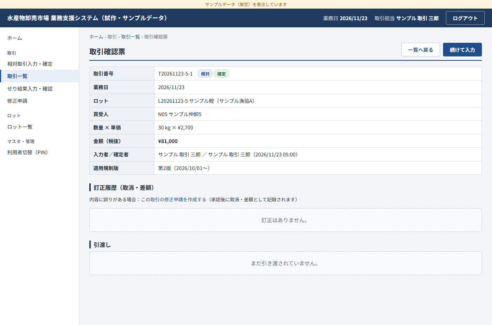
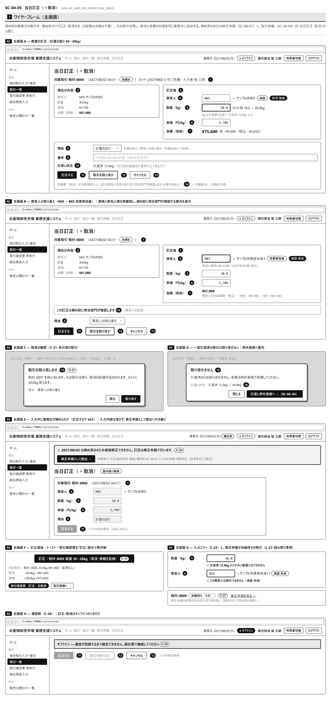

# SC-04-05 当日訂正（＋取消）— ワイヤーフレーム（新規画面、ワイヤーフレーム段階）

| 項目 | 内容 |
|---|---|
| 画面の役割 | **入力**：**未締めの業務日**の取引を訂正 / 取消（理由を付ける；2 段階の決裁は不要）。取消の専用ボタンを含む（SC-04-06 を統合 — PRM-127） |
| 記録の役割 | TRADE（P17）。閲覧：SETTLE, STL-HEAD, OPS-HEAD（SC-07-01 の 要確認 タブで照合） |
| 端末 | PC |
| 上書きしない | 元の取引はそのまま；訂正 / 取消 は同じ業務日に REVERSE + DELTA のレコードを作成し、在庫台帳に戻し / 差し引きの行を記録（ルール4, ADR-004） |

## 1. プロトタイプ（as-is）



プロトタイプには**この画面はない**（M17）：すべての修正は 修正申請 で 1〜2 段階の決裁を経る、当日の取引も含む。画像は 取引確認票（SC-04-04）— to-be でボタンを SC-04-05 へ置く場所。

## 2. to-be ワイヤーフレーム

> **標準の図（LAB-4）：** 図のソースは [`html/SC-04-05.html`](../../wireframes/html/SC-04-05.html) — 1 つの HTML で全バリアントを扱い、`scripts/render-wireframes.py` で [`png/SC-04-05.png`](../../wireframes/png/SC-04-05.png) と [`pdf/wireframes-all.pdf`](../../wireframes/pdf/wireframes-all.pdf) に出力；BM-51 の画像はバリアント A を使用。下の ASCII ブロックは配置の説明用に残し、食い違う場合は HTML + SPEC が正。




```
[1] 対象取引 相対-0005（2027/08/02 04:31・未締め）  ロット L…-5 鰹  入力者 桜 三郎
┌─ [2] 現在の内容 ───────────┐   ┌─ [3] 訂正後 ─────────────────────────────┐
│ 買受人  N05 サンプル仲卸5    │   │ [4] 買受人  [ N05 ]  → 許可 有効            │
│ 数量    30kg                │   │ [5] 数量    [ 28 ] kg   ロット残 18 → 20kg   │
│ 単価    ¥2,700              │   │ [6] 単価    [ 2,700 ]                     │
│ 金額    ¥81,000             │   │ [7] 金額    ¥75,600（差 −¥5,400、税込 −¥5,832）│
└────────────────────────────┘   └────────────────────────────────────────┘
[14] （閾値以上または買受人変更のとき）この訂正は締め前に照合部門が確認します
[8] 理由 [ 計量の誤り ▼ ] [9] 備考 [            ]（必須: その他のとき）
[10] 引渡し状況: 引渡済 12kg（訂正後の数量は引渡済以上であること）
[11] [ 訂正する ]   [12] [ 取引を取り消す ]（別ボタン・赤枠）  [13] キャンセル
 取消の確認（C-31）: 「相対-0005 を取り消します。元の取引は残り、取消の記録が追加されます。ロットに30kg戻ります」
 完了: C-12 「訂正：相対-0005 数量 30→28kg（取消・差額を記録）」、取引確認票を再印刷（「訂正」表示）
```

## 3. 項目

| No | Item | 種別 | 必須 | ルール | 出典 |
|---|---|---|---|---|---|
| 1 | 対象の取引 | ラベル | — | 取引の業務日が**未締め**のときのみ入れる | FR-AITAI-03 |
| 2 | 現在の内容 | ラベル | — | 有効な値（前回の訂正を反映済み） | ADR-004 |
| 3 | 訂正後ブロック | 領域 | — | | — |
| 4 | 買受人 | コード | ✓ | SC-04-01 と同様に 許可 / 承認 + 参加上限 を再確認。買受人を変更 → 常に [14] を表示 | BR-PERM-01 |
| 5 | 数量 | 数値 | ✓ | > 0；≤ 元の SL + ロットの残；≥ 引渡済の数量。ロットの単位ごと：kg は **小数 1 桁**、箱 / 尾 は **整数** — 入力欄で即座に制限（顧客 #11、m-11） | BR-LOT-02, FR-DEL-01, PRM-053 |
| 6 | 単価 | 数値 | ✓ | > 0 | — |
| 7 | 金額 + 差額 | ラベル | — | 買受人ごとの税込の差額も表示（閾値との比較に使用） | — |
| 8 | 理由 | 選択 | ✓ | 一覧：計量の誤り / 買受人の取り違え / 単価の誤り / その他 | FT-04-05 |
| 9 | 備考 | テキスト | その他のとき | 200 文字以内 | — |
| 10 | 引渡しの状況 | ラベル | — | | FR-DEL-05 |
| 11 | 訂正する | ボタン | — | オンライン必須；2 段階の決裁はしない；SC-07-01 の 要確認 タブに表示。差額が 2 段階の閾値以上または買受人変更 → 照合事務局が 確認済 を押すまで SC-07-02 のチェックリストで ✖ の行 | PRM-127, Q-SC0405-01 |
| 12 | 取り消す | ボタン | — | 専用ボタン、赤枠；**一部でも引渡し済みならブロック** → SC-06-04 へ誘導 | FT-04-06, PRM-127 |
| 13 | キャンセル | ボタン | — | | — |
| 14 | 照合が確認する旨の文 | ラベル | — | 金額変動が買受人ごとに最大（税込）で規則の 2 段階閾値以上（E-08、新しいパラメータは作らない）**または**買受人変更のとき表示：「この訂正は締め前に照合部門が確認します」— 顧客 Q-SC0405-01 の 2 番目の点 | E-08, PRM-127 |

## 4. 状態

| 状態 | 表示 |
|---|---|
| 業務日がロック済み（SC-04-04 から開いた場合） | 開けない；C-24 → SC-08-01（修正申請） |
| **入力中に業務日がロックされた**（[11] / [12] を押して 423 `DAY_LOCKED` を受けた） | **入力内容は消えない。** C-24 を表示、ボタン「修正申請として提出 →」：SC-08-01 を対象の取引、訂正後 ([4]–[6])、理由 [8] + [9] を初期入力で開く；確定者は必要なら証憑を追加して提出するだけ。この場面は締めの時刻に実際に起こる（顧客 #5、Q-WF-03 の 2 番目の点） |
| 取引に決裁待ちの修正申請がある | C-27、フォームは閲覧のみ |
| 一部引渡し済みで 取消 を押した | エラーボックス「引渡済のため取り消せません。差異は例外登録で処理してください →」SC-06-04 |
| 新しい買受人の資格が不足 | [4] の下に C-22 |
| 通信断 | C-28 |

## 5. 役割による違い

TRADE：画面全体。SETTLE / STL-HEAD / OPS-HEAD：SC-04-04 と 要確認 タブ SC-07-01 で履歴を閲覧、ボタンはなし。その他の役割：C-25。

## 6. プロトタイプとの to-be の違い

画面全体が新規（M17, D11）。プロトタイプはすべての修正に 修正申請 を使う → to-be では分離：**未締め = SC-04-05（2 段階の決裁なし）、締め済み = SC-08-01 → SC-08-03**。SC-04-04 は業務日の状態に応じてボタンを 1 つだけ表示する。

## 7. 質問

- Q-SC0405-01：当日訂正に、金額が大きく変わるとき 2 人目の確認は必要か？**回答済み【顧客（模擬）、2026-11-25】：** 修正時に 2 人目は不要（PRM-127）。当日訂正 / 取消 で金額変動が 2 段階の閾値以上（E-08 の閾値と同じ）または買受人変更 → 日次締め（SC-07-02 [9]）にボタン ✖ の行、照合事務局が「確認済」を押すまで；閾値未満は ⚠ のまま。画面は [14] を表示；SC-04-04 と 要確認 では元の確定者と修正者の両方の名前を表示。

## 変更履歴

| No | Version | Action | 変更内容 | 更新日 | 更新者 | Approve |
|---|---|---|---|---|---|---|
| 1 | 0.1.0 | Add new | 初版 | 2026-11-25 | phuongnnm-23344 | |
| 2 | 0.2.0 | Update | Gate 1 / 顧客：数量は単位ごとに小数桁（m-11, #11）；[14] 照合が確認する旨の文 — 閾値以上 / 買受人変更時（Q-SC0405-01 回答済み）；423 の途中で内容を保持し SC-08-01 に引き継ぐ（#5）。プロトタイプ画像は据え置き | 2026-11-25 | phuongnnm-23344 | |
| 3 | 0.2.1 | Update | LAB-4 wireframe HTML：図のソース `html/SC-04-05.html`、`png/SC-04-05.png` を埋め込み | 2026-11-25 | phuongnnm-23344 | |
