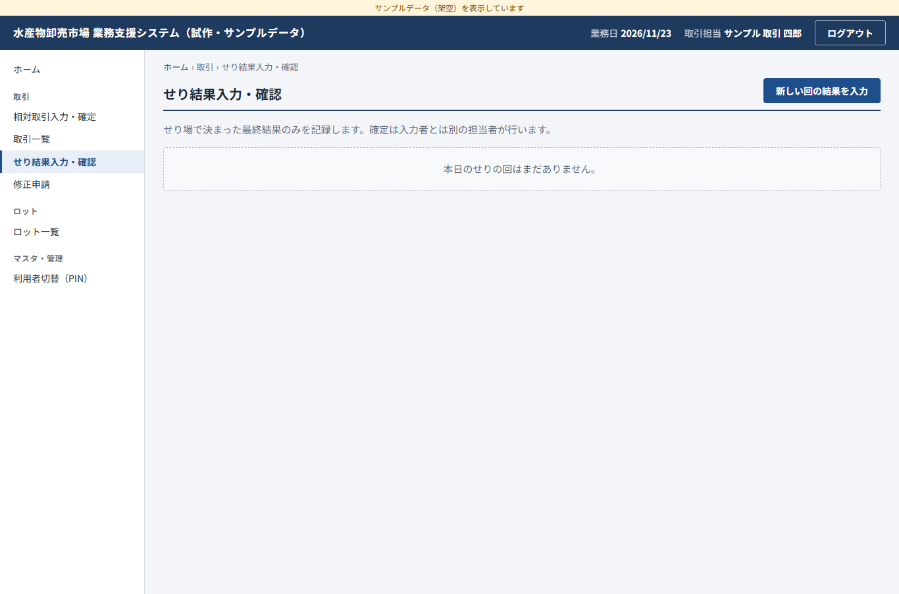
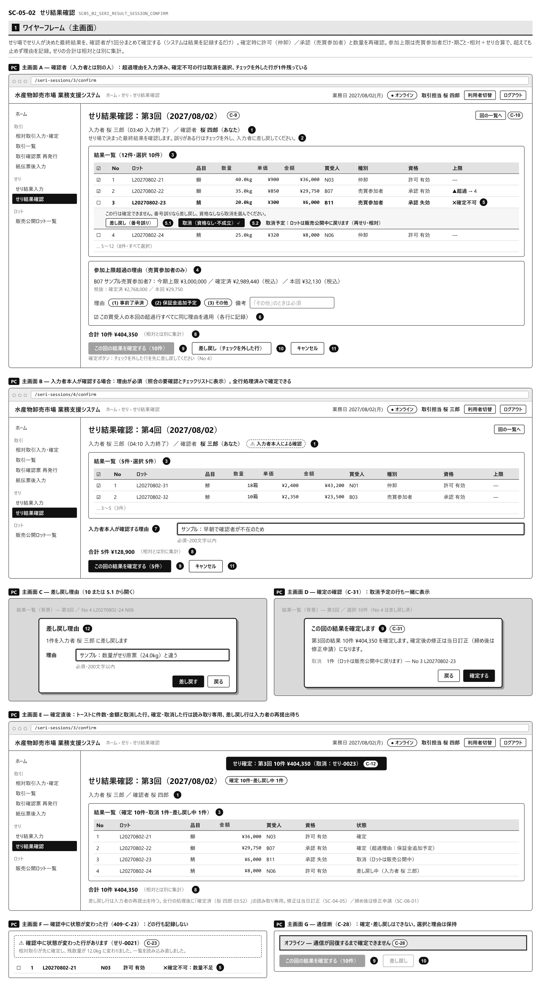

# SC-05-02 せり結果確認 — ワイヤーフレーム

| 項目 | 内容 |
|---|---|
| 画面の役割 | **決定**：確認者がせりのセッション全体を一度に確認する。せりの結果はせり人が場で決める；システムは**結果を記録するだけ**で、ライブのせり画面はない（FR-SERI-01, 原則1） |
| 記録の役割 | TRADE（確認者 ◎、入力者と別人 — S2）。閲覧：SETTLE, STL-HEAD, OPS-HEAD（P20） |
| 端末 | PC |

## 1. プロトタイプ（as-is）



確認画面は撮影できなかった：デモの業務日にはまだせりのセッションがなく、セッションを作成すると**データを書き込む**ため（閲覧のみの範囲外）。as-is はコード `src/app/(app)/seri/[id]/confirm/page.tsx` に基づいて記述：結果の表；上限超過の理由欄が**すべての行**にある（自由入力）；入力者と同一人物のときの欄「入力者本人が確定する理由」；ボタン「この回の結果を確定する」+ 確認ダイアログ。上の画像はセッション一覧の空の状態（C-21）。

## 2. to-be ワイヤーフレーム

> **標準の図（LAB-4）：** 図のソースは [`html/SC-05-02.html`](../../wireframes/html/SC-05-02.html) — 1 つの HTML で全バリアントを扱い、`scripts/render-wireframes.py` で [`png/SC-05-02.png`](../../wireframes/png/SC-05-02.png) と [`pdf/wireframes-all.pdf`](../../wireframes/pdf/wireframes-all.pdf) に出力；BM-51 の画像はバリアント A を使用。下の ASCII ブロックは配置の説明用に残し、食い違う場合は HTML + SPEC が正。




```
[C-9] せり結果確認：第3回（2027/08/02）                       [C-10] 回の一覧へ
[1] 入力者 桜 三郎（03:40 入力終了） ／ 確認者 桜 四郎（あなた）
[2] せり場で決まった最終結果を確認します。誤りがある行はチェックを外し、入力者に差し戻してください。
┌─ [3] 結果一覧（12件・選択 10件）─────────────────────────────────────────────────┐
│ ☑ No ロット   品目 数量  単価    金額     買受人  種別      資格             上限      │
│ ☑ 1  L…-21  鰤  40kg ¥900  ¥36,000  N03  仲卸      許可 有効          —         │
│ ☑ 2  L…-22  鰤  35kg ¥850  ¥29,750  B07  売買参加者 承認 有効          ▲超過 [4]  │
│ ☐ 3  L…-23  鯖  20kg ¥300  ¥6,000   B11  売買参加者 承認 失効 ✖確定不可 [5]       │
│      └ 確定できません [差し戻し（番号誤り）] [取消（資格なし・不成立）]              │
│ ☐ 4  L…-24  鯖  25kg ¥320  ¥8,000   N06  仲卸      許可 有効          —（差し戻し）│
│ ☑ 5〜12 …（8件・すべて選択）                                                   │
└────────────────────────────────────────────────────────────────────────────┘
┌─ [4] 参加上限超過の理由（売買参加者のみ）───────────────────────────────────────┐
│ B07 サンプル売買参加者7: 今期上限 ¥3,000,000 / 確定済 ¥2,989,440（税込） / 本回 ¥32,130（税込）│
│ 理由 (1)事前了承済 (2)保証金追加予定 (3)その他 [備考        ]                         │
│ [6] ☐ この買受人の本回の超過行すべてに同じ理由を適用（各行に記録）                       │
└────────────────────────────────────────────────────────────────────────────┘
[7] 入力者本人が確認する理由 [            ]  ← 入力者=確認者 のときだけ表示・必須、要確認に表示
[8] 合計 10件 ¥404,350（相対とは別に集計）
[9] [ この回の結果を確定する（10件） ]  [10] 差し戻し（チェックを外した行）  [11] キャンセル

── [10] を押したときのダイアログ
┌─ [12] 差し戻し理由 ───────────────────────────────────────────────┐
│ 1件を入力者 桜 三郎 に差し戻します                                     │
│ 理由（必須・200文字以内） [                                        ]   │
│                                          [ 差し戻す ]  [ 戻る ]      │
└──────────────────────────────────────────────────────────────┘
```

## 3. 項目

| No | Item | 種別 | 必須 | ルール | 出典 |
|---|---|---|---|---|---|
| 1 | 入力者 / 確認者 | ラベル | — | 2 人の名前を表示；同一人物 → 黄色のラベル | S2, PRM-115 |
| 2 | 案内 | ラベル | — | | FR-SERI-02 |
| 3 | 結果の表 | 選択表 | — | レイアウト FORM-SERI-01；資格の列は **許可（仲卸）/ 承認（売買参加者）** を正確に記載；資格 + SL を**確認時点で**再確認 | BR-PERM-01, FT-01-05 |
| 4 | 参加上限超過の理由ブロック | 領域 | 超過行があるとき | **売買参加者のみ**（仲卸には上限なし）；上限は期ごと、相対 + せりで共通；理由を素早く選択 + 備考；強制的には止めない | L4-A04 (1), ACT-03, M20 |
| 5 | 確定できない行 | 赤いラベル + 2 ボタン | — | 資格が 失効 / 一時停止 / SL 不足 → 自動で選択を外す、行の横に理由；**確認者が選ぶ**「差し戻し（番号誤り）」（入力者が当たりの番号を直す）または「取消（資格なし・不成立）」（SL は減らさない、ロットは残る / 販売公開中へ戻る — 顧客 #9）；自動で取り消さない、買受人を変えるボタンはなし（Q-TRD-05、原則3） | BR-PERM-01, BR-LOT-02, FR-SERI-02 |
| 5.1 | 差し戻し（番号誤り） | ボタン（行 [5] 内） | — | 詳細は SPEC §4.1（W-m01） | — | `SC-05-02_SPEC.md` |
| 5.2 | 取消（資格なし・不成立） | ボタン（行 [5] 内） | — | 詳細は SPEC §4.1（W-m01） | — | `SC-05-02_SPEC.md` |
| 6 | 同じ理由を適用 | チェックボックス | — | 1 つのセッション内の 1 人の買受人；保存は行ごと（あると良い） | L4-A04 (1) |
| 7 | 自己確認の理由 | テキスト | 入力者 = 確認者のとき | 要確認 タブ（SC-07-01）と SC-07-02 のチェックリストに表示 | S2, PRM-115 |
| 8 | 合計 | ラベル | — | | — |
| 9 | 確定する | ボタン | — | C-31 → 確認者 + 時刻を記録、SL 台帳から差し引く；**MFA なし**（PREMISE §3.2 の一覧にない）；**オンライン必須** | CAP-HUMAN-01, L4-A05 |
| 10 | 差し戻し | ボタン | — | 選択を外した行は入力者に戻り、SC-05-01 で修正 | FR-SERI-02 |
| 11 | キャンセル | ボタン | — | | — |
| 12 | 差し戻し理由（ダイアログ） | テキスト + ボタン | ✓（200 文字以内） | [10] から開く：「{n}件を入力者 {tên} に差し戻します」+ 理由欄 + [差し戻す] [戻る]。空のとき → `E-TRD-017`「差し戻しの理由を入力してください」。理由は取引の状態履歴（`trade_status_history.reason`）に記録、入力者にアプリ内通知。P3 で追加（次の番号、挿入なし） | FR-SERI-02, ルール4 |

## 4. 状態

| 状態 | 表示 |
|---|---|
| セッションは確認済み | 閲覧のみ + 「確定済（桜 四郎 03:52）」；その後の修正 → SC-04-05（未締め）/ SC-08-01（締め済み） |
| 行がない | C-21 + SC-05-01 へのリンク |
| 上限超過の理由がない | [9] を薄く、理由のない行に赤い枠（C-22） |
| 相対が先に確定して SL が変わった | C-23、行を [5] へ移動 |
| 業務日がロック済み | C-24 |
| 通信断 | C-28：確認できない |

## 5. 役割による違い

| 役割 | 表示内容 |
|---|---|
| TRADE ≠ 入力者 | 画面全体 |
| TRADE = 入力者 | 画面全体 + [7] 必須 |
| SETTLE / STL-HEAD / OPS-HEAD | 閲覧のみ（[4], [6], [7], [9], [10], [12] なし） |

## 6. プロトタイプとの to-be の違い

| # | Prototype | To-be | 出典 |
|---|---|---|---|
| 1 | 理由欄がすべての行にあり（仲卸も含む）、自由入力 | 売買参加者の上限超過行のみ；素早く選択 + 同じ理由を適用 | M20, L4-A04 (1) |
| 2 | 上限は業務日ごと | 期ごと、相対 + せりで共通 | M19, D08 |
| 3 | 全行を確認 | 誤った行の選択を外す + 差し戻し | FT-05-02 |
| 4 | 資格の列なし | 有、許可 / 承認 を正しく記載 | ルール2 |

## 変更履歴

| No | Version | Action | 変更内容 | 更新日 | 更新者 | Approve |
|---|---|---|---|---|---|---|
| 1 | 0.1.0 | Add new | 初版 | 2026-11-25 | phuongnnm-23344 | |
| 2 | 0.2.0 | Update | 顧客 #9：せりの「確定不可」行に案内文、ロットは販売公開中へ戻る | 2026-11-25 | phuongnnm-23344 | |
| 3 | 0.2.1 | Update | P3 まとめ：[12] 差し戻し理由ダイアログ（必須、E-TRD-017）を追加 — SC-05-02_SPEC と一致 | 2026-11-25 | phuongnnm-23344 | |
| 4 | 0.2.2 | Update | 顧客 Q-TRD-05：2 ボタン 差し戻し（番号誤り）/ 取消（資格なし・不成立）；Q-TRD-02 | 2026-11-25 | phuongnnm-23344 |  |
| 5 | 0.2.3 | Update | LAB-4 wireframe HTML：図のソース `html/SC-05-02.html`、`png/SC-05-02.png`；列 上限 「▲超過」（SPEC に合わせる）、例 選択 10件 ¥404,350 | 2026-11-25 | phuongnnm-23344 | |
| 6 | 0.2.4 | Update | W-m01：項目表に子 ID 5.1 差し戻し / 5.2 取消 を追加（HTML のバッジ / SPEC §4.1 に合わせる） | 2026-11-25 | phuongnnm-23344 |  |
