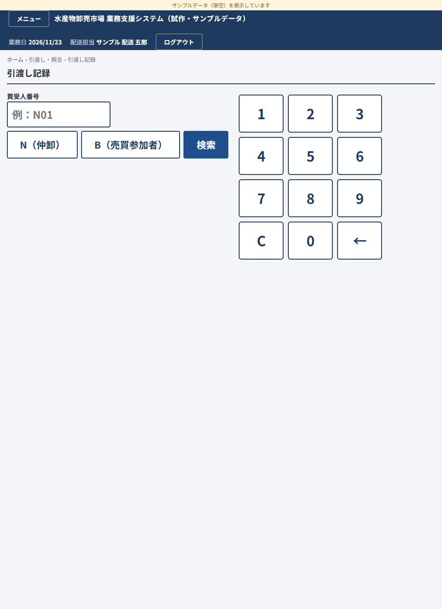
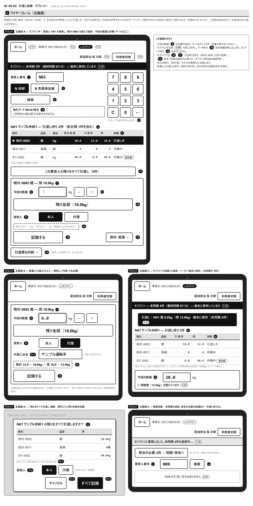

# SC-06-02 引渡し記録（タブレット）— ワイヤーフレーム

| 項目 | 内容 |
|---|---|
| 画面の役割 | **入力**：埠頭で引渡しを 1 回ずつ記録（06:30〜10:00）。手袋を着用し、屋外の日差しの中で使用 |
| 記録の役割 | DELIVERY, DEL-HEAD。閲覧：SETTLE, STL-HEAD, OPS-HEAD（P21） |
| 端末 | 縦向きタブレット；ボタン 64px 以上；**オフラインでの利用可**（ローカル保存 + キュー — ADR-008） |

## 1. プロトタイプ（as-is）



`/deliveries`、delivery@、枠 1024 × 1366。機能：買受人番号の入力欄、N / B ボタン、テンキー、検索；検索後：引渡し待ちの取引一覧、「残り全部」（撮影なし。買受人を選ぶ必要があり、一覧は当日のデータに依存する）。

## 2. to-be ワイヤーフレーム

> **標準の図（LAB-4）：** 図のソースは [`html/SC-06-02.html`](../../wireframes/html/SC-06-02.html) — 1 つの HTML で全バリアントを扱い、`scripts/render-wireframes.py` で [`png/SC-06-02.png`](../../wireframes/png/SC-06-02.png) と [`pdf/wireframes-all.pdf`](../../wireframes/pdf/wireframes-all.pdf) に出力；BM-51 の画像はバリアント A を使用。下の ASCII ブロックは配置の説明用に残し、食い違う場合は HTML + SPEC が正。




```
[C-13]ホーム  業務日 2027/08/02  ●オフライン  配送担当 桜 次郎  [C-5]利用者切替
[C-28] ███ オフライン — 未同期 3件（最終同期 07:12）— 端末に保存しています ███
┌─ [1] 買受人番号 ────────────┐  ┌─ [2] テンキー ──────┐
│ [ N 01 ]  例：N01            │  │  7   8   9          │
│ [3] (N 仲卸) (B 売買参加者) ←選択中は塗りつぶし │  4   5   6          │
│ [4] [   検索   ]             │  │  1   2   3          │
│ [16] 取引データ 06:58 時点      │  │                     │
│   この時刻以降の取引は表示されません│  │                     │
└────────────────────────────┘  │  C   0   ←          │
                                 └─────────────────────┘
[5] N01 サンプル仲卸1 — 引渡し待ち 3件（前日残 1件を含む）
┌─ [6] ─────────────────────────────────────────────────────────┐
│ 取引       品目  単位 確定数量 引渡済  残     状態                  │
│ ▶相対-0005 鰹   kg   30     12    18    引渡し中                │
│  相対-0011 真鯛 箱    4      0     4    待機中                  │
│  せり-0302 鰤   kg   40      0    40    待機中  [前日残]          │
│ （行のどこを触っても選択）                                          │
└──────────────────────────────────────────────────────────────┘
[17] [ この買受人の残りをすべて引渡し（3件） ]
┌─ [7] 相対-0005 鰹 ── 残 18kg ─────────────────────────────────────┐
│ [8] 今回の数量 [ _ ] kg（空欄・カーソルはここ） [9]  (−)  (+)        │
│ [10] [   残り全部（18kg）   ]   ← 最大のボタン                     │
│ [11] 受取人 [ 本人 ] [ 代理 ] ← 大きな2ボタン。代理のときだけ氏名欄      │
│ [12] [  記録する  ]           [13] [ 例外・差異 → SC-06-04 ]        │
│ [14] 累計 12 → 18kg ／ 残 18 → 12kg（記録前プレビュー）                │
└───────────────────────────────────────────────────────────────┘
 記録後: C-12 「引渡し：N01 鰹 6kg（残 12kg）」 オフライン時は「端末に保存（未同期 4件）」
 残 0 → 自動で 完了（FT-06-03）
[15] [ 引渡票を印刷 → SC-06-06 ]
```

## 3. 項目

| No | Item | 種別 | 必須 | ルール | 出典 |
|---|---|---|---|---|---|
| 1 | 買受人番号 | 大きい数字欄 | ✓ | 「例：N01」のヒント | FB LAB-2 #13 |
| 2 | テンキー | ボタン | — | キー ≥ 64px、枠を太く、コントラスト高め | PRM-086 |
| 3 | 接頭辞 N / B | 選択ボタン | — | 選択時に色が変わる | FB LAB-2 #13 |
| 4 | 検索 | ボタン | — | オフライン時：端末に取り込んだデータの中で検索（当日の初めと同期のたびに取り込み） | ADR-008 |
| 5 | 買受人の概要 | ラベル | — | 前日からの引渡し残を含む | FR-DEL-05 |
| 6 | 引渡し待ちの取引一覧 | 選択表 | — | 相対 と せり；状態 待機中 / 引渡し中 / 完了 / 例外。行のどこをタップしても選択 | FT-06-01, PRM-086 |
| 7 | 引渡しの記録ブロック | 領域 | — | | — |
| 8 | 今回の数量 | 数値 | ✓（[10] を除く） | **空欄、カーソルはここ**：取引を選んでも埋めない（初期値があると、急いで 記録 を押したときに誤記録になる — 顧客 #8）。> 0、≤ 残；kg は小数 1 桁、箱 / 尾 は整数。kg 建ての取引は箱単位で引き渡すことがある — 「精算と一致」のルールは規則のパラメータ | PRM-118, E-17, BR-LOT-02 |
| 9 | −/+ | ボタン | — | 箱 / 尾 の刻み 1 | — |
| 10 | 残り全部 | 大きいボタン | — | 残りをちょうど記録 | FR-DEL-02 |
| 11 | 受取人 | 大きいボタン 2 つ + テキスト | ✓ | 「本人」/「代理」（ドロップダウン ▼ は使わない — 手袋では押しにくい）、**初期値は本人**；代理を選んだときだけ名前欄（任意） — 顧客 #13、Q-DEL-03 【顧客（模擬）、2026-11-25】 | FR-DEL-01, PRM-086 |
| 11.1 | 代理人氏名 | テキストボックス | — | 詳細は SPEC §4.1（W-m01） | — | `SC-06-02_SPEC.md` |
| 12 | 記録する | ボタン | — | 追記のみ；オフラインはローカル保存、端末コード + 時刻を付与 | ルール4, ADR-008 |
| 13 | 例外・差異 | ボタン | — | → SC-06-04（不足 / 過剰 / 返品 / 争い） | FT-06-04 |
| 14 | プレビュー | ラベル | — | | — |
| 15 | 引渡票の印刷 | ボタン | — | 買受人が必要なとき → SC-06-06 | FT-06-08 |
| 16 | オフラインのデータの時点 | ラベル | — | **オフライン時のみ表示**：「取引データ hh:mm 時点」（取り込み / 最後の同期の時刻）+ 検索欄の横の「この時刻以降の取引は表示されません」。引渡し担当が「買受人に荷がない」と誤って判断しないため — 顧客 #2 | NFR-AVL-02, FR-DEL-01, KPI-05 |
| 17 | まとめて全部引き渡す | ボタン | — | 買受人に残りの取引が 2 件以上あるとき表示。押す → 確認ダイアログで取引ごと（取引 / 品目 / 残）を一覧 →「すべて記録」；各取引は従来どおり「残り全部」の行を 1 件ずつ；受取人は全体で 1 回選ぶ。オフラインでも使用可 — 顧客 #12 | FR-DEL-02, PERSONA-DOCK-01 |
| 17.1 | 引き渡す取引の一覧 | ラベル | — | 詳細は SPEC §4.1（W-m01） | — | `SC-06-02_SPEC.md` |
| 17.2 | 受取人 本人 / 代理（+ 氏名） | ボタン | ✓ | 詳細は SPEC §4.1（W-m01） | — | `SC-06-02_SPEC.md` |
| 17.3 | すべて記録 | ボタン | — | 詳細は SPEC §4.1（W-m01） | — | `SC-06-02_SPEC.md` |
| 17.4 | キャンセル | ボタン | — | 詳細は SPEC §4.1（W-m01） | — | `SC-06-02_SPEC.md` |

## 4. 状態

| 状態 | 表示 |
|---|---|
| 引渡し待ちの取引がない | C-21「N01 の引渡し待ちはありません」 |
| 通信断 | C-28（常に表示、未同期の数）；[16] にデータの時点；記録は可能；[13] は SC-06-04 のオフライン版を開く（紙の経路は WF SC-06-05 を参照） |
| 通信復帰後、同期で SL が負 / 重複 | 自動で統合しない → 「照合が必要 2件」ラベル → SC-03-07 |
| 業務日がロック済み（前日の取引） | 前日の取引の引き渡しは**現在の業務日に記録する**（引渡し残は通常のこと）；金額が変わる場合のみ修正申請 |
| 残を超えるエラー | [8] の下に C-22 |

## 5. 役割による違い

DELIVERY、DEL-HEAD：画面全体。SETTLE / STL-HEAD / OPS-HEAD：引渡しの状態を SC-06-01 / SC-04-04（PC）で閲覧。その他の役割：C-25。

## 6. プロトタイプとの to-be の違い

| # | Prototype | To-be | 出典 |
|---|---|---|---|
| 1 | オンラインのみ | ローカル保存 + キュー + C-28 | M04, ADR-008 |
| 2 | 例外ボタンなし | [13] → SC-06-04 | M16 |
| 3 | 引渡票の印刷なし | [15] | FT-06-08 |
| 4 | キーと枠が薄い（版 1.1）— 版 1.2 で大きくした | 版 1.2 を維持、≥ 64px と高コントラストの基準を追加 | FB LAB-2 #13 |
| 5 | [14] プレビューなし | 有 | — |
| 6 | 数量欄が初期値入り（プロトタイプ画像は「6」） | 空欄、カーソルを欄に | 顧客 #8 |
| 7 | 古いオフラインのデータを表示しない | [16] | 顧客 #2 |
| 8 | 取引ごとに引き渡し | [17] まとめて引き渡し を追加 | 顧客 #12 |

## 変更履歴

| No | Version | Action | 変更内容 | 更新日 | 更新者 | Approve |
|---|---|---|---|---|---|---|
| 1 | 0.1.0 | Add new | 初版 | 2026-11-25 | phuongnnm-23344 | |
| 2 | 0.2.0 | Update | Gate 1 / 顧客：[8] は初期値なし（#8）；[16] オフラインのデータの時点（#2）；[17] まとめて引き渡し（#12）；[11] 2 ボタン 本人 / 代理（#13）；行全体で選択；数字は単位ごと（m-11）；ヘッダーに 「ホーム」 の文字（#32）。プロトタイプ画像は据え置き（「6」が入った画像は as-is） | 2026-11-25 | phuongnnm-23344 | |
| 3 | 0.2.1 | Update | 顧客 Q-DEL-03：項目 11 の初期値は 本人 | 2026-11-25 | phuongnnm-23344 |  |
| 4 | 0.2.2 | Update | LAB-4 wireframe HTML：図のソース `html/SC-06-02.html`、`png/SC-06-02.png` を埋め込み | 2026-11-25 | phuongnnm-23344 | |
| 5 | 0.2.3 | Update | W-m01：項目表に子 ID 11.1、17.1–17.4 を追加；W-m02：HTML のバリアント C — 相対-0011 は 引渡済 0 / 残 4 / 待機中 のまま（一度の記録で変わるのは 相対-0005 のみ） | 2026-11-25 | phuongnnm-23344 |  |
