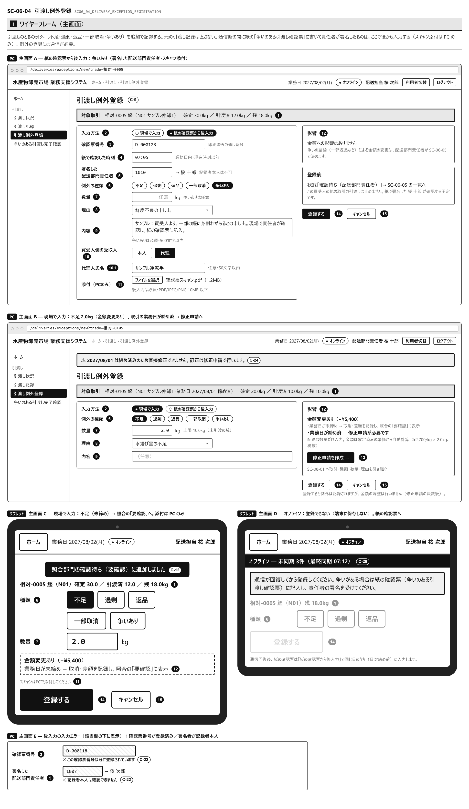

# SC-06-04 引渡し例外登録 — ワイヤーフレーム（新規画面、ワイヤーフレーム段階）

| 項目 | 内容 |
|---|---|
| 画面の役割 | **入力**：引渡し時の例外を記録：不足 / 過剰 / 返品 / 一部取消 / **争い**。通信断のときは **争いのある引渡し確認票（紙）の後入力** の場所でもある（ADR-008 §2.4） |
| 記録の役割 | DELIVERY, DEL-HEAD（P21）。閲覧：SETTLE, STL-HEAD, OPS-HEAD |
| 端末 | PC/TAB。タブレット：通信があるときに素早く記録（例外は**オフラインでは記録しない** — ADR-008 §2.1）；スキャンの添付は PC のみ（E-21） |

## 1. プロトタイプ（as-is）

なし（M16）。プロトタイプには SC-06-02 のみ；画像なし。

## 2. to-be ワイヤーフレーム

> **標準の図（LAB-4）：** 図のソースは [`html/SC-06-04.html`](../../wireframes/html/SC-06-04.html) — 1 つの HTML で全バリアントを扱い、`scripts/render-wireframes.py` で [`png/SC-06-04.png`](../../wireframes/png/SC-06-04.png) と [`pdf/wireframes-all.pdf`](../../wireframes/pdf/wireframes-all.pdf) に出力；BM-51 の画像はバリアント A を使用。下の ASCII ブロックは配置の説明用に残し、食い違う場合は HTML + SPEC が正。




```
[1] 対象取引 相対-0005 鰹（N01 サンプル仲卸1） 確定 30kg ／ 引渡済 12kg ／ 残 18kg
[2] 入力方法 (●) 現場で入力   ( ) 紙の確認票から後入力
     └ 後入力のとき: [3] 確認票番号 [ D-000123 ]  [4] 紙で確認した時刻 [ 07:05 ]
                     [5] 署名した配送部門責任者 [ 社員番号 ____ ] → 桜 十郎
[6] 例外の種類  (不足) (過剰) (返品) (一部取消) (争いあり)
[7] 数量 [ 2 ] kg     [8] 理由 [ 鮮度不良の申し出 ▼ ]   [9] 内容 [                   ]
[10] 買受人側の受取人 [ 本人 ] [ 代理 ]（代理のときだけ氏名）
[11] 添付（PCのみ） [ ファイルを選択 ]  確認票スキャン.pdf（必須: 後入力のとき）
[12] 影響: 金額変更あり（−¥5,400）
     ・業務日が未締め → 取消・差額を記録し、照合の「要確認」に表示（締め前に照合部門が確認します）
     ・業務日が締め済 → 修正申請が必要です → [13]
[14] [ 登録する ]  [15] キャンセル
 登録後: 「争いあり」→ 状態「確認待ち（配送部門責任者）」→ SC-06-05 の一覧へ。他の取引の引渡しは止めない
```

## 3. 項目

| No | Item | 種別 | 必須 | ルール | 出典 |
|---|---|---|---|---|---|
| 1 | 取引 + SL | ラベル | — | | FR-DEL-01 |
| 2 | 入力方法 | 選択 | ✓ | 初期値は 現場；通信断の後は 後入力 | ADR-008 §2.4 |
| 3 | 紙の伝票番号 | テキスト | 後入力のとき | 印刷済みの通し番号（FORM のセット）；一意；発行済みで未入力の伝票は SC-07-02 [11] のチェックリストに表示 | ADR-008 §2.4 |
| 4 | 紙で確認した時刻 | 時刻 | 後入力のとき | 現在時刻以下、業務日の中 | ADR-008 §2.4 |
| 5 | 署名した配送部門責任者 | 社員番号 | 後入力 + 争いのとき | 引渡しの記録者と異なること（PRM-111）；この人が SC-06-05 で確認する | S1, ADR-008 §2.4 |
| 6 | 例外の種類 | 選択ボタン | ✓ | | FT-06-04 |
| 7 | SL | 数値 | ✓（争いあり を除く） | | — |
| 8 | 理由 | 選択 | ✓ | | — |
| 9 | 内容 | テキスト | 争いありのとき | 500 文字以内 | FR-DEL-04 |
| 10 | 買受人側の受取人 | 2 ボタン + テキスト | — | 「本人」/「代理」、代理を選んだときだけ名前欄（顧客 #13） | PRM-086 |
| 10.1 | 代理人氏名 | テキストボックス | 無（代理のときは任意 — Q-DEL-03、SC-06-02 の 11.1 と同様） | 詳細は SPEC §4.1（W-m01） | — | `SC-06-04_SPEC.md` |
| 11 | 添付 | ファイル | 後入力のとき | PC のみ；容量制限あり。証憑の種類「紛争・引渡しの証憑」 → オンラインで 3 年、その後コールドストレージ（TBL-ATTACH-01）；期限後の物理削除は決裁が必要（B.7） | TBL-ATTACH-01, B.7, E-21, M11 |
| 12 | 金額への影響 | ラベル | — | 金額が変わる（不足 / 返品 / 一部取消）+ **未締めの日** → REVERSE / DELTA のレコードを引渡しの流れで作成 **さらに** SC-07-01 の 要確認 タブに表示、SC-07-02 のチェックリスト [20] に ✖ の行（照合事務局が 「確認済」 を押すまで）（顧客 #4）。金額が変わる + **締め済みの日** → 修正申請が必要 | BR-CLOSE-01, ADR-004, FR-SETTLE-01, OBJ-05 |
| 13 | 修正申請へのリンク | ボタン | — | → SC-08-01、取引コードを引き継ぐ | — |
| 14 | 登録する | ボタン | — | 追記のみ；通信が必要 — オフラインはボタンをロック（キューに入れない） | ADR-008 §2.1 |
| 15 | キャンセル | ボタン | — | | — |

## 4. 状態

| 状態 | 表示 |
|---|---|
| 通信断（タブレット） | C-28 + 「通信が回復してから登録してください。争いがある場合は紙の確認票（争いのある引渡し確認票）に記入し、責任者の署名を受けてください」；フォームはロック、ローカル保存しない。通信が戻ったら ADR-008 §2.4 の経路で紙の伝票を後入力（Q-DEL-01） |
| 伝票番号が使用済み | [3] の下に C-22 |
| [5] が記録者と同一 | C-22：「記録者本人は確認できません」 |
| 未締めの日 + 金額変更 | [12] の 1 行目；登録後に C-12「照合部門の確認待ち（要確認）に追加しました」 |
| 締め済みの日 + 金額変更 | [12] の 2 行目 + [13]（C-24） |

## 5. 役割による違い

DELIVERY、DEL-HEAD：画面全体。SETTLE / STL-HEAD / OPS-HEAD：SC-07-03 / SC-07-04 / RPT-04 で閲覧。

## 変更履歴

| No | Version | Action | 変更内容 | 更新日 | 更新者 | Approve |
|---|---|---|---|---|---|---|
| 1 | 0.1.0 | Add new | 初版。通信断時の紙の伝票の後入力経路を含む（ADR-008 §2.4） | 2026-11-25 | phuongnnm-23344 | |
| 2 | 0.2.0 | Update | Gate 1 / 顧客：金額が変わる例外（未締めの日）→ 要確認 SC-07-01 + チェックリスト SC-07-02（#4）；受取人 2 ボタン（#13）；添付は取扱いの種類で TBL-ATTACH-01（M-08） | 2026-11-25 | phuongnnm-23344 | |
| 3 | 0.2.1 | Update | P3 まとめ：例外はオフラインで記録しない（ADR-008 §2.1）— オフラインでは C-28 + 紙の手順、フォームはロック；通信が戻ってから後入力（Q-DEL-01、SC-06-04_SPEC と一致） | 2026-11-25 | phuongnnm-23344 | |
| 4 | 0.2.2 | Update | LAB-4 wireframe HTML：図のソース `html/SC-06-04.html`、`png/SC-06-04.png` を埋め込み | 2026-11-25 | phuongnnm-23344 | |
| 5 | 0.2.3 | Update | W-m01：項目表に子 ID 10.1（代理人氏名、任意）を追加 | 2026-11-25 | phuongnnm-23344 |  |
