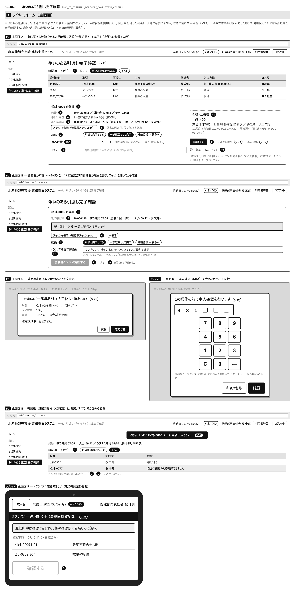

# SC-06-05 争いのある引渡し完了確認 — ワイヤーフレーム（新規画面、ワイヤーフレーム段階）

| 項目 | 内容 |
|---|---|
| 画面の役割 | **決定**：配送部門責任者が、争いのある引渡しの結論を出す（CAP-HUMAN-01） |
| 記録の役割 | DEL-HEAD（◎、MFA — P22）。**自分が記録した引渡しは自己確認禁止**（S1, PRM-111）。閲覧：SETTLE, STL-HEAD, OPS-HEAD |
| 端末 | PC/TAB — 埠頭または事務所 PC で実施；**通信断のときは実施しない**（紙の経路による） |

## 1. プロトタイプ（as-is）

なし（M16）：enum DEL_HEAD はあるがデモ用のアカウントも画面もない。画像なし。

## 2. to-be ワイヤーフレーム

> **標準の図（LAB-4）：** 図のソースは [`html/SC-06-05.html`](../../wireframes/html/SC-06-05.html) — 1 つの HTML で全バリアントを扱い、`scripts/render-wireframes.py` で [`png/SC-06-05.png`](../../wireframes/png/SC-06-05.png) と [`pdf/wireframes-all.pdf`](../../wireframes/pdf/wireframes-all.pdf) に出力；BM-51 の画像はバリアント A を使用。下の ASCII ブロックは配置の説明用に残し、食い違う場合は HTML + SPEC が正。




```
[1] 確認待ち（3件）  絞込: (自分が確認できるもの) (すべて)
┌──────────────────────────────────────────────────────────────────────────┐
│ 受付時刻 取引        買受人  内容           記録者   入力方法          SLA残   │
│ ▶07:20  相対-0005   N01   鮮度不良の申し出 桜 次郎  紙→後入力 D-000123  3h10m │
│  08:02  せり-0302   B07   数量の相違      桜 三郎  現場             2日4h  │
│  07/28  相対-0042   N05   箱数の相違      桜 次郎  現場             SLA超過 │
│ （既定の絞込「自分が確認できるもの」では自分の記録は表示しない。「すべて」で表示し、     │
│   「自分の記録のため確認できません」）                                              │
└──────────────────────────────────────────────────────────────────────────┘
┌─ [2] 相対-0005 の詳細 ────────────────────────────────────────────────────┐
│ [3] 確定 30kg / 引渡済 12kg / 例外 2kg   [4] 申し出内容「…」                    │
│ [5] 紙の確認票 D-000123: 紙で確認 07:05（署名: 桜 十郎）／ 入力 09:12（桜 次郎）    │
│     [6] スキャンを表示（確認票スキャン.pdf）                                     │
│ [7] 結論 (引渡し完了とする) (一部返品として完了) (継続協議 → 紛争へ)               │
│ [11.1] 返品数量 [ 2.0 ]kg（一部返品のとき・例外の数量を初期表示・上限 引渡済）       │
│ [11] 金額への影響（一部返品のとき）: −¥5,400 → 業務日 未締め: 要確認に表示 ／ 締め済: 修正申請 │
│ [8] コメント [                                          ]                   │
│ [8.1] 署名者に代わって確認する理由 [            ]（紙の署名者 ≠ 確認者 のときだけ・必須）  │
│ [9] [ 確認する ]  → C-31 → C-30 MFA     [10] 紛争詳細 → SC-07-04              │
└──────────────────────────────────────────────────────────────────────────┘
 完了後の記録表示: 「紙で確認 07:05 ／ 入力 09:12 ／ システム確認 09:20（桜 十郎、MFA済）」
```

## 3. 項目

| No | Item | 種別 | ルール | 出典 |
|---|---|---|---|---|
| 1 | 確認待ちの一覧 | 選択表 | 初期値は「自分が確認できるもの」（自分が記録した行を除く）；SLA の残り列 | FR-DEL-04, S1 |
| 2 | 詳細ブロック | 領域 | | — |
| 3 | SL | ラベル | | — |
| 4 | 争いの内容 | ラベル | | FT-06-04 |
| 5 | **紙の伝票** | ラベル | 後入力のときのみ：伝票番号、**「紙で確認 hh:mm」と「入力 hh:mm」** + 署名者 | ADR-008 §2.4 |
| 6 | スキャン | リンク | 署名の照合用 | E-21 |
| 7 | 結論 | 選択ボタン | 必須 | CAP-HUMAN-01 |
| 8 | コメント | テキスト | 継続協議のとき必須 | — |
| 8.1 | 署名者に代わって確認する理由 | テキスト | 閲覧者が署名者 [5] と異なる場合の伝票行のみ表示；必須、200 文字以内（`E-DEL-022`）。SC-06-05_SPEC と合わせるため追加 | 顧客 #16 |
| 9 | 確認する | ボタン | 閲覧者が記録者の場合は非表示；紙の伝票の場合、既定は**署名した人** [5] が確認。署名者が不在（シフト外 / 休暇）→ **別の配送部門責任者**（または代行）が**理由必須**で確認 + [6] のスキャンを開いて照合必須；監査ログに「紙の署名者に代わって確認」と記録。自分が記録した引渡しの自己確認は引き続き禁止。C-31 → C-30 MFA（顧客 #16） | S1, ADR-008 §2.4, ADR-002 |
| 11 | 金額への影響 | ラベル | 「一部返品として完了」を選んだとき：変わる金額と経路を表示 — 未締めの日 → 要確認 SC-07-01（SC-07-02 [20] の ✖ 行）；締め済みの日 → 修正申請（顧客 #17） | BR-CLOSE-01, FR-DEL-03 |
| 11.1 | 返品数量 | 数値欄 | 一部返品のとき：初期値 = 例外の SL；> 0 かつ ≤ 引渡済；[11] の計算に必要。SC-06-05_SPEC と合わせるため追加 | 顧客 #17 |
| 10 | 紛争 | リンク | → SC-07-04 | FT-07-05 |

## 4. 状態

| 状態 | 表示 |
|---|---|
| 待ちの項目がない | C-21 |
| 自分が記録した行 | ラベル「自分の記録のため確認できません」、[9] 非表示 |
| 紙の伝票、閲覧者 ≠ 署名者 | 「紙で署名した 桜 十郎 が確認する予定です」；[9] は「署名者に代わって確認する」の形で表示 + 理由欄（必須）、[6] を開いた後のみ有効 |
| SLA 超過 | 行を赤く表示；確認は可能 |
| 通信断 | C-28：「通信断中は確認できません。紙の確認票に署名してください」 |
| 確認済み | 3 つの時刻を表示して閲覧のみ |

## 5. 役割による違い

DEL-HEAD（記録者ではない）：画面全体。DEL-HEAD = 記録者：その行のみ閲覧。DELIVERY：SC-06-01 で状態を閲覧。SETTLE / STL-HEAD / OPS-HEAD：閲覧のみ + SC-07-03。

## 変更履歴

| No | Version | Action | 変更内容 | 更新日 | 更新者 | Approve |
|---|---|---|---|---|---|---|
| 1 | 0.1.0 | Add new | 初版。ADR-008 §2.4 に基づく「紙で確認 / 入力」のラベル | 2026-11-25 | phuongnnm-23344 | |
| 2 | 0.2.0 | Update | 顧客 #16：署名者が不在 → 別の配送部門責任者が理由 + スキャンの照合で確認；#17：一部返品のとき [11] の金額への影響 | 2026-11-25 | phuongnnm-23344 | |
| 3 | 0.2.1 | Update | LAB-4 wireframe HTML：図のソース `html/SC-06-05.html`、`png/SC-06-05.png` を埋め込み；項目 8.1（署名者に代わって確認する理由）と 11.1（返品数量）を SPEC に合わせて追加；自分が記録した行は既定の絞り込みに表示しない | 2026-11-25 | phuongnnm-23344 | |
