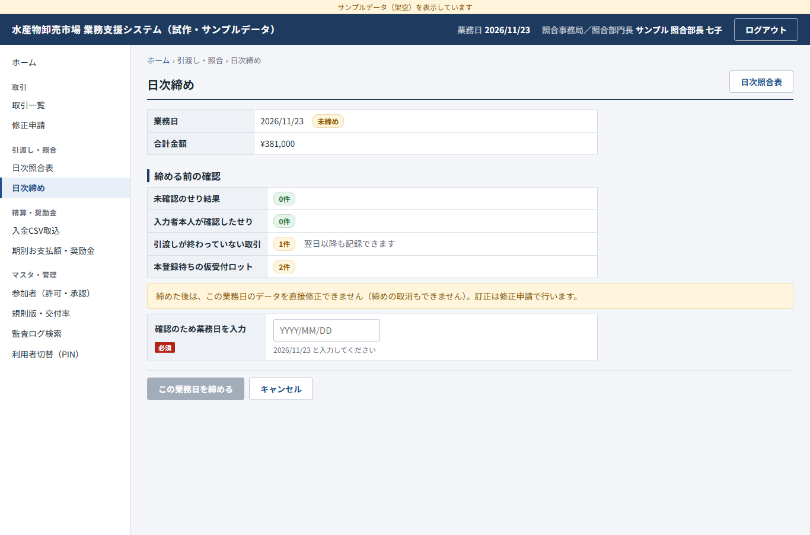
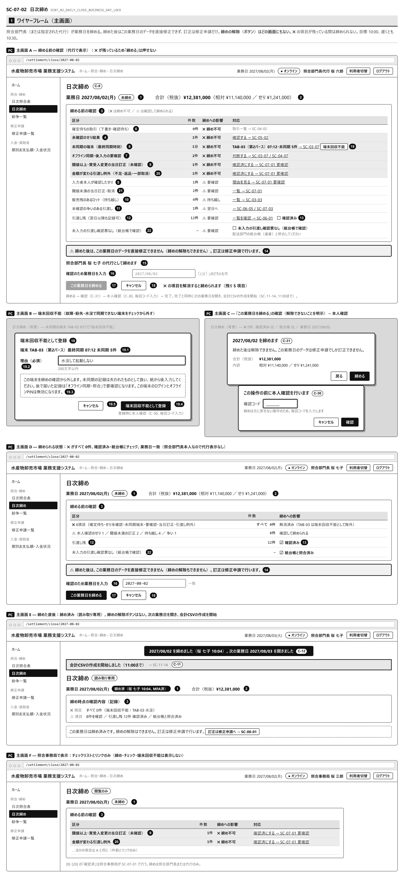

# SC-07-02 日次締め — ワイヤーフレーム

| 項目 | 内容 |
|---|---|
| 画面の役割 | **決定**：業務日を締める。締めた後は誰も直接修正せず、修正申請 のみ（BR-CLOSE-01） |
| 記録の役割 | STL-HEAD または指定済みの代行（◎、MFA — P25, S8）。閲覧：SETTLE |
| 端末 | PC。締めの目標 10:00、遅くとも 10:30（PRM-030） |
| 制約 | **締めた日を再オープンするボタンはどの画面にもない**（PRM-031, ADR-005） |

## 1. プロトタイプ（as-is）



`/settlement/close`、stlhead@。機能：業務日 + 合計、チェックリスト 4 行、警告文、日付の再入力欄、せりが未確認の間は締めボタンが薄く表示。

## 2. to-be ワイヤーフレーム

> **標準の図（LAB-4）：** 図のソースは [`html/SC-07-02.html`](../../wireframes/html/SC-07-02.html) — 1 つの HTML で全バリアントを扱い、`scripts/render-wireframes.py` で [`png/SC-07-02.png`](../../wireframes/png/SC-07-02.png) と [`pdf/wireframes-all.pdf`](../../wireframes/pdf/wireframes-all.pdf) に出力；BM-51 の画像はバリアント A を使用。下の ASCII ブロックは配置の説明用に残し、食い違う場合は HTML + SPEC が正。




チェックリストは ADR-005 §2.5 の標準一覧に合わせる：12 項目 — 6 項目は ✖ で締めを止める、6 項目は ⚠ で進めてよい（せりの自己確認 ⚠ の行を含み、確認のため；#8 [13] と #12 [22] はチェック必須 — Q-STL-02）。

```
[1] 業務日 2027/08/02(月)  未締め      [2] 合計（税抜）¥12,381,000（相対 ¥11,140,000 / せり ¥1,241,000）
┌─ [3] 締める前の確認 ────────────────────────────────────────────────────────────────┐
│ 区分                                            件数   締めへの影響   対応                          │
│ [6] 確定待ちの取引（下書き・確認待ち）               0件   ✖ 締め不可    → SC-04-02（絞込）             │
│ [4] 未確認のせり結果                               1件   ✖ 締め不可    確認する → SC-05-02            │
│ [8] 未同期の端末（最終同期時刻）                    1台   ✖ 締め不可    TAB-03 07:12 → SC-03-07  [19] 端末回収不能 │
│ [7] オフライン同期・後入力の要確認                   2件   ✖ 締め不可    判断する → SC-03-07 / SC-04-07  │
│ [9] 閾値以上・買受人変更の当日訂正（未確認）         1件   ✖ 締め不可    確認済にする → SC-07-01 要確認  │
│ [20] 金額が変わる引渡し例外（不足・返品・一部取消）    1件   ✖ 締め不可    確認済にする → SC-07-01 要確認  │
│ [5] 入力者本人が確認したせり                       1件   ⚠ 要確認      理由を見る → SC-07-01 要確認     │
│ [21] 閾値未満の当日訂正・取消                      2件   ⚠ 要確認      一覧 → SC-07-01                │
│ [10] 販売残のあるロット（持ち越し）                  4件   ⚠ 持ち越し    一覧 → SC-03-03                 │
│ [11] 未確認の争いのある引渡し                       1件   ⚠ 翌日へ      → SC-06-05 / SC-07-03           │
│ [12] 引渡し残（翌日以降も記録可）                   12件   ⚠ 要確認      → SC-06-01 ☐ [13] 確認済み        │
│ [22] 未入力の引渡し確認票なし（紙台帳で確認）          —     ⚠ 要確認      配送部門の紙台帳（連番）と照合 ☐   │
└──────────────────────────────────────────────────────────────────────────────────┘
[14] 締めた後は、この業務日のデータを直接修正できません（締めの解除もできません）。訂正は修正申請で行います。
[15] 代行で締める場合: 「照合部門長 桜 七子 の代行として締めます」（代行指定がある場合のみ表示）
[16] 確認のため業務日を入力 [ 2027/08/02 ]（/ と - のどちらも可）
[17] [ この業務日を締める ]  → C-31 確認 → C-30 MFA → 完了     [18] キャンセル
 完了後: 「2027/08/02 を締めました（桜 七子 10:04）。次の業務日 2027/08/03 を開きました」、会計CSV作成を開始（SC-11-14、11:00まで）

── [19] 端末回収不能（端末が故障・紛失・水没で同期できない場合）
┌──────────────────────────────────────────────────────┐
│ 端末 TAB-03（第2バース）最終同期 07:12 未同期 5件            │
│ 理由（必須）[ 水没して起動しない                    ]        │
│ この端末を締めの確認から外します。未同期の記録は失われたものとして │
│ 扱い、紙から後入力してください。後で届いた記録は「オフライン同期・ │
│ 照合」で要確認になります。この端末のログインとオフラインPINは無効 │
│ になります。                                              │
│ [ 端末回収不能として登録 ] → C-30 MFA      [ キャンセル ]       │
└──────────────────────────────────────────────────────┘
```

## 3. 項目

| No | Item | 種別 | ルール | 出典 |
|---|---|---|---|---|
| 1 | 業務日 + 状態 | ラベル | 未締め / 締め済 | FR-SETTLE-02 |
| 2 | 合計 | ラベル | 相対 / せり で分ける | FB LAB-2 #12 |
| 3 | チェックリスト | 表 | 各行：番号、影響（✖ 締めを止める / ⚠ 確認すれば可）、**対応する画面へのリンク**。一覧は ADR-005 §2.5 に一致 | PRM-119, FB LAB-2 #11, ADR-005 |
| 4 | せりが未確認 | ✖ の行 | | FR-SERI-02 |
| 5 | せりの自己確認 | ⚠ の行 | 確認のみ、止めない | S2, PRM-115 |
| 6 | 取引の下書き / 確認待ち | ✖ の行 | 状態 FIG-012（D10）；リンク → SC-04-02（絞込） | PRM-114 |
| 7 | SC-03-07 / 後入力 の要確認レコード | ✖ の行 | 決定者の判断待ちの重複疑いの紙伝票後入力を含む | FT-04-07, ADR-008 |
| 8 | 未同期の端末 | ✖ の行 | 端末名 + 最終同期時刻 + 待ちのレコード数。**「端末回収不能」を付けた端末は除く** | L4-A05, ADR-008 |
| 9 | 当日訂正 / 取消 で金額変動が 2 段階の閾値以上 **または買受人変更** | ✖ の行 | 閾値は修正申請の 2 段階の閾値と同じ（E-08、規則の値）、買受人ごとの金額変動の最大（税込）で測る。各行は照合事務局が SC-07-01 の 要確認 タブで 「確認済」 を押す必要がある；元の確定者と修正者の両方の名前を表示。Q-SC0405-01 回答済み【顧客（模擬）、2026-11-25】 — 顧客 #25 | PRM-127, E-08, FR-SETTLE-02 |
| 10 | 残 SL のあるロット（持ち越し） | ⚠ の行 | 持ち越しの扱いは規則に従う（仮、E-12） | PRM-110, E-12 |
| 11 | 未確認の引渡し紛争 | ⚠ の行 | 入力済みの `OPEN` の紛争のみ数える；未入力の紙の伝票は [22] で照合；止めない、翌日へ進む；リンク → SC-06-05 / SC-07-03 | ADR-008 §2.4 |
| 12 | 引渡し残 | ⚠ の行 | 日常のこと；[13] のチェック必須；リンク → SC-06-01 | FR-DEL-05, PRM-036 |
| 13 | 「確認済み」欄 | チェックボックス | チェック必須（件数では止めない） | PRM-119, PRM-036 |
| 22 | 「未入力の引渡し確認票なし（紙台帳で確認）」 | チェックボックス | ADR-005 §2.5 #12。件数は表示しない；締める人は配送が保管する通し番号の紙台帳と照合；伝票を 1 枚も発行しなかった場合も必ずチェック —【顧客（模擬）、2026-11-25 — Q-STL-02】 | PRM-111, ADR-008 §2.4 |
| 14 | 警告文 | ラベル | 常に表示 | BR-CLOSE-01 |
| 15 | 代行の行 | ラベル | 監査に「誰の代わりか」を記録 | S8, RACI-01 |
| 16 | 日付の再入力 | テキスト | 業務日と一致；`/` と `-` のどちらも可 | FB LAB-2 #8 |
| 17 | 締める | ボタン | ✖ の行が残る、または [13] / [22] が未チェック、または [16] が不一致のとき薄く表示；C-31 → **C-30 MFA（取り消せない操作のため必ずコードを再入力 — ADR-002）**。締め後、修正申請 / 後入力 が記帳日を持てるよう、スケジュールどおり次の市場の業務日を直ちに開く（ADR-005） | P25, ADR-002, ADR-005 |
| 18 | キャンセル | ボタン | | — |
| 19 | 端末回収不能 | ボタン + ダイアログ | STL-HEAD / 代行のみ；理由必須；C-30 MFA；監査ログに記録。端末は [8] の行から外れる；その端末のセッションと オフライン PIN は無効化；その端末から後で届いたレコード → SC-03-07（要確認）→ 修正申請 後入力。顧客 #1 | NFR-AVL-02, BR-CLOSE-01, ADR-005, ADR-008 |
| 19.1 | 端末情報 | ラベル | — | 詳細は SPEC §4.1（W-m01） | — | `SC-07-02_SPEC.md` |
| 19.2 | 理由 | テキストボックス | ✓ | 詳細は SPEC §4.1（W-m01） | — | `SC-07-02_SPEC.md` |
| 19.3 | 影響の説明 | ラベル | — | 詳細は SPEC §4.1（W-m01） | — | `SC-07-02_SPEC.md` |
| 19.4 | 端末回収不能として登録 | ボタン | — | 詳細は SPEC §4.1（W-m01） | — | `SC-07-02_SPEC.md` |
| 19.5 | キャンセル | ボタン | — | 詳細は SPEC §4.1（W-m01） | — | `SC-07-02_SPEC.md` |
| 20 | 確認済みでない金額変動のある引渡し例外 | ✖ の行 | 未締めの日の 不足 / 返品 / 一部取消（SC-06-04 [12]）；照合事務局が SC-07-01 で 「確認済」 を押す。顧客 #4 | FR-SETTLE-01, OBJ-05 |
| 21 | 閾値未満の当日訂正 | ⚠ の行 | SC-07-01 で確認、止めない | PRM-127 |

## 4. 状態

| 状態 | 表示 |
|---|---|
| 締め済み | 画面全体は閲覧のみ：「締め済（桜 七子 10:04、MFA済）」；**再オープンのボタンはない**；リンク「訂正は修正申請へ」 |
| ✖ の行が残る | [17] を薄く、「✖ の項目を解消すると締められます」 |
| 端末の故障・紛失で同期できない | [19] 端末回収不能 → 行 [8] からその端末を外す；「チェックリストを飛ばして締める」経路はない |
| 通信断 | C-28：締められない |
| 権限がない / 代行が未指定 | C-25（SETTLE はチェックリストを閲覧のみ） |
| MFA の誤り / 取消 | 画面に留まる、締めない |

## 5. 役割による違い

| 役割 | 表示内容 |
|---|---|
| STL-HEAD / 代行 | 画面全体 |
| SETTLE | チェックリスト + リンク、[13], [22], [16], [17], [19] なし；[9], [20] は SC-07-01 で 「確認済」 を押す |
| OPS-HEAD | 業務日の状態を SC-07-01 で閲覧 |

## 6. プロトタイプとの to-be の違い

| # | Prototype | To-be | 出典 |
|---|---|---|---|
| 1 | チェックリスト 4 行、リンクなし | 12 行（✖ 6、⚠ 6 — #8, #12 はチェック必須）、影響の度合い + リンク | PRM-119, FB LAB-2 #11, ADR-005 §2.5 |
| 2 | MFA なし（確認ダイアログに「試作では省略」） | C-30 MFA step-up | M02, ADR-002 |
| 3 | 代行なし | [15] | S8 |
| 4 | 未同期の端末、紙の伝票の行なし | [8], [11] + 出口 [19] 端末回収不能 | M04, ADR-008, 顧客 #1 |
| 5 | 大きい当日訂正 / 金額が変わる引渡し例外の行なし | [9], [20] は照合が 確認済 にするまで締めを止める | 顧客 #4, #25 |

## 変更履歴

| No | Version | Action | 変更内容 | 更新日 | 更新者 | Approve |
|---|---|---|---|---|---|---|
| 1 | 0.1.0 | Add new | 初版 | 2026-11-25 | phuongnnm-23344 | |
| 2 | 0.2.0 | Update | Gate 1：ADR-005 §2.5 の標準一覧に合わせた checklist（6 ✖ / 4 ⚠ + せり の自己確認）(M-05)；[19] 端末回収不能 を追加（顧客 #1）；[9] 当日訂正 ≥ 閾値 / 買受人変更 は 確認済 まで ✖（顧客 #25、Q-SC0405-01）；[20] 金額が変わる引渡し例外（顧客 #4）；締め後に次の業務日を開く（M-01）。プロトタイプ画像は据え置き | 2026-11-25 | phuongnnm-23344 | |
| 3 | 0.2.1 | Update | P3 まとめ：[11] は入力済みの 紛争 `OPEN` のみ数える；紙の伝票の未入力は [22] の紙の台帳で照合 — ADR-005 0.2.2 の #10 と一致（Q-STL-02） | 2026-11-25 | phuongnnm-23344 | |
| 4 | 0.2.2 | Update | 顧客 Q-STL-02：[22] を追加、チェックリスト 12 項目（✖ 6 / ⚠ 6） | 2026-11-25 | phuongnnm-23344 |  |
| 5 | 0.2.3 | Update | LAB-4 wireframe HTML：図のソース `html/SC-07-02.html`、`png/SC-07-02.png`；リンク [6] → SC-04-02、[11] → SC-06-05 / SC-07-03、[12] → SC-06-01（SPEC に一致） | 2026-11-25 | phuongnnm-23344 | |
| 6 | 0.2.4 | Update | W-m01：項目表に子 ID 19.1–19.5（端末回収不能のダイアログ）を追加 | 2026-11-25 | phuongnnm-23344 |  |
