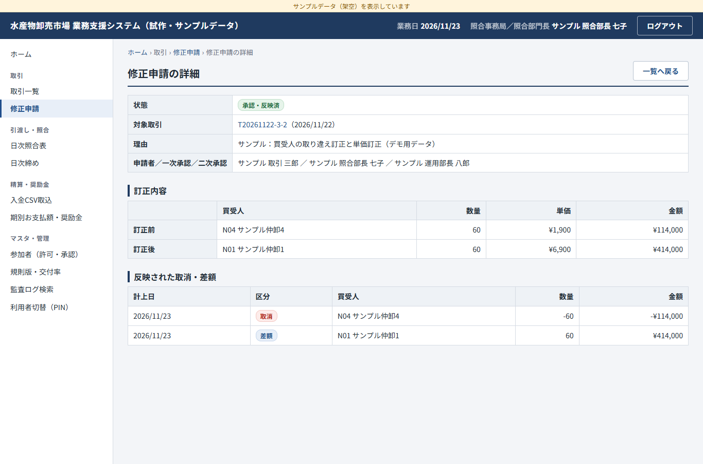
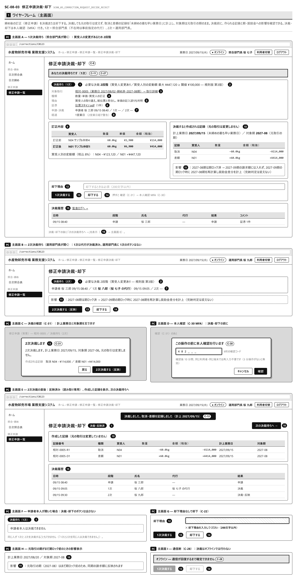

# SC-08-03 修正申請決裁・却下 — ワイヤーフレーム

| 項目 | 内容 |
|---|---|
| 画面の役割 | **決定**：修正申請の決裁（決裁）/ 却下（確定後の訂正）。決裁しても**元の取引は変更しない**：REVERSE + DELTA のレコードを、未締めの業務日のうち最も早い日に記帳；**行の期 = 元の取引の期**（ルール4, ADR-004, ADR-007） |
| 記録の役割 | 1次：STL-HEAD（不在の場合 → 事前に指定した代行。**OPS-HEAD は代わらない** — Q-STL-04）；2次：OPS-HEAD（◎、MFA — P27, P28）。起票者は決裁できない；1 人が 1次 と 2次 の両方を決裁することはできない（S3） |
| 端末 | PC |
| 画面名 | LAB-1 は「修正申請承認・却下」と記載；LAB-4 で「修正申請決裁・却下」に変更し、承認 は 承認（売買参加者）にのみ使う（ルール2, PRM-121, PREMISE L4-D03）。画面 ID は据え置き |

## 1. プロトタイプ（as-is）



`/corrections/[id]`、stlhead@、2 段階で決裁済みのサンプル申請（データは「サンプル」）。機能：状態、対象の取引、理由、3 人、訂正前 / 訂正後 の表、生成された 取消・差額 の表。

## 2. to-be ワイヤーフレーム（1次の決裁待ちの申請）

> **標準の図（LAB-4）：** 図のソースは [`html/SC-08-03.html`](../../wireframes/html/SC-08-03.html) — 1 つの HTML で全バリアントを扱い、`scripts/render-wireframes.py` で [`png/SC-08-03.png`](../../wireframes/png/SC-08-03.png) と [`pdf/wireframes-all.pdf`](../../wireframes/pdf/wireframes-all.pdf) に出力；BM-51 の画像はバリアント A を使用。下の ASCII ブロックは配置の説明用に残し、食い違う場合は HTML + SPEC が正。




例：取引 相対-0005 の業務日は 2027/08/02 → **期 2027-08** に属する。修正申請は 2027/09/15 に提出、その時点で期 2027-08 は期ロック済み（09/14 10:20 にロック — SC-09-04）（ロックは支払期日 2027/09/10 の後）。

```
[1] 状態 決裁待ち（1次）  [2] 必要な決裁 2段階（買受人変更あり／買受人別の変動額 最大 ¥447,120 ≥ 閾値 ¥100,000 — 規則版 第3版）
[3] 対象取引 相対-0005（業務日 2027/08/02・締め済・2027-08期）→ 取引詳細
[4] 種類 数量・単価・買受人の訂正 [5] 理由 「買受人の取り違え…」   [6] 証憑 伝票スキャン.pdf（1件）
[7] 申請者 桜 三郎 09/15 08:40 ／ 1次 — ／ 2次 —        [8] 経過 1営業日（2営業日超で警告）
┌─ [9] 訂正内容 ────────────────────────────────────────────────────┐
│        買受人             数量   単価     金額（税抜）                │
│ 訂正前  N04 サンプル仲卸4   60   ¥1,900   ¥114,000                   │
│ 訂正後  N01 サンプル仲卸1   60   ¥6,900   ¥414,000                   │
│ 買受人別の変動額（税込 8%）: N04 −¥123,120 ／ N01 +¥447,120             │
└─────────────────────────────────────────────────────────────────┘
┌─ [10] 決裁すると作成される記録（元の取引は変更しません）──────────────────────┐
│ 計上業務日 2027/09/15（未締めの最も早い業務日）／ 対象期 2027-08（元取引の期）   │
│ 取消  N04  −60  −¥114,000 ／ 差額  N01  +60  +¥414,000                    │
│ [11] 影響: 2027-08期は期ロック済 → 2027-09期の請求額には入れず、               │
│      2027-09期の期ロック時に 2027-08期を再計算し奨励金差分を計上（完納判定は変えない）│
└─────────────────────────────────────────────────────────────────┘
[12] 却下理由 [                       ]（却下時必須）
[13] [ 1次決裁する ]   [14] [ 却下する ]   → C-31 → C-30 MFA
[15] 決裁履歴: 申請 09/15 08:40 桜 三郎 …（監査ログへ）
[16] [ 次の決裁待ちへ → ]（決裁・却下の後に表示）
```

## 3. 項目

| No | Item | 種別 | ルール | 出典 |
|---|---|---|---|---|
| 1 | 状態 | ラベル | 決裁待ち（1次）/（2次）/ 決裁・反映済 / 却下 | FR-CORR-02, L4-D03 |
| 2 | 決裁の段数 | ラベル | **有効な版の規則**の閾値（暫定 100,000 JPY、E-08）と、**買受人 1 人あたりの金額変動の最大**を比較 = 買受人ごとの \|Σ 税込の差額\| の最大値 — 差額の純額は使わない（同じ価格で買受人を替えると純額は 0 になるが、金額は 2 人の間を移動している）。**買受人を変更 → 常に 2 段**；`KANNO`、`INCENTIVE` は常に 2 段。版番号を記録。顧客 #3 に回答済み【顧客（模擬）、2026-11-25】 | M13, D07, PREMISE §3.1, FR-CORR-02, ADR-004 |
| 3 | 対象の取引 | リンク | → SC-04-04；業務日、「締め済」ラベル、取引の期を表示 | — |
| 4 | 種別 | ラベル | `TRADE`（SL / 単価 / 買受人 / 不足・返品）· `KANNO`（完納の変更 — PRM-055）· `INCENTIVE`（適用率の誤りで締めた期の奨励金を修正）· `LATE_ENTRY`（締め済みの日への後入力 — SC-03-07） | FT-08-01, ADR-007 |
| 5 | 理由 | ラベル | | FORM-CORR-01 |
| 6 | 証憑 | リンク | ファイルを表示（証憑の種類 `CORRECTION_EVIDENCE`） | M11, TBL-ATTACH-01 |
| 7 | 起票者 / 1次 / 2次 | ラベル | ある場合は「代行: ○○の代わり」を併記 | S3, S8 |
| 8 | 待ち時間 | ラベル | > 2 営業日 → 黄色 | FR-NOTIFY-03 |
| 9 | 訂正前 / 訂正後 の表 | 表 | 買受人ごとの変動の行を追加（税込、取引の税率による — 水産物の生鮮 8%） | — |
| 10 | 生成される記録 | 表 | REVERSE（旧の買受人）+ DELTA（新の買受人）。2 つの軸：**計上業務日** = 未締めの業務日のうち最も早い日（日の帳簿、精算、IF-ACC-01）；**対象期** = 元の取引の期 | ADR-004, ADR-007, PRM-120 |
| 11 | 期のお支払額 / 奨励金への影響 | ラベル | 元の期がまだ開いている →「2027-08期の請求額に反映されます」；元の期が期ロック済み → 開いている期には入らない、DELTA は次の期ロックで；完納は遡及しない（`KANNO` を除く） | PRM-043, ADR-007 |
| 12 | 却下理由 | テキスト | 却下のとき必須、200 文字以内 | — |
| 13 | 決裁 | ボタン | ラベルは段ごとに変わる：「1次決裁する」/「2次決裁する（反映）」；閲覧者が起票者、または 1次 を決裁済みの場合は非表示 | S3, L4-D03 |
| 14 | 却下 | ボタン | | — |
| 15 | 履歴 | 表 | SC-13-01 へのリンク | FR-AUDIT-01 |
| 16 | 次の申請へ | ボタン | 閲覧者の次の 決裁待ち の申請を開く；10 分以内の MFA ではコードを再度求めない（操作がタイムアウトした場合を除く）。顧客 #29（あると良い） | L4-A07 |

## 4. 状態

| 状態 | 表示 |
|---|---|
| 閲覧者が起票者 | [13] [14] を非表示；「申請者本人は決裁できません」 |
| 閲覧者が 1次 を決裁済み | 「1次と2次を同じ人は決裁できません」 |
| 2次 待ち | [1] 「決裁待ち（2次）」、[7] に 1次 の名前 |
| 元の期がまだ開いている | [11] 「元取引の期（2027-08）はまだ期ロック前のため、同期の請求額に反映されます」 |
| 反映済み | 閲覧のみ；[10] に実際の記録を表示（プロトタイプと同様） |
| 却下 | 閲覧のみ + 理由 |
| 対象の取引に別の待ち申請がある | 起きない（1 取引につき待ち申請は最大 1 件） |
| 通信断 | C-28 |

## 5. 役割による違い

| 役割 | 表示内容 |
|---|---|
| STL-HEAD | 1次の決裁ボタン（起票者でないとき） |
| OPS-HEAD | 2次の決裁ボタン（1次 のボタンはなし — Q-STL-04） |
| TRADE / DELIVERY / SETTLE（起票者） | 自分の申請のみ閲覧 + 他の申請は 閲 の権限に従う |

## 6. プロトタイプとの to-be の違い

| # | Prototype | To-be | 出典 |
|---|---|---|---|
| 1 | 2 段階の閾値は定数 300,000、純額の差額と比較 | 版管理された規則のパラメータ、暫定 100,000；買受人 1 人あたりの金額変動の最大と比較；買受人変更は常に 2 段；[2] に表示 | M13, D07, 顧客 #3 |
| 2 | MFA なし | C-30 | M02, ADR-002 |
| 3 | 決裁前に生成される記録を確認できない | [10], [11]（計上業務日 と 対象期 を分けて表示） | FR-CORR-02, ADR-007 |
| 4 | 証憑なし、待ち時間を数えない | [6], [8] | M11, FR-NOTIFY-03 |
| 5 | ラベル「承認」 | 内部の決裁は「決裁」 | ルール2, PRM-121 |

## 変更履歴

| No | Version | Action | 変更内容 | 更新日 | 更新者 | Approve |
|---|---|---|---|---|---|---|
| 1 | 0.1.0 | Add new | 初版 | 2026-11-25 | phuongnnm-23344 | |
| 2 | 0.2.0 | Update | Gate 1：ラベルを 承認 → 決裁 に変更（M-06）；例の [10]/[11] で 計上業務日 と 対象期 を分け、対象期 = 元の取引の期（誤った例の期を修正、C-02）；2 段階の閾値は買受人ごとの金額変動の最大を基準に、買受人変更は常に 2 段（顧客 #3）；[4] に KANNO / INCENTIVE / LATE_ENTRY を追加；[16] 次の決裁待ちへ（顧客 #29）。プロトタイプ画像は据え置き | 2026-11-25 | phuongnnm-23344 | |
| 3 | 0.2.1 | Update | Gate 1 recheck n-05：例の申請日を 2027/09/15 に変更（SC-09-04 の期ロック時刻に合わせる） | 2026-11-25 | phuongnnm-23344 | |
| 4 | 0.2.2 | Update | 顧客 Q-STL-04：運用部門長の 1次 の決裁ボタンを削除（照合部門長 / 代行 のみ） | 2026-11-25 | phuongnnm-23344 |  |
| 5 | 0.2.3 | Update | LAB-4 wireframe HTML：図のソース `html/SC-08-03.html`、`png/SC-08-03.png`；[4] のラベル 「数量・単価・買受人の訂正」（SPEC に一致） | 2026-11-25 | phuongnnm-23344 | |
