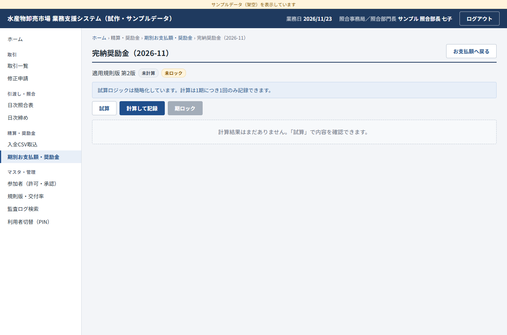
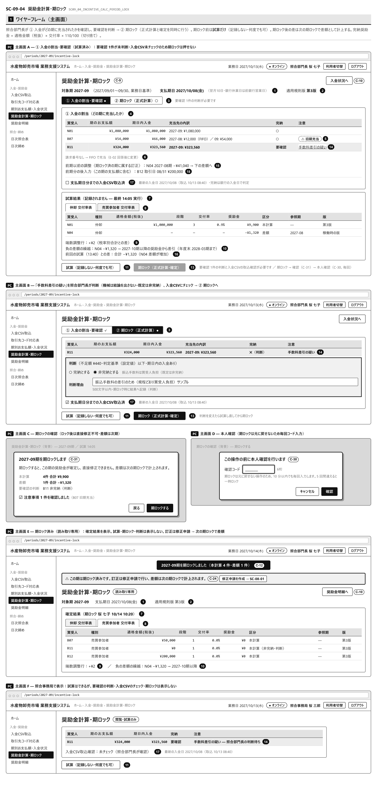

# SC-09-04 奨励金計算・期ロック — ワイヤーフレーム

| 項目 | 内容 |
|---|---|
| 画面の役割 | **決定**：2 段階。① 入金が十分に割り当てられたことを確認（要確認 の行を処理）→ ② **期ロック = 正式計算 + 凍結を同一トランザクションで行う**（ADR-007 §2.1）。ロック前にあるのは **試算** のみ（結果は記録しない）。ロック後の差異はすべて次の期ロックで DELTA として計上（ルール4） |
| 記録の役割 | STL-HEAD（◎、MFA — P30）。閲覧：SETTLE, OPS-HEAD |
| 端末 | PC |

## 1. プロトタイプ（as-is）



`/periods/[id]/incentives`、stlhead@、期 2026-11 は未計算。機能：適用版、試算 / 計算して記録 / 期ロック、「試算ロジックは簡略化しています」の文。3 段階に分かれている（試算 → 期が開いている間に結果を記録 → ロック）のは Database Design の N13 と**誤り**。to-be では中間の段階を削除。

## 2. to-be ワイヤーフレーム

> **標準の図（LAB-4）：** 図のソースは [`html/SC-09-04.html`](../../wireframes/html/SC-09-04.html) — 1 つの HTML で全バリアントを扱い、`scripts/render-wireframes.py` で [`png/SC-09-04.png`](../../wireframes/png/SC-09-04.png) と [`pdf/wireframes-all.pdf`](../../wireframes/pdf/wireframes-all.pdf) に出力；BM-51 の画像はバリアント A を使用。下の ASCII ブロックは配置の説明用に残し、食い違う場合は HTML + SPEC が正。




例の金額は税率 **8%（軽減税率、水産物の生鮮）**を使用。奨励金の係数 110/100 は BR-INC-01 / 13-06 の固定ルールで、品目の税率には依存しない。

```
[1] 対象期 2027-09（2027/09/01〜09/30、業務日基準）  支払期日 2027/10/08(金)（10日、銀行休業日は前銀行営業日）  [2] 適用規則版 第3版
[3] ステップ  ①入金の割当・要確認 ●  ②期ロック（正式計算）○
┌─ [4] ① 入金の割当（どの期に充当したか）────────────────────────────────────┐
│ 買受人  期のお支払額  期日内入金  充当先の内訳                    完納      注意          │
│ N01    ¥1,080,000   ¥1,080,000  2027-09: ¥1,080,000           ○                        │
│ B07    ¥   54,000   ¥   66,000  2027-08: ¥12,000（FIFO）/ 09: ¥54,000 ○  [5]⚠旧期充当  │
│ B11    ¥  324,000   ¥  323,560  2027-09: ¥323,560             要確認  [14]手数料差引の疑い│
│ [6] 請求番号なし → FIFO で充当（E-02 回答後に変更）                                     │
│ [15] 前期以前の調整（期ロック済の期に属する訂正）: N04 2027-08期 −¥41,040 → 下の差額へ │
│ [18] 前期分の後入力（この期の支払額に含む）: B12 取引日 08/31 ¥200,000                      │
│ [17] □ 支払期日分までの入金CSV取込済　最新の入金日 2027/10/08（取込 10/13 08:40）           │
└────────────────────────────────────────────────────────────────────────────┘
┌─ [7] 試算結果（記録されません — 最終 14:05 実行）────────────────────────────────┐
│ [8] タブ: (仲卸 交付率表) (売買参加者 交付率表)                                     │
│ 買受人 種別  適格金額(税抜) 段階  交付率  奨励金       区分   参照期   版              │
│ N01   仲卸   ¥1,000,000   3    0.9%   ¥9,900      本計算  —      第3版             │
│ N04   仲卸   —            —    —      −¥1,320     差額   2027-08 稼働時の版 │
│ [9] 端数調整行: +¥2（税率別合計との差）                                           │
│ [10] 負の差額の繰越: N04 −¥1,320 → 2027-10期以降の奨励金から差引（年度末 2028-03期まで）│
│ [16] 前回の試算（13:40）との差: 合計 −¥1,320（N04 差額が増加）                       │
└────────────────────────────────────────────────────────────────────────────┘
[11] [ 試算（記録しない・何度でも可） ]   [13] [ 期ロック（正式計算・確定） ]（C-31 → C-30 MFA）
```

## 3. 項目

| No | Item | 種別 | ルール | 出典 |
|---|---|---|---|---|
| 1 | 期 + 支払期日 | ラベル | 期 = 元の取引の**業務日**の月（後入力の取引は実際の取引日による）。支払期日 = 翌月の 10 日；**銀行休業日**に当たる場合は**前の銀行営業日**に繰り上げ（例：期 2028-05：2028/06/10 は土曜 — 市場は開き、銀行は休み → 2028/06/09） | L4-A04 (2), D05, ADR-007 |
| 2 | 適用版 | ラベル | 期の 1 日目に有効な版 | PRM-042 |
| 3 | 2 段階のバー | ナビゲーション | ② は ① に未決定の 要確認 の行がなくなったときのみ開く | FT-09-07 |
| 4 | 入金の割当表 | 表 | 照合が ロック前に確認できるよう、**入金がどの期に割り当てられたか**を表示。完納 列：○ / ✖ / **要確認** | OPEN-L4-02, D03 |
| 5 | 古い期への割当の警告 | ラベル ⚠ | FIFO により新しい期の入金が古い期の未払いに充当され、新しい期の完納を失う可能性がある | OPEN-L4-02, FB-CUS-225 |
| 6 | FIFO の注記 | ラベル | E-02 の回答時に変更 | E-02 |
| 7 | 試算ブロック | 領域 | ロック前は常に **試算**（見出しに「記録されません」+ 最後に実行した時刻）。「計算済み・未ロック」の状態はない | ADR-007 §2.1, N13 |
| 8 | 交付率表の 2 タブ | タブ | 仲卸 / 売買参加者、各表 5 等級 | D01, BR-INC-01 |
| 9 | 端数調整 | 行 | | PRM-053, D04 |
| 10 | 負の差分の繰越 | ラベル | 負の delta は、計上された期の会計年度末までの後の期の奨励金から少しずつ差し引く；年度末に残った負の分 → 行 `CARRY_EXPIRED`、RPT-07 に表示して 照合部門 が処理 | M08, D23, ADR-007 |
| 11 | 試算 | ボタン | 結果は記録しない；何度実行してもよい（顧客 #6）。実行のたびに監査ログに 1 行（時刻、入力のハッシュ、合計）を記録し、[16] が前回と比較できるようにする。ロック前に入金 CSV が遅れて届く / 誤って割り当てた → 割当を修正してから 試算 し直す | 顧客 #6, ADR-007 |
| 12 | (削除) 計算して記録 | — | 0.2.0 で削除 — 正式な結果は期ロックのトランザクションの中でのみ記録（M-02, N13）；番号は `_common-layout` のルールに従い保持 | ADR-007 §2.1 |
| 13 | 期ロック | ボタン | C-31（「ロック後は直接修正できません。差額は次期の期ロックで計上されます」）→ C-30 MFA（取り消せない操作のため必ずコードを再入力）。**同一トランザクション**内で：ロック後に入力が変わったロック済みの期すべてについて、正式な MAIN + DELTA を計算（会計年度の制限なし、**古い期の版**による、修正申請 KANNO を除き完納は遡及しない）、結果 + 入力のハッシュを記録、端数調整を生成、期を閉じる、メールをキューに入れる | PRM-043, ADR-007 |
| 14 | 「手数料差引の疑い」 | ラベル + 決定ボックス | 不足が設定ファイルの目印以下で、期限内に入金がある → **要確認**、システムは**自動で結論を出さない**。照合部門長が 完納 / 非完納 を選び、理由を入力（必須）；初期提案は 非完納（振込手数料は買受人負担 — PRM-040）；決定は期ロック時に結果へ記録（`kanno_basis = JUDGED`）。振込手数料について 経理部 の回答待ち。顧客 #7 | BR-INC-01, CAP-HUMAN-01, ADR-007 |
| 15 | 前期以前の調整 | 情報行 | 期ロック済みの期に属する修正（修正申請 TRADE）（元の取引の期に割り当て）は、この期の**期のお支払額には加算しない**；DELTA で処理。後入力の取引はここではない — [18] を参照。照合が金の行き先を確認できるように表示 | ADR-007, OPEN-DB-08 |
| 16 | 前回の試算との比較 | ラベル | 前回の試算の監査ログの行から | 顧客 #6 |
| 17 | 入金CSV取込済 | チェックボックス | 照合部門長が、支払期日までの入金日を持つ入金 CSV をすべて取り込んだらチェック；隣のラベルに最大の入金日 + 取込時刻を表示；チェックしない → [13] を薄く、サーバーが `E-INC-014` を返す。完納は銀行の入金日による（取込日ではない；猶予ではない） | Q-INC-01 【顧客（模擬）、2026-11-25】; BR-INC-01 |
| 18 | 前期分の後入力 | 情報行 | 期ロック済みの期の GD 後入力は**この期に移る**：この期のお支払額に加算し、この期の支払期日で完納を判定、通常の金額と同じ扱い — 期ロック済みの期に GD がある人 / ない人で同じ 1 つのルール | Q-INC-02 【顧客（模擬）、2026-11-25】; ADR-007 §2.3-7a |

## 4. 状態

| 状態 | 表示 |
|---|---|
| 入金がない / 期が終わっていない | [4] C-21；[13] を薄く |
| 未決定の 要確認 の行がある | [13] を薄く；「要確認 1件の判断が必要です」 |
| [17] が未チェック | [13] を薄く；「入金CSVの取込を確認してください」 |
| [4] に ⚠ の行がある | 止めない；[13] で「⚠ 2件を確認しましたか」と確認 |
| 締め済み | 閲覧のみ；[7] の見出しを「確定結果（期ロック 桜 七子 10/14 10:20）」に変更；修正 → 修正申請 → 次の期ロックで DELTA（C-24） |
| 通信断 | C-28 |

## 5. 役割による違い

STL-HEAD：画面全体。SETTLE：[4], [7], [17]（閲覧のみ）, [18] と ボタン [11] を閲覧；[14] の決定、[17] のチェック、[13] はできない。OPS-HEAD：閲覧のみ。その他の役割：C-25。

## 6. プロトタイプとの to-be の違い

| # | Prototype | To-be | 出典 |
|---|---|---|---|
| 1 | 交付率表は 1 つ | 2 つの表 仲卸 / 売買参加者 | D01 |
| 2 | 等級の判定は税込の金額 | 適格金額は税抜；奨励金 × 110/100 | D02 |
| 3 | 入金を日付の窓で割り当て、どこに割り当てたか表示しない | FIFO の割当表 + [4], [5] | D03, OPEN-L4-02 |
| 4 | 税率 1 種類、端数調整なし、負の delta の繰越なし | [9], [10] | D04, M08 |
| 5 | 支払期日は 10 日固定 | 規則 + 銀行カレンダーに従う | D05 |
| 6 | MFA なし | C-30 | M02 |
| 7 | ボタン 3 つ 試算 / 計算して記録 / 期ロック | ボタン 2 つ 試算 / 期ロック；正式な結果はロック時にのみ記録 | N13, ADR-007 §2.1 |
| 8 | 少額の不足を自動で ✖ にする | 要確認 + 決定者 | 顧客 #7 |

## 変更履歴

| No | Version | Action | 変更内容 | 更新日 | 更新者 | Approve |
|---|---|---|---|---|---|---|
| 1 | 0.1.0 | Add new | 初版 | 2026-11-25 | phuongnnm-23344 | |
| 2 | 0.2.0 | Update | Gate 1：「計算して記録」ボタンを削除、[7] はロック前は常に 試算、期ロック = 正式計算 + 凍結（M-02）；支払期日はロックの日付に応じて繰り上げ（M-03）；税率 8% の例、奨励金 9,900（m-07）；DELTA は会計年度の制限なし、CARRY_EXPIRED（C-01, m-05）；[15] 前期以前の調整（C-02）；試算を何度も実行でき監査 + [16]（顧客 #6）；手数料差引の疑い = 要確認（顧客 #7）。プロトタイプ画像は据え置き | 2026-11-25 | phuongnnm-23344 | |
| 3 | 0.2.1 | Update | Gate 1 recheck n-05：N01 は 等級3；2027-07 は移行期として記録、版は go-live | 2026-11-25 | phuongnnm-23344 | |
| 4 | 0.2.2 | Update | 顧客 Q-INC-01/02：[17] 入金CSV取込済 チェックボックス、[18] 前期分の後入力 を追加；[15] は調整のみ残す | 2026-11-25 | phuongnnm-23344 |  |
| 5 | 0.2.3 | Update | LAB-4 wireframe HTML：図のソース `html/SC-09-04.html`、`png/SC-09-04.png` を埋め込み | 2026-11-25 | phuongnnm-23344 | |
| 6 | 0.2.4 | Update | W-m03：例を期 2027-09 に変更（支払期日 2027/10/10 は日曜 → 10/08）、[18] 後入力 = 期 2027-08 の GD 08/31（go-live 後、TV-13 に一致）；[15] と表の 移行期 ラベルを削除；HTML も同じ | 2026-11-25 | phuongnnm-23344 |  |
