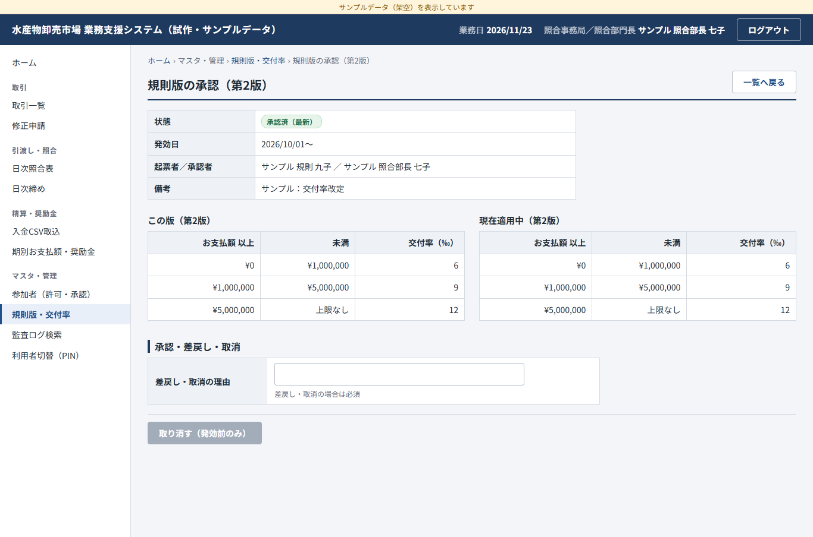
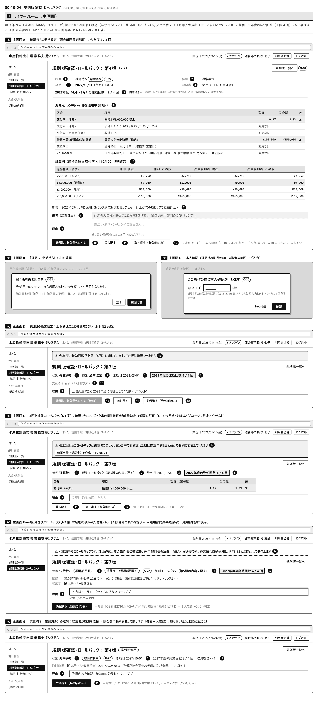

# SC-10-04 規則版確認・ロールバック — ワイヤーフレーム

| 項目 | 内容 |
|---|---|
| 画面の役割 | **決定**（確認者）— 規則の版を確認 / 差し戻し / 取消。ロールバックの版を含む |
| 記録の役割 | STL-HEAD（◎、MFA — P32）；作成者（RULE）≠ 確認者（S4）。4 回に達したときのロールバックの N2 分岐：OPS-HEAD の決裁（MFA）を追加 |
| 端末 | PC |
| 画面名 | LAB-1 は「規則版承認・ロールバック」と記載；LAB-4 で「規則版確認・ロールバック」に変更し、承認 は 承認（売買参加者）にのみ使う（ルール2, PRM-121, PREMISE L4-D03）。画面 ID は据え置き |

## 1. プロトタイプ（as-is）



`/rules/[id]/review`、stlhead@、版 第2版 は決裁済み。機能：状態、発効日、maker / checker、この版と適用中の版の交付率表の比較、理由欄、ボタン 取り消す。

## 2. to-be ワイヤーフレーム（確認待ちの版）

> **標準の図（LAB-4）：** 図のソースは [`html/SC-10-04.html`](../../wireframes/html/SC-10-04.html) — 1 つの HTML で全バリアントを扱い、`scripts/render-wireframes.py` で [`png/SC-10-04.png`](../../wireframes/png/SC-10-04.png) と [`pdf/wireframes-all.pdf`](../../wireframes/pdf/wireframes-all.pdf) に出力；BM-51 の画像はバリアント A を使用。下の ASCII ブロックは配置の説明用に残し、食い違う場合は HTML + SPEC が正。




```
[1] 状態 確認待ち   [2] 種別 通常改定 / ロールバック（第2版の内容に戻す）
[3] 発効日 2027/10/01（毎月1日のみ）   [4] 起票者 桜 九子（ルール管理者）
[5] 今年度（2027年度: 4月〜3月）の発効回数  2 / 4 回   ※移行時の初期版・発効前に取り消した版は数えない
┌─ [6] 変更点（この版 vs 現在適用中 第3版）───────────────────────────────────┐
│ 区分                    項目                         現在        この版   差   │
│ 交付率（仲卸）            段階3 ¥1,000,000〜           0.9%       1.0%    ▲  │
│ 交付率（売買参加者）       変更なし                                            │
│ 修正申請 2段階決裁の閾値   買受人別の変動額（税込）       ¥100,000    ¥150,000 ▲  │
│ 支払期日                 翌月10日（銀行休業日は前銀行営業日） 変更なし            │
│ 締め時刻 / ロット受付開始 / 取引開始 / 引渡し精算一致ルール   変更なし              │
│ [15] 計算例: 適格金額 ¥1,000,000 → 現在 ¥9,900 / この版 ¥11,000（×交付率×110/100）│
└───────────────────────────────────────────────────────────────────┘
[7] 影響: 2027-10期以降に適用。期ロック済の期は変更しません（訂正は次の期ロックで差額計上）
[8] 備考（起票理由）「…」
[9] 差戻し・取消・ロールバックの理由 [                 ]
[10] [ 確認して発効待ちにする ]  [11] [ 差し戻す ]  [12] [ 取り消す（発効前のみ） ]   → C-31 → C-30 MFA

── [13] 5回目（通常改定）: 「今年度の発効回数が上限（4回）に達しています。この版は確認できません」[10] 無効
── [14] 4回到達後のロールバック（E-14 未回答 — 2つの分岐を設計、設定スイッチにはしない）
     N1 案: [13] と同じく確認不可（誤った率で計算された期の奨励金は修正申請「奨励金」で個別に訂正）
     N2 案（お客様現時点の意見 [Giả lập]）: 確認可。理由必須、照合部門長の確認 + 運用部門長の決裁（MFA）、
            経営層へ自動通知、RPT-12 に回数として表示
```

## 3. 項目

| No | Item | 種別 | ルール | 出典 |
|---|---|---|---|---|
| 1 | 状態 | ラベル | 下書き / 確認待ち / 発効待ち (APPROVED) / 適用中 / 置換済 / 取消 | GOV-RULE-01, ADR-006 |
| 2 | 種別 | ラベル | 通常改定 / ロールバック（戻し先の版を記録） | ADR-006 |
| 3 | 発効日 | ラベル | 毎月 1 日のみ、未来の日付 | PRM-042, TBL-RATE-01 |
| 4 | Maker | ラベル | 閲覧者 = maker → [10] を非表示（S4） | S4 |
| 5 | 会計年度のカウンター | ラベル | 発効待ち / 適用中 / 置換済 の状態で、発効日が会計年度内の 通常改定 + ロールバック の版を数える（4→3）；go-live のセットと、発効前に取り消した版は数えない | L4-A04 (3), D06, ADR-006 §2.3 |
| 6 | 差異の表 | 表 | **規則のパラメータすべて**（2 段階の閾値、支払期日、締め時刻、ロット受付時刻、取引開始時刻、引渡しのルール）を含む、交付率表だけではない。支払期日：10 日、**銀行休業日**に当たる場合は**前の銀行営業日**に繰り上げ（版 0.1.0 の 「休市日 → 前の営業日」 と異なる） | D05, D09, PREMISE §3.1 |
| 7 | 影響 | ラベル | ロック済みの期は変更しない | BR-CLOSE-01 |
| 8 | maker の理由 | ラベル | | — |
| 9 | checker の理由 | テキスト | 差し戻し / 取消 / ロールバックの決裁のとき必須 | ADR-006 |
| 10 | 確認して発効待ちにする | ボタン | C-31 → C-30 MFA；版 → 発効待ち；発効日になると → 適用中、前の版 → 置換済 | P32, ADR-006 |
| 11 | 差し戻す | ボタン | maker の 下書き に戻す | — |
| 12 | 取り消す | ボタン | 発効日の前のみ。下書き / 確認待ちの版：maker または checker が理由を付けて取消。**発効待ち（決裁済み）**の版：maker が理由を付けて取消を申請 → checker の STL-HEAD が決裁 + C-30 MFA（maker-checker を維持）；取消した版は回数に数えない | ADR-006 §2.3-7a, m-09 |
| 13 | 5 回目の制限 | バナー | 新しい 5 件目の版は**両方の分岐で**ブロック | GOV-RULE-01, OPEN-L4-01 |
| 14 | 4 回到達後のロールバック | バナー + フロー | **未確定 — E-14 のワークショップ待ち**；設計は N1 / N2 を描く。N1 では、決裁済みの誤った率が期の版のまま → エンジンは DELTA を自動生成しない；金額の修正は 修正申請 の種別「奨励金」（INCENTIVE、2 段）で 人 × 期 ごとに行う（R-L4-01）。ワークショップでは、未期ロックの期の頭までさかのぼるロールバック案も検討（ADR-006 §3） | OPEN-L4-01, R-L4-01, ADR-006 |
| 15 | 計算例 | ラベル | 数段階の金額の例；checker が決裁前に金額の変化を確認できる（発効日前に誤りを見つけたら → 取消、回数は消費しない） | ADR-006 §2.5-10 |

## 4. 状態

| 状態 | 表示 |
|---|---|
| 閲覧者が maker | 「起票者本人は確認できません」 |
| 4 回に到達 | [13] または [14] |
| 3/4 回 | [5] 黄色「残り1回」 |
| 発効待ち | 閲覧のみ + [12]（取消には決裁） |
| 適用済み | 閲覧のみ（プロトタイプと同様）；[12] 非表示 |
| N2 で OPS-HEAD を待つ | C-27「決裁待ち（運用部門長）」 |
| 通信断 | C-28 |

## 5. 役割による違い

STL-HEAD：ボタン [10]–[12]。OPS-HEAD：N2 分岐の 決裁 ボタンのみ表示。RULE：閲覧のみ + 差し戻されたときに修正（SC-10-02）、発効待ちの版の取消を申請。その他の役割：C-25。

## 6. プロトタイプとの to-be の違い

| # | Prototype | To-be | 出典 |
|---|---|---|---|
| 1 | 比較は交付率表 1 つのみ | 2 つの表 + 規則のパラメータ + 計算例 | D01, D09 |
| 2 | カウンターは go-live のセットも数える | 数えない | D06 |
| 3 | 5 回目は rollback もブロック | N1 / N2、E-14 待ち | M15, OPEN-L4-01 |
| 4 | MFA なし | C-30 | M02 |
| 5 | 確認者の決裁で即 ACTIVE | 発効待ち → 発効日に 適用中 | N14 |
| 6 | ラベル「承認」 | 「確認」（checker）/「決裁」（OPS-HEAD） | ルール2, PRM-121 |

## 変更履歴

| No | Version | Action | 変更内容 | 更新日 | 更新者 | Approve |
|---|---|---|---|---|---|---|
| 1 | 0.1.0 | Add new | 初版 | 2026-11-25 | phuongnnm-23344 | |
| 2 | 0.2.0 | Update | Gate 1：ラベルを 承認 → 確認 / 決裁 に変更（M-06）；支払期日は銀行休業日に応じて繰り上げ（M-03）；カウンターは 発効待ち / 適用中 / 置換済 を数え、発効待ちの版の取消は checker の 決裁 + MFA（m-09）；状態 発効待ち を追加（N14）；N1 に 修正申請 INCENTIVE による金額修正の経路を記載（M-04）；計算例 [15]。プロトタイプ画像は据え置き | 2026-11-25 | phuongnnm-23344 | |
| 3 | 0.2.1 | Update | Gate 1 recheck n-04：決裁済みの版の取消の参照 → ADR-006 §2.3-7a | 2026-11-25 | phuongnnm-23344 | |
| 4 | 0.2.2 | Update | P3 まとめ：例 [6] 「ランク2 ¥1,000,000〜」 → 「ランク3」 を、INCENTIVE_DB §5 の仮の交付率表に合わせる（ランク 3 = 1,000,000–<3,000,000） | 2026-11-25 | phuongnnm-23344 |  |
| 5 | 0.2.3 | Update | LAB-4 wireframe HTML：図のソース `html/SC-10-04.html`、`png/SC-10-04.png` を埋め込み | 2026-11-25 | phuongnnm-23344 | |
