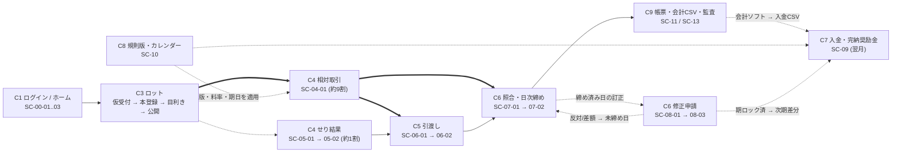
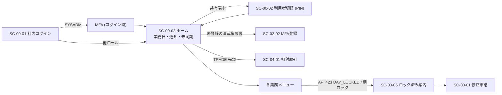
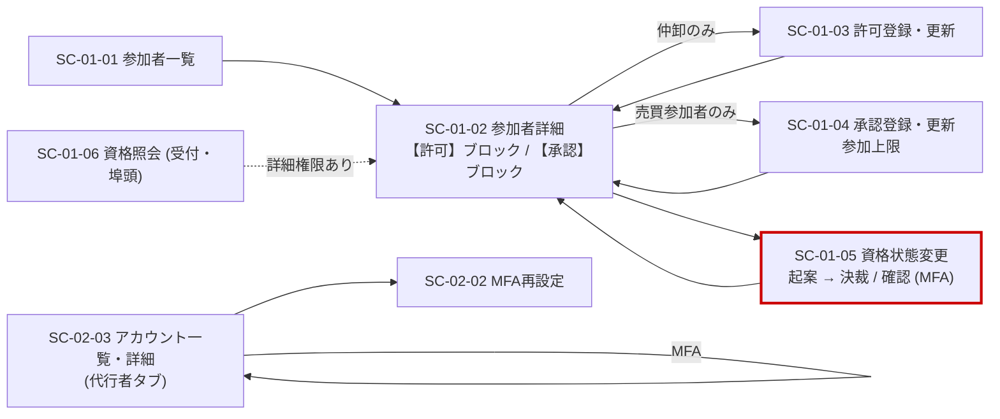
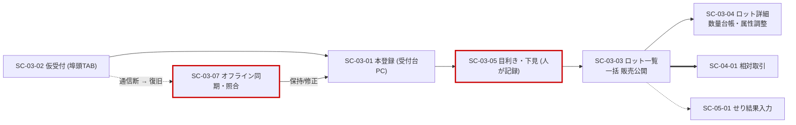
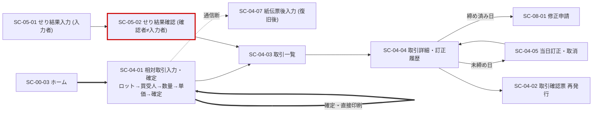
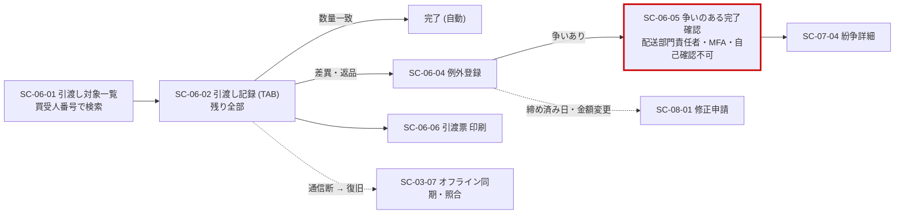
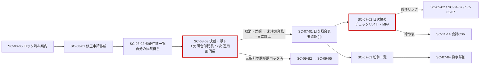
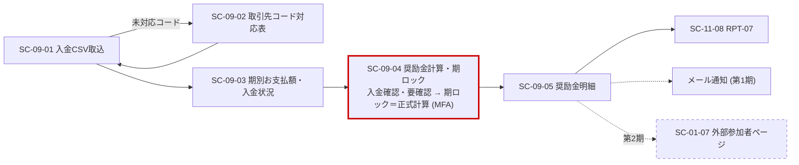
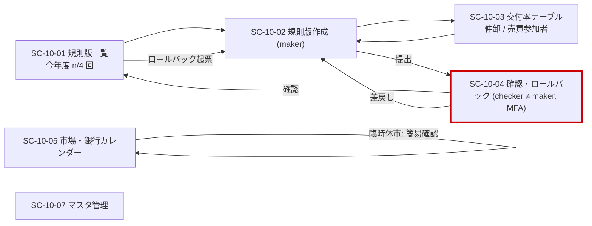
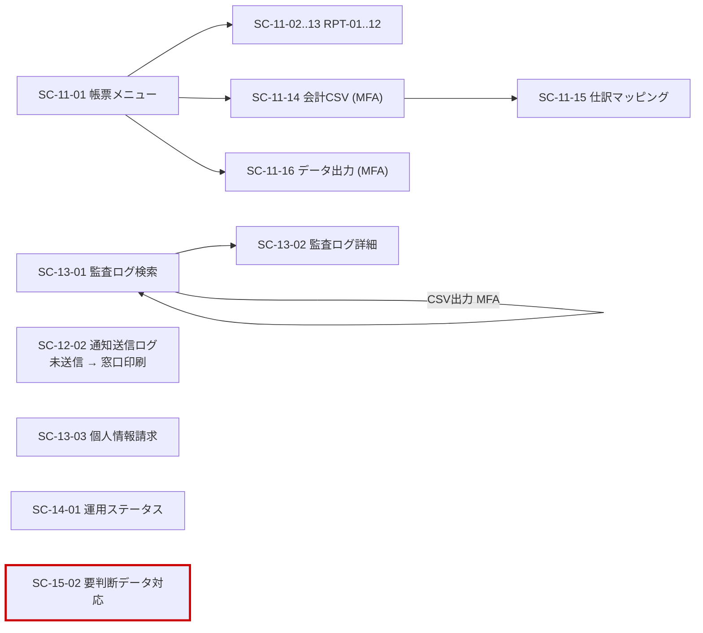

# 画面一覧・画面遷移 — 第1期 (70 画面)

第1期の to-be 画面一覧（PREMISE §1.2 に基づく R1 パッケージ：99 FT / 70 画面 + 10 バッチ）と、クラスタごとの画面遷移図です。画面の ID、名称、役割、端末の出典：画面一覧 LAB-1 版 1.7（`project/04_screen/screen-list.md`、本リポジトリには含まれません）。プロトタイプの状態：LAB-2 の画面リスト版 1.2 + as-is 報告 P1（`plans/reports/pl-261125-lab4-p1-prototype-as-built-extraction.md`）。

画面名は、システムが日本語で動作するため日本語のまま残し、説明を日本語で補います。**内部の決裁・確認には「決裁」「確認」を使い、「承認」は使いません。「承認」は 承認（売買参加者）にのみ使います**（原則2、PRM-121）。このため、ID（PREMISE L4-D03）はそのままに、LAB-1 の 2 画面のラベルを変更しています：SC-08-03 「修正申請承認・却下」→「修正申請決裁・却下」、SC-10-04 「規則版承認・ロールバック」→「規則版確認・ロールバック」。

## 0. 読み方

| カラム | 値 |
|---|---|
| 種別 | `DS` 一覧・検索 · `CT` 詳細 · `NH` 入力・登録 · `DU` 確認・決裁（**決裁者**） · `BC` 帳票・出力 · `CĐ` 設定・マスタ · `XT` 認証 · `IN` 印刷プレビュー |
| 役割 | 役割の**記録・決裁**（確認）は role-list（TBL-ROLE-01）に従います。**閲覧**権限は role-list の 閲 列（L4-A06）に従い、記録は各画面の spec で定めます。`INTAKE` 受付 · `JUDGE` 目利き · `TRADE` 取引 · `DELIVERY` 配送 · `SETTLE` 照合事務局 · `RULE` ルール管理 · `SYSADM` システム管理；追加の権限として `STL-HEAD` 照合部門長 · `OPS-HEAD` 運用部門長 · `DEL-HEAD` 配送部門責任者 |
| 端末 | `PC` = PC + テンキー、すべてキーボードで操作（NFR-USE-01）· `TAB` = タッチ式タブレット、ボタン 48px 以上、手袋着用（PRM-086）· `PC/TAB` = 2 種類のレイアウト |
| プロトタイプ | `Có` = LAB-2 に動作するページあり · `Thành phần` = 共通コンポーネントとして作成 · `Mới` = プロトタイプになし、LAB-4 で新規設計 |
| LAB-4 設計レベル | `Spec` = 10 つの中核画面（L4-D02）または配送の接続 2 画面 SC-06-04、SC-06-05（L4-D07）のいずれか：ここの wireframe + P3 の Screen Specification BM-2-901-51 — **12 画面** · `WF` = ここの詳細 wireframe（PREMISE §2 の 3 行目による補足 4 画面 + L4-D05 により P3 で追加される SC-03-02）· `List` = この画面一覧の行のみ。ロジックはクラスタの Function / Technical Design にあります |

## 1. 要約

| 業務群 | ID グループ | 第1期の画面 | プロトタイプにあり | 新規 | Spec | WF | 第1期外 / 統合済み |
|---|---|---|---|---|---|---|---|
| C1 システム入口 | SC-00 | 4 | 3 | 1 (コンポーネント) | — | — | SC-00-04 (SC-00-03 に統合) |
| C2 参加者・アカウント | SC-01, SC-02 | 8 | 5 | 3 | SC-01-02 | — | SC-01-07, SC-02-01 (第2期); SC-02-05 (SC-02-03 のタブ); SC-02-04 (統合) |
| C3 ロット | SC-03 | 6 | 5 | 1 | SC-03-01, SC-03-05 | SC-03-02, SC-03-07 | SC-03-06 (SC-03-04 に統合) |
| C4 取引 — **相対（主要フロー）** + せり | SC-04, SC-05 | 8 | 5 | 3 | SC-04-01, SC-05-02 | SC-04-05 | SC-04-06 (SC-04-05 のボタン); SC-04-08 (削除); SC-05-03 (統合) |
| C5 引渡し | SC-06 | 5 | 1 | 4 | SC-06-02, SC-06-04 ★, SC-06-05 ★ | — | SC-06-03 (PC レイアウトを廃止) |
| C6 照合・日次締め・修正申請 | SC-07, SC-08 | 7 | 5 | 2 | SC-07-02, SC-08-03 | — | — |
| C7 精算・完納奨励金 | SC-09 | 5 | 3 | 2 | SC-09-04 | — | — |
| C8 規則版・カレンダー・マスタ | SC-10 | 6 | 4 | 2 | SC-10-04 | — | SC-10-06 (設定ファイル、PRM-126) |
| C9 帳票・通知・監査・運用・移行 | SC-11..SC-15 | 21 | 1 | 20 | — | — | SC-13-04, SC-15-01, SC-15-03 (削除); SC-11-07, SC-12-01 (統合) |
| **合計** | | **70** | **32** | **38** | **12** (代表 10 + ★ 2 件 L4-D07) | **3** | **第1期外 12 + 統合 4** |

数え方：画面一覧 LAB-1 の 82 画面 − 第1期外の 12 画面 = **70**（機能一覧 §7.4、DEC-031 による数え方）。統合 ID の 4 件は 82 に含めません。バッチ（10）は画面ではないため §4 に記載します。

## 2. 画面一覧 — 第1期 70 画面

### C1 システム入口 (SC-00)

| # | SC-ID | 画面名 | 名称（説明） | 種別 | 役割 | 端末 | Prototype | レベル | to-be 備考 |
|---|---|---|---|---|---|---|---|---|---|
| 1 | SC-00-01 | 社内ログイン | 社内ログイン | XT | 社内の全役割 | PC/TAB | 有 | List | SYSADM はログイン時に即 MFA。その他の役割は PREMISE §3.2（L4-A07）に従い、操作の前に MFA（step-up）。プロトタイプには MFA なし（M02） |
| 2 | SC-00-02 | 利用者切替（PIN） | 共用端末での利用者切替 | XT | INTAKE, JUDGE, TRADE, DELIVERY (+ 責任者権限) | PC/TAB | 有 | List | PIN 4 桁；オフラインは N 時間まで有効、オフライン時は決裁不可（M03, E-18）；利用者を替えると MFA は無効 |
| 3 | SC-00-03 | ホーム（業務メニュー） | 役割別ホーム | DS | 社内の全役割 | PC/TAB | 有 | List | 通知枠を追加（SC-00-04 を統合、PRM-130）、ネットワーク状態と未同期件数を表示（M04, M09）。TRADE：先頭のショートカットは相対。**タブレット：** 役割ごとに大きいボタン 4〜6 個のグリッド、順序固定、待ち件数付き；「ホーム」ボタンは文字表示（「≡」は使わない）— `_common-layout` C-13, C-14（Q-WF-02 は【顧客（模擬）、2026-11-25】により回答済み） |
| 4 | SC-00-05 | エラー・ロック済み案内 | ロック済みレコードの案内（共通） | CT | 社内の全役割 | PC/TAB | 構成要素 | List | API が 423 `DAY_LOCKED` / 期ロック済みを返したときのバナー → SC-08-01 へのボタン。状態の共通パターンは `_common-layout.md` を参照 |

### C2 参加者・アカウント (SC-01, SC-02)

| # | SC-ID | 画面名 | 名称（説明） | 種別 | 役割 | 端末 | Prototype | レベル | to-be 備考 |
|---|---|---|---|---|---|---|---|---|---|
| 5 | SC-01-01 | 参加者一覧・検索 | 参加者一覧 | DS | SETTLE | PC | 有 | List | 種別、状態（有効 / 一時停止 / 失効 / 再審査）、期限切れ間近で絞り込み |
| 6 | SC-01-02 | 参加者詳細・編集 | 参加者詳細 | NH | SETTLE (STL-HEAD) | PC | 有 | **Spec** | **許可（仲卸）と承認（売買参加者）の 2 ブロックを分離**（L4-D02）；保証金の履歴（D14） |
| 7 | SC-01-03 | 許可登録・更新（仲卸） | 許可の登録・更新（仲卸） | NH | SETTLE (STL-HEAD) | PC | 有 | List | SC-01-02 の 許可 ブロックから開く；仲卸のみ |
| 8 | SC-01-04 | 承認登録・更新（売買参加者） | 承認の登録・更新 + 参加上限（売買参加者） | NH | SETTLE (STL-HEAD) | PC | 有 | List | SC-01-02 の 承認 ブロックから開く；売買参加者のみ |
| 9 | SC-01-05 | 資格状態変更（一時停止・再審査・期限前更新） | 資格状態の変更・更新 | DU | SETTLE（入力）, STL-HEAD（起案 / 確認）, OPS-HEAD（決裁） | PC | 新規 | List | 決裁には MFA；期限前更新は再審査を経由しない（PRM-121）；内部の手順に「承認」の語は使わない（S6） |
| 10 | SC-01-06 | 資格照会 | 資格の簡易照会 | DS | INTAKE, TRADE, DELIVERY, … | PC/TAB | 新規 | List | 色 + 文字（色だけに頼らない）；許可 / 承認 を正しく表示 |
| 11 | SC-02-02 | MFA登録・再設定 | MFA の登録・再設定 | XT | STL-HEAD, OPS-HEAD, DEL-HEAD, SYSADM, 代行者 | PC | 新規 | List | 個人の携帯電話を持たない人向けにコード受取の方法を用意（L4-A07、認証の ADR） |
| 12 | SC-02-03 | アカウント一覧・詳細 | アカウント一覧・詳細 | NH | SYSADM | PC | 有 | List | 代行者タブを追加（SC-02-05 を統合、PRM-129）；役割・権限の変更前に MFA |

### C3 ロット (SC-03)

| # | SC-ID | 画面名 | 名称（説明） | 種別 | 役割 | 端末 | Prototype | レベル | to-be 備考 |
|---|---|---|---|---|---|---|---|---|---|
| 13 | SC-03-01 | ロット本登録（受付台・PC） | ロットの本登録 | NH | INTAKE | PC | 有 | **Spec** | 出荷者は自由入力のテキストではなくコード（D15）；業務日はロット受付時刻 01:00 から紐づく（E-16） |
| 14 | SC-03-02 | ロット仮受付（埠頭・タブレット） | 埠頭でのロット仮受付 | NH | INTAKE | TAB | 有 | **WF** | 端末にオフライン保存 +「未同期 n件」（M04）；第1期は埠頭での撮影なし。wireframe [SC-03-02](SC-03-02-lot-provisional-intake-dock-tablet-wireframe.md) は P3 で顧客 #22 に従い作成（wireframe のみ、完全な spec ではない — PREMISE L4-D05）：品目は大きいボタン・順序固定、SL は空欄 + 大きなテンキー、仮番号は端末で採番 |
| 15 | SC-03-03 | ロット一覧・検索 | ロット一覧 | DS | INTAKE, JUDGE, TRADE | PC | 有 | List | 販売公開の一括操作；販売終了 / 持ち越し（D12, E-12） |
| 16 | SC-03-04 | ロット詳細 | ロット詳細 + 台帳 | CT | INTAKE, JUDGE, TRADE, SETTLE | PC | 有 | List | ロット属性の修正を含む（SC-03-06 を統合、PRM-128）：理由、変更前後 |
| 17 | SC-03-05 | 目利き・下見結果入力 | 目利き・下見結果の入力 | NH | JUDGE | PC/TAB | 有 | **Spec** | **入力は評価担当者が行う — AI / OCR は使わない**（CAP-HUMAN-01） |
| 18 | SC-03-07 | オフライン同期・照合 | 通信断後の同期・照合 | DU | INTAKE, DELIVERY | PC/TAB | 新規 | **WF** | 競合は担当者が 残す / 削除 / 修正 を選択；自動で統合しない（DEC-004, M04） |

### C4 取引 (SC-04 相対 — 主要フロー、SC-05 せり — 結果の記録)

| # | SC-ID | 画面名 | 名称（説明） | 種別 | 役割 | 端末 | Prototype | レベル | to-be 備考 |
|---|---|---|---|---|---|---|---|---|---|
| 19 | SC-04-01 | 相対取引入力・確定 | 相対取引の入力・確定 | NH | TRADE | PC | 有 | **Spec** | **最も使われる画面**；オンライン必須；取引確認票をそのまま印刷（M05）；期ごとの参加上限（M19） |
| 20 | SC-04-02 | 取引確認票（再発行・印刷プレビュー） | 取引確認票の再印刷 | IN | TRADE | PC | 新規 | List | 再印刷のみ、「再発行」の表示あり |
| 21 | SC-04-03 | 取引一覧・検索 | 取引一覧 | DS | TRADE, SETTLE | PC | 有 | List | 初期表示は相対で絞り込み；新しい順 |
| 22 | SC-04-04 | 取引詳細（訂正履歴） | 取引詳細・訂正履歴 | CT | TRADE, SETTLE | PC | 有 | List | 業務日の状態に応じて**ボタンを 1 つだけ**表示：未締めの日は「当日訂正・取消」→ SC-04-05；締め済みの日は「修正申請」→ SC-08-01。ボタン横に理由の文：「未締めのため、その場で訂正できます（照合が確認します）」/「この業務日は締め済のため、修正申請（決裁が必要）になります」。先頭行に取引自体の**業務日** +「締め済」ラベル（取引は開いている日とは別の日に属することがある）。修正者が元の確定者と異なる場合は両方の名前を表示。Q-WF-03 は【顧客（模擬）、2026-11-25】により回答済み — 顧客 #26 |
| 23 | SC-04-05 | 当日訂正（＋取消） | 当日の訂正・取消 | NH | TRADE | PC | 新規 | **WF** | 取消の専用ボタンを含む（SC-04-06 を統合、PRM-127）；2 段階の決裁はなし；履歴を保持（M17, D11） |
| 24 | SC-04-07 | 紙伝票後入力 | 紙伝票の後入力 | NH | TRADE | PC | 新規 | List | 入力グリッド；許可 / 承認 は実際の取引時刻で確認；重複が疑われる行は決裁者の判断待ち |
| 25 | SC-05-01 | せり結果入力 | せり結果の入力 | NH | TRADE (入力者) | PC | 有 | List | 結果の記録のみ；ライブのせり画面はなし |
| 26 | SC-05-02 | せり結果確認 | せり結果の確認（セッション単位） | DU | TRADE (確認者) | PC | 有 | **Spec** | **決裁者**（CAP-HUMAN-01）；確認者 ≠ 入力者（S2）；参加上限を超えるのは売買参加者のみ（L4-A04） |

### C5 引渡し (SC-06)

| # | SC-ID | 画面名 | 名称（説明） | 種別 | 役割 | 端末 | Prototype | レベル | to-be 備考 |
|---|---|---|---|---|---|---|---|---|---|
| 27 | SC-06-01 | 引渡し対象一覧 | 引渡し対象の一覧 | DS | DELIVERY | PC/TAB | 新規 | List | プロトタイプは検索を SC-06-02 に含めていたが、to-be では分離；事務所 PC で 08:00 以降に買受人の問い合わせに対応（KPI-05）。埠頭のタブレットは直接 SC-06-02 へ。配送部門責任者は 09:30 の巡回のため、タブレットで SC-06-01 を**閲覧専用**で開ける（顧客 #30）。Q-WF-01 は【顧客（模擬）、2026-11-25】により回答済み：分離 |
| 28 | SC-06-02 | 引渡し記録（タブレット） | 引渡し記録（タブレット） | NH | DELIVERY | TAB | 有 | **Spec** | オフライン保存（M04）；「例外」ボタン → SC-06-04 |
| 29 | SC-06-04 | 引渡し例外登録 | 引渡し例外の登録 | NH | DELIVERY, DEL-HEAD | PC/TAB | 新規 | **Spec** (L4-D07) | 不足 / 過剰 / 返品 / 一部取消 + 理由 + 画像（PC）（M16） |
| 30 | SC-06-05 | 争いのある引渡し完了確認 | 争いのある引渡し完了の確認 | DU | DEL-HEAD | PC/TAB | 新規 | **Spec** (L4-D07) | **決裁者**、MFA、自己確認は禁止（S1, PRM-111） |
| 31 | SC-06-06 | 引渡票（印刷・再発行） | 引渡票の印刷・再印刷 | IN | DELIVERY | PC/TAB | 新規 | List | |

### C6 照合・日次締め・修正申請 (SC-07, SC-08)

| # | SC-ID | 画面名 | 名称（説明） | 種別 | 役割 | 端末 | Prototype | レベル | to-be 備考 |
|---|---|---|---|---|---|---|---|---|---|
| 32 | SC-07-01 | 日次照合表 | 日次照合表 | DS | SETTLE | PC | 有 | List | 相対 / せり / 訂正 で分ける；要確認（n）：せりの自己確認、参加上限超過（理由あり）（顧客 #10）、当日訂正（2 段階の閾値以上、または買受人変更 → 「確認済」を押す必要あり、顧客 #25）、締め前に金額が変わる引渡し例外（「確認済」を押す必要あり、顧客 #4）。「確認済」列で照合 |
| 33 | SC-07-02 | 日次締め | 業務日の締め | DU | STL-HEAD（または代行） | PC | 有 | **Spec** | チェックリスト + MFA；**再オープンのボタンはなし**（BR-CLOSE-01） |
| 34 | SC-07-03 | 紛争一覧 | 紛争一覧 | DS | SETTLE, DEL-HEAD | PC | 新規 | List | SLA の残り / 期限超過の列 |
| 35 | SC-07-04 | 紛争詳細・対応 | 紛争の詳細・対応 | NH | SETTLE, DEL-HEAD | PC | 新規 | List | 取引 / 引渡し回 / SC-06-05 へのリンク |
| 36 | SC-08-01 | 修正申請作成（FORM-CORR-01） | 修正申請の作成 | NH | TRADE, DELIVERY, SETTLE | PC | 有 | List | 金額への影響と決裁段数を事前表示（金額変動が最大の買受人ごとの閾値；買受人変更は常に 2 段）；添付（M11）。種別：TRADE / KANNO / INCENTIVE / LATE_ENTRY（後入力、締め済みの日用、SC-03-07 / SC-04-07 から開く）。C-24 で 423 に途中で当たった場合は、入力中の内容を**初期入力**（顧客 #5） |
| 37 | SC-08-02 | 修正申請一覧 | 修正申請一覧 | DS | TRADE, DELIVERY, SETTLE, STL-HEAD, OPS-HEAD | PC | 有 | List | 決裁者：既定は「自分の決裁待ち」 |
| 38 | SC-08-03 | 修正申請決裁・却下 | 修正申請の決裁・却下 | DU | STL-HEAD (1次), OPS-HEAD (2次) | PC | 有 | **Spec** | **決裁者**、MFA；2 段階の閾値は版管理された規則から取得（M13, D07）、金額変動が最大の買受人ごとに比較；LAB-1 の「修正申請承認・却下」は L4-D03 により変更 |

### C7 精算・完納奨励金 (SC-09)

| # | SC-ID | 画面名 | 名称（説明） | 種別 | 役割 | 端末 | Prototype | レベル | to-be 備考 |
|---|---|---|---|---|---|---|---|---|---|
| 39 | SC-09-01 | 入金CSV取込 | 入金 CSV の取込 | NH | SETTLE | PC | 有 | List | 実フォーマットは E-01 / E-02 の回答待ち；エラー行 → SC-09-02 |
| 40 | SC-09-02 | 取引先コード対応表 | 取引先コード対応表 | CĐ | SETTLE | PC | 新規 | List | |
| 41 | SC-09-03 | 期別お支払額・入金状況 | 期別のお支払額・入金状況 | DS | SETTLE, STL-HEAD | PC | 有 | List | 割当表で入金を期に配分（D03） |
| 42 | SC-09-04 | 奨励金計算・期ロック | 奨励金の計算・期ロック | DU | STL-HEAD | PC | 有 | **Spec** | ロックの前に、入金がどの期に割り当てられたかを表示（OPEN-L4-02）；交付率表 2 種（D01）；**試算** + 期ロックのみ（正式計算はロックと同一トランザクション — N13） |
| 43 | SC-09-05 | 奨励金明細 | 奨励金の明細（人 × 期） | CT | SETTLE, STL-HEAD | PC | 新規 | List | 適用版、差分、繰り越しの残り |

### C8 規則版・カレンダー・マスタ (SC-10)

| # | SC-ID | 画面名 | 名称（説明） | 種別 | 役割 | 端末 | Prototype | レベル | to-be 備考 |
|---|---|---|---|---|---|---|---|---|---|
| 44 | SC-10-01 | 規則版一覧 | 規則版の一覧 | DS | RULE, STL-HEAD | PC | 有 | List | カウンター「今年度 n/4 回」は go-live のセットを含めない（D06） |
| 45 | SC-10-02 | 規則版作成・編集 | 規則版の作成・編集（作成者） | NH | RULE | PC | 有 | List | 交付率表だけでなく、規則のパラメータ §3.1（PREMISE）すべてを含む（D09） |
| 46 | SC-10-03 | 交付率テーブル編集 | 交付率テーブルの編集 | NH | RULE | PC | 有 | List | タブ 2 つ：仲卸 / 売買参加者（D01） |
| 47 | SC-10-04 | 規則版確認・ロールバック | 規則版の確認・ロールバック（確認者） | DU | STL-HEAD | PC | 有 | **Spec** | 作成者 ≠ 確認者、MFA；4 回に達した場合のロールバック：2 分岐は E-14 待ち（OPEN-L4-01）；LAB-1 の「規則版承認・ロールバック」は L4-D03 により変更 |
| 48 | SC-10-05 | 市場・銀行カレンダー | 市場・銀行カレンダー | CĐ | RULE (入力), STL-HEAD (簡易決裁) | PC | 新規 | List | 臨時休市 / 臨時開市は年 4 回に数えない（M10）。銀行フラグは支払期日に使用（銀行休業日に当たる場合は前の銀行営業日） |
| 49 | SC-10-07 | マスタ管理（税率・品目・単位・出荷者） | 税率・品目・単位・出荷者のマスタ管理 | CĐ | RULE, SYSADM | PC | 新規 | List | |

### C9 帳票・通知・監査・運用・移行 (SC-11..SC-15)

| # | SC-ID | 画面名 | 名称（説明） | 種別 | 役割 | 端末 | Prototype | レベル | to-be 備考 |
|---|---|---|---|---|---|---|---|---|---|
| 50 | SC-11-01 | 帳票メニュー | 帳票メニュー | DS | SETTLE, STL-HEAD, OPS-HEAD (ほかの役割は P36 による) | PC | 新規 | List | 固定の 12 帳票の一覧；共通の表示枠（M12） |
| 51 | SC-11-02 | RPT-01 日次取引集計 | 日次の取引集計 | BC | SETTLE | PC | 新規 | List | 相対 / せり で分ける |
| 52 | SC-11-03 | RPT-02 ロット履歴・取引状態ログ | ロット履歴・取引状態のログ | BC | SETTLE, INTAKE | PC | 新規 | List | |
| 53 | SC-11-04 | RPT-03 失効済・失効間近参加者 | 失効済・失効間近の参加者 | BC | SETTLE, INTAKE | PC | 新規 | List | 受付窓口用の印刷版（第1期では外部参加者ページの代わり、L4-A08） |
| 54 | SC-11-05 | RPT-04 滞留引渡し・例外 | 滞留引渡し・例外 | BC | DELIVERY, SETTLE | PC | 新規 | List | |
| 55 | SC-11-06 | RPT-05 日次照合表 | 日次照合表（出力） | BC | SETTLE | PC | 新規 | List | レイアウトは FORM-SETTLE-01 |
| 56 | SC-11-08 | RPT-07 期別完納奨励金 | 期別の完納奨励金の結果 | BC | SETTLE, STL-HEAD | PC | 新規 | List | |
| 57 | SC-11-09 | RPT-08 ロック後調整ログ | ロック後の調整ログ | BC | SETTLE, STL-HEAD | PC | 新規 | List | |
| 58 | SC-11-10 | RPT-09 紛争・SLA集計 | 紛争・SLA の集計 | BC | SETTLE, DEL-HEAD | PC | 新規 | List | |
| 59 | SC-11-11 | RPT-10 参加者別月次 | 参加者別の月次 | BC | SETTLE, OPS-HEAD | PC | 新規 | List | |
| 60 | SC-11-12 | RPT-11 取引種別別月次 | 取引種別別の月次 | BC | SETTLE, OPS-HEAD | PC | 新規 | List | 相対 / せり |
| 61 | SC-11-13 | RPT-12 ルール変更・適用版 | 規則の変更・適用版 | BC | RULE, STL-HEAD | PC | 新規 | List | ロールバック回数を含む（OPEN-L4-01 の N2 分岐） |
| 62 | SC-11-14 | 会計連携CSV出力・会計照合用出力表（RPT-06） | 会計連携 CSV と RPT-06 の出力 | BC | SETTLE | PC | 新規 | List | 作成時にバッチで固定（PRM-123, M06）；出力時に MFA |
| 63 | SC-11-15 | 仕訳マッピング設定 | 仕訳マッピング設定 | CĐ | SETTLE, STL-HEAD | PC | 新規 | List | |
| 64 | SC-11-16 | データ出力 | データ出力 | BC | SETTLE, SYSADM | PC | 新規 | List | 構造化データの CSV 3 種（固定、パッケージ ④）；MFA |
| 65 | SC-12-02 | 通知送信ログ | 通知送信ログ | DS | SYSADM | PC | 新規 | List | 再送は 3 回まで；照合用の「未送信」一覧（L4-A08） |
| 66 | SC-13-01 | 監査ログ検索 | 監査ログ検索 | DS | SETTLE, STL-HEAD, SYSADM | PC | 有 | List | CSV 出力は MFA；追記のみ、修正・削除は不可（M24） |
| 67 | SC-13-02 | 監査ログ詳細 | 監査ログ詳細 | CT | SETTLE, STL-HEAD, SYSADM | PC | 新規 | List | 変更前 / 変更後、「代行: 〜の代わりに」 |
| 68 | SC-13-03 | 個人情報請求対応 | 個人情報請求（APPI）対応（簡略版） | NH | SYSADM, STL-HEAD | PC | 新規 | List | C-06 の簡略版 |
| 69 | SC-14-01 | 運用ダッシュボード | 運用ステータス（簡略版） | DS | SYSADM, STL-HEAD | PC | 新規 | List | C-04 の簡略版：状態ページ 1 枚 + メール |
| 70 | SC-15-02 | 要判断データ対応 | 移行で判断が必要なデータの対応 | DU | SETTLE | PC | 新規 | List | **決裁者**が行ごとに判断；時間のカウント / 40 時間 |

## 3. 第1期の対象外の画面（追跡のため ID を保持）

| SC-ID | 画面名 | 第1期での扱い | 出典 |
|---|---|---|---|
| SC-00-04 | 通知一覧 | SC-00-03 上の通知枠で対応 | PRM-130 (K7) |
| SC-01-07 | 外部参加者マイページ | 第2期；代わりにメール + 窓口で印刷したリスト | DEC-019, L4-A08, SEC-IAM-02 |
| SC-02-01 | 外部参加者ログイン（メールOTP） | 第2期 | 同上 |
| SC-02-05 | 代行者指定 | SC-02-03 のタブ | PRM-129 (K4) |
| SC-03-06 | ロット属性調整 | SC-03-04 で修正 | PRM-128 (K3) |
| SC-04-06 | 取引取消 | SC-04-05 上の専用ボタン | PRM-127 (K2) |
| SC-04-08 | シフト引継ぎ | 画面を削除（C-01, ③） | DEC-031 |
| SC-06-03 | 引渡し記録（PC） | PC レイアウトを削除；タブレットで引渡しを行う | C-08 |
| SC-10-06 | 運用パラメータ・通知設定 | 履歴付きの設定ファイル；金額に関わるパラメータは版管理された規則に含める | PRM-126 (K1), PREMISE §3.1 |
| SC-13-04 | 証憑アーカイブ復元申請 | IT 経由の手続き、約束 ≤ 2 営業日 | C-05 |
| SC-15-01 | 移行データ取込・検証 | スクリプト + ログ | C-07 |
| SC-15-03 | 移行照合レポート | 署名用の照合ファイル（ACC-04） | C-07 |
| SC-02-04 · SC-05-03 · SC-11-07 · SC-12-01 | (統合) | SC-02-03 · SC-04-04 · SC-11-14 · 設定ファイルに統合済み | 画面一覧 LAB-1 版 1.1 |

明確に対象外（オプション / 対応しない、ルール 6）：顧客ポータル、ライブのせり画面、AI による鮮度判定、画像からの符丁読取り、**締め済みの日の再オープン**、分析 / 予測ダッシュボード — この一覧には画面はありません。

## 4. バッチ（画面ではない。遷移図との照合用）

| ID | 作業 | 関連画面 |
|---|---|---|
| SC-01-B1 | 失効の自動処理 + 失効間近の警告 | SC-01-01, SC-11-04 |
| SC-07-B1 | 業務日の計画的な開設：日次締めが次の市場の業務日を開く；ロット受付開始時刻（`LOT_INTAKE_START_TIME`、暫定 01:00 JST）のジョブは安全網 | SC-00-03, SC-10-05, SC-07-02 |
| SC-07-B2 | 精算の日次計算 | SC-07-01 |
| SC-09-B1 | 期のお支払額の計算 + メール | SC-09-03 |
| SC-09-B2 | 次期への奨励金の差分 | SC-09-05 |
| SC-11-B1 | 日次帳票 + 会計ファイル（11:00 前） | SC-11-14 |
| SC-12-B1 | 通知の送信 / 再送 | SC-12-02 |
| SC-14-B1 | 開始前の点検（監視の警告に置き換え） | SC-14-01 |
| SC-14-B2 | バックアップ / PITR | — |
| SC-15-B1 | 移行のリハーサル | SC-15-02 |

## 5. 画面遷移

### 5.0 ナビゲーション

| 層 | 内容 |
|---|---|
| 全体（ヘッダー） | システム名 · **業務日** · ネットワーク状態 / 未同期 n件 · **利用者名**（常時表示） · 利用者切替 · ログアウト |
| メニューグループ（役割別、権限のあるグループのみ表示） | 取引（相対が先頭） · ロット · 引渡し · 照合・締め · 精算・奨励金 · 規則・マスタ · 帳票 · 管理 |
| 画面内 | パンくず；文脈リンク（ロット → 取引、取引 → 引渡し、締め済みの日 → 修正申請） |
| 深さ | 日常業務のすべての画面はホームから 2 手順以内；SC-04-01 = ショートカット 1 キー |
| タブレット | 左メニューを隠す；ホームは役割ごとの大きいボタン（FB LAB-2 #13） |

Mermaid の記号：`==>` 主要フロー（相対）、`-->` 通常フロー、`-.->` 例外 / 条件付き分岐。赤枠のノード = **決裁者**の判断点（CAP-HUMAN-01）。破線のノード = 第1期外。

### 5.1 クラスタ別の概要 — 1 業務日

### 5.2 C1 入口 — ログイン・利用者切替・ホーム

### 5.3 C2 参加者・アカウント

### 5.4 C3 ロット

### 5.5 C4 取引 — 相対（主要フロー）と せり

### 5.6 C5 引渡し

### 5.7 C6 照合・締め・修正申請

### 5.8 C7 精算・完納奨励金 (翌月)

### 5.9 C8 規則版・カレンダー・マスタ

### 5.10 C9 帳票・通知・監査・運用・移行

## 6. 顧客に確認した点（画面 / 画面遷移）

以下の 3 件は **【顧客（模擬）、2026-11-25】により回答済み**（`customer-feedback-lab4-wireframes-261125.md`）。画面に反映し、`qa.md` でクローズ済みです。

| # | 論点 | 回答 | 適用箇所 |
|---|---|---|---|
| Q-WF-01 | SC-06-01 を SC-06-02 から分離 — 埠頭の受渡担当は別の一覧が必要か？ | **分離**（前提どおり）：タブレットは SC-06-02 に直接入り検索を使う；SC-06-01 は事務所 PC 向け（KPI-05）；希望事項：配送部門責任者向けに、タブレットで SC-06-01 を閲覧専用にする | SC-06-01 の行 |
| Q-WF-02 | タブレットのメニュー：左メニューの代わりに役割別の大きな「ホーム」ボタン | **同意**。条件：役割ごとに 4〜6 個、順序固定、待ち件数の表示、「≡」の代わりに「ホーム」/「メニュー」の文字、利用者名 + 利用者切替は常に表示 | `_common-layout` C-13, C-14；SC-00-03 の行 |
| Q-WF-03 | SC-04-04 で、当日訂正 / 修正申請 のボタンが日の状態により表示 — 確定者は理解できるか？ | **理解できる**。ボタン横に理由の文を追加し、業務日 + 取引自身の締め済みラベルを表示；当日訂正の入力中に 423 が出た場合は内容を保持し SC-08-01 に引き継ぐ | SC-04-04, SC-08-01 の行；WF SC-04-05 |

## 変更履歴

| No | Version | Action | 変更内容 | 更新日 | 更新者 | Approve |
|---|---|---|---|---|---|---|
| 1 | 0.1.0 | Add new | 初版：第1期 70 画面を 9 クラスタで整理、プロトタイプの状態 / 設計レベル、対象外の ID 16 件、バッチ 10 件、画面遷移図 10 件 | 2026-11-25 | phuongnnm-23344 | |
| 2 | 0.2.0 | Update | Gate 1：内部の「承認」表記を「決裁 / 確認」に変更（SC-08-02, SC-08-03, SC-10-04, C1, C2, C6, C8 の図）し、§0 にルールを記載（M-06, L4-D03）；mermaid で `:::human` を矢印から分離し `class` 行に（m-08）；バッチの業務日開設を D3 に従う（M-01）；SC-09-04 は 試算 + 期ロック のみ（M-02）；SC-00-03 行（Q-WF-02, #32）、SC-04-04 行（Q-WF-03, #26）、SC-06-01 行（Q-WF-01, #30）、SC-07-01 行（#4, #10, #25）、SC-08-01 行（#5, LATE_ENTRY）、SC-03-02 行（#22 未作成）；§6 に Q-WF-01〜03 の回答を記載 | 2026-11-25 | phuongnnm-23344 | |
| 3 | 0.2.1 | Update | SC-03-02：P3 で受講者が追加 wireframe を確定（L4-D05, 顧客 #22）；§1 クラスタ C3 の WF 列に SC-03-02 を追加、WF 合計 4 → 5 | 2026-11-25 | phuongnnm-23344 | |
| 4 | 0.2.2 | Update | Gate 2 G2-m05：SC-06-04, SC-06-05 を Spec レベルへ（L4-D07）、Spec 合計 12 / WF 3 | 2026-11-25 | phuongnnm-23344 |  |
