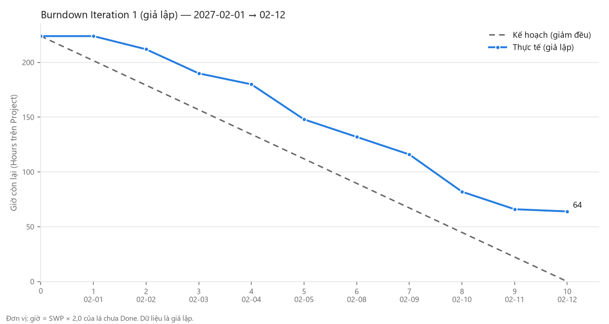

# Báo cáo tiến độ — Iteration 1 (giả lập)

| Mục | Nội dung |
|---|---|
| Iteration trên Project | **Iteration 1** — trường Iteration của [GitHub Project 1](https://github.com/users/phuongnnm-23344/projects/1) (= S1 trong WBS LAB-1) |
| Khoảng thời gian giả lập | **2027-02-01 (thứ Hai) → 2027-02-12 (thứ Sáu)**, 10 ngày làm; báo cáo chốt số cuối ngày 2027-02-12 |
| Phạm vi S1 | FG-01 tư cách người tham gia (許可 của 仲卸 và 承認 của 売買参加者 là hai bản ghi riêng) + FG-02 đăng nhập / đổi người bằng PIN + ghi nhật ký (FG-13). 相対取引 là luồng chính, làm ở S3; S1 dựng phần kiểm tư cách mà 相対 sẽ dùng (BR-PERM-01) |
| Bản tiếng Nhật gửi khách | [`ja/progress-report.md`](ja/progress-report.md) |

> **Toàn bộ tiến độ trong báo cáo này là giả lập** (bài luyện tập LAB-5): dự án chưa chạy thật, không có dữ liệu thật của khách. Những sự kiện phía khách trong nhật ký (câu hỏi, trả lời, file gửi tới) là kịch bản giả lập, gắn nhãn `[Giả lập]` trong [`progress/iteration-1-daily.csv`](progress/iteration-1-daily.csv). Số issue, SWP, Hours và Status là số thật trên Project, đọc lại bằng script.

**Tóm tắt.** Cam kết 26 lá / 112 SWP / 224 giờ. Cuối sprint: **20 lá Done = 80 SWP (71%)**, còn 6 lá / 32 SWP / 64 giờ chuyển sang S2. Đổi người bằng PIN trên PC dùng chung và tra tư cách người mua bằng bàn phím đã xong. Phần 承認 (nhánh 却下) và màn 一時停止 chưa xong — nguyên nhân chính là một câu hỏi nghiệp vụ còn chờ khách trả lời và màn FE phải tự dựng component vì chưa có bộ component dùng chung. Phần chưa xong được nhận trước tiên ở S2; **lịch S3 (相対取引) giữ nguyên**.

Nguồn số: Status / Point đếm từ Project bằng [`backlog/scripts/set-iteration-status-on-project.py`](backlog/scripts/set-iteration-status-on-project.py); burndown sinh từ nhật ký bằng [`backlog/scripts/render-iteration-burndown.py`](backlog/scripts/render-iteration-burndown.py); nhật ký được kiểm (ngày làm, chuyển trạng thái, Done sau phụ thuộc) bằng [`backlog/scripts/iteration-daily-log.py`](backlog/scripts/iteration-daily-log.py). Hours = SWP × 2,0 ([`estimate.md`](estimate.md) §2).

## 1. Trạng thái cuối sprint

Đơn vị đếm là **lá** (issue không có sub-issue). Issue cha #302 (SC-01-06, gồm #357 và #358) là Done trên Project nhưng không đếm thêm để không cộng SWP hai lần.

| Trạng thái | Số issue | Tổng SWP | Hours | Ghi chú |
|---|---|---|---|---|
| Done | 20 | 80 | 160 | #22, #88, #89, #151, #224, #225, #227, #255, #256, #263, #286, #289, #306, #333, #357, #358, #384, #423, #471, #484. Giờ làm thật (giả lập) 169 giờ, vượt 5,6% so với Hours |
| In Review | 2 | 6 | 12 | #300 nạp danh sách người tham gia đợt 1 — đã nạp các dòng hợp lệ lên môi trường stg, chờ IT của chợ xác nhận danh sách dòng bị loại · #307 màn đăng ký 承認 (SC-01-04) — nhánh 確認 chạy với API thật, nhánh 却下 chờ #264 |
| Blocked | 1 | 5 | 10 | #264 API 確認 / 却下 承認 — nhánh 確認 xong; nhánh 却下 chờ trả lời câu hỏi #24 (có bước 弁明 trước khi 却下 hay không). Không tự chọn thay khách |
| In Progress | 2 | 13 | 26 | #425 màn 一時停止 (SC-01-05) — còn bước gửi 決裁 và lưu giờ phút · #427 test vòng đời 許可 — đăng ký / 決裁 đã chạy, phần 一時停止 chờ #425 |
| Todo | 1 | 8 | 16 | #428 test vòng đời 承認 — case viết chung khuôn với #427, chưa chạy được vì chờ #264, #307, #425 |
| **Tổng** | **26** | **112** | **224** | Project: 27 item Iteration 1 (26 lá + cha #302), đọc lại 27 / 27 khớp |

### 1.1 Điều kiện dùng thử S1

| Điều kiện | Kết quả | Issue |
|---|---|---|
| AC-S1-1 Demo bằng danh sách người tham gia đã che của chợ (actors.csv đợt 1), không dùng dữ liệu bịa | **Một phần** — nạp các dòng hợp lệ; dòng thiếu 失効日 tạm loại, chờ đợt 2 | #300 (In Review), câu hỏi #63 |
| AC-S1-2 Đăng ký 許可 cho 仲卸, 承認 cho 売買参加者 (有効日 / 失効日 riêng), đặt 一時停止 theo 決裁 — trên màn | **Một phần** — 許可: đăng ký + 決裁 xong; 承認: đăng ký + 確認 chạy được, nhánh 却下 chờ #24; 一時停止 chưa xong | Done #225, #263, #227, #306 · còn #264, #307, #425, #427, #428 |
| AC-S1-3 Gõ mã người mua bằng bàn phím → thấy hiệu lực, căn cứ 許可 / 承認, ngày hết hạn | **Đạt** | #151, #357, #358 (cha #302) |
| AC-S1-4 Hai người đổi nhau bằng PIN trên PC dùng chung; nhật ký ghi đúng ai làm gì | **Đạt** | #333, #384, #289, #423, #471, #484 |

### 1.2 Phần đã thống nhất làm ở S2 (không phải trễ)

- Bước 決裁 / 確認 ở S1 nhận **token MFA ký bằng khóa test**; kiểm MFA thật làm ở S2 (#114, #387). Danh sách thao tác phải hỏi MFA không đổi.
- Vào màn SC-01-03 / 04 / 05 ở S1 bằng menu của khung màn PC + ô mã người tham gia. Khối 許可 / 承認 trên màn chi tiết người tham gia SC-01-02 (#304, #305) và phần lỗi / khóa tài khoản / hết phiên của màn đăng nhập SC-00-01 (#424) làm ở S2.
- 保証金 / 参加上限 làm cùng 相対 ở S3; email báo trước 30 ngày khi sắp 失効 làm trước UAT.

## 2. Burndown

Còn lại = Hours của lá chưa Done ở cuối ngày. Bảng đầy đủ: [`progress/iteration-1-burndown.csv`](progress/iteration-1-burndown.csv).

| Ngày | Kế hoạch (giờ) | Còn lại (giờ) | Còn lại (SWP) | Lệch (giờ) | Done trong ngày |
|---|---|---|---|---|---|
| 1 · 02-01 | 201,6 | 224 | 112 | +22,4 | — |
| 2 · 02-02 | 179,2 | 212 | 106 | +32,8 | #22, #423 |
| 3 · 02-03 | 156,8 | 190 | 95 | +33,2 | #255, #256 |
| 4 · 02-04 | 134,4 | 180 | 90 | +45,6 | #88 |
| 5 · 02-05 | 112,0 | 148 | 74 | +36,0 | #89, #225, #358, #471 |
| 6 · 02-08 | 89,6 | 132 | 66 | +42,4 | #151, #286 |
| 7 · 02-09 | 67,2 | 116 | 58 | +48,8 | #227, #357 |
| 8 · 02-10 | 44,8 | 82 | 41 | +37,2 | #224, #263, #289, #333 |
| 9 · 02-11 | 22,4 | 66 | 33 | +43,6 | #306, #384 |
| 10 · 02-12 | 0 | 64 | 32 | +64,0 | #484 |

**Lệch kế hoạch ở đâu:**

1. **Đầu sprint chậm do chuỗi phụ thuộc, không do ước lượng.** FG-02 là một chuỗi nối tiếp 4 issue: bảng IAM #255 → đăng nhập #286 → đăng ký thiết bị #333 → đổi người bằng PIN #384, cộng lại 40 giờ = cả sprint của một người ở mức 50%. FG-01 cũng vậy: #22 → #88 / #89 → #151 → #224. Issue chỉ tính Done sau review, nên hai ngày đầu gần như phẳng.
2. **Ba chỗ chờ phía khách** (giả lập): (a) IT của chợ hỏi lại thời hạn phiên đăng nhập thiết bị dùng chung trong thiết kế đã duyệt → #333 chờ 02-05 → 02-08, kết luận giữ thiết kế; (b) actors.csv đợt 1 có dòng 承認 thiếu 失効日 và mã khác định dạng → #300 chờ 02-04 → 02-10; (c) câu hỏi #24 về bước 弁明 → #264 chặn từ 02-10, 02-11 là ngày lễ ở Nhật nên chưa có trả lời.
3. **FE chưa có component dùng chung.** Bộ component (design system #500) còn là issue thô. FE-4 tự dựng ô ngày / ô giờ phút: #306 vượt 2 giờ, #425 chưa xong. FE-1 còn năng lực nên làm thêm 10 giờ component dùng chung ngoài cam kết (ghi `unplanned` trong nhật ký, chưa có issue).
4. **Test dồn cuối chuỗi.** #427 / #428 cần cả API lẫn màn xong trước; QA-1 nhận 34 giờ theo Hours trên Project, trong khi phần dành cho issue chỉ là 28 giờ (40 giờ trừ 30% giữ cho chạy case theo DoD 4).
5. **Ước lượng.** 20 lá Done: Hours 160, giờ làm 169 (+5,6%, giả lập). Giữ k = 2,0 giờ / SWP; tính lại bằng giờ thật sau S2.

Theo người (giờ cam kết theo Hours trên Project; giờ làm là giả lập):

| Người | Hours cam kết | Giờ làm | Hours đã Done | Ghi chú |
|---|---|---|---|---|
| BE-1 | 32 | 34,5 | 32 | |
| BE-2 | 36 | 38,5 | 36 | |
| BE-3 | 34 | 34,5 | 34 | |
| BE-6 | 44 | 45 | 28 | Nhận nhiều hơn 40 giờ ngay từ đầu; 2 việc bị chặn (#300, #264) |
| FE-1 | 16 | 27 | 16 | Thêm 10 giờ component dùng chung ngoài cam kết |
| FE-4 | 28 | 29,5 | 12 | Tự dựng component; #425, #307 chưa xong |
| QA-1 | 34 | 26 (+12 chạy case DoD 4) | 2 | Test chờ chuỗi dev |

## 3. Rủi ro trễ

Mốc: S2 = 2027-02-15 → 02-26 · S3 (相対取引) = 03-01 → 03-12 · điểm kiểm số 完納奨励金 cuối S4 = 03-26 · S7 = 04-26 → 05-07. "Ai làm" là vai giả định.

| # | Rủi ro | Issue | Ảnh hưởng tới mốc nào | Hành động | Ai làm, khi nào |
|---|---|---|---|---|---|
| R-01 | 6 lá chưa xong (32 SWP / 64 giờ) dồn sang S2, trong khi S2 đã có MFA thật, khối SC-01-02, lỗi đăng nhập | #264, #300, #307, #425, #427, #428 | Demo S2 (02-26); FG-01 phải xong trước S3 vì 相対 kiểm tư cách người mua | Buổi lập kế hoạch S2 nhận 6 lá này trước, giảm phần mới tương ứng 64 giờ. Lịch trượt thì dời せり / báo cáo phụ / mục "Muốn có", **không dời 相対** | PL + BrSE-1, 02-15 |
| R-02 | Câu hỏi bước 弁明 trước khi 却下 承認 chưa có trả lời | #24 → #264, #307, #428 | Demo S2; nghiệm thu FG-01 | Gửi lại qua đầu mối của chợ (照合部門長), xin trả lời trước 02-17. Quá hạn thì đề nghị chợ chốt bằng văn bản theo giả định hiện tại; nhánh 却下 làm ngay khi có câu trả lời | BrSE-1 gửi 02-15; 照合部門長 (chợ) trả lời trước 02-17 |
| R-03 | actors.csv đợt 1 có dòng thiếu 失効日 / mã khác định dạng; demo S1 chỉ dùng phần dòng hợp lệ | #300, #63 | Demo S2; chuẩn bị chuyển đổi dữ liệu (EP-FG15) | Chợ gửi dòng bổ sung cùng đợt 2; seed giữ báo cáo dòng bị loại; quy tắc kiểm này dùng lại cho migration đầy đủ | IT của chợ, đợt 2 trước 02-19 (đề nghị); BE-6 nạp lại trong 1 ngày sau khi nhận |
| R-04 | S1 dùng token MFA khóa test; nếu MFA thật trễ thì 決裁 / 確認 chưa nghiệm thu được | #114, #387, #263, #264 | Demo S2 | Nói rõ ở demo S1 (danh sách thao tác cần MFA không đổi); MFA thật là việc đầu S2 | PL nói ở demo 02-12; BE S2 02-15 → 02-19 |
| R-05 | Chưa có bộ component FE dùng chung → màn FE chậm, mỗi màn tự dựng lại | #500 (issue thô), #306, #425 | Demo S2 (màn 受付 trên tablet); S3 màn 相対 | Ở buổi lập kế hoạch S2 tách từ #500 các lá component cơ bản (gồm phần FE-1 đã làm ở S1), chấm SWP bằng skill, xếp trước màn S2 | FE-1 + PL, 02-15 |
| R-06 | Phân việc theo giờ sơ bộ, không theo Hours trên Project: BE-6 44 giờ (> 40), QA-1 34 giờ (> 28), FE-1 chỉ 16 giờ | Iteration 2 | S2, S3 | Từ S2 chia việc theo Hours trên Project; test tách theo màn để chạy sớm; giữ 30% QA cho DoD 4; xem lại k sau S2 bằng giờ thật | PL, 02-15 |
| R-07 | Thiết kế 第4波 dồn 311 giờ sơ bộ (23 issue) trong 02-19 → 03-05, chạy song song S2–S3; mỗi đợt thiết kế còn có thể bị hỏi lại sau khi duyệt (như #333 ở S1) | 23 issue mốc 設計第4波 (G2) | G2 03-05 → các sprint S4 trở đi thiếu spec | Dành riêng BrSE-1 + 1 BE + 1 FE cho thiết kế từ 02-15; xin hai buổi review với chợ trong tuần 02-22 và 03-01; câu hỏi phát sinh gom gửi một lần mỗi tuần | PL, từ 02-15 |
| R-08 | Quy tắc rollback quy chế khi đã đủ 4 lần / năm (E-14) cần quyết định của ban lãnh đạo | #36 | S2 (FG-10 quy chế) | S2 làm theo hai nhánh đã thiết kế; ban lãnh đạo chốt một nhánh trước 02-15; quá hạn thì Sun* đề xuất một nhánh bằng văn bản để chợ xác nhận, phần còn lại của FG-10 làm tiếp | 経営陣 (chợ), trước 02-15 |
| R-09 | Câu trả lời của 経理部 (E-02 cột 請求番号 / 対象年月 trong CSV 入金, E-06 thuế, Q-INC-01, Q-INC-02) chậm; tháng 4–5 là mùa quyết toán | #37, #43, #41, #42 | Điểm kiểm số 完納奨励金 cuối S4 (#121, 03-26); S6–S7 | Sun* gửi danh sách câu còn chờ mỗi thứ Hai; chợ giữ một đầu mối và một buổi riêng với 経理部; câu nào quá hạn thì chốt bằng văn bản theo giả định tạm | BrSE-1 mỗi thứ Hai; 照合部門長 + 経理部 (chợ), trước 03-05 |
| R-10 | Thiết bị ở bến (E-05) chưa chọn, S2 làm tiếp nhận lô trên tablet | #61 | Demo S2 tại hiện trường | Mượn 1–2 tablet chợ đang có để demo S2; chốt model trước cuối tháng 2 | IT / 運用部門 (chợ), 02-26 |
| R-11 | S7 (完納奨励金) trùng Golden Week; 経理部 bận quyết toán | EP-FG09 #12 | Demo S7, UAT | Đặt lịch 経理部 cho S6–S7 ngay; demo S7 đặt 05-07 (sau Golden Week) | PL + 経営陣 (chợ), trước 03-31 |
| R-12 | 18 lá đã có spec nhưng > 16 giờ (nhãn `needs-split`) phải tách trước sprint dự kiến; gần nhất là #432 thuộc 相対 | #432 và 17 lá nhãn `needs-split` | S3 (相対) | Tách và chấm lại SWP #432 trong S2; các lá khác tách trước buổi lập kế hoạch của sprint chứa chúng | PL, #432 trước 02-26 |

## Ghi chú nội bộ (không có trong bản gửi khách)

- Truy vết: phạm vi và năng lực S1 — PREMISE L5-D10; giả định S0 / 第1波 / actors.csv — L5-A18; giữ 30% QA — L5-D12; thứ tự cắt khi trượt — L5-D11; ngoại lệ `needs-split` — L5-D08. Hai điểm phải nói với khách (MFA khóa test, phần dời S2) theo Expert Gate A Q-02 / Q-03; tải 第4波 theo Gate A N-04 (FB-EXP-344). Rủi ro phía khách lấy từ `customer-feedback-lab5-priority-261126.md` câu 6 [Customer giả lập, 2026-11-26].
- Giờ sơ bộ của tập cam kết là 254 giờ, Hours trên Project 224 giờ; burndown dùng Hours (task-breakdown §1.3). Chia người ở P1 theo giờ sơ bộ nên lệch theo Hours (R-06).
- Lịch: giả lập theo đúng WBS LAB-1 (10 ngày làm). Mùng 1 Tết Nguyên đán 2027 rơi vào 2027-02-06, nằm giữa Iteration 1; WBS LAB-1 chưa trừ ngày nghỉ Tết của đội. Nếu chạy thật phải xác nhận ngày làm trước buổi lập kế hoạch S1 và giảm cam kết theo ngày làm thật — cần người dùng quyết có đưa vào kế hoạch hay không.
- Issue Done **không đóng** trên GitHub: sprint là giả lập năm 2027, đóng bây giờ thì ngày đóng là 2026, lệch lịch. Việc ngoài cam kết (10 giờ component) chưa tạo issue — đề xuất tách thành lá từ #500 ở S2 (R-05).
