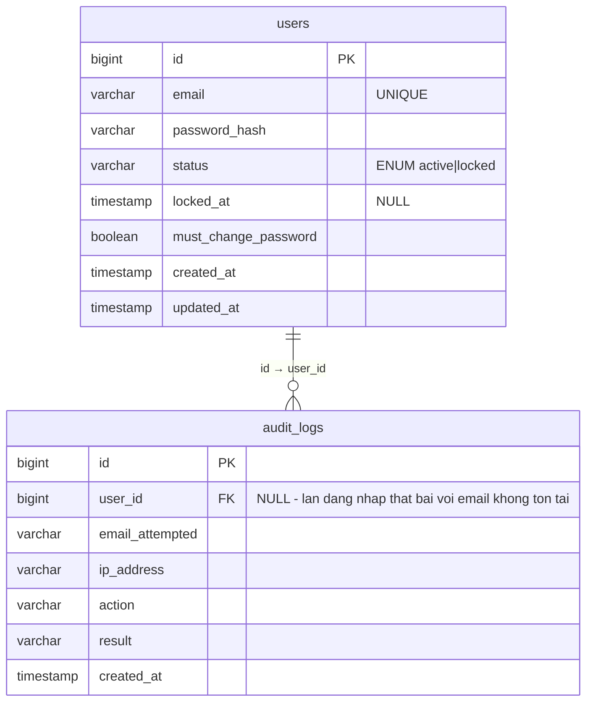

# Hệ thống quản trị nội bộ — Database Design

> **BẢN MẪU** của [`BM-2-901-50-database-design-template.md`](../01-templates/BM-2-901-50-database-design-template.md) — điền sẵn dữ liệu thật để biết mức chi tiết cần đạt. Không phải tài liệu của dự án nào; không copy file này, copy khuôn rỗng rồi đối chiếu sang đây.
>
> Thuộc bộ demo feature `authentication` — xem [`README.md`](./README.md) của thư mục này.

| | |
|---|---|
| System Name | Hệ thống quản trị nội bộ |
| Schema | `adm` |
| CHARACTER SET | utf8mb4 |
| Owner | ***REMOVED*** |
| Note | Phạm vi bản mẫu chỉ gồm hai bảng phục vụ đăng nhập và kiểm toán. Bảng nghiệp vụ khác không nằm trong bộ demo. |

---

## 1. Lịch sử sửa đổi

| No | Version | Action | Sheet / Bảng | Nội dung thay đổi | Ngày | Người sửa |
|---|---|---|---|---|---|---|
| 1 | 0.1.0 | Add new | — | Khởi tạo | 2026-09-21 | ***REMOVED*** |
| 2 | 0.1.0 | Add new | `users` | Thêm bảng tài khoản | 2026-09-21 | ***REMOVED*** |
| 3 | 0.1.0 | Add new | `audit_logs` | Thêm bảng nhật ký truy cập theo `FR-AUTH-004` | 2026-09-21 | ***REMOVED*** |

<!-- Action chỉ nhận 3 giá trị: Add new · Update · Delete. -->

---

## 2. Danh sách bảng

| No | Schema | Category | Tên bảng (logic) | Tên bảng (vật lý) | Mô tả | Note | Status |
|---|---|---|---|---|---|---|---|
| 1 | adm | master | Tài khoản người dùng | [`users`](#41-users) | Một dòng một nhân viên; email là khoá đăng nhập | Khoảng 200 dòng, tăng chậm | Approved |
| 2 | adm | transaction | Nhật ký truy cập | [`audit_logs`](#42-audit_logs) | Ghi mọi lần đăng nhập và thao tác quản trị tài khoản | Chỉ ghi thêm, không sửa không xoá; giữ 90 ngày | Decision (provisional) |

> `audit_logs` để `Decision (provisional)` vì chính sách xoá sau 90 ngày chưa chốt cách thực hiện — xem mục 5, Q1.

---

## 3. ER Diagram

> Tên bảng và tên cột trong sơ đồ phải **khớp từng ký tự** với mục 4 — lệch tên là sơ đồ nói một đằng, định nghĩa bảng nói một nẻo.

**Vì sao `audit_logs.user_id` cho phép NULL:** khi có người thử đăng nhập bằng email chưa đăng ký, vẫn phải ghi lại lần thử đó (phục vụ phát hiện dò tài khoản) nhưng không có `user_id` nào để trỏ tới. Cột `email_attempted` giữ email đã nhập cho ca này.

---

## 4. Định nghĩa bảng

### 4.1. `users`

| | | | |
|---|---|---|---|
| Tên bảng (logic) | Tài khoản người dùng | Tạo bởi / ngày | ***REMOVED*** / 2026-09-21 |
| Tên bảng (vật lý) | `users` | Sửa bởi / ngày | — |
| Overview | Một dòng cho mỗi nhân viên được cấp quyền dùng hệ thống. Tài khoản do admin tạo, không có đăng ký tự phục vụ. | Note | `status` và `locked_at` là hai cột thêm mới cho quy tắc A1 |

**Định nghĩa cột**

| No. | Key | Tên logic | Tên vật lý | Data Type | Size | Not Null | Default | Note |
|---|---|---|---|---|---|---|---|---|
| 1 | PRI | ID | `id` | BIGINT | N/A | Yes | AUTO_INCREMENT | |
| 2 | UNI | Email | `email` | VARCHAR | 255 | Yes | | **Luôn lưu dạng đã chuẩn hoá**: `trim` + chữ thường (quy tắc A4). Ứng dụng chịu trách nhiệm chuẩn hoá trước khi ghi |
| 3 | | Mật khẩu đã băm | `password_hash` | VARCHAR | 60 | Yes | | `bcrypt` cost 12. Độ dài 60 là cố định của bcrypt. **Không bao giờ ghi ra log** |
| 4 | | Họ tên | `full_name` | VARCHAR | 100 | Yes | | Lấy từ danh sách phòng nhân sự |
| 5 | | Trạng thái | `status` | VARCHAR | 10 | Yes | `'active'` | ENUM 2 giá trị: `'active'` · `'locked'`. Chỉ hai giá trị này, thêm giá trị mới là đổi hợp đồng dữ liệu (MAJOR) |
| 6 | | Thời điểm bị khoá | `locked_at` | TIMESTAMP | N/A | No | NULL | NULL khi `status = 'active'`. Batch giải khoá đọc cột này để tính đủ 30 phút chưa |
| 7 | | Bắt buộc đổi mật khẩu | `must_change_password` | BOOLEAN | N/A | Yes | `false` | `true` sau khi admin đặt lại mật khẩu; màn hình LOGIN đọc để chọn màn kế tiếp |
| 8 | | Ngày tạo | `created_at` | TIMESTAMP | N/A | Yes | `CURRENT_TIMESTAMP` | |
| 9 | | Ngày cập nhật | `updated_at` | TIMESTAMP | N/A | Yes | `CURRENT_TIMESTAMP` | Tự cập nhật khi sửa |

**Index**

| No. | Tên index | Cột | Primary key | Unique | Note |
|---|---|---|---|---|---|
| 1 | `PRIMARY` | `id` | Yes | Yes | |
| 2 | `uq_users_email` | `email` | No | Yes | Đường tra chính của thao tác đăng nhập |
| 3 | `idx_users_status_locked_at` | `status`, `locked_at` | No | No | Phục vụ batch giải khoá quét các dòng `locked` quá 30 phút |

**Khoá ngoại**

| No. | Tên khoá ngoại | Cột | Bảng đích | Cột đích | Note |
|---|---|---|---|---|---|
| — | N/A | | | | `users` là bảng gốc, không tham chiếu bảng nào |

> **Bộ đếm số lần đăng nhập sai KHÔNG nằm trong bảng này.** Nó ở Valkey, key `login_fail:<email đã chuẩn hoá>`, TTL 15 phút. Lý do: mỗi lần đăng nhập sai sẽ sinh một lần ghi CSDL, mà tần suất đó do kẻ tấn công điều khiển. Quyết định này trước đây ghi ở bản mẫu System Design, nay **không còn nơi ở** sau khi template System Design bị xoá ngày 2026-09-28 — xem `ISS-89`.

---

### 4.2. `audit_logs`

| | | | |
|---|---|---|---|
| Tên bảng (logic) | Nhật ký truy cập | Tạo bởi / ngày | ***REMOVED*** / 2026-09-21 |
| Tên bảng (vật lý) | `audit_logs` | Sửa bởi / ngày | — |
| Overview | Ghi mọi lần đăng nhập (thành công lẫn thất bại) và thao tác quản trị tài khoản, phục vụ kiểm toán nội bộ. | Note | **Chỉ ghi thêm.** Ứng dụng không có đường UPDATE hay DELETE lên bảng này |

**Định nghĩa cột**

| No. | Key | Tên logic | Tên vật lý | Data Type | Size | Not Null | Default | Note |
|---|---|---|---|---|---|---|---|---|
| 1 | PRI | ID | `id` | BIGINT | N/A | Yes | AUTO_INCREMENT | |
| 2 | FK | ID người dùng | `user_id` | BIGINT | N/A | No | NULL | NULL khi email nhập vào không tồn tại — xem giải thích ở mục 3 |
| 3 | | Email đã nhập | `email_attempted` | VARCHAR | 255 | Yes | | Dạng đã chuẩn hoá. Giữ cả khi `user_id` NULL để truy được chuỗi lần thử |
| 4 | | Địa chỉ IP | `ip_address` | VARCHAR | 45 | Yes | | 45 ký tự để chứa được IPv6 |
| 5 | | Hành động | `action` | VARCHAR | 30 | Yes | | `login` · `logout` · `password_reset` · `account_locked` · `account_unlocked` |
| 6 | | Kết quả | `result` | VARCHAR | 20 | Yes | | `success` · `failed` · `blocked` |
| 7 | | Thời điểm | `created_at` | TIMESTAMP | N/A | Yes | `CURRENT_TIMESTAMP` | |

> **Không có cột nào chứa mật khẩu, token hay nội dung phiên** — đây là ràng buộc bảo mật, không phải thiếu sót. Xem `FR-AUTH-004` tiêu chí 2.

**Index**

| No. | Tên index | Cột | Primary key | Unique | Note |
|---|---|---|---|---|---|
| 1 | `PRIMARY` | `id` | Yes | Yes | |
| 2 | `idx_audit_user_created` | `user_id`, `created_at` | No | No | Kiểm toán viên lọc theo người dùng và khoảng thời gian |
| 3 | `idx_audit_created` | `created_at` | No | No | Phục vụ xoá dữ liệu quá 90 ngày |
| 4 | `idx_audit_email_created` | `email_attempted`, `created_at` | No | No | Phát hiện chuỗi lần thử vào một email chưa đăng ký |

**Khoá ngoại**

| No. | Tên khoá ngoại | Cột | Bảng đích | Cột đích | Note |
|---|---|---|---|---|---|
| 1 | `fk_audit_logs_user_id` | `user_id` | `users` | `id` | `ON DELETE SET NULL` — xoá tài khoản **không** được làm mất dấu vết kiểm toán |

---

## 5. Câu hỏi mở / TBD

| # | Câu hỏi | Ảnh hưởng tới | Người trả lời | Hạn | Trạng thái |
|---|---|---|---|---|---|
| Q1 | Giữ nhật ký 90 ngày rồi làm gì — xoá hẳn, hay chuyển sang kho lưu trữ? Chưa chốt nên `audit_logs` đang ở `Decision (provisional)`. | Mục 2, index 3 của `audit_logs` | Trưởng dự án | 30/09/2026 | open |
| Q2 | Hệ thống hiện chưa có chức năng xoá tài khoản. Khi có, `ON DELETE SET NULL` có đủ không hay phải chuyển sang xoá mềm? | Khoá ngoại `fk_audit_logs_user_id` | Tech Lead | 30/09/2026 | open |

> *Biểu mẫu BM-2-901-50 **không có** mục "Câu hỏi mở / TBD" — bản mẫu này tự thêm, vì luật của dự án là "không còn dòng `open` mới được chuyển `approved`". Xem `ISS-85`.*
