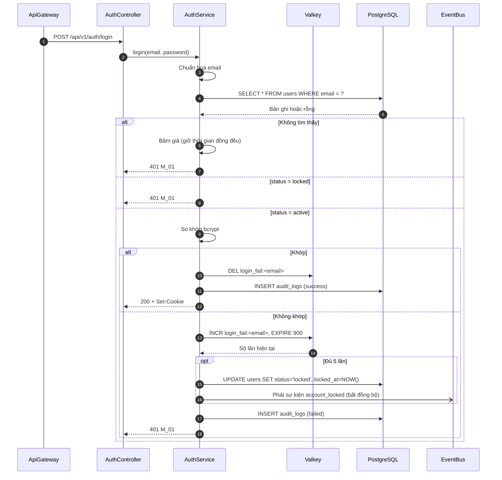

# AUTH_LOGIN — Chi tiết xử lý đăng nhập

> **BẢN MẪU** của [`BM-2-901-53-detail-design-template.md`](../01-templates/BM-2-901-53-detail-design-template.md) — điền sẵn dữ liệu thật để biết mức chi tiết cần đạt. Không phải tài liệu của dự án nào; không copy file này, copy khuôn rỗng rồi đối chiếu sang đây.
>
> Thuộc bộ demo feature `authentication` — xem [`README.md`](./README.md) của thư mục này.

> Biểu mẫu: **BM-2-901-53 v01** — Detail Design (Chart + Description) · SUN ASTERISK VIETNAM CO., LTD · ISO/IEC 27001:2013 & ISO 9001:2015

---

## 1. History of change

| No | Version | Action | Mục / Bước | Nội dung thay đổi | Ngày | Người sửa |
|---|---|---|---|---|---|---|
| 1 | 0.1.0 | Add new | — | Khởi tạo | 2026-09-21 | ***REMOVED*** |

---

## 2. Sequence diagram

`./assets/AUTH_LOGIN_sequence.png` — *bản mẫu chưa có ảnh thật.*

**File nguồn của sơ đồ:** *bản mẫu — chưa có link Draw.io*

> - Ảnh lưu trong `assets/`, **tên có tiền tố Design ID**, nhúng bằng đường dẫn tương đối.
> - Vẽ bằng Draw.io / Figma / PlantUML — **không** vẽ bằng Excel. Luôn để lại link file nguồn.
> - Sửa luồng xử lý ở mục 4 thì **phải xuất lại ảnh trong cùng lần sửa đó**.
> - Tên thành phần trên sơ đồ phải **khớp từng ký tự** với `component` ở frontmatter (`AuthService`).
> - Mọi nhánh lỗi vẽ trên sơ đồ phải có một dòng trong bảng `Error` của bước tương ứng ở mục 4, và ngược lại.

Bản Mermaid

Ký hiệu: `->>` gọi đồng bộ · `-->>` trả về · `-)` gọi bất đồng bộ · `alt/else` nhánh điều kiện · `opt` nhánh tuỳ chọn.

---

## 3. Description

Xác thực nhân viên và phát hành phiên đăng nhập. Được `AuthController` gọi khi nhận request `POST /api/v1/auth/login`.

Chạy xong, hệ thống ở một trong ba trạng thái: ① phiên mới được phát hành và bộ đếm sai đã xoá; ② bộ đếm sai tăng thêm một; ③ tài khoản chuyển sang `locked` và một sự kiện cảnh báo đã được phát đi. Cả ba trường hợp đều ghi một dòng `audit_logs`.

---

## 4. Detail function

### 4.1. Chuẩn hoá và kiểm tra request

| Trường | Giá trị |
|---|---|
| Input | `LoginRequest` (body: `email`, `password`) |
| Output | `NormalizedCredentials` (`email` đã chuẩn hoá, `password`) → bước 4.2 |

**Error**

| Điều kiện lỗi | Xử lý | Status code |
|---|---|---|
| `email` hoặc `password` thiếu trong body | Ghi log mức WARN, dừng xử lý | 400 |
| `email` dài quá 255 ký tự | Ghi log mức WARN, dừng xử lý | 400 |

**Detail**

| No | Nội dung xử lý |
|---|---|
| 1 | `trim` hai đầu chuỗi `email`, chuyển toàn bộ sang chữ thường (quy tắc A4) |
| 2 | Cắt `password` còn tối đa 72 byte — giới hạn cứng của bcrypt; **không** báo lỗi, xử lý bình thường |
| 3 | **Không** kiểm định dạng email. Kiểm ở đây sẽ cho biết email nào hợp lệ, hỗ trợ dò tài khoản (quy tắc A3) |

### 4.2. Tra tài khoản và xác thực

| Trường | Giá trị |
|---|---|
| Input | `NormalizedCredentials` từ bước 4.1 |
| Output | `User` (khi khớp) → bước 4.3, hoặc dừng với lỗi |

**Error**

| Điều kiện lỗi | Xử lý | Status code |
|---|---|---|
| Không tìm thấy bản ghi theo `email` | **Chạy băm giả** với chuỗi cố định để thời gian phản hồi không lệch, ghi `audit_logs` với `user_id = NULL`, dừng xử lý | 401 (`M_01`) |
| `status = 'locked'` | Ghi `audit_logs` với `result = 'blocked'`, dừng xử lý. **Không** báo cho client biết lý do là bị khoá | 401 (`M_01`) |
| Mật khẩu không khớp | Sang bước 4.4 (tăng bộ đếm) rồi dừng | 401 (`M_01`) |
| Không kết nối được PostgreSQL | Ghi log mức ERROR, dừng xử lý | 500 (`M_99`) |

**Detail**

| No | Nội dung xử lý |
|---|---|
| 1 | `SELECT id, email, password_hash, status, must_change_password FROM users WHERE email = ?` |
| 2 | So khớp `password` với `password_hash` bằng bcrypt |
| 3 | Ba nhánh lỗi ở bảng trên đều trả **cùng một mã** — đây là quy tắc A3, không được tách nhỏ dù tiện gỡ lỗi hơn |

### 4.3. Phát hành phiên

| Trường | Giá trị |
|---|---|
| Input | `User` từ bước 4.2 |
| Output | `LoginResponse` (`redirect_to`, `user`) + header `Set-Cookie` |

**Error**

| Điều kiện lỗi | Xử lý | Status code |
|---|---|---|
| Không xoá được key đếm trên Valkey | **Ghi log mức WARN và đi tiếp** — đăng nhập vẫn thành công. Bộ đếm sẽ tự hết hạn sau 15 phút | *không đổi (200)* |

**Detail**

| No | Nội dung xử lý |
|---|---|
| 1 | Sinh mã phiên ngẫu nhiên, lưu vào Valkey với TTL 8 giờ (quy tắc A5) |
| 2 | Xoá key `login_fail:<email>` |
| 3 | Đặt cookie `sid`: `HttpOnly`, `Secure`, `SameSite=Lax`, `Max-Age=28800` |
| 4 | Chọn `redirect_to`: `/password/change` nếu `must_change_password = true`, ngược lại `/home` |
| 5 | Ghi `audit_logs` với `action = 'login'`, `result = 'success'` |

### 4.4. Tăng bộ đếm và khoá tài khoản

| Trường | Giá trị |
|---|---|
| Input | `email` đã chuẩn hoá |
| Output | Không trả giá trị — chỉ gây tác dụng phụ lên Valkey, PostgreSQL và EventBus |

**Error**

| Điều kiện lỗi | Xử lý | Status code |
|---|---|---|
| Không kết nối được Valkey | **Ghi log mức ERROR và đi tiếp** — vẫn trả `401` cho client. Quy tắc A1 tạm vô hiệu, lớp giới hạn theo IP (A2) vẫn còn. Đây là đánh đổi đã chốt ở thiết kế hệ thống mục 2 | *không đổi (401)* |
| Không phát được sự kiện cảnh báo | **Ghi log mức WARN và đi tiếp** — tài khoản vẫn bị khoá đúng như A1; chỉ mất thư cảnh báo | *không đổi (401)* |

**Detail**

| No | Nội dung xử lý |
|---|---|
| 1 | `INCR login_fail:<email>`; nếu là lần đầu thì đặt `EXPIRE 900` (15 phút) |
| 2 | Nếu giá trị đếm **chưa** đủ 5 thì dừng ở đây |
| 3 | Đủ 5: `UPDATE users SET status = 'locked', locked_at = NOW() WHERE email = ?` |
| 4 | Ghi `audit_logs` với `action = 'account_locked'` |
| 5 | Phát sự kiện `account_locked` lên EventBus — **bất đồng bộ**, không chờ kết quả. Việc gửi thư thuộc `EV2`, không nằm trên đường đi của request này |

---

## 5. Other Notes

**Tiền đề trước khi gọi**

- API Gateway đã kiểm giới hạn tần suất theo IP (quy tắc A2). Function này **không** tự kiểm.
- Bảng `users` đã có hai cột `status` và `locked_at` — migration phải chạy trước khi deploy code này.

**Function này KHÔNG làm gì**

- **Không** kiểm phân quyền theo vai trò — thuộc `AUTH_RBAC`, chưa có.
- **Không** gửi thư cảnh báo — chỉ phát sự kiện, việc gửi thuộc `EV2`.
- **Không** giải khoá tài khoản — thuộc batch `EV1` và chức năng admin đặt lại mật khẩu.
- **Không** tự giới hạn tần suất.

**Tích hợp ngoài**

Function này không gọi trực tiếp hệ thống ngoài nào. Mail Gateway được gọi gián tiếp qua EventBus (`EV2`), chi tiết timeout/retry **hiện không có nơi ở** — mục này trước đây thuộc bản mẫu System Design, đã xoá ngày 2026-09-28 (`ISS-89`).

**Quy ước log:** [`_common/log-convention.md`](../_common/log-convention.md). Riêng function này: **không bao giờ** ghi `password`, `password_hash` hay mã phiên vào log ở bất kỳ mức nào.

**Câu hỏi mở / TBD**

| # | Câu hỏi | Ai trả lời | Hạn | Trạng thái |
|---|---|---|---|---|
| Q1 | Bước 4.4 khi Valkey hỏng thì A1 vô hiệu hoàn toàn. Có cần cơ chế dự phòng (ví dụ đếm tạm trong bộ nhớ tiến trình) hay chấp nhận như đã chốt? | Tech Lead | 30/09/2026 | open |
