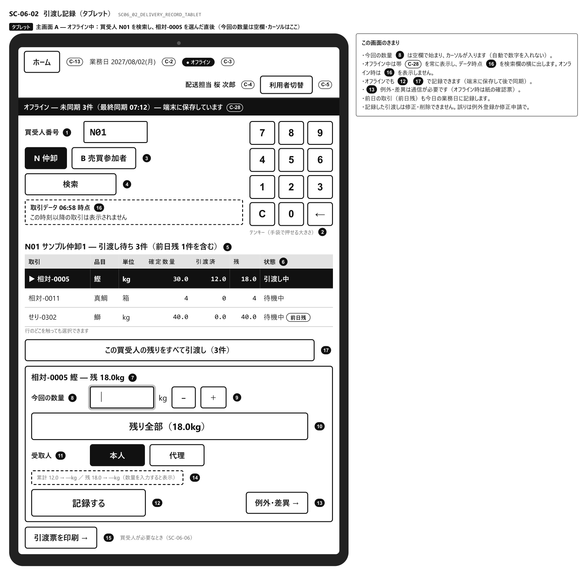
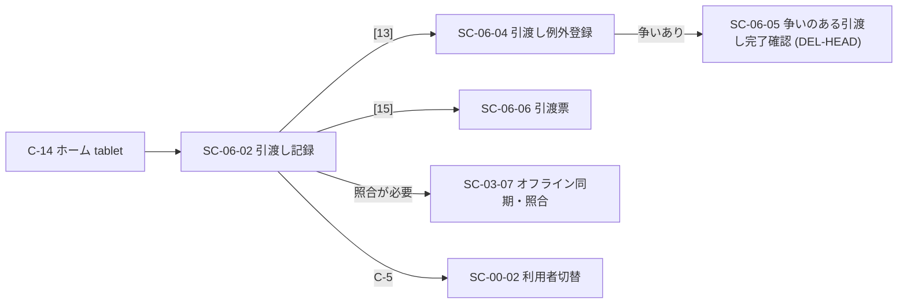

# SC-06-02 — 引渡し記録（タブレット）

> Biểu mẫu: **BM-2-901-51 v2.1** — Screen Specification · SUN ASTERISK VIETNAM CO., LTD · ISO/IEC 27001:2013 & ISO 9001:2015

---

## 1. History of change

| No | Version | Action | Nội dung thay đổi | Ngày | Người sửa | Approve |
|---|---|---|---|---|---|---|
| 1 | 0.1.0 | Add New | Khởi tạo từ wireframe WF-SC-06-02 0.2.0 | 2026-11-25 | phuongnnm-23344 | |
| 2 | 0.1.1 | Update | Khách Q-DEL-03: nút 本人 mặc định, 代理 + tên tùy chọn; đóng Q-DEL-01/02/03; G2-m07: nhãn [PL] mục tiêu hiệu năng | 2026-11-25 | phuongnnm-23344 |  |
| 3 | 0.1.2 | Update | LAB-4: ảnh annotated thay bằng biến thể A của wireframe HTML `wireframes/html/SC-06-02.html` (WF 0.2.2); ghi badge không có trên ảnh; link HTML / PNG / PDF | 2026-11-25 | phuongnnm-23344 | |

---

## 2. Layout

**Design:** [Wireframe SC-06-02 0.2.2](../../../wireframes/SC-06-02-delivery-record-tablet-wireframe.md) · nguồn hình HTML [`wireframes/html/SC-06-02.html`](../../../wireframes/html/SC-06-02.html) · mọi biến thể: [`wireframes/png/SC-06-02.png`](../../../wireframes/png/SC-06-02.png) / [`wireframes/pdf/wireframes-all.pdf`](../../../wireframes/pdf/wireframes-all.pdf) · khung chung [_common-layout](../../../wireframes/_common-layout.md) · ảnh as-is prototype: `wireframes/assets/SC-06-02_prototype-tablet.png`

> - Ảnh = **biến thể A** (màn chính) của wireframe HTML, sinh bằng `scripts/render-wireframes.py --spec` (chưa có Figma). Số trên ảnh = cột `ID` mục 4 = cột `No` của wireframe; `C-x` = mục chung ở `_common-layout.md`.
> - Badge không có trên ảnh này: 11.1 tên người nhận thay (B), C-12 · C-22 (C), 17.1–17.4 hộp xác nhận giao hết (D), C-21 · C-29 (E) → xem biến thể tương ứng trong [`wireframes/png/SC-06-02.png`](../../../wireframes/png/SC-06-02.png) / PDF.
> - [14] ở biến thể A vẽ dạng giữ chỗ để đặt số; màn thật chỉ hiện khi đã nhập số lượng [8] (mục 4).

---

## 3. Description

Màn **nhập** ở khu giao hàng (bến, 06:30–10:00): 配送担当 (DELIVERY — nhân viên giao) ghi **từng lần giao** (引渡し) cho người mua; một giao dịch (GD — 相対 hoặc せり) có thể giao **nhiều lần** tới khi hết phần còn lại (残). Người dùng đeo găng, trời nắng → nút ≥ 64 px, chữ ≥ 20 px, tương phản cao (PRM-086).

Màn **được dùng khi mất mạng** (ADR-008 §2.1, DEC-004): lần giao lưu vào hàng đợi trên máy (IndexedDB) với mã bản ghi `clientRecordId`, đồng bộ lại theo thứ tự qua cùng hàm nghiệp vụ, idempotent. Giao có **tranh chấp** không ghi ở đây: nút [13] mở SC-06-04; tranh chấp do 配送部門責任者 xác nhận ở SC-06-05 (người quyết cuối — CAP-HUMAN-01).

Ghi giao là **chỉ thêm** (luật 4): không sửa / xóa lần giao đã ghi; ghi sai → ngoại lệ (SC-06-04) hoặc 修正申請. Giao GD của ngày trước (引渡し残) ghi vào **業務日 hiện tại** — bình thường, không cần 修正申請.

---

## 4. View

ID item = số trong wireframe to-be; `C-` = item dùng chung (`wireframes/_common-layout.md`).

### 4.1 Danh sách item

| ID | Item Name | Item Type | Required | Note |
|---|---|---|---|---|
| **H** | **Header tablet** | | | |
| C-13 | ホーム | Button | - | Chữ 「ホーム」, góc trái trên → C-14 |
| C-2 | 業務日 | Label | - | `YYYY/MM/DD`; server cấp khi online, offline dùng giá trị lần đồng bộ cuối |
| C-3 | 通信状態 | Label | - | ●オンライン / ●オフライン + chữ |
| C-4 | 利用者 | Label | - | Vai + tên người đang dùng (PIN) |
| C-5 | 利用者切替 | Button | - | → SC-00-02 (bàn số to) |
| C-28 | オフライン帯 | Label | - | Luôn hiện khi offline: 「オフライン — 未同期 {n}件（最終同期 {hh:mm}）— 端末に保存しています」 |
| C-12 | トースト | Label | - | Sau khi ghi |
| **A** | **Tìm người mua** | | | |
| 1 | 買受人番号 | Text box | Có | Ô số lớn, chỉ nhận từ [2] / [3]; hiện 「例：N01」 khi trống |
| 2 | テンキー | Button | - | 0–9, C (xóa hết), ← (xóa 1 ký tự); phím ≥ 64 px |
| 3 | 種別 N / B | Button | - | `N` 仲卸 / `B` 売買参加者 — tiền tố của [1], nút đang chọn tô đặc |
| 4 | 検索 | Button | - | Mờ khi [1] chưa đủ (tiền tố + ≥ 1 số) |
| 16 | オフライン時点表示 | Label | - | **Chỉ khi offline**: 「取引データ {hh:mm} 時点」 + 「この時刻以降の取引は表示されません」 (khách #2) |
| **B** | **Danh sách GD chờ giao** | | | |
| 5 | 買受人サマリー | Label | - | 「{買受人番号} {名称} — 引渡し待ち {n}件（前日残 {m}件を含む）」 |
| 6 | 引渡し待ち一覧 | Label (bảng chọn) | - | Cột: 取引 / 品目 / 単位 / 確定数量 / 引渡済 / 残 / 状態; chạm bất kỳ chỗ nào trên dòng là chọn; dòng chọn có ▶ và nền đậm. Nhãn 「前日残」 với GD có 業務日 trước hôm nay |
| 17 | 残りをすべて引渡し | Button | - | Chỉ hiện khi người mua có ≥ 2 GD còn 残 → hộp D |
| **C** | **Ghi một lần giao (GD đang chọn)** | | | |
| 7 | 記録ブロック | Label | - | Tiêu đề 「{取引} {品目} — 残 {残}{単位}」 |
| 8 | 今回の数量 | Text box | Có (trừ khi bấm [10]) | **Để trống, con trỏ ở đây** khi chọn GD — không điền sẵn (khách #8) |
| 9 | − / + | Button | - | Bước 1 (箱 / 尾); 0,1 với kg |
| 10 | 残り全部 | Button | - | Nút lớn nhất; ghi đúng phần còn lại, `isRemainingAll = true` |
| 11 | 受取人 本人 / 代理 | Button | Có | 2 nút to; **mặc định 「本人」** (đã chọn sẵn); chọn 「代理」 mới hiện 11.1 (Q-DEL-03 [Customer giả lập, 2026-11-25]) |
| 11.1 | 代理人氏名 | Text box | Không | Tên ngắn **tùy chọn** (tài xế / nhân viên người mua); bàn phím chữ (ngoại lệ duy nhất trên màn) |
| 12 | 記録する | Button | - | |
| 13 | 例外・差異 | Button | - | → SC-06-04 (mang `tradeId`) |
| 14 | 記録前プレビュー | Label | - | 「累計 {引渡済} → {引渡済+今回}{単位} ／ 残 {残} → {残−今回}{単位}」 |
| 15 | 引渡票を印刷 | Button | - | → SC-06-06 |
| **D** | **Hộp xác nhận [17]** | | | |
| 17.1 | Danh sách GD sẽ giao | Label | - | Mỗi dòng: 取引 / 品目 / 残 |
| 17.2 | 受取人 本人 / 代理 (+ tên) | Button | Có | Chọn một lần cho cả nhóm |
| 17.3 | すべて記録 | Button | - | |
| 17.4 | キャンセル | Button | - | |

### 4.2 Validation

| ID | Type | Min | Max | Default | Ghi chú |
|---|---|---|---|---|---|
| [1] | String | 2 | 11 | (trống) | `^[NB][0-9]{1,10}$` (tiền tố từ [3]). Trống khi bấm [4] → `E-DEL-001` 「買受人番号を入力してください」. Không thấy → `E-DEL-002` 「該当する買受人が見つかりません」 |
| [8] | Decimal | > 0 | 残 của GD | (trống) | Trống / ≤ 0 → `E-DEL-003` 「数量を入力してください（0より大きい値）」. Đơn vị `KG`: tối đa 1 chữ số lẻ; `CASE` / `PIECE`: số nguyên → `E-DEL-004` 「kg は小数点以下1桁まで、箱・尾は整数で入力してください」. > 残 → `E-DEL-005` 「残数量（{残}{単位}）を超えています」 (offline: so với 残 trên máy) |
| [11] | Enum | — | — | `SELF` (本人) | Luôn có giá trị trên UI; API nhận thiếu `receiver.type` → `E-DEL-006` 「受取人（本人／代理）を選んでください」 |
| 11.1, 17.2 | String | 0 | 50 | (trống) | Tùy chọn khi 代理; > 50 → `E-DEL-007` 「代理人の氏名は50文字以内で入力してください」 |

> Không validate ở client: trạng thái GD (確定 / đã xong) — server kiểm (`E-DEL-008`, `E-DEL-009`). Quy tắc "khớp 精算" (`DELIVERY_MATCH_RULE`, E-17) do server áp khi tính 完了.

### 4.3 Data Mapping

| ID | Data Source | API ID | API URL | Key / Param | Ghi chú |
|---|---|---|---|---|---|
| [4], [5], [6] | API (online) | `API-DEL-001` | `GET /api/v1/deliveries/pending` | `buyerNo` | |
| [4], [5], [6], [16] | Local DB (IndexedDB) | `API-DEL-002` | `GET /api/v1/deliveries/offline-snapshot` | `snapshotAt` | Snapshot tải đầu ca + sau mỗi lần đồng bộ; offline tìm trong snapshot trừ lần giao đang chờ trên máy |
| [8]–[12], [17] | API (online) | `API-DEL-003` | `POST /api/v1/deliveries` | `items[].tradeId`, `qty`, `isRemainingAll`, `clientRecordId`, `receiver` | Nhiều GD trong một request khi [17] |
| [8]–[12], [17] | Local DB (offline) | — (module `sync`) | hàng đợi → API đồng bộ của `sync` | `clientRecordId`, `deviceId`, `capturedBy`, `capturedAt` | Đồng bộ gọi cùng hàm DB `fn_delivery_record` (ADR-008 §2.2) |
| C-28 | Local DB | — | — | số bản ghi chờ, `lastSyncedAt` | |

---

## 5. Event

| ID | Given (Pre-condition) | When (Trigger/Action) | Then (Result) | Note |
|---|---|---|---|---|
| **Initializing Process（初期処理）** | | | | |
| - | Thiết bị đã đăng ký, người dùng DELIVERY / DEL-HEAD (PIN) | Mở màn | 1. [1] trống, [3] = 「N」 mặc định. 2. Online: gọi `API-DEL-002` nếu snapshot cũ hơn lần đồng bộ cuối → lưu IndexedDB. 3. Offline: hiện C-28 và [16] với `snapshotAt` | |
| **Standard Process（通常処理）** | | | | |
| [2], [3] | - | Chạm phím | Ghép vào [1]; đổi [3] đổi tiền tố | |
| [4] | [1] hợp lệ | Chạm 「検索」 | Online: `API-DEL-001` → [5], [6]; offline: lọc snapshot, trừ lần giao chờ đồng bộ của máy. Không có GD chờ → C-21 「{買受人番号} の引渡し待ちはありません」 (offline thêm câu [16]) | |
| [6] | Có danh sách | Chạm một dòng | Mở [7] cho GD đó; [8] trống, con trỏ ở [8]; [11] bỏ chọn; [14] ẩn tới khi có số | khách #8 |
| [8], [9] | - | Nhập / bấm −+ | Validate 4.2; [14] cập nhật theo số | |
| [10] | GD còn 残 > 0 | Chạm 「残り全部」 | [8] = 残 (chỉ đọc), `isRemainingAll = true`; [14] hiện 「残 → 0」 | Không cân lại với GD theo kg (PRM-118 (a)) |
| [11] | - | Chạm 「代理」 | Hiện 11.1, con trỏ vào đó | |
| [12] | [8] / [10] và [11] hợp lệ | Chạm 「記録する」 | **Online:** sinh `clientRecordId` (UUID v4) → `API-DEL-003` → 201: C-12 「引渡し：{買受人} {品目} {数量}{単位}（残 {残}{単位}）」, cập nhật [6]; 残 = 0 → dòng sang 「完了」 (FT-06-03). **Offline:** lưu IndexedDB (`clientRecordId`, `deviceId`, người dùng hiện tại, giờ máy) → C-12 「端末に保存（未同期 {n}件）」, C-28 tăng số, [6] trừ cục bộ | Nút khóa 2 giây sau khi chạm (chống bấm đôi); gửi lại cùng `clientRecordId` không ghi đôi |
| [17] | Người mua có ≥ 2 GD còn 残 | Chạm | Mở hộp D liệt kê từng GD; 17.3 → online: **một** `API-DEL-003` với nhiều `items` (mỗi GD một `clientRecordId`, `isRemainingAll = true`); offline: mỗi GD một bản ghi hàng đợi | khách #12 |
| [13] | Đã chọn GD | Chạm | → SC-06-04 (`tradeId`) | Offline: xem 6.1 |
| [15] | Đã chọn người mua | Chạm | → SC-06-06 | |
| C-3 | Offline → online | Có mạng lại | C-29 「オンラインに復帰しました。未同期 {n}件を送信中…」; module `sync` gửi hàng đợi theo thứ tự; xong → tải lại snapshot. Bản ghi bị giữ (`HELD`) → nhãn 「照合が必要 {n}件」 → SC-03-07 | ADR-008 §2.2 |
| **Error Handling（エラー制御）** | | | | |
| [8] | Online, lưu | 409 `E-DEL-005` (người khác vừa giao, 残 giảm) | C-23 「残数量が {残}{単位} に変わりました」, nạp lại [6], giữ GD đang chọn | |
| [12] | Online | 409 `E-DEL-008` / `E-DEL-009` | C-23 với câu lỗi; nạp lại [6] | |
| [12] | Online | 423 `E-CMN-003` (業務日 hiện tại đã khóa — hiếm, máy giữ ngày cũ) | C-24; nạp lại header C-2 | |
| [12] | Đang gửi | Mất mạng giữa chừng / timeout | Lưu bản ghi vào hàng đợi với **cùng** `clientRecordId` → chuyển chế độ offline; không hỏi người dùng nhập lại | Idempotent — server nhận trùng trả kết quả cũ |
| - | Bất kỳ | 401 `E-CMN-001` / hết giờ máy (~5 phút, PRM-112) | → SC-00-02 đổi người; giữ dữ liệu đang nhập | |
| - | Bất kỳ | 5xx | C-26; bản ghi đang ghi vào hàng đợi, thử lại khi đồng bộ | |

---

## 6. Other Notes

### 6.1 Trạng thái màn

| Trạng thái | Hiển thị / hành vi |
|---|---|
| Đang tải | C-20 trong [6] |
| Không có GD chờ | C-21 「{買受人番号} の引渡し待ちはありません」 |
| Offline | C-28 luôn hiện (số chưa đồng bộ); [16] hiện mốc giờ; vẫn ghi được [12], [17]; [13] → SC-06-04 hiện C-28 「通信が回復してから登録してください。争いがある場合は紙の確認票（争いのある引渡し確認票）に記入し、責任者の署名を受けてください」 — ngoại lệ **không** ghi offline (ADR-008 §2.1; WF-SC-06-04 0.2.1 đã sửa khớp) |
| Có mạng lại, đồng bộ bị giữ | Nhãn 「照合が必要 {n}件」 → SC-03-07; không tự gộp, không ghi đè |
| GD ngày trước (前日残) | Ghi bình thường vào 業務日 hiện tại; nhãn 「前日残」 ở [6] |
| GD có ngoại lệ đang mở | 状態 「例外」 ở [6]; vẫn giao được phần còn lại; tranh chấp không chặn GD khác của người mua (PRM-111) |
| Lỗi vượt 残 | C-22 dưới [8] |
| Đang gửi | [12] / 17.3 mờ + vòng quay; ≤ 2 giây mục tiêu ([PL] cho API ghi, lấy theo mức NFR-PERF-01 của tìm kiếm) |

### 6.2 Phân quyền hiển thị theo vai

| Item | DELIVERY | DEL-HEAD | SETTLE / STL-HEAD / OPS-HEAD | Vai khác |
|---|---|---|---|---|
| Toàn màn ([1]–[17]) | T | T | Ẩn — xem trạng thái giao ở SC-06-01 / SC-04-04 (PC) | Ẩn (C-25) |

Vào URL trực tiếp không có vai → C-25. Không có item chỉ-đọc theo vai trên màn này.

### 6.3 Luồng chuyển màn

### 6.4 Quy tắc nghiệp vụ dev cần biết

- 残 = SL hiệu lực của GD (`v_trade_effective`, sau 当日訂正 / 修正申請 / ngoại lệ 不足 · 返品 · 一部取消) − Σ `deliveries.qty_delivered`. 完了 khi 残 = 0 theo `DELIVERY_MATCH_RULE` của quy chế (BR-DEL-03, E-17).
- `receiver_name` (NOT NULL ở TRADE_DB 4.34): 本人 → lưu chuỗi 「本人」; 代理 → tên nhập ở 11.1, bỏ trống → lưu 「代理」. Q-DEL-03 [Customer giả lập, 2026-11-25].
- Không có thao tác sửa / xóa lần giao trên màn (luật 4).

### 6.5 Truy vết

FR-DEL-01, FR-DEL-02, FR-DEL-05, BR-DEL-03, FT-06-01, FT-06-03, FT-06-07, PRM-086, PRM-111, PRM-112, PRM-118, E-17, NFR-AVL-02, NFR-PERF-01, DEC-004, L4-A05; ADR-005, ADR-008; TRADE_DB 4.34, IAM_AUDIT_DB 4.55; khách #2, #8, #12, #13, #32.

### 6.6 Câu hỏi / giả định mới

| ID đề xuất | Nội dung | Giả định tạm | Ảnh hưởng nếu sai |
|---|---|---|---|
| Q-DEL-01 | Ngoại lệ giao thường (不足 / 過剰…) có cần ghi **offline** không? | **Đã trả lời** [Customer giả lập, 2026-11-25]: không; mất mạng → ghi lên 引渡し確認票 giấy có số thứ tự (ô giống màn hình), **nhập lại trong ngày, trước 日次締め** (SC-06-04 後入力; soát ở checklist #12 — Q-STL-02). Giao bình thường vẫn chạy offline | Có: thêm `sync_kind = DELIVERY_EXCEPTION`, xử lý xung đột ở SC-03-07, +0,3 MM |
| Q-DEL-02 | Snapshot offline gồm GD của bao nhiêu ngày trước (引渡し残)? | **Đã trả lời** [Customer giả lập, 2026-11-25]: 7 業務日 là đủ (thường xong trong 1–3 ngày) | Dài hơn: dung lượng IndexedDB / thời gian tải tăng |
| Q-DEL-03 | 本人 lưu thế nào trong `receiver_name` (bắt buộc)? | **Đã trả lời** [Customer giả lập, 2026-11-25]: mặc định 「本人」; 「代理」 + tên ngắn tùy chọn — không bắt gõ tên thật | Cần tên thật người nhận: thêm ô nhập, chậm thao tác ở bến |
