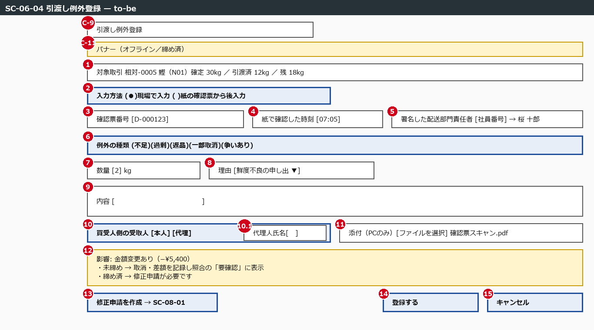

# SC-06-04 — 引渡し例外登録

> Biểu mẫu: **BM-2-901-51 v2.1** — Screen Specification · SUN ASTERISK VIETNAM CO., LTD · ISO/IEC 27001:2013 & ISO 9001:2015

---

## 1. History of change

| No | Version | Action | Nội dung thay đổi | Ngày | Người sửa | Approve |
|---|---|---|---|---|---|---|
| 1 | 0.1.0 | Add New | Khởi tạo từ wireframe WF-SC-06-04 0.2.0 (màn nối của SC-06-02) | 2026-11-25 | phuongnnm-23344 | |
| 2 | 0.1.1 | Update | Khách: đóng Q-DEL-01/04/05/06 (Q-DEL-04: 配送 chỉ nhập SL thực giao, tiền tự tính theo đơn giá đã chốt); dòng 10.1 tên 代理 không bắt buộc | 2026-11-25 | phuongnnm-23344 |  |

---

## 2. Layout

**Design:** [Wireframe SC-06-04 0.2.1](../../../wireframes/SC-06-04-delivery-exception-registration-wireframe.md). Prototype không có màn này (M16) → ảnh dựng từ wireframe to-be (`scripts/render-annotated-screens.py`).

---

## 3. Description

Màn **nhập** ngoại lệ khi giao: 不足 (thiếu), 過剰 (thừa), 返品 (trả), 一部取消 (hủy một phần), **争いあり (tranh chấp)**. Cũng là nơi **nhập bù phiếu giấy 争いのある引渡し確認票** đã ký tay lúc mất mạng (ADR-008 §2.4-12). Người dùng: DELIVERY, DEL-HEAD; PC hoặc tablet (đính kèm scan chỉ trên PC — E-21).

Ngoại lệ là **bản ghi thêm** — không sửa lần giao gốc (luật 4). Ngoại lệ làm **đổi tiền** (不足 / 返品 / 一部取消 có SL):
- 業務日 của GD **chưa khóa** → hệ thống ghi REVERSE / DELTA ngay (nguồn `SAME_DAY`) và đưa vào 要確認 của 照合事務局 (SC-07-01); 日次締め bị chặn tới khi 照合 bấm 「確認済」 (SC-07-02 [20], khách #4).
- 業務日 của GD **đã khóa** → không ghi điều chỉnh; ngoại lệ vẫn lưu và màn dẫn sang 修正申請 (SC-08-01) — BR-CLOSE-01.

Tranh chấp → trạng thái 「確認待ち（配送部門責任者）」, hiện ở SC-06-05; không chặn giao GD khác (PRM-111).

---

## 4. View

### 4.1 Danh sách item

| ID | Item Name | Item Type | Required | Note |
|---|---|---|---|---|
| **H** | **Khung** | | | |
| C-9 | 画面タイトル 「引渡し例外登録」 | Label | - | |
| C-11 | バナー | Label | - | C-24 / C-28 |
| **A** | **GD đích** | | | |
| 1 | 対象取引 | Label | - | 「{取引} {品目}（{買受人番号} {名称}） 確定 {数量} ／ 引渡済 {数量} ／ 残 {数量}」 |
| **B** | **Cách nhập** | | | |
| 2 | 入力方法 | Button (chọn 1) | Có | 「現場で入力」 (mặc định) / 「紙の確認票から後入力」 |
| 3 | 確認票番号 | Text box | Có khi 後入力 | Số sê-ri in sẵn |
| 4 | 紙で確認した時刻 | Text box (time) | Có khi 後入力 | `hh:mm` |
| 5 | 署名した配送部門責任者 | Text box | Có khi 後入力 + 争いあり | Nhập 社員番号 → hiện tên |
| **C** | **Nội dung ngoại lệ** | | | |
| 6 | 例外の種類 | Button (chọn 1) | Có | 不足 / 過剰 / 返品 / 一部取消 / 争いあり (`code_values.DELIVERY_EXCEPTION`) |
| 7 | 数量 | Text box | Có (trừ 争いあり — Không) | Đơn vị theo GD |
| 8 | 理由 | Text box (chọn ▼) | Có | Danh sách lý do theo loại (`code_values`) |
| 9 | 内容 | Text box (nhiều dòng) | Có khi 争いあり | |
| 10 | 買受人側の受取人 本人 / 代理 | Button | Không | Chọn 代理 → hiện 10.1 |
| 10.1 | 代理人氏名 | Text box | Có khi 代理 | |
| 11 | 添付 | Button (file) | Có khi 後入力 | **Chỉ PC**; tablet ẩn và hiện câu 「スキャンはPCで添付してください」 |
| **D** | **Ảnh hưởng + hành động** | | | |
| 12 | 影響 | Label | - | Tính khi chọn [6] / nhập [7]: 「金額変更あり（{±¥}）」 + một trong hai câu: 「業務日が未締め → 取消・差額を記録し、照合の『要確認』に表示」 / 「業務日が締め済 → 修正申請が必要です」. Không đổi tiền → 「金額への影響はありません」 |
| 13 | 修正申請を作成 | Button | - | Chỉ khi GD đã khóa và đổi tiền → SC-08-01 (mang `tradeId`, loại, SL, lý do) |
| 14 | 登録する | Button | - | |
| 15 | キャンセル | Button | - | → màn trước (SC-06-02 / SC-06-01) |

### 4.2 Validation

| ID | Type | Min | Max | Default | Ghi chú |
|---|---|---|---|---|---|
| [3] | String | 1 | 20 | (trống) | Trống → `E-DEL-030` 「確認票番号を入力してください」. Đã dùng → `E-DEL-014` 「この確認票番号は既に登録されています」 (server) |
| [4] | Time | 業務日 01:00 | giờ hiện tại | (trống) | Ngoài khoảng → `E-DEL-015` 「紙で確認した時刻は業務日内・現在時刻以前で入力してください」 |
| [5] | String | 1 | 20 | (trống) | Không phải DEL_HEAD → `E-DEL-018` 「署名した配送部門責任者の社員番号が正しくありません」; = người ghi lần giao → `E-DEL-016` 「記録者本人は確認できません」 |
| [6] | Enum | — | — | (chưa chọn) | → `E-DEL-011` 「例外の種類を選んでください」 |
| [7] | Decimal | > 0 | 確定数量 hiệu lực | (trống) | Thiếu khi loại ≠ 争いあり → `E-DEL-003`. Số lẻ sai đơn vị → `E-DEL-004`. 不足 / 一部取消 > 残 chưa giao, 返品 > 引渡済 → `E-DEL-028` 「数量が対象の範囲を超えています（上限 {n}{単位}）」 |
| [8] | Code | — | — | (chưa chọn) | → `E-DEL-012` 「理由を選んでください」 |
| [9] | String | 1 | 500 | (trống) | Bắt buộc khi 争いあり → `E-DEL-013` 「争いありの場合は内容を入力してください（500文字以内）」; loại khác 0–500 |
| 10.1 | String | 0 | 50 | (trống) | Tùy chọn khi 代理; > 50 → `E-DEL-007` (Q-DEL-03) |
| [11] | File | 1 file | 10 MB | — | PDF / JPEG / PNG. Thiếu khi 後入力 → `E-DEL-017` 「後入力の場合は確認票のスキャンを添付してください」. Sai loại / quá cỡ → `E-DEL-029` 「PDF・JPEG・PNG（10MB以下）を添付してください」 |

### 4.3 Data Mapping

| ID | Data Source | API ID | API URL | Key / Param | Ghi chú |
|---|---|---|---|---|---|
| [1], [12] | API | `API-DEL-001` | `GET /api/v1/deliveries/pending` | `tradeId` | Lấy GD + `businessDateLocked`, đơn giá, thuế để tính [12] |
| [5] | API | — (module `iam`) | tra tài khoản theo 社員番号 | `employeeNo` | API của `iam`, chưa đặc tả — [`specs/_index.md`](../../_index.md) mục phụ thuộc (DEP-02) |
| [11] | API | — (module chung `attachments`) | upload chứng từ → `attachmentId` | `docClass = DISPUTE_EVIDENCE` | API chung, chưa đặc tả — [`specs/_index.md`](../../_index.md) mục phụ thuộc (DEP-03) |
| [2]–[11], [14] | API | `API-DEL-004` | `POST /api/v1/delivery-exceptions` | body theo 4.1 | |

---

## 5. Event

| ID | Given (Pre-condition) | When (Trigger/Action) | Then (Result) | Note |
|---|---|---|---|---|
| **Initializing Process（初期処理）** | | | | |
| - | Mở từ SC-06-02 [13] (`tradeId`) hoặc SC-06-01, online | Mở màn | Gọi `API-DEL-001?tradeId=` → [1]; [2] = 現場; [3]–[5], [11] ẩn | |
| - | Offline | Mở màn | C-28 + câu 「通信が回復してから登録してください。争いがある場合は紙の確認票…に記入し、責任者の署名を受けてください」; form khóa | Q-DEL-01 |
| **Standard Process（通常処理）** | | | | |
| [2] | - | Chọn 「紙の確認票から後入力」 | Hiện [3], [4], [11]; [5] hiện khi [6] = 争いあり | ADR-008 §2.4 |
| [6], [7] | - | Chọn loại / nhập SL | Tính [12]: tiền = floor(SL × đơn giá) × hướng (−) cho 不足 / 返品 / 一部取消; 過剰 / 争いあり → 「金額への影響はありません」 (tranh chấp đổi tiền quyết ở SC-06-05); [13] hiện khi GD đã khóa và đổi tiền | |
| [14] | Form hợp lệ | Chạm 「登録する」 | 1. `API-DEL-004`. 2. 201 + `adjustmentCreated = true` → C-12 「照合部門の確認待ち（要確認）に追加しました」. 3. 201 + `correctionRequired = true` → giữ màn, banner C-24 dạng thông tin + [13] nổi bật. 4. 争いあり → C-12 「確認待ち（配送部門責任者）に登録しました」 → về SC-06-02 | |
| [13] | GD đã khóa, đổi tiền | Chạm | → SC-08-01 mang `tradeId`, loại, SL, lý do (nội dung đã nhập không mất) | C-24 khách #5 |
| [15] | - | Chạm | Về màn trước; có dữ liệu đã nhập → hỏi xác nhận bỏ | |
| **Error Handling（エラー制御）** | | | | |
| [3] | Lưu | 409 `E-DEL-014` | C-22 dưới [3] | |
| [5] | Lưu | 422 `E-DEL-016` / `E-DEL-018` | C-22 dưới [5] | |
| [7] | Lưu | 409 `E-DEL-028` (SL vừa đổi do lần giao khác) | C-23 với số mới; nạp lại [1] | |
| - | Lưu | 423 `E-CMN-003` (業務日 hiện tại bị khóa giữa chừng) | C-24, giữ nội dung | |
| - | Lưu | Mất mạng | C-28; giữ nội dung trên màn, không xếp hàng đợi | |

---

## 6. Other Notes

### 6.1 Trạng thái màn

| Trạng thái | Hiển thị |
|---|---|
| Offline | C-28 + hướng dẫn phiếu giấy; form khóa (Q-DEL-01) |
| GD ngày chưa khóa + đổi tiền | [12] câu 1; sau lưu C-12 「…要確認に追加しました」 |
| GD ngày đã khóa + đổi tiền | [12] câu 2 + [13] (C-24) |
| Số phiếu đã dùng / người ký = người ghi | C-22 |
| Tablet | [11] ẩn; nếu 後入力 → câu 「後入力（スキャン添付）はPCで行ってください」, [14] mờ |

### 6.2 Phân quyền hiển thị theo vai

| Item | DELIVERY | DEL-HEAD | SETTLE / STL-HEAD / OPS-HEAD | Vai khác |
|---|---|---|---|---|
| [1]–[15] | T | T | Ẩn — xem ở SC-07-03 / SC-07-04 / RPT-04 | Ẩn (C-25) |

### 6.3 Luồng chuyển màn

SC-06-02 [13] / SC-06-01 → **SC-06-04** → (争いあり) SC-06-05 · (đổi tiền, ngày đã khóa) SC-08-01 · (đổi tiền, ngày chưa khóa) SC-07-01 要確認 (phía 照合).

### 6.4 Truy vết

FT-06-04, FR-DEL-03, FR-DEL-04, FR-SETTLE-01, OBJ-05, BR-CLOSE-01, PRM-048, PRM-111, TBL-ATTACH-01, B.7, E-21, M16; ADR-004, ADR-005, ADR-008 §2.4; TRADE_DB 4.35, ADJUST_DB 4.32 / 4.39; khách #4, #13.

### 6.5 Câu hỏi / giả định mới

| ID đề xuất | Nội dung | Giả định tạm | Ảnh hưởng nếu sai |
|---|---|---|---|
| Q-DEL-01 | (xem SC-06-02) ngoại lệ offline | **Đã trả lời** [Customer giả lập, 2026-11-25]: không offline; phiếu giấy có số thứ tự, nhập bù ở màn này (後入力) trong ngày, trước 日次締め | — |
| Q-DEL-04 | Ngoại lệ đổi tiền ở ngày chưa khóa được ghi REVERSE / DELTA bằng `trade_fixes` (nguồn `SAME_DAY`) do **vai DELIVERY** tạo? | **Đã trả lời (điều chỉnh)** [Customer giả lập, 2026-11-25]: cho phép với điều kiện 配送 **chỉ nhập SL thực giao** (不足 / 返品 / 一部取消), tiền tự tính theo **đơn giá đã chốt**, 配送 không nhập / sửa giá-tiền; mọi bút toán phải 照合 確認済 mới 締め; chỉ hướng giảm | Không cho: ngoại lệ chỉ ghi nhận, TRADE phải làm 当日訂正 riêng — thêm một bước tay |
| Q-DEL-05 | 返品 / 不足 có trả SL về sổ lô (`lot_quantity_ledger`) không? | **Đã trả lời** [Customer giả lập, 2026-11-25]: không tự động; hàng trả phải có người xem lại chất lượng rồi quyết bán lại / hủy qua 返品・廃棄 (luật 3) | Có: thêm bút toán `SALE_REVERSE` trong cùng transaction |
| Q-DEL-06 | 過剰 (giao thừa) có đổi tiền không? | **Đã trả lời** [Customer giả lập, 2026-11-25]: không — chỉ ghi nhận; người mua nhận thêm thì TRADE làm 当日訂正 / 修正申請 | Có: thêm DELTA dương |
