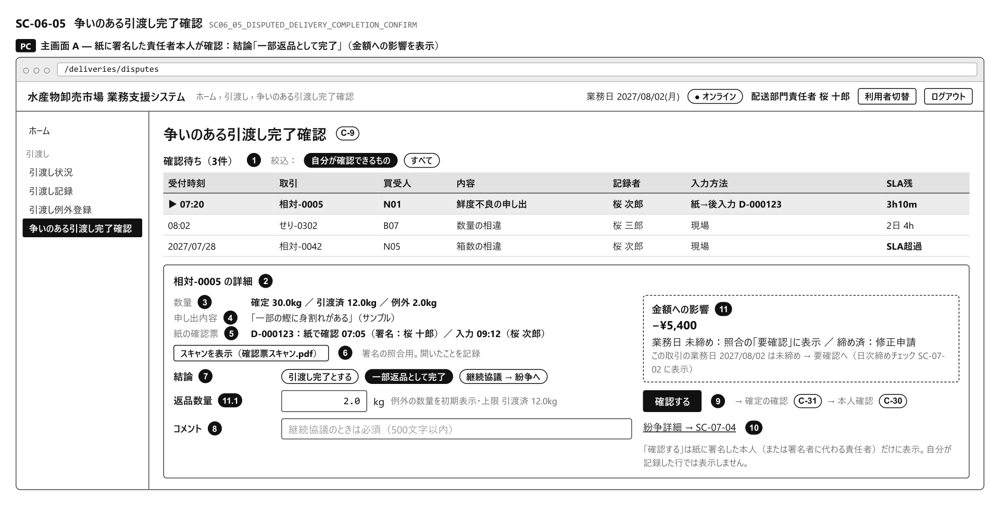

# SC-06-05 — 争いのある引渡し完了確認

> Biểu mẫu: **BM-2-901-51 v2.1** — Screen Specification · SUN ASTERISK VIETNAM CO., LTD · ISO/IEC 27001:2013 & ISO 9001:2015

---

## 1. History of change

| No | Version | Action | Nội dung thay đổi | Ngày | Người sửa | Approve |
|---|---|---|---|---|---|---|
| 1 | 0.1.0 | Add New | Khởi tạo từ wireframe WF-SC-06-05 0.2.0 (màn nối của SC-06-02) | 2026-11-25 | phuongnnm-23344 | |
| 2 | 0.1.1 | Update | Khách Q-DEL-07: nhu cầu RPT-04 lọc 継続協議 + lịch sử từng lần họp (DEP-17); đóng Q-DEL-08 | 2026-11-25 | phuongnnm-23344 |  |
| 3 | 0.1.2 | Update | LAB-4: ảnh annotated thay bằng biến thể A của wireframe HTML `wireframes/html/SC-06-05.html` (WF 0.2.1); ghi badge không có trên ảnh; link HTML / PNG / PDF | 2026-11-25 | phuongnnm-23344 | |

---

## 2. Layout

**Design:** [Wireframe SC-06-05 0.2.1](../../../wireframes/SC-06-05-disputed-delivery-completion-confirm-wireframe.md) · nguồn hình HTML [`wireframes/html/SC-06-05.html`](../../../wireframes/html/SC-06-05.html) · mọi biến thể: [`wireframes/png/SC-06-05.png`](../../../wireframes/png/SC-06-05.png) / [`wireframes/pdf/wireframes-all.pdf`](../../../wireframes/pdf/wireframes-all.pdf) · khung chung [_common-layout](../../../wireframes/_common-layout.md)

> - Ảnh = **biến thể A** (màn chính) của wireframe HTML, sinh bằng `scripts/render-wireframes.py --spec` (chưa có Figma). Số trên ảnh = cột `ID` mục 4 = cột `No` của wireframe; `C-x` = mục chung ở `_common-layout.md`.
> - Badge không có trên ảnh này: 8.1 lý do xác nhận thay người ký (B), C-12 (E), C-28 (F) → xem biến thể tương ứng trong [`wireframes/png/SC-06-05.png`](../../../wireframes/png/SC-06-05.png) / PDF.
> - Prototype không có màn này (M16). C-30 / C-31 ở biến thể A chỉ là chú thích cạnh [9]; hộp thoại thật xem biến thể C (C-31) và D (C-30).

---

## 3. Description

Màn **quyết định**: 配送部門責任者 (DEL-HEAD — người phụ trách giao hàng) kết luận một lần giao có tranh chấp — **điểm người quyết cuối** của CAP-HUMAN-01 (luật 3). Hệ thống không tự kết luận. Ba kết luận: 引渡し完了とする (hoàn tất), 一部返品として完了 (hoàn tất kèm trả một phần — đổi tiền), 継続協議 (chưa kết luận → chuyển 紛争, SC-07-04).

Ràng buộc: **cấm tự xác nhận** lần giao / ngoại lệ do chính mình ghi (PRM-111); bắt MFA (PREMISE §3.2); **không làm được khi mất mạng** (đi phiếu giấy có chữ ký, nhập bù ở SC-06-04, xác nhận ở đây sau — ADR-008 §2.4). Với phiếu giấy, mặc định người đã ký xác nhận; người ký vắng → DEL-HEAD khác (hoặc 代行) xác nhận với lý do bắt buộc sau khi mở bản scan (khách #16).

---

## 4. View

### 4.1 Danh sách item

| ID | Item Name | Item Type | Required | Note |
|---|---|---|---|---|
| **H** | **Khung** | | | |
| C-9 | 画面タイトル | Label | - | |
| C-11 | バナー | Label | - | C-28 khi offline |
| **A** | **Danh sách chờ** | | | |
| 1 | 確認待ち一覧 | Label (bảng chọn) | - | Tiêu đề 「確認待ち（{n}件）」; bộ lọc 「自分が確認できるもの」(mặc định) / 「すべて」. Cột: 受付時刻 / 取引 / 買受人 / 内容 / 記録者 / 入力方法 (現場 \| 紙→後入力 {番号}) / SLA残 |
| **B** | **Chi tiết** | | | |
| 2 | 詳細ブロック | Label | - | 「{取引} の詳細」 |
| 3 | 数量 | Label | - | 確定 / 引渡済 / 例外 |
| 4 | 申し出内容 | Label | - | |
| 5 | 紙の確認票 | Label | - | Chỉ khi nhập bù: 「紙の確認票 {番号}: 紙で確認 {hh:mm}（署名: {氏名}）／ 入力 {hh:mm}（{氏名}）」 |
| 6 | スキャンを表示 | Button | - | Mở bản scan (tab mới); ghi nhận đã mở |
| 7 | 結論 | Button (chọn 1) | Có | 引渡し完了とする / 一部返品として完了 / 継続協議 → 紛争へ |
| 11 | 金額への影響 | Label | - | Chỉ khi 一部返品: 「−¥{額} → 業務日 未締め: 要確認に表示 ／ 締め済: 修正申請」 |
| 11.1 | 返品数量 | Text box | Có khi 一部返品 và ngoại lệ chưa có SL | Mặc định = SL ghi ở ngoại lệ (nếu có). Item con thêm so với wireframe (cần SL để tính [11]) |
| 8 | コメント | Text box (nhiều dòng) | Có khi 継続協議 | |
| 8.1 | 署名者に代わって確認する理由 | Text box | Có khi người xem ≠ người ký giấy | Chỉ hiện ở dòng phiếu giấy |
| 9 | 確認する | Button | - | Nhãn 「署名者に代わって確認する」 khi 8.1 hiện. Ẩn nếu người xem là người ghi |
| 10 | 紛争詳細 | Button | - | → SC-07-04 |

### 4.2 Validation

| ID | Type | Min | Max | Default | Ghi chú |
|---|---|---|---|---|---|
| [7] | Enum | — | — | (chưa chọn) | → `E-DEL-020` 「結論を選んでください」 |
| 11.1 | Decimal | > 0 | 引渡済 của GD | SL ngoại lệ | → `E-DEL-026` 「返品数量を入力してください」; > 引渡済 → `E-DEL-028`; số lẻ sai đơn vị → `E-DEL-004` |
| [8] | String | 0 (1 khi 継続協議) | 500 | (trống) | 継続協議 mà trống → `E-DEL-021` 「継続協議の場合はコメントを入力してください」 |
| 8.1 | String | 1 | 200 | (trống) | → `E-DEL-022` 「署名者に代わって確認する場合は理由を入力してください」 |
| [6] → [9] | Flag | — | — | false | Phiếu giấy + người xem ≠ người ký mà chưa mở [6] → [9] mờ; server kiểm lại → `E-DEL-023` 「スキャンを表示して確認してから確定してください」 |

### 4.3 Data Mapping

| ID | Data Source | API ID | API URL | Key / Param | Ghi chú |
|---|---|---|---|---|---|
| [1]–[5], [11] | API | `API-DEL-005` | `GET /api/v1/delivery-exceptions/disputes` | `scope=confirmable\|all` | Trả cả `paper`, `canConfirm`, `isSigner`, `amountPreview` |
| [6] | API | — (module chung `attachments`) | tải file theo `attachmentId` (URL ký ngắn hạn) | `attachmentId` | Client gửi `scanViewedAt` khi đã mở |
| [7]–[9], 11.1 | API | `API-DEL-006` | `POST /api/v1/delivery-exceptions/{exceptionId}/confirmation` | `conclusion`, `returnQty`, `comment`, `signerAbsentReason`, `scanViewedAt` | MFA step-up |

---

## 5. Event

| ID | Given (Pre-condition) | When (Trigger/Action) | Then (Result) | Note |
|---|---|---|---|---|
| **Initializing Process（初期処理）** | | | | |
| - | DEL-HEAD (hoặc 代行), online | Mở màn | `API-DEL-005?scope=confirmable` → [1], dòng đầu được chọn → [2]–[5]. Rỗng → C-21 「確認待ちの争いはありません」 | |
| - | Offline | Mở màn | C-28 「通信断中は確認できません。紙の確認票に署名してください」; danh sách cache cuối hiện chỉ đọc | ADR-008 §2.3-10 |
| **Standard Process（通常処理）** | | | | |
| [1] | - | Đổi bộ lọc | 「すべて」 → `scope=all`: dòng do chính mình ghi hiện nhãn 「自分の記録のため確認できません」 | |
| [1] | - | Chạm một dòng | Nạp [2]–[6]; dòng phiếu giấy và người xem ≠ người ký → câu 「紙で署名した {氏名} が確認する予定です」 + 8.1 + [9] dạng 「署名者に代わって確認する」 (mờ tới khi mở [6]) | khách #16 |
| [6] | - | Chạm | Mở scan; ghi `scanViewedAt` ở client; bật [9] nếu đủ điều kiện | |
| [7] | - | Chọn 一部返品 | Hiện [11], 11.1 (mặc định SL ngoại lệ) và tính tiền: floor(SL × đơn giá); câu theo `businessDateLocked` | khách #17 |
| [9] | [7] + điều kiện 4.2 đạt | Chạm | 1. C-31: 「この争いを『{結論}』として確定します。確定後は取り消せません」. 2. C-30 MFA (nếu step-up hết hạn). 3. `API-DEL-006`. 4. 200 → C-12 「確認しました：{取引}（{結論}）」; bản ghi chỉ đọc với 3 mốc 「紙で確認 {hh:mm} ／ 入力 {hh:mm} ／ システム確認 {hh:mm}（{氏名}、MFA済）」; `correctionRequired` → banner + nút 「修正申請を作成 → SC-08-01」 | |
| [10] | - | Chạm | → SC-07-04 | |
| **Error Handling（エラー制御）** | | | | |
| [9] | - | 403 `E-DEL-019` (tự xác nhận — server kiểm lại) | C-23 「自分の記録のため確認できません」 | PRM-111 |
| [9] | - | 403 `E-CMN-005` | Mở C-30, gửi lại sau khi nhập mã | |
| [9] | - | 409 `E-DEL-024` (người khác vừa xác nhận) | C-23; nạp lại [1] | |
| [9] | - | 422 `E-DEL-023` | C-22 cạnh [6] | |
| - | - | Mất mạng | C-28; [9] mờ | |

---

## 6. Other Notes

### 6.1 Trạng thái màn

| Trạng thái | Hiển thị |
|---|---|
| Không có mục chờ | C-21 |
| Dòng do chính mình ghi | Nhãn 「自分の記録のため確認できません」; [9] ẩn |
| Phiếu giấy, người xem ≠ người ký | Câu người ký dự kiến; 8.1 + [9] 「署名者に代わって確認する」, bật sau khi mở [6] |
| Quá SLA (`slaDueAt` < now, PRM-048 tạm 3 営業日) | Dòng đỏ + chữ 「SLA超過」; vẫn xác nhận được |
| Offline | C-28; không xác nhận |
| Đã xác nhận | Chỉ đọc + 3 mốc giờ |

### 6.2 Phân quyền hiển thị theo vai

| Item | DEL-HEAD (không phải người ghi) | DEL-HEAD = người ghi dòng đó | DELIVERY | SETTLE / STL-HEAD / OPS-HEAD |
|---|---|---|---|---|
| [1]–[6], [10], [11] | T | Đ | Ẩn — xem trạng thái ở SC-06-01 | Đ (qua SC-07-03; vào màn này chỉ đọc) |
| [7], [8], 8.1, 11.1, [9] | T | Ẩn | Ẩn | Ẩn |

代行 của DEL-HEAD (`delegations`, đang hiệu lực) = DEL-HEAD; audit ghi "thay cho …".

### 6.3 Luồng chuyển màn

SC-06-04 (争いあり) → **SC-06-05** → (継続協議) SC-07-04 · (一部返品, ngày đã khóa) SC-08-01. Ngoài ra vào từ C-14 nút 「争いの確認待ち {n}」 và SC-07-03.

### 6.4 Truy vết

FT-06-05, CAP-HUMAN-01, PRM-048, PRM-111, FR-DEL-03, FR-DEL-04, BR-CLOSE-01, NFR-SEC-01; ADR-002, ADR-008 §2.4; TRADE_DB 4.35, 4.36; PREMISE §3.2; khách #16, #17.

### 6.5 Câu hỏi / giả định mới

| ID đề xuất | Nội dung | Giả định tạm | Ảnh hưởng nếu sai |
|---|---|---|---|
| Q-DEL-07 | 継続協議 lưu ở đâu? | Cột `conclusion` + unique partial `conclusion <> 'CONTINUE_DISPUTE'` (TRADE_DB 0.2.1 §4.36). Khách [Customer giả lập, 2026-11-25]: nơi lưu là việc nội bộ; nhu cầu là **RPT-04 lọc được các vụ 継続協議 và xem lịch sử từng lần họp** — ghi ở phụ thuộc `report` (`specs/_index.md`) | Không thêm: 継続協議 chỉ còn ở `audit_logs`, báo cáo RPT-04 không lọc được |
| Q-DEL-08 | 継続協議 có cần MFA không (không đổi dữ liệu nghiệp vụ)? | **Đã trả lời** [Customer giả lập, 2026-11-25]: có, giống bước xác nhận tranh chấp | Bỏ MFA: tách nút, đổi thứ tự xử lý |
