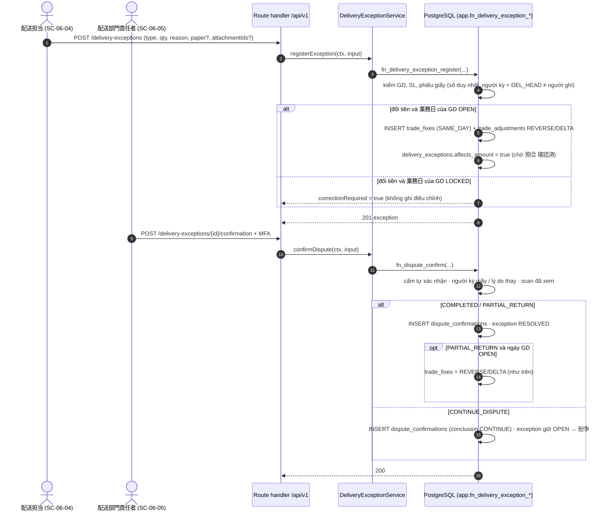

# DEL_EXCEPTION_DISPUTE — Ngoại lệ giao và xác nhận tranh chấp

> Biểu mẫu: **BM-2-901-53 v01** — Detail Design (Chart + Description) · SUN ASTERISK VIETNAM CO., LTD · ISO/IEC 27001:2013 & ISO 9001:2015

---

## 1. History of change

| No | Version | Action | Mục / Bước | Nội dung thay đổi | Ngày | Người sửa | Approve |
|---|---|---|---|---|---|---|---|
| 1 | 0.1.0 | Add new | — | Khởi tạo | 2026-11-25 | phuongnnm-23344 | |
| 2 | 0.1.1 | Update | — | Gate 2 G2-M02: Điều kiện hoàn thành (LAB-5); khách Q-DEL-04: chỉ SL thực giao, tiền theo đơn giá đã chốt, chỉ hướng giảm | 2026-11-25 | phuongnnm-23344 |  |

---

## 2. Sequence diagram

Ảnh PNG: N/A — Mermaid là nguồn duy nhất (Gate 1 m-08).

---

## 3. Description

Hai function nối nhau: (1) **ghi ngoại lệ** từ SC-06-04 (DELIVERY / DEL-HEAD) — chỉ thêm, không sửa lần giao gốc; (2) **xác nhận tranh chấp** ở SC-06-05 — 配送部門責任者 là người quyết cuối (CAP-HUMAN-01, luật 3), MFA, cấm tự xác nhận (PRM-111), không chạy offline.

Ngoại lệ đổi tiền đi đúng một trong hai đường (luật 4, BR-CLOSE-01, ADR-004 §2.2):

| 業務日 của GD gốc | Hệ thống làm | 照合 / 締め |
|---|---|---|
| `OPEN` | Ghi `trade_fixes` (kind `FIX`, `reason_code = DELIVERY_EXCEPTION`) + `trade_adjustments` REVERSE / DELTA (nguồn `SAME_DAY`, `period_id` = kỳ của GD) trong cùng transaction; `delivery_exceptions.affects_amount = true` | Dòng ✖ 「金額が変わる引渡し例外」 ở 日次締め tới khi 照合事務局 bấm 確認済 (`settle_reviewed_*`) — SC-07-02 [20] |
| `LOCKED` | **Không** ghi điều chỉnh; lưu ngoại lệ (`affects_amount = false`), trả `correctionRequired = true` | Người dùng lập 修正申請 (SC-08-01) — duyệt ở SC-08-03 |

Chạy xong (1): có `delivery_exceptions` (OPEN; tranh chấp có `sla_due_at`). Chạy xong (2): có `dispute_confirmations`; ngoại lệ `RESOLVED` (hoặc giữ OPEN khi 継続協議).

---

## 4. Detail function

### 4.1. Xác thực, quyền, MFA

| Trường | Giá trị |
|---|---|
| Input | Cookie `sid`; body JSON |
| Output | `SessionContext` → 4.2 / 4.4 |

**Error**

| Điều kiện lỗi | Xử lý | Status code |
|---|---|---|
| Không phiên | Dừng; `E-CMN-001` | 401 |
| (1) vai không phải DELIVERY / DEL-HEAD; (2) không có quyền `DEL_HEAD` (hoặc 代行) | Dừng; `E-CMN-002` | 403 |
| (2) thiếu MFA step-up | Dừng; `E-CMN-005` | 403 |
| Body sai kiểu | Dừng; `E-CMN-007` | 422 |

**Detail**

| No | Nội dung xử lý |
|---|---|
| 1 | Như các TECH khác (phiên, vai, quyền, 代行, `set_config`) |

### 4.2. Validate ngoại lệ (`fn_delivery_exception_register` — phần kiểm)

| Trường | Giá trị |
|---|---|
| Input | `tradeId`, `deliveryId?`, `inputMode` (`ON_SITE` \| `PAPER_LATE`), `exceptionCode`, `qty?`, `reasonCode`, `description?`, `receiver?`, `paper?` (`formNo`, `signedAt`, `signerEmployeeNo`), `attachmentIds[]` |
| Output | GD đã khóa dòng + `amount_delta` dự tính → 4.3 |

**Error**

| Điều kiện lỗi | Xử lý | Status code |
|---|---|---|
| GD không có / không `CONFIRMED` | Dừng; `E-DEL-027` / `E-DEL-008` | 404 / 409 |
| `exceptionCode` / `reasonCode` không có trong `code_values` | Dừng; `E-DEL-011` / `E-DEL-012` | 422 |
| `qty` thiếu khi loại ≠ 争いあり; số lẻ sai | Dừng; `E-DEL-003` / `E-DEL-004` | 422 |
| `qty` vượt phạm vi (不足 / 一部取消 > 残 chưa giao; 返品 > 引渡済) | Dừng; `E-DEL-028` | 409 |
| 争いあり mà `description` rỗng | Dừng; `E-DEL-013` | 422 |
| `PAPER_LATE`: `formNo` trùng | Dừng; `E-DEL-014` | 409 |
| `PAPER_LATE`: `signedAt` ngoài 業務日 / tương lai | Dừng; `E-DEL-015` | 422 |
| `PAPER_LATE` + 争いあり: người ký không có quyền `DEL_HEAD` | Dừng; `E-DEL-018` | 422 |
| Người ký = người ghi lần giao (`deliveries.recorded_by`) hoặc = người gọi | Dừng; `E-DEL-016` | 422 |
| `PAPER_LATE` mà không có `attachmentIds` (`doc_class = DISPUTE_EVIDENCE`) | Dừng; `E-DEL-017` | 422 |
| 業務日 hiện tại không `OPEN` | Dừng; `E-CMN-003` | 423 |

**Detail**

| No | Nội dung xử lý |
|---|---|
| 1 | `SELECT … FROM trades WHERE id = :tradeId FOR UPDATE`; tính 残 / 引渡済 như DEL_RECORD §4.3 |
| 2 | `affects_amount_candidate` = loại ∈ (不足, 返品, 一部取消) và `qty` > 0 |
| 3 | `amount_delta` = −floor(`qty` × `unit_price_jpy`) (税抜, PRM-053) — `unit_price_jpy` lấy từ GD đã chốt (giá hiệu lực); body **không có** trường giá / tiền, 配送 chỉ nhập SL; chỉ hướng giảm (`EXCESS` 過剰 → `affects_amount = false`, chỉ ghi nhận — Q-DEL-04, Q-DEL-06 [Customer giả lập, 2026-11-25]) |

### 4.3. Ghi ngoại lệ (+ điều chỉnh nếu ngày mở)

| Trường | Giá trị |
|---|---|
| Input | Kết quả 4.2 |
| Output | `{ exception, adjustmentCreated, correctionRequired, amountDeltaJpy }` → 201 |

**Error**

`N/A — kiểm ở 4.2 trong cùng transaction; lỗi DB → rollback, 500 E-CMN-004`

**Detail**

| No | Nội dung xử lý |
|---|---|
| 1 | INSERT `delivery_exceptions` (`business_date` = 業務日 mở, `is_dispute` = (loại = 争いあり), `sla_due_at` = now + SLA từ file cấu hình (PRM-048, tạm 3 営業日 theo lịch), `paper_form_no`, `paper_signed_at`, `paper_signed_by`, `status = OPEN`) |
| 2 | Gắn `attachments` (`ref_table = 'delivery_exceptions'`, `doc_class = DISPUTE_EVIDENCE`) |
| 3 | Nếu `affects_amount_candidate` và `trades.business_date` `OPEN`: INSERT `trade_fixes` (`kind = FIX`, `change` = {before: qty hiệu lực, after: qty − `qty`}, `reason_code = DELIVERY_EXCEPTION`, `max_buyer_diff_incl_jpy`, `buyer_changed = false`) + `trade_adjustments` REVERSE (SL / giá cũ) + DELTA (SL mới; bỏ DELTA nếu SL mới = 0), `source = SAME_DAY`, `business_date` = ngày GD, `period_id` = kỳ chứa `trade_date`; ghi `delivery_exceptions.affects_amount = true` và `fix_id` = `trade_fixes` vừa tạo (Q-DEL-04, Q-DEL-09) |
| 4 | Nếu `affects_amount_candidate` và ngày GD `LOCKED`: không ghi điều chỉnh; `correctionRequired = true` |
| 5 | Tranh chấp: `notifications` → DEL-HEAD (người ký nếu có) 「争いのある引渡しの確認待ち: {取引}」 |
| 6 | `audit_logs` (`DELIVERY_EXCEPTION_REGISTER`) |

### 4.4. Validate xác nhận (`fn_dispute_confirm` — phần kiểm)

| Trường | Giá trị |
|---|---|
| Input | `exceptionId`, `conclusion` (`COMPLETED` \| `PARTIAL_RETURN` \| `CONTINUE_DISPUTE`), `returnQty?`, `comment?`, `signerAbsentReason?`, `scanViewedAt?` |
| Output | Ngoại lệ đã khóa dòng → 4.5 |

**Error**

| Điều kiện lỗi | Xử lý | Status code |
|---|---|---|
| Không có ngoại lệ | Dừng; `E-DEL-025` | 404 |
| Không phải tranh chấp, hoặc đã có xác nhận kết luận (`COMPLETED` / `PARTIAL_RETURN`) | Dừng; `E-DEL-024` | 409 |
| Người gọi = `delivery_exceptions.created_by` hoặc = `deliveries.recorded_by` của lần giao liên quan | Dừng; `E-DEL-019` 「自分の記録のため確認できません」 | 403 |
| `conclusion` thiếu | Dừng; `E-DEL-020` | 422 |
| `PARTIAL_RETURN` thiếu `returnQty` (và ngoại lệ không có SL) / vượt 引渡済 | Dừng; `E-DEL-026` / `E-DEL-028` | 422 / 409 |
| `CONTINUE_DISPUTE` thiếu `comment` | Dừng; `E-DEL-021` | 422 |
| Phiếu giấy, người gọi ≠ `paper_signed_by`, thiếu `signerAbsentReason` | Dừng; `E-DEL-022` | 422 |
| Như trên mà `scanViewedAt` rỗng | Dừng; `E-DEL-023` | 422 |
| Thiếu MFA | Dừng; `E-CMN-005` | 403 |

**Detail**

| No | Nội dung xử lý |
|---|---|
| 1 | `SELECT … FROM delivery_exceptions WHERE id = :id FOR UPDATE` (hai DEL-HEAD bấm cùng lúc → người sau nhận `E-DEL-024`) |
| 2 | Kiểm cấm tự xác nhận ở DB (không chỉ ở UI) |

### 4.5. Ghi xác nhận

| Trường | Giá trị |
|---|---|
| Input | Kết quả 4.4 + `app.mfa_verified_at` |
| Output | `{ confirmation, exceptionStatus, adjustmentCreated, correctionRequired }` → 200 |

**Error**

`N/A — kiểm ở 4.4; lỗi DB → rollback, 500`

**Detail**

| No | Nội dung xử lý |
|---|---|
| 1 | INSERT `dispute_confirmations` (`exception_id`, `confirmed_by`, `delegation_id`, `mfa_verified_at`, `decision_note` = comment hoặc nhãn kết luận, `signer_absent_reason`, **`conclusion`** — TRADE_DB 0.2.1 §4.36, Q-DEL-07) |
| 2 | `COMPLETED` / `PARTIAL_RETURN`: UPDATE `delivery_exceptions.status = RESOLVED`, `resolved_at` |
| 3 | `PARTIAL_RETURN`: tính tiền theo `returnQty`, đi đúng bảng ở §3 (ngày GD `OPEN` → `trade_fixes` + REVERSE / DELTA + `affects_amount = true`; `LOCKED` → `correctionRequired`) |
| 4 | `CONTINUE_DISPUTE`: ngoại lệ giữ `OPEN` (vẫn là ⚠ 「未確認の争い」 ở 日次締め, sang ngày sau); `notifications` → SETTLE (紛争管理 SC-07-03) |
| 5 | `audit_logs` — ghi rõ "xác nhận thay người ký giấy {tên}" khi `signer_absent_reason` có giá trị, và 代行 |

---

## 5. Other Notes

- **Database Design (đã gộp, TRADE_DB 0.2.1):** (a) `dispute_confirmations.conclusion` + `uq_dispute_confirmations_exception` thành unique partial `conclusion <> 'CONTINUE_DISPUTE'` — §4.36 (Q-DEL-07); (b) `delivery_exceptions.fix_id` FK `trade_fixes` nối ngoại lệ với điều chỉnh để checklist 日次締め **không đếm hai lần** (mục 当日訂正 loại trừ `trade_fixes` có ngoại lệ trỏ tới — ADR-005 0.2.2 §2.5 mục 6, Q-DEL-09) — §4.35. Vai DELIVERY tạo `trade_fixes` qua hàm ngoại lệ: ADR-004 0.2.1 §2.2 (Q-DEL-04).
- **Không làm:** không sửa / xóa `deliveries`; không kết luận thay người (không có tự động 完了 theo SLA); không chạy offline (ADR-008 §2.3-10 — không MFA offline).
- **Hệ quả kỳ:** điều chỉnh mang `period_id` = kỳ GD gốc; kỳ đã 期ロック → chỉ đi DELTA ở 期ロック kế tiếp (ADR-007 §2.3) — module `incentive` xử lý.
- **SLA:** `sla_due_at` theo 営業日 của `market_calendar`; quá hạn chỉ cảnh báo (RPT-09), không chặn.
- Truy vết: luật 3, luật 4; CAP-HUMAN-01, FT-06-04, FT-06-05, FR-DEL-03, FR-DEL-04, FR-SETTLE-01, OBJ-05, PRM-048, PRM-053, PRM-111, BR-CLOSE-01, TBL-ATTACH-01, E-21; ADR-002, ADR-004, ADR-005, ADR-007, ADR-008 §2.4; TRADE_DB 4.34–4.36, ADJUST_DB 4.32, 4.39, IAM_AUDIT_DB 4.54; khách #4, #16, #17.

### Điều kiện hoàn thành (LAB-5)

Mỗi dòng là một ca kiểm được (test tích hợp gọi API / hàm DB); issue LAB-5 xong khi mọi dòng đạt. Cùng khuôn với luồng 1 (vd `trade/technical-design/TRADE_AITAI_CONFIRM_TECH.md` §5).

| # | Cho / Khi | Kết quả mong đợi |
|---|---|---|
| 1 | Ngày GD `OPEN`; 配送 ghi 不足 2kg (đơn giá đã chốt 1.500) | 201; `delivery_exceptions` `affects_amount = true`, `fix_id` trỏ `trade_fixes` mới; REVERSE + DELTA với tiền −3.000 tính từ đơn giá GD (body không có trường giá / tiền); mục #6 checklist 日次締め +1 tới khi 照合 bấm 確認済; mục #5 / #9 **không** đếm fix này (Q-DEL-09) |
| 2 | Ngày GD `LOCKED`; ghi 返品 | 201; không có `trade_adjustments`, `correctionRequired = true` |
| 3 | Ghi 過剰 (`EXCESS`) | 201; `affects_amount = false`, không điều chỉnh tiền (Q-DEL-06) |
| 4 | 不足 / 一部取消 > 残 chưa giao; 返品 > 引渡済 | 409 `E-DEL-028` |
| 5 | 争いあり không nội dung | 422 `E-DEL-013` |
| 6 | Nhập bù phiếu giấy (`PAPER_LATE`): số phiếu đã dùng / thiếu scan / người ký = người ghi lần giao | 409 `E-DEL-014` / 422 `E-DEL-017` / 422 `E-DEL-016` |
| 7 | 配送部門責任者 xác nhận tranh chấp do **chính mình** ghi (người ghi ngoại lệ hoặc người ghi lần giao) | 403 `E-DEL-019` — kiểm ở DB, không chỉ UI |
| 8 | Xác nhận `CONTINUE_DISPUTE` 2 lần cho cùng ngoại lệ, rồi `COMPLETED` | 3 dòng `dispute_confirmations` (2 `CONTINUE_DISPUTE` + 1 `COMPLETED`); ngoại lệ `RESOLVED`; xác nhận kết luận lần hai → 409 `E-DEL-024` |
| 9 | `CONTINUE_DISPUTE` không ghi chú | 422 `E-DEL-021` |
| 10 | `PARTIAL_RETURN` ở ngày GD `OPEN` | Một `trade_fixes` + REVERSE / DELTA; `fix_id` gắn vào ngoại lệ; checklist đếm **một lần** ở mục #6 |
| 11 | Phiếu giấy, người xác nhận ≠ người ký giấy, thiếu lý do / chưa xem scan | 422 `E-DEL-022` / `E-DEL-023` |
| 12 | Thiếu step-up MFA khi xác nhận (kể cả 継続協議 — Q-DEL-08) | 403 `E-CMN-005` |
| 13 | Mất mạng | Màn khóa form (C-28), không có hàng đợi offline cho ngoại lệ (Q-DEL-01) — kiểm bằng test UI |
