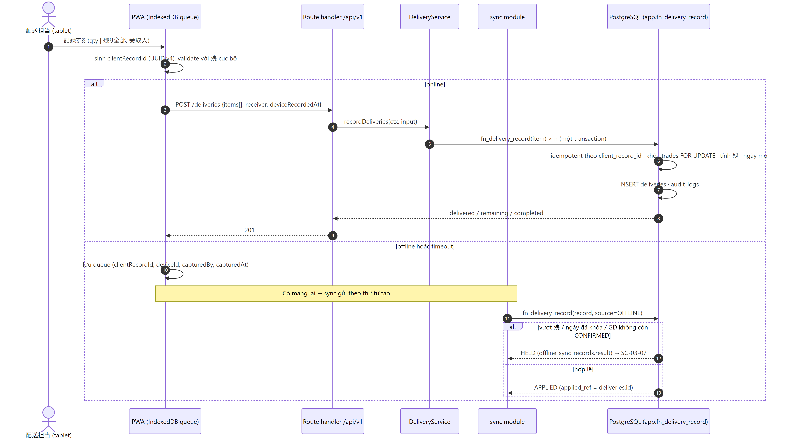
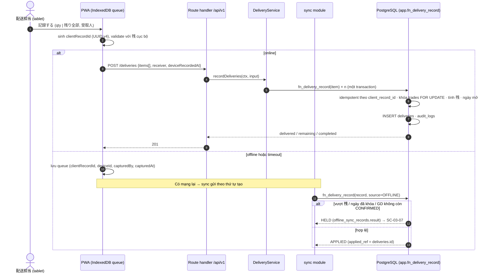

# DEL_RECORD — Ghi giao nhiều lần, offline idempotent

> Biểu mẫu: **BM-2-901-53 v01** — Detail Design (Chart + Description) · SUN ASTERISK VIETNAM CO., LTD · ISO/IEC 27001:2013 & ISO 9001:2015

---

## 1. History of change

| No | Version | Action | Mục / Bước | Nội dung thay đổi | Ngày | Người sửa | Approve |
|---|---|---|---|---|---|---|---|
| 1 | 0.1.0 | Add new | — | Khởi tạo | 2026-11-25 | phuongnnm-23344 | |
| 2 | 0.1.1 | Update | — | Gate 2 G2-M02: Điều kiện hoàn thành (LAB-5); khách Q-DEL-03; G2-m07: nhãn [PL] mục tiêu hiệu năng | 2026-11-25 | phuongnnm-23344 |  |
| 3 | 0.1.2 | Update | §2 | FB-EXP-236: nhúng ảnh PNG `./assets/DEL_RECORD_sequence.png` xuất từ khối Mermaid (`scripts/export-mermaid-png.py`); Mermaid vẫn là nguồn | 2026-11-25 | phuongnnm-23344 |  |

---

## 2. Sequence diagram

Nguồn: khối Mermaid dưới (bản để sửa); ảnh sinh từ chính khối đó bằng `python scripts/export-mermaid-png.py DEL_RECORD` — sửa Mermaid thì chạy lại để hai bản không lệch.

---

## 3. Description

Ghi **mỗi lần giao một dòng** `deliveries` (chỉ thêm, ngày mở — TRADE_DB 4.34). Một GD giao nhiều lần; 残 và trạng thái tính từ SL hiệu lực của GD (`v_trade_effective` — gốc + Σ điều chỉnh) trừ Σ đã giao, đọc qua `v_delivery_status`. **Một hàm DB `fn_delivery_record` cho cả đường online và đồng bộ offline** (ADR-008 §2.2-5): cùng kiểm vai, SL, ngày mở; khác nhau chỉ ở nơi ghi kết quả từ chối (online → lỗi HTTP; offline → `offline_sync_records.result = HELD`).

Idempotent: `client_record_id` (UUID sinh trên máy) là khóa — unique `uq_deliveries_client_record`; gửi lại cùng id **cùng nội dung** → trả kết quả cũ, không ghi đôi; cùng id **khác nội dung** → từ chối `E-DEL-010` (dấu hiệu lỗi client).

Chạy xong: có dòng `deliveries` với `business_date` = 業務日 hiện tại do server xác định (không theo đồng hồ máy — ADR-005 §2.3); GD hết 残 (theo `DELIVERY_MATCH_RULE`) hiện 完了.

---

## 4. Detail function

### 4.1. Xác thực + validate request

| Trường | Giá trị |
|---|---|
| Input | Cookie `sid`; body `{ items: [{ tradeId, qty?, isRemainingAll, clientRecordId }], receiver: { type: SELF \| PROXY, name? }, deviceRecordedAt }` |
| Output | `SessionContext` + input đã chuẩn hóa → 4.2 |

**Error**

| Điều kiện lỗi | Xử lý | Status code |
|---|---|---|
| Không có phiên | Dừng; `E-CMN-001` | 401 |
| Vai không phải DELIVERY / DEL-HEAD | Dừng; `E-CMN-002` | 403 |
| `items` rỗng hoặc > 20; trường sai kiểu | Dừng; `E-CMN-007` | 422 |
| `qty` thiếu khi `isRemainingAll = false`, hoặc ≤ 0 | Dừng; `E-DEL-003` | 422 |
| `receiver.type` thiếu | Dừng; `E-DEL-006` | 422 |
| `PROXY` mà `name` > 50 (tên tùy chọn — Q-DEL-03) | Dừng; `E-DEL-007`, `field` = `receiver.name` | 422 |

**Detail**

| No | Nội dung xử lý |
|---|---|
| 1 | Kiểm phiên, vai, thiết bị (`devices.is_active`, không `lost_reported_at`) |
| 2 | `receiver_name` = 「本人」 khi `SELF`; = `name` khi `PROXY`, `name` rỗng → 「代理」 (Q-DEL-03 [Customer giả lập, 2026-11-25]) |
| 3 | Mở **một** transaction cho cả `items` (giao hết một lần [17] là nguyên tử: một GD lỗi → không ghi GD nào) |

### 4.2. Idempotent theo `client_record_id`

| Trường | Giá trị |
|---|---|
| Input | Mỗi `item.clientRecordId` |
| Output | Danh sách item cần ghi mới; item đã ghi → lấy kết quả cũ → 4.5 |

**Error**

| Điều kiện lỗi | Xử lý | Status code |
|---|---|---|
| Đã có `deliveries.client_record_id` nhưng khác `trade_id` / `qty_delivered` / `is_remaining_all` | Dừng; `E-DEL-010` 「同じ記録IDで異なる内容が送信されました」; log `WARN` | 409 |

**Detail**

| No | Nội dung xử lý |
|---|---|
| 1 | `SELECT … FROM deliveries WHERE client_record_id = ANY(:ids)` |
| 2 | Trùng hoàn toàn → đánh dấu `replayed = true`, không INSERT |
| 3 | Đường đồng bộ: kiểm thêm `offline_sync_records (device_id, client_record_id)` — đã có kết quả → trả kết quả cũ (`APPLIED` / `HELD` / `REJECTED`) |

### 4.3. Kiểm GD, 残, ngày mở

| Trường | Giá trị |
|---|---|
| Input | Item cần ghi mới |
| Output | `qty_to_record`, `remaining_after` → 4.4 |

**Error**

| Điều kiện lỗi | Xử lý | Status code |
|---|---|---|
| GD không tồn tại | Dừng; `E-DEL-027` | 404 |
| GD không `CONFIRMED` (下書き / 確認待ち / 取消) | Dừng; `E-DEL-008`. Offline → `HELD` | 409 |
| 残 = 0 | Dừng; `E-DEL-009`. Offline → `HELD` | 409 |
| `qty` > 残 (sau khi khóa dòng) | Dừng; `E-DEL-005` kèm `remaining`. Offline → `HELD` lý do 「残数量超過」 | 409 |
| Số lẻ sai đơn vị (`KG` 1 chữ số; `CASE` / `PIECE` nguyên) | Dừng; `E-DEL-004` | 422 |
| `business_date_for(now())` không `OPEN` | Dừng; `E-CMN-003`. Offline: bản ghi có `captured_at` thuộc 業務日 đã khóa → `HELD` (ADR-008 §2.2-7) | 423 |

**Detail**

| No | Nội dung xử lý |
|---|---|
| 1 | `SELECT … FROM trades WHERE id = ANY(:tradeIds) ORDER BY id FOR UPDATE` — thứ tự cố định chống deadlock giữa hai tablet giao cùng người mua |
| 2 | 残 = `v_trade_effective.qty` − Σ `deliveries.qty_delivered` (đọc sau khi khóa) |
| 3 | `isRemainingAll` → `qty_to_record = 残`, bỏ qua `qty` client gửi (chống lệch khi 残 đã đổi — người dùng muốn "hết phần còn lại") |
| 4 | Đường offline: 業務日 của bản ghi = `business_date_for(captured_at)`; khác 業務日 đang mở và ngày đó `LOCKED` → `HELD` (không ghi vào ngày đã khóa, không tự dời ngày) |

### 4.4. Ghi lần giao

| Trường | Giá trị |
|---|---|
| Input | Kết quả 4.3 |
| Output | Dòng `deliveries` mới → 4.5 |

**Error**

`N/A — mọi điều kiện đã kiểm ở 4.3 trong cùng transaction có khóa dòng; lỗi DB khác → rollback, 500 E-CMN-004 (online) / bản ghi giữ PENDING để thử lại (offline)`

**Detail**

| No | Nội dung xử lý |
|---|---|
| 1 | INSERT `deliveries` (`trade_id`, `business_date` = 業務日 mở, `qty_delivered`, `is_remaining_all`, `receiver_name`, `recorded_by` = người thao tác (offline: `captured_by` qua PIN), `device_id`, `client_record_id`, `device_recorded_at`) |
| 2 | Đường offline: UPDATE `offline_sync_records` `result = APPLIED`, `applied_ref_table = 'deliveries'`, `applied_ref_id` |
| 3 | `audit_logs` (`action = DELIVERY_RECORD`, có `device_id`, cờ `offline`) |

### 4.5. Tính trạng thái + response

| Trường | Giá trị |
|---|---|
| Input | Các dòng vừa ghi / replay |
| Output | `{ results: [{ clientRecordId, deliveryId, tradeId, qtyDelivered, deliveredTotal, remaining, status, replayed }] }` → 201 |

**Error**

`N/A — chỉ đọc view sau khi ghi`

**Detail**

| No | Nội dung xử lý |
|---|---|
| 1 | Đọc `v_delivery_status` cho các GD: `status` = 待機中 (đã giao 0) · 引渡し中 · 完了 (残 = 0 theo `DELIVERY_MATCH_RULE` của version quy chế ngày GD — E-17) · 例外 (có `delivery_exceptions` OPEN) |
| 2 | COMMIT; trả 201 (replay toàn bộ → 200 với cùng body) |

---

## 5. Other Notes

- **Snapshot offline** (`API-DEL-002`): GD `CONFIRMED` còn 残 > 0 trong tối đa 7 業務日 gần nhất (Q-DEL-02 — khách đồng ý [Customer giả lập, 2026-11-25]) + danh sách người mua (số, tên) + `snapshotAt`. Không chứa giá / tiền (giảm dữ liệu trên máy). PWA tính 残 cục bộ = snapshot − hàng đợi chưa đồng bộ của chính máy.
- **Hai tablet cùng giao một GD khi offline**: cả hai ghi cục bộ được; khi đồng bộ, bản ghi tới sau vượt 残 → `HELD` → SC-03-07 (người quyết giữ / bỏ / lập 修正申請 `LATE_ENTRY`) — không tự gộp, không ghi đè (ADR-008 §2.2-6).
- **Không làm:** không sửa / xóa lần giao; không xử lý ngoại lệ (DEL_DISPUTE); không đổi trạng thái lô sang `DELIVERED` (module `lot` đọc `v_delivery_status`).
- **Hiệu năng:** p95 ≤ 2 giây với 20 item ([PL] cho API ghi, lấy theo mức NFR-PERF-01 của tìm kiếm); index `idx_deliveries_trade`, `uq_deliveries_client_record`.
- **API đồng bộ** thuộc module `sync` (chưa có spec ở P3) — phải gọi `fn_delivery_record` với cờ `offline` và `captured_by`, `captured_at`, `device_id` lấy từ bản ghi hàng đợi.
- Truy vết: luật 4; FR-DEL-01, FR-DEL-02, FR-DEL-05, BR-DEL-03, PRM-111, PRM-118, E-17, NFR-AVL-02, NFR-PERF-01, DEC-004; ADR-004, ADR-005 §2.3, ADR-008 §2.2; TRADE_DB 4.34, IAM_AUDIT_DB 4.6, 4.55.

### Điều kiện hoàn thành (LAB-5)

Mỗi dòng là một ca kiểm được (test tích hợp gọi API / hàm DB); issue LAB-5 xong khi mọi dòng đạt. Cùng khuôn với luồng 1 (vd `trade/technical-design/TRADE_AITAI_CONFIRM_TECH.md` §5).

| # | Cho / Khi | Kết quả mong đợi |
|---|---|---|
| 1 | Online, GD `CONFIRMED` 残 = 12kg; giao 6kg `receiver.type = SELF` | 201; 1 dòng `deliveries` (`receiver_name` = 「本人」), `remaining = 6.0`, `status` 引渡し中 |
| 2 | Gửi lại **cùng** `clientRecordId` cùng nội dung (2 lần, hoặc đồng bộ lại sau mất mạng) | 200 `replayed = true`; vẫn **1** dòng `deliveries` |
| 3 | Cùng `clientRecordId` nhưng khác `qty` | 409 `E-DEL-010`; log `WARN`; không ghi thêm |
| 4 | `qty` > 残 (vd tablet khác vừa giao) | 409 `E-DEL-005`, `field = items[i].qty`, `detail.remaining`; offline → bản ghi `HELD` lý do 「残数量超過」 |
| 5 | `isRemainingAll = true` khi 残 đã đổi | Ghi đúng 残 hiện tại (bỏ `qty` client) |
| 6 | Giao hết một lần 3 GD, GD thứ 2 lỗi | Không GD nào được ghi (một transaction); `field = items[1]…` |
| 7 | Bản ghi offline có `captured_at` thuộc 業務日 đã `LOCKED` | `HELD` (không ghi vào ngày đã khóa, không tự dời ngày); online gọi thẳng vào ngày khóa → 423 `E-CMN-003` |
| 8 | `PROXY` không tên | 201; `receiver_name` = 「代理」 (Q-DEL-03). Tên > 50 → 422 `E-DEL-007` |
| 9 | Số lẻ sai đơn vị (`CASE` 1.5) | 422 `E-DEL-004` |
| 10 | GD `PENDING` / 取消; GD đã giao hết | 409 `E-DEL-008` / `E-DEL-009` |
| 11 | Hai tablet giao cùng người mua cùng lúc (GD chồng nhau) | Không deadlock (khóa `trades` theo `id`); tổng giao ≤ SL hiệu lực |
