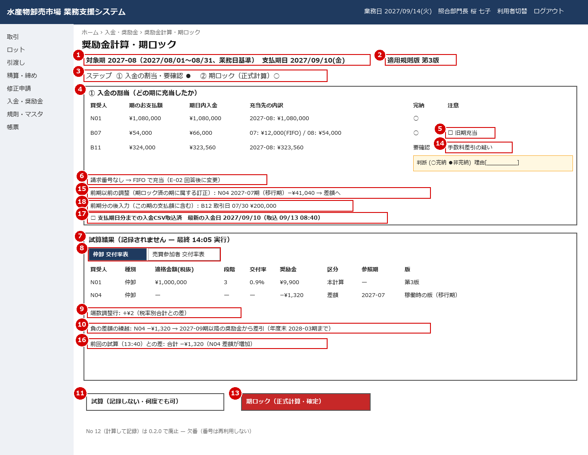

# SC-09-04 — 奨励金計算・期ロック

> Biểu mẫu: **BM-2-901-51 v2.1** — Screen Specification · SUN ASTERISK VIETNAM CO., LTD · ISO/IEC 27001:2013 & ISO 9001:2015

---

## 1. History of change

| No | Version | Action | Nội dung thay đổi | Ngày | Người sửa | Approve |
|---|---|---|---|---|---|---|
| 1 | 0.1.0 | Add New | Khởi tạo từ wireframe SC-09-04 0.2.1 (LAB-4 P3) | 2026-11-25 | phuongnnm-23344 | |
| 2 | 0.1.1 | Update | Khách Q-INC-01/02: item [17] tick 「支払期日分までの入金CSV取込済」, [18] 前期分の後入力; validation, mapping, vai, E-INC-014; ảnh annotated dựng lại | 2026-11-25 | phuongnnm-23344 |  |

---

## 2. Layout

**Design:** [Wireframe SC-09-04 0.2.1](../../../wireframes/SC-09-04-incentive-calc-period-lock-wireframe.md) (to-be) · ảnh as-is prototype: [`SC-09-04_prototype.png`](../../../wireframes/assets/SC-09-04_prototype.png)

> - Ảnh đánh số **dựng từ wireframe to-be** (script `scripts/render-annotated-screens.py`, nguồn là bảng chữ của wireframe), không từ ảnh prototype: to-be khác prototype nhiều (bảng phân bổ 入金 [4], 2 bảng tỷ lệ [8], bỏ nút 計算して記録 [12], 要確認 [14], 前期以前の調整 [15], so 試算 [16]). Số trên ảnh = cột `ID` mục 4 = cột `No` của wireframe; **No 12 là số bỏ** (giữ số, không dùng lại — quy tắc `_common-layout`).
> - Chưa có Figma: dự án LAB-4 dùng wireframe Markdown làm thiết kế (PREMISE, mức chi tiết wireframe). Hộp thoại C-31 / C-30 và hộp quyết 要確認 mô tả ngay trong file này.

---

## 3. Description

Màn **quyết định** của 照合部門長 (STL-HEAD): kiểm tiền 入金 đã gán vào kỳ nào, quyết các dòng 要確認, rồi **期ロック** — trong **một transaction** tính chính thức 完納奨励金 (thưởng thanh toán đủ, đúng hạn), ghi kết quả và đóng băng kỳ (ADR-007 §2.1). Trước khi khóa chỉ có **試算** (tính thử, không ghi kết quả, chạy bao nhiêu lần cũng được, mỗi lần ghi 監査ログ). Sau khi khóa, mọi chênh lệch của kỳ này chỉ đi **DELTA ở 期ロック kế tiếp** (luật 4).

- Người dùng: STL-HEAD (thao tác); SETTLE 照合事務局 (xem + 試算); OPS-HEAD 運用部門長 (chỉ đọc).
- Vào từ: menu 入金・奨励金 → SC-09-03 期別お支払額・入金状況 → nút 「奨励金計算・期ロックへ」 (mang `periodId`); hoặc URL `/periods/{periodId}/incentive-lock`.
- Đi tới: SC-09-05 奨励金明細 (sau khóa, nút C-10); SC-09-03 (breadcrumb / sửa phân bổ); SC-09-02 (cảnh báo 入金 chưa ánh xạ); SC-08-01 修正申請 (từ banner C-24 khi kỳ đã khóa).
- Thiết bị: PC 1366 × 900.

---

## 4. View

**Đánh ID:** cột `ID` dùng **đúng số item của wireframe** (1–18, không đánh lại; `C-xx` = item dùng chung ở `wireframes/_common-layout.md`, chỉ liệt kê khi màn có quy tắc riêng). Dòng in đậm A–E là nhóm hiển thị, không phải item. Mục 5 trỏ item bằng số này (vd. `13`).

### 4.1 Danh sách item

| ID | Item Name | Item Type | Required | Note |
|---|---|---|---|---|
| **A** | **Đầu màn (kỳ, version, bước)** | | | |
| 1 | 対象期 + 支払期日 | Label | - | 「対象期 2027-08（2027/08/01〜08/31、業務日基準）　支払期日 2027/09/10(金)」. Ngày `YYYY/MM/DD(曜)`. Nếu 支払期日 bị lùi (ngày 10 là ngày ngân hàng nghỉ) thêm 「（10日は銀行休業日のため前銀行営業日）」 |
| 2 | 適用規則版 | Label | - | 「適用規則版 第{n}版」 = version của kỳ (hiệu lực ngày 1 của kỳ, PRM-042); kỳ migrate: 「稼働時の版（移行期）」 |
| 3 | ステップ表示 | Label | - | ① 入金の割当・要確認 / ② 期ロック（正式計算）; ● bước hiện tại, ○ chưa tới. ② chỉ thành ● khi không còn dòng 要確認 chưa quyết |
| **B** | **① 入金の割当（どの期に充当したか）** | | | |
| 4 | Bảng phân bổ 入金 | Label (bảng) | - | Cột: 買受人 (mã người mua) · 期のお支払額 · 期日内入金 · 充当先の内訳 · 完納 (○ / ✖ / 要確認) · 注意. Sắp theo mã người mua. Tiền `¥#,##0`. Mỗi dòng một người mua có 期のお支払額 > 0 hoặc có phân bổ vào kỳ |
| 5 | ⚠ 旧期充当 | Label | - | Cảnh báo ở cột 注意 khi 入金 trong cửa sổ hạn của kỳ bị FIFO đem trả kỳ cũ (`OLD_PERIOD_ALLOCATION`); cũng hiện 「⚠ 過入金」 (`OVERPAYMENT`). Tooltip: 「期日内の入金の一部が前の期に充当されたため、この期が完納にならない場合があります」 |
| 6 | FIFO 注記 | Label | - | 「請求番号なし → FIFO で充当（E-02 回答後に変更）」. Ẩn khi E-02 chốt dùng 請求番号 |
| 14 | 手数料差引の疑い + 判断 | Label + Radio + Text box | Có (khi dòng 要確認) | Nhãn ở cột 注意; bấm → hộp quyết dưới dòng: radio 「完納とする」 / 「非完納とする」 (chọn sẵn 非完納 — gợi ý mặc định PRM-040) + ô 「判断理由」. Quyết định giữ ở màn (nháp) tới khi 期ロック; gửi kèm 試算 để xem số |
| 15 | 前期以前の調整 | Label | - | 「前期以前の調整（期ロック済の期に属する訂正）: {買受人} {期}期 {±金額} → 差額へ」. Chỉ điều chỉnh (修正申請 TRADE); không cộng vào 期のお支払額 của kỳ này (OPEN-DB-08) |
| 18 | 前期分の後入力 | Label | - | 「前期分の後入力（この期の支払額に含む）: {買受人} 取引日 {MM/DD} ¥{税抜}」 — GD 後入力 của kỳ đã khóa chuyển sang kỳ này, **đã** cộng vào 期のお支払額 và xét 完納 theo 支払期日 kỳ này (Q-INC-02, TECH §3.4). Không có dòng → ẩn |
| 17 | 入金CSV取込確認 | Checkbox + Label | Có (trước 期ロック) | Checkbox 「支払期日分までの入金CSV取込済」 + nhãn bên cạnh 「最新の入金日 {YYYY/MM/DD}（取込 {MM/DD HH:MM}）」 từ `paymentCsv`. Mặc định không tick, không tự tick; chỉ người khóa tick (Q-INC-01 [Customer giả lập, 2026-11-25]). Không lưu nháp — mỗi lần mở màn tick lại |
| **C** | **試算結果 / 確定結果** | | | |
| 7 | Khối kết quả | Label (bảng) | - | Tiêu đề trước khóa: 「試算結果（記録されません — 最終 HH:MM 実行）」; sau khóa: 「確定結果（期ロック {氏名} MM/DD HH:MM）」. Cột: 買受人 · 種別 · 適格金額(税抜) · 段階 · 交付率 · 奨励金 · 区分 (本計算 / 差額 / 繰越 / 繰越失効) · 参照期 · 版 |
| 8 | Tab bảng tỷ lệ | Button (tab) | - | 「仲卸 交付率表」 / 「売買参加者 交付率表」 — lọc dòng [7] theo loại; mặc định tab 仲卸. Mỗi tab có liên kết nhỏ xem 5 bậc của version |
| 9 | 端数調整行 | Label | - | 「端数調整行: {±¥n}（税率別合計との差）」 |
| 10 | 負の差額の繰越 | Label | - | 「負の差額の繰越: {買受人} {−¥n} → {期}期以降の奨励金から差引（年度末 {YYYY}-03期まで）」; kỳ tháng 03: 「年度末で繰越失効: {¥n}（RPT-07 で未回収として表示）」 |
| 16 | 前回の試算との差 | Label | - | 「前回の試算（HH:MM）との差: 合計 {±¥n}（{買受人} …）」; chưa có lần trước → ẩn |
| **D** | **Thao tác** | | | |
| 11 | 試算 | Button | - | 「試算（記録しない・何度でも可）」 |
| 12 | (bỏ) 計算して記録 | — | - | Bỏ ở wireframe 0.2.0 (N13) — giữ số, không hiển thị |
| 13 | 期ロック | Button | - | 「期ロック（正式計算・確定）」, màu nhấn đỏ. Mở hộp thoại C-31 → C-30 |
| **E** | **Hộp thoại (thuộc màn này)** | | | |
| C-31 | Xác nhận 期ロック | Dialog | - | 「期ロックすると、この期の奨励金が確定し、直接修正できません。差額は次の期ロックで計上されます。」 + số chính: 本計算 合計 / 差額 合計 / 件数. Khi có ⚠: checkbox 「注意事項 {n} 件を確認しました」 (bắt buộc). Nút 「期ロックする」 / 「戻る」 |
| C-30 | MFA (luôn hỏi lại mã) | Dialog + Text box | Có | Mã 6 số; 期ロック là hành động không quay lại được → luôn hỏi lại kể cả còn hiệu lực step-up (ADR-002 §2-6a) |
| C-10 | Nút góc phải | Button | - | Trước khóa: 「入金状況へ」 (→ SC-09-03); sau khóa: 「奨励金明細へ」 (→ SC-09-05) |

> - `Item Type`: `Label` · `Image` · `Text box` · `Button` (+ `Radio`, `Dialog` — mở rộng cần cho màn này).
> - `Required`: `Có` · `Không` · `-` (item không nhận nhập liệu).

### 4.2 Validation

| ID | Type | Min | Max | Default | Ghi chú |
|---|---|---|---|---|---|
| 14 (判断) | Enum `KANNO` / `NOT_KANNO` | - | - | `NOT_KANNO` | Bắt buộc cho mọi dòng 要確認 trước khi bật [13]. Thiếu khi gọi 期ロック → `E-INC-006` 「要確認の判断が入力されていない買受人が {count} 件あります。」 (C-22 tại dòng) |
| 14 (判断理由) | String (UTF-8, cho phép xuống dòng) | 1 | 500 | (trống) | Bắt buộc khi có 判断; trim khoảng trắng hai đầu; rỗng / > 500 → `E-INC-007` 「判断の理由を入力してください（500文字以内）。」 ngay dưới ô |
| 17 | Boolean | - | - | `false` | Bắt buộc `true` để bật [13]; gửi `paymentCsvImportConfirmed`. Server nhận `false` → 422 `E-INC-014` 「支払期日分までの入金CSVの取込を確認し、チェックを入れてください。」 (C-22 dưới [17]) |
| C-31 (checkbox ⚠) | Boolean | - | - | `false` | Bắt buộc `true` khi số ⚠ > 0; gửi `ackWarningCount` = số ⚠ đang hiện. Server đếm khác → `E-INC-013` |
| C-30 (mã MFA) | String số | 6 | 6 | (trống) | Chỉ chữ số; mã kiểm ở API xác thực MFA của iam (chưa đặc tả), sai 5 lần → khóa tạm (ADR-002) |

Item [11], [8] không có validation (không nhận nhập liệu). Điều kiện bật / tắt nút ở mục 6.2.

### 4.3 Data Mapping

| ID | Data Source | API ID | API URL | Key / Param | Ghi chú |
|---|---|---|---|---|---|
| 1, 2, 3 | API | `API-INC-001` | `GET /api/v1/periods/{periodId}/lock-view` | `period.code`, `period.startDate`, `period.endDate`, `period.dueDate`, `period.dueDateShifted`, `ruleVersion.label` | |
| 4, 5, 6, 14 (nhãn), 15, 17 (nhãn), 18 | API | `API-INC-001` | `GET /api/v1/periods/{periodId}/lock-view` | `allocations[]`, `warnings[]`, `fifoMode`, `priorPeriodAdjustments[]`, `paymentCsv`, `lateEntries[]` | `allocations[].kannoStatus` = `OK` / `NG` / `SUSPECT` |
| 7, 8, 9, 10, 16 (trước khóa) | API | `API-INC-002` | `POST /api/v1/periods/{periodId}/incentive-previews` | `results[]`, `roundingAdjustments[]`, `carry[]`, `diffFromPrevious` | Trả sau khi bấm [11] |
| 7, 9, 10 (sau khóa) | API | `API-INC-004` | `GET /api/v1/periods/{periodId}/incentive-results` | `results[]`, `roundingAdjustments[]`, `carry[]`, `lockedBy`, `lockedAt` | |
| 14 (判断) | API | `API-INC-002`, `API-INC-003` | (như trên) · `POST /api/v1/periods/{periodId}/lock` | `judgements` | Nháp giữ ở `sessionStorage` theo `periodId` (mất khi đóng tab — chỉ tiện lợi, không phải lưu trữ) |
| 13, 17, C-31, C-30 | API | `API-INC-003` | `POST /api/v1/periods/{periodId}/lock` | `expectedInputHash`, `judgements`, `ackWarningCount`, `paymentCsvImportConfirmed`, header `X-MFA-Token` | `expectedInputHash` = `inputHash` của lần [11] gần nhất trong phiên |

> - `API ID` tra ở [`_common/api-list.md`](../../_common/api-list.md) và [`api-design/_index.md`](../../system-design/api-design/_index.md).

### 4.4 Phân quyền hiển thị theo vai (bổ sung theo yêu cầu LAB-4)

Ký hiệu: **T** thao tác · **R** chỉ đọc · **H** ẩn · `—` không vào được màn (C-25 「この画面を表示する権限がありません」). Quyền kiểm lại ở API (ADR-003); bảng này chỉ là hiển thị.

| ID | STL-HEAD (照合部門長, kể cả 代行 hiệu lực) | SETTLE (照合事務局) | OPS-HEAD (運用部門長) | Vai khác (INTAKE, JUDGE, TRADE, DELIVERY, RULE, SYSADM) |
|---|---|---|---|---|
| 1, 2, 3 | R | R | R | — |
| 4, 5, 6, 15, 18 | R | R | R | — |
| 14 (nhãn 要確認) | R | R | R | — |
| 14 (判断 + 理由) | T | H (chỉ thấy chữ 「照合部門長の判断待ち」) | H | — |
| 7, 8, 9, 10, 16 | R (8: T chọn tab) | R (8: T) | R (8: T) | — |
| 11 試算 | T | T | H | — |
| 17 tick 入金CSV | T | R (thấy nhãn ngày, không tick) | R | — |
| 13 期ロック, C-31, C-30 | T | H | H | — |
| C-10 | T | T | T | — |

Người có cả vai SETTLE và quyền STL_HEAD: theo quyền cao hơn. 代行 hết hạn giữa lúc đang mở màn → API trả 403, màn chuyển [13] sang H và hiện C-25 ở banner.

---

## 5. Event

| ID | Given (Pre-condition) | When (Trigger/Action) | Then (Result) | Note |
|---|---|---|---|---|
| **Initializing Process（初期処理）** | | | | |
| - | Có `periodId` hợp lệ, vai được phép | Mở màn | 1. Gọi `API-INC-001` (hiện C-20 khi > 300 ms) 2. Hiện [1]–[6], [14] nhãn, [15] 3. Kỳ `LOCKED` → gọi `API-INC-004`, [7] = 確定結果, [11] [13] [14] ẩn, C-10 = 「奨励金明細へ」 4. Kỳ `OPEN` → [7] trống: 「まだ試算していません。［試算］を押してください」 (C-21); [16] lấy từ `lastPreview` nếu có | Không tự chạy 試算 khi mở màn (mỗi lần 試算 ghi 監査ログ) |
| - | Kỳ `OPEN`, chưa có phân bổ nào / kỳ chưa kết thúc | Mở màn | [4] C-21 「この期に充当された入金はまだありません。入金CSV取込（SC-09-01）を確認してください →」; [13] mờ + lý do | |
| **Standard Process（通常処理）** | | | | |
| 8 | Có kết quả ở [7] | Bấm tab | Lọc dòng [7] theo 仲卸 / 売買参加者; không gọi API | |
| 14 | Dòng 要確認, vai STL-HEAD | Bấm nhãn 「手数料差引の疑い」 | Mở hộp quyết dưới dòng (radio chọn sẵn 非完納, ô lý do); hiện số thiếu 「不足額 ¥440（判定基準 ¥{FEE_MAX} 以下）」 | Quyết định lưu nháp `sessionStorage` |
| 14 | Hộp quyết đang mở | Chọn radio + nhập lý do, rời ô | Validate 4.2; hợp lệ → cột 完納 hiện 「○（判断）」 / 「✖（判断）」, [3] cập nhật | |
| 11 | Kỳ `OPEN`, có mạng | Bấm 試算 | 1. Gọi `API-INC-002` kèm judgement nháp 2. [7] hiện kết quả, tiêu đề ghi giờ chạy 3. [9], [10], [16] cập nhật 4. Lưu `inputHash` trả về làm `expectedInputHash` 5. Toast C-12 「試算しました（記録されません）」 | Dòng 要確認 chưa quyết hiện 「要確認」 ở cột 区分, thưởng tạm 0 |
| 13 | [13] bật (mục 6.2) | Bấm 期ロック | Mở C-31: hệ quả + số chính; có ⚠ → checkbox bắt buộc | |
| C-31 | C-31 đang mở | Bấm 「期ロックする」 | Mở C-30 (luôn hỏi mã) | |
| C-30 | Nhập đủ 6 số | Bấm 「確認」 | 1. Gọi `API-INC-003` 2. 200 → toast C-12 「{期}期を期ロックしました（本計算 {n} 件・差額 {m} 件）」 3. Tải lại `API-INC-001` + `API-INC-004`; màn chuyển trạng thái 「Đã khóa」 | Email kết quả gửi sau commit (outbox) |
| C-10 | — | Bấm | Chuyển SC-09-03 (trước khóa) / SC-09-05 (sau khóa, mang `periodId`) | |
| 5 | Có ⚠ `UNMAPPED_PAYMENT` | Bấm liên kết 「未対応の入金 {n} 件」 | Chuyển SC-09-02 | |
| **Error Handling（エラー制御）** | | | | |
| 13 | Gọi `API-INC-003` | 409 `E-INC-008` | Hộp lỗi C-23: thông điệp JP; [7] gắn nhãn 「古い試算」; [13] mờ tới khi 試算 lại | Phân bổ / 修正申請 mới xảy ra giữa 試算 và khóa |
| 13 | Gọi `API-INC-003` | 409 `E-INC-013` | C-23; tải lại `API-INC-001`; mở lại C-31 với số ⚠ mới | |
| 13 | Gọi `API-INC-003` | 409 `E-INC-003` / `E-INC-004` / `E-INC-005` / `E-INC-009` | C-23 với thông điệp JP của mã; không đổi màn | |
| 13 | Gọi `API-INC-003` | 422 `E-INC-006` / `E-INC-007` / `E-INC-011` | C-22 tại dòng [14] liên quan, cuộn tới dòng đầu tiên | |
| 13 | Gọi `API-INC-003` | 422 `E-INC-014` | C-22 dưới [17], bỏ tick, cuộn tới [17] | Q-INC-01 |
| 11, 13 | Kỳ vừa bị người khác khóa | 423 `E-INC-002` | Banner C-24 (dạng 期ロック: 「この期は期ロック済みです。訂正は修正申請で行い、差額は次の期ロックで計上されます。」 + nút → SC-08-01); tải lại màn ở trạng thái đã khóa | |
| C-30 | Xác thực mã (API iam) / gọi `API-INC-003` | Sai mã: lỗi của API xác thực MFA (iam, chưa đặc tả); token thiếu / hết hạn: 403 `E-CMN-005` | Giữ hộp C-30, chữ đỏ dưới ô; sai 5 lần → khóa tạm theo ADR-002 | |
| - | Bất kỳ | 403 | C-25; ẩn nút ghi | |
| - | Bất kỳ | 500 `E-INC-010` / 5xx / timeout | C-26 banner đỏ + mã lỗi; judgement nháp giữ nguyên | |
| - | Mất mạng | — | C-28: [11], [13], hộp quyết [14] bị chặn với câu 「通信が回復するまで確定できません」; dữ liệu đã tải vẫn xem được | Không có chế độ offline cho màn này |

---

## 6. Other Notes

### 6.1 Trạng thái màn

| Trạng thái | Điều kiện | Hiển thị |
|---|---|---|
| Đang tải | `API-INC-001` > 300 ms | C-20 |
| Rỗng | Kỳ chưa có phân bổ / chưa kết thúc | [4] C-21; [13] mờ |
| Chưa 試算 | Kỳ `OPEN`, chưa bấm [11] trong phiên | [7] C-21 「まだ試算していません」; [13] mờ |
| 試算 cũ | `lock-view.inputHash` ≠ hash của lần [11] gần nhất | [7] nhãn 「古い試算 — 入力が変わりました」; [13] mờ |
| Còn 要確認 | ≥ 1 dòng `SUSPECT` chưa quyết | [3] ở ①; câu 「要確認 {n}件の判断が必要です」; [13] mờ |
| Có ⚠ | `warningCount` > 0 | Không chặn; C-31 có checkbox bắt buộc |
| Chờ duyệt | — | N/A — 期ロック là quyết định một người (STL-HEAD + MFA), không có bước duyệt thứ hai |
| Đã khóa | `status = LOCKED` | Chỉ đọc; [7] 確定結果; [11] [13] [14] ẩn; thao tác sửa → C-24 → SC-08-01 → DELTA ở 期ロック kế tiếp |
| Lỗi | 4xx / 5xx | C-22 / C-23 / C-24 / C-26 theo mục 5 |
| Mất mạng | Offline | C-28 |

### 6.2 Điều kiện bật [13] 期ロック (phía màn — server kiểm lại ở `API-INC-003`)

Tất cả phải đúng: vai STL-HEAD (hoặc 代行); `period.status = OPEN`; `previousPeriodLocked = true`; `allBusinessDaysLocked = true`; 業務日 hiện tại > `dueDate`; không còn dòng `SUSPECT` chưa quyết; [17] đã tick (Q-INC-01); đã 試算 trong phiên và `inputHash` chưa đổi; có mạng. Nút mờ kèm câu lý do đầu tiên không đạt (vd. 「支払期日（2027/09/10）の翌日以降にロックできます」).

### 6.3 Quy tắc / tiền đề

- Công thức, thứ tự tính, DELTA, CARRY, test vector: [INC_ENGINE_TECH](../technical-design/INC_ENGINE_TECH.md) — màn không tính tiền, chỉ hiện số API trả.
- Số tiền ví dụ trong ảnh dùng thuế 8% (軽減税率, thủy sản tươi); 110/100 là 税係数 cố định của BR-INC-01 (ADR-007 §2.2-5).
- Kỳ = tháng theo 業務日 của **GD gốc** (`trade_date`), GD 後入力 tính theo ngày trên 紙伝票 (L4-A04 (2)). **Ngoại lệ cho 完納奨励金:** GD 後入力 ghi khi kỳ gốc đã khóa tính vào kỳ đang mở chứa 業務日 ghi sổ, xét 完納 theo 支払期日 của kỳ đó — một quy tắc cho người có / không có GD ở kỳ gốc ([18], TECH §3.4, TV-13, TV-15; Q-INC-02).
- 完納 xét theo **入金日 trên CSV ngân hàng**, không theo ngày import; trước khi khóa 照合 tick [17] (Q-INC-01).
- Màn không hiện chữ 「承認」 (L4-D03); quyết định nội bộ ghi 「判断」 / 「期ロック」.
- Q-INC-01, Q-INC-02 đã trả lời [Customer giả lập, 2026-11-25] (còn hỏi 経理部: giờ CSV ngân hàng về; cách ghi 請求 cho GD 後入力); Q-INC-03 (thời điểm tạo kỳ kế) — xem TECH §5.

### 6.4 Truy vết

FT-09-06, FT-09-07, FT-09-08, FT-09-10; BR-INC-01, B.5, 13-06; FR-INC-01, FR-INC-03; PRM-040..043, PRM-053, PRM-055; OPEN-L4-02, OPEN-DB-08, E-02; ADR-002, ADR-007; as-built D01–D05, N13; khách #6, #7 [Customer giả lập, 2026-11-25]; CAP-HUMAN-01.
