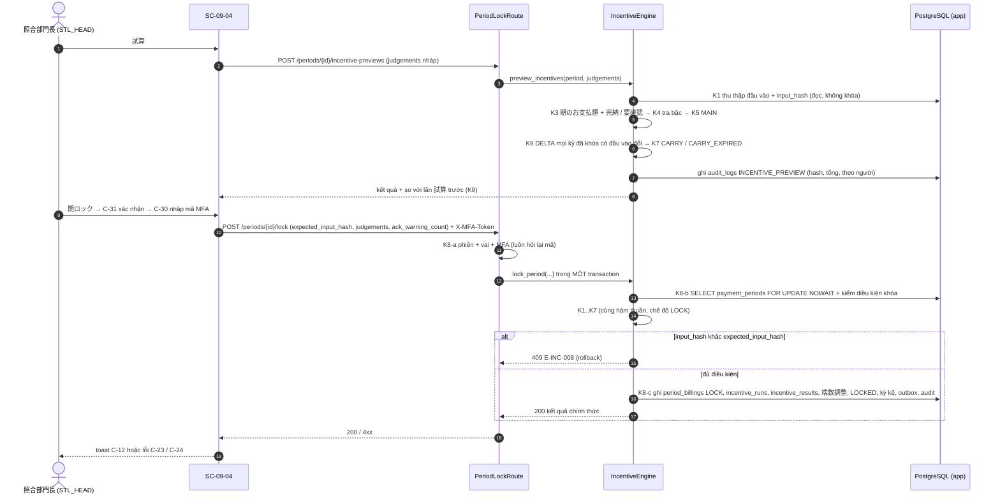

# INC_ENGINE — Engine 完納奨励金 (試算 / 期ロック, DELTA, CARRY)

> Biểu mẫu: **BM-2-901-53 v01** — Detail Design (Chart + Description) · SUN ASTERISK VIETNAM CO., LTD · ISO/IEC 27001:2013 & ISO 9001:2015

Thuật ngữ dùng trong file: **完納奨励金** (かんのうしょうれいきん — thưởng cho người mua trả đủ, đúng hạn tiền của một kỳ), **期のお支払額** (số phải trả của kỳ), **適格金額** (số tiền làm căn cứ tính thưởng, 税抜 = chưa thuế), **交付率** (tỷ lệ thưởng theo bậc), **期ロック** (khóa kỳ — tính chính thức + đóng băng), **試算** (tính thử, không ghi kết quả), **要確認** (cần người quyết), **消込** (đối chiếu tiền về với khoản phải thu), **年度 / năm TC** (năm tài chính 4月→3月).

---

## 1. History of change

| No | Version | Action | Mục / Bước | Nội dung thay đổi | Ngày | Người sửa | Approve |
|---|---|---|---|---|---|---|---|
| 1 | 0.1.0 | Add new | — | Khởi tạo (LAB-4 P3): 9 khối K1–K9 có điều kiện hoàn thành để LAB-5 tách task; biến số, công thức số nguyên, thứ tự tính, quy tắc tách dòng DELTA, ánh xạ TV-01..14 (INCENTIVE_DB §5) | 2026-11-25 | phuongnnm-23344 | |

---

## 2. Sequence diagram

N/A (ảnh PNG) — chưa xuất ảnh: máy làm P3 chưa có `mmdc` (Gate 1 m-08, FB-EXP-236 Waiting). Bản Mermaid dưới đây là nguồn duy nhất tới khi xuất ảnh `./assets/INC_ENGINE_sequence.png`; khi xuất phải giữ cùng nội dung.

<details open>
<summary>Bản Mermaid — 試算 và 期ロック (số bước khớp mục 4)</summary>



</details>

---

## 3. Description

Engine tính 完納奨励金 của **một kỳ thanh toán** P (tháng theo 業務日 của GD gốc) cho mọi người mua thuộc loại 仲卸 (`NAKAOROSHI`) và 売買参加者 (`BAIBAI`). Hai cách gọi dùng **cùng một hàm thuần** `compute_period_incentives` (ADR-007 §2.1):

- **試算** (SETTLE hoặc STL_HEAD, chạy bao nhiêu lần cũng được): không ghi bảng nghiệp vụ, chỉ ghi một dòng `audit_logs` để lần sau so sánh.
- **期ロック** (chỉ STL_HEAD / người được 代行, MFA hỏi lại mã): trong **một transaction** tính chính thức, chốt các dòng 要確認, ghi kết quả append-only, đóng kỳ, sinh dòng 端数調整 cho IF-ACC-01, xếp email. Một kỳ khóa một lần, không mở lại.

Sau khi kỳ khóa, mọi thay đổi đầu vào của kỳ đó (修正申請 TRADE / LATE_ENTRY, phân bổ 入金 sau khóa, 修正申請 KANNO / INCENTIVE) chỉ xuất hiện thành dòng **DELTA ở 期ロック kế tiếp**, tính bằng version quy chế của kỳ cũ (luật 4, BR-INC-01, PRM-043). Không có đường ghi đè kết quả đã khóa.

### 3.1 Biến số (dùng thống nhất ở mục 4, FUNC và test)

| Ký hiệu | Nghĩa | Nguồn dữ liệu | Kiểu |
|---|---|---|---|
| P | Kỳ đang xử lý (đang 試算 hoặc đang khóa) | `payment_periods` (CLOSE_DB 4.43) | uuid |
| Q | Một kỳ đã `LOCKED` được tính lại (Q ≠ P) | `payment_periods.status = 'LOCKED'` | uuid |
| V_X | Version quy chế của kỳ X = `payment_periods.rule_version_id` của X (= version hiệu lực ngày 1 của X) | CLOSE_DB 4.43, RULE_DB 4.21 | uuid |
| i, c_i | Người mua và loại bảng tỷ lệ (`NAKAOROSHI` / `BAIBAI`) | `participants.kind` | uuid, enum |
| S_excl(i,X,r) | Tổng 税抜 theo suất thuế r của i trong kỳ X | `v_trade_effective` theo `trade_date` + `trade_adjustments.period_id` | bigint |
| T(i,X,r) | Thuế kỳ theo suất = ROUND_{TAX_ROUNDING}(S_excl × rate_r / 100) | `tax_rates`, `rule_parameters.TAX_ROUNDING` của V_X | bigint |
| B(i,X) | 期のお支払額 = Σ_r (S_excl + T) | BILLING_DB 4.49 / 4.50 | bigint |
| E0(i,X) | Tổng 税抜 = Σ_r S_excl(i,X,r) | — | bigint |
| OT(i,X) | Tiền đã phân bổ vào X **đúng hạn** = Σ `payment_allocations.amount_jpy` (kể cả `REVERSE` âm) có `is_on_time = true` | BILLING_DB 4.48 | bigint |
| s(i,X) | Thiếu = B − OT | — | bigint |
| FEE_MAX | `KANNO_FEE_SUSPECT_MAX_JPY` — ngưỡng đánh dấu 「手数料差引の疑い」 (file cấu hình, chỉ để đánh dấu, không đổi tiền) | file cấu hình (ADR-006 §2.6) | bigint |
| K(i,X) | 完納 (boolean) | K3 / judgement / 修正申請 KANNO | boolean |
| E(i,X) | 適格金額 = K ? max(0, E0) : 0 | — | bigint |
| t, ρ | Bậc và 交付率 (basis point, 1 bp = 0,01%) | `incentive_rate_rows` của V_X, c_i | smallint, int |
| I(i,X) | Thưởng tính theo công thức = ⌊E × ρ × 110 / 1.000.000⌋ | K5 | bigint |
| C_INC(i,X) | Σ số tiền 修正申請 `INCENTIVE` đã duyệt cho (i, X) — số cố định, cộng thêm | ADJUST_DB 4.37 `change.amount_jpy` | bigint |
| R(i,Q) | Tổng đã ghi nhận cho Q = Σ `incentive_jpy` dòng `MAIN` của (i, Q) + Σ dòng `DELTA` có `ref_period_id = Q` của i | INCENTIVE_DB 4.52 | bigint |
| new(c) | 修正申請 c `APPROVED` là "mới" khi chưa có dòng `incentive_results` nào có `correction_id = c` | INCENTIVE_DB 4.52 | boolean |
| H | `input_hash` = SHA-256 của tập đầu vào chuẩn hóa (K1) | — | char(64) |

### 3.2 Công thức (số nguyên, không dùng số thực)

```
I(i,X)   = floor( E(i,X) × ρ × 110 / 1_000_000 )          -- ρ tính bằng bp; 110/100 là 税係数 cố định (BR-INC-01, B.5, 13-06)
I'(i,Q)  = floor( E'(i,Q) × ρ'(V_Q) × 110 / 1_000_000 ) + C_INC(i,Q)
DELTA    = I'(i,Q) − R(i,Q)                               -- ghi ở kỳ P nếu ≠ 0, ref_period = Q
Payout(i,P) = max(0, Σ incentive_jpy mọi dòng của i có period_id = P)
```

Kiểm tràn: E ≤ 10^11 (100 tỷ yên) × ρ ≤ 10.000 × 110 = 1,1 × 10^17 < 2^63. Phép chia dùng `div()` số nguyên của PostgreSQL (làm tròn xuống với số dương; E ≥ 0 nên không có ca âm). Ví dụ: TV-11 1.234.567 × 90 × 110 = 12.222.213.300 → ÷ 1.000.000 = **12.222**.

### 3.3 Thứ tự tính trong một lần gọi (bắt buộc giữ)

1. K1 thu thập đầu vào của P và tập kỳ ứng viên DELTA → H.
2. K3 期のお支払額 + 完納 / 要確認 của P (áp judgement nếu có).
3. K4 chọn V_P, tra bậc → K5 MAIN.
4. K6 lần lượt từng Q (theo `period_code` tăng dần): tính lại, so R, sinh dòng DELTA (tách theo nguồn).
5. K7 cộng mọi dòng của i ở P (MAIN + DELTA + CARRY vào) → payout, CARRY ra kỳ kế / CARRY_EXPIRED cuối năm TC.
6. K8 (chỉ LOCK) ghi toàn bộ trong cùng transaction; K9 đọc ra báo cáo / so 試算.

K2 (phân bổ 入金) **không** chạy trong engine: chạy lúc nhập CSV / hủy batch / gán tay (SC-09-01, SC-09-03); engine chỉ đọc kết quả phân bổ.

---

## 4. Detail function

Mỗi khối có **Điều kiện hoàn thành (DoD)** kiểm được — LAB-5 tách mỗi khối thành một task (K2 có thể làm song song với K1/K3; K6 phụ thuộc K1–K5; K8 phụ thuộc tất cả).

### 4.1. K1 — Thu thập đầu vào và mã băm (`incentive_collect_inputs`, `incentive_input_hash`)

| Trường | Giá trị |
|---|---|
| Input | `period_id` P; chế độ `PREVIEW` / `LOCK` |
| Output | Tập dòng đầu vào chuẩn hóa của P + tập kỳ ứng viên Q; `input_hash` H → K3, K6, K8 |

**Error**

| Điều kiện lỗi | Xử lý | Status code |
|---|---|---|
| P không tồn tại | Dừng, trả `E-INC-001` | 404 |
| P đã `LOCKED` (試算 hoặc khóa lại) | Dừng, trả `E-INC-002` | 423 |
| Kỳ Q ứng viên thiếu `rule_version_id` (dữ liệu migrate lỗi) | Dừng, ghi log ERROR, trả `E-INC-010` | 500 |

**Detail**

| No | Nội dung xử lý |
|---|---|
| 1 | Đọc P (`period_code`, `start_date`, `end_date`, `due_date`, `rule_version_id`, `fiscal_year`); chế độ LOCK đọc bằng `FOR UPDATE NOWAIT` ở K8, chế độ PREVIEW đọc thường. |
| 2 | Đọc GD hiệu lực của P từ `v_trade_effective` với `trade_date ∈ [start_date, end_date]` (kể cả GD `LATE_ENTRY` có `trade_date` trong P vì P còn mở) + `trade_adjustments` có `period_id = P`; gom theo (người mua, `tax_rate_id`). Chỉ lấy người mua có `participants.kind ∈ (NAKAOROSHI, BAIBAI)`. |
| 3 | Đọc `payment_allocations` có `period_id = P` (cả `ALLOCATE` lẫn `REVERSE`), giữ `is_on_time`. |
| 4 | Tập ứng viên DELTA = mọi Q `LOCKED` có **ít nhất một** đầu vào ghi sau khóa của chính Q: `trade_adjustments.period_id = Q` với `created_at > Q.locked_at`; `trades` có `trade_date` ∈ Q và `created_at > Q.locked_at` (GD `LATE_ENTRY` — TV-13); `payment_allocations.period_id = Q` với `created_at > Q.locked_at`; 修正申請 `KANNO` / `INCENTIVE` `APPROVED` có `target_period_id = Q`. Không lọc theo năm TC (Gate 1 C-01), **không** lọc theo mốc lần khóa trước: `locked_at = now()` là giờ **bắt đầu** transaction, nên một dòng ghi song song có `created_at` nhỏ hơn mốc đó mà commit sau có thể bị lần khóa trước bỏ sót — tính lại toàn bộ Q và so với R (K6) là lũy đẳng nên quét rộng vẫn đúng, chỉ tốn thêm vài kỳ (khối lượng nhỏ). |
| 5 | Chuẩn hóa: mỗi nguồn thành mảng `(id, participant_id, tax_rate_id, amount, is_on_time, created_at)` sắp theo `id`; thêm `V_P` và danh sách (Q, `id` đầu vào) của tập ứng viên; `jsonb` → text chuẩn → `sha256` → H. Judgement **không** vào H (nó là quyết định, không phải đầu vào). |
| 6 | Không đọc `now()` để quyết định kỳ hay hạn; mọi ngày lấy từ bảng (ADR-007 §2.1-1). |

**DoD K1:** (a) gọi 2 lần liên tiếp không có ghi mới → cùng H; (b) thêm một `payment_allocations` vào P → H đổi; (c) TV-13: GD `LATE_ENTRY` `trade_date` 2027-08-31 tạo 2027-09-21 làm kỳ 2027-08 vào tập ứng viên khi khóa kỳ 09; (d) TV-01: điều chỉnh `period_id` 2027-08 ghi 2027-09-03 khi kỳ 08 `OPEN` → vào S_excl của kỳ 08, không vào tập ứng viên.

### 4.2. K2 — Phân bổ 入金 vào kỳ (`allocate_payment_fifo`) — chạy ngoài engine

| Trường | Giá trị |
|---|---|
| Input | Một dòng `payments` (người tham gia đã xác định, `paid_on`, `amount_jpy`, `invoice_no`) |
| Output | Các dòng `payment_allocations` (append-only) → được K1 đọc |

**Error**

| Điều kiện lỗi | Xử lý | Status code |
|---|---|---|
| `participant_id` NULL (mã người nộp chưa ánh xạ) | Không phân bổ; dòng vào danh sách 要判断 ở SC-09-02; đi tiếp các dòng khác | — (không lỗi API) |
| Có `invoice_no` nhưng không tra ra kỳ | Rơi về FIFO, ghi cảnh báo vào kết quả nhập | — |

**Detail**

| No | Nội dung xử lý |
|---|---|
| 1 | Có `invoice_no` và E-02 đã chốt dùng 請求番号 → phân bổ toàn bộ vào kỳ của số đó (`method = INVOICE_NO`). Hiện E-02 chưa trả lời → nhánh này tắt bằng cờ triển khai, chỉ chạy FIFO. |
| 2 | FIFO: liệt kê các kỳ X của người đó có `start_date ≤ paid_on` và **còn nợ** > 0, sắp theo `period_code` tăng dần. Còn nợ(X) = (X `OPEN`: B hiện hành của X) hoặc (X `LOCKED`: `period_billings` LOCK + Σ điều chỉnh / GD `LATE_ENTRY` gán vào X sau khóa) − Σ phân bổ vào X (BILLING_DB 4.48). |
| 3 | Lần lượt phân bổ min(tiền còn lại, còn nợ) vào từng kỳ; `is_on_time = paid_on ≤ X.due_date`. |
| 4 | Tiền thừa sau khi trả hết nợ → phân bổ vào kỳ `OPEN` cũ nhất của người đó (`is_on_time` theo hạn của kỳ đó); K9 gắn cảnh báo 「過入金」 cho 照合 xử lý. |
| 5 | Hủy batch 入金 → mỗi dòng phân bổ của batch sinh một dòng `REVERSE` số âm, `reverses_id` trỏ dòng gốc; không xóa. |
| 6 | Gán tay (`MANUAL`, lý do bắt buộc) do 照合 làm ở SC-09-03; phân bổ vào kỳ đã khóa hợp lệ nhưng chỉ có tác dụng qua DELTA (完納 không hồi tố — TV-07). |

**DoD K2:** TV-06 (108.000 → kỳ 09 trễ, 432.000 → kỳ 10, kỳ 10 không 完納); TV-05 (`paid_on` 2027-10-12 > hạn 2027-10-08 → `is_on_time = false`); hủy batch → tổng phân bổ của batch = 0.

### 4.3. K3 — 期のお支払額, xét 完納 và 要確認 (`period_payable`, `kanno_status`)

| Trường | Giá trị |
|---|---|
| Input | Đầu vào K1 của (i, X); `judgements` (map người → `{decision: KANNO \| NOT_KANNO, reason}`) |
| Output | B, E0, OT, s, K, `kanno_basis`, trạng thái dòng (`OK` / `NG` / `SUSPECT`) → K4 |

**Error**

| Điều kiện lỗi | Xử lý | Status code |
|---|---|---|
| LOCK: có dòng `SUSPECT` thiếu judgement | Dừng, trả `E-INC-006` kèm danh sách người | 422 |
| LOCK: judgement thiếu lý do / lý do > 500 ký tự | Dừng, trả `E-INC-007` | 422 |
| Judgement cho người không ở trạng thái `SUSPECT` | Dừng, trả `E-INC-011` | 422 |
| PREVIEW: thiếu judgement | Không lỗi — dòng giữ `SUSPECT`, K = false tạm, hiện 要確認 | — |

**Detail**

| No | Nội dung xử lý |
|---|---|
| 1 | Theo từng suất r: T = ROUND(S_excl × rate_r / 100) với ROUND = `TAX_ROUNDING` của V_X (mặc định `FLOOR`, DEC-011, E-06). B = Σ_r (S_excl + T). Thuế tính **một lần trên tổng** theo người × kỳ × suất (PRM-053), không cộng thuế từng GD. |
| 2 | B ≤ 0 → không sinh dòng MAIN cho i (không có gì phải trả); nếu i có dòng DELTA / CARRY ở P vẫn đi K7. |
| 3 | OT ≥ B → `OK`: K = true, `kanno_basis = AUTO`. |
| 4 | 0 < s ≤ FEE_MAX **và** OT > 0 (có ít nhất một 入金 trong hạn) → `SUSPECT` 「手数料差引の疑い」: engine **không** tự kết luận (ADR-007 §2.6, khách #7). Gợi ý mặc định trên màn: `NOT_KANNO` (phí chuyển khoản do người mua chịu — FQ-02, PRM-040). Có judgement → K theo quyết định, `kanno_basis = JUDGED`, `judgement_note` = lý do. |
| 5 | Các trường hợp còn lại (s > FEE_MAX, hoặc OT = 0) → `NG`: K = false, `AUTO`. 入金 sau 支払期日 không tính vào OT (không ân hạn — B.5 「超過時は0」). |
| 6 | E = K ? max(0, E0) : 0. |

**DoD K3:** TV-05 → `NG`, E = 0; TV-10 → `SUSPECT` khi thiếu 440 ≤ FEE_MAX; judgement `KANNO` + lý do → K = true, `JUDGED`, thưởng 9.900; judgement `NOT_KANNO` → 0; thuế 8% của 1.050.000 = 84.000 (TV-01).

### 4.4. K4 — Chọn version và tra bậc (`rate_tier_for`)

| Trường | Giá trị |
|---|---|
| Input | V_X, c_i, E |
| Output | (t, ρ) → K5 |

**Error**

| Điều kiện lỗi | Xử lý | Status code |
|---|---|---|
| Bảng tỷ lệ của (V_X, c_i) không đủ 5 bậc liền nhau hoặc không có bậc chứa E | Dừng toàn bộ lần tính, log ERROR (dữ liệu quy chế hỏng — hàm `submit_rule_version` lẽ ra đã chặn), trả `E-INC-010` | 500 |

**Detail**

| No | Nội dung xử lý |
|---|---|
| 1 | Version = **V_X của kỳ X** (ngày 1 của kỳ), **không** phải version hiệu lực ngày khóa hay ngày tính lại (TV-12: kỳ 09 tra v2, kỳ 10 tra v3; DELTA của Q luôn tra V_Q — TV-02, TV-03). |
| 2 | Chọn dòng `incentive_rate_rows` có `participant_class = c_i`, `min_eligible_jpy ≤ E` và (`max_eligible_jpy` IS NULL hoặc `E < max_eligible_jpy`) — cận dưới 「以上」, cận trên 「未満」. |
| 3 | E = 0 → bậc 1, ρ = 0 (bậc 1 luôn 0 bp — RULE_DB 4.22). |

**DoD K4:** TV-12: 1.000.000 → bậc 3 (cận dưới đúng ngưỡng); 999.999 → bậc 2; cùng người kỳ 09 / kỳ 10 tra hai version khác nhau.

### 4.5. K5 — Tính thưởng MAIN (`incentive_amount`)

| Trường | Giá trị |
|---|---|
| Input | E, ρ |
| Output | Dòng `MAIN` (i, P): `payable_incl_jpy = B`, `paid_on_time_jpy = OT`, `kanno`, `kanno_basis`, `judgement_note`, `eligible_excl_jpy = E`, `tier_no`, `rate_bp`, `incentive_jpy = I`, `rule_version_id = V_P`, `participant_class = c_i` → K7 |

**Error**

`N/A — hàm số học thuần trên số nguyên đã kiểm miền ở K3 / K4; không có nhánh lỗi.`

**Detail**

| No | Nội dung xử lý |
|---|---|
| 1 | I = `div(E * ρ * 110, 1000000)`; hàm `IMMUTABLE`, không đọc bảng. |
| 2 | Không làm tròn trung gian (không tính E × ρ / 10000 rồi × 1,1 bằng `numeric` làm tròn). |

**DoD K5:** TV-11 → 12.222; TV-12 → 9.900 / 5.499 / 8.800; TV-01 → 10.395; unit test thuần ≥ 6 ca biên (E = 0, ρ = 0, E ngay dưới / trên ngưỡng, E lớn 10^11).

### 4.6. K6 — DELTA cho kỳ đã khóa (`compute_delta_rows`)

| Trường | Giá trị |
|---|---|
| Input | P, tập ứng viên Q (K1), kết quả đã ghi của Q (`incentive_results`), 修正申請 KANNO / INCENTIVE đã duyệt |
| Output | 0..n dòng `DELTA` ghi ở P (`period_id = P`, `ref_period_id = Q`, `rule_version_id = V_Q`) → K7 |

**Error**

| Điều kiện lỗi | Xử lý | Status code |
|---|---|---|
| Q ứng viên không có `incentive_runs` (kỳ migrate chưa nạp kết quả) | Dừng, log ERROR, trả `E-INC-010` (kỳ migrate phải nạp như kỳ đã khóa — DEC-005, ADR-007 §2.7-15) | 500 |

**Detail**

| No | Nội dung xử lý |
|---|---|
| 1 | Duyệt Q theo `period_code` tăng dần; với mỗi người i có đầu vào đổi ở Q **hoặc** có dòng kết quả ở Q, tính lại **toàn bộ** Q tại thời điểm hiện tại (không cộng dồn chênh): S_excl', B', E0' gồm **mọi** GD có `trade_date` ∈ Q (kể cả `LATE_ENTRY` ghi sau khóa) + mọi `trade_adjustments.period_id = Q`; OT' gồm mọi phân bổ vào Q. Thuế tính lại theo `TAX_ROUNDING` của V_Q. |
| 2 | K' (完納 sau tính lại) = K của dòng MAIN của (i, Q) — **không hồi tố** (PRM-043), kể cả khi phân bổ sau khóa làm OT' ≥ B' (TV-07: DELTA 0). **Ngoại lệ duy nhất:** có 修正申請 `KANNO` đã duyệt cho (i, Q) → K' = `kanno_after` của yêu cầu duyệt muộn nhất (ADR-007 §2.5-11). Không có dòng MAIN của (i, Q) (người không có GD lúc khóa, nay có GD `LATE_ENTRY`) → K' = false [giả định PL, Q-INC-02]. |
| 3 | E' = K' ? max(0, E0') : 0; (t', ρ') tra bằng **V_Q** (K4); I' = ⌊E' × ρ' × 110 / 10^6⌋ + C_INC(i, Q). C_INC là **số cố định** của 修正申請 `INCENTIVE`, không co giãn theo E' (TV-14; ADR-007 §2.5-12). |
| 4 | D = I' − R(i, Q). D = 0 → không ghi dòng. |
| 5 | **Tách dòng theo nguồn** khi (i, Q) có 修正申請 `APPROVED` **mới** — tức chưa có dòng `incentive_results` nào mang `correction_id` của nó (xác định bằng dữ liệu, không bằng mốc thời gian): (a) mỗi `INCENTIVE` mới → một dòng DELTA = `amount_jpy` của nó, gắn `correction_id`; (b) `KANNO` mới → một dòng DELTA = I'(với K') − I'(với K cũ) giữ các đầu vào khác như mới, gắn `correction_id`, `kanno_basis = CORRECTION`; (c) phần còn lại D − Σ(a) − Σ(b) ≠ 0 → một dòng DELTA không gắn `correction_id`. Tổng các dòng = D. Ví dụ biến thể TV-14: +2.000 (INCENTIVE) + +990 (TRADE). |
| 6 | Trường của dòng DELTA: `kanno = K'`; `kanno_basis` = `CORRECTION` cho dòng (b), còn lại sao từ MAIN của Q; `payable_incl_jpy = B'`, `paid_on_time_jpy = OT'`, `eligible_excl_jpy = E'`, `tier_no = t'`, `rate_bp = ρ'`, `participant_class = c_i`. |
| 7 | Năm TC của dòng DELTA = năm TC của **P** (kỳ ghi nhận), dù Q thuộc năm TC trước (TV-03, ADR-007 §2.4-10). |

**DoD K6:** TV-02 (+1.980, K kỳ 08 giữ true); TV-03 (−15.400 ghi ở 2028-05, tra v3, năm TC 2028); TV-07 (phân bổ sau khóa → DELTA 0; sau KANNO → +9.900 có `correction_id`, `CORRECTION`); TV-13 (+1.980 từ GD `LATE_ENTRY`); TV-14 (+2.000 ở kỳ 11; +990 ở kỳ 12; **không** sinh −2.000; biến thể tách 2 dòng); chạy K6 hai lần liên tiếp không có đầu vào mới → lần 2 sinh 0 dòng (lũy đẳng).

### 4.7. K7 — Cộng dồn, CARRY và CARRY_EXPIRED (`compute_carry_rows`)

| Trường | Giá trị |
|---|---|
| Input | Mọi dòng của i có `period_id = P` (MAIN, DELTA vừa tính, CARRY vào từ kỳ trước) |
| Output | Payout(i, P); 0..1 dòng `CARRY` (ghi ở kỳ kế P+1) hoặc 0..1 dòng `CARRY_EXPIRED` (ghi ở P) → K8 |

**Error**

`N/A — chỉ cộng trừ trên các dòng đã có; kỳ kế P+1 do K8 bảo đảm tồn tại trước khi ghi.`

**Detail**

| No | Nội dung xử lý |
|---|---|
| 1 | Σ = Σ `incentive_jpy` mọi dòng của i ở P. Payout = max(0, Σ). |
| 2 | Σ < 0 và P **không** phải kỳ cuối năm TC (tháng 03) → dòng `CARRY` số tiền Σ (âm) ghi ở **P+1** (`period_id = P+1`, `run_id` = lần chạy của P), `ref_period_id` = kỳ gốc của chuỗi âm (= `ref_period_id` của CARRY đi vào P nếu có, ngược lại = P). |
| 3 | Σ < 0 và P là kỳ cuối năm TC → dòng `CARRY_EXPIRED` số tiền **−Σ (dương)** ghi ở P, cùng quy tắc `ref_period_id` như No 2 → Σ của i ở P về 0, payout 0. RPT-07 hiện trị tuyệt đối là phần chưa thu cho 照合部門 (Q-ARCH-08). Không mang sang năm TC mới, không đếm âm hai lần (Gate 1 m-05, recheck n-01). |
| 4 | CARRY không bao giờ vượt năm TC (vì kỳ tháng 03 luôn chốt bằng No 3). |

**DoD K7:** TV-04: kỳ 2028-05 Σ = −12.100 → CARRY −12.100 ở 2028-06; 2028-06: −2.200 → CARRY ở 2028-07 …; kỳ 2029-03: CARRY_EXPIRED +2.200, Σ = 0, payout 0.

### 4.8. K8 — 期ロック trong một transaction (`lock_period`) — và chế độ 試算 (`preview_incentives`)

| Trường | Giá trị |
|---|---|
| Input | P, `expected_input_hash`, `judgements`, `ack_warning_count`, ngữ cảnh phiên (`app.user_id`, `app.device_id`, `app.mfa_verified_at`), header `X-MFA-Token` (`purpose = PERIOD_LOCK`) |
| Output | Kỳ P `LOCKED`; `incentive_runs` + `incentive_results`; `period_billings` LOCK; dòng 端数調整; kỳ P+1 tồn tại; outbox email; `audit_logs` → API-INC-003 |

**Error**

| Điều kiện lỗi | Xử lý | Status code |
|---|---|---|
| Chưa đăng nhập | Dừng, `E-CMN-001` | 401 |
| Không có quyền `STL_HEAD` (kể cả 代行 hiệu lực) | Dừng, `E-CMN-002` | 403 |
| Token MFA thiếu / hết hạn / đã dùng / sai `purpose` (期ロック luôn hỏi lại mã — ADR-002 §2-6a) | Dừng, `E-CMN-005` | 403 |
| Không lấy được khóa dòng P (`NOWAIT`) | Rollback, `E-INC-009` | 409 |
| P đã `LOCKED` | Rollback, `E-INC-002` | 423 |
| Kỳ trước P còn `OPEN` | Rollback, `E-INC-003` | 409 |
| 業務日 hiện tại ≤ `due_date` của P | Rollback, `E-INC-004` | 409 |
| Còn 業務日 trong [start_date, end_date] chưa `LOCKED` | Rollback, `E-INC-005` | 409 |
| `ack_warning_count` ≠ số cảnh báo ⚠ hiện tại (K9) | Rollback, `E-INC-013` kèm số mới | 409 |
| H ≠ `expected_input_hash` | Rollback, `E-INC-008` (phải 試算 lại) | 409 |
| Lỗi từ K1 / K3 / K4 / K6 | Rollback, trả mã của khối đó | 422 / 500 |

**Detail**

| No | Nội dung xử lý |
|---|---|
| 1 | Route handler kiểm phiên, vai, MFA (tiêu thụ `X-MFA-Token` `purpose = PERIOD_LOCK` do iam cấp — không dùng lại step-up 10 phút vì 期ロック không quay lại được), rồi gọi `app.lock_period` trong một transaction; `set_config('app.user_id' …)` trước khi gọi. |
| 2 | `SELECT … FROM payment_periods WHERE id = P FOR UPDATE NOWAIT`; `pg_advisory_xact_lock(hashtext('incentive_period_lock'))` để hai kỳ không khóa song song (K6 đọc kết quả của nhau). |
| 3 | Kiểm điều kiện khóa theo bảng Error (thứ tự như bảng). `assert_caller('SETTLE', 'STL_HEAD')` kiểm cả 代行 (`lock_delegation_id`). |
| 4 | Chạy K1 (chế độ LOCK) → so H. Chạy K3 với `judgements` (bắt buộc đủ), K4, K5, K6, K7. |
| 5 | Ghi `period_billings` `snapshot_kind = LOCK` + `period_billing_tax_lines` cho mọi (i, P) có B > 0; ghi `incentive_runs` (P, V_P, H); ghi mọi dòng `incentive_results` (MAIN, DELTA, CARRY sang P+1, CARRY_EXPIRED). |
| 6 | Sinh dòng 端数調整 theo suất: chênh giữa thuế kỳ (Σ T) và Σ thuế đã xuất theo ngày trong IF-ACC-01 của P → `accounting_export_lines` loại 端数調整 gắn batch của 業務日 đang mở (BILLING_DB 4.42; định dạng chờ E-01 / OPEN-DB-01). |
| 7 | `UPDATE payment_periods SET status = 'LOCKED', locked_by, lock_delegation_id, locked_at = now()`. Bảo đảm P+1 tồn tại (tạo nếu chưa có, `rule_version_id = rule_at(P+1.start_date)`, `due_date` theo `PAYMENT_DUE_RULE` + lịch ngân hàng). |
| 8 | Xếp `notifications` (email kết quả kỳ cho từng người có dòng ở P; FORM-INC-01) — gửi sau commit bởi worker outbox. |
| 9 | Ghi `audit_logs` (`action = PERIOD_LOCK`, P, H, tổng MAIN / DELTA / CARRY, danh sách judgement + lý do, người, 代行, thiết bị, thời điểm MFA). Commit. Lỗi bất kỳ ở No 2–9 → rollback toàn bộ, không có trạng thái "đã tính, chưa khóa" (N13). |
| 10 | **Chế độ 試算** (`preview_incentives`): cùng No 4 với `judgements` nháp (thiếu thì giữ 要確認), **không** chạy No 2 (không khóa), No 5–8; chỉ ghi một dòng `audit_logs` (`action = INCENTIVE_PREVIEW`, P, H, tổng, map người → Σ thưởng) — dùng cho K9. Quyền: `SETTLE` hoặc `STL_HEAD`; không cần MFA. |

**DoD K8:** (a) khóa thành công → mọi bảng ghi trong cùng transaction (test: ép lỗi ở bước ghi outbox → không còn dòng `incentive_results` nào, P vẫn `OPEN`); (b) hai phiên khóa cùng lúc → một phiên `E-INC-009`; (c) đổi một phân bổ giữa 試算 và khóa → `E-INC-008`; (d) khóa kỳ 09 khi kỳ 08 `OPEN` → `E-INC-003`; (e) không có cách gọi nào ghi `incentive_results` ngoài `lock_period` (kiểm quyền EXECUTE của role ứng dụng).

### 4.9. K9 — Đọc ra: màn, báo cáo, so lần 試算 trước (`period_lock_view`, `incentive_results_view`)

| Trường | Giá trị |
|---|---|
| Input | P; dòng `audit_logs` `INCENTIVE_PREVIEW` gần nhất và liền trước của P |
| Output | Bảng phân bổ ([4] SC-09-04), cảnh báo ⚠, dòng 「前期以前の調整」, so sánh 試算, kết quả chính thức cho SC-09-05 / RPT-07 / FORM-INC-01 → API-INC-001, API-INC-004 |

**Error**

| Điều kiện lỗi | Xử lý | Status code |
|---|---|---|
| Hỏi kết quả chính thức khi P chưa khóa | Trả `E-INC-012` | 404 |

**Detail**

| No | Nội dung xử lý |
|---|---|
| 1 | 「充当先の内訳」: với mỗi i, liệt kê mọi phân bổ của các 入金 đã có ít nhất một phân bổ vào P, gom theo kỳ đích (kỳ, số tiền, `method`, `is_on_time`). |
| 2 | Cảnh báo ⚠ (đếm vào `warning_count`): `OLD_PERIOD_ALLOCATION` — 入金 có `paid_on` ∈ (P.end_date, P.due_date] bị FIFO đem trả kỳ cũ hơn P (TV-06, OPEN-L4-02); `OVERPAYMENT` — phân bổ vượt B; `UNMAPPED_PAYMENT` — 入金 chưa ánh xạ người có `paid_on ≤ P.due_date` (TV-07). |
| 3 | 「前期以前の調整」: Σ điều chỉnh / GD `LATE_ENTRY` gán vào kỳ đã khóa và ghi sau khóa, theo người × kỳ gốc — không cộng vào B của P (OPEN-DB-08). |
| 4 | So 試算: hiệu theo người giữa map của lần 試算 mới nhất và liền trước; tổng chênh. Trả cả `last_preview.input_hash` để màn biết có cần 試算 lại không (H hiện tại ≠ hash lần 試算 cuối → nút 期ロック mờ). |
| 5 | Kết quả chính thức: đọc `incentive_results` theo P (dòng ghi ở P) + payout theo K7-1 + `CARRY_EXPIRED` trị tuyệt đối cho RPT-07. |

**DoD K9:** TV-06 sinh `OLD_PERIOD_ALLOCATION` cho B05 ở kỳ 10; TV-02 hiện 216.000 ở 「前期以前の調整」 của kỳ 09; hai lần 試算 với một phân bổ mới giữa hai lần → chênh đúng bằng thay đổi thưởng.

---

## 5. Other Notes

**Bộ test vector — nguồn duy nhất:** `specs/system-design/database-design/INCENTIVE_DB.md` §5 (TV-01..TV-14). Không chép số sang đây; fixture CI dựng từ bảng đó (bảng tỷ lệ giả tới khi có `incentive-rate-table.csv` — E-03, L4-A02). Ánh xạ khối:

| TV | Khối kiểm chính | Ghi chú |
|---|---|---|
| TV-01 | K1, K3, K5 | Điều chỉnh `period_id` kỳ còn mở vào B |
| TV-02 | K6, K9 | DELTA +1.980; 「前期以前の調整」 |
| TV-03 | K4, K6 | Qua năm TC, tra version kỳ cũ |
| TV-04 | K7 | CARRY → CARRY_EXPIRED dương |
| TV-05 | K2, K3 | Trễ hạn → 0 |
| TV-06 | K2, K9 | FIFO làm kỳ mới mất 完納 + cảnh báo |
| TV-07 | K2, K6 | Không hồi tố; KANNO → DELTA có `correction_id` |
| TV-08 | (lịch — calendar) | 支払期日 theo ngày ngân hàng; engine chỉ đọc `due_date` |
| TV-09 | (業務日 — settle / calendar) | Tiền đề của K1, không phải logic engine |
| TV-10 | K3, K8 | 要確認 + judgement |
| TV-11 | K5 | floor |
| TV-12 | K4, K5 | Cận 「以上」 + version theo kỳ |
| TV-13 | K1, K6 | GD `LATE_ENTRY` |
| TV-14 | K6 | INCENTIVE cố định, không đảo; biến thể tách dòng |

**Ranh giới — engine KHÔNG làm:** không tự đổi 完納 kỳ đã khóa (chỉ qua 修正申請 KANNO); không tự phát hiện tỷ lệ sai đã duyệt (sửa bằng 修正申請 INCENTIVE — ADR-006 §2.4-8a); không tính 期のお支払額 để gửi thông báo nghĩa vụ (SC-09-B1 dùng chung hàm `period_payable` ở K3); không phân bổ 入金 (K2 thuộc luồng nhập CSV); không chạy theo lịch (khóa là quyết định của người — CAP-HUMAN-01).

**Hiệu năng:** ~170 người × (1 kỳ + vài kỳ ứng viên) — một transaction vài giây (ADR-007 §1). Index cần: `idx_allocations_period_created`, `idx_incentive_results_participant`, `trade_adjustments (period_id, created_at)`, `trades (trade_date)`.

**Câu hỏi / giả định mới (chi tiết ở báo cáo PL):**
- Q-INC-01 — Điều kiện khóa "業務日 hiện tại > 支払期日": 入金 CSV của chính ngày 支払期日 đến muộn hơn 1 ngày thì sao? Giả định [PL]: chặn khóa tới ngày sau hạn; 入金 đến sau khóa đi DELTA / KANNO. Sai → chỉ đổi điều kiện K8-3, effort ≈ 0.
- Q-INC-02 — Người mua không có GD lúc khóa, sau đó có GD `LATE_ENTRY` cho kỳ đã khóa: giả định [PL] K' = false (không 完納 → không thưởng). Sai (khách muốn xét 完納 theo tiền về) → thêm nhánh K6-2, +0,5 MD.
- Q-INC-03 — Kỳ kế P+1 được tạo lúc khóa P (giữ prototype 0023) nhưng `trade_adjustments.period_id` NOT NULL cần kỳ của GD tháng mới **trước** khi kỳ cũ khóa (vd. 修正申請 ngày 09-05 cho GD 09-02 khi kỳ 08 chưa khóa). Đề xuất [PL]: tạo kỳ ở lần mở 業務日 đầu tiên của tháng (SC-07-B1); K8-7 chỉ "bảo đảm tồn tại". Đã phản ánh ở CLOSE_DB 0.2.1 §4.43 (giữ giả định, chờ khách xác nhận).

**Phụ thuộc:** iam (API xác thực MFA cấp token + tiêu thụ token — chưa đặc tả, xem `specs/_index.md` mục phụ thuộc; `assert_caller`, 代行); settle (khóa 業務日, batch IF-ACC-01); notify (worker outbox); calendar (`due_date`, `is_bank_open`).
