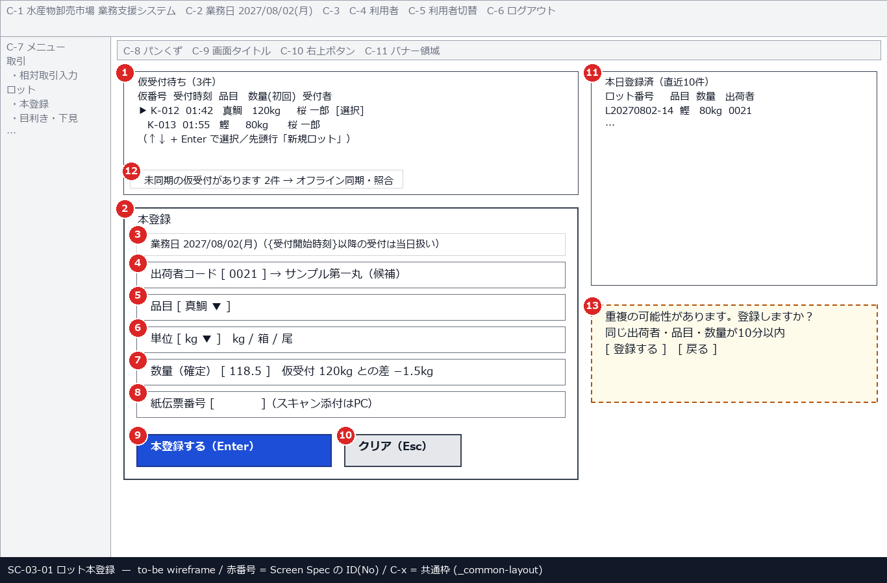

# SC-03-01 — ロット本登録（受付台・PC）

> Biểu mẫu: **BM-2-901-51 v2.1** — Screen Specification · SUN ASTERISK VIETNAM CO., LTD · ISO/IEC 27001:2013 & ISO 9001:2015

---

## 1. History of change

| No | Version | Action | Nội dung thay đổi | Ngày | Người sửa | Approve |
|---|---|---|---|---|---|---|
| 1 | 0.1.0 | Add New | Khởi tạo từ wireframe WF-SC-03-01 0.2.0 (LAB-4 P3) | 2026-11-25 | phuongnnm-23344 | |
| 2 | 0.1.1 | Update | Khách Q-LOT-01: tìm theo 仮番号, lô 取消 giữ số; G2-m07: nhãn [PL] mục tiêu hiệu năng | 2026-11-25 | phuongnnm-23344 |  |
| 3 | 0.1.2 | Update | LAB-4: ảnh annotated thay bằng biến thể A của wireframe HTML `wireframes/html/SC-03-01.html` (WF 0.2.1); ghi badge không có trên ảnh; link HTML / PNG / PDF | 2026-11-25 | phuongnnm-23344 | |
| 4 | 0.1.3 | Update | Expert Gate 3 G3-m05: thêm §6.1 Trạng thái màn (tổng hợp từ §5 Event), ghi chú cũ thành §6.2 | 2026-11-25 | phuongnnm-23344 | |

---

## 2. Layout

**Design:** [Wireframe SC-03-01 0.2.1](../../../wireframes/SC-03-01-lot-main-registration-wireframe.md) · nguồn hình HTML [`wireframes/html/SC-03-01.html`](../../../wireframes/html/SC-03-01.html) · mọi biến thể: [`wireframes/png/SC-03-01.png`](../../../wireframes/png/SC-03-01.png) / [`wireframes/pdf/wireframes-all.pdf`](../../../wireframes/pdf/wireframes-all.pdf) · khung chung [_common-layout](../../../wireframes/_common-layout.md) · ảnh as-is prototype: [SC-03-01_prototype.png](../../../wireframes/assets/SC-03-01_prototype.png)

> - Ảnh = **biến thể A** (màn chính) của wireframe HTML, sinh bằng `scripts/render-wireframes.py --spec` (chưa có Figma). Số trên ảnh = cột `ID` mục 4 = cột `No` của wireframe; `C-x` = mục chung ở `_common-layout.md`.
> - Badge không có trên ảnh này: 13 hộp thoại (C), C-12 (B), C-22 (D), C-24 (E), C-28 (F), C-21 (G), C-23 (H) → xem biến thể tương ứng trong [`wireframes/png/SC-03-01.png`](../../../wireframes/png/SC-03-01.png) / PDF.

---

## 3. Description

- **Mục đích:** bước 2 của tiếp nhận lô (~04:00, quầy 受付 PC + テンキー). 受付担当 chọn một lô 仮受付 (tiếp nhận tạm ở bến, SC-03-02) hoặc 「新規ロット」, bổ sung mã 出荷者 (người gửi hàng) từ master, 品目 (loại hàng), 単位, 数量 xác nhận, số 紙伝票 → lô thành chính thức (`RECEIVED` 受付) và sổ số lượng có dòng 受入 (FR-LOT-01, FORM-LOT-01, PRM-116).
- **Ai dùng:** vai ghi INTAKE. Vai đọc (SETTLE, STL-HEAD, OPS-HEAD) **không vào màn này**, xem lô ở SC-03-03 / SC-03-04 (role-list P13, L4-A06).
- **Nhập liên tiếp:** sau khi lưu ở lại form, con trỏ về dòng kế tiếp của [1] (DEC-033).
- **Đi tới:** SC-03-04 (bấm dòng [11]); SC-03-07 ([12]); SC-08-01 (C-24 khi ngày đã khóa). Sau 本登録, lô đi tiếp SC-03-05 目利き → SC-03-03 公開 (FIG-011).
- **Không làm ở màn này:** chụp ảnh chứng từ ở bến (第1期 chỉ scan ở PC — E-21); sửa lô đã 本登録 (→ SC-03-04, PRM-128); lưu offline (L4-A05: PC 受付 không thuộc 3 màn offline).

---

## 4. View

**Đánh ID:** cột `ID` = **số item của wireframe to-be** (không đánh lại — brief P3, `_common-layout` quy tắc giữ số). Chữ `A`, `B`, `C` chỉ là nhóm để đọc. Item khung chung `C-n` định nghĩa một lần ở `_common-layout.md`, ở đây chỉ liệt kê cái màn dùng.

### 4.1 Danh sách item

| ID | Item Name | Item Type | Required | Note |
|---|---|---|---|---|
| **C** | **Khung chung (PC)** | | | C-1..C-12, C-20..C-26, C-28, C-29 theo `_common-layout`. Không dùng C-27 (không có bước duyệt), C-30 (không MFA — PREMISE §3.2), C-31 |
| **A** | **仮受付待ち** | | | |
| 1 | 仮受付待ち一覧（N件） | Label (bảng chọn) | - | Cột: 仮番号 · 受付時刻 · 品目 · 数量(初回) · 受付者 · [選択]. Dòng đầu cố định 「新規ロット」. ↑↓ + Enter chọn. Sắp theo 受付時刻 tăng dần |
| 12 | 未同期の仮受付があります N件 → | Button (liên kết) | - | Chỉ hiện khi N > 0 (bản ghi 仮受付 `PENDING`/`HELD` ở `offline_sync_records`). → SC-03-07 |
| **B** | **本登録** | | | |
| 2 | Khối 本登録 | Label (vùng) | - | Tiêu đề 「本登録」; chọn dòng [1] thì điền sẵn [5][6][7] từ 仮受付 |
| 3 | 業務日 + câu giải thích | Label | - | `YYYY/MM/DD(曜)（{HH:MM}以降の受付は当日扱い）`; HH:MM = `LOT_INTAKE_START_TIME` của version quy chế đang hiệu lực (khách #27, E-16) — không viết cứng |
| 4 | 出荷者コード | Text box + gợi ý | Có | Placeholder 「例：0021」. Gõ mã → hiện tên ngay bên phải (「→ サンプル第一丸」); gợi ý ≤ 10 dòng |
| 5 | 品目 | Text box (chọn) | Có | Ô chọn master 品目, gõ mã/tên để lọc |
| 6 | 単位 | Text box (chọn) | Có | `kg` / `箱` / `尾`; đổi 品目 thì lấy đơn vị mặc định của 品目 |
| 7 | 数量（確定） | Text box (số) | Có | Bên phải hiện 「仮受付 {qty}{unit} との差 {±diff}{unit}」 khi lô có 仮受付 |
| 8 | 紙伝票番号 | Text box | Không | Placeholder 「紙伝票の番号」 + chữ nhỏ 「スキャン添付はPC」 |
| 9 | 本登録する（Enter） | Button | - | Nút chính |
| 10 | クリア（Esc） | Button | - | Xóa form, giữ lựa chọn [1] |
| **D** | **Bảng phụ, hộp thoại** | | | |
| 11 | 本日登録済（直近10件） | Label (bảng) | - | Cột: ロット番号 · 品目 · 数量 · 出荷者. Bấm dòng → SC-03-04 |
| 13 | 重複の可能性 hộp thoại | Label (dialog) | - | 「同じ出荷者・品目・数量のロットが10分以内に登録されています（{lotNo}）。登録しますか？」 [登録する] [戻る]. Không chặn |

> `Item Type` theo biểu mẫu chỉ có Label · Image · Text box · Button; bảng / hộp thoại ghi `Label (…)`.

### 4.2 Validation

Kiểm ở client (ngay khi rời ô / bấm [9]) **và** ở server (API-LOT-002 — server là kiểm cuối). Lỗi hiện theo C-22 (chữ đỏ dưới ô, con trỏ về ô sai đầu tiên).

| ID | Type | Min | Max | Default | Ghi chú |
|---|---|---|---|---|---|
| 4 | String (mã) | 1 | 10 | trống | Phải có trong master `shippers` đang dùng. Trống → `E-LOT-015` 「出荷者コードを入力してください」; không có → `E-LOT-001` 「出荷者コードがマスタにありません（{code}）」 + liên kết 「マスタに無い場合は管理者へ」 |
| 5 | String (mã) | 1 | 10 | giá trị 仮受付 / trống | Trống → `E-LOT-016` 「品目を選択してください」; không có trong master → `E-LOT-002` 「品目がマスタにありません」 |
| 6 | Enum `unit_code` | - | - | đơn vị mặc định của 品目 | `KG` / `CASE` / `PIECE`; sai → `E-LOT-016` |
| 7 | Number | > 0 | 99,999,999.9 | SL 仮受付 / trống | Trống hoặc ≤ 0 → `E-LOT-003` 「数量は0より大きい値を入力してください」. kg tối đa **1 chữ số lẻ**, 箱 / 尾 **số nguyên** (chặn ngay khi gõ) → `E-LOT-004` 「kg は小数第1位まで、箱・尾は整数で入力してください」 (BR-LOT-02, NUMERIC(12,1), m-11) |
| 8 | String | 0 | 20 | trống | Quá 20 ký tự → `E-LOT-005` 「紙伝票番号は20文字以内で入力してください」. Ký tự cho phép: chữ, số, `-` |

### 4.3 Data Mapping

| ID | Data Source | API ID | API URL | Key / Param | Ghi chú |
|---|---|---|---|---|---|
| 1, 12 | API | `API-LOT-001` | `GET /api/v1/lots/provisional` | → `items[]`, `unsyncedCount` | Mở màn + sau mỗi lần lưu + mỗi 60 giây khi màn đang mở |
| 3, 5, 6 | API | `API-LOT-006` | `GET /api/v1/lots/form-options` | → `businessDate`, `intakeStartTime`, `items[]`, `units[]` | Một lần khi mở màn |
| 4 | API | `API-LOT-005` | `GET /api/v1/master/shippers` | `q` → `shippers[]` | Gọi khi gõ (debounce 200 ms) |
| 4–9 | API | `API-LOT-002` | `POST /api/v1/lots` | `provisionalLotId`, `shipperId`, `itemCode`, `unit`, `qty`, `voucherNo`, `confirmDuplicate` | → `lotId`, `lotNo` |
| 13 | API | `API-LOT-002` | `POST /api/v1/lots` | `confirmDuplicate=true` | Gửi lại sau khi người dùng bấm 「登録する」 |
| 11 | API | `API-LOT-003` | `GET /api/v1/lots` | `registeredBy=me&status=RECEIVED,INSPECTED,PUBLISHED&sort=-registeredAt&limit=10` | |

> Danh mục API toàn hệ thống: [`_common/api-list.md`](../../_common/api-list.md); API Design của feature ở `specs/system-design/api-design/lot/`.

### 4.4 Phân quyền hiển thị theo vai (bổ sung theo brief P3)

| Vai \ Item | 1, 12 | 2–8 | 9, 10, 13 | 11 |
|---|---|---|---|---|
| INTAKE | Thao tác | Thao tác | Thao tác | Chỉ đọc (bấm → SC-03-04) |
| SETTLE · STL-HEAD · OPS-HEAD | Không vào màn — menu không có mục; mở URL → C-25. Xem lô ở SC-03-03 / SC-03-04 | | | |
| JUDGE · TRADE · DELIVERY · RULE · SYSADM | Không vào màn (C-25) | | | |

---

## 5. Event

| ID | Given (Pre-condition) | When (Trigger/Action) | Then (Result) | Note |
|---|---|---|---|---|
| **Initializing Process（初期処理）** | | | | |
| - | Người dùng có vai INTAKE, online | Mở màn | 1. Gọi API-LOT-006, API-LOT-001, API-LOT-003 song song (C-20 khi > 300 ms) 2. [3] hiện 業務日 đang mở + giờ nhận lô của quy chế 3. [1] hiện danh sách; con trỏ ở dòng 仮受付 đầu tiên (nếu không có → dòng 「新規ロット」) | |
| 1 | Không có lô `PROVISIONAL` của 業務日 | Mở màn | [1] C-21 「仮受付待ちはありません」; dòng 「新規ロット」 vẫn chọn được | |
| 12 | `unsyncedCount` > 0 | Mở màn | Hiện [12] với số N | ADR-008 |
| **Standard Process（通常処理）** | | | | |
| 1 | - | ↑↓ rồi Enter (hoặc bấm [選択]) trên dòng 仮受付 | 1. Điền [5][6][7] từ 仮受付 (SL 仮受付 điền vào [7] để sửa) 2. Con trỏ sang [4] | |
| 1 | - | Chọn 「新規ロット」 | Xóa [4]–[8], con trỏ ở [4] | |
| 4 | - | Gõ mã | Gợi ý ≤ 10 dòng (mã + tên); Enter chọn dòng đầu → hiện tên bên phải, con trỏ sang [5] | |
| 5 | - | Chọn 品目 | [6] lấy đơn vị mặc định nếu [6] chưa sửa tay | |
| 7 | Lô có 仮受付 | Gõ SL | Cập nhật chữ 「仮受付 … との差 …」 | Tô vàng khi chênh > 5% (khách #28): **chưa làm** — FB-CUS-287 để sau |
| 9 | [4]–[7] hợp lệ | Enter ở [8] hoặc bấm [9] | 1. Gọi API-LOT-002 (`confirmDuplicate=false`), nút [9] mờ khi chờ 2. 201 → C-12 「本登録：{lotNo} {品目} {qty}{unit}（{出荷者名}）」 3. Xóa [4]–[8]; nạp lại [1], [11]; con trỏ về dòng kế tiếp của [1] | DEC-033 |
| 13 | API-LOT-002 trả 409 `E-LOT-007` | - | Mở [13] với mã lô nghi trùng; [登録する] → gửi lại `confirmDuplicate=true`; [戻る] → đóng, giữ nội dung | PRM-116; không chặn |
| 10 | - | Esc / bấm [10] | Xóa [4]–[8]; giữ dòng đã chọn ở [1] | |
| 11 | - | Bấm dòng | Chuyển SC-03-04 (lô đó) | |
| 12 | - | Bấm [12] | Chuyển SC-03-07 (lọc 仮受付) | |
| **Error Handling（エラー制御）** | | | | |
| 4–8 | - | Bấm [9] khi có ô sai | Không gọi API; C-22 dưới ô sai đầu tiên (mã lỗi ở 4.2) | |
| 9 | Người khác vừa 本登録 cùng 仮受付 | API trả 409 `E-LOT-006` | C-23 「この仮受付はすでに本登録済みです（{lotNo}）」; nạp lại [1] | |
| 9 | 業務日 đã khóa (hiếm: ngày khóa lúc 10:00) | API trả 423 `E-CMN-003` | C-24: banner vàng, form chỉ đọc **giữ nguyên nội dung**; nút 「修正申請を作成 →」 mang nội dung sang SC-08-01 phạm vi `LATE_ENTRY` | BR-CLOSE-01, ADR-005 |
| 9 | - | API trả 403 `E-CMN-002` | C-25 | |
| 9 | - | API trả 5xx / timeout 10 s | C-26 banner đỏ + mã lỗi; nội dung giữ nguyên, bấm lại được | NFR-OPS-01 |
| - | Đang mở màn | Mất mạng | C-28: banner 「通信が回復するまで登録できません」; [9] khóa, nội dung giữ; có mạng lại → C-29, [9] mở lại | L4-A05: PC này không lưu offline |

---

## 6. Other Notes

### 6.1 Trạng thái màn

Tổng hợp từ §5 Event; mã `C-xx` định nghĩa ở `wireframes/_common-layout.md`. Phân quyền theo vai ở §4.4.

| Trạng thái | Hiển thị / hành vi |
|---|---|
| Đang tải | C-20 khi API mở màn > 300 ms |
| Không có 仮受付 | [1] C-21 「仮受付待ちはありません」; dòng 「新規ロット」 vẫn chọn được |
| Có bản ghi chưa đồng bộ | [12] hiện số N (`unsyncedCount` > 0) → SC-03-07 |
| Lỗi nhập | C-22 dưới ô sai đầu tiên, không gọi API (mã lỗi ở §4.2) |
| Đang gửi | [9] mờ khi chờ API-LOT-002 |
| Lưu xong | C-12 toast; xóa [4]–[8], nạp lại [1], [11] |
| Nghi trùng (409 `E-LOT-007`) | Dialog [13]; không chặn — [登録する] gửi lại `confirmDuplicate=true` |
| Xung đột (409 `E-LOT-006`) | C-23; nạp lại [1] |
| Ngày đã khóa (423 `E-CMN-003`) | C-24: form chỉ đọc, giữ nội dung; nút 「修正申請を作成 →」 sang SC-08-01 `LATE_ENTRY` |
| Không có quyền (403) | C-25 |
| Lỗi server / timeout 10 s | C-26; giữ nội dung, bấm lại được |
| Offline | C-28, [9] khóa, giữ nội dung (PC này không lưu offline — L4-A05); có mạng lại → C-29 |

### 6.2 Ghi chú khác

- **Truy vết:** FR-LOT-01, FORM-LOT-01, BR-LOT-02, FT-03-01, FT-03-06, FT-10-06, PRM-116, E-16, E-21, DEC-033, ADR-005, ADR-008; khách #27 (FB-CUS-286), #28 (FB-CUS-287 để sau); Gate 1 M-01 (業務日 từ giờ nhận lô), m-11 (số lẻ theo đơn vị); bảng lệch D15 (mã 出荷者 thay text).
- **Sổ SL:** 本登録 ghi một dòng `RECEIVE` = SL xác nhận vào `lot_quantity_ledger`; 仮受付 **không** ghi sổ (lô chưa bán được). Chi tiết: [LOT_REGISTER_TECH](../technical-design/LOT_REGISTER_TECH.md) §5 (chú thích enum `ATTR_FIX` đã sửa ở MKT_DB 0.3.2).
- **Mã lô:** `lots.lot_no` NOT NULL ở Database Design → mã `L{YYYYMMDD}-{n}` cấp khi bản ghi lô **lên server** (仮受付 đồng bộ hoặc 新規 ở màn này). Toast [9] hiện mã đó. Q-LOT-01 đã trả lời [Customer giả lập, 2026-11-25]: giữ thời điểm cấp này; 受付 chỉ cần gõ 仮番号 vẫn tìm ra lô tới hết ngày (API-LOT-003 `q`), số không dùng lại, lô 仮受付 hủy giữ số với trạng thái 取消, phiếu in dùng mã chính thức.
- **Không validate có chủ đích:** [3], [11] chỉ hiển thị. [1] không validate (chọn từ danh sách server trả).
- **Hiệu năng:** API-LOT-002 ≤ 1 s ở p95 với 60 người đồng thời — [PL] mục tiêu nội bộ cho API ghi (RFP chỉ có NFR-PERF-01 cho tìm kiếm, NFR-PERF-02 cho tải); bảng [1] tối đa ~150 dòng / ngày (350–600 lô/ngày, chia 2 giờ cao điểm) — không phân trang.
- **Câu hỏi mở / TBD:** Q-LOT-02 (ngưỡng tô vàng chênh SL, khách #28) — ở [LOT_FUNC §3](../function-specifications/LOT_FUNC.md#3-mã-lỗi-câu-hỏi-giả-định-của-module).
