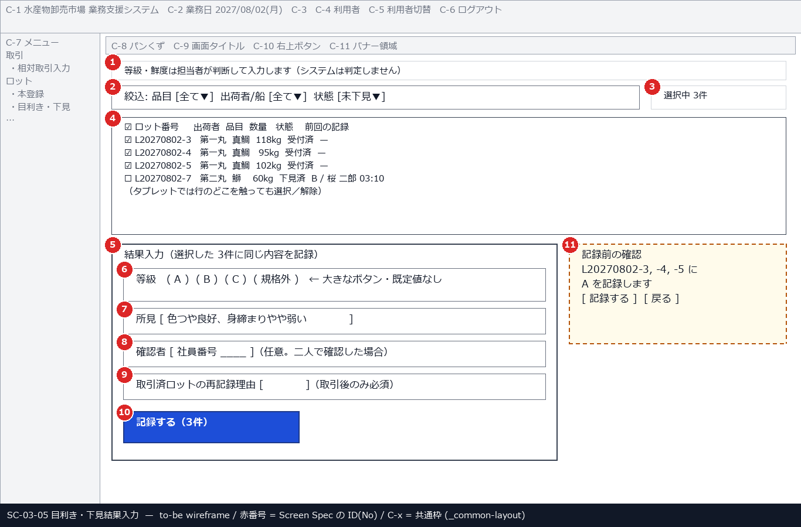

# SC-03-05 — 目利き・下見結果入力

> Biểu mẫu: **BM-2-901-51 v2.1** — Screen Specification · SUN ASTERISK VIETNAM CO., LTD · ISO/IEC 27001:2013 & ISO 9001:2015

---

## 1. History of change

| No | Version | Action | Nội dung thay đổi | Ngày | Người sửa | Approve |
|---|---|---|---|---|---|---|
| 1 | 0.1.0 | Add New | Khởi tạo từ wireframe WF-SC-03-05 0.2.0 (LAB-4 P3) | 2026-11-25 | phuongnnm-23344 | |
| 2 | 0.1.1 | Update | LAB-4: ảnh annotated thay bằng biến thể A của wireframe HTML `wireframes/html/SC-03-05.html` (WF 0.2.1); ghi badge không có trên ảnh; link HTML / PNG / PDF | 2026-11-25 | phuongnnm-23344 | |
| 3 | 0.1.2 | Update | Expert Gate 3 G3-m05: thêm §6.1 Trạng thái màn (tổng hợp từ §5 Event), ghi chú cũ thành §6.2 | 2026-11-25 | phuongnnm-23344 | |

---

## 2. Layout

**Design:** [Wireframe SC-03-05 0.2.1](../../../wireframes/SC-03-05-mekiki-inspection-result-entry-wireframe.md) · nguồn hình HTML [`wireframes/html/SC-03-05.html`](../../../wireframes/html/SC-03-05.html) · mọi biến thể: [`wireframes/png/SC-03-05.png`](../../../wireframes/png/SC-03-05.png) / [`wireframes/pdf/wireframes-all.pdf`](../../../wireframes/pdf/wireframes-all.pdf) · khung chung [_common-layout](../../../wireframes/_common-layout.md) · ảnh as-is prototype: [SC-03-05_prototype.png](../../../wireframes/assets/SC-03-05_prototype.png)

> - Ảnh = **biến thể A** (màn chính) của wireframe HTML, sinh bằng `scripts/render-wireframes.py --spec` (chưa có Figma). Số trên ảnh = cột `ID` mục 4 = cột `No` của wireframe; `C-x` = mục chung ở `_common-layout.md`.
> - Badge không có trên ảnh này: 11 hộp thoại xác nhận (B), C-12 (C), C-13 tablet (D), C-28 (E), C-21 (F), C-23 (G) → xem biến thể tương ứng trong [`wireframes/png/SC-03-05.png`](../../../wireframes/png/SC-03-05.png) / PDF.
> - Bố cục tablet (cùng item, nút [6] ≥ 64 px) = biến thể D.

---

## 3. Description

- **Mục đích:** ghi kết quả 目利き・下見 (thẩm định độ tươi / chất lượng) **do người đánh giá quyết** — điểm người quyết cuối của CAP-HUMAN-01. Hệ thống **không** chấm, **không** gợi ý hạng, **không** OCR / AI (SCOPE-OUT-01/02, ADR-010, luật 3). Áp một kết quả cho nhiều lô đã chọn, **mỗi lô lưu một dòng** (FT-03-02, PRM-117). Lô `受付` sau khi ghi thành `下見済` — điều kiện để 公開 (FIG-011, E-13 tạm theo FIG-011).
- **Ai dùng:** JUDGE (◎). SETTLE / STL-HEAD / OPS-HEAD xem lịch sử 目利き ở SC-03-04; INTAKE, TRADE thấy 「前回の記録」 qua SC-03-03 / SC-04-01 [2] — không vào màn này (role-list P14).
- **Thiết bị:** PC hoặc tablet. Không có chế độ offline (Q-SC0305-01 đã trả lời [Customer giả lập, 2026-11-25]).
- **Không ghi đè:** ghi lại lô đã có kết quả = thêm dòng mới, dòng cũ giữ (append-only, luật 4); lô đã có GD phải có lý do.

---

## 4. View

**Đánh ID:** cột `ID` = số item wireframe to-be; `A`, `B`, `C` chỉ là nhóm.

### 4.1 Danh sách item

| ID | Item Name | Item Type | Required | Note |
|---|---|---|---|---|
| **C** | **Khung chung** | | | PC: C-1..C-12; tablet: C-13, C-14 thay C-7. Trạng thái: C-20..C-26, C-28, C-29. Không dùng C-27, C-30, C-31 (hộp xác nhận riêng [11]) |
| **A** | **Tìm và chọn lô** | | | |
| 1 | 等級・鮮度は担当者が判断して入力します（システムは判定しません） | Label | - | Luôn hiện, chữ đậm, trên cùng |
| 2 | 絞込（品目・出荷者/船・状態） | Text box (3 ô chọn) | Không | 品目 [全て▼] · 出荷者 [全て▼] · 状態: 未下見 (mặc định) / 下見済 / 販売公開中 / 全て |
| 3 | 選択中 N件 | Label | - | Đếm lô đang chọn ở [4] |
| 4 | Bảng lô | Label (bảng chọn nhiều) | - | Cột: ☑ · ロット番号 · 出荷者 · 品目 · 数量 · 状態 · 前回の記録 (`{grade} / {người} {HH:MM}` hoặc 「—」). Dòng lô có GD thêm nhãn 「取引あり」. Tablet: chạm **cả dòng** để chọn / bỏ (khách #14). Ô tiêu đề ☑ = chọn tất cả dòng đang lọc |
| **B** | **結果入力** | | | |
| 5 | 結果入力（選択した N件に同じ内容を記録） | Label (vùng) | - | Tiêu đề động theo N |
| 6 | 等級 | Button (nhóm nút chọn một) | Có | Danh mục hạng của chợ (`grades[]` — chờ fixture L4-A02, tạm A / B / C / 規格外). **Không có giá trị mặc định**; nút đang chọn tô đặc + chữ 「選択中」 |
| 7 | 所見 | Text box (nhiều dòng) | Không | Placeholder 「色つや、身締まり など」 |
| 8 | 確認者（社員番号） | Text box (số) | Không | Người thứ hai nếu hai người cùng xem; gõ số → hiện tên |
| 9 | 取引済ロットの再記録理由 | Text box | Có khi chọn ≥ 1 lô 「取引あり」 | Ẩn khi không có lô 「取引あり」 trong lựa chọn |
| 10 | 記録する（N件） | Button | - | Mờ + lý do cạnh nút khi chưa đủ điều kiện (「ロットを選択してください」/「等級を選択してください」) |
| 11 | 記録前の確認 | Label (dialog) | - | 「{lotNo1}, {lotNo2}, … に {grade} を記録します」 (liệt kê đủ mã, > 10 lô thì cuộn) + [記録する] [戻る] (khách #15) |

### 4.2 Validation

| ID | Type | Min | Max | Default | Ghi chú |
|---|---|---|---|---|---|
| 4 | Array lô | 1 | 50 | không chọn | 0 lô → [10] mờ (client); server `E-LOT-010` 「ロットを1件以上選択してください（最大50件）」. Lô `仮受付` / `引渡し完了` không hiện; server vẫn kiểm → `E-LOT-013` 「ロット {lotNo} は下見を記録できない状態です（{status}）」 |
| 6 | String (mã hạng) | 1 | 10 | **không có** | Chưa chọn → [10] mờ; server `E-LOT-008` 「等級を選択してください」. Phải thuộc `grades[]` |
| 7 | String | 0 | 200 | trống | Quá 200 → `E-LOT-009` 「所見は200文字以内で入力してください」 (đếm ký tự, chặn gõ ở 200) |
| 8 | String (mã NV) | 0 | 10 | trống | Không tìm thấy, tài khoản không `ACTIVE`, hoặc trùng người đang dùng → `E-LOT-012` 「確認者の社員番号が見つからないか、記録者本人です」 |
| 9 | String | 1 | 200 | trống | Bắt buộc khi lựa chọn có lô 「取引あり」 → `E-LOT-011` 「取引のあるロットを再記録する場合は理由を入力してください」; quá 200 → `E-LOT-017` |

### 4.3 Data Mapping

| ID | Data Source | API ID | API URL | Key / Param | Ghi chú |
|---|---|---|---|---|---|
| 2, 6 | API | `API-LOT-006` | `GET /api/v1/lots/form-options` | → `items[]`, `grades[]` | Một lần khi mở màn |
| 2 | API | `API-LOT-005` | `GET /api/v1/master/shippers` | `q` | Ô 出荷者 của bộ lọc |
| 4 | API | `API-LOT-003` | `GET /api/v1/lots` | `status`, `itemCode`, `shipperId`, `include=latestInspection,hasTrades` | Mặc định `status=RECEIVED`; đổi lọc → gọi lại |
| 5–11 | API | `API-LOT-004` | `POST /api/v1/lots/inspections` | `lotIds[]`, `grade`, `note`, `secondCheckerEmployeeNo`, `rerecordReason` | → `count`, `batchNo`, `recordedAt` |
| 8 | API | `API-LOT-004` | (cùng) | | Tên người hiện từ `GET /api/v1/staff/lookup` của module `iam` — **chưa có API Design**, chưa đặc tả — [`specs/_index.md`](../../_index.md) mục phụ thuộc (DEP-02) |

### 4.4 Phân quyền hiển thị theo vai

| Vai \ Item | 1–4 | 5–9 | 10, 11 |
|---|---|---|---|
| JUDGE | Thao tác | Thao tác | Thao tác |
| SETTLE · STL-HEAD · OPS-HEAD | Không vào màn (C-25); xem ở SC-03-04 | | |
| INTAKE · TRADE | Không vào màn (C-25); thấy 前回の記録 ở SC-03-03 / SC-04-01 [2] | | |
| DELIVERY · RULE · SYSADM | Không vào màn (C-25) | | |

---

## 5. Event

| ID | Given (Pre-condition) | When (Trigger/Action) | Then (Result) | Note |
|---|---|---|---|---|
| **Initializing Process（初期処理）** | | | | |
| - | Vai JUDGE, online | Mở màn | 1. Gọi API-LOT-006 + API-LOT-003 (`status=RECEIVED`) 2. [6] không chọn hạng nào, [10] mờ | |
| 4 | Không có lô theo lọc | Mở màn / đổi lọc | C-21 「下見対象のロットはありません」 | |
| **Standard Process（通常処理）** | | | | |
| 2 | - | Đổi lọc | Gọi lại API-LOT-003; **giữ** các lô đã chọn còn nằm trong kết quả, bỏ chọn lô không còn | |
| 4 | - | Bấm ô ☑ (PC) / chạm dòng (tablet) | Đảo chọn; cập nhật [3], [5]; dòng 「取引あり」 được chọn → hiện [9] | khách #14 |
| 6 | - | Bấm nút hạng | Chọn hạng đó (chọn một); bấm lại nút đang chọn → bỏ chọn | |
| 10 | ≥ 1 lô, có hạng, [9] đủ nếu cần | Bấm [10] | Mở [11] liệt kê đúng mã lô + hạng | khách #15 |
| 11 | [11] đang mở | [記録する] | 1. Gọi API-LOT-004 2. 201 → C-12 「目利き記録：{N}件（{grade}）記録者 {tên} {HH:MM}」 3. Bỏ chọn tất cả, xóa [6]–[9] (hạng **không** giữ cho lượt sau), gọi lại API-LOT-003 | Lô `受付` → `下見済` |
| 11 | [11] đang mở | [戻る] | Đóng, giữ nguyên lựa chọn và nội dung | |
| **Error Handling（エラー制御）** | | | | |
| 6–9 | - | Bấm [10] khi có ô sai | C-22 dưới ô sai (mã ở 4.2) | |
| 4 | Lô vừa đổi trạng thái / có GD sau khi tải | API trả 409 `E-LOT-013` hoặc 422 `E-LOT-011` | C-23 nêu mã lô; nạp lại [4], giữ hạng + 所見; không lô nào được ghi (cả lượt rollback) | Tất cả hoặc không |
| - | Ngày đã khóa | 423 `E-CMN-003` | C-24; nội dung giữ, chỉ đọc. Ghi 目利き cho ngày đã khóa không có đường 修正申請 (目利き không đổi tiền) → ghi lại ở ngày mở nếu lô 持ち越し | ADR-005 |
| - | - | 403 / 5xx | C-25 / C-26 | |
| - | Đang chọn lô, đã bấm hạng | Mất mạng | C-28: **giữ** lô đã chọn và hạng; [10] mờ 「通信が回復するまで記録できません」; ghi giấy như hiện nay. Có mạng lại → C-29, [10] mở lại, bấm là lưu ngay | Q-SC0305-01 [Customer giả lập, 2026-11-25] |

---

## 6. Other Notes

### 6.1 Trạng thái màn

Tổng hợp từ §5 Event; mã `C-xx` định nghĩa ở `wireframes/_common-layout.md`. Phân quyền theo vai ở §4.4.

| Trạng thái | Hiển thị / hành vi |
|---|---|
| Mới mở | [6] chưa chọn hạng, [10] mờ |
| Không có lô theo lọc | C-21 「下見対象のロットはありません」 |
| Có lô 「取引あり」 được chọn | Hiện [9] (lý do ghi lại) |
| Lỗi nhập | C-22 dưới ô sai (mã ở §4.2) |
| Chờ xác nhận | Dialog [11] liệt kê mã lô + hạng |
| Lưu xong | C-12 toast; bỏ chọn tất cả, xóa [6]–[9] |
| Xung đột (409 `E-LOT-013` / 422 `E-LOT-011`) | C-23 nêu mã lô; nạp lại [4], giữ hạng + 所見; cả lượt không ghi |
| Ngày đã khóa (423 `E-CMN-003`) | C-24, chỉ đọc, giữ nội dung |
| Không có quyền / lỗi server | C-25 / C-26 |
| Offline | C-28: giữ lô đã chọn + hạng; [10] mờ 「通信が回復するまで記録できません」; có mạng lại → C-29 |

### 6.2 Ghi chú khác

- **Truy vết:** FR-LOT-02, FT-03-02, CAP-HUMAN-01, SCOPE-OUT-01, SCOPE-OUT-02, SCOPE-OUT-06, PRM-086, PRM-117, FIG-011, E-13, ADR-010, luật 3, luật 4; khách #14 (FB-CUS-273), #15 (FB-CUS-274), Q-SC0305-01 (FB-CUS-295); to-be khác prototype: bỏ hạng mặc định 「A」.
- **Database Design:** wireframe [8] 確認者 và [9] lý do ghi lại lưu ở `lot_inspections.second_checker_id` (FK `staff_accounts`, khác người ghi) và `rerecord_reason VARCHAR(200)` — đã phản ánh ở LOT_DB 0.2.1 §4.27. Danh mục hạng `grades[]` lấy từ `code_values` loại `INSPECTION_GRADE` (RULE_DB 0.2.1 §4.18; danh mục thật — Q-LOT-03). Ô 「下見時刻」 (khách #31) để sau — FB-CUS-290.
- **Không ghi đè:** lần ghi sau thay kết quả hiện hành (lấy dòng mới nhất), dòng cũ giữ ở `lot_inspections`; SC-03-04 hiện cả lịch sử.
- **Câu hỏi mở / TBD:** Q-SC0305-02 (lô chưa ghi 目利き bán bằng giấy khi mất mạng — chờ E-13 / OPEN-L4-03); Q-LOT-03 (danh mục hạng thật — chờ fixture L4-A02); Q-LOT-04 (ghi lại lô đã có GD có cần thông báo người chốt không) — ở [LOT_FUNC §3](../function-specifications/LOT_FUNC.md#3-mã-lỗi-câu-hỏi-giả-định-của-module).
