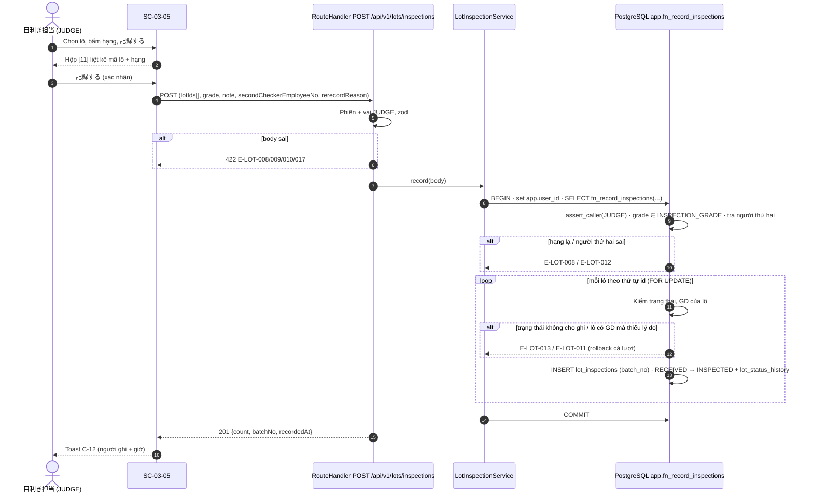

# LOT_INSPECTION_RECORD — Ghi kết quả 目利き・下見 do người quyết

> Biểu mẫu: **BM-2-901-53 v01** — Detail Design (Chart + Description) · SUN ASTERISK VIETNAM CO., LTD · ISO/IEC 27001:2013 & ISO 9001:2015

---

## 1. History of change

| No | Version | Action | Mục / Bước | Nội dung thay đổi | Ngày | Người sửa | Approve |
|---|---|---|---|---|---|---|---|
| 1 | 0.1.0 | Add new | — | Khởi tạo (LAB-4 P3) | 2026-11-25 | phuongnnm-23344 | |

---

## 2. Sequence diagram

Ảnh `./assets/LOT_INSPECTION_RECORD_sequence.png`: **N/A — chưa xuất** (cùng lý do [LOT_REGISTER_TECH §2](LOT_REGISTER_TECH.md#2-sequence-diagram)); nguồn duy nhất là khối Mermaid.

**File nguồn của sơ đồ:** khối Mermaid trong file này.

---

## 3. Description

- Ghi **kết quả người đánh giá đã quyết** (hạng, 所見, người thứ hai nếu có) cho một hoặc nhiều lô; mỗi lô một dòng `lot_inspections` cùng `batch_no` (PRM-117). Lô `RECEIVED` thành `INSPECTED` (下見済) — điều kiện 公開 (FIG-011).
- Hệ thống **không** sinh, đề xuất hay sửa hạng; không có đầu vào ảnh / OCR / mô hình (CAP-HUMAN-01, ADR-010, luật 3). Hạng chỉ đến từ nút người bấm.
- Ghi lại lô đã có kết quả = dòng mới, dòng cũ giữ (luật 4); lô đã có GD → bắt lý do.

---

## 4. Detail function

### 4.1. Kiểm request và người gọi

| Trường | Giá trị |
|---|---|
| Input | Body `RecordInspectionsBody` (API-LOT-004 §3), cookie phiên |
| Output | Body đã validate → 4.2 |

**Error**

| Điều kiện lỗi | Xử lý | Status code |
|---|---|---|
| Chưa đăng nhập | `E-CMN-001`, dừng | 401 |
| Không có vai JUDGE | `E-CMN-002`, dừng | 403 |
| `lotIds` rỗng / > 50 / trùng | `E-LOT-010`, dừng | 422 |
| `grade` rỗng | `E-LOT-008`, dừng | 422 |
| `note` > 200 / `rerecordReason` > 200 | `E-LOT-009` / `E-LOT-017`, dừng | 422 |

**Detail**

| No | Nội dung xử lý |
|---|---|
| 1 | `requireRole(["JUDGE"])`; zod; bỏ trùng trong `lotIds` trước khi đếm |
| 2 | Mở transaction, gắn `app.user_id`, `app.device_id` |

### 4.2. Kiểm hạng và người xác nhận thứ hai

| Trường | Giá trị |
|---|---|
| Input | `p_grade`, `p_second_checker_employee_no` |
| Output | `v_caller`, `v_day`, `v_second_checker` → 4.3 |

**Error**

| Điều kiện lỗi | Xử lý | Status code |
|---|---|---|
| `p_grade` không thuộc `code_values` `INSPECTION_GRADE` đang dùng | `E-LOT-008`, rollback | 422 |
| Mã NV không có / tài khoản không `ACTIVE` / trùng `v_caller` | `E-LOT-012`, rollback | 422 |
| Không có 業務日 `OPEN` | `E-CMN-003`, rollback | 423 |

**Detail**

| No | Nội dung xử lý |
|---|---|
| 1 | `v_caller := assert_caller(['JUDGE'], [])` |
| 2 | `v_day :=` 業務日 `OPEN` (dòng 目利き ghi vào ngày đang mở — lô 持ち越し vẫn ghi được) |
| 3 | Tra `staff_accounts.employee_no` → `v_second_checker` (không bắt người thứ hai có vai JUDGE — giả định PL) |

### 4.3. Ghi từng lô

| Trường | Giá trị |
|---|---|
| Input | `p_lot_ids`, `p_note`, `p_rerecord_reason`, `v_second_checker` |
| Output | `count`, `batch_no` → 4.4 |

**Error**

| Điều kiện lỗi | Xử lý | Status code |
|---|---|---|
| Số lô tìm thấy ≠ số id gửi lên | `E-LOT-014`, rollback | 404 |
| Lô `PROVISIONAL` hoặc `DELIVERED` | `E-LOT-013: {lot_no} ({status})`, rollback cả lượt | 409 |
| Lô có GD (`v_trade_effective` có dòng) mà `p_rerecord_reason` rỗng | `E-LOT-011: {lot_no}`, rollback | 422 |
| Trigger `DAY_LOCKED` | `E-CMN-003`, rollback | 423 |

**Detail**

| No | Nội dung xử lý |
|---|---|
| 1 | `v_batch_no := gen_random_uuid()` |
| 2 | Khóa các lô `ORDER BY id FOR UPDATE` (thứ tự cố định, tránh deadlock với 公開 / chốt GD) |
| 3 | Mỗi lô: kiểm trạng thái ∈ (`RECEIVED`, `INSPECTED`, `PUBLISHED`, `CLOSED`); kiểm GD |
| 4 | `INSERT lot_inspections (lot_id, business_date = v_day, grade, freshness_note, batch_no, inspected_by = v_caller, second_checker_id, rerecord_reason)` — hai cột cuối có ở LOT_DB 0.2.1 §4.27 |
| 5 | Lô `RECEIVED` → `UPDATE lots SET status = 'INSPECTED'` + `lot_status_history`; trạng thái khác giữ nguyên (ghi lại không làm lô đã bán quay về 下見済) |

### 4.4. Commit, trả kết quả

| Trường | Giá trị |
|---|---|
| Input | `count`, `v_batch_no` |
| Output | 201 `{count, batchNo, recordedAt}` |

**Error**

| Điều kiện lỗi | Xử lý | Status code |
|---|---|---|
| `40P01` / `40001` | Rollback, `E-CMN-006` | 409 |
| Lỗi khác | Log `ERROR`, `E-CMN-004` | 500 |

**Detail**

| No | Nội dung xử lý |
|---|---|
| 1 | `COMMIT`; log `INFO lot.inspected batchNo={…} count={…} rerecord={true/false}` |

---

## 5. Other Notes

- **Function này KHÔNG:** 公開 lô (SC-03-03); quyết bán được hay không (E-13 / OPEN-L4-03 — tạm theo FIG-011: chỉ `下見済` mới 公開); nhận ảnh hay tệp.
- **Offline:** không có (Q-SC0305-01). Client giữ lựa chọn khi mất mạng; không có hàng đợi.
- **Database Design:** `lot_inspections.second_checker_id`, `rerecord_reason` đã phản ánh ở LOT_DB 0.2.1 §4.27; loại `INSPECTION_GRADE` ở RULE_DB 0.2.1 §4.18 (danh mục hạng thật — Q-LOT-03).
- **Điều kiện hoàn thành (LAB-5):** (a) 3 lô `RECEIVED` + hạng A → 3 dòng cùng `batch_no`, 3 lô `INSPECTED`; (b) lô `PROVISIONAL` lẫn trong lượt → 409, **không** dòng nào được ghi; (c) lô có GD không lý do → 422 `E-LOT-011`, có lý do → ghi, lô giữ trạng thái; (d) không có API / tham số nào trả hạng gợi ý; (e) người thứ hai trùng người ghi → 422 `E-LOT-012`.
