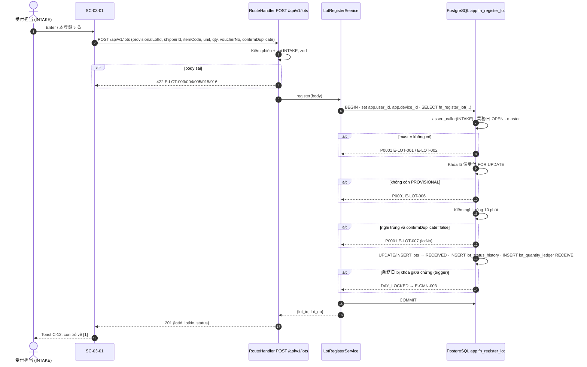

# LOT_REGISTER — 本登録 lô + dòng sổ số lượng 受入

> Biểu mẫu: **BM-2-901-53 v01** — Detail Design (Chart + Description) · SUN ASTERISK VIETNAM CO., LTD · ISO/IEC 27001:2013 & ISO 9001:2015

---

## 1. History of change

| No | Version | Action | Mục / Bước | Nội dung thay đổi | Ngày | Người sửa | Approve |
|---|---|---|---|---|---|---|---|
| 1 | 0.1.0 | Add new | — | Khởi tạo (LAB-4 P3) | 2026-11-25 | phuongnnm-23344 | |

---

## 2. Sequence diagram

Ảnh `./assets/LOT_REGISTER_sequence.png`: **N/A — chưa xuất**. Nguồn duy nhất của sơ đồ là khối Mermaid dưới đây (dạng văn bản như PlantUML, diff đọc được); máy làm P3 chưa có `mmdc`, ảnh PNG xuất khi có công cụ (Gate 1 m-08, FB-EXP-236 Waiting) — xuất từ chính khối này để hai bản không lệch.

**File nguồn của sơ đồ:** khối Mermaid trong file này.

---

## 3. Description

- Hoàn tất một lô 仮受付 (từ SC-03-02, đã đồng bộ lên server) hoặc tạo lô 新規 ở quầy: gắn mã 出荷者 từ master, 品目, đơn vị, SL xác nhận, số 紙伝票 → lô `RECEIVED` (受付) và sổ SL có dòng `RECEIVE` (受入) — từ đây SL khả dụng của lô = Σ `qty_delta` (BR-LOT-02).
- Người gọi: SC-03-01 (vai INTAKE). Một lần gọi = một transaction; lỗi ở bước nào thì không có gì được ghi.
- Kết thúc: lô ở `RECEIVED`, chờ 目利き (SC-03-05) → 公開 (SC-03-03).

---

## 4. Detail function

### 4.1. Kiểm request và người gọi

| Trường | Giá trị |
|---|---|
| Input | `Request` JSON `RegisterLotBody` (API-LOT-002 §3); cookie phiên |
| Output | `RegisterLotBody` đã validate + `userId`, `deviceId` → bước 4.2 |

**Error**

| Điều kiện lỗi | Xử lý | Status code |
|---|---|---|
| Không có phiên / phiên hết hạn | Trả `E-CMN-001`, dừng | 401 |
| Người dùng không có vai INTAKE | Trả `E-CMN-002`, dừng | 403 |
| `qty` ≤ 0 / sai số lẻ theo `unit`; `voucherNo` > 20 hoặc ký tự lạ; thiếu `shipperId` / `itemCode` / `unit` | Trả `E-LOT-003` / `004` / `005` / `015` / `016` với `field`, dừng | 422 |

**Detail**

| No | Nội dung xử lý |
|---|---|
| 1 | `requireRole(["INTAKE"])` đọc phiên, thiết bị (ADR-002) |
| 2 | Parse body bằng zod; số lẻ: `unit = KG` → `qty * 10` phải nguyên; `CASE` / `PIECE` → `qty` nguyên |
| 3 | Mở transaction, `set_config('app.user_id', userId, true)`, `set_config('app.device_id', deviceId, true)` |

### 4.2. Xác định 業務日 và kiểm master

| Trường | Giá trị |
|---|---|
| Input | Body đã validate |
| Output | `v_caller`, `v_day`, `shipper` hợp lệ → bước 4.3 |

**Error**

| Điều kiện lỗi | Xử lý | Status code |
|---|---|---|
| `assert_caller(INTAKE)` thất bại (tài khoản bị dừng giữa chừng) | Ném `E-CMN-002`, rollback | 403 |
| Không có 業務日 `OPEN` | Ném `E-CMN-003`, rollback | 423 |
| `shipperId` không có / không dùng nữa | Ném `E-LOT-001`, rollback | 422 |
| `itemCode` không có | Ném `E-LOT-002`, rollback | 422 |

**Detail**

| No | Nội dung xử lý |
|---|---|
| 1 | `v_caller := assert_caller(['INTAKE'], [])` |
| 2 | `v_day :=` 業務日 `OPEN` từ `business_days` (không suy từ `now()` — MKT_DB §4.0, ADR-005) |
| 3 | Kiểm `shippers`, `item_codes` (đọc trong hàm `security definer`) |

### 4.3. Khóa lô 仮受付 và kiểm nghi trùng

| Trường | Giá trị |
|---|---|
| Input | `p_provisional_lot_id` (có thể NULL), `p_shipper_id`, `p_item_code`, `p_qty`, `p_confirm_duplicate` |
| Output | `v_lot` (dòng đã khóa) hoặc NULL → bước 4.4 |

**Error**

| Điều kiện lỗi | Xử lý | Status code |
|---|---|---|
| `p_provisional_lot_id` không tồn tại | Ném `E-LOT-014`, rollback | 404 |
| Lô không còn `PROVISIONAL` (máy khác vừa 本登録) | Ném `E-LOT-006: {lot_no}`, rollback | 409 |
| Có lô cùng `shipper_id`, `item_code`, `qty_received` = `p_qty`, `status <> PROVISIONAL`, `updated_at` (thời điểm 本登録) trong 10 phút và `p_confirm_duplicate = false` | Ném `E-LOT-007: {lot_no}`, rollback — client hỏi lại rồi gửi `true` | 409 |

**Detail**

| No | Nội dung xử lý |
|---|---|
| 1 | Nếu có `p_provisional_lot_id`: `SELECT … FROM lots WHERE id = … FOR UPDATE` |
| 2 | Kiểm nghi trùng trên `lots` của `v_day` (index `idx_lots_business_date_status`); bỏ qua khi `p_confirm_duplicate` |

### 4.4. Ghi lô, lịch sử trạng thái, sổ SL

| Trường | Giá trị |
|---|---|
| Input | `v_lot`, body, `v_caller`, `v_day` |
| Output | `{lot_id, lot_no, status}` → bước 4.5 |

**Error**

| Điều kiện lỗi | Xử lý | Status code |
|---|---|---|
| Trigger `enforce_open_business_day` báo `DAY_LOCKED` (ngày bị khóa giữa bước 4.2 và 4.4) | Map `E-CMN-003`, rollback; client giữ nội dung (C-24) | 423 |
| Vi phạm CHECK (SL / đơn vị) do client lách validate | Map `E-CMN-007`, rollback | 422 |

**Detail**

| No | Nội dung xử lý |
|---|---|
| 1 | Lô 仮受付: `UPDATE lots SET shipper_id, item_code, unit, qty_received = p_qty, voucher_no, status = 'RECEIVED', registered_by = v_caller, registered_at = now(), updated_*` (giữ `qty_provisional`, `provisional_no`, `business_date` của lô) |
| 2 | Lô 新規: `INSERT lots` với `lot_no = 'L' || YYYYMMDD(v_day) || '-' || next_day_counter(v_day,'LOT')`, `business_date = v_day`, `status = 'RECEIVED'`, `provisional_by = registered_by = v_caller`, `registered_at = now()` |
| 3 | `INSERT lot_status_history (from PROVISIONAL|NULL → RECEIVED)` |
| 4 | `INSERT lot_quantity_ledger (entry_kind = 'RECEIVE', qty_delta = p_qty, business_date = v_day)` — **một** dòng; không ghi dòng cho SL 仮受付 (A-LOT-01) |
| 5 | Trigger audit ghi `audit_logs` (trước / sau của `lots`) — FR-AUDIT-01 |

### 4.5. Commit và trả kết quả

| Trường | Giá trị |
|---|---|
| Input | Kết quả bước 4.4 |
| Output | HTTP 201 `{lotId, lotNo, status: "RECEIVED"}` |

**Error**

| Điều kiện lỗi | Xử lý | Status code |
|---|---|---|
| Deadlock / serialization (`40P01`, `40001`) | Rollback, trả `E-CMN-006` — client bấm lại | 409 |
| Lỗi khác | Ghi log `ERROR` (log-convention), trả `E-CMN-004` kèm traceId, không lộ SQL | 500 |

**Detail**

| No | Nội dung xử lý |
|---|---|
| 1 | `COMMIT` |
| 2 | Ghi log `INFO lot.registered lotNo={…} provisional={true/false}` (không ghi tên người gửi) |

---

## 5. Other Notes

- **Function này KHÔNG:** sửa lô đã `RECEIVED` (→ SC-03-04, PRM-128, `ATTR_FIX`); ghi 目利き; 公開; xử lý 仮受付 offline (đồng bộ qua module `sync` gọi hàm tạo 仮受付 riêng — ADR-008 §2.2; bản ghi `HELD` → SC-03-07).
- **Đối chiếu Database Design (đã gộp):** (1) chú thích enum `ATTR_FIX` sửa thành "sửa SL **sau** 本登録 ở SC-03-04" — MKT_DB 0.3.2 §4.0 (A-LOT-01); (2) `lots.voucher_no` thống nhất `VARCHAR(20)` theo wireframe [8] — LOT_DB 0.2.1 §4.25; (3) `lots.registered_at` (giờ 本登録, dùng cho sort `-registeredAt` của API-LOT-003) — LOT_DB 0.2.1 §4.25; (4) thời điểm cấp `lot_no` vẫn là giả định (Q-LOT-01).
- **Tiền đề:** 業務日 `OPEN` đã được 日次締め hôm trước mở (ADR-005); master `shippers` / `item_codes` có dữ liệu (SC-10-07).
- **Điều kiện hoàn thành (LAB-5):** (a) 仮受付 → `RECEIVED` + 1 dòng `RECEIVE` đúng SL; (b) 新規 → lô mới có `lot_no` theo ngày; (c) hai máy bấm cùng 仮受付 → một 201, một 409 `E-LOT-006`; (d) nghi trùng → 409 `E-LOT-007`, gửi lại `confirmDuplicate=true` → 201; (e) ngày khóa → 423, không có dòng nào được ghi; (f) `qty = 1.25` kg / `2.5` 箱 → 422 `E-LOT-004`.
