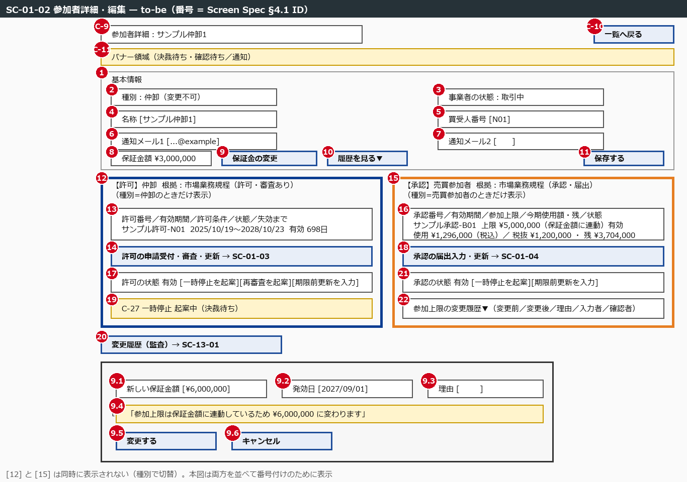
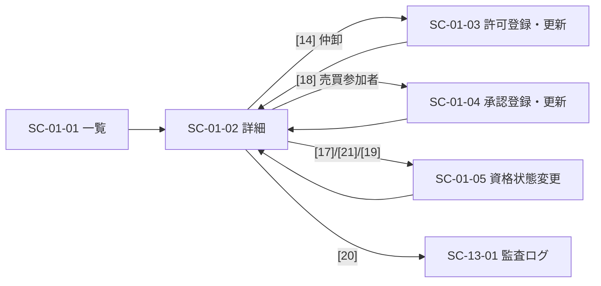

# SC-01-02 — 参加者詳細・編集

> Biểu mẫu: **BM-2-901-51 v2.1** — Screen Specification · SUN ASTERISK VIETNAM CO., LTD · ISO/IEC 27001:2013 & ISO 9001:2015

---

## 1. History of change

| No | Version | Action | Nội dung thay đổi | Ngày | Người sửa | Approve |
|---|---|---|---|---|---|---|
| 1 | 0.1.0 | Add New | Khởi tạo từ wireframe WF-SC-01-02 0.2.2 (đã sửa D-01 Gate 1 recheck) | 2026-11-25 | phuongnnm-23344 | |
| 2 | 0.1.1 | Update | Khách Q-PTY-06: bảng quyền, [9], [21], [22] — chỉ 照合部門長 đổi 保証金 / 参加上限, một bước, MFA; Q-TRD-02: [16] hiện 税込 / 税抜 | 2026-11-25 | phuongnnm-23344 |  |
| 3 | 0.1.2 | Update | LAB-4: ảnh annotated thay bằng biến thể A của wireframe HTML `wireframes/html/SC-01-02.html` (WF 0.2.5); ghi badge không có trên ảnh; link HTML / PNG / PDF | 2026-11-25 | phuongnnm-23344 | |

---

## 2. Layout

**Design:** [Wireframe SC-01-02 0.2.6](../../../wireframes/SC-01-02-participant-detail-kyoka-shonin-wireframe.md) · nguồn hình HTML [`wireframes/html/SC-01-02.html`](../../../wireframes/html/SC-01-02.html) · mọi biến thể: [`wireframes/png/SC-01-02.png`](../../../wireframes/png/SC-01-02.png) / [`wireframes/pdf/wireframes-all.pdf`](../../../wireframes/pdf/wireframes-all.pdf) · khung chung [_common-layout](../../../wireframes/_common-layout.md) · ảnh as-is prototype: `wireframes/assets/SC-01-02_prototype-nakaoroshi.png`, `wireframes/assets/SC-01-02_prototype-baibai.png`

> - Ảnh = **biến thể A** (màn chính) của wireframe HTML, sinh bằng `scripts/render-wireframes.py --spec` (chưa có Figma). Số trên ảnh = cột `ID` mục 4 = cột `No` của wireframe; `C-x` = mục chung ở `_common-layout.md`.
> - Badge không có trên ảnh này: 9.1–9.6 hộp thoại 保証金の変更 (C), C-30 (D), C-11 · C-27 (E), C-21 · C-22 (F) → xem biến thể tương ứng trong [`wireframes/png/SC-01-02.png`](../../../wireframes/png/SC-01-02.png) / PDF.
> - Biến thể A đặt khối 【許可】 [12]–[14], [17], [19] và khối 【承認】 [15], [16], [18], [21], [22] cạnh nhau **chỉ để đánh số**; màn thật chỉ hiện một khối theo 種別 (mục 3, §6). Hộp thoại [9] = biến thể C.

---

## 3. Description

Màn **quản lý** hồ sơ một người tham gia (参加者 — doanh nghiệp / cá nhân mua bán ở chợ) và xem tư cách pháp lý của họ. Người dùng chính: 照合事務局 (SETTLE — nhân viên phòng đối soát) và 照合部門長 (STL-HEAD — trưởng phòng đối soát). 運用部門長 (OPS-HEAD) chỉ xem.

Điểm cốt lõi (luật 2, ADR-003, L4-D02): **許可 (kyoka — giấy phép có xét duyệt, cho 仲卸 / người bán buôn trung gian)** và **承認 (shōnin — chấp thuận, thủ tục nhẹ, cho 売買参加者 / người tham gia mua bán)** là **hai khối riêng**, hai căn cứ pháp lý, hai thủ tục, hai bảng dữ liệu. Không có khối chung kiểu "取引資格". Mỗi lúc chỉ một khối hiện, theo 種別 của người tham gia.

Màn này ghi trực tiếp **chỉ** thông tin cơ bản và 保証金 (tiền bảo chứng — thêm dòng lịch sử; **chỉ 照合部門長**, MFA, không checker — Q-PTY-06 [Customer giả lập, 2026-11-25]). Thay đổi tư cách (cấp mới, gia hạn, đình chỉ, 再審査) đi qua màn nhập SC-01-03 / SC-01-04 / SC-01-05 theo thủ tục maker-checker; đổi 参加上限 là thao tác **một bước của 照合部門長** ở SC-01-04 (MFA, audit). Màn này chỉ hiện trạng thái, yêu cầu đang chờ và lịch sử.

Đi tới: SC-01-01 (danh sách), SC-01-03 (許可), SC-01-04 (承認), SC-01-05 (đổi trạng thái / gia hạn), SC-13-01 (監査ログ).

---

## 4. View

**Đánh ID:** section là chữ, **ID item = số item trong wireframe to-be** (không đánh lại — brief P3). Item dùng chung mang tiền tố `C-` (định nghĩa ở `wireframes/_common-layout.md`, sẽ chuyển sang `specs/_common/`). Mục 5 trỏ item bằng `[n]`.

### 4.1 Danh sách item

| ID | Item Name | Item Type | Required | Note |
|---|---|---|---|---|
| **H** | **Khung màn** | | | |
| C-9 | 画面タイトル 「参加者詳細：{名称}」 | Label | - | |
| C-10 | 一覧へ戻る | Button | - | → SC-01-01 (giữ bộ lọc trước) |
| C-11 | バナー領域 | Label | - | Banner 決裁待ち / 確認待ち (C-27), lỗi hệ thống (C-26) |
| **A** | **基本情報** | | | |
| 1 | Khối 基本情報 | Label | - | Vùng |
| 2 | 種別 | Label | - | 卸売業者 / 仲卸 / 売買参加者 / 買出人; khóa sau đăng ký, kèm chữ 「（登録後変更不可）」 |
| 3 | 事業者の状態 | Label | - | 取引中 / 退会 — **không** hiện 一時停止 / 失効 ở mức này |
| 4 | 名称 | Text box | Có | |
| 5 | 買受人番号 | Text box | Có (仲卸 / 売買参加者) | Tự đổi chữ thường → hoa khi gõ; ẩn với 卸売業者 / 買出人 |
| 6 | 通知メール1 | Text box | Không | Placeholder `example@example.co.jp` |
| 7 | 通知メール2 | Text box | Không | Tối đa 2 địa chỉ |
| 8 | 保証金額 | Label | - | Giá trị hiện hành (`v_participant_current_deposit`), định dạng `¥#,###` |
| 9 | 保証金の変更 | Button | - | Mở hộp thoại D (dưới) |
| 10 | 履歴を見る ▼ | Button | - | Mở / gập bảng lịch sử 保証金 (發效日 / 金額 / 理由 / 入力者 / 入力日時) |
| 11 | 保存する | Button | - | Mờ khi chưa đổi gì |
| **K** | **【許可】仲卸 — chỉ khi 種別 = 仲卸** | | | |
| 12 | Khối 許可 | Label | - | Khung xanh đậm, tiêu đề chữ to 「【許可】仲卸 ─ 根拠: 市場業務規程（許可・審査あり）」. **Không có cột 参加上限** |
| 13 | Bảng 許可 | Label | - | Cột: 許可番号 / 有効期間 / 許可条件 / 状態 / 失効まで（日）. Bản trước khi gia hạn hiện ở dòng lịch sử có nhãn 「更新済」 |
| 14 | 許可の申請受付・審査・更新 | Button | - | → SC-01-03. Dưới nút ghi thủ tục: 「新規: 審査→起案→運用部門長決裁／更新: 照合事務局入力→照合部門長確認（MFA）」 |
| 17 | 許可の状態 + nút | Label + Button | - | Nhãn trạng thái (有効 / 一時停止 / 失効 / 再審査中) + nút 「一時停止を起案」「再審査を起案」「再開を起案」「期限前更新を入力」 theo trạng thái và vai (§6.2) → SC-01-05 |
| 19 | 進行中の申請 | Label | - | C-27: 「一時停止 起案中（決裁待ち）」/「期限前更新 入力済（確認待ち）」. **Không bao giờ** 「承認待ち」 |
| **S** | **【承認】売買参加者 — chỉ khi 種別 = 売買参加者** | | | |
| 15 | Khối 承認 | Label | - | Khung cam, tiêu đề 「【承認】売買参加者 ─ 根拠: 市場業務規程（承認・届出）」 |
| 16 | Bảng 承認 + 参加上限 | Label | - | Cột: 承認番号 / 有効期間 / 参加上限 / 今期使用額 / 残 / 状態. 今期使用額 hiện 「¥{usedIncl}（税込）／ 税抜 ¥{usedExcl}」, 残 = 参加上限 − 税込 (Q-TRD-02 [Customer giả lập, 2026-11-25]). 参加上限 kèm chữ 「保証金額に連動」 hoặc 「個別設定」 |
| 18 | 承認の届出入力・更新 | Button | - | → SC-01-04. Dưới nút: 「手続: 届出 → 照合事務局入力 → 照合部門長確認（MFA）」 |
| 21 | 承認の状態 + nút | Label + Button | - | Như [17] cho 承認; thêm 「参加上限の変更」 (chỉ STL-HEAD) → SC-01-04, áp ngay sau C-30 MFA, không có bước 確認 (Q-PTY-06) |
| 22 | 参加上限の変更履歴 ▼ | Button | - | Bảng gập: 発効日 / 変更前 / 変更後 / 理由 / 変更者（照合部門長）/ 変更日時 (sự kiện `LIMIT_CHANGED`) |
| **L** | **Liên kết chung** | | | |
| 20 | 変更履歴（監査） | Button | - | → SC-13-01 lọc `participant_id` |
| **D** | **Hộp thoại [9] 保証金の変更** | | | |
| 9.1 | 新しい保証金額 | Text box | Có | テンキー; hiện `¥#,###` khi rời ô |
| 9.2 | 発効日 | Text box (date) | Có | Mặc định = 業務日 hiện tại |
| 9.3 | 理由 | Text box | Có | |
| 9.4 | Câu ảnh hưởng 参加上限 | Label | - | Chỉ với 売買参加者: 「参加上限は保証金額に連動しているため ¥{新額} に変わります」 hoặc 「参加上限は個別設定のため ¥{現上限} のまま変わりません」 (khách #20) |
| 9.5 | 変更する | Button | - | |
| 9.6 | キャンセル | Button | - | |

> `9.x` là item con của hộp thoại [9] — wireframe gộp cả hộp thoại thành một số; đánh số con để mục 4.2 / 5 trỏ được.

### 4.2 Validation

| ID | Type | Min | Max | Default | Ghi chú |
|---|---|---|---|---|---|
| [4] | String | 1 | 100 | giá trị hiện tại | Trim hai đầu. Rỗng / quá dài → `E-PTY-001` 「名称は1〜100文字で入力してください」 |
| [5] | String | 1 | 10 | giá trị hiện tại | `^[A-Z0-9]{1,10}$` → `E-PTY-002` 「買受人番号は英大文字・数字1〜10文字で入力してください」. Trùng (server) → `E-PTY-003` 「この買受人番号は既に使われています」 (C-22 dưới ô) |
| [6], [7] | String (email) | 0 | 254 | giá trị hiện tại | Dạng `local@domain` (một `@`, domain có `.`) → `E-PTY-004` 「メールアドレスの形式が正しくありません」. [6] = [7] → `E-PTY-021` 「同じメールアドレスは2件登録できません」 |
| 9.1 | Integer | 0 | 99,999,999,999 | (trống) | Số nguyên ≥ 0, đơn vị yên → `E-PTY-005` 「保証金額は0以上の整数で入力してください」. = giá trị hiện hành → `E-PTY-022` 「現在の保証金額と同じです」 |
| 9.2 | Date | 業務日 hiện tại | — | 業務日 hiện tại | `YYYY/MM/DD` hoặc `YYYY-MM-DD`; trước 業務日 hiện tại → `E-PTY-006` 「発効日は本日（業務日）以降の日付を入力してください」 (giả định Q-PTY-02). Trùng ngày đã có → `E-PTY-008` 「同じ発効日の保証金変更が既にあります」 |
| 9.3 | String | 1 | 200 | (trống) | → `E-PTY-007` 「理由を入力してください」 |

> **Cố ý không validate:** [2] 種別 (không sửa được — server từ chối nếu gửi khác, `E-PTY-009`); [8] (chỉ đọc). Email không gửi thư xác nhận ở 第1期 (L4-A08 — đổi theo giấy yêu cầu, có lịch sử).

### 4.3 Data Mapping

| ID | Data Source | API ID | API URL | Key / Param | Ghi chú |
|---|---|---|---|---|---|
| [2]–[8], [10], [13], [16], [17], [19], [21], [22] | API | `API-PTY-001` | `GET /api/v1/participants/{participantId}` | `participant`, `contacts`, `deposit`, `depositHistory`, `permit` \| `approval`, `openRequest`, `events` | Một lần gọi khi mở màn; khối 許可 / 承認 theo `participant.kind` |
| [4]–[7], [11] | API | `API-PTY-002` | `PUT /api/v1/participants/{participantId}` | `name`, `buyerNo`, `emails[]`, `version` | `version` = khóa lạc quan (E-CMN-008) |
| 9.1–9.3, 9.5 | API | `API-PTY-003` | `POST /api/v1/participants/{participantId}/deposits` | `depositJpy`, `effectiveFrom`, `reason` | Trả `limitAfter` để hiện C-12 |
| 9.4 | API (đã tải) | `API-PTY-001` | — | `approval.limitMode`, `approval.participationLimitJpy` | Tính ở client, không gọi thêm |

> Danh mục API toàn hệ thống: [`_common/api-list.md`](../../_common/api-list.md); API Design của feature: [`specs/system-design/api-design/party/`](../../system-design/api-design/party/).

---

## 5. Event

| ID | Given (Pre-condition) | When (Trigger/Action) | Then (Result) | Note |
|---|---|---|---|---|
| **Initializing Process（初期処理）** | | | | |
| - | Người dùng có vai đọc người tham gia (SETTLE, STL-HEAD, OPS-HEAD) | Mở màn `/participants/{id}` | 1. Hiện C-20 (skeleton). 2. Gọi `API-PTY-001`. 3. Hiện [1]–[11]; `kind = NAKAOROSHI` → hiện [12]–[14], [17], [19]; `kind = BAIBAI` → [15], [16], [18], [21], [22]; `WHOLESALER` / `KAIDASHI` → không có hai khối, câu 「この種別は許可・承認の対象外です」. 4. Có `openRequest` → [19] C-27 + banner C-11; ẩn nút đổi trạng thái của khối đó. 5. Áp §6.2 (ẩn nút theo vai) | |
| - | Vai khác (INTAKE, JUDGE, TRADE, DELIVERY, RULE) | Mở URL trực tiếp | Trang C-25 「この画面を表示する権限がありません」 (403 `E-CMN-002`) | Tra tư cách nhanh dùng SC-01-06 |
| **Standard Process（通常処理）** | | | | |
| [5] | - | Gõ ký tự | Chữ thường tự đổi thành hoa; ký tự khác `A-Z0-9` không nhận | |
| [4]–[7] | Có thay đổi so với dữ liệu tải | Rời ô | Validate client (4.2); lỗi → C-22 dưới ô; [11] bật khi không còn lỗi | |
| [11] | Form hợp lệ | Bấm 「保存する」 | 1. Gọi `API-PTY-002` kèm `version`. 2. 200 → C-12 「保存しました：{名称}」, nạp lại `API-PTY-001`. 3. Email đổi → server đóng dòng cũ, thêm dòng mới (lịch sử) | Audit before / after (FR-AUDIT-01) |
| [9] | Vai STL-HEAD (hoặc 代行), `participant.status = ACTIVE` | Bấm 「保証金の変更」 | Mở hộp thoại D; 9.2 = 業務日; con trỏ ở 9.1 | Q-PTY-06: SETTLE không thấy nút |
| 9.1 | Người tham gia là 売買参加者 | Nhập số | 9.4 cập nhật ngay: `limitMode = DEPOSIT` → 「…¥{新額} に変わります」; `INDIVIDUAL` → 「…¥{現上限} のまま変わりません」 | khách #20 |
| 9.5 | 9.1–9.3 hợp lệ | Bấm 「変更する」 | 0. Step-up MFA hết → C-30 trước (403 `E-CMN-005` → C-30 → gửi lại). 1. Gọi `API-PTY-003`. 2. 201 → đóng hộp thoại, C-12 「保証金を変更しました（{発効日}から ¥{額}）」, [8], [10], [16] nạp lại. 3. **Không sửa đè**: thêm dòng `participant_deposit_history` | luật 4, D14 |
| 9.6 | - | Bấm 「キャンセル」 | Đóng hộp thoại, không lưu | |
| [10] / [22] | - | Bấm ▼ | Mở / gập bảng lịch sử (dữ liệu đã tải) | |
| [14] | `kind = NAKAOROSHI` | Bấm | → SC-01-03 (`participantId`) | |
| [18] | `kind = BAIBAI` | Bấm | → SC-01-04 (`participantId`) | |
| [17] / [21] | Không có `openRequest` cho khối đó | Bấm nút đổi trạng thái | → SC-01-05 (`participantId`, `target = PERMIT` \| `APPROVAL`, `action`) | Màn đích gọi `API-PTY-004` / `API-PTY-006` |
| [19] | Có `openRequest` | Bấm nhãn | → SC-01-05 ở chế độ xem / 決裁 yêu cầu đó | |
| [20] | - | Bấm | → SC-13-01 lọc `participant_id` | |
| C-10 | Form có thay đổi chưa lưu | Bấm | Hộp xác nhận 「保存していない変更があります。破棄して一覧へ戻りますか？」 | |
| **Error Handling（エラー制御）** | | | | |
| [5] | Lưu | Server trả 409 `E-PTY-003` | C-22 dưới [5]; con trỏ về [5] | |
| [11] | Lưu | 409 `E-CMN-008` (người khác vừa sửa) | C-23 「他の利用者が更新しました。最新の内容を読み込み直してください」 + nút 「再読み込み」; giữ nội dung đang gõ | |
| [11], 9.5 | Lưu | 409 `E-PTY-010` (退会) | C-23; ẩn mọi nút ghi | |
| 9.5 | Lưu | 403 `E-CMN-005` (hết step-up) | Mở C-30, giữ nội dung hộp thoại, gửi lại sau khi nhập mã | Q-PTY-06 |
| 9.5 | Lưu | 422 `E-PTY-006` / `E-PTY-008` | C-22 dưới 9.2, hộp thoại giữ nguyên | |
| - | Bất kỳ | 401 `E-CMN-001` | Về SC-00-01, giữ URL để quay lại | |
| - | Bất kỳ | 5xx / timeout | C-26 banner đỏ + mã `traceId`; dữ liệu đang nhập giữ nguyên | |
| - | Mất mạng | Bất kỳ | C-28 「通信が回復するまで保存できません」; [11], 9.5 mờ | Màn không có chế độ offline (ADR-008 §2.1) |

---

## 6. Other Notes

### 6.1 Trạng thái màn

| Trạng thái | Điều kiện | Hiển thị |
|---|---|---|
| Đang tải | Chờ `API-PTY-001` > 300 ms | C-20 |
| 仲卸 chưa có 許可 | `kind = NAKAOROSHI`, `permit = null` | [13] C-21: 「許可が登録されていません。取引の確定はできません」 + [14] |
| 売買参加者 chưa có 承認 | `kind = BAIBAI`, `approval = null` | [16] C-21: 「承認が登録されていません。取引の確定はできません」 + [18] |
| Ngoài đối tượng | `WHOLESALER` / `KAIDASHI` | Không có [12], [15]; câu 「この種別は許可・承認の対象外です」; [5] ẩn |
| Sắp hết hạn | `daysToExpiry ≤ 30` (PRM-045) | Nhãn vàng 「失効まで {n}日」 ở [13] / [16] — cùng ngưỡng SC-04-01 |
| 一時停止 / 失効 / 再審査中 | `status ≠ VALID` | Nhãn đỏ + chữ ở [17] / [21] (không chỉ màu); [14] / [18] vẫn dùng được để gia hạn đúng thủ tục |
| Đang chờ 決裁 / 確認 | `openRequest ≠ null` | [19] C-27; banner C-11; nút đổi trạng thái của khối ẩn |
| 退会 | `participant.status = WITHDRAWN` | [3] xám; mọi nút ghi ẩn; chỉ đọc |
| Lỗi nhập | Validate | C-22 dưới ô |
| Ngày đã khóa (423) | N/A — dữ liệu master không gắn 業務日; không có 423 ở màn này | |
| Offline | Mất mạng | C-28; chặn lưu |

### 6.2 Phân quyền hiển thị theo vai (vai × item)

Ký hiệu: **T** = thao tác · **Đ** = chỉ đọc · **Ẩn** = không hiện. Vai không có trong bảng (INTAKE, JUDGE, TRADE, DELIVERY, RULE, SYSADM) → C-25, không vào màn.

| Item | SETTLE (照合事務局) | STL-HEAD (照合部門長) | OPS-HEAD (運用部門長) |
|---|---|---|---|
| [2], [3], [8], [13], [16], [19], [22] | Đ | Đ | Đ |
| [4]–[7] | T | T | Đ |
| [9] | Ẩn (Q-PTY-06) | T (MFA) | Ẩn |
| [11] | T | T | Ẩn |
| [10], [20] | T | T | T |
| [14] (→ SC-01-03) | T — nhập hồ sơ cấp mới 許可; nhập 失効日 mới khi gia hạn | T — ghi kết quả 審査 + 起案 (cấp mới); 確認 gia hạn (MFA) | T — chỉ để 決裁 cấp mới (MFA) khi có yêu cầu chờ |
| [17] 許可: 「期限前更新を入力」 | T | Ẩn (là người 確認) | Ẩn |
| [17] 許可: 「一時停止を起案」「再審査を起案」「再開を起案」 | Ẩn | T (起案) | Ẩn — OPS-HEAD 決裁 ở SC-01-05 qua [19] |
| [18] (→ SC-01-04) | T — nhập 届出 cấp mới / gia hạn | T — 確認 (MFA); đổi 参加上限 một bước (MFA) | Ẩn |
| [21] 承認: 「期限前更新を入力」 | T | Ẩn | Ẩn |
| [21] 承認: 「参加上限の変更」 | Ẩn (Q-PTY-06) | T (MFA, một bước) | Ẩn |
| [21] 承認: 「一時停止を起案」「再審査を起案」「再開を起案」 | Ẩn | T | Ẩn |

Quy tắc thêm: (0) Đổi 保証金 / 参加上限 không theo maker-checker: chỉ 照合部門長 làm, một bước, MFA + `audit_logs` (Q-PTY-06 [Customer giả lập, 2026-11-25]). (1) Người nhập / 起案 không được 確認 / 決裁 chính yêu cầu đó (maker ≠ checker — CHECK `decided_by <> proposed_by` và `≠ created_by`, PARTY_DB 4.13 / 4.15). (2) Khi đang có `openRequest`, mọi nút đổi trạng thái của khối đó ẩn với mọi vai (một yêu cầu mở / tư cách — giả định Q-PTY-01). (3) Vai là thuộc tính tài khoản nhiều vai (`staff_roles`) + quyền duyệt (`staff_authorities`); 代行 đang hiệu lực được coi như quyền duyệt tương ứng.

### 6.3 Luồng chuyển màn

### 6.4 Thủ tục — hai khối, hai thủ tục (tóm tắt cho dev; chi tiết ở TECH)

| | 許可 (仲卸) — [SPEC-PTY_PERMIT_LIFECYCLE-001](../technical-design/PTY_PERMIT_LIFECYCLE_TECH.md) | 承認 (売買参加者) — [SPEC-PTY_APPROVAL_LIFECYCLE-001](../technical-design/PTY_APPROVAL_LIFECYCLE_TECH.md) |
|---|---|---|
| Cấp mới | 照合事務局 nhập → 照合部門長 ghi kết quả 審査 + 起案 → **運用部門長 決裁 (MFA)** — giả định [PL], OPEN-DB-09 | 照合事務局 nhập 届出 → **照合部門長 確認 (MFA)**, xét nhẹ 保証金 / 資力 — OPEN-DB-09 |
| Gia hạn bình thường | 照合事務局 nhập 失効日 mới → **照合部門長 確認 (MFA)** — PRM-121, không 審査 lại | Như bên trái (PRM-121) |
| 一時停止 / 再審査 / 再開 | 照合部門長 起案 → 運用部門長 決裁 (MFA) | Như bên trái |
| Trường riêng | 許可条件, kết quả 審査 | 参加上限 (đổi qua `LIMIT_CHANGED`, không sửa đè) |
| Hết 失効日 | Tự động 失効 (giả định [PL]) | Như bên trái |

### 6.5 Truy vết

FR-PARTY-01, TBL-ACTOR-01, 02-08, B.2, BR-PERM-01, PRM-044, PRM-045, PRM-046, PRM-121, FIG-010, FR-AUDIT-01, NFR-SEC-01; L4-D02, L4-D03, L4-A08; ADR-003, ADR-002; PARTY_DB 4.9–4.15; Gate 1 M-07, recheck N-03, D-01; khách #18–#21.

### 6.6 Câu hỏi / giả định (mới ở spec này)

| ID đề xuất | Nội dung | Giả định tạm | Ảnh hưởng nếu sai |
|---|---|---|---|
| Q-PTY-01 | Một tư cách (許可 hoặc 承認) có được có **nhiều** yêu cầu đang chờ cùng lúc không (vd. vừa 期限前更新 vừa 一時停止)? | Không — tối đa 1 yêu cầu mở / tư cách | Thêm hàng đợi yêu cầu + quy tắc thứ tự: +0,3 MM |
| Q-PTY-02 | 保証金 có được ghi **hồi tố** (発効日 trước 業務日 hiện tại) không? Hồi tố làm 参加上限 của GD đã chốt trong kỳ đổi theo | Không — 発効日 ≥ 業務日 hiện tại | Cho hồi tố: phải tính lại cảnh báo vượt hạn mức đã ghi, +0,2 MM |
| Q-PTY-03 | 通知メール có bắt buộc ít nhất 1 địa chỉ với 仲卸 / 売買参加者 không? | Không bắt buộc; thiếu email → thông báo kỳ in giấy (L4-A08) | Bắt buộc: thêm validate + dữ liệu migration phải đủ email |
