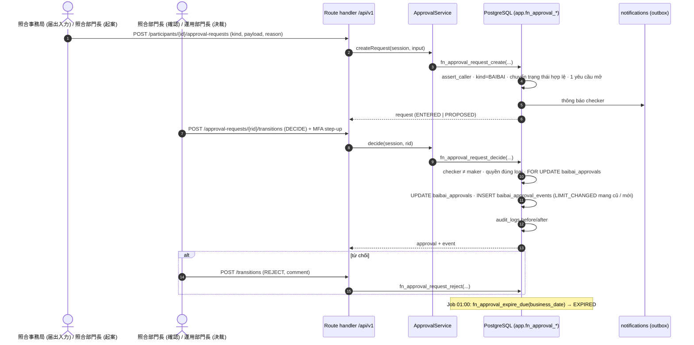

# PTY_APPROVAL_LIFECYCLE — Vòng đời 承認 (売買参加者) và 参加上限

> Biểu mẫu: **BM-2-901-53 v01** — Detail Design (Chart + Description) · SUN ASTERISK VIETNAM CO., LTD · ISO/IEC 27001:2013 & ISO 9001:2015

---

## 1. History of change

| No | Version | Action | Mục / Bước | Nội dung thay đổi | Ngày | Người sửa | Approve |
|---|---|---|---|---|---|---|---|
| 1 | 0.1.0 | Add new | — | Khởi tạo | 2026-11-25 | phuongnnm-23344 | |

---

## 2. Sequence diagram

Ảnh PNG: N/A — Mermaid là nguồn duy nhất (Gate 1 m-08). Khi render được: `./assets/PTY_APPROVAL_LIFECYCLE_sequence.png`.

---

## 3. Description

承認 là căn cứ khác 許可: **thủ tục nhẹ** — 届出 (nộp thông báo) → 照合事務局 nhập → 照合部門長 確認 (MFA) kèm xét nhẹ 保証金 / 資力; không có bước 審査 riêng, không có `REVIEWED` (CHECK ở PARTY_DB 4.15). Có trường riêng **参加上限** (hạn mức tham gia): vượt hạn mức trong kỳ chỉ cảnh báo + bắt lý do ở màn GD, **không chặn cứng** (PRM-046, L4-A04 (1)). Hàm, bảng, endpoint **tách hẳn** khỏi 許可 ([PTY_PERMIT_LIFECYCLE](PTY_PERMIT_LIFECYCLE_TECH.md)) — đổi một bên không kéo bên kia (ADR-003).

| Loại | Trạng thái trước → sau | Maker | Checker (MFA) | Event | Nguồn |
|---|---|---|---|---|---|
| `NEW` cấp mới | (chưa có) → 有効 | SETTLE nhập 届出 → `ENTERED` | **STL-HEAD 確認** | `REGISTERED` | PARTY_DB 4.15; OPEN-DB-09 (xét nhẹ, một người) |
| `RENEW` gia hạn | 有効 / 一時停止 → giữ nguyên, `valid_to` mới | SETTLE | **STL-HEAD 確認** | `RENEWED` | PRM-121 |
| `LIMIT_CHANGE` đổi 参加上限 | giữ nguyên | SETTLE | **STL-HEAD 確認** | `LIMIT_CHANGED` (`old_limit_jpy`, `new_limit_jpy`) | PRM-046, Gate 1 M-07 |
| `SUSPEND` / `RESUME` / `REVIEW_START` / `REINSTATE` | như 許可 (FIG-010) | STL-HEAD 起案 → `PROPOSED` | **OPS-HEAD 決裁** | `SUSPENDED` / `RESUMED` / `REVIEW_STARTED` / `REINSTATED` | PRM-121 |
| (job) 失効 | 有効 / 一時停止 → 失効 | hệ thống | — | `EXPIRED` | giả định [PL] |

**参加上限 hiệu lực** (đọc ở SC-01-02 [16], SC-04-01, SC-05-02):
`limit = baibai_approvals.participation_limit_jpy` nếu khác NULL (`INDIVIDUAL`), ngược lại = 保証金 hiện hành `v_participant_current_deposit` tại ngày xét (`DEPOSIT`). **今期使用額** = Σ 買受代金 hiệu lực (相対 + せり, gồm điều chỉnh có `period_id` = kỳ đang xét) theo `trade_date` trong kỳ — view `v_buyer_period_usage`; **残** = `limit − 使用額` (có thể âm, hiện đỏ).

Bảng yêu cầu chờ: `baibai_approval_requests` — PARTY_DB 0.3.1 §4.60 (bảng riêng, cùng tên cột với `nakaoroshi_permit_requests`; `request_kind` có thêm `LIMIT_CHANGE`, không có `PROPOSED` cho `NEW`).

---

## 4. Detail function

### 4.1. Xác thực, quyền, MFA

| Trường | Giá trị |
|---|---|
| Input | Cookie `sid`; body JSON (zod); `participantId` / `requestId` |
| Output | `SessionContext` → 4.2–4.4 |

**Error**

| Điều kiện lỗi | Xử lý | Status code |
|---|---|---|
| Không có phiên | Dừng; `E-CMN-001` | 401 |
| Vai không đúng bảng §3 (SETTLE tạo `NEW` / `RENEW` / `LIMIT_CHANGE`; STL-HEAD tạo loại 起案; checker đúng quyền) | Dừng; `E-CMN-002` | 403 |
| `DECIDE` thiếu MFA hợp lệ | Dừng; `E-CMN-005` | 403 |
| Body sai kiểu | Dừng; `E-CMN-007` | 422 |

**Detail**

| No | Nội dung xử lý |
|---|---|
| 1 | Như SPEC-PTY_PERMIT_LIFECYCLE-001 §4.1 (phiên, vai, quyền duyệt, 代行, MFA, `set_config`) |

### 4.2. Tạo yêu cầu (`fn_approval_request_create`)

| Trường | Giá trị |
|---|---|
| Input | `participantId`, `kind`, `payload` (`approvalNo`, `validFrom`, `validTo`, `limitMode` `DEPOSIT` \| `INDIVIDUAL`, `participationLimitJpy?`, `screeningNote` cho `NEW`; `newValidTo` cho `RENEW`; `limitMode`, `participationLimitJpy?`, `effectiveOn` cho `LIMIT_CHANGE`), `reason` |
| Output | Yêu cầu `ENTERED` / `PROPOSED` → response `API-PTY-006` |

**Error**

| Điều kiện lỗi | Xử lý | Status code |
|---|---|---|
| Người tham gia không tồn tại | Dừng; `E-PTY-018` | 404 |
| `kind ≠ BAIBAI` | Dừng; `E-PTY-009` 「この種別では承認を登録できません」 | 409 |
| `WITHDRAWN` | Dừng; `E-PTY-010` | 409 |
| Chuyển trạng thái sai / `NEW` khi đã có 承認 chưa 失効 | Dừng; `E-PTY-013` | 409 |
| Có yêu cầu mở | Dừng; `E-PTY-011` | 409 |
| `approvalNo` trùng | Dừng; `E-PTY-019` | 409 |
| `validTo < validFrom` | Dừng; `E-PTY-020` | 422 |
| `RENEW`: `newValidTo ≤ valid_to` hoặc đã 失効 | Dừng; `E-PTY-014` | 422 / 409 |
| `INDIVIDUAL` mà `participationLimitJpy` ≤ 0 / thiếu; hoặc hạn mức mới = hạn mức hiện tại | Dừng; `E-PTY-016` | 422 |
| `LIMIT_CHANGE.effectiveOn` < 業務日 hiện tại | Dừng; `E-PTY-006` | 422 |
| `reason` rỗng | Dừng; `E-PTY-007` | 422 |

**Detail**

| No | Nội dung xử lý |
|---|---|
| 1 | `assert_caller`; `SELECT … FOR UPDATE` `participants`, `baibai_approvals` hiện hành |
| 2 | Kiểm như bảng Error; với `LIMIT_CHANGE` tính và lưu vào `payload` cả `oldLimitJpy` (NULL = theo 保証金) để checker thấy trước / sau |
| 3 | INSERT `baibai_approval_requests` (`ENTERED` cho maker SETTLE, `PROPOSED` cho STL-HEAD 起案) |
| 4 | `notifications` → STL-HEAD (`ENTERED`) / OPS-HEAD (`PROPOSED`); `audit_logs` |

### 4.3. 確認 / 決裁 (`fn_approval_request_decide`)

| Trường | Giá trị |
|---|---|
| Input | `requestId`, `comment?`, `app.mfa_verified_at` |
| Output | `baibai_approvals` mới / cập nhật + một dòng `baibai_approval_events` → response `API-PTY-007` |

**Error**

| Điều kiện lỗi | Xử lý | Status code |
|---|---|---|
| Yêu cầu không chờ quyết | Dừng; `E-PTY-017` | 409 |
| Quyền không khớp (`NEW` / `RENEW` / `LIMIT_CHANGE` cần `STL_HEAD`; loại 起案 cần `OPS_HEAD`) | Dừng; `E-CMN-002` | 403 |
| Người gọi = maker (`entered_by` / `proposed_by`) | Dừng; `E-PTY-012` | 403 |
| Trạng thái 承認 đã đổi từ lúc tạo | Dừng; `E-PTY-013` | 409 |
| Thiếu MFA | Dừng; `E-CMN-005` | 403 |

**Detail**

| No | Nội dung xử lý |
|---|---|
| 1 | `SELECT … FOR UPDATE` yêu cầu + `baibai_approvals`; kiểm lại chuyển trạng thái |
| 2 | `NEW`: INSERT `baibai_approvals` (`status = VALID`, `participation_limit_jpy` = NULL nếu `DEPOSIT`); INSERT `REGISTERED` (`decided_by` = STL-HEAD, MFA; `reason` ghi kết quả xét nhẹ 保証金 / 資力 từ `screeningNote`) |
| 3 | `RENEW`: UPDATE `valid_to`; INSERT `RENEWED` (`old_valid_to`, `new_valid_to`) |
| 4 | `LIMIT_CHANGE`: UPDATE `participation_limit_jpy` (NULL khi về `DEPOSIT`) **và** INSERT `LIMIT_CHANGED` (`old_limit_jpy`, `new_limit_jpy`, `effective_on`) **trong cùng transaction** — không có đường UPDATE cột hạn mức nào khác (PARTY_DB 4.14 cột 6). Hạn mức mới áp từ **kỳ chứa** `effective_on` (PARTY_DB 4.15 cột 7) |
| 5 | Loại 起案: UPDATE `status`; INSERT event tương ứng (`proposed_by`, `decided_by` = OPS-HEAD, MFA) |
| 6 | UPDATE yêu cầu `DECIDED`; `audit_logs` (代行 ghi "thay cho …"); `notifications` → maker |

### 4.4. 却下 (`fn_approval_request_reject`)

| Trường | Giá trị |
|---|---|
| Input | `requestId`, `comment` (bắt buộc) |
| Output | Yêu cầu `REJECTED`; 承認 không đổi |

**Error**

| Điều kiện lỗi | Xử lý | Status code |
|---|---|---|
| `comment` rỗng | Dừng; `E-PTY-023` | 422 |
| Yêu cầu đã đóng | Dừng; `E-PTY-017` | 409 |
| Không phải checker / là maker | Dừng; `E-CMN-002` / `E-PTY-012` | 403 |

**Detail**

| No | Nội dung xử lý |
|---|---|
| 1 | Như SPEC-PTY_PERMIT_LIFECYCLE-001 §4.5 |

### 4.5. Job 失効 tự động (`fn_approval_expire_due`)

| Trường | Giá trị |
|---|---|
| Input | `p_business_date` (gọi cùng lúc với `fn_permit_expire_due` từ hàm mở ngày) |
| Output | 承認 quá hạn → `EXPIRED` |

**Error**

| Điều kiện lỗi | Xử lý | Status code |
|---|---|---|
| Lỗi DB | Ghi log `ERROR`, rollback lô, alarm; không chặn mở ngày | — (batch) |

**Detail**

| No | Nội dung xử lý |
|---|---|
| 1 | Như SPEC-PTY_PERMIT_LIFECYCLE-001 §4.6 cho `baibai_approvals` / `baibai_approval_events` |

---

## 5. Other Notes

- **Đổi 保証金 kéo theo 参加上限** (`API-PTY-003`, không qua yêu cầu): hàm `fn_participant_deposit_change` INSERT `participant_deposit_history` (chỉ thêm, `uq_deposit_participant_from`), **không** sinh `LIMIT_CHANGED` — với `limitMode = DEPOSIT` hạn mức là giá trị suy ra từ 保証金 theo ngày, lịch sử nằm ở chính bảng 保証金; response trả `limitAfter` để màn báo (khách #20). Giả định [PL]: đổi 保証金 chỉ cần SETTLE / STL-HEAD + audit, không checker (PRM-046 coi là trường số có lịch sử) — Q-PTY-06.
- **MFA cho `LIMIT_CHANGE`:** PARTY_DB 4.15 bắt `mfa_verified_at` khi có `decided_by`; PREMISE 0.6.1 §3.2 đã thêm 確認 đổi 参加上限 vào danh sách hỏi MFA cho khớp. Q-PTY-07 giữ để khách xác nhận.
- **Không làm:** không chặn GD khi vượt 参加上限 (chỉ cảnh báo ở `trade`); không hồi tố hạn mức về trước `effective_on`.
- Bảng `baibai_approval_requests`: PARTY_DB 0.3.1 §4.60 (cột giống 4.59, bảng riêng).
- Câu hỏi treo: OPEN-DB-09 (cấp mới 承認 chỉ cần 照合部門長 確認 — xét nhẹ?), Q-PTY-01, Q-PTY-04, Q-PTY-06, Q-PTY-07.
- Truy vết: luật 2, luật 4; FR-PARTY-01, BR-PERM-01, PRM-046, PRM-121, FIG-010, L4-A04 (1); ADR-003; PARTY_DB 4.11, 4.14, 4.15; Gate 1 M-07, N-03; khách #20, #21.
