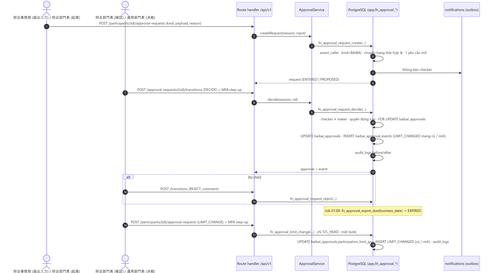
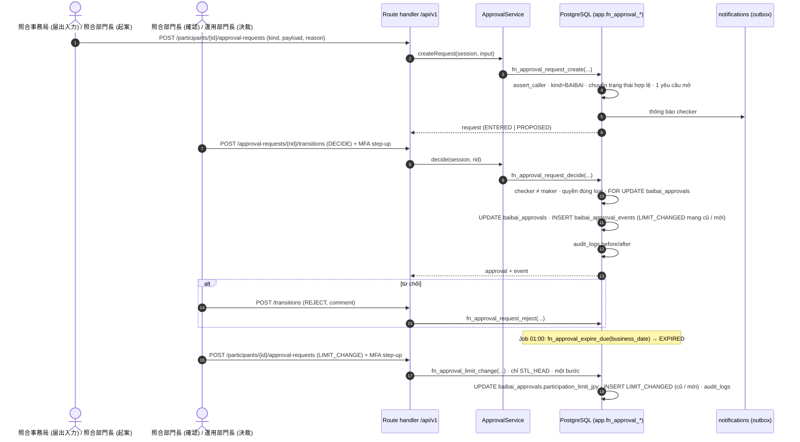

# PTY_APPROVAL_LIFECYCLE — Vòng đời 承認 (売買参加者) và 参加上限

> Biểu mẫu: **BM-2-901-53 v01** — Detail Design (Chart + Description) · SUN ASTERISK VIETNAM CO., LTD · ISO/IEC 27001:2013 & ISO 9001:2015

---

## 1. History of change

| No | Version | Action | Mục / Bước | Nội dung thay đổi | Ngày | Người sửa | Approve |
|---|---|---|---|---|---|---|---|
| 1 | 0.1.0 | Add new | — | Khởi tạo | 2026-11-25 | phuongnnm-23344 | |
| 2 | 0.1.1 | Update | — | Gate 2 G2-M02: Điều kiện hoàn thành (LAB-5); G2-M03: RENEW khi 承認 đã 失効 → 409 E-PTY-013; khách Q-PTY-06: LIMIT_CHANGE một bước do 照合部門長 (§4.2b) | 2026-11-25 | phuongnnm-23344 |  |
| 3 | 0.1.2 | Update | §2 | FB-EXP-236: nhúng ảnh PNG `./assets/PTY_APPROVAL_LIFECYCLE_sequence.png` xuất từ khối Mermaid (`scripts/export-mermaid-png.py`); Mermaid vẫn là nguồn | 2026-11-25 | phuongnnm-23344 |  |

---

## 2. Sequence diagram

Nguồn: khối Mermaid dưới (bản để sửa); ảnh sinh từ chính khối đó bằng `python scripts/export-mermaid-png.py PTY_APPROVAL_LIFECYCLE` — sửa Mermaid thì chạy lại để hai bản không lệch.

---

## 3. Description

承認 là căn cứ khác 許可: **thủ tục nhẹ** — 届出 (nộp thông báo) → 照合事務局 nhập → 照合部門長 確認 (MFA) kèm xét nhẹ 保証金 / 資力; không có bước 審査 riêng, không có `REVIEWED` (CHECK ở PARTY_DB 4.15). Có trường riêng **参加上限** (hạn mức tham gia): vượt hạn mức trong kỳ chỉ cảnh báo + bắt lý do ở màn GD, **không chặn cứng** (PRM-046, L4-A04 (1)). Hàm, bảng, endpoint **tách hẳn** khỏi 許可 ([PTY_PERMIT_LIFECYCLE](PTY_PERMIT_LIFECYCLE_TECH.md)) — đổi một bên không kéo bên kia (ADR-003).

| Loại | Trạng thái trước → sau | Maker | Checker (MFA) | Event | Nguồn |
|---|---|---|---|---|---|
| `NEW` cấp mới | (chưa có) → 有効 | SETTLE nhập 届出 → `ENTERED` | **STL-HEAD 確認** | `REGISTERED` | PARTY_DB 4.15; OPEN-DB-09 (xét nhẹ, một người) |
| `RENEW` gia hạn | 有効 / 一時停止 → giữ nguyên, `valid_to` mới | SETTLE | **STL-HEAD 確認** | `RENEWED` | PRM-121 |
| `LIMIT_CHANGE` đổi 参加上限 | giữ nguyên | **STL-HEAD thực hiện trực tiếp, một bước** (không maker riêng) | — (không checker; MFA step-up + audit) | `LIMIT_CHANGED` (`old_limit_jpy`, `new_limit_jpy`) | PRM-046, Gate 1 M-07, **Q-PTY-06 [Customer giả lập, 2026-11-25]** |
| `SUSPEND` / `RESUME` / `REVIEW_START` / `REINSTATE` | như 許可 (FIG-010) | STL-HEAD 起案 → `PROPOSED` | **OPS-HEAD 決裁** | `SUSPENDED` / `RESUMED` / `REVIEW_STARTED` / `REINSTATED` | PRM-121 |
| (job) 失効 | 有効 / 一時停止 → 失効 | hệ thống | — | `EXPIRED` | giả định [PL] |

**参加上限 hiệu lực** (đọc ở SC-01-02 [16], SC-04-01, SC-05-02):
`limit = baibai_approvals.participation_limit_jpy` nếu khác NULL (`INDIVIDUAL`), ngược lại = 保証金 hiện hành `v_participant_current_deposit` tại ngày xét (`DEPOSIT`). **今期使用額** = Σ 買受代金 hiệu lực (相対 + せり, gồm điều chỉnh có `period_id` = kỳ đang xét) theo `trade_date` trong kỳ — view `v_buyer_period_usage`; **残** = `limit − 使用額` (có thể âm, hiện đỏ).

Bảng yêu cầu chờ: `baibai_approval_requests` — PARTY_DB §4.60 (bảng riêng, cùng tên cột với `nakaoroshi_permit_requests`; **không** nhận `LIMIT_CHANGE` — đổi 参加上限 không qua yêu cầu chờ; không có `PROPOSED` cho `NEW`).

**Vì sao `LIMIT_CHANGE` một bước (Q-PTY-06):** khách muốn **chỉ 照合部門長** đổi 保証金 / 参加上限, không để 照合事務局 tự đổi, và không thêm người kiểm hay luồng duyệt. Giữ maker-checker (SETTLE nhập → STL-HEAD 確認) thì trái ý thứ nhất; thêm checker thứ hai thì trái ý thứ hai. Bù lại: MFA step-up (Q-PTY-07 khách đồng ý — thông số tiền), `audit_logs` before / after, lịch sử `LIMIT_CHANGED` hiện ở SC-01-02 [22]. Cùng quy tắc cho đổi 保証金 (API-PTY-003).

---

## 4. Detail function

### 4.1. Xác thực, quyền, MFA

| Trường | Giá trị |
|---|---|
| Input | Cookie `sid`; body JSON (zod); `participantId` / `requestId` |
| Output | `SessionContext` → 4.2–4.4 |

**Error**

| Điều kiện lỗi | Xử lý | Status code |
|---|---|---|
| Không có phiên | Dừng; `E-CMN-001` | 401 |
| Vai không đúng bảng §3 (SETTLE tạo `NEW` / `RENEW`; STL-HEAD tạo loại 起案 và `LIMIT_CHANGE`; checker đúng quyền) | Dừng; `E-CMN-002` | 403 |
| `DECIDE` hoặc `LIMIT_CHANGE` thiếu step-up MFA | Dừng; `E-CMN-005` | 403 |
| Body sai kiểu | Dừng; `E-CMN-007` | 422 |

**Detail**

| No | Nội dung xử lý |
|---|---|
| 1 | Như SPEC-PTY_PERMIT_LIFECYCLE-001 §4.1 (phiên, vai, quyền duyệt, 代行, MFA, `set_config`) |

### 4.2. Tạo yêu cầu (`fn_approval_request_create`)

| Trường | Giá trị |
|---|---|
| Input | `participantId`, `kind`, `payload` (`approvalNo`, `validFrom`, `validTo`, `limitMode` `DEPOSIT` \| `INDIVIDUAL`, `participationLimitJpy?`, `screeningNote` cho `NEW`; `newValidTo` cho `RENEW`), `reason` — `LIMIT_CHANGE` đi §4.2b |
| Output | Yêu cầu `ENTERED` / `PROPOSED` → response `API-PTY-006` |

**Error**

| Điều kiện lỗi | Xử lý | Status code |
|---|---|---|
| Người tham gia không tồn tại | Dừng; `E-PTY-018` | 404 |
| `kind ≠ BAIBAI` | Dừng; `E-PTY-009` 「この種別では承認を登録できません」 | 409 |
| `WITHDRAWN` | Dừng; `E-PTY-010` | 409 |
| Chuyển trạng thái sai / `NEW` khi đã có 承認 chưa 失効 | Dừng; `E-PTY-013` | 409 |
| Có yêu cầu mở | Dừng; `E-PTY-011` | 409 |
| `approvalNo` trùng | Dừng; `E-PTY-019` | 409 |
| `validTo < validFrom` | Dừng; `E-PTY-020` | 422 |
| `RENEW` khi 承認 đã 失効 — không có ân hạn (Q-PTY-04) | Dừng; `E-PTY-013`, `detail` = `{ currentStatus: "EXPIRED", kind: "RENEW", nextAction: "REVIEW_START" }` | 409 |
| `RENEW`: `newValidTo ≤ valid_to` | Dừng; `E-PTY-014`, `field` = `payload.newValidTo`, `detail.currentValidTo` | 422 |
| `INDIVIDUAL` mà `participationLimitJpy` ≤ 0 / thiếu; hoặc hạn mức mới = hạn mức hiện tại | Dừng; `E-PTY-016` | 422 |
| `reason` rỗng | Dừng; `E-PTY-007` | 422 |

**Detail**

| No | Nội dung xử lý |
|---|---|
| 1 | `assert_caller`; `SELECT … FOR UPDATE` `participants`, `baibai_approvals` hiện hành |
| 2 | Kiểm như bảng Error |
| 3 | INSERT `baibai_approval_requests` (`ENTERED` cho maker SETTLE, `PROPOSED` cho STL-HEAD 起案) |
| 4 | `notifications` → STL-HEAD (`ENTERED`) / OPS-HEAD (`PROPOSED`); `audit_logs` |

### 4.2b. Đổi 参加上限 một bước (`fn_approval_limit_change`)

| Trường | Giá trị |
|---|---|
| Input | `participantId`, `payload` (`limitMode` `DEPOSIT` \| `INDIVIDUAL`, `participationLimitJpy?`, `effectiveOn`), `reason`, `app.mfa_verified_at` |
| Output | `baibai_approvals` cập nhật + một dòng `LIMIT_CHANGED` → response `API-PTY-006` dòng 1b |

**Error**

| Điều kiện lỗi | Xử lý | Status code |
|---|---|---|
| Người gọi không phải STL-HEAD (hoặc 代行) | Dừng; `E-CMN-002` | 403 |
| Step-up MFA hết hiệu lực | Dừng; `E-CMN-005` | 403 |
| Người tham gia không tồn tại / không phải 売買参加者 / 退会 | Dừng; `E-PTY-018` / `E-PTY-009` / `E-PTY-010` | 404 / 409 / 409 |
| 承認 không có hoặc `EXPIRED` | Dừng; `E-PTY-013` | 409 |
| `INDIVIDUAL` mà `participationLimitJpy` ≤ 0 / thiếu; hoặc hạn mức mới = hạn mức hiện tại | Dừng; `E-PTY-016` | 422 |
| `effectiveOn` < 業務日 hiện tại | Dừng; `E-PTY-006` | 422 |
| `reason` rỗng | Dừng; `E-PTY-007` | 422 |

**Detail**

| No | Nội dung xử lý |
|---|---|
| 1 | `assert_caller(['STL_HEAD'])`; `SELECT … FOR UPDATE` `participants`, `baibai_approvals` hiện hành |
| 2 | `v_old := participation_limit_jpy` (NULL = theo 保証金) |
| 3 | UPDATE `participation_limit_jpy` (NULL khi về `DEPOSIT`) **và** INSERT `LIMIT_CHANGED` (`old_limit_jpy`, `new_limit_jpy`, `effective_on`, `reason`, `decided_by` = `created_by` = người gọi, `mfa_verified_at`) **trong cùng transaction** — không có đường UPDATE cột hạn mức nào khác (PARTY_DB 4.14 cột 6). Hạn mức mới áp từ **kỳ chứa** `effective_on` |
| 4 | `audit_logs` before / after (代行 ghi "thay cho …"); không tạo `notifications` cho checker (không có checker) |

### 4.3. 確認 / 決裁 (`fn_approval_request_decide`)

| Trường | Giá trị |
|---|---|
| Input | `requestId`, `comment?`, `app.mfa_verified_at` |
| Output | `baibai_approvals` mới / cập nhật + một dòng `baibai_approval_events` → response `API-PTY-007` |

**Error**

| Điều kiện lỗi | Xử lý | Status code |
|---|---|---|
| Yêu cầu không chờ quyết | Dừng; `E-PTY-017` | 409 |
| Quyền không khớp (`NEW` / `RENEW` cần `STL_HEAD`; loại 起案 cần `OPS_HEAD`) | Dừng; `E-CMN-002` | 403 |
| Người gọi = maker (`entered_by` / `proposed_by`) | Dừng; `E-PTY-012` | 403 |
| Trạng thái 承認 đã đổi từ lúc tạo | Dừng; `E-PTY-013` | 409 |
| Thiếu MFA | Dừng; `E-CMN-005` | 403 |

**Detail**

| No | Nội dung xử lý |
|---|---|
| 1 | `SELECT … FOR UPDATE` yêu cầu + `baibai_approvals`; kiểm lại chuyển trạng thái |
| 2 | `NEW`: INSERT `baibai_approvals` (`status = VALID`, `participation_limit_jpy` = NULL nếu `DEPOSIT`); INSERT `REGISTERED` (`decided_by` = STL-HEAD, MFA; `reason` ghi kết quả xét nhẹ 保証金 / 資力 từ `screeningNote`) |
| 3 | `RENEW`: UPDATE `valid_to`; INSERT `RENEWED` (`old_valid_to`, `new_valid_to`) |
| 5 | Loại 起案: UPDATE `status`; INSERT event tương ứng (`proposed_by`, `decided_by` = OPS-HEAD, MFA) |
| 6 | UPDATE yêu cầu `DECIDED`; `audit_logs` (代行 ghi "thay cho …"); `notifications` → maker |

### 4.4. 却下 (`fn_approval_request_reject`)

| Trường | Giá trị |
|---|---|
| Input | `requestId`, `comment` (bắt buộc) |
| Output | Yêu cầu `REJECTED`; 承認 không đổi |

**Error**

| Điều kiện lỗi | Xử lý | Status code |
|---|---|---|
| `comment` rỗng | Dừng; `E-PTY-023` | 422 |
| Yêu cầu đã đóng | Dừng; `E-PTY-017` | 409 |
| Không phải checker / là maker | Dừng; `E-CMN-002` / `E-PTY-012` | 403 |

**Detail**

| No | Nội dung xử lý |
|---|---|
| 1 | Như SPEC-PTY_PERMIT_LIFECYCLE-001 §4.5 |

### 4.5. Job 失効 tự động (`fn_approval_expire_due`)

| Trường | Giá trị |
|---|---|
| Input | `p_business_date` (gọi cùng lúc với `fn_permit_expire_due` từ hàm mở ngày) |
| Output | 承認 quá hạn → `EXPIRED` |

**Error**

| Điều kiện lỗi | Xử lý | Status code |
|---|---|---|
| Lỗi DB | Ghi log `ERROR`, rollback lô, alarm; không chặn mở ngày | — (batch) |

**Detail**

| No | Nội dung xử lý |
|---|---|
| 1 | Như SPEC-PTY_PERMIT_LIFECYCLE-001 §4.6 cho `baibai_approvals` / `baibai_approval_events` |

---

## 5. Other Notes

- **Đổi 保証金 kéo theo 参加上限** (`API-PTY-003`, không qua yêu cầu): hàm `fn_participant_deposit_change` INSERT `participant_deposit_history` (chỉ thêm, `uq_deposit_participant_from`), **không** sinh `LIMIT_CHANGED` — với `limitMode = DEPOSIT` hạn mức là giá trị suy ra từ 保証金 theo ngày, lịch sử nằm ở chính bảng 保証金; response trả `limitAfter` để màn báo (khách #20). Đổi 保証金: **chỉ STL-HEAD**, MFA step-up, audit, không checker (Q-PTY-06 [Customer giả lập, 2026-11-25]). Hỏi 経理部: 保証金 trong hệ thống có phải khớp sổ 経理 hằng kỳ không — khớp thì cần mục so sánh (báo giá riêng).
- **MFA cho `LIMIT_CHANGE`:** PARTY_DB 4.15 bắt `mfa_verified_at` khi có `decided_by`; khách đồng ý (Q-PTY-07 [Customer giả lập, 2026-11-25]). PREMISE §3.2 cần đổi chữ 「確認 đổi 参加上限」 thành 「đổi 保証金 / 参加上限 (照合部門長, một bước)」.
- **Không làm:** không chặn GD khi vượt 参加上限 (chỉ cảnh báo ở `trade`); không hồi tố hạn mức về trước `effective_on`.
- Bảng `baibai_approval_requests`: PARTY_DB 0.3.1 §4.60 (cột giống 4.59, bảng riêng).
- Câu hỏi treo: OPEN-DB-09 (cấp mới 承認 chỉ cần 照合部門長 確認 — xét nhẹ?); hỏi 経理部 về khớp sổ 保証金. Đã trả lời [Customer giả lập, 2026-11-25]: Q-PTY-01 (một yêu cầu mở / tư cách), Q-PTY-04 (không ân hạn → 再審査), Q-PTY-06, Q-PTY-07.
- **Điều kiện hoàn thành (LAB-5):** (a) 承認 và 許可 là hai hàm / hai bảng: lỗi tư cách ở `trade` ra `E-TRD-006` (chữ 「売買参加者の承認」) cho 承認, `E-TRD-005` cho 許可 — không có mã chung; (b) `NEW` → `ENTERED`, STL-HEAD khác người nhập `DECIDE` + MFA → `baibai_approvals` `VALID` + `REGISTERED`; người nhập tự `DECIDE` → 403 `E-PTY-012`; (c) `LIMIT_CHANGE` do STL-HEAD + MFA → đúng 1 dòng `LIMIT_CHANGED` có `old_limit_jpy` / `new_limit_jpy` / `effective_on`, `baibai_approvals.participation_limit_jpy` đổi cùng transaction, không có dòng `baibai_approval_requests`; SETTLE gọi → 403 `E-CMN-002`; thiếu step-up → 403 `E-CMN-005`; (d) GD chốt trong kỳ chứa `effective_on` dùng hạn mức mới, kỳ trước giữ hạn mức cũ; (e) đã có một yêu cầu `ENTERED` / `PROPOSED` → tạo yêu cầu thứ hai 409 `E-PTY-011` (Q-PTY-01); (f) `RENEW` khi 承認 đã 失効 → 409 `E-PTY-013` `detail.nextAction = "REVIEW_START"`; `newValidTo ≤ valid_to` khi còn hiệu lực → 422 `E-PTY-014`; (g) job mở ngày: 承認 `valid_to` < 業務日 → `EXPIRED` + event `EXPIRED` (`decided_by` NULL); chạy lại cùng ngày không sinh thêm dòng; yêu cầu mở giữ nguyên, người quyết gặp `E-PTY-013`; (h) đổi 保証金 khi `limitMode = DEPOSIT` không sinh `LIMIT_CHANGED` nhưng `limitAfter` = 保証金 mới; (i) `SUSPEND` có hiệu lực ngay lúc 決裁 (giờ phút ở event): GD chốt trước giữ, GD chốt sau → `E-TRD-006` (Q-PTY-05).
- Truy vết: luật 2, luật 4; FR-PARTY-01, BR-PERM-01, PRM-046, PRM-121, FIG-010, L4-A04 (1); ADR-003; PARTY_DB 4.11, 4.14, 4.15; Gate 1 M-07, N-03; khách #20, #21.
