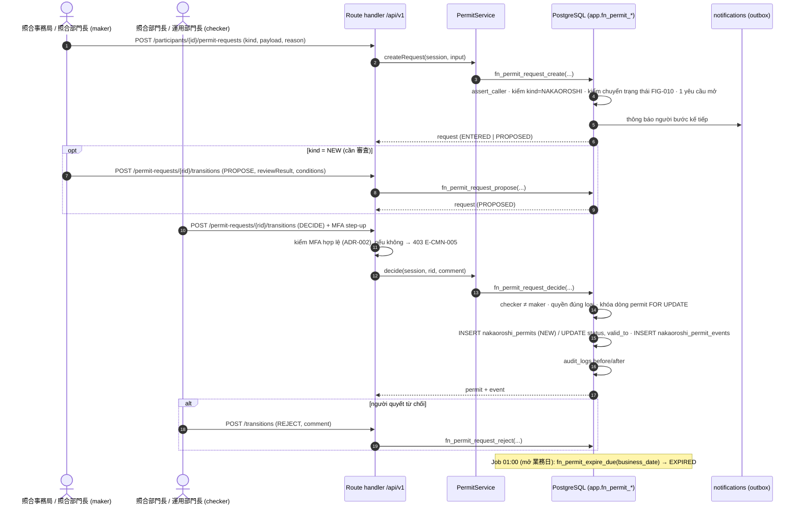

# PTY_PERMIT_LIFECYCLE — Vòng đời 許可 (仲卸)

> Biểu mẫu: **BM-2-901-53 v01** — Detail Design (Chart + Description) · SUN ASTERISK VIETNAM CO., LTD · ISO/IEC 27001:2013 & ISO 9001:2015

---

## 1. History of change

| No | Version | Action | Mục / Bước | Nội dung thay đổi | Ngày | Người sửa | Approve |
|---|---|---|---|---|---|---|---|
| 1 | 0.1.0 | Add new | — | Khởi tạo | 2026-11-25 | phuongnnm-23344 | |
| 2 | 0.1.1 | Update | — | Gate 2 G2-M02: Điều kiện hoàn thành (LAB-5); G2-M03: RENEW khi 許可 đã 失効 → 409 E-PTY-013 + `detail.nextAction`, E-PTY-014 chỉ 422, bỏ khóa lỗi cũ (thay bằng `detail` / `field`); đóng Q-PTY-01/04/05 | 2026-11-25 | phuongnnm-23344 |  |

---

## 2. Sequence diagram

Ảnh PNG: N/A — repo dùng Mermaid làm nguồn duy nhất cho sơ đồ (chưa có công cụ render được cấp quyền, xem Gate 1 m-08). Khi render được thì xuất `./assets/PTY_PERMIT_LIFECYCLE_sequence.png` từ đúng khối dưới.

---

## 3. Description

Mọi thay đổi tư cách 許可 của 仲卸 đi qua **một yêu cầu có maker và checker**; không có đường sửa thẳng `nakaoroshi_permits.status` / `valid_to` (PARTY_DB 4.12: chỉ đổi qua hàm sinh event trong cùng transaction). Thủ tục 許可 **khác** 承認 (luật 2, ADR-003) — xử lý 承認 ở [PTY_APPROVAL_LIFECYCLE](PTY_APPROVAL_LIFECYCLE_TECH.md), không dùng chung hàm, bảng, endpoint.

Loại yêu cầu (`request_kind`) và thủ tục:

| Loại | Trạng thái trước → sau (FIG-010) | Maker (tạo) | Bước giữa | Checker (MFA) | Event ghi | Nguồn |
|---|---|---|---|---|---|---|
| `NEW` cấp mới | (chưa có) → 有効 | SETTLE nhập hồ sơ → `ENTERED` | STL-HEAD ghi 審査 + 起案 → `PROPOSED` | **OPS-HEAD 決裁** | `REVIEWED` + `REGISTERED` | ADR-003 §2.2, giả định [PL] (OPEN-DB-09) |
| `RENEW` gia hạn bình thường | 有効 / 一時停止 → giữ nguyên, `valid_to` mới | SETTLE nhập 失効日 mới → `ENTERED` | — | **STL-HEAD 確認** | `RENEWED` | **PRM-121** (đã chốt LAB-1) |
| `SUSPEND` 一時停止 | 有効 → 一時停止 | STL-HEAD 起案 → `PROPOSED` | — | OPS-HEAD 決裁 | `SUSPENDED` | PRM-121 |
| `RESUME` 再開 | 一時停止 → 有効 | STL-HEAD 起案 | — | OPS-HEAD 決裁 | `RESUMED` | PRM-121 |
| `REVIEW_START` 再審査開始 | 有効 / 一時停止 / 失効 → 再審査中 | STL-HEAD 起案 | — | OPS-HEAD 決裁 | `REVIEW_STARTED` | PRM-121, FIG-010 |
| `REINSTATE` 再審査 → 有効 | 再審査中 → 有効 (kèm `valid_to`, 許可条件 mới) | STL-HEAD 起案 kèm kết quả 審査 | — | OPS-HEAD 決裁 | `REVIEWED` + `REINSTATED` | PRM-121 |
| (job) 失効 | 有効 / 一時停止 → 失効 khi `valid_to` < 業務日 | hệ thống | — | — | `EXPIRED` | giả định [PL] |

Chạy xong: `nakaoroshi_permits` mang trạng thái / hạn mới, `nakaoroshi_permit_events` có dòng mới (chỉ thêm), yêu cầu ở trạng thái `DECIDED` hoặc `REJECTED`, `audit_logs` có before / after. Module `trade` đọc tư cách qua `v_qualification_current` khi 確定 (BR-PERM-01) — không thuộc function này.

**Bảng yêu cầu chờ:** `nakaoroshi_permit_requests` (riêng cho 許可; 承認 có bảng riêng `baibai_approval_requests` — không bảng chung, ADR-003) lưu yêu cầu đang chờ (起案中 / 確認待ち — wireframe [19] C-27) — PARTY_DB 0.3.1 §4.59.

---

## 4. Detail function

### 4.1. Xác thực, quyền, MFA

| Trường | Giá trị |
|---|---|
| Input | Cookie phiên `sid` + body JSON (zod); `participantId` / `requestId` (path) |
| Output | `SessionContext` (`userId`, `deviceId`, `roles[]`, `authorities[]`, `delegationId?`, `mfaVerifiedAt?`) → bước 4.2–4.5 |

**Error**

| Điều kiện lỗi | Xử lý | Status code |
|---|---|---|
| Không có phiên / phiên hết hạn | Dừng; `E-CMN-001` | 401 |
| Vai không được làm thao tác (bảng §3: SETTLE tạo `NEW` / `RENEW`; STL-HEAD tạo `SUSPEND` / `RESUME` / `REVIEW_START` / `REINSTATE` và `PROPOSE`; checker đúng quyền) | Dừng; `E-CMN-002` | 403 |
| Thao tác `DECIDE` mà MFA step-up không còn hiệu lực (10 phút, idle 3 phút — ADR-002 §2.2) | Dừng; `E-CMN-005`; client mở C-30 rồi gửi lại | 403 |
| Body sai kiểu / thiếu trường | Dừng; `E-CMN-007` + `field` = khóa lỗi (vd `payload.validTo`) | 422 |

**Detail**

| No | Nội dung xử lý |
|---|---|
| 1 | Đọc phiên server-side, nạp vai (`staff_roles`), quyền duyệt (`staff_authorities`) và 代行 đang hiệu lực (`delegations`, ngày hiện tại) |
| 2 | Với `DECIDE`: kiểm `staff_sessions.mfa_verified_at` ≥ now − 10 phút và lần thao tác cuối ≤ 3 phút; ghi `app.mfa_verified_at` |
| 3 | Mở transaction, `set_config('app.user_id' / 'app.device_id' / 'app.mfa_verified_at', …, true)` (ADR-002 §2.1-4) |
| 4 | Validate body theo schema của từng `kind` / `action` (mục 4.2, 4.3); lỗi kiểu → 422 trước khi gọi DB |

### 4.2. Tạo yêu cầu (`fn_permit_request_create`)

| Trường | Giá trị |
|---|---|
| Input | `participantId`, `kind`, `payload` (`permitNo`, `validFrom`, `validTo`, `permitConditions` cho `NEW`; `newValidTo` cho `RENEW`; `newValidTo?`, `permitConditions?`, `reviewResult`, `reviewedOn` cho `REINSTATE`), `reason` (1–500) |
| Output | Dòng `nakaoroshi_permit_requests` (`ENTERED` với `NEW` / `RENEW`; `PROPOSED` với loại do STL-HEAD 起案) → response `API-PTY-004` |

**Error**

| Điều kiện lỗi | Xử lý | Status code |
|---|---|---|
| Không tìm thấy người tham gia | Dừng; `E-PTY-018` | 404 |
| `participants.kind ≠ NAKAOROSHI` | Dừng; `E-PTY-009` 「この種別では許可を登録できません」 | 409 |
| `participants.status = WITHDRAWN` | Dừng; `E-PTY-010` | 409 |
| `NEW` khi đã có 許可 chưa 失効 | Dừng; `E-PTY-013` | 409 |
| Chuyển trạng thái không hợp lệ theo bảng §3 (vd. `RESUME` khi 有効) | Dừng; `E-PTY-013` 「この状態からは指定の操作はできません」 | 409 |
| Đã có yêu cầu mở (`ENTERED` / `PROPOSED`) cho cùng 許可 / cùng người tham gia (`NEW`) | Dừng; `E-PTY-011` | 409 |
| `permitNo` trùng | Dừng; `E-PTY-019` | 409 |
| `validTo < validFrom` | Dừng; `E-PTY-020` | 422 |
| `RENEW` khi 許可 đã 失効 (`valid_to` < 業務日 hoặc trạng thái `EXPIRED`) — không có ân hạn (Q-PTY-04) | Dừng; `E-PTY-013`, `detail` = `{ currentStatus: "EXPIRED", kind: "RENEW", nextAction: "REVIEW_START" }` → client hướng sang 再審査 | 409 |
| `RENEW`: `newValidTo ≤ valid_to` hiện tại | Dừng; `E-PTY-014`, `field` = `payload.newValidTo`, `detail.currentValidTo` | 422 |
| `reason` rỗng | Dừng; `E-PTY-007` | 422 |

**Detail**

| No | Nội dung xử lý |
|---|---|
| 1 | `assert_caller` theo bảng §3 (vai maker đúng loại) |
| 2 | `SELECT … FOR UPDATE` dòng `participants` (và `nakaoroshi_permits` hiện hành nếu có) để chặn hai yêu cầu song song |
| 3 | Kiểm `kind = NAKAOROSHI`, `status = ACTIVE`, chuyển trạng thái hợp lệ, không có yêu cầu mở (unique partial `status IN ('ENTERED','PROPOSED')`) |
| 4 | INSERT `nakaoroshi_permit_requests` (`status` theo loại, `entered_by` hoặc `proposed_by` = người gọi, `payload`, `reason`) |
| 5 | Ghi `notifications`: `ENTERED` → STL-HEAD (và 代行) 「許可の{種類}が入力されました（確認／審査待ち）」; `PROPOSED` → OPS-HEAD 「許可の{種類}が起案されました（決裁待ち）」 |
| 6 | Ghi `audit_logs` (`action = PERMIT_REQUEST_CREATE`) |

### 4.3. 審査 + 起案 cho cấp mới (`fn_permit_request_propose`)

| Trường | Giá trị |
|---|---|
| Input | `requestId`, `reviewResult` (1–500), `reviewedOn` (date ≤ hôm nay), `permitConditions?` (≤ 500), `comment?` |
| Output | Yêu cầu `PROPOSED` → chờ 4.4 |

**Error**

| Điều kiện lỗi | Xử lý | Status code |
|---|---|---|
| Yêu cầu không phải `NEW` hoặc không ở `ENTERED` | Dừng; `E-PTY-017` | 409 |
| Người gọi không có quyền `STL_HEAD` (hoặc 代行) | Dừng; `E-CMN-002` | 403 |
| Người gọi = `entered_by` | Dừng; `E-PTY-012` 「入力者本人は起案できません」 | 403 |
| `reviewResult` rỗng | Dừng; `E-PTY-015` | 422 |

**Detail**

| No | Nội dung xử lý |
|---|---|
| 1 | `SELECT … FOR UPDATE` yêu cầu; kiểm trạng thái, quyền, người khác `entered_by` |
| 2 | Ghi `review_result`, `reviewed_on`, `permit_conditions` vào `payload`; `proposed_by` = người gọi, `status = PROPOSED` |
| 3 | `notifications` → OPS-HEAD; `audit_logs` |

### 4.4. 決裁 / 確認 (`fn_permit_request_decide`)

| Trường | Giá trị |
|---|---|
| Input | `requestId`, `comment?` (≤ 500), `app.mfa_verified_at` |
| Output | `nakaoroshi_permits` (mới / cập nhật) + 1–2 dòng `nakaoroshi_permit_events`; yêu cầu `DECIDED` → response `API-PTY-005` |

**Error**

| Điều kiện lỗi | Xử lý | Status code |
|---|---|---|
| Yêu cầu không ở trạng thái chờ người quyết (`NEW` phải `PROPOSED`; `RENEW` phải `ENTERED`; loại 起案 phải `PROPOSED`) | Dừng; `E-PTY-017` | 409 |
| Quyền không khớp loại: `RENEW` cần `STL_HEAD`; loại khác cần `OPS_HEAD` (hoặc 代行 tương ứng) | Dừng; `E-CMN-002` | 403 |
| Người gọi = `entered_by` hoặc `proposed_by` | Dừng; `E-PTY-012` 「申請者・起案者本人は決裁（確認）できません」 | 403 |
| Trạng thái 許可 đã đổi từ lúc tạo yêu cầu (vd. job 失効 chạy giữa chừng) | Dừng; `E-PTY-013`; yêu cầu giữ nguyên để người quyết 却下 | 409 |
| Thiếu MFA | Dừng; `E-CMN-005` | 403 |

**Detail**

| No | Nội dung xử lý |
|---|---|
| 1 | `SELECT … FOR UPDATE` yêu cầu và dòng `nakaoroshi_permits`; kiểm lại chuyển trạng thái với dữ liệu hiện tại |
| 2 | `NEW`: INSERT `nakaoroshi_permits` (`status = VALID`, `permit_conditions`) rồi INSERT event `REVIEWED` (`review_result`, `reviewed_on`, `proposed_by` = STL-HEAD, `decided_by` NULL) và `REGISTERED` (`from_status` NULL, `to_status = VALID`, `proposed_by`, `decided_by` = OPS-HEAD, `mfa_verified_at`) |
| 3 | `RENEW`: UPDATE `valid_to` (và `permit_conditions` nếu có ghi xem lại điều kiện); INSERT `RENEWED` (`old_valid_to`, `new_valid_to`, `created_by` = `entered_by`, `decided_by` = STL-HEAD, MFA); trạng thái không đổi |
| 4 | Loại 起案: UPDATE `status`; INSERT event tương ứng (`from_status`, `to_status`, `proposed_by`, `decided_by`, MFA). `REINSTATE`: INSERT `REVIEWED` trước rồi `REINSTATED`, cập nhật `valid_to` / 許可条件 nếu có |
| 5 | `effective_on` = 業務日 hiện tại (`business_date_for(now())`) — hiệu lực ngay (giả định [PL]) |
| 6 | UPDATE yêu cầu `status = DECIDED`, `decided_by`, `decided_at`, `delegation_id`, `mfa_verified_at` |
| 7 | `audit_logs` before / after (ghi "thay cho …" khi 代行); `notifications` → maker 「許可の{種類}が決裁されました」 |

### 4.5. 却下 (`fn_permit_request_reject`)

| Trường | Giá trị |
|---|---|
| Input | `requestId`, `comment` (1–500, bắt buộc) |
| Output | Yêu cầu `REJECTED`; 許可 không đổi |

**Error**

| Điều kiện lỗi | Xử lý | Status code |
|---|---|---|
| `comment` rỗng | Dừng; `E-PTY-023` 「却下理由を入力してください」 | 422 |
| Yêu cầu đã đóng | Dừng; `E-PTY-017` | 409 |
| Người gọi không phải checker của bước hiện tại (STL-HEAD với `ENTERED`; OPS-HEAD với `PROPOSED`) hoặc là maker | Dừng; `E-CMN-002` / `E-PTY-012` | 403 |

**Detail**

| No | Nội dung xử lý |
|---|---|
| 1 | Kiểm như 4.4 bước 1 (không cần MFA — từ chối không đổi tư cách; giả định [PL], PREMISE §3.2 chỉ liệt kê đổi tư cách) |
| 2 | UPDATE `status = REJECTED`, `decided_by`, `decision_comment`; không ghi `nakaoroshi_permit_events` |
| 3 | `audit_logs`; `notifications` → maker kèm lý do |

### 4.6. Job 失効 tự động (`fn_permit_expire_due`)

| Trường | Giá trị |
|---|---|
| Input | `p_business_date` — 業務日 vừa mở (gọi từ hàm mở ngày: 日次締め hoặc job 01:00, ADR-005 §2.4) |
| Output | Số 許可 chuyển 失効; event `EXPIRED` |

**Error**

| Điều kiện lỗi | Xử lý | Status code |
|---|---|---|
| Lỗi DB khi xử lý một dòng | Ghi log `ERROR` (log-convention), rollback cả lô, alarm CloudWatch; job mở ngày **vẫn chạy tiếp** (失効 trễ một lượt không chặn mở ngày); lần mở ngày sau xử lý lại | — (batch) |

**Detail**

| No | Nội dung xử lý |
|---|---|
| 1 | Chọn `nakaoroshi_permits` có `status IN ('VALID','SUSPENDED')` và `valid_to < p_business_date` (idempotent: dòng đã 失効 không chọn lại) |
| 2 | Với mỗi dòng: UPDATE `status = EXPIRED`; INSERT event `EXPIRED` (`created_by` NULL, `decided_by` NULL, `reason = '失効日経過'`) |
| 3 | Yêu cầu mở của dòng đó (`ENTERED` / `PROPOSED` loại `RENEW` / `SUSPEND` / `RESUME`) giữ nguyên — người quyết sẽ gặp `E-PTY-013` và 却下; ghi `notifications` cho SETTLE |
| 4 | Ghi một dòng `audit_logs` tổng (`action = PERMIT_EXPIRE_BATCH`, số dòng) |

---

## 5. Other Notes

- **Bảng `nakaoroshi_permit_requests`**: định nghĩa ở PARTY_DB 0.3.1 §4.59 (cột `id`, `participant_id`, `permit_id` NULL khi `NEW`, `request_kind`, `status` `ENTERED` / `PROPOSED` / `DECIDED` / `REJECTED`, `payload`, `reason`, `entered_by`, `proposed_by`, `decided_by`, `decided_at`, `delegation_id`, `mfa_verified_at`, `decision_comment`; unique partial một yêu cầu mở / người). Chỉ UPDATE cột trạng thái quyết một lần; không DELETE.
- **Không làm:** không sửa thẳng `status` / `valid_to`; không có thu hồi (取消) 許可 — enum chưa có, chờ OPEN-DB-09 (ai 決裁, 弁明の機会); không kiểm tư cách khi 確定 GD (module `trade`, BR-PERM-01).
- **Ngôn ngữ UI:** duyệt nội bộ dùng 「決裁」「確認」「起案」; **không** dùng 「承認」 (L4-D03, luật 2).
- **Đồng thời:** khóa dòng `participants` + `nakaoroshi_permits` theo thứ tự cố định (participant → permit → request) để tránh deadlock với job 失効.
- **Thông báo:** qua outbox `notifications`, gửi lại ≤ 3 lần; lỗi gửi không rollback nghiệp vụ.
- **Câu hỏi treo:** OPEN-DB-09 (cấp mới 許可 có cần 運用部門長 決裁 không — giả định có).
- **Đã trả lời [Customer giả lập, 2026-11-25]:** Q-PTY-01 (đúng — một yêu cầu mở / tư cách; có 一時停止 thì xử lý trước, yêu cầu 更新 rút lại rồi lập sau), Q-PTY-04 (không ân hạn; 失効 → 再審査: 照合部門長 起案, 運用部門長 決裁; gia hạn bình thường làm **trước** 失効日), Q-PTY-05 (hiệu lực ngay lúc 決裁, áp cho GD chốt **sau** thời điểm đó; lưu giờ phút 決裁 — `nakaoroshi_permit_events.created_at` / yêu cầu `decided_at`; chưa cần chọn ngày tương lai).
- Truy vết: luật 2, luật 4; FR-PARTY-01, BR-PERM-01, PRM-045, PRM-121, FIG-010, NFR-SEC-01; ADR-002, ADR-003; PARTY_DB 4.12, 4.13; Gate 1 N-03, D-01.
- **Điều kiện hoàn thành (LAB-5):** (a) 許可 và 承認 hai mã khác nhau: 仲卸 có 許可 `SUSPENDED` chốt GD → `E-TRD-005` (chữ 「仲卸の許可」), không bao giờ `E-TRD-006`; hàm, bảng yêu cầu (`nakaoroshi_permit_requests`), endpoint tách khỏi 承認; (b) `NEW`: SETTLE nhập → `ENTERED`; STL-HEAD ghi 審査 + 起案 → `PROPOSED`; OPS-HEAD `DECIDE` + MFA → 許可 `VALID` + hai event `REVIEWED` + `REGISTERED` cùng transaction; (c) maker tự 起案 / 決裁 → 403 `E-PTY-012`, CHECK DB chặn khi gọi thẳng hàm; (d) đã có yêu cầu `ENTERED` / `PROPOSED` → yêu cầu thứ hai 409 `E-PTY-011` (unique partial `uq_permit_requests_open`); (e) `RENEW` khi 許可 đã 失効 → 409 `E-PTY-013` với `detail.nextAction = "REVIEW_START"`; `RENEW` với `newValidTo ≤ valid_to` khi còn hiệu lực → 422 `E-PTY-014` `field = payload.newValidTo`; (f) `SUSPEND` 決裁 lúc 10:05 → GD chốt 10:04 giữ nguyên, GD chốt 10:06 → `E-TRD-005` (Q-PTY-05); (g) job mở 業務日: 許可 `valid_to` < 業務日 → `EXPIRED` + event `EXPIRED` (`decided_by` NULL) + một dòng `audit_logs` tổng; chạy lại cùng ngày không sinh thêm; lỗi DB không chặn mở ngày (alarm); (h) `DECIDE` thiếu step-up MFA → 403 `E-CMN-005`; (i) không có API nào UPDATE thẳng `status` / `valid_to` của `nakaoroshi_permits`.
