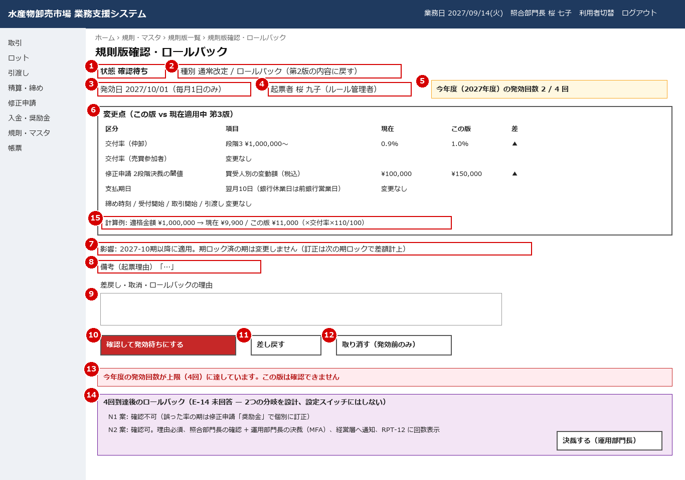

# SC-10-04 — 規則版確認・ロールバック

> Biểu mẫu: **BM-2-901-51 v2.1** — Screen Specification · SUN ASTERISK VIETNAM CO., LTD · ISO/IEC 27001:2013 & ISO 9001:2015

---

## 1. History of change

| No | Version | Action | Nội dung thay đổi | Ngày | Người sửa | Approve |
|---|---|---|---|---|---|---|
| 1 | 0.1.0 | Add New | Khởi tạo từ wireframe SC-10-04 0.2.1 (LAB-4 P3); vẽ đủ nhánh N1 / N2 của E-14 | 2026-11-25 | phuongnnm-23344 | |
| 2 | 0.1.1 | Update | Gate 2 G2-M01: C-30 theo PREMISE §3.2 ★ — 確認 (`CHANGE` và `ROLLBACK`), 決裁 N2, 取消 bản `APPROVED` luôn hỏi lại mã; 差し戻す, 取消 `DRAFT` / `PENDING` dùng step-up | 2026-11-25 | phuongnnm-23344 | |

---

## 2. Layout

**Design:** [Wireframe SC-10-04 0.2.1](../../../wireframes/SC-10-04-rule-version-approve-rollback-wireframe.md) (to-be) · ảnh as-is prototype: [`SC-10-04_prototype.png`](../../../wireframes/assets/SC-10-04_prototype.png)

> - Ảnh đánh số **dựng từ wireframe to-be** (script `scripts/render-annotated-screens.py`): to-be khác prototype ở bộ đếm năm TC [5], so sánh cả tham số quy chế [6], ví dụ tính [15], banner [13] / [14], nút 決裁 của 運用部門長. Số trên ảnh = cột `ID` mục 4 = cột `No` của wireframe.
> - Ảnh vẽ đồng thời [13] và [14] để thấy vị trí; trên màn thật chỉ hiện banner đúng tình huống (mục 6.1). Nút 「決裁する（運用部門長）」 thuộc item [14] (luồng N2), không đánh số riêng.

---

## 3. Description

Màn **quyết định** của checker 照合部門長 (STL-HEAD) cho một version quy chế đã nộp: **確認** (xác nhận → 発効待ち), **差し戻す** (trả về maker), **取り消す** (hủy trước ngày hiệu lực). Version gồm 2 bảng 交付率 (仲卸 / 売買参加者) + tham số quy chế; có thể là 通常改定 hoặc **ロールバック** (chép nội dung version cũ). Màn hiện bộ đếm **今年度の発効回数 n / 4** (không tính bộ go-live, bản hủy, lịch chợ – ngân hàng), so sánh với version đang áp, ví dụ tiền thưởng, và hai nhánh của **E-14** (rollback khi đã đủ 4 lần — chưa chốt, OPEN-L4-01).

- Người dùng: STL-HEAD (checker, ≠ maker); OPS-HEAD (chỉ ở nhánh N2: 決裁 rollback khi đủ 4 lần); RULE ルール管理者 (maker: chỉ đọc, đề nghị hủy version 発効待ち).
- Vào từ: SC-10-01 規則版一覧 (bấm dòng version) hoặc thông báo 「確認待ち」 / 「決裁待ち」 (C-27). URL `/rule-versions/{versionId}/review`.
- Đi tới: SC-10-01 (sau thao tác / breadcrumb); SC-10-02 (maker sửa bản bị trả về); SC-11-13 RPT-12 (liên kết ở [5]).
- Chữ 「承認」 không dùng trên màn (luật 2, L4-D03): checker = 「確認」, 運用部門長 = 「決裁」. Thiết bị: PC.

---

## 4. View

**Đánh ID:** cột `ID` = số item của wireframe (1–15, không đánh lại); `C-xx` = item dùng chung. Dòng in đậm A–D là nhóm.

### 4.1 Danh sách item

| ID | Item Name | Item Type | Required | Note |
|---|---|---|---|---|
| **A** | **Thông tin version** | | | |
| 1 | 状態 | Label | - | 下書き / 確認待ち / 決裁待ち（運用部門長）/ 発効待ち / 適用中 / 置換済 / 取消 (map `DRAFT` / `PENDING` / `PENDING`+checker (N2) / `APPROVED` / `ACTIVE` / `SUPERSEDED` / `CANCELLED`) |
| 2 | 種別 | Label | - | 「通常改定」 hoặc 「ロールバック（第{n}版の内容に戻す）」 |
| 3 | 発効日 | Label | - | `YYYY/MM/DD` + 「（毎月1日のみ）」 |
| 4 | 起票者 | Label | - | Tên + 「（ルール管理者）」; người xem = maker → câu 「起票者本人は確認できません」 cạnh nút |
| 5 | 今年度の発効回数 | Label | - | 「{年度}年度（4月〜3月）の発効回数 {used} / 4 回」 — năm TC theo **発効日** của version này; dòng nhỏ 「※移行時の初期版・発効前に取り消した版・市場カレンダーは数えない」. used = 3 → nền vàng 「残り1回」; used ≥ 4 → nền đỏ. Liên kết 「RPT-12 へ」 |
| **B** | **Nội dung thay đổi** | | | |
| 6 | 変更点（この版 vs 現在適用中） | Label (bảng) | - | Cột: 区分 · 項目 · 現在 · この版 · 差 (▲ tăng / ▼ giảm / 変更あり). Gồm 2 bảng 交付率 (5 bậc mỗi bảng: cận dưới 以上 · tỷ lệ %) và **mọi tham số quy chế** (ngưỡng 2 cấp 修正申請, 支払期日, giờ nhận lô / bắt đầu GD, 日次締め期限, quy tắc giao, làm tròn thuế, 持ち越し, 下見前販売). Dòng không đổi gom thành 「変更なし」 |
| 15 | 計算例 | Label | - | 「適格金額 ¥{E} → 現在 ¥{I_cur} / この版 ¥{I_new}（×交付率×110/100）」 cho 4 mức 500.000 / 1.000.000 / 3.000.000 / 10.000.000, mỗi loại 仲卸 / 売買参加者 |
| 7 | 影響 | Label | - | 「{YYYY-MM}期以降に適用。期ロック済の期は変更しません（訂正は次の期ロックで差額計上）」 |
| 8 | 備考（起票理由） | Label | - | Lý do maker (`note`) |
| **C** | **Thao tác** | | | |
| 9 | 理由 | Text box (nhiều dòng) | Có (khi trả về / hủy / 確認 rollback / 決裁 N2 / đề nghị hủy) | Placeholder 「差戻し・取消・ロールバックの理由を入力」 |
| 10 | 確認して発効待ちにする | Button | - | Nút chính. ROLLBACK: nhãn 「ロールバックを確認する」 |
| 11 | 差し戻す | Button | - | |
| 12 | 取り消す（発効前のみ） | Button | - | Với vai RULE khi version `APPROVED`: nhãn 「取消を依頼する」 |
| **D** | **Banner chặn / E-14** | | | |
| 13 | 上限到達 | Label (banner đỏ) | - | 「今年度の発効回数が上限（4回）に達しています。この版は確認できません」 — `CHANGE` khi used ≥ 4 (cả N1, N2) |
| 14 | 4回到達後のロールバック | Label (banner) + Button | - | Chỉ khi `ROLLBACK` và used ≥ 4. **N1:** 「4回到達後のロールバックは確認できません。誤った率で計算された期は修正申請『奨励金』で個別に訂正してください」 + liên kết SC-08-01. **N2:** 「理由必須。照合部門長の確認後、運用部門長の決裁（MFA）が必要です。経営層へ自動通知し、RPT-12 に回数として表示します」; ở trạng thái 決裁待ち hiện nút 「決裁する（運用部門長）」 cho OPS-HEAD |
| C-27 | Nhãn chờ | Label | - | 「確認待ち」 / 「決裁待ち（運用部門長）」 cạnh [1] |
| C-31 | Xác nhận | Dialog | - | 確認: 「発効日 {date} から適用されます。今年度 {used+1} / 4 回目になります。」; ROLLBACK thêm 「第{n}版の内容に戻します」; 取消: 「取り消した版は回数に数えません」 |
| C-30 | MFA | Dialog + Text box | Có | **Luôn hỏi lại mã** (PREMISE §3.2 ★, token một lần): 確認 `CHANGE` (`RULE_CHANGE_CONFIRM`), 確認 `ROLLBACK` (`RULE_ROLLBACK_CONFIRM`), 決裁 N2 (`RULE_SECOND_APPROVAL`), 取消 bản `APPROVED` (`RULE_CANCEL_DECIDE`). Dùng step-up 10 phút nếu còn: 差し戻す, 取消 bản `DRAFT` / `PENDING` |
| C-10 | Nút góc phải | Button | - | 「規則版一覧へ」 → SC-10-01 |

### 4.2 Validation

| ID | Type | Min | Max | Default | Ghi chú |
|---|---|---|---|---|---|
| 9 | String (UTF-8, cho phép xuống dòng) | 1 | 500 | (trống) | Bắt buộc với [11], [12], [10] khi `ROLLBACK`, nút 決裁 [14], 「取消を依頼する」; tùy chọn với [10] khi `CHANGE`. Trim hai đầu; sai → `E-RULE-007` 「理由を入力してください（500文字以内）。」 ngay dưới ô (C-22) |
| C-30 | String số | 6 | 6 | (trống) | Kiểm ở API xác thực MFA của iam (chưa đặc tả) |

Điều kiện nghiệp vụ (quota, 発効日, trạng thái, maker ≠ checker) **không** phải validation nhập liệu — server kiểm, màn ẩn / mờ nút theo `permissions` (mục 6.2).

### 4.3 Data Mapping

| ID | Data Source | API ID | API URL | Key / Param | Ghi chú |
|---|---|---|---|---|---|
| 1–8, 13, 14, 15, C-27 | API | `API-RULE-001` | `GET /api/v1/rule-versions/{versionId}/review` | `version`, `quota`, `diff[]`, `examples[]`, `impact`, `policy`, `permissions` | `policy.branch` = `N1` / `N2` (nhánh đang cài) |
| 9, 10 | API | `API-RULE-002` | `POST /api/v1/rule-versions/{versionId}/confirm` | `reason`, header `X-MFA-Token` | |
| 9, 14 (決裁) | API | `API-RULE-003` | `POST /api/v1/rule-versions/{versionId}/second-approval` | `reason`, header `X-MFA-Token` | Chỉ N2 |
| 9, 11 | API | `API-RULE-004` | `POST /api/v1/rule-versions/{versionId}/return` | `reason` | |
| 9, 12 (STL-HEAD / maker) | API | `API-RULE-005` | `POST /api/v1/rule-versions/{versionId}/cancel` | `reason`, header `X-MFA-Token` | |
| 9, 12 (RULE, `APPROVED`) | API | `API-RULE-006` | `POST /api/v1/rule-versions/{versionId}/cancel-request` | `reason` | |

### 4.4 Phân quyền hiển thị theo vai (bổ sung theo yêu cầu LAB-4)

Ký hiệu: **T** thao tác · **R** chỉ đọc · **H** ẩn · `—` không vào được (C-25). Một người nhiều vai (OPEN-DB-10): quyền là hợp các cột, **trừ** S4 — người là maker của version này không có [10], [11], nút 決裁 [14].

| ID | STL-HEAD (checker, ≠ maker) | OPS-HEAD | RULE (maker / ルール管理者) | SETTLE, vai khác |
|---|---|---|---|---|
| 1–8, 13, 15, C-27 | R | R | R | — |
| 9 | T | T (chỉ khi 決裁待ち) | T (khi đề nghị hủy / hủy bản `DRAFT`, `PENDING` của mình) | — |
| 10 確認 | T (version `PENDING` chưa có checker) | H | H | — |
| 11 差し戻す | T (`PENDING`) | H | H | — |
| 12 取り消す | T (`DRAFT` / `PENDING`; `APPROVED` khi có đề nghị hủy) | H | T: 「取り消す」 bản `DRAFT` / `PENDING` của mình; 「取消を依頼する」 bản `APPROVED` | — |
| 14 (banner) | R | R | R | — |
| 14 (nút 決裁, N2) | H | T (≠ maker, ≠ checker) | H | — |
| C-10 | T | T | T | — |

---

## 5. Event

| ID | Given (Pre-condition) | When (Trigger/Action) | Then (Result) | Note |
|---|---|---|---|---|
| **Initializing Process（初期処理）** | | | | |
| - | `versionId` hợp lệ, vai được phép | Mở màn | 1. Gọi `API-RULE-001` (C-20 khi > 300 ms) 2. Hiện [1]–[8], [15] 3. Hiện [13] nếu `policy.blockedReason = QUOTA`; [14] nếu `ROLLBACK` và `quota.used ≥ 4` 4. Ẩn / hiện nút theo `permissions` (4.4) | |
| - | Người xem là maker | Mở màn | [10], [11] ẩn; câu 「起票者本人は確認できません」 | S4 |
| **Standard Process（通常処理）** | | | | |
| 10 | `PENDING`, used < 4 (hoặc `ROLLBACK` ở N2) | Bấm 確認 | Kiểm [9] nếu `ROLLBACK` → C-31 → C-30 (luôn hỏi mã, cả `CHANGE`) → `API-RULE-002`. 200: toast C-12 「第{n}版を確認しました（発効日 {date}・今年度 {used}/4 回）」 hoặc (N2) 「運用部門長の決裁待ちにしました」; tải lại màn | |
| 14 | N2, 決裁待ち, vai OPS-HEAD | Bấm 「決裁する（運用部門長）」 | Kiểm [9] → C-31 (「4回到達後のロールバックです。経営層へ通知されます」) → C-30 (luôn hỏi mã) → `API-RULE-003`; 200: toast 「決裁しました（今年度 {used}/4 回超）」 | |
| 11 | `PENDING` | Bấm 差し戻す | Kiểm [9] → C-31 → C-30 (step-up) → `API-RULE-004`; 200: toast 「差し戻しました」, chuyển SC-10-01 | Maker sửa ở SC-10-02 |
| 12 | `DRAFT` / `PENDING` (maker hoặc checker), hoặc `APPROVED` có đề nghị (checker) | Bấm 取り消す | Kiểm [9] → C-31 → C-30 (`APPROVED`: luôn hỏi mã; `DRAFT` / `PENDING`: step-up) → `API-RULE-005`; 200: toast 「取り消しました（回数に数えません）」 | |
| 12 | `APPROVED`, vai RULE | Bấm 取消を依頼する | Kiểm [9] → C-31 → `API-RULE-006`; 200: toast 「取消を依頼しました（照合部門長の決裁待ち）」; C-27 hiện 「取消依頼中」 | |
| 5 | — | Bấm 「RPT-12 へ」 | Chuyển SC-11-13 lọc năm TC | |
| 14 (N1) | — | Bấm liên kết 修正申請 | Chuyển SC-08-01 với loại `INCENTIVE` | |
| **Error Handling（エラー制御）** | | | | |
| 10 | Gọi `API-RULE-002` | 409 `E-RULE-006` / `E-RULE-009` | Tải lại; hiện [13] / [14] tương ứng; C-23 | Người khác vừa duyệt version khác (RV-13) |
| 10, 14 | Gọi API | 409 `E-RULE-004` | C-23 + gợi ý 「取り消して発効日を見直してください」 | |
| 10, 14 | Gọi API | 409 `E-RULE-003` / `E-RULE-005` / `E-RULE-010` / `E-RULE-013` | C-23; tải lại trạng thái | |
| 10, 11, 12, 14 | Gọi API | 403 `E-RULE-002` / `E-RULE-011` | C-23 với thông điệp JP; ẩn nút | |
| 12 | Gọi API | 409 `E-RULE-008` / `E-RULE-012` / `E-RULE-014` | C-23 | |
| 9 | Gửi | 422 `E-RULE-007` | C-22 dưới [9] | |
| C-30 | Xác thực mã (API iam) / gọi API | Sai mã: lỗi của API xác thực MFA (iam, chưa đặc tả); token thiếu / hết hạn: 403 `E-CMN-005` | Giữ hộp C-30, chữ đỏ | |
| - | Bất kỳ | 404 `E-RULE-001` | Trang 「指定された規則版が見つかりません」 + liên kết SC-10-01 | |
| - | Bất kỳ | 403 / 5xx / mất mạng | C-25 / C-26 / C-28 (mọi hành động duyệt bị chặn khi offline) | |

---

## 6. Other Notes

### 6.1 Trạng thái màn

| Trạng thái | Hiển thị |
|---|---|
| Đang tải | C-20 |
| Rỗng | N/A — màn luôn mở một version cụ thể; version không tồn tại → 404 |
| `DRAFT` (下書き) | Chỉ đọc cho checker (chưa nộp); maker có [12] |
| `PENDING` (確認待ち) | [9]–[12] theo vai |
| 決裁待ち (N2) | C-27 「決裁待ち（運用部門長）」; STL-HEAD chỉ còn [11] (trả về → bắt đầu lại), [12]; OPS-HEAD có nút 決裁 |
| `APPROVED` (発効待ち) | Chỉ đọc + [12] (checker khi có đề nghị; maker 「取消を依頼する」) |
| `ACTIVE` / `SUPERSEDED` / `CANCELLED` | Chỉ đọc; [12] ẩn |
| 3 / 4 lần | [5] vàng 「残り1回」 |
| Đủ 4 lần | [13] (CHANGE) hoặc [14] (ROLLBACK); [10] ẩn ở N1 |
| Lỗi | C-22 / C-23 / C-26 |
| Mất mạng | C-28 |

### 6.2 Quy tắc / tiền đề

- Logic duyệt, quota, chính sách E-14, test vector RV-01..18: [RULE_VERSION_TECH](../technical-design/RULE_VERSION_TECH.md).
- Nhánh E-14 cài **một** trong hai (N1 mặc định tới khi có workshop — Q-RULE-01); màn đọc `policy.branch` từ API, **không** có công tắc cấu hình. Phương án F / G (ADR-006 §3) không có trên màn (L4-D06).
- 発効日 chỉ ngày 1, phải sau 業務日 hiện tại khi bấm 確認 (PRM-042).
- Version đã có hiệu lực không sửa / hủy được; tỷ lệ sai phát hiện sau 発効日 → 修正申請 INCENTIVE từng người × kỳ (R-L4-01).
- Ví dụ [6]: 1.000.000 ở **bậc 3** theo INCENTIVE_DB §5 — WF-SC-10-04 0.2.2 đã sửa (trước ghi nhầm 「段階2」).

### 6.3 Truy vết

FT-10-01; GOV-RULE-01, NFR-OPS-02, FR-INC-02, FR-RULE-01, TBL-RATE-01, RACI-01; PRM-042, PRM-054, PRM-126; E-14 (OPEN-L4-01), R-L4-01; L4-A03, L4-A04 (3), L4-D03, L4-D06; ADR-002, ADR-006; as-built D01, D06, D07, D09, M15, N14; Gate 1 M-04, M-06, m-09.
