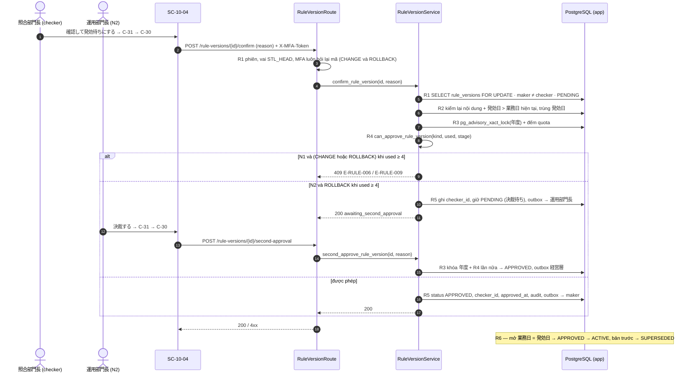

# RULE_VERSION — Quy chế có version: maker-checker, ngày hiệu lực, quota, rollback, nhánh E-14

> Biểu mẫu: **BM-2-901-53 v01** — Detail Design (Chart + Description) · SUN ASTERISK VIETNAM CO., LTD · ISO/IEC 27001:2013 & ISO 9001:2015

Thuật ngữ: **規則版** (version quy chế — gói 2 bảng 交付率 + tham số quy chế), **起票者** (maker, ルール管理者), **確認** (checker 照合部門長 xác nhận — không dùng chữ 承認, L4-D03), **決裁** (運用部門長 quyết, chỉ nhánh N2), **発効日** (ngày hiệu lực, luôn ngày 1 của tháng), **年度 / năm TC** (4月→3月).

---

## 1. History of change

| No | Version | Action | Mục / Bước | Nội dung thay đổi | Ngày | Người sửa | Approve |
|---|---|---|---|---|---|---|---|
| 1 | 0.1.0 | Add new | — | Khởi tạo (LAB-4 P3): 7 khối R1–R7, hàm chính sách E-14 vẽ đủ N1 / N2 (F / G chỉ là tư liệu — L4-D06), test vector RV-01..17 | 2026-11-25 | phuongnnm-23344 | |
| 2 | 0.1.1 | Update | — | Gate 2 G2-M01: confirm `CHANGE` và cancel `APPROVED` luôn hỏi lại mã (`RULE_CHANGE_CONFIRM`, `RULE_CANCEL_DECIDE`) theo PREMISE §3.2 ★; thêm RV-18; G2-m04: bỏ `;` trong thông điệp Mermaid | 2026-11-25 | phuongnnm-23344 | |

---

## 2. Sequence diagram

N/A (ảnh PNG) — chờ render Mermaid (Gate 1 m-08). Bản Mermaid là nguồn tới khi xuất `./assets/RULE_VERSION_sequence.png`.

<details open>
<summary>Bản Mermaid — 確認 (checker) gồm nhánh N2</summary>



</details>

---

## 3. Description

Dịch vụ quản lý vòng đời version quy chế phía **checker** (SC-10-04) và việc **có hiệu lực** theo ngày. Maker tạo / sửa / nộp ở SC-10-02, SC-10-03 (ngoài phạm vi file này; hàm `submit_rule_version` kiểm bảng tỷ lệ 5 bậc liền nhau — RULE_DB 4.22).

Luật 5 / GOV-RULE-01 áp như sau:
- Một version = **gói** 2 bảng 交付率 (仲卸 / 売買参加者, 5 bậc) + tham số quy chế (`rule_parameters`), hiệu lực từ **ngày 1 của một tháng tương lai** (PRM-042, ADR-006 §2.1).
- **Maker ≠ checker**; checker 照合部門長 có MFA. Version đã `PENDING` thì nội dung khóa.
- **Quota 4 lần / năm TC** theo **năm TC của 発効日** của version đang duyệt; đếm `CHANGE` + `ROLLBACK` ở `APPROVED` / `ACTIVE` / `SUPERSEDED`; **không đếm** `BASELINE` (bộ giá trị go-live) và `CANCELLED`. Lịch chợ – ngân hàng (`market_calendar`, SC-10-05) là master, **không phải version**, nên không bao giờ vào quota (PRM-054).
- **Rollback** = version mới chép nội dung version cũ (`rollback_of_id`), cùng vòng đời và quota; không "kích hoạt lại" version cũ.
- **Không làm biến dạng kỳ đã khóa:** version chỉ áp từ 発効日 trở đi; kỳ đã 期ロック giữ `rule_version_id` của nó (CLOSE_DB 4.43). Tỷ lệ sai đã duyệt chỉ sửa được bằng 修正申請 `INCENTIVE` từng người × kỳ (ADR-006 §2.4-8a, R-L4-01).
- **Rollback khi đã đủ 4 lần — E-14 chưa trả lời:** thiết kế cả hai nhánh N1 (chặn) / N2 (cho, có 運用部門長 決裁) trong **một hàm chính sách**; sau workshop chỉ cài một nhánh, **không** làm công tắc cấu hình (ADR-006 §2.5-9, PREMISE §6). Phương án F / G của ADR-006 §3 là **tư liệu workshop**, không thiết kế ở đây (L4-D06).

### 3.1 Biến số

| Ký hiệu | Nghĩa | Nguồn |
|---|---|---|
| v | Version đang xử lý | `rule_versions` (RULE_DB 4.21) |
| d_bd | 業務日 hiện tại (đang mở) | `business_days` (CLOSE_DB 4.24) — không dùng `now()` |
| FY(x) | Năm TC của ngày x = năm(x) nếu tháng(x) ≥ 4, ngược lại năm(x) − 1 | `rule_versions.fiscal_year` (GENERATED) |
| used(y) | Số version đã tính quota của năm TC y = count(`change_kind ∈ {CHANGE, ROLLBACK}` ∧ `status ∈ {APPROVED, ACTIVE, SUPERSEDED}` ∧ `fiscal_year = y`) | RULE_DB 4.21 |
| QUOTA | 4 (GOV-RULE-01) — hằng số trong hàm, không phải tham số | — |
| stage | `CHECKER` (確認) / `SECOND` (決裁 N2) | — |
| BRANCH | `N1` hoặc `N2` — chọn **lúc build** bằng phiên bản hàm `can_approve_rule_version` được cài | ADR-006 §2.5 |

### 3.2 Hàm chính sách E-14 (`can_approve_rule_version`) — toàn bộ khác biệt N1 / N2 nằm ở đây

```
input: kind ∈ {CHANGE, ROLLBACK}, used, stage
-- chung cả hai nhánh
if kind = CHANGE   and used ≥ QUOTA → DENY  E-RULE-006          (version mới thứ 5 luôn bị chặn)
if used < QUOTA                      → ALLOW (needs_second = false)
-- chỉ còn: kind = ROLLBACK và used ≥ QUOTA
N1: → DENY E-RULE-009                                          (sửa tiền bằng 修正申請 INCENTIVE)
N2: stage = CHECKER → ALLOW (needs_second = true, reason bắt buộc)
    stage = SECOND  → ALLOW (needs_second = false; đếm vào used → lượt thứ 5+; thông báo 経営層; RPT-12)
```

---

## 4. Detail function

### 4.1. R1 — Xác thực, đọc và khóa version

| Trường | Giá trị |
|---|---|
| Input | `versionId`; phiên (`app.user_id`, quyền, `app.mfa_verified_at`), header `X-MFA-Token` |
| Output | Dòng v đã `FOR UPDATE` → R2 |

**Error**

| Điều kiện lỗi | Xử lý | Status code |
|---|---|---|
| Chưa đăng nhập | Dừng, `E-CMN-001` | 401 |
| Không có quyền `STL_HEAD` (confirm / return / cancel) hoặc `OPS_HEAD` (second-approval) hoặc vai `RULE` (cancel-request) | Dừng, `E-CMN-002` | 403 |
| MFA không đạt — PREMISE §3.2 ★, cần `X-MFA-Token` đúng `purpose` (step-up không thay được): confirm `CHANGE` (`RULE_CHANGE_CONFIRM`), confirm `ROLLBACK` (`RULE_ROLLBACK_CONFIRM`), second-approval (`RULE_SECOND_APPROVAL`), cancel bản `APPROVED` (`RULE_CANCEL_DECIDE`); return và cancel bản `DRAFT` / `PENDING`: step-up 10 phút còn hiệu lực | Dừng, `E-CMN-005` | 403 |
| v không tồn tại | Dừng, `E-RULE-001` | 404 |
| Người gọi = `maker_id` khi confirm / return / second-approval | Dừng, `E-RULE-002` | 403 |

**Detail**

| No | Nội dung xử lý |
|---|---|
| 1 | Route handler kiểm phiên, CSRF, MFA (ADR-002), `set_config` ngữ cảnh, mở transaction, gọi hàm DB tương ứng. |
| 2 | `SELECT * FROM rule_versions WHERE id = v FOR UPDATE` (chờ, không `NOWAIT` — thao tác ngắn). |
| 3 | `assert_caller(...)` theo hành động; kiểm S4: `caller ≠ maker_id` (ràng buộc CHECK `checker_id <> maker_id` là lưới cuối). |

**DoD R1:** RV-02 (maker tự confirm → `E-RULE-002`); OPS-HEAD gọi confirm → 403; RV-18 (confirm `CHANGE` / `ROLLBACK`, cancel `APPROVED` không gửi `X-MFA-Token` dù step-up còn hiệu lực → 403 `E-CMN-005`; token `purpose` khác → 403; cancel `DRAFT` có step-up, không token → 200).

### 4.2. R2 — Kiểm trạng thái, nội dung và 発効日

| Trường | Giá trị |
|---|---|
| Input | v, d_bd |
| Output | v hợp lệ để duyệt → R3 |

**Error**

| Điều kiện lỗi | Xử lý | Status code |
|---|---|---|
| confirm: `status ≠ PENDING` hoặc (`PENDING` đã có `checker_id` = đang chờ 決裁 N2) | Dừng, `E-RULE-003` | 409 |
| second-approval: không ở trạng thái 決裁待ち (PENDING + `checker_id` + `second_approver_id` NULL) | Dừng, `E-RULE-010` | 409 |
| `effective_from ≤ d_bd` (đã tới / qua ngày hiệu lực) | Dừng, `E-RULE-004` (hướng dẫn hủy rồi tạo lại) | 409 |
| Đã có version khác `APPROVED` / `ACTIVE` cùng `effective_from` | Dừng, `E-RULE-005` | 409 |
| Bảng tỷ lệ / tham số không hợp lệ (kiểm lại như `submit_rule_version`) | Dừng, `E-RULE-013` | 409 |
| ROLLBACK / return / cancel thiếu lý do hoặc > 500 ký tự | Dừng, `E-RULE-007` | 422 |

**Detail**

| No | Nội dung xử lý |
|---|---|
| 1 | `effective_from` là ngày 1 (CHECK ở bảng) và phải **> d_bd** — duyệt đúng ngày hiệu lực cũng bị chặn, để kỳ bắt đầu hôm nay không đổi version giữa chừng (PRM-042, FR-INC-02). |
| 2 | Kiểm lại nội dung (phòng dữ liệu bị đổi ngoài luồng): mỗi `participant_class` đủ 5 bậc liền nhau từ 0, bậc 1 = 0 bp, bậc 5 không cận trên; đủ mọi `param_key` bắt buộc với kiểu đúng (RULE_DB 4.23). |
| 3 | ROLLBACK: `rollback_of_id` trỏ version từng có hiệu lực (`ACTIVE` / `SUPERSEDED`) và nội dung đã chép đúng (so mã băm nội dung hai version). |

**DoD R2:** RV-03 (`effective_from` 2027-10-01 khi d_bd 2027-10-01 → `E-RULE-004`); RV-15 (trùng 発効日 → `E-RULE-005`); sửa tay một bậc thành không liền → `E-RULE-013`.

### 4.3. R3 — Khóa năm TC và đếm quota

| Trường | Giá trị |
|---|---|
| Input | y = FY(`effective_from` của v) |
| Output | used(y) → R4 |

**Error**

`N/A — chỉ đọc + khóa advisory (chờ tới khi có, không lỗi); vượt quota do R4 quyết.`

**Detail**

| No | Nội dung xử lý |
|---|---|
| 1 | `pg_advisory_xact_lock(hashtext('rule_quota:' || y))` — hai checker duyệt hai version cùng năm TC chạy tuần tự, không cùng vượt quota (ADR-006 §2.3-6). |
| 2 | Đếm used(y) theo §3.1 **sau** khi có khóa. Năm TC lấy theo **発効日 của v**, không theo d_bd (RV-06: duyệt ngày 2028-02-10 một version hiệu lực 2028-04-01 → đếm năm TC 2028). |
| 3 | `BASELINE`, `CANCELLED`, `DRAFT`, `PENDING` (kể cả PENDING chờ 決裁 N2) không vào used. |

**DoD R3:** RV-05 (BASELINE + 1 CANCELLED + 3 CHANGE → used = 3); RV-06, RV-07 (biên 3/31 → 4/1); RV-13 (hai phiên đồng thời với used = 3 → một thành công, một `E-RULE-006`).

### 4.4. R4 — Chính sách E-14 (`can_approve_rule_version`)

| Trường | Giá trị |
|---|---|
| Input | `change_kind` của v, used(y), stage |
| Output | `{allowed, needs_second, error_code}` → R5 |

**Error**

| Điều kiện lỗi | Xử lý | Status code |
|---|---|---|
| CHANGE và used ≥ 4 (cả N1, N2) | Dừng, `E-RULE-006` | 409 |
| N1: ROLLBACK và used ≥ 4 | Dừng, `E-RULE-009` (thông điệp chỉ đường 修正申請 「奨励金」) | 409 |

**Detail**

| No | Nội dung xử lý |
|---|---|
| 1 | Hàm `IMMUTABLE` theo §3.2; là **chỗ duy nhất** có chữ N1 / N2 trong code. Đổi nhánh sau workshop = thay thân hàm + test RV-09 / RV-10, không đổi bảng, không đổi API. |
| 2 | Dự án build với nhánh **N1** làm mặc định tới khi có E-14 (an toàn hơn về luật GOV-RULE-01); test của N2 chạy bằng bản hàm N2 trong bộ test để sẵn sàng đổi. Giả định [PL] — Q-RULE-01. |

**DoD R4:** bảng chân trị đủ 2 kind × (used < 4, used = 4, used = 5) × 2 stage × 2 nhánh = 24 ca, khớp §3.2.

### 4.5. R5 — Ghi trạng thái, audit, thông báo

| Trường | Giá trị |
|---|---|
| Input | v, kết quả R4, `reason` |
| Output | v ở trạng thái mới; `audit_logs`; `notifications` |

**Error**

`N/A — lỗi ghi DB (hiếm) làm rollback toàn bộ transaction và trả 500 `E-CMN-004`; không có ghi dở.`

**Detail**

| No | Nội dung xử lý |
|---|---|
| 1 | confirm, `needs_second = false`: `status = APPROVED`, `checker_id`, `approved_at = now()`; nếu là ROLLBACK lưu lý do checker vào `audit_logs`. Thông báo maker 「第{n}版が確認されました（発効日 {date}）」. |
| 2 | confirm, `needs_second = true` (N2): giữ `PENDING`, ghi `checker_id` (trạng thái hiển thị 「決裁待ち（運用部門長）」 — C-27); thông báo mọi 運用部門長 có quyền. |
| 3 | second-approval (N2): người gọi `OPS_HEAD`, ≠ maker, ≠ checker (`E-RULE-011`); chạy lại R2 + R3 + R4 (stage `SECOND`); `status = APPROVED`, `second_approver_id`, `approved_at`; thông báo **経営層** (danh sách nhận ở file cấu hình) 「4回到達後のロールバックを決裁しました（今年度 {used+1} 回目）」; RPT-12 đếm lượt. |
| 4 | Mỗi hành động ghi `audit_logs` (`RULE_VERSION_CONFIRM` / `_SECOND_APPROVE` / `_RETURN` / `_CANCEL_REQUEST` / `_CANCEL`): người, 代行, thiết bị, thời điểm MFA, used trước / sau, nhánh chính sách, lý do. |

**DoD R5:** RV-01, RV-08, RV-10 (trạng thái + audit + outbox đúng); RV-11.

### 4.6. R6 — Có hiệu lực theo ngày (`activate_due_rule_versions`, `rule_at`)

| Trường | Giá trị |
|---|---|
| Input | 業務日 vừa mở d |
| Output | Version `APPROVED` có `effective_from ≤ d` → `ACTIVE`; version `ACTIVE` trước đó → `SUPERSEDED` (`replaced_version_id`) |

**Error**

| Điều kiện lỗi | Xử lý | Status code |
|---|---|---|
| Hàm mở 業務日 lỗi giữa chừng | Rollback cả việc mở ngày (job dự phòng chạy lại — ADR-005) | — (batch) |

**Detail**

| No | Nội dung xử lý |
|---|---|
| 1 | Gọi **trong cùng transaction** của hàm mở 業務日 (日次締め mở ngày kế, hoặc job 01:00 dự phòng — SC-07-B1). Nhiều version tới hạn (job lỡ nhiều ngày) → kích hoạt theo `effective_from` tăng dần; bản trung gian `ACTIVE` rồi `SUPERSEDED` ngay. |
| 2 | `rule_at(d)` = version có `effective_from` lớn nhất ≤ d trong `status ∈ {APPROVED, ACTIVE, SUPERSEDED}` — **không phụ thuộc** job đã chạy hay chưa (tra cứu luôn đúng). Mọi bản ghi tiền lưu version đã áp (ADR-006 §2.1-3). |
| 3 | Tạo kỳ mới: `payment_periods.rule_version_id = rule_at(start_date)`. Kỳ đã có (kể cả đã khóa) **không** đổi version (RV-17). |

**DoD R6:** RV-14; RV-17.

### 4.7. R7 — Trả về, đề nghị hủy, hủy

| Trường | Giá trị |
|---|---|
| Input | v, `reason`, hành động |
| Output | v → `DRAFT` (trả về) / ghi đề nghị hủy / `CANCELLED` |

**Error**

| Điều kiện lỗi | Xử lý | Status code |
|---|---|---|
| return: v không `PENDING` | `E-RULE-003` | 409 |
| cancel: v `ACTIVE` / `SUPERSEDED` / `CANCELLED`, hoặc `effective_from ≤ d_bd` | `E-RULE-008` | 409 |
| cancel v `APPROVED` mà chưa có đề nghị hủy của maker | `E-RULE-012` | 409 |
| cancel v `APPROVED`: người gọi là người đề nghị / maker | `E-RULE-002` | 403 |
| cancel-request: v không `APPROVED`, hoặc đã có đề nghị đang chờ | `E-RULE-014` | 409 |
| Thiếu lý do | `E-RULE-007` | 422 |

**Detail**

| No | Nội dung xử lý |
|---|---|
| 1 | return (checker): `PENDING` → `DRAFT`, xóa `checker_id` nếu là N2 chờ 決裁 (bắt đầu lại); thông báo maker kèm lý do. |
| 2 | cancel `DRAFT` / `PENDING`: maker hoặc checker, lý do bắt buộc → `CANCELLED` (không tính quota). |
| 3 | cancel-request (maker, vai `RULE`): v `APPROVED` và `effective_from > d_bd` → ghi đề nghị (người, giờ, lý do) + thông báo 照合部門長. **Lưu đề nghị:** cột `cancel_requested_by`, `cancel_requested_at`, `cancel_request_reason` của `rule_versions` (RULE_DB 0.2.1 §4.21 cột 13b — ba cột cùng NULL hoặc cùng có giá trị; đề nghị mở = `APPROVED` và `cancel_requested_at` có giá trị); `audit_logs` `RULE_VERSION_CANCEL_REQUEST` vẫn ghi. | |
| 4 | cancel `APPROVED` (checker 照合部門長, ≠ người đề nghị, MFA luôn hỏi lại mã `RULE_CANCEL_DECIDE`): cần đề nghị đang mở → `CANCELLED`, `cancelled_by`, `cancel_reason`; quota được trả lại (used giảm 1); thông báo maker. |

**DoD R7:** RV-12 (ba ca); return rồi maker sửa, nộp lại → về `PENDING` không mất lịch sử (audit có cả hai lượt).

---

## 5. Other Notes

### 5.1 Test vector quy chế (RV) — chưa có ở Database Design, ghi ở đây làm nguồn

Giả định chung: go-live 2027-08-01 với v1 `BASELINE` (FY2027); bảng tỷ lệ giả như INCENTIVE_DB §5; d_bd mặc định 2027-09-14.

| RV | Tình huống | Kết quả phải ra | ID |
|---|---|---|---|
| RV-01 | v4 `CHANGE` hiệu lực 2027-10-01, used(2027) = 2, checker ≠ maker, MFA OK | `APPROVED`; used(2027) = 3; maker nhận thông báo | GOV-RULE-01 |
| RV-02 | Người có cả vai RULE và quyền STL_HEAD tự confirm version mình lập | 403 `E-RULE-002` | S4 |
| RV-03 | d_bd 2027-10-01, confirm version hiệu lực 2027-10-01 | 409 `E-RULE-004` | PRM-042, FR-INC-02 |
| RV-04 | used(2027) = 4, confirm `CHANGE` thứ 5 (N1 và N2) | 409 `E-RULE-006` ở cả hai nhánh | GOV-RULE-01, OPEN-L4-01 |
| RV-05 | FY2027 có v1 `BASELINE`, 3 `CHANGE` (`APPROVED`/`ACTIVE`/`SUPERSEDED`), 1 `CANCELLED` | used = 3 → confirm thứ 4 được | L4-A04 (3), D06 |
| RV-06 | d_bd 2028-02-10; used(2027) = 4, used(2028) = 0. Confirm v hiệu lực 2028-04-01 / v' hiệu lực 2028-03-01 | v → `APPROVED` (đếm FY2028); v' → `E-RULE-006` (FY2027) | C.3 (chuyển năm TC) |
| RV-07 | FY(2028-03-01), FY(2028-04-01) | 2027, 2028 | ADR-006 §2.3 |
| RV-08 | `ROLLBACK` về v2, hiệu lực 2027-11-01, used = 3, lý do có, nhập lại mã MFA | `APPROVED`, used = 4, nội dung = v2, `rollback_of_id` = v2 | ADR-006 §2.4 |
| RV-09 | **N1:** `ROLLBACK` khi used = 4 | 409 `E-RULE-009`; thông điệp chỉ đường 修正申請 「奨励金」 | E-14 N1, R-L4-01 |
| RV-10 | **N2:** `ROLLBACK` khi used = 4 → checker confirm → OPS-HEAD second-approval | Sau confirm: `PENDING` + `checker_id` (決裁待ち), used vẫn 4; sau 決裁: `APPROVED`, used = 5, thông báo 経営層, RPT-12 hiện 5 | E-14 N2 [Giả lập] |
| RV-11 | **N2:** second-approval do chính checker hoặc maker | 403 `E-RULE-011` | ADR-006 §2.5 |
| RV-12 | v `APPROVED` hiệu lực 2027-10-01: (a) maker đề nghị hủy → checker khác hủy; (b) checker hủy khi chưa có đề nghị; (c) hủy khi d_bd 2027-10-01 | (a) `CANCELLED`, used giảm 1; (b) `E-RULE-012`; (c) `E-RULE-008` | ADR-006 §2.3-7a, m-09 |
| RV-13 | used = 3; hai checker confirm hai version FY2027 cùng lúc | Một `APPROVED`, một `E-RULE-006` | ADR-006 §2.3-6 |
| RV-14 | v `APPROVED` hiệu lực 2027-10-01; mở 業務日 2027-10-01 | v `ACTIVE`, bản trước `SUPERSEDED`; `rule_at(2027-09-30)` = bản trước, `rule_at(2027-10-01)` = v (đúng cả khi job chưa chạy) | ADR-006 §2.2 |
| RV-15 | Hai version cùng hiệu lực 2027-10-01, một đã `APPROVED` | Confirm bản kia → `E-RULE-005` | `uq_rule_versions_active_from` |
| RV-16 | Thêm 臨時休市 2027-10-15 ở SC-10-05 | used không đổi (lịch không phải version) | PRM-054 |
| RV-17 | v hiệu lực 2027-10-01 được duyệt khi kỳ 2027-09 `OPEN` | Kỳ 2027-09 giữ version cũ; kỳ 2027-10 tạo với v; DELTA kỳ 09 sau này vẫn tra version kỳ 09 | ADR-006 §2.2-5, ADR-007 K4 |
| RV-18 | Step-up phiên còn hiệu lực (MFA 2 phút trước), không có `X-MFA-Token`: (a) confirm v4 `CHANGE`; (b) confirm `ROLLBACK`; (c) cancel v `APPROVED` có đề nghị; (d) cancel v `DRAFT`; (e) confirm `CHANGE` kèm token `purpose = RULE_ROLLBACK_CONFIRM` | (a)(b)(c)(e) 403 `E-CMN-005`, v không đổi; (d) `CANCELLED` | PREMISE §3.2 ★, ADR-002 §2.2-6a |

### 5.2 Ranh giới

- Không làm: tạo / sửa / nộp version (SC-10-02/03 — hàm `create_rule_version`, `save_rate_rows`, `save_rule_parameters`, `submit_rule_version`); sửa tiền kỳ đã khóa (修正申請 INCENTIVE — feature settle); phương án F / G (L4-D06 — chỉ tư liệu workshop, effort ~0,3–0,5 MM chưa có trong DEC-048).
- Ví dụ tính trên màn ([15]) dùng `incentive_amount` của feature incentive (INC_FUNC 2.7) — một công thức, không viết lại.

### 5.3 Câu hỏi / giả định mới

- Q-RULE-01 — Tới khi có E-14, build nhánh nào làm mặc định? Giả định [PL]: **N1** (không nới GOV-RULE-01 khi chưa có quyết định của ban lãnh đạo). Đổi sang N2 sau workshop: thay một hàm + bật màn 決裁, ~0,5 MD.
- Q-RULE-02 — Đề nghị hủy version `APPROVED` lưu ở 3 cột của `rule_versions` — đã phản ánh ở RULE_DB 0.2.1 §4.21 (điểm thiết kế nội bộ, đóng khi Gate 2 duyệt).
- Q-RULE-03 — N2: danh sách 「経営層」 nhận thông báo là ai (file cấu hình)? Giả định [PL]: 代表取締役 + 運用部門長 + 照合部門長.
