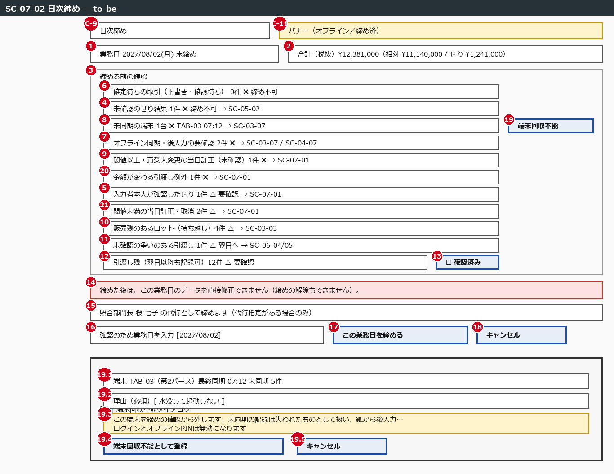
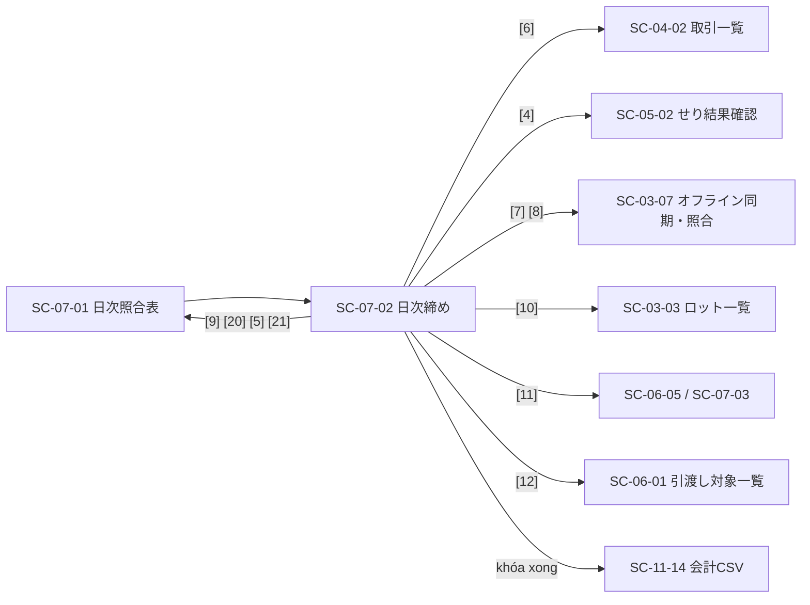

# SC-07-02 — 日次締め

> Biểu mẫu: **BM-2-901-51 v2.1** — Screen Specification · SUN ASTERISK VIETNAM CO., LTD · ISO/IEC 27001:2013 & ISO 9001:2015

---

## 1. History of change

| No | Version | Action | Nội dung thay đổi | Ngày | Người sửa | Approve |
|---|---|---|---|---|---|---|
| 1 | 0.1.0 | Add New | Khởi tạo từ wireframe WF-SC-07-02 0.2.0; checklist 11 mục khớp ADR-005 §2.5 / CLOSE_DB 4.24 | 2026-11-25 | phuongnnm-23344 | |

---

## 2. Layout

**Design:** [Wireframe SC-07-02 0.2.0](../../../wireframes/SC-07-02-daily-close-business-day-lock-wireframe.md). To-be khác prototype nhiều (11 dòng thay 4, 代行, MFA, 端末回収不能) → ảnh dựng từ wireframe.

Ảnh prototype as-is: `wireframes/assets/SC-07-02_prototype.png`. Hộp thoại [19] 端末回収不能 mô tả trong file này (D).

---

## 3. Description

Màn **quyết định**: 照合部門長 (STL-HEAD) hoặc người 代行 đã chỉ định **khóa 業務日** (日次締め). Sau khóa không ai sửa trực tiếp dữ liệu của ngày đó — chỉ qua 修正申請 (BR-CLOSE-01, luật 4). **Không có nút mở lại ngày đã khóa** ở bất kỳ màn nào (PRM-031, ADR-005 §2.7).

Trước khi khóa, màn hiện **checklist chuẩn 11 mục** (ADR-005 §2.5 = CLOSE_DB 4.24 `close_checklist`): 6 mục ✖ chặn khóa, 5 mục ⚠ được đi tiếp. Mỗi dòng có số lượng và liên kết tới đúng màn xử lý. Khóa = C-31 xác nhận hệ quả → C-30 MFA **luôn hỏi lại mã** (hành động không quay lại được — ADR-002 §2.2-6a) → khóa trong một transaction, **mở luôn 業務日 chợ kế tiếp** theo lịch (ADR-005 §2.4), bắt đầu tạo batch IF-ACC-01 (SC-11-14).

Máy hỏng / mất không đồng bộ được → lối thoát **「端末回収不能」** [19] (ADR-005 §2.6): máy ra khỏi dòng ✖ [8], phiên + PIN offline bị thu hồi, bản ghi về sau vào SC-03-07. Không có đường "khóa bỏ qua checklist".

Mục tiêu khóa 10:00, muộn nhất 10:30 (PRM-030).

---

## 4. View

ID item = số trong wireframe to-be. Cột "ADR #" nối dòng checklist với số thứ tự ở ADR-005 §2.5 / CLOSE_DB 4.24.

### 4.1 Danh sách item

| ID | Item Name | Item Type | Required | Note |
|---|---|---|---|---|
| **H** | **Khung** | | | |
| C-9 | 画面タイトル 「日次締め」 | Label | - | |
| C-11 | バナー | Label | - | C-28 offline / 「締め済」 / C-26 |
| **A** | **Tổng quan ngày** | | | |
| 1 | 業務日 + 状態 | Label | - | 「{YYYY/MM/DD(曜)} 未締め」/「締め済（{氏名} {hh:mm}、MFA済）」 |
| 2 | 合計（税抜） | Label | - | 「¥{合計}（相対 ¥… / せり ¥…）」 — 相対 đứng trước (luồng chính) |
| **B** | **Checklist** | | | |
| 3 | 締める前の確認 | Label (bảng) | - | Cột: 区分 / 件数 / 締めへの影響 (✖ 締め不可 / ⚠ 要確認・持ち越し・翌日へ) / 対応 (liên kết). 11 dòng dưới đây, đúng thứ tự wireframe |
| 6 | 確定待ちの取引（下書き・確認待ち） | Label + link | - | ✖ — ADR #1 → SC-04-02 (lọc) |
| 4 | 未確認のせり結果 | Label + link | - | ✖ — ADR #2 → SC-05-02 |
| 8 | 未同期の端末（最終同期時刻） | Label + link | - | ✖ — ADR #3; mỗi máy: mã, vị trí, giờ đồng bộ cuối, số bản ghi chờ; nút [19] trên từng máy → SC-03-07 |
| 7 | オフライン同期・後入力の要確認 | Label + link | - | ✖ — ADR #4 → SC-03-07 / SC-04-07 |
| 9 | 閾値以上・買受人変更の当日訂正（未確認） | Label + link | - | ✖ — ADR #5 → SC-07-01 tab 要確認; hiện người chốt gốc + người sửa |
| 20 | 金額が変わる引渡し例外（不足・返品・一部取消） | Label + link | - | ✖ — ADR #6 → SC-07-01 tab 要確認 |
| 5 | 入力者本人が確認したせり | Label + link | - | ⚠ — ADR #11 → SC-07-01 |
| 21 | 閾値未満の当日訂正・取消 | Label + link | - | ⚠ — ADR #9 → SC-07-01 |
| 10 | 販売残のあるロット（持ち越し） | Label + link | - | ⚠ — ADR #7 → SC-03-03 |
| 11 | 未確認の争いのある引渡し | Label + link | - | ⚠ 「翌日へ」 — ADR #10 → SC-06-05 / SC-07-03 |
| 12 | 引渡し残（翌日以降も記録可） | Label + link | - | ⚠ — ADR #8 → SC-06-01 |
| 13 | 確認済み（引渡し残） | Checkbox | Có | Bắt buộc tick (kể cả khi [12] = 0 件 — giả định Q-STL-03) |
| **C** | **Xác nhận khóa** | | | |
| 14 | 警告文 | Label | - | Luôn hiện: 「締めた後は、この業務日のデータを直接修正できません（締めの解除もできません）。訂正は修正申請で行います。」 |
| 15 | 代行表示 | Label | - | Chỉ khi người xem là 代行: 「照合部門長 {氏名} の代行として締めます」 |
| 16 | 業務日の再入力 | Text box | Có | |
| 17 | この業務日を締める | Button | - | |
| 18 | キャンセル | Button | - | → SC-07-01 |
| **D** | **Hộp thoại [19] 端末回収不能** | | | |
| 19 | 端末回収不能 | Button | - | Trên dòng máy ở [8]; mở hộp thoại |
| 19.1 | 端末情報 | Label | - | 「端末 {code}（{location}）最終同期 {hh:mm} 未同期 {n}件」 |
| 19.2 | 理由 | Text box | Có | |
| 19.3 | 影響の説明 | Label | - | Câu cố định: máy ra khỏi checklist; bản ghi chưa đồng bộ coi như mất, nhập bù từ giấy; bản ghi về sau vào SC-03-07 (要確認); đăng nhập + PIN offline của máy bị vô hiệu |
| 19.4 | 端末回収不能として登録 | Button | - | → C-30 MFA (luôn hỏi lại mã) |
| 19.5 | キャンセル | Button | - | |

### 4.2 Validation

| ID | Type | Min | Max | Default | Ghi chú |
|---|---|---|---|---|---|
| [13] | Boolean | — | — | false | Chưa tick khi bấm [17] → `E-STL-003` 「引渡し残の確認（確認済み）にチェックしてください」 |
| [16] | Date (string) | 10 | 10 | (trống) | Chấp nhận `YYYY/MM/DD` và `YYYY-MM-DD`; khác 業務日 đang khóa → `E-STL-001` 「確認のため業務日を正しく入力してください」 |
| 19.2 | String | 1 | 200 | (trống) | → `E-STL-006` 「理由を入力してください（200文字以内）」 |

> [17] chỉ bật khi: mọi dòng ✖ = 0 件, [13] đã tick, [16] khớp. Server kiểm lại toàn bộ (không tin client).

### 4.3 Data Mapping

| ID | Data Source | API ID | API URL | Key / Param | Ghi chú |
|---|---|---|---|---|---|
| [1], [2], [3]–[12], [20], [21], [15] | API | `API-STL-001` | `GET /api/v1/business-days/{businessDate}/close-checklist` | `businessDate` | Trả `checklistVersion` (hash nội dung) |
| [13], [16], [17] | API | `API-STL-002` | `POST /api/v1/business-days/{businessDate}/close` | `confirmDate`, `deliveryRemainderAcknowledged`, `checklistVersion`, header `X-MFA-Token` | ★ MFA dùng một lần |
| 19.2, 19.4 | API | `API-STL-003` | `POST /api/v1/devices/{deviceId}/lost` | `reason`, header `X-MFA-Token` | ★ MFA dùng một lần |
| C-30 | API | — (module `iam`) | xác thực mã MFA với `purpose` → `mfaToken` | `purpose = DAY_CLOSE` \| `DEVICE_LOST` | API của `iam`, chưa đặc tả — [`specs/_index.md`](../../_index.md) mục phụ thuộc (DEP-01); quy ước token: [api-conventions §4](../../_common/api-conventions.md#4-mfa-step-up) |

---

## 5. Event

| ID | Given (Pre-condition) | When (Trigger/Action) | Then (Result) | Note |
|---|---|---|---|---|
| **Initializing Process（初期処理）** | | | | |
| - | STL-HEAD / 代行 / SETTLE, online | Mở màn (mặc định 業務日 `OPEN` sớm nhất) | `API-STL-001` → [1]–[21]; dòng ✖ > 0 tô đỏ, dòng ⚠ vàng; [17] mờ kèm câu 「✖ の項目を解消すると締められます」 nếu còn ✖ | |
| - | Ngày đã khóa | Mở với ngày đó | Toàn màn chỉ đọc: [1] 「締め済（{氏名} {hh:mm}、MFA済）」, checklist hiện ảnh chụp `close_checklist`; **không có nút mở lại**; liên kết 「訂正は修正申請へ」 → SC-08-01 | PRM-031 |
| **Standard Process（通常処理）** | | | | |
| [3] (mọi dòng) | - | Bấm liên kết 対応 | Mở màn xử lý tương ứng (tab mới), lọc theo 業務日 | |
| - | Quay lại tab | Màn được focus | Gọi lại `API-STL-001` (checklist có thể đã đổi) | |
| [19] | STL-HEAD / 代行, máy ở [8] | Bấm | Mở hộp D (19.1–19.5) | |
| 19.4 | 19.2 hợp lệ | Bấm | C-30 (luôn hỏi mã) → `API-STL-003` → 200: đóng hộp, C-12 「端末 {code} を端末回収不能として登録しました」, nạp lại checklist (máy rời [8]) | |
| [17] | Điều kiện 4.2 đạt | Bấm | 1. C-31: 「{業務日} を締めます。締めた後は解除できません。合計 ¥{合計}」 + nút 「締める」. 2. C-30 (luôn hỏi lại mã) → `mfaToken`. 3. `API-STL-002`. 4. 200 → C-12 「{業務日} を締めました（{氏名} {hh:mm}）。次の業務日 {翌業務日} を開きました」, màn sang chỉ đọc; header C-2 cập nhật; thông báo 「会計CSVの作成を開始しました（11:00まで）」 | |
| [18] | - | Bấm | → SC-07-01, không khóa | |
| **Error Handling（エラー制御）** | | | | |
| [17] | - | 409 `E-STL-010` (checklist đổi từ lúc hiển thị) | C-23 「チェックリストが更新されました。最新の内容を確認してください」; nạp lại | |
| [17] | - | 409 `E-STL-002` (còn ✖ — server) | C-23 + danh sách dòng ✖ trong `error_extra`; nạp lại | |
| [17] | - | 409 `E-STL-004` (người khác vừa khóa) | Chuyển chỉ đọc với thông tin người khóa | |
| [17] | - | 409 `E-STL-005` (ngày trước chưa khóa) | C-23 「前の業務日 {date} が未締めです。先に締めてください」 + liên kết | |
| [17] | - | 409 `E-STL-008` (không có ngày chợ kế tiếp trong lịch) | C-23; hướng dẫn ルール管理者 nhập lịch SC-10-05 | |
| [17], 19.4 | - | 403 `E-CMN-005` / MFA sai / hủy | Ở lại màn, không khóa | |
| - | - | Mất mạng | C-28: 「通信が回復するまで締められません」; [17], [19] mờ | |

---

## 6. Other Notes

### 6.1 Trạng thái màn

| Trạng thái | Hiển thị |
|---|---|
| Đang tải | C-20 trong [3] |
| Còn dòng ✖ | [17] mờ + câu 「✖ の項目を解消すると締められます」 |
| Đủ điều kiện | [17] bật khi [13] tick và [16] khớp |
| Đã khóa | Chỉ đọc + ảnh chụp checklist lúc khóa; không nút mở lại |
| Máy hỏng / mất | [19] trên dòng máy; không có "khóa bỏ qua checklist" |
| Offline | C-28; không khóa, không 端末回収不能 |
| Không có quyền / chưa có 代行 | SETTLE: checklist chỉ đọc (không [13], [16], [17], [19]); vai khác C-25 |
| Ngày đã khóa (423) | N/A — màn không ghi dữ liệu nghiệp vụ của ngày; ngày đã khóa hiện chỉ đọc |

### 6.2 Phân quyền hiển thị theo vai

| Item | STL-HEAD / 代行 (STL_HEAD) | SETTLE | OPS-HEAD | Vai khác |
|---|---|---|---|---|
| [1], [2], [3]–[12], [20], [21], [14] | Đ (+ liên kết) | Đ (+ liên kết) | Ẩn — xem trạng thái ngày ở SC-07-01 | Ẩn (C-25) |
| [13], [16], [17], [18] | T | Ẩn | Ẩn | Ẩn |
| [15] | Đ (chỉ 代行) | Ẩn | Ẩn | Ẩn |
| [19], hộp D | T | Ẩn | Ẩn | Ẩn |

SETTLE xử lý dòng [9], [20] bằng nút 「確認済」 ở SC-07-01 (không ở màn này).

### 6.3 Luồng chuyển màn

### 6.4 Truy vết

FT-07-04, FR-SETTLE-01, FR-SETTLE-02, BR-CLOSE-01, E-08, E-12, PRM-030, PRM-031, PRM-036, PRM-110, PRM-115, PRM-119, PRM-123, PRM-127, NFR-AVL-02, RACI-01, S8; ADR-002 §2.2-6a, ADR-005 §2.4–2.7, ADR-008; CLOSE_DB 4.24, IAM_AUDIT_DB 4.6, 4.55, ADJUST_DB 4.32, TRADE_DB 4.35; Gate 1 M-01, M-05; khách #1, #4, #25.

### 6.5 Câu hỏi / giả định mới

| ID đề xuất | Nội dung | Giả định tạm | Ảnh hưởng nếu sai |
|---|---|---|---|
| Q-STL-01 | Phải khóa các 業務日 theo thứ tự (ngày cũ trước)? | Có — chặn khóa D khi D−1 còn `OPEN` (`E-STL-005`) | Cho khóa lệch thứ tự: "ngày mở sớm nhất" cho 修正申請 có thể là ngày cũ hơn ngày vừa khóa — phải kiểm lại ADR-005 |
| Q-STL-02 | ADR #10 nói "gồm phiếu giấy 争いのある引渡し確認票 đã phát mà chưa nhập" — hệ thống không có sổ phát phiếu | Chỉ đếm tranh chấp `OPEN` đã nhập; phiếu chưa nhập do người khóa tự soát bằng sổ giấy | Cần sổ phát phiếu: thêm bảng + màn cấp số, +0,2 MM |
| Q-STL-03 | [13] có bắt tick khi 引渡し残 = 0 件? | Có (wireframe: "không chặn bởi số lượng") | — |
