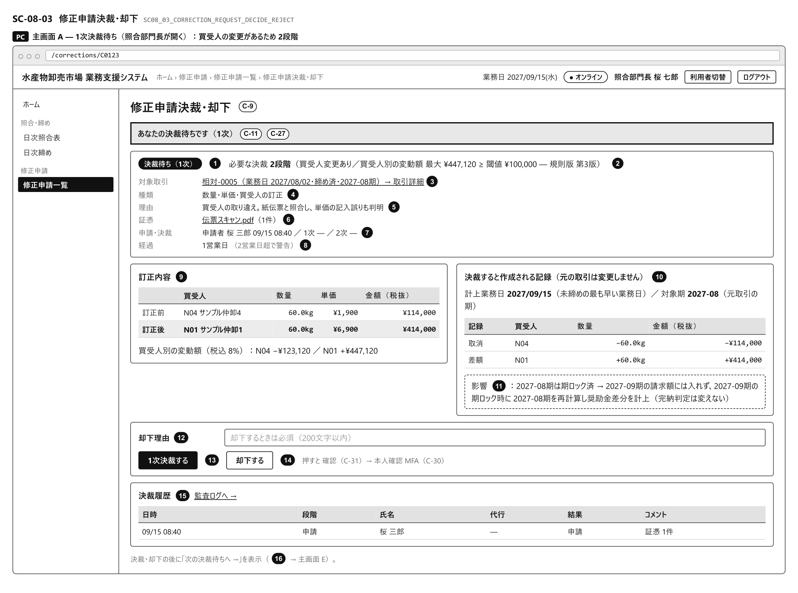

# SC-08-03 — 修正申請決裁・却下

> Biểu mẫu: **BM-2-901-51 v2.1** — Screen Specification · SUN ASTERISK VIETNAM CO., LTD · ISO/IEC 27001:2013 & ISO 9001:2015

---

## 1. History of change

| No | Version | Action | Nội dung thay đổi | Ngày | Người sửa | Approve |
|---|---|---|---|---|---|---|
| 1 | 0.1.0 | Add New | Khởi tạo từ wireframe WF-SC-08-03 0.2.1 | 2026-11-25 | phuongnnm-23344 | |
| 2 | 0.1.1 | Update | Khách Q-STL-04: cấp 1 = 照合部門長 hoặc 代行 chỉ định trước, 運用部門長 chỉ cấp 2; đóng Q-STL-04/05; G2-M03: lỗi LATE_ENTRY hiện `message` + `detail.sourceCode` | 2026-11-25 | phuongnnm-23344 |  |
| 3 | 0.1.2 | Update | LAB-4: ảnh annotated thay bằng biến thể A của wireframe HTML `wireframes/html/SC-08-03.html` (WF 0.2.3); ghi badge không có trên ảnh; link HTML / PNG / PDF | 2026-11-25 | phuongnnm-23344 | |

---

## 2. Layout

**Design:** [Wireframe SC-08-03 0.2.3](../../../wireframes/SC-08-03-correction-request-approve-reject-wireframe.md) · nguồn hình HTML [`wireframes/html/SC-08-03.html`](../../../wireframes/html/SC-08-03.html) · mọi biến thể: [`wireframes/png/SC-08-03.png`](../../../wireframes/png/SC-08-03.png) / [`wireframes/pdf/wireframes-all.pdf`](../../../wireframes/pdf/wireframes-all.pdf) · khung chung [_common-layout](../../../wireframes/_common-layout.md) · ảnh as-is prototype: `wireframes/assets/SC-08-03_prototype.png`

> - Ảnh = **biến thể A** (màn chính) của wireframe HTML, sinh bằng `scripts/render-wireframes.py --spec` (chưa có Figma). Số trên ảnh = cột `ID` mục 4 = cột `No` của wireframe; `C-x` = mục chung ở `_common-layout.md`.
> - Badge không có trên ảnh này: C-31 (C), C-30 (D), C-12 (E), C-28 (I) → xem biến thể tương ứng trong [`wireframes/png/SC-08-03.png`](../../../wireframes/png/SC-08-03.png) / PDF.
> - [16] ở biến thể A chỉ là chú thích; nút 「次の決裁待ちへ」 thật hiện sau khi 決裁 (biến thể E).

---

## 3. Description

Màn **quyết định**: 照合部門長 (cấp 1) / 運用部門長 (cấp 2) **決裁** hoặc **却下** một 修正申請 (yêu cầu điều chỉnh sau khi chốt — người quyết, CAP-HUMAN-01). Tên màn LAB-1 là 「修正申請承認・却下」; LAB-4 đổi nhãn thành 「修正申請決裁・却下」 — chữ 承認 chỉ dành cho 承認（売買参加者）(luật 2, L4-D03). ID màn giữ nguyên.

Duyệt **không sửa GD gốc**: sinh REVERSE + DELTA ghi ở **業務日 chưa khóa sớm nhất** (計上業務日); **kỳ của dòng = kỳ của GD gốc** (対象期). Màn cho người duyệt xem trước đúng các bản ghi sẽ sinh [10] và ảnh hưởng kỳ / thưởng [11] trước khi bấm. Số cấp [2] đã chốt lúc nộp theo quy chế có version: tiền thay đổi lớn nhất của một người mua (税込) ≥ ngưỡng, **hoặc đổi 買受人 → luôn 2 cấp**, `KANNO` / `INCENTIVE` luôn 2 cấp.

Bốn loại [4]: `TRADE` (SL / giá / người mua của GD), `KANNO` (đổi 完納 của kỳ đã khóa), `INCENTIVE` (sửa thưởng kỳ đã khóa), `LATE_ENTRY` (bản ghi mới của ngày đã khóa — 後入力).

---

## 4. View

### 4.1 Danh sách item

| ID | Item Name | Item Type | Required | Note |
|---|---|---|---|---|
| **H** | **Khung** | | | |
| C-9 | 画面タイトル 「修正申請決裁・却下」 | Label | - | |
| C-11 | バナー | Label | - | C-27 決裁待ち / C-28 / C-26 |
| **A** | **Tóm tắt yêu cầu** | | | |
| 1 | 状態 | Label | - | 決裁待ち（1次）/ 決裁待ち（2次）/ 決裁・反映済 / 却下. **Không** dùng 「承認」 |
| 2 | 必要な決裁 | Label | - | 「{1\|2}段階（{理由}— 規則版 第{n}版）」; lý do: 「買受人変更あり」 / 「買受人別の変動額 最大 ¥{額} ≥ 閾値 ¥{閾値}」 / 「完納・奨励金の訂正」 |
| 3 | 対象 | Button (link) | - | `TRADE`: 「{取引}（業務日 {日付}・締め済・{期}期）→ 取引詳細」 → SC-04-04. `KANNO` / `INCENTIVE`: 「{買受人} {期}期」 → SC-09-xx. `LATE_ENTRY`: 「{業務日}（締め済）の後入力: {種類}」 |
| 4 | 種類 | Label | - | Nhãn loại (`TRADE` → 「数量・単価・買受人の訂正」 v.v.) |
| 5 | 理由 | Label | - | |
| 6 | 証憑 | Button (link) | - | Mở file chứng cứ (`CORRECTION_EVIDENCE`); 「{件}件」 |
| 7 | 申請者 / 1次 / 2次 | Label | - | Tên + giờ; 代行 hiện 「（{氏名} の代行）」 |
| 8 | 経過 | Label | - | 「{n}営業日」; > 2 営業日 → vàng 「2営業日超」 |
| **B** | **Nội dung + ảnh hưởng** | | | |
| 9 | 訂正内容 | Label (bảng) | - | 訂正前 / 訂正後: 買受人 / 数量 / 単価 / 金額（税抜） + dòng 「買受人別の変動額（税込 {率}%）」 |
| 10 | 決裁すると作成される記録 | Label (bảng) | - | 「計上業務日 {日付}（未締めの最も早い業務日）／ 対象期 {期}（元取引の期）」 + dòng 取消（REVERSE）/ 差額（DELTA）; sau khi phản ánh hiện bản ghi thật. Câu cố định 「元の取引は変更しません」 |
| 11 | 影響 | Label | - | Kỳ gốc mở: 「元取引の期（{期}）はまだ期ロック前のため、同期の請求額に反映されます」; kỳ gốc đã khóa: 「{期}期は期ロック済 → {現期}期の請求額には入れず、{現期}期の期ロック時に {期}期を再計算し奨励金差分を計上（完納判定は変えない）」; `KANNO`: 「完納判定を変更します（次の期ロックで差分）」 |
| **C** | **Hành động** | | | |
| 12 | 却下理由 | Text box (nhiều dòng) | Có khi 却下 | |
| 13 | 決裁 | Button | - | Nhãn 「1次決裁する」/「2次決裁する（反映）」; với `required_levels = 1`: 「決裁する（反映）」 |
| 14 | 却下する | Button | - | |
| 15 | 決裁履歴 | Label (bảng) + link | - | Mỗi bước: 日時 / 段階 / 氏名 / 代行 / 結果 / コメント → SC-13-01 |
| 16 | 次の決裁待ちへ | Button | - | Chỉ hiện sau khi 決裁 / 却下 và còn yêu cầu chờ của người xem |

### 4.2 Validation

| ID | Type | Min | Max | Default | Ghi chú |
|---|---|---|---|---|---|
| [12] | String | 1 (khi 却下) | 200 | (trống) | 却下 mà trống / > 200 → `E-STL-025` 「却下理由を入力してください（200文字以内）」 |

> Không có ô nhập khác — mọi nội dung yêu cầu chỉ đọc (sửa nội dung = 却下 rồi lập lại ở SC-08-01).

### 4.3 Data Mapping

| ID | Data Source | API ID | API URL | Key / Param | Ghi chú |
|---|---|---|---|---|---|
| [1]–[11], [15] | API | `API-STL-004` | `GET /api/v1/corrections/{correctionId}` | `correctionId` | Gồm `preview`, `allowedActions` |
| [6] | API | — (module chung `attachments`) | tải chứng cứ | `attachmentId` | chưa đặc tả — [`specs/_index.md`](../../_index.md) mục phụ thuộc (DEP-03) |
| [12]–[14] | API | `API-STL-005` | `POST /api/v1/corrections/{correctionId}/decisions` | `level`, `decision`, `comment` | MFA step-up |
| [16] | API | `API-STL-005` (response) | — | `nextPendingId` | |

---

## 5. Event

| ID | Given (Pre-condition) | When (Trigger/Action) | Then (Result) | Note |
|---|---|---|---|---|
| **Initializing Process（初期処理）** | | | | |
| - | Mở từ SC-08-02 / thông báo, online | Mở `/corrections/{id}` | `API-STL-004` → [1]–[15]; áp §6.2 theo `allowedActions` | |
| **Standard Process（通常処理）** | | | | |
| [3] | - | Bấm | → SC-04-04 (TRADE) / màn kỳ (KANNO, INCENTIVE) | |
| [6] | - | Bấm | Mở chứng cứ (tab mới) | |
| [13] | `allowedActions` có `DECIDE_L1` / `DECIDE_L2` | Bấm | 1. C-31: 「{段階}決裁します。計上業務日 {日付}、対象期 {期}。元の取引は変更しません」. 2. C-30 MFA nếu step-up hết hạn. 3. `API-STL-005` (`decision = APPROVE`, `level`). 4. 200 → C-12 「1次決裁しました」/「決裁しました。取消・差額を記録しました（計上 {日付}）」; nạp lại; hiện [16] nếu có `nextPendingId` | |
| [14] | [12] hợp lệ | Bấm | C-31 「却下します。申請者に通知されます」 → C-30 → `API-STL-005` (`REJECT`) → C-12 「却下しました」; chỉ đọc | |
| [16] | Có `nextPendingId` | Bấm | Mở yêu cầu kế tiếp; trong 10 phút MFA không hỏi lại (trừ idle > 3 phút) | khách #29 |
| [15] | - | Bấm liên kết | → SC-13-01 lọc theo yêu cầu | |
| **Error Handling（エラー制御）** | | | | |
| [13], [14] | - | 403 `E-STL-023` / `E-STL-024` | C-23 với câu lỗi; ẩn [13] [14] | Server kiểm lại dù UI đã ẩn |
| [13], [14] | - | 409 `E-STL-026` / `E-STL-022` (người khác vừa duyệt) | C-23 「この修正申請は既に処理されました」; nạp lại | |
| [13] | - | 409 `E-STL-027` (lô không đủ SL) | C-23 với SL còn; yêu cầu giữ nguyên trạng thái | |
| [13] | - | 409 lỗi module đích (`LATE_ENTRY`) | C-23 hiện `message` của lỗi; mã gốc của module đích ở `detail.sourceCode` | |
| [13], [14] | - | 403 `E-CMN-005` | Mở C-30, gửi lại | |
| - | - | Mất mạng | C-28; [13] [14] mờ | Duyệt không chạy offline |

---

## 6. Other Notes

### 6.1 Trạng thái màn

| Trạng thái | Hiển thị |
|---|---|
| Người xem là người lập | [13] [14] ẩn; câu 「申請者本人は決裁できません」 |
| Người xem đã duyệt cấp 1 | [13] [14] ẩn; 「1次と2次を同じ人は決裁できません」 |
| Chờ cấp 2 | [1] 「決裁待ち（2次）」; [7] có tên cấp 1 |
| Kỳ gốc còn mở | [11] câu kỳ mở |
| Đã phản ánh | Chỉ đọc; [10] hiện bản ghi thật (REVERSE / DELTA đã ghi) |
| Bị từ chối | Chỉ đọc + lý do |
| Quá 2 営業日 | [8] vàng |
| Offline | C-28 |
| GD đích có yêu cầu khác đang chờ | Không xảy ra (tối đa 1 yêu cầu chờ / GD) |
| Ngày đã khóa (423) | N/A — 修正申請 chính là đường hợp lệ cho ngày đã khóa; bản ghi luôn vào 業務日 mở |

### 6.2 Phân quyền hiển thị theo vai

| Item | STL-HEAD (không phải người lập) | OPS-HEAD | Người lập (TRADE / DELIVERY / SETTLE) | SETTLE khác | Vai khác |
|---|---|---|---|---|---|
| [1]–[11], [15] | Đ | Đ | Đ (yêu cầu của mình) | Đ (theo 閲) | Ẩn (C-25) |
| [12], [14] | T ở cấp 1 | T ở cấp 2 | Ẩn | Ẩn | Ẩn |
| [13] 「1次決裁」 | T (hoặc 代行 STL-HEAD đã chỉ định) | Ẩn (không thay cấp 1 — Q-STL-04) | Ẩn | Ẩn | Ẩn |
| [13] 「2次決裁」 | Ẩn | T (≠ người duyệt cấp 1) | Ẩn | Ẩn | Ẩn |
| [16] | T | T | Ẩn | Ẩn | Ẩn |

代行 đang hiệu lực (chỉ định trước ở `delegations`) được tính như quyền của người được thay; STL-HEAD vắng hoặc tự lập → cấp 1 do 代行 (PRM-033, PRM-120 (a)); không có 代行 → yêu cầu chờ ở SC-08-02, 運用部門長 **không** duyệt cấp 1 thay (Q-STL-04 [Customer giả lập, 2026-11-25]).

### 6.3 Luồng chuyển màn

SC-08-01 (lập) → SC-08-02 (danh sách, mặc định 「自分の決裁待ち」) → **SC-08-03** → [3] SC-04-04 · [15] SC-13-01 · [16] SC-08-03 (yêu cầu kế tiếp) · xong → SC-08-02.

### 6.4 Truy vết

FT-08-02, FT-08-03, FR-CORR-01..03, 07-03, D.4, CAP-HUMAN-01, PRM-033, PRM-043, PRM-055, PRM-120, PRM-121, E-08, GOV-RULE-01, FR-NOTIFY-03, S3, S8; ADR-002, ADR-004, ADR-006, ADR-007; ADJUST_DB 4.37–4.39; L4-D03, L4-A04 (2), L4-A07; Gate 1 C-02, M-06, recheck n-05; khách #3, #29.

### 6.5 Câu hỏi / giả định mới

| ID đề xuất | Nội dung | Giả định tạm | Ảnh hưởng nếu sai |
|---|---|---|---|
| Q-STL-04 | 運用部門長 duyệt cấp 1 thay 照合部門長? | **Đã trả lời** Q-STL-04 [Customer giả lập, 2026-11-25]: không; cấp 1 = 照合部門長 hoặc 代行 chỉ định trước; 運用部門長 chỉ cấp 2. Còn hỏi 経営陣: nhân sự 代行 chỉ định trước UAT | Chưa có 代行 lúc go-live → 修正申請 kẹt khi 照合部門長 vắng |
| Q-STL-05 | Lô không đủ SL khi 修正申請 tăng SL — chặn hay cho âm có cảnh báo? | **Đã trả lời** [Customer giả lập, 2026-11-25]: chặn (`E-STL-027`) — sổ đang sai ở đâu đó, phải tra trước (có khi sửa SL lô trước) | Cho âm: cần quy tắc 持ち越し / 返品 riêng |
