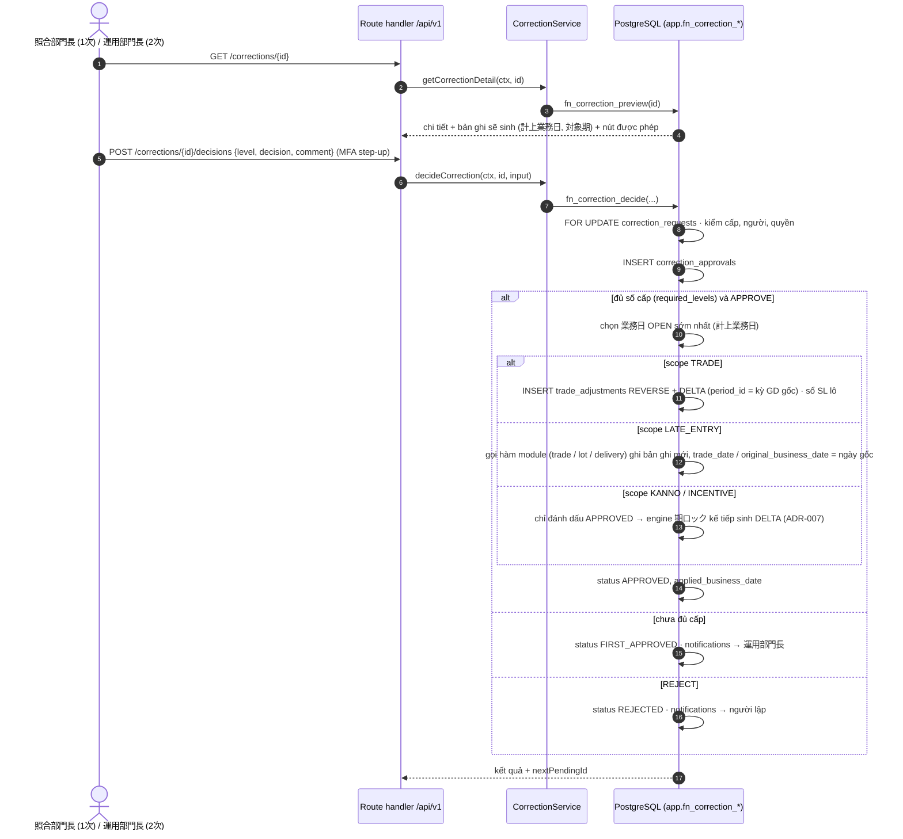

# STL_CORRECTION_DECIDE — 修正申請 決裁 và sinh bản ghi điều chỉnh

> Biểu mẫu: **BM-2-901-53 v01** — Detail Design (Chart + Description) · SUN ASTERISK VIETNAM CO., LTD · ISO/IEC 27001:2013 & ISO 9001:2015

---

## 1. History of change

| No | Version | Action | Mục / Bước | Nội dung thay đổi | Ngày | Người sửa | Approve |
|---|---|---|---|---|---|---|---|
| 1 | 0.1.0 | Add new | — | Khởi tạo | 2026-11-25 | phuongnnm-23344 | |
| 2 | 0.1.1 | Update | — | Gate 2 G2-M02: Điều kiện hoàn thành (LAB-5); G2-M03: LATE_ENTRY bị từ chối → 409 E-STL-029 + `detail.sourceCode`; khách Q-STL-04: quyền cấp 1; Q-INC-02: GD LATE_ENTRY kỳ đã khóa ghi `incentive_period_id` | 2026-11-25 | phuongnnm-23344 |  |

---

## 2. Sequence diagram

Ảnh PNG: N/A — Mermaid là nguồn duy nhất (Gate 1 m-08).

---

## 3. Description

Duyệt nội bộ 修正申請 (yêu cầu điều chỉnh sau khi chốt) — **dùng chữ 決裁 / 却下, không dùng 承認** (L4-D03, luật 2). Duyệt **không sửa GD gốc** (luật 4, ADR-004): sinh cặp REVERSE (người mua / giá cũ, số âm) + DELTA (người mua / giá mới) với **hai trục**:

- **計上業務日** (`trade_adjustments.business_date`, `correction_requests.applied_business_date`) = 業務日 `OPEN` **sớm nhất** lúc duyệt (PRM-120 (b)) — sổ ngày, 精算, IF-ACC-01.
- **対象期** (`trade_adjustments.period_id`) = **kỳ của GD gốc** (kỳ chứa `trades.trade_date`, L4-A04 (2), ADR-007 §2.3). Kỳ gốc còn `OPEN` → vào 期のお支払額 kỳ gốc; kỳ gốc đã 期ロック → không vào kỳ đang mở, chỉ đi DELTA ở 期ロック kế tiếp, **không hồi tố 完納** (trừ scope `KANNO`).

Số cấp (`required_levels`) **chốt lúc nộp** (SC-08-01 — ngoài function này), lưu ảnh chụp ngưỡng + version: 2 cấp khi tiền thay đổi lớn nhất của một người mua (税込) ≥ `CORR_TWO_LEVEL_THRESHOLD_JPY` (tạm 100.000 JPY, E-08) **hoặc** đổi 買受人 **hoặc** scope `KANNO` / `INCENTIVE` (ADJUST_DB 4.37). Function này **không tính lại** số cấp khi quy chế đổi sau khi nộp.

Ai duyệt (ADJUST_DB 4.38, S3, PRM-033, PRM-120 (a); Q-STL-04 [Customer giả lập, 2026-11-25] — **運用部門長 không duyệt cấp 1 thay 照合部門長**; chợ chỉ có một 運用部門長):

| Cấp | Người được duyệt | Cấm |
|---|---|---|
| 1 | `STL_HEAD`, hoặc người **代行 STL_HEAD đã chỉ định trước** (`delegations` đang hiệu lực) khi 照合部門長 vắng / là người lập. Không có 代行 → yêu cầu **chờ** (không có đường vòng) | Người lập; `OPS_HEAD` (kể cả khi 照合部門長 vắng) |
| 2 | `OPS_HEAD` hoặc 代行 OPS_HEAD đã chỉ định trước | Người lập; người đã duyệt cấp 1 (`uq_correction_approvals_person`) |

MFA step-up mỗi lần (10 phút, idle 3 phút — không phải ★), nên nút 「次の決裁待ちへ」 (SC-08-03 [16]) duyệt tiếp không hỏi lại mã trong cửa sổ (khách #29).

---

## 4. Detail function

### 4.1. Xem trước (`fn_correction_preview` — GET)

| Trường | Giá trị |
|---|---|
| Input | `correctionId`, `SessionContext` |
| Output | `CorrectionDetail` (yêu cầu, GD / kỳ / ngày đích, `before` / `after`, biến động theo người mua 税込, `preview.records[]`, `preview.appliedBusinessDate`, `preview.targetPeriod`, `preview.periodLocked`, `preview.effectText`, `approvals[]`, `elapsedBusinessDays`, `allowedActions`) → response API-STL-004 |

**Error**

| Điều kiện lỗi | Xử lý | Status code |
|---|---|---|
| Không có phiên | Dừng; `E-CMN-001` | 401 |
| RLS ẩn / không tồn tại | Dừng; `E-STL-021` | 404 |
| Vai không đọc được 修正申請 | Dừng; `E-CMN-002` | 403 |

**Detail**

| No | Nội dung xử lý |
|---|---|
| 1 | Đọc `correction_requests` + `correction_approvals` + `attachments` (`CORRECTION_EVIDENCE`) |
| 2 | `TRADE`: tính bản ghi sẽ sinh từ `change.before` / `after` (REVERSE: −qty cũ × giá cũ, người mua cũ; DELTA: qty mới × giá mới, người mua mới; tiền = floor(qty × giá), PRM-053); biến động 税込 theo người mua theo suất thuế của GD |
| 3 | `appliedBusinessDate` = min(`business_days.business_date`) `WHERE status = 'OPEN'` **tại thời điểm xem** — ghi chú cho màn: ngày thật chốt lúc duyệt cuối |
| 4 | `targetPeriod` = kỳ chứa `trades.trade_date` (`LATE_ENTRY`: chứa `target_business_date`); `periodLocked` từ `payment_periods.status` |
| 5 | `allowedActions`: `DECIDE_L1` / `DECIDE_L2` / `REJECT` theo bảng §3 và người xem; `elapsedBusinessDays` theo `market_calendar` (> 2 → cảnh báo, FR-NOTIFY-03) |

### 4.2. Xác thực + khóa yêu cầu (POST)

| Trường | Giá trị |
|---|---|
| Input | `correctionId`, body `{ level: 1 \| 2, decision: APPROVE \| REJECT, comment? }`, MFA |
| Output | Yêu cầu đã khóa dòng → 4.3 |

**Error**

| Điều kiện lỗi | Xử lý | Status code |
|---|---|---|
| Không phiên | Dừng; `E-CMN-001` | 401 |
| Thiếu MFA còn hiệu lực | Dừng; `E-CMN-005` | 403 |
| Không có yêu cầu | Dừng; `E-STL-021` | 404 |
| `status ∉ (SUBMITTED, FIRST_APPROVED)` | Dừng; `E-STL-022` | 409 |
| `level` ≠ cấp hiện tại (SUBMITTED → 1, FIRST_APPROVED → 2) | Dừng; `E-STL-026` (người khác vừa duyệt) | 409 |
| Người gọi = `created_by` | Dừng; `E-STL-023` 「申請者本人は決裁できません」 | 403 |
| Cấp 2 và người gọi = người duyệt cấp 1 | Dừng; `E-STL-024` 「1次と2次を同じ人は決裁できません」 | 403 |
| Quyền không khớp bảng §3 (vd `OPS_HEAD` gửi `level = 1`; 代行 hết hạn) | Dừng; `E-CMN-002` | 403 |
| `REJECT` mà `comment` rỗng / > 200 | Dừng; `E-STL-025` | 422 |

**Detail**

| No | Nội dung xử lý |
|---|---|
| 1 | `SELECT … FROM correction_requests WHERE id = :id FOR UPDATE` |
| 2 | Kiểm theo bảng Error; xác định `delegation_id` nếu duyệt bằng 代行 |
| 3 | INSERT `correction_approvals` (`level`, `decision`, `approver_id`, `delegation_id`, `mfa_verified_at`, `comment`) — unique (`correction_id`, `level`) và (`correction_id`, `approver_id`) chặn trùng ở mức DB |

### 4.3. Chuyển trạng thái

| Trường | Giá trị |
|---|---|
| Input | Kết quả 4.2 |
| Output | `REJECTED` / `FIRST_APPROVED` → 4.5; đủ cấp + `APPROVE` → 4.4 |

**Error**

`N/A — chỉ rẽ nhánh theo dữ liệu đã kiểm`

**Detail**

| No | Nội dung xử lý |
|---|---|
| 1 | `REJECT` → `status = REJECTED`; không sinh bản ghi; `notifications` → người lập (kèm lý do) |
| 2 | `APPROVE` và `level < required_levels` → `status = FIRST_APPROVED`; `notifications` → OPS-HEAD 「修正申請の2次決裁待ち」 |
| 3 | `APPROVE` và `level = required_levels` → 4.4 |

### 4.4. Phản ánh (sinh REVERSE / DELTA hoặc bản ghi mới)

| Trường | Giá trị |
|---|---|
| Input | Yêu cầu đủ cấp |
| Output | `status = APPROVED`, `applied_business_date`, bản ghi đã sinh → 4.5 |

**Error**

| Điều kiện lỗi | Xử lý | Status code |
|---|---|---|
| Không có 業務日 `OPEN` | Rollback; `E-STL-028` (không xảy ra nếu ADR-005 §2.4 chạy đúng — alarm) | 409 |
| `TRADE` tăng SL mà lô không đủ SL khả dụng | Rollback (approval cũng rollback); `E-STL-027` kèm SL còn | 409 |
| `LATE_ENTRY`: hàm module đích từ chối (vd. tư cách 許可 / 承認 không hiệu lực tại giờ trên phiếu — ADR-008 §2.4-11) | Rollback; `E-STL-029`, `detail` = `{ sourceCode, sourceMessage }` (mã + thông điệp của module đích, vd `E-TRD-005`) | 409 |

**Detail**

| No | Nội dung xử lý |
|---|---|
| 1 | `applied` = min 業務日 `OPEN` (FOR SHARE dòng `business_days`) — không bao giờ ghi vào ngày `LOCKED` (trigger `enforce_open_business_day` là chốt chặn cuối) |
| 2 | **`TRADE`**: INSERT `trade_adjustments` REVERSE (`buyer_id` cũ, `unit_price_jpy` cũ, `qty_delta` = −qty cũ) + DELTA (`buyer_id` mới, giá mới, `qty_delta` = qty mới; bỏ DELTA nếu là hủy toàn phần), `source = CORRECTION`, `correction_id`, `business_date = applied`, `period_id` = kỳ chứa `trades.trade_date`, `tax_rate_id` = suất của GD gốc, `rule_version_id` = version của ngày `applied`. Sổ SL lô: chênh SL → `SALE_REVERSE` / `SALE` (kiểm khả dụng). `trade_status_history` thêm `CORRECTION_APPLIED` |
| 3 | **`LATE_ENTRY`**: theo `change.kind` gọi `fn_trade_late_entry` / `fn_lot_late_entry` / `fn_delivery_record` (cờ late) — bản ghi mới `business_date = applied`, `trades.trade_date` / `*.original_business_date` = `target_business_date`; GD (`fn_trade_late_entry`): đọc kỳ của `trade_date` `FOR SHARE`, kỳ đó `LOCKED` → ghi `trades.incentive_period_id` = kỳ chứa `business_date` ghi sổ (kỳ đang mở — Q-INC-02, ADR-007 §2.3-7a, TRADE_DB 4.30 cột 3b); nếu có `sync_record_id` → `offline_sync_records.result = APPLIED`, `applied_ref_*` |
| 4 | **`KANNO` / `INCENTIVE`**: không ghi `trade_adjustments`; engine 期ロック kế tiếp đọc yêu cầu `APPROVED` để sinh DELTA `incentive_results` (ADR-007 §2.4-8, §2.5) — ngoài function này |
| 5 | UPDATE `status = APPROVED`, `applied_business_date = applied` (cả `KANNO` / `INCENTIVE`: ghi ngày duyệt để truy vết) |

### 4.5. Audit, thông báo, response

| Trường | Giá trị |
|---|---|
| Input | Kết quả 4.3 / 4.4 |
| Output | `{ correction: { id, status, appliedBusinessDate? }, approval, records[], nextPendingId? }` → 200 |

**Error**

`N/A — ghi log / outbox; lỗi outbox không rollback nghiệp vụ`

**Detail**

| No | Nội dung xử lý |
|---|---|
| 1 | `audit_logs` (`CORRECTION_DECIDE`, cấp, quyết định, 代行 "thay cho …", MFA, before / after) |
| 2 | `notifications`: APPROVED → người lập + SETTLE 「修正申請 {番号} を反映しました（計上 {日付}・対象期 {期}）」 |
| 3 | `nextPendingId` = yêu cầu chờ cũ nhất mà người gọi được duyệt (cùng logic `allowedActions`), loại yêu cầu vừa xử lý |

---

## 5. Other Notes

- **Không làm:** không sửa `trades`; không tính lại `required_levels`; không mở lại ngày; không tự 決裁 (không có auto-approve theo thời gian).
- **Đồng thời:** tối đa một yêu cầu chờ / GD (`uq_correction_requests_one_pending`) nên hai 修正申請 không thể chồng điều chỉnh cùng GD.
- **Ví dụ (wireframe SC-08-03):** GD 相対-0005 業務日 2027-08-02 (kỳ 2027-08), nộp 2027-09-15, duyệt cấp 2 ngày 2027-09-15 → REVERSE N04 −60 −¥114.000 / DELTA N01 +60 +¥414.000; `business_date = 2027-09-15`, `period_id = 2027-08` (đã 期ロック 09-14) → không vào 期のお支払額 2027-09; DELTA thưởng ở 期ロック kỳ 2027-09.
- Truy vết: luật 2, luật 4; FR-CORR-01..03, 07-03, D.4, CAP-HUMAN-01, PRM-033, PRM-043, PRM-053, PRM-055, PRM-120, E-08, GOV-RULE-01, FR-NOTIFY-03, S3, S8; ADR-002, ADR-004 §2.2, ADR-005 §2.8, ADR-006, ADR-007 §2.3–2.5; ADJUST_DB 4.37–4.39; L4-D03, L4-A04 (2); Gate 1 C-02, M-04, M-05, M-10; khách #3, #29.

### Điều kiện hoàn thành (LAB-5)

Mỗi dòng là một ca kiểm được (test tích hợp gọi API / hàm DB); issue LAB-5 xong khi mọi dòng đạt. Cùng khuôn với luồng 1 (vd `trade/technical-design/TRADE_AITAI_CONFIRM_TECH.md` §5).

| # | Cho / Khi | Kết quả mong đợi |
|---|---|---|
| 1 | `required_levels = 1` (TRADE, tiền thay đổi lớn nhất 50.000 < ngưỡng); STL-HEAD (≠ người lập) `level = 1` `APPROVE` | 200; `status = APPROVED`; 1 REVERSE + 1 DELTA ở `trade_adjustments`, `business_date` = 業務日 `OPEN` sớm nhất, `period_id` = kỳ chứa `trades.trade_date`; dòng `trades` gốc không đổi (so before / after) |
| 2 | `required_levels = 2` (vượt ngưỡng hoặc đổi 買受人, hoặc `KANNO` / `INCENTIVE`); cấp 1 duyệt | `FIRST_APPROVED`, chưa sinh bản ghi; `notifications` → 運用部門長 |
| 3 | Như trên, 運用部門長 `level = 2` `APPROVE` | `APPROVED`; REVERSE + DELTA như dòng 1; GD gốc của kỳ đã 期ロック → không vào 期のお支払額 kỳ đang mở (DELTA ở 期ロック kế tiếp) |
| 4 | Người lập tự gọi decide (cấp nào cũng vậy) | 403 `E-STL-023` |
| 5 | Cùng một người duyệt cấp 1 rồi gọi cấp 2 | 403 `E-STL-024` (và `uq_correction_approvals_person` chặn ở DB) |
| 6 | **運用部門長 gửi `level = 1`** (kể cả khi 照合部門長 vắng, không có 代行) | 403 `E-CMN-002`; yêu cầu giữ `SUBMITTED` (Q-STL-04) |
| 7 | 照合部門長 vắng; người được chỉ định ở `delegations` (đang hiệu lực, principal = 照合部門長) duyệt cấp 1 | 200; `correction_approvals.delegation_id` có giá trị; audit ghi "thay cho …"; 代行 hết hạn → 403 `E-CMN-002` |
| 8 | Hai người bấm cùng lúc: cấp 1 vừa xong, người khác gửi `level = 1` | 409 `E-STL-026` `detail.currentLevel = 2` |
| 9 | `REJECT` không lý do / > 200 | 422 `E-STL-025`; có lý do → `REJECTED`, không sinh bản ghi, thông báo người lập |
| 10 | TRADE tăng SL mà lô không đủ khả dụng | 409 `E-STL-027`; rollback cả dòng `correction_approvals` (Q-STL-05) |
| 11 | `LATE_ENTRY` mà hàm module đích từ chối (vd 許可 không hiệu lực tại giờ trên phiếu) | 409 `E-STL-029`, `detail.sourceCode` = mã gốc (vd `E-TRD-005`); không có bản ghi mới, yêu cầu giữ trạng thái trước đó |
| 12 | `LATE_ENTRY` hợp lệ | Bản ghi mới ở 業務日 `OPEN` sớm nhất, `trade_date` / `original_business_date` = ngày gốc; ngày gốc vẫn `LOCKED`; GD mà kỳ của ngày gốc đã `LOCKED` → `trades.incentive_period_id` = kỳ đang mở, không sinh DELTA thưởng (Q-INC-02, INCENTIVE_DB TV-13 / TV-15) |
| 13 | Thiếu step-up MFA | 403 `E-CMN-005` |
| 14 | Gửi decide cho yêu cầu đã `APPROVED` / `REJECTED` | 409 `E-STL-022` |
