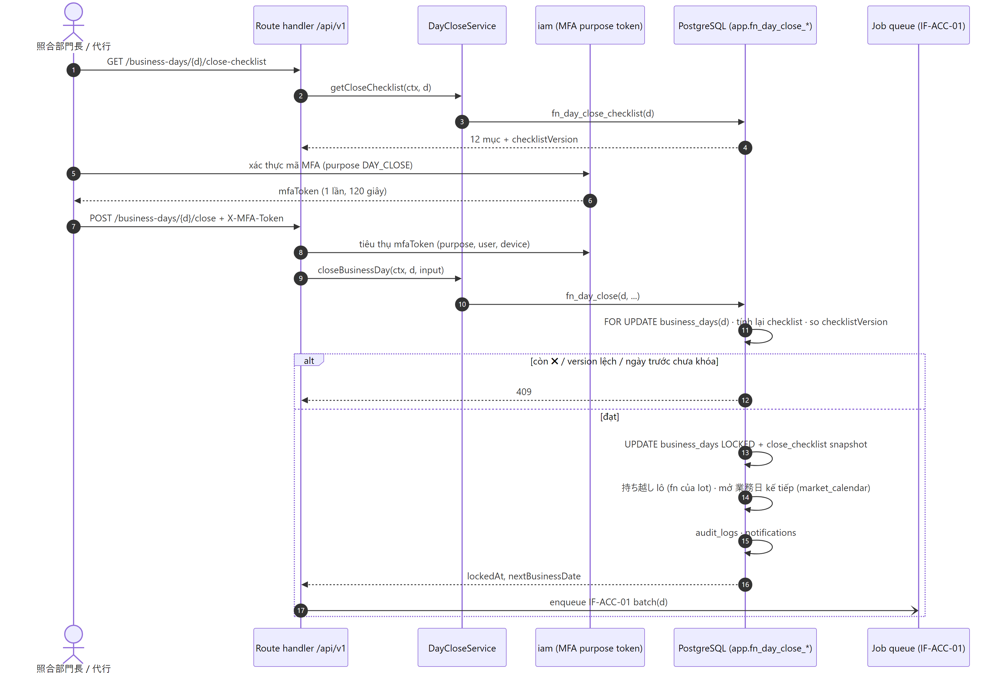
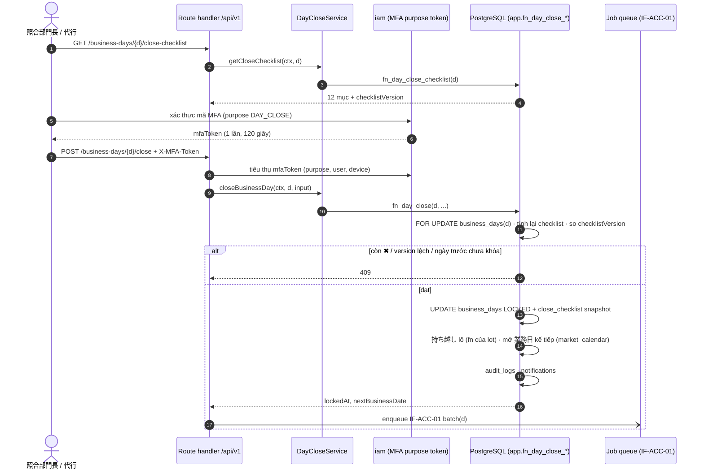

# STL_DAY_CLOSE — 日次締め

> Biểu mẫu: **BM-2-901-53 v01** — Detail Design (Chart + Description) · SUN ASTERISK VIETNAM CO., LTD · ISO/IEC 27001:2013 & ISO 9001:2015

---

## 1. History of change

| No | Version | Action | Mục / Bước | Nội dung thay đổi | Ngày | Người sửa | Approve |
|---|---|---|---|---|---|---|---|
| 1 | 0.1.0 | Add new | — | Khởi tạo | 2026-11-25 | phuongnnm-23344 | |
| 2 | 0.1.1 | Update | — | Gate 2 G2-M02: Điều kiện hoàn thành (LAB-5); G2-M03: `detail.blocking` là mảng `{adrNo, label, count}`; khách Q-STL-02: checklist 12 mục, #12 tick, E-STL-013 | 2026-11-25 | phuongnnm-23344 |  |
| 3 | 0.1.2 | Update | §2 | FB-EXP-236: nhúng ảnh PNG `./assets/STL_DAY_CLOSE_sequence.png` xuất từ khối Mermaid (`scripts/export-mermaid-png.py`); Mermaid vẫn là nguồn | 2026-11-25 | phuongnnm-23344 |  |

---

## 2. Sequence diagram

Nguồn: khối Mermaid dưới (bản để sửa); ảnh sinh từ chính khối đó bằng `python scripts/export-mermaid-png.py STL_DAY_CLOSE` — sửa Mermaid thì chạy lại để hai bản không lệch.

---

## 3. Description

Khóa một 業務日 sau khi người có quyền xem đủ checklist chuẩn (ADR-005 §2.5). Khóa bằng trạng thái DB + trigger `enforce_open_business_day` → mọi ghi vào ngày đó ở mọi bảng nghiệp vụ trả `DAY_LOCKED` (HTTP 423) — khóa ở mức dữ liệu, không chỉ ẩn nút (ADR-005 §3 phương án C bị bỏ). **Không có function mở lại** (ADR-005 §2.7).

Checklist (một hàm `fn_day_close_checklist(d)` dùng cho cả màn và cho kiểm lúc khóa — cùng một nguồn):

| ADR # | Mức | Điều kiện đếm (ngày `d`) | Item SC-07-02 |
|---|---|---|---|
| 1 | ✖ | `trades.business_date = d` và `status IN ('DRAFT','PENDING')` | [6] |
| 2 | ✖ | `seri_sessions` của `d` có `status = 'ENTERING'` (chưa xác nhận) | [4] |
| 3 | ✖ | `devices` `is_active` và `lost_reported_at IS NULL` có `pending_sync_count > 0`, **hoặc** có `offline_sync_records.result = 'PENDING'` với `business_date_for(captured_at) = d` | [8] |
| 4 | ✖ | `offline_sync_records.result = 'HELD'` có `business_date_for(captured_at) = d` + dòng 紙伝票後入力 nghi trùng chờ người quyết (`trades.source = 'PAPER_LATE'` chưa xác nhận) | [7] |
| 5 | ✖ | `trade_fixes.business_date = d`, `reviewed_at IS NULL` và (`max_buyer_diff_incl_jpy ≥ CORR_TWO_LEVEL_THRESHOLD_JPY` của version ngày `d` **hoặc** `buyer_changed`) — **trừ** fix sinh từ ngoại lệ giao (Q-DEL-09) | [9] |
| 6 | ✖ | `delivery_exceptions.affects_amount = true`, `settle_reviewed_at IS NULL`, GD có `business_date = d` | [20] |
| 7 | ⚠ | Lô `business_date ≤ d` còn SL khả dụng > 0 và chưa `CLOSED` → sẽ 持ち越し | [10] |
| 8 | ⚠ (tick) | GD `CONFIRMED` có `business_date ≤ d` còn 残 giao > 0 | [12] + [13] |
| 9 | ⚠ | Như #5 nhưng dưới ngưỡng và không đổi 買受人 | [21] |
| 10 | ⚠ | `delivery_exceptions.is_dispute` `status = 'OPEN'` có `business_date ≤ d` | [11] |
| 11 | ⚠ | Phiên せり của `d` có 確認者 = 入力者 (có lý do) | [5] |
| 12 | ⚠ (tick) | Không đếm — người khóa đối chiếu sổ giấy 引渡し確認票 đánh số của 配送 (Q-STL-02); `count` luôn `null` | [22] |

`checklistVersion` = hash SHA-256 của (11 số đếm #1–#11 + danh sách id máy ở #3). Client gửi lại khi khóa — lệch → bắt xem lại (tránh khóa theo màn đã cũ).

Chạy xong: `business_days(d).status = LOCKED`, có `locked_by`, `lock_delegation_id`, `locked_at`, `close_checklist` (ảnh chụp 12 mục, gồm trạng thái tick #8 / #12, + máy đã loại vì 「端末回収不能」); 業務日 chợ kế tiếp `OPEN`; batch IF-ACC-01 được xếp hàng.

---

## 4. Detail function

### 4.1. Xác thực, quyền, MFA dùng một lần

| Trường | Giá trị |
|---|---|
| Input | Cookie `sid`; header `X-MFA-Token` (chỉ POST); path `businessDate` |
| Output | `SessionContext` + `mfaVerifiedAt` → 4.2 / 4.3 |

**Error**

| Điều kiện lỗi | Xử lý | Status code |
|---|---|---|
| Không phiên | Dừng; `E-CMN-001` | 401 |
| GET: vai không phải STL-HEAD / 代行 / SETTLE. POST: không có quyền `STL_HEAD` và không có 代行 STL_HEAD đang hiệu lực | Dừng; `E-CMN-002` | 403 |
| POST: `X-MFA-Token` thiếu / hết hạn (120 giây) / đã dùng / khác `purpose = DAY_CLOSE` / khác người hoặc thiết bị | Dừng; `E-CMN-005` | 403 |
| `businessDate` sai định dạng | Dừng; `E-CMN-007` | 422 |

**Detail**

| No | Nội dung xử lý |
|---|---|
| 1 | Nạp phiên, quyền duyệt, 代行 (S8, RACI-01) |
| 2 | POST: gọi `iam` tiêu thụ `mfaToken` (đánh dấu đã dùng) — ★ luôn hỏi lại mã, không dùng cửa sổ 10 phút (ADR-002 §2.2-6a) |
| 3 | `set_config` `app.user_id`, `app.device_id`, `app.mfa_verified_at`, `app.delegation_id` |

### 4.2. Tính checklist (`fn_day_close_checklist`)

| Trường | Giá trị |
|---|---|
| Input | `d` |
| Output | `{ businessDate, status, totals: { aitai, seri, all }, items: [{ adrNo, itemNo, level: BLOCK \| WARN, count, details[] }], devices[], checklistVersion, lockedInfo? }` → response API-STL-001, hoặc dùng ở 4.3 |

**Error**

| Điều kiện lỗi | Xử lý | Status code |
|---|---|---|
| `d` không có ở `business_days` | Dừng; `E-STL-012` 「指定の業務日が存在しません」 | 404 |

**Detail**

| No | Nội dung xử lý |
|---|---|
| 1 | Chạy 11 truy vấn đếm ở §3 (#12 không đếm) (index: `idx_trades_business_date`, `idx_trade_fixes_unreviewed`, `idx_delivery_exceptions_open`, `idx_offline_sync_held`) — mục tiêu ≤ 1 giây |
| 2 | Ngưỡng #5 / #9 đọc từ `rule_parameters` của `business_days(d).rule_version_id` |
| 3 | Tổng tiền: Σ hiệu lực 税抜 của GD `business_date = d` (gồm điều chỉnh có `business_date = d`), tách 相対 / せり (`v_daily_settlement`) |
| 4 | Ngày đã `LOCKED` → trả ảnh chụp `close_checklist` + `lockedInfo` thay vì tính lại |

### 4.3. Kiểm lại và khóa (`fn_day_close`)

| Trường | Giá trị |
|---|---|
| Input | `d`, `confirmDate`, `deliveryRemainderAcknowledged`, `paperSlipsAllEnteredAcknowledged`, `checklistVersion` |
| Output | Ngày `d` `LOCKED` → 4.4 |

**Error**

| Điều kiện lỗi | Xử lý | Status code |
|---|---|---|
| `confirmDate` (sau chuẩn hóa `/` → `-`) ≠ `d` | Dừng; `E-STL-001` | 422 |
| `deliveryRemainderAcknowledged ≠ true` | Dừng; `E-STL-003`, `field` = `deliveryRemainderAcknowledged` | 422 |
| `paperSlipsAllEnteredAcknowledged ≠ true` (ADR #12) | Dừng; `E-STL-013`, `field` = `paperSlipsAllEnteredAcknowledged` | 422 |
| `d` đã `LOCKED` | Dừng; `E-STL-004` (kèm người / giờ khóa) | 409 |
| Có 業務日 `OPEN` < `d` | Dừng; `E-STL-005` (Q-STL-01) | 409 |
| `checklistVersion` ≠ giá trị tính lại | Dừng; `E-STL-010` | 409 |
| Còn mục ✖ có `count > 0` | Dừng; `E-STL-002` + `detail.blocking` = mảng `{ adrNo, label, count }` (một phần tử / dòng ✖) | 409 |
| Mất mạng / timeout giữa chừng | Transaction rollback; client nhận lỗi mạng → gọi lại GET để xem trạng thái thật | — |

**Detail**

| No | Nội dung xử lý |
|---|---|
| 1 | `SELECT … FROM business_days WHERE business_date = d FOR UPDATE` — chặn hai người khóa cùng lúc và chặn ghi mới trong lúc kiểm (ghi nghiệp vụ đọc trạng thái ngày qua trigger cùng dòng) |
| 2 | Gọi `fn_day_close_checklist(d)` trong cùng transaction; so `checklistVersion`, kiểm ✖ |
| 3 | UPDATE `business_days` `status = LOCKED`, `locked_by`, `lock_delegation_id`, `locked_at = now()`, `close_checklist` = JSON 12 mục (tick #8, #12 = `true`, người tick = người khóa) + danh sách máy `lost_reported_at` không null đã loại khỏi #3 |

### 4.4. Hệ quả sau khóa (cùng transaction)

| Trường | Giá trị |
|---|---|
| Input | `d` vừa khóa |
| Output | `{ lockedAt, lockedBy, delegatedFor?, nextBusinessDate }` → 200 |

**Error**

| Điều kiện lỗi | Xử lý | Status code |
|---|---|---|
| Không tìm được ngày chợ mở kế tiếp trong `market_calendar` (14 ngày tới) | Rollback toàn bộ (không khóa); `E-STL-008` | 409 |
| Lỗi hàm 持ち越し của `lot` | Rollback; `E-CMN-004`; alarm | 500 |

**Detail**

| No | Nội dung xử lý |
|---|---|
| 1 | Gọi `fn_lot_carry_over(d)` (module `lot`): lô còn SL → dòng `CARRY_OVER` sang ngày sau cùng mã lô (PRM-110, E-12 — quy tắc tạm) |
| 2 | Tìm ngày chợ mở kế tiếp `n` (`market_calendar.is_market_open`); nếu `business_days(n)` chưa có → INSERT `OPEN`, `intake_opens_at = n 01:00`, `rule_version_id` = version hiệu lực ngày `n` (idempotent với job 01:00 — ADR-005 §2.4) |
| 3 | Gọi `expireDueQualifications(n)` của `party` sau COMMIT (lỗi không ảnh hưởng khóa — SPEC-PARTY_FUNC-001 §2.8) |
| 4 | `audit_logs` (`DAY_CLOSE`, 代行 "thay cho …", MFA, ảnh chụp checklist); `notifications` → SETTLE 「{d} を締めました」 |
| 5 | Sau COMMIT: xếp hàng job tạo batch IF-ACC-01 cho `d` (BILLING_DB 4.41, PRM-123; hạn 11:00). Lỗi xếp hàng → log `ERROR` + alarm, không rollback khóa |

---

## 5. Other Notes

- **Không làm:** không có `reopen`; không tự khóa theo giờ (ADR-005 §3 E — trái CAP-HUMAN-01); không sửa dữ liệu ngày `d`.
- **Thứ tự khóa:** chặn khóa lệch thứ tự (Q-STL-01) để "業務日 chưa khóa sớm nhất" luôn là ngày sau ngày khóa gần nhất.
- **Cảnh báo trước giờ khóa:** do job nhắc (file cấu hình, ADR-005 §3 E), không thuộc function này.
- **MFA token dùng một lần** là chi tiết của `iam` (chưa có spec P3) — đề xuất: `POST /api/v1/auth/mfa/verify` {code, purpose} → `mfaToken` — chốt ở [api-conventions §4](../../_common/api-conventions.md#4-mfa-step-up); API iam chưa đặc tả (DEP-01, `specs/_index.md`).
- Truy vết: luật 3, luật 4; BR-CLOSE-01, FR-SETTLE-02, PRM-030, PRM-031, PRM-036, PRM-110, PRM-119, PRM-123, PRM-127, NFR-AVL-02, S8, RACI-01; ADR-002, ADR-005 §2.4–2.7, ADR-008; CLOSE_DB 4.20, 4.24; Gate 1 M-01, M-05; khách #1, #4, #25.

### Điều kiện hoàn thành (LAB-5)

Mỗi dòng là một ca kiểm được (test tích hợp gọi API / hàm DB); issue LAB-5 xong khi mọi dòng đạt. Cùng khuôn với luồng 1 (vd `trade/technical-design/TRADE_AITAI_CONFIRM_TECH.md` §5).

| # | Cho / Khi | Kết quả mong đợi |
|---|---|---|
| 1 | Ngày `d` có đủ dữ liệu cho 12 mục (#1–#11 có số, #12 không đếm); gọi API-STL-001 | Trả đúng 12 phần tử `items`, `adrNo` 1..12 khớp ADR-005 §2.5; #12 `count = null`, `requiresAck = true`; `checklistVersion` đổi khi bất kỳ số đếm #1–#11 đổi |
| 2 | Còn ≥ 1 mục ✖ (vd #2 = 1, #3 = 1); POST close với token đúng | 409 `E-STL-002`, `detail.blocking` là **mảng** `{adrNo, label, count}` đúng 2 phần tử; ngày vẫn `OPEN` |
| 3 | Mọi ✖ = 0; thiếu tick #8 hoặc #12 (`deliveryRemainderAcknowledged` / `paperSlipsAllEnteredAcknowledged` ≠ true) | 422 `E-STL-003` / `E-STL-013`, `field` = khóa tương ứng; không khóa |
| 4 | `confirmDate` khác `d` (`2027/08/03` khi khóa 2027-08-02) | 422 `E-STL-001` |
| 5 | Hợp lệ, token `purpose = DAY_CLOSE` | 200; `business_days(d).status = LOCKED`, `close_checklist` có 12 mục + tick #8/#12 + máy đã loại; 業務日 chợ kế tiếp `OPEN` (`nextBusinessDate`); `audit_logs` `DAY_CLOSE`; job IF-ACC-01 được xếp (`accountingExport = QUEUED`) |
| 6 | Sau khi khóa `d`: ghi GD / lô / giao / điều chỉnh vào `d` (mọi bảng nghiệp vụ) | 423 `E-CMN-003` (trigger `enforce_open_business_day`); không có endpoint mở lại |
| 7 | Token `purpose = DEVICE_LOST` (hoặc token đã dùng, quá 120 giây, khác thiết bị) | 403 `E-CMN-005`; ngày vẫn `OPEN` |
| 8 | Step-up còn hiệu lực nhưng không gửi `X-MFA-Token` | 403 `E-CMN-005` (★ luôn hỏi lại mã) |
| 9 | `d−1` còn `OPEN` | 409 `E-STL-005` `detail.openDate` (Q-STL-01) |
| 10 | Checklist đổi giữa GET và POST (`checklistVersion` cũ) | 409 `E-STL-010` `detail.currentVersion` |
| 11 | Hai người khóa cùng `d` cùng lúc | Một 200, một 409 `E-STL-004` |
| 12 | Lịch không có ngày chợ mở trong 14 ngày tới | 409 `E-STL-008`; rollback toàn bộ, `d` vẫn `OPEN` |
| 13 | 代行 STL_HEAD hết hạn; vai SETTLE gọi POST | 403 `E-CMN-002` |
