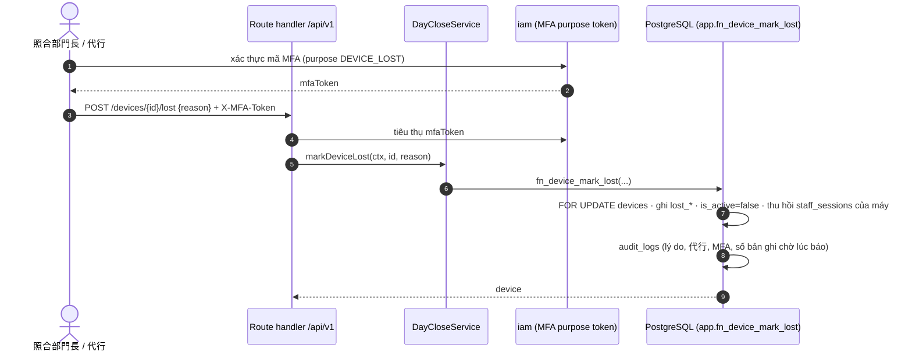

# STL_DEVICE_LOST — 端末回収不能

> Biểu mẫu: **BM-2-901-53 v01** — Detail Design (Chart + Description) · SUN ASTERISK VIETNAM CO., LTD · ISO/IEC 27001:2013 & ISO 9001:2015

---

## 1. History of change

| No | Version | Action | Mục / Bước | Nội dung thay đổi | Ngày | Người sửa | Approve |
|---|---|---|---|---|---|---|---|
| 1 | 0.1.0 | Add new | — | Khởi tạo | 2026-11-25 | phuongnnm-23344 | |

---

## 2. Sequence diagram

Ảnh PNG: N/A — Mermaid là nguồn duy nhất (Gate 1 m-08).

---

## 3. Description

Lối thoát duy nhất khi checklist 日次締め bị một thiết bị hỏng / mất / hết pin giữ lại (ADR-005 §2.6, khách #1). Không phải "khóa bỏ qua checklist": chỉ loại **đúng máy đó** khỏi mục #3; mọi mục ✖ khác vẫn chặn. Bản ghi chưa đồng bộ coi như mất → nhập bù từ giấy (後入力); nếu máy về sau đồng bộ được, bản ghi vào `offline_sync_records` `HELD` → SC-03-07 → 修正申請 `LATE_ENTRY` hoặc 「反映しない」 (ADR-008 §2.2-6). Không có thao tác "bỏ đánh dấu" ở 第1期 — đăng ký lại máy là việc của SYSADM (cấp `device_code` mới).

---

## 4. Detail function

### 4.1. Xác thực, quyền, MFA dùng một lần

| Trường | Giá trị |
|---|---|
| Input | Cookie `sid`; header `X-MFA-Token`; path `deviceId`; body `{ reason }` |
| Output | `SessionContext` → 4.2 |

**Error**

| Điều kiện lỗi | Xử lý | Status code |
|---|---|---|
| Không phiên | Dừng; `E-CMN-001` | 401 |
| Không có quyền `STL_HEAD` / 代行 | Dừng; `E-CMN-002` | 403 |
| MFA token thiếu / sai mục đích / đã dùng | Dừng; `E-CMN-005` | 403 |
| `reason` rỗng / > 200 | Dừng; `E-STL-006` | 422 |

**Detail**

| No | Nội dung xử lý |
|---|---|
| 1 | Như STL_DAY_CLOSE §4.1 với `purpose = DEVICE_LOST` (★ luôn hỏi lại mã — PREMISE §3.2) |

### 4.2. Đánh dấu máy

| Trường | Giá trị |
|---|---|
| Input | `deviceId`, `reason` |
| Output | `{ device: { id, code, lostReportedAt, lostReportedBy, pendingSyncCountAtReport } }` → 200 |

**Error**

| Điều kiện lỗi | Xử lý | Status code |
|---|---|---|
| Không có máy | Dừng; `E-STL-009` | 404 |
| Đã đánh dấu trước đó | Dừng; `E-STL-007` (kèm người / giờ) | 409 |

**Detail**

| No | Nội dung xử lý |
|---|---|
| 1 | `SELECT … FROM devices WHERE id = :id FOR UPDATE` |
| 2 | UPDATE `lost_reported_at = now()`, `lost_reported_by`, `lost_reason`, `is_active = false` (IAM_AUDIT_DB 4.6) |
| 3 | DELETE / vô hiệu `staff_sessions` của `device_id` (phiên server-side — ADR-002 §2.1-2); từ giờ API từ máy này trả 401; đổi người bằng PIN trên máy bị từ chối khi online; bản băm PIN offline trên máy không xóa từ xa được → mọi bản ghi máy gửi lên sau đều `HELD` (kiểm `lost_reported_at` trong hàm đồng bộ) |
| 4 | `audit_logs` (`DEVICE_LOST`, lý do, 代行, MFA, `pending_sync_count` lúc báo); `notifications` → SYSADM, SETTLE |

---

## 5. Other Notes

- **Không làm:** không xóa bản ghi offline đã nhận; không tự tạo 修正申請 cho bản ghi đến muộn.
- Báo cáo khóa ngày (`close_checklist`) ghi danh sách máy đã loại để kiểm toán thấy đường tắt đã dùng (ADR-005 §4).
- Truy vết: NFR-AVL-02, BR-CLOSE-01, NFR-SEC-03; ADR-002, ADR-005 §2.6, ADR-008 §2.2-7; IAM_AUDIT_DB 4.6, 4.7, 4.55; PREMISE §3.2; khách #1.
