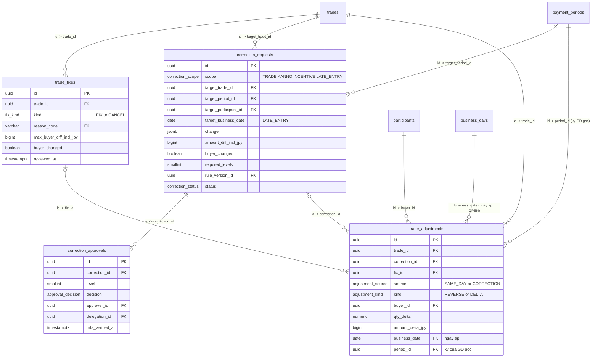

# ADJUST_DB — 当日訂正, 修正申請, điều chỉnh REVERSE / DELTA

| | |
|---|---|
| System Name | 水産物卸売市場業務支援システム（Product A, khách 株式会社 桜水産市場 — hư cấu） |
| Schema | `app` |
| CHARACTER SET | UTF8 (PostgreSQL 16, RDS Multi-AZ, AWS Tokyo) |
| Updated by | phuongnnm-23344 |
| Note | Một file của bộ Database Design tách theo cụm ER (QC-01 §4: một file một nhóm bảng). Nguyên tắc P1–P7, quy ước chung + enum (4.0), view công bố, bảng lệch so với prototype, kết quả parity và điểm mở chung nằm ở file tổng [MKT_DB.md](MKT_DB.md). **Số mục 4.xx giữ theo số bảng toàn schema** (cột No ở MKT_DB §2) để tham chiếu chéo giữa các file và từ ADR / spec không đổi khi tách |

---

## 1. Lịch sử sửa đổi

| No | Version | Action | Sheet / Bảng | Nội dung thay đổi | Ngày | Người sửa | Approve |
|---|---|---|---|---|---|---|---|
| 1 | 0.1.0 | Add new | — | Nội dung ban đầu nằm trong `MKT_DB.md` 0.1.0 (một file cho toàn schema) | 2026-11-25 | phuongnnm-23344 | |
| 2 | 0.2.0 | Add new | Toàn file | Tách từ `MKT_DB.md` 0.1.1 theo cụm ER (Gate 1 M-09); sửa theo Gate 1: `trade_adjustments.period_id` = kỳ GD gốc, tách khỏi `business_date` ngày áp (C-02); `correction_scope` thêm `INCENTIVE`, `LATE_ENTRY` + nghĩa `KANNO` (M-04, M-05, M-10); ngưỡng 2 cấp theo tiền thay đổi lớn nhất của một người mua, `buyer_changed` (khách #3); `trade_fixes` thêm số đo ngưỡng + `reviewed_*` cho checklist 日次締め (khách #25) | 2026-11-25 | phuongnnm-23344 | |

---

## 2. Danh sách bảng

| No | Schema | Category | Tên bảng (logic) | Tên bảng (vật lý) | Mô tả | Note | Status |
|---|---|---|---|---|---|---|---|
| 32 | app | transaction | 当日訂正 / 取消 | [`trade_fixes`](#432-trade_fixes) | Sửa / hủy GD của ngày chưa khóa, có lý do, không duyệt 2 cấp | Mới | Decision (provisional) |
| 37 | app | transaction | 修正申請 | [`correction_requests`](#437-correction_requests) | Yêu cầu sửa sau khóa ngày (FORM-CORR-01) | Prototype: `correction_requests` | Decision (provisional) |
| 38 | app | history | Bước duyệt 修正申請 | [`correction_approvals`](#438-correction_approvals) | Mỗi lần duyệt / từ chối một dòng, có 代行, MFA | Mới | Decision (provisional) |
| 39 | app | transaction | Dòng điều chỉnh | [`trade_adjustments`](#439-trade_adjustments) | REVERSE (người mua cũ) + DELTA (người mua mới) | Prototype: `trade_adjustments` | Decision (provisional) |

---

## 3. ER Diagram

`trade_adjustments` có đúng một nguồn: `correction_id` (修正申請 sau khóa ngày) **hoặc** `fix_id` (当日訂正 / 取消 trước khóa ngày). Mỗi dòng mang **hai trục thời gian** (Gate 1 C-02): `business_date` = ngày áp / ghi sổ (業務日 `OPEN`; sổ ngày, 日次精算, IF-ACC-01) và `period_id` = **kỳ của GD gốc** (kỳ chứa `trades.trade_date`). `trades`, `participants`, `business_days`, `payment_periods` ở các file [TRADE_DB.md](TRADE_DB.md), [PARTY_DB.md](PARTY_DB.md), [CLOSE_DB.md](CLOSE_DB.md).

---

## 4. Định nghĩa bảng

Quy ước chung (kiểu, cột chung, chỉ thêm, ngày mở, ghi qua hàm, enum): [MKT_DB.md §4.0](MKT_DB.md#40-quy-ước-chung).

### 4.32. `trade_fixes`

| | | | |
|---|---|---|---|
| Tên bảng (logic) | 当日訂正 / 取消 | Tạo bởi / ngày | phuongnnm-23344 / 2026-11-25 |
| Tên bảng (vật lý) | `trade_fixes` | Sửa bởi / ngày | — |
| Overview | Sửa / hủy GD **của 業務日 chưa khóa** trên SC-04-05 (PRM-127, FR-AITAI-03): có lý do, giữ lịch sử, **không** duyệt 2 cấp. Sinh `trade_adjustments` (REVERSE + DELTA; 取消 chỉ REVERSE) cùng cơ chế với 修正申請 → GD gốc không bị ghi đè (luật 4, sửa D11). **Chỉ thêm. Ngày mở** (ngày của GD gốc phải `OPEN`). | Note | Sau khóa ngày chỉ còn đường 修正申請 (4.37). Ngày bị khóa đúng lúc đang nhập (lỗi `DAY_LOCKED`, HTTP 423) → màn giữ nội dung và mang sang SC-08-01 (khách #5). Chỉ UPDATE `reviewed_by` / `reviewed_at` một lần |

**Định nghĩa cột**

| No. | Key | Tên logic | Tên vật lý | Data Type | Size | Not Null | Default | Note |
|---|---|---|---|---|---|---|---|---|
| 1 | PRI | ID | `id` | UUID | N/A | Yes | `gen_random_uuid()` | |
| 2 | FK | GD | `trade_id` | UUID | N/A | Yes | | |
| 3 | FK | 業務日 | `business_date` | DATE | N/A | Yes | | = `trades.business_date` (CHECK trong hàm) |
| 4 | | Loại | `kind` | `fix_kind` | N/A | Yes | | |
| 5 | | Nội dung đổi | `change` | JSONB | N/A | No | | `{before, after}` cho `qty`, `unit_price_jpy`, `buyer_id`; NULL khi `CANCEL` |
| 6 | | Mã lý do | `reason_code` | VARCHAR | 20 | Yes | | `code_values` (`FIX_REASON`) |
| 7 | | Ghi chú lý do | `reason_note` | VARCHAR | 200 | No | | |
| 7a | | Tiền thay đổi lớn nhất của một người mua (税込) | `max_buyer_diff_incl_jpy` | BIGINT | N/A | Yes | | Cùng cách đo với 4.37 cột 7; `CANCEL` = tiền 税込 của GD |
| 7b | | Đổi 買受人 | `buyer_changed` | BOOLEAN | N/A | Yes | `false` | |
| 7c | FK | 照合 確認済 bởi / lúc | `reviewed_by`, `reviewed_at` | UUID / TIMESTAMPTZ | | No | | 照合事務局 bấm 「確認済」 ở 要確認 SC-07-01. Dòng có `max_buyer_diff_incl_jpy` ≥ `CORR_TWO_LEVEL_THRESHOLD_JPY` **hoặc** `buyer_changed` mà chưa có → ✖ checklist 日次締め; dưới ngưỡng → ⚠ (Q-SC0405-01, khách #25 [Giả lập]). `reviewed_by` ≠ `created_by` |
| 8 | | Cột chung | `created_at`, `created_by` | | | | | |

**Index** — `trade_fixes_pkey`; `idx_trade_fixes_trade` (`trade_id`); `idx_trade_fixes_unreviewed` (`business_date`) partial `reviewed_at IS NULL`.

**Khoá ngoại** — `trade_id` → `trades.id`; `business_date` → `business_days`.

---

### 4.37. `correction_requests`

| | | | |
|---|---|---|---|
| Tên bảng (logic) | 修正申請 | Tạo bởi / ngày | phuongnnm-23344 / 2026-11-25 |
| Tên bảng (vật lý) | `correction_requests` | Sửa bởi / ngày | — |
| Overview | FORM-CORR-01: sửa sau khóa ngày (FT-08-01). Số cấp duyệt chốt **lúc nộp** theo `CORR_TWO_LEVEL_THRESHOLD_JPY` của version hiệu lực, so với **tiền thay đổi lớn nhất của một người mua** (lưu ảnh chụp ngưỡng + version — sửa D07, khách #3); **luôn 2 cấp** khi đổi người mua, `KANNO`, `INCENTIVE` (PRM-033). Tối đa một yêu cầu đang chờ / GD (giữ 0029). Bốn phạm vi: `TRADE` — duyệt xong → REVERSE + DELTA vào **業務日 chưa khóa sớm nhất** (PRM-120 (b)), kỳ theo GD gốc (4.39); `KANNO` — tiền về trước 支払期日 nhưng 消込 trễ / gán sai (PRM-055): ngoại lệ có duyệt của nguyên tắc "không hồi tố 完納", kết quả là dòng DELTA ở 期ロック kế tiếp (INCENTIVE_DB 4.52); `INCENTIVE` — sửa tiền thưởng của kỳ đã khóa tính theo tỷ lệ áp sai (R-L4-01) → dòng DELTA có lý do; `LATE_ENTRY` — GD / lô / lần giao **mới** của ngày đã khóa (紙伝票後入力, bản ghi offline đến muộn): duyệt xong ghi vào 業務日 đang mở, tham chiếu ngày gốc (`trades.trade_date`, `*.original_business_date`) (Gate 1 M-04, M-05, M-10). | Note | Bỏ cột `approver1`, `approver2` → bảng `correction_approvals` (có 代行, MFA) |

**Định nghĩa cột**

| No. | Key | Tên logic | Tên vật lý | Data Type | Size | Not Null | Default | Note |
|---|---|---|---|---|---|---|---|---|
| 1 | PRI | ID | `id` | UUID | N/A | Yes | `gen_random_uuid()` | |
| 2 | | Phạm vi | `scope` | `correction_scope` | N/A | Yes | `'TRADE'` | `TRADE` · `KANNO` · `INCENTIVE` · `LATE_ENTRY` |
| 3 | FK | GD đích | `target_trade_id` | UUID | N/A | No | | Bắt buộc khi `TRADE` |
| 4 | FK | Kỳ đích | `target_period_id` | UUID | N/A | No | | Bắt buộc khi `KANNO`, `INCENTIVE` (kỳ đã `LOCKED`) |
| 5 | FK | Người tham gia đích | `target_participant_id` | UUID | N/A | No | | Bắt buộc khi `KANNO`, `INCENTIVE` |
| 5a | | 業務日 gốc | `target_business_date` | DATE | N/A | No | | Bắt buộc khi `LATE_ENTRY`; ngày đã `LOCKED` |
| 6 | | Nội dung đổi | `change` | JSONB | N/A | Yes | | `TRADE`: `{before, after}`; `KANNO`: `{kanno_after, evidence}`; `INCENTIVE`: `{amount_jpy, basis}`; `LATE_ENTRY`: `{kind: TRADE \| LOT \| DELIVERY, payload, paper_slip_no, sync_record_id}` |
| 7 | | Tiền thay đổi lớn nhất của một người mua (税込) | `amount_diff_incl_jpy` | BIGINT | N/A | Yes | | = max theo người mua liên quan của \|Σ chênh 税込\|; đổi 買受人 cùng giá thì mỗi bên một số, không triệt tiêu về 0 (khách #3). Dùng so ngưỡng. `KANNO` / `INCENTIVE`: tiền thưởng thay đổi |
| 7a | | Đổi 買受人 | `buyer_changed` | BOOLEAN | N/A | Yes | `false` | `true` → `required_levels = 2` |
| 8 | | Ngưỡng tại lúc nộp | `threshold_jpy_snapshot` | BIGINT | N/A | Yes | | |
| 9 | FK | Version quy chế | `rule_version_id` | UUID | N/A | Yes | | |
| 10 | | Số cấp cần | `required_levels` | SMALLINT | N/A | Yes | | CHECK 1..2; = 2 khi `buyer_changed`, `KANNO`, `INCENTIVE`, hoặc `amount_diff_incl_jpy` ≥ ngưỡng |
| 11 | | Lý do | `reason` | VARCHAR | 500 | Yes | | |
| 12 | | Trạng thái | `status` | `correction_status` | N/A | Yes | `'SUBMITTED'` | |
| 13 | | 業務日 áp | `applied_business_date` | DATE | N/A | No | | Ngày ghi REVERSE / DELTA |
| 14 | | Cột chung | `created_at`, `created_by`, `updated_at` | | | | | `created_by` = người lập (TRADE / DELIVERY / SETTLE) |

Chứng cứ (sao kê, ảnh) ở `attachments` (`ref_table = 'correction_requests'`). Chờ duyệt quá 2 営業日 → cảnh báo (`notifications`).

**Index** — `correction_requests_pkey`; `uq_correction_requests_one_pending` (`target_trade_id`) unique partial `status IN ('SUBMITTED','FIRST_APPROVED')`; `idx_correction_requests_status` (`status`, `created_at`).

**Khoá ngoại** — `target_trade_id` → `trades.id`; `target_period_id` → `payment_periods.id`; `target_participant_id` → `participants.id`; `rule_version_id` → `rule_versions.id`; `applied_business_date` → `business_days`. `target_business_date` không FK sang ngày mở (ngày đã khóa vẫn tồn tại ở `business_days`, FK thường).

---

### 4.38. `correction_approvals`

| | | | |
|---|---|---|---|
| Tên bảng (logic) | Bước duyệt 修正申請 | Tạo bởi / ngày | phuongnnm-23344 / 2026-11-25 |
| Tên bảng (vật lý) | `correction_approvals` | Sửa bởi / ngày | — |
| Overview | Mỗi lần 決裁 / 却下 một dòng. Cấp 1 = 照合部門長, cấp 2 = 運用部門長; **một người không duyệt cả 2 cấp**; người lập không duyệt; 照合部門長 tự lập → cấp 1 do 代行 đã chỉ định (PRM-120 (a)). MFA bắt buộc. **Chỉ thêm.** | Note | Mới — thay `approver1` / `approver2` |

**Định nghĩa cột**

| No. | Key | Tên logic | Tên vật lý | Data Type | Size | Not Null | Default | Note |
|---|---|---|---|---|---|---|---|---|
| 1 | PRI | ID | `id` | UUID | N/A | Yes | `gen_random_uuid()` | |
| 2 | FK | 修正申請 | `correction_id` | UUID | N/A | Yes | | |
| 3 | | Cấp | `level` | SMALLINT | N/A | Yes | | CHECK 1..2 |
| 4 | | Quyết định | `decision` | `approval_decision` | N/A | Yes | | |
| 5 | FK | Người duyệt | `approver_id` | UUID | N/A | Yes | | |
| 6 | FK | 代行 | `delegation_id` | UUID | N/A | No | | |
| 7 | | MFA lúc | `mfa_verified_at` | TIMESTAMPTZ | N/A | Yes | | |
| 8 | | Ý kiến / lý do từ chối | `comment` | VARCHAR | 500 | No | | Bắt buộc khi `REJECT` |
| 9 | | Cột chung | `created_at` | | | | | |

**Index** — `correction_approvals_pkey`; `uq_correction_approvals_level` (`correction_id`, `level`) unique; `uq_correction_approvals_person` (`correction_id`, `approver_id`) unique (một người một cấp).

**Khoá ngoại** — `correction_id` → `correction_requests.id`; `approver_id` → `staff_accounts.id`; `delegation_id` → `delegations.id`.

---

### 4.39. `trade_adjustments`

| | | | |
|---|---|---|---|
| Tên bảng (logic) | Dòng điều chỉnh | Tạo bởi / ngày | phuongnnm-23344 / 2026-11-25 |
| Tên bảng (vật lý) | `trade_adjustments` | Sửa bởi / ngày | — |
| Overview | Cặp REVERSE (người mua / giá **cũ**, số âm) + DELTA (người mua / giá **mới**) cho mọi thay đổi sau 確定 — hai nguồn `SAME_DAY` và `CORRECTION` dùng chung bảng (ADR-004 §2.2). GD gốc không đổi; giá trị hiệu lực = gốc + Σ điều chỉnh (`v_trade_effective`). `business_date` = **ngày áp** (luôn `OPEN`; sổ ngày, 日次精算, IF-ACC-01). `period_id` = **kỳ của GD gốc**: kỳ gốc còn `OPEN` → dòng vào 期のお支払額 kỳ gốc và thưởng khi khóa kỳ gốc; kỳ gốc đã `LOCKED` → **không** vào 期のお支払額 kỳ đang mở, chỉ đi DELTA ở 期ロック kế tiếp (INCENTIVE_DB 4.52) — không đếm hai lần. Số chênh của kỳ đã khóa hiện trên thông báo kỳ kế tiếp thành dòng 「前期以前の調整」 riêng, không cộng vào số xét 完納 (OPEN-DB-08). **Chỉ thêm. Ngày mở.** (Gate 1 C-02) | Note | Thêm `adjustment_source`, `fix_id`, `tax_rate_id`, `rule_version_id`, `created_by` so với prototype |

**Định nghĩa cột**

| No. | Key | Tên logic | Tên vật lý | Data Type | Size | Not Null | Default | Note |
|---|---|---|---|---|---|---|---|---|
| 1 | PRI | ID | `id` | UUID | N/A | Yes | `gen_random_uuid()` | |
| 2 | FK | GD gốc | `trade_id` | UUID | N/A | Yes | | |
| 3 | | Nguồn | `source` | `adjustment_source` | N/A | Yes | | |
| 4 | FK | 修正申請 | `correction_id` | UUID | N/A | No | | CHECK: có khi `source = CORRECTION` |
| 5 | FK | 当日訂正 / 取消 | `fix_id` | UUID | N/A | No | | CHECK: có khi `source = SAME_DAY`; đúng một trong 4, 5 |
| 6 | | Loại | `kind` | `adjustment_kind` | N/A | Yes | | |
| 7 | FK | Người mua của dòng | `buyer_id` | UUID | N/A | Yes | | REVERSE = cũ, DELTA = mới (giữ M4 của prototype) |
| 8 | | Đơn giá của dòng | `unit_price_jpy` | BIGINT | N/A | Yes | | CHECK > 0 |
| 9 | | SL thay đổi | `qty_delta` | NUMERIC | 12,1 | Yes | | |
| 10 | | Tiền thay đổi (税抜) | `amount_delta_jpy` | BIGINT | N/A | Yes | | Trigger kiểm = SL × giá (giữ 0025) |
| 11 | FK | Thuế suất | `tax_rate_id` | UUID | N/A | Yes | | = suất của GD gốc |
| 12 | FK | Version quy chế áp | `rule_version_id` | UUID | N/A | Yes | | |
| 13 | FK | 業務日 áp (ghi sổ) | `business_date` | DATE | N/A | Yes | | Ngày `OPEN` sớm nhất lúc ghi. **Không** quyết định kỳ |
| 13a | FK | Kỳ của GD gốc | `period_id` | UUID | N/A | Yes | | Hàm ghi điền = kỳ chứa `trades.trade_date` (L4-A04 (2), Gate 1 C-02); người dùng không nhập. Ví dụ: GD 2027-07-31, 修正申請 duyệt 2027-08-03 → `business_date` 2027-08-03, `period_id` = 2027-07 |
| 14 | | Cột chung | `created_at`, `created_by` | | | | | |

**Index** — `trade_adjustments_pkey`; `idx_adjustments_trade` (`trade_id`); `idx_adjustments_buyer_date` (`buyer_id`, `business_date`); `idx_adjustments_business_date` (`business_date`); `idx_adjustments_period_created` (`period_id`, `created_at`) — phát hiện đầu vào đổi sau 期ロック (C-01).

**Khoá ngoại** — `trade_id` → `trades.id`; `correction_id` → `correction_requests.id`; `fix_id` → `trade_fixes.id`; `buyer_id` → `participants.id`; `tax_rate_id` → `tax_rates.id`; `rule_version_id` → `rule_versions.id`; `business_date` → `business_days`; `period_id` → `payment_periods.id`.
