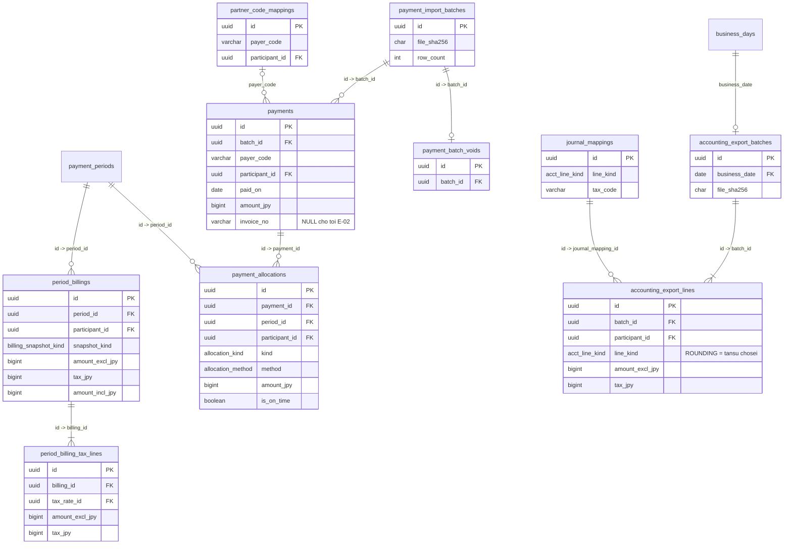

# BILLING_DB — 期のお支払額 / 入金 / phân bổ / batch kế toán IF-ACC-01

| | |
|---|---|
| System Name | 水産物卸売市場業務支援システム（Product A, khách 株式会社 桜水産市場 — hư cấu） |
| Schema | `app` |
| CHARACTER SET | UTF8 (PostgreSQL 16, RDS Multi-AZ, AWS Tokyo) |
| Updated by | phuongnnm-23344 |
| Note | Một file của bộ Database Design tách theo cụm ER (QC-01 §4: một file một nhóm bảng). Nguyên tắc P1–P7, quy ước chung + enum (4.0), view công bố, bảng lệch so với prototype, kết quả parity và điểm mở chung nằm ở file tổng [MKT_DB.md](MKT_DB.md). **Số mục 4.xx giữ theo số bảng toàn schema** (cột No ở MKT_DB §2) để tham chiếu chéo giữa các file và từ ADR / spec không đổi khi tách |

---

## 1. Lịch sử sửa đổi

| No | Version | Action | Sheet / Bảng | Nội dung thay đổi | Ngày | Người sửa | Approve |
|---|---|---|---|---|---|---|---|
| 1 | 0.1.0 | Add new | — | Nội dung ban đầu nằm trong `MKT_DB.md` 0.1.0 (một file cho toàn schema) | 2026-11-25 | phuongnnm-23344 | |
| 2 | 0.2.0 | Add new | Toàn file | Tách từ `MKT_DB.md` 0.1.1 theo cụm ER (Gate 1 M-09); sửa theo Gate 1: 期のお支払額 lấy điều chỉnh theo `period_id` (kỳ GD gốc), điều chỉnh của kỳ đã khóa không vào kỳ đang mở (C-02); phân bổ 入金 vào kỳ đã khóa → tính lại thành DELTA (C-01); ví dụ thuế 8% (m-07) | 2026-11-25 | phuongnnm-23344 | |
| 3 | 0.3.0 | Update | 4.48, 4.49 | Gate 1 recheck: 4.49 cột 5 chỉ tính GD ghi trước khi kỳ khóa (N-02); định nghĩa "còn nợ" của kỳ đã khóa cho FIFO (n-03) | 2026-11-25 | phuongnnm-23344 | |
| 4 | 0.3.1 | Update | 4.48, 4.49 | Khách Q-INC-02: GD 後入力 của kỳ đã khóa vào 期のお支払額 của kỳ `trades.incentive_period_id` (kỳ đang mở), không đi DELTA; "còn nợ" kỳ đã khóa chỉ cộng điều chỉnh | 2026-11-25 | phuongnnm-23344 | |

---

## 2. Danh sách bảng

| No | Schema | Category | Tên bảng (logic) | Tên bảng (vật lý) | Mô tả | Note | Status |
|---|---|---|---|---|---|---|---|
| 40 | app | history | Ánh xạ 仕訳 | [`journal_mappings`](#440-journal_mappings) | 勘定科目 / 税区分 theo loại dòng, có lịch sử | Mới | Decision (provisional) |
| 41 | app | transaction | Batch kế toán IF-ACC-01 | [`accounting_export_batches`](#441-accounting_export_batches) | Một batch / 業務日 đã khóa, đóng băng lúc tạo | Mới | Undecided |
| 42 | app | transaction | Dòng batch kế toán | [`accounting_export_lines`](#442-accounting_export_lines) | Người tham gia × thuế suất; dòng 端数調整 | Mới | Undecided |
| 44 | app | history | Ánh xạ mã đối tác | [`partner_code_mappings`](#444-partner_code_mappings) | Mã người nộp trong file 入金 → người tham gia | Mới | Decision (provisional) |
| 45 | app | transaction | Batch import 入金 | [`payment_import_batches`](#445-payment_import_batches) | Mỗi file một batch, chặn trùng SHA-256 | Prototype: `payment_import_batches` | Decision (provisional) |
| 46 | app | transaction | Hủy batch 入金 | [`payment_batch_voids`](#446-payment_batch_voids) | Hủy bằng bản ghi thêm, người hủy ≠ người import | Prototype: `payment_batch_voids` | Decision (provisional) |
| 47 | app | transaction | 入金 | [`payments`](#447-payments) | Dòng tiền về | Prototype: `payments` | Decision (provisional) |
| 48 | app | transaction | Phân bổ 入金 vào kỳ | [`payment_allocations`](#448-payment_allocations) | FIFO khi chưa có 請求番号 (E-02) | Mới | Decision (provisional) |
| 49 | app | transaction | 期のお支払額 | [`period_billings`](#449-period_billings) | Số phải trả người × kỳ; ảnh chụp lúc thông báo và lúc 期ロック | Mới | Decision (provisional) |
| 50 | app | transaction | Thuế theo suất của kỳ | [`period_billing_tax_lines`](#450-period_billing_tax_lines) | Tổng 税抜 + thuế tính một lần theo từng suất | Mới | Decision (provisional) |

---

## 3. ER Diagram

`payment_periods`, `business_days` ở [CLOSE_DB.md](CLOSE_DB.md); `participants` ở [PARTY_DB.md](PARTY_DB.md); `tax_rates`, `rule_versions` ở [RULE_DB.md](RULE_DB.md); kết quả thưởng ở [INCENTIVE_DB.md](INCENTIVE_DB.md).

Ví dụ số (thủy sản tươi là thực phẩm → **軽減税率 8%**, Gate 1 m-07): người mua có 1.000.000 JPY 税抜 trong kỳ → thuế 80.000 (một lần trên tổng theo suất, `FLOOR`) → 期のお支払額 1.080.000.

---

## 4. Định nghĩa bảng

Quy ước chung (kiểu, cột chung, chỉ thêm, ngày mở, ghi qua hàm, enum): [MKT_DB.md §4.0](MKT_DB.md#40-quy-ước-chung).

### 4.40. `journal_mappings`

| | | | |
|---|---|---|---|
| Tên bảng (logic) | Ánh xạ 仕訳 | Tạo bởi / ngày | phuongnnm-23344 / 2026-11-25 |
| Tên bảng (vật lý) | `journal_mappings` | Sửa bởi / ngày | — |
| Overview | 仕訳対応表 (FT-11-14): loại dòng × thuế suất → 勘定科目 / 税区分. Có lịch sử; thay đổi chỉ áp cho batch tạo **sau** thời điểm đổi, không áp ngược (PRM-123). **Chỉ thêm** (đổi = dòng mới, dòng cũ điền `superseded_at` qua hàm). | Note | Mới (M06) |

**Định nghĩa cột**

| No. | Key | Tên logic | Tên vật lý | Data Type | Size | Not Null | Default | Note |
|---|---|---|---|---|---|---|---|---|
| 1 | PRI | ID | `id` | UUID | N/A | Yes | `gen_random_uuid()` | |
| 2 | | Loại dòng | `line_kind` | `acct_line_kind` | N/A | Yes | | |
| 3 | | Mã thuế | `tax_code` | VARCHAR | 10 | Yes | | |
| 4 | | 勘定科目 | `account_code` | VARCHAR | 20 | Yes | | Định dạng chờ E-01 |
| 5 | | 税区分 | `tax_category` | VARCHAR | 20 | Yes | | |
| 6 | | Hiệu lực từ | `effective_at` | TIMESTAMPTZ | N/A | Yes | `now()` | |
| 7 | | Bị thay lúc | `superseded_at` | TIMESTAMPTZ | N/A | No | | |
| 8 | | Cột chung | `created_at`, `created_by` | | | | | |

**Index** — `journal_mappings_pkey`; `uq_journal_mappings_current` (`line_kind`, `tax_code`) unique partial `superseded_at IS NULL`. **Khoá ngoại** — N/A.

---

### 4.41. `accounting_export_batches`

| | | | |
|---|---|---|---|
| Tên bảng (logic) | Batch kế toán IF-ACC-01 | Tạo bởi / ngày | phuongnnm-23344 / 2026-11-25 |
| Tên bảng (vật lý) | `accounting_export_batches` | Sửa bởi / ngày | — |
| Overview | Tạo sau 日次締め, nội dung **đóng băng lúc tạo** gồm ánh xạ đã áp; xuất lại cùng 業務日 trả đúng file đã tạo (PRM-123, ADR-005 §2.10). Import tay vào phần mềm kế toán. **Chỉ thêm.** | Note | **Undecided**: định dạng / trường chờ E-01. Trường tối thiểu theo IF-ACC-01 / DR-SETTLE-01 |

**Định nghĩa cột**

| No. | Key | Tên logic | Tên vật lý | Data Type | Size | Not Null | Default | Note |
|---|---|---|---|---|---|---|---|---|
| 1 | PRI | ID | `id` | UUID | N/A | Yes | `gen_random_uuid()` | |
| 2 | UNI | Batch code | `batch_code` | VARCHAR | 20 | Yes | | |
| 3 | UNI/FK | 業務日 | `business_date` | DATE | N/A | Yes | | Ngày `LOCKED`; một batch / ngày |
| 4 | | Ánh xạ đã áp | `mapping_snapshot` | JSONB | N/A | Yes | | |
| 5 | | Băm file | `file_sha256` | CHAR | 64 | Yes | | File gốc ở S3 |
| 6 | | Khóa file S3 | `storage_key` | VARCHAR | 300 | Yes | | |
| 7 | | Cột chung | `created_at`, `created_by` | | | | | Xuất CSV kế toán cần MFA (PREMISE §3.2) |

**Index** — `accounting_export_batches_pkey`; `uq_acct_batches_code`; `uq_acct_batches_business_date`.

**Khoá ngoại** — `business_date` → `business_days`.

---

### 4.42. `accounting_export_lines`

| | | | |
|---|---|---|---|
| Tên bảng (logic) | Dòng batch kế toán | Tạo bởi / ngày | phuongnnm-23344 / 2026-11-25 |
| Tên bảng (vật lý) | `accounting_export_lines` | Sửa bởi / ngày | — |
| Overview | Người tham gia × thuế suất × loại dòng. Thuế theo ngày ở đây **chỉ để 照合**, không dùng xét 完納. Khi 期ロック sinh dòng `ROUNDING` 端数調整 (thuế kỳ − tổng thuế ngày) vào batch kế tiếp để 売掛 = 期のお支払額 (PRM-053, FT-09-10). **Chỉ thêm.** | Note | **Undecided** cùng 4.41 |

**Định nghĩa cột**

| No. | Key | Tên logic | Tên vật lý | Data Type | Size | Not Null | Default | Note |
|---|---|---|---|---|---|---|---|---|
| 1 | PRI | ID | `id` | UUID | N/A | Yes | `gen_random_uuid()` | |
| 2 | FK | Batch | `batch_id` | UUID | N/A | Yes | | |
| 3 | FK | Người tham gia | `participant_id` | UUID | N/A | Yes | | |
| 4 | | Loại dòng | `line_kind` | `acct_line_kind` | N/A | Yes | | |
| 5 | FK | Thuế suất | `tax_rate_id` | UUID | N/A | Yes | | |
| 6 | FK | Ánh xạ | `journal_mapping_id` | UUID | N/A | Yes | | |
| 7 | | Tiền 税抜 | `amount_excl_jpy` | BIGINT | N/A | Yes | | |
| 8 | | Thuế | `tax_jpy` | BIGINT | N/A | Yes | | |
| 9 | | Trạng thái dòng | `line_status` | `acct_line_status` | N/A | Yes | | 保留 / 確認済み / 調整済み |
| 10 | FK | Kỳ (dòng 端数調整) | `period_id` | UUID | N/A | No | | Bắt buộc khi `ROUNDING` |

**Index** — `accounting_export_lines_pkey`; `idx_acct_lines_batch` (`batch_id`).

**Khoá ngoại** — `batch_id` → `accounting_export_batches.id`; `participant_id` → `participants.id`; `tax_rate_id` → `tax_rates.id`; `journal_mapping_id` → `journal_mappings.id`; `period_id` → `payment_periods.id`.

---

### 4.44. `partner_code_mappings`

| | | | |
|---|---|---|---|
| Tên bảng (logic) | Ánh xạ mã đối tác | Tạo bởi / ngày | phuongnnm-23344 / 2026-11-25 |
| Tên bảng (vật lý) | `partner_code_mappings` | Sửa bởi / ngày | — |
| Overview | 取引先コード対応表 (FT-09-02): mã / tên người nộp trong file 入金 → người tham gia. Dòng không khớp vào danh sách 要判断 cho 照合事務局. **Chỉ thêm** (đổi = đóng `valid_to` + dòng mới). | Note | Mới (M07) |

**Định nghĩa cột**

| No. | Key | Tên logic | Tên vật lý | Data Type | Size | Not Null | Default | Note |
|---|---|---|---|---|---|---|---|---|
| 1 | PRI | ID | `id` | UUID | N/A | Yes | `gen_random_uuid()` | |
| 2 | | Mã người nộp | `payer_code` | VARCHAR | 30 | Yes | | Theo định dạng file của 経理 (E-02) |
| 3 | FK | Người tham gia | `participant_id` | UUID | N/A | Yes | | |
| 4 | | Hiệu lực từ / đến | `valid_from`, `valid_to` | DATE | N/A | Yes / No | | |
| 5 | | Cột chung | `created_at`, `created_by` | | | | | |

**Index** — `partner_code_mappings_pkey`; `uq_partner_code_current` (`payer_code`) unique partial `valid_to IS NULL`.

**Khoá ngoại** — `participant_id` → `participants.id`.

---

### 4.45. `payment_import_batches`

| | | | |
|---|---|---|---|
| Tên bảng (logic) | Batch import 入金 | Tạo bởi / ngày | phuongnnm-23344 / 2026-11-25 |
| Tên bảng (vật lý) | `payment_import_batches` | Sửa bởi / ngày | — |
| Overview | Mỗi file 入金 CSV một batch; file gốc lưu S3; chặn import trùng file chưa bị hủy bằng SHA-256 (giữ 0024). **Chỉ thêm.** | Note | |

**Định nghĩa cột**

| No. | Key | Tên logic | Tên vật lý | Data Type | Size | Not Null | Default | Note |
|---|---|---|---|---|---|---|---|---|
| 1 | PRI | ID | `id` | UUID | N/A | Yes | `gen_random_uuid()` | |
| 2 | | Tên file | `file_name` | VARCHAR | 200 | Yes | | |
| 3 | | Băm file | `file_sha256` | CHAR | 64 | Yes | | Prototype cho NULL; to-be bắt buộc |
| 4 | | Khóa file S3 | `storage_key` | VARCHAR | 300 | Yes | | |
| 5 | | Số dòng | `row_count` | INT | N/A | Yes | | CHECK ≥ 0 |
| 6 | | Cột chung | `created_at`, `created_by` | | | | | `created_by` = người import (prototype: `imported_by`, `imported_at`) |

**Index** — `payment_import_batches_pkey`; `idx_payment_batches_sha` (`file_sha256`). **Khoá ngoại** — `created_by` → `staff_accounts.id`.

---

### 4.46. `payment_batch_voids`

| | | | |
|---|---|---|---|
| Tên bảng (logic) | Hủy batch 入金 | Tạo bởi / ngày | phuongnnm-23344 / 2026-11-25 |
| Tên bảng (vật lý) | `payment_batch_voids` | Sửa bởi / ngày | — |
| Overview | Hủy batch sai bằng bản ghi thêm (không xóa); 照合部門長 khác người import; từ chối khi kỳ có tiền của batch đã khóa (giữ 0024). Hủy sinh dòng `REVERSE` ở `payment_allocations`. **Chỉ thêm.** | Note | |

**Định nghĩa cột**

| No. | Key | Tên logic | Tên vật lý | Data Type | Size | Not Null | Default | Note |
|---|---|---|---|---|---|---|---|---|
| 1 | PRI | ID | `id` | UUID | N/A | Yes | `gen_random_uuid()` | |
| 2 | UNI/FK | Batch | `batch_id` | UUID | N/A | Yes | | |
| 3 | | Lý do | `reason` | VARCHAR | 500 | Yes | | |
| 4 | | Cột chung | `created_at`, `created_by` | | | | | `created_by` = người hủy (prototype: `voided_by`) |

**Index** — `payment_batch_voids_pkey`; `uq_payment_batch_voids_batch`. **Khoá ngoại** — `batch_id` → `payment_import_batches.id`.

---

### 4.47. `payments`

| | | | |
|---|---|---|---|
| Tên bảng (logic) | 入金 | Tạo bởi / ngày | phuongnnm-23344 / 2026-11-25 |
| Tên bảng (vật lý) | `payments` | Sửa bởi / ngày | — |
| Overview | Một dòng tiền về. Người tham gia xác định qua `partner_code_mappings`; chưa khớp → `participant_id` NULL, vào danh sách 要判断; gán sau bằng bản ghi `payment_allocations`, không sửa dòng này. **Chỉ thêm.** | Note | |

**Định nghĩa cột**

| No. | Key | Tên logic | Tên vật lý | Data Type | Size | Not Null | Default | Note |
|---|---|---|---|---|---|---|---|---|
| 1 | PRI | ID | `id` | UUID | N/A | Yes | `gen_random_uuid()` | |
| 2 | FK | Batch | `batch_id` | UUID | N/A | Yes | | |
| 3 | | Số dòng trong file | `row_no` | INT | N/A | Yes | | |
| 4 | | Mã người nộp | `payer_code` | VARCHAR | 30 | Yes | | Prototype: `buyer_no` |
| 5 | FK | Người tham gia | `participant_id` | UUID | N/A | No | | |
| 6 | | Ngày nhận | `paid_on` | DATE | N/A | Yes | | Ngày tiền về tài khoản — so với 支払期日 |
| 7 | | Số tiền | `amount_jpy` | BIGINT | N/A | Yes | | CHECK > 0 |
| 8 | | 請求番号 | `invoice_no` | VARCHAR | 30 | No | | NULL tới khi E-02 trả lời |
| 9 | | Cột chung | `created_at` | | | | | |

**Index** — `payments_pkey`; `uq_payments_batch_row` (`batch_id`, `row_no`); `idx_payments_participant_paid_on` (`participant_id`, `paid_on`).

**Khoá ngoại** — `batch_id` → `payment_import_batches.id`; `participant_id` → `participants.id`. `payer_code` không FK (`partner_code_mappings` có lịch sử, nhiều dòng một mã).

---

### 4.48. `payment_allocations`

| | | | |
|---|---|---|---|
| Tên bảng (logic) | Phân bổ 入金 vào kỳ | Tạo bởi / ngày | phuongnnm-23344 / 2026-11-25 |
| Tên bảng (vật lý) | `payment_allocations` | Sửa bởi / ngày | — |
| Overview | Bảng riêng, append-only (ADR-007 §2.7, sửa D03): mặc định **FIFO theo kỳ cũ nhất còn nợ** của người đó — "còn nợ" của một kỳ = `period_billings` LOCK (hoặc số hiện hành nếu kỳ còn mở) **+ Σ điều chỉnh gán vào kỳ đó sau khi khóa** − Σ phân bổ; hệ quả: tiền trả cho kỳ mới có thể bị FIFO đem trả khoản chênh của kỳ đã khóa trước, làm kỳ mới mất 完納 — đưa vào OPEN-DB-08 (recheck n-03); có 請求番号 (E-02) thì phân bổ theo số; 照合 có thể gán tay (`MANUAL`, có lý do). Hủy batch → dòng `REVERSE` số âm. 入金 sau 支払期日 vẫn gán kỳ cũ nhưng `is_on_time = false` → kỳ đó không 完納 (L4-A04 (2)). Màn 期ロック đọc bảng này để hiện tiền nào gán vào kỳ nào (OPEN-L4-02). **Chỉ thêm.** | Note | Test vector bắt buộc: nợ kỳ cũ + FIFO làm kỳ mới mất 完納 (OPEN-L4-02) |

**Định nghĩa cột**

| No. | Key | Tên logic | Tên vật lý | Data Type | Size | Not Null | Default | Note |
|---|---|---|---|---|---|---|---|---|
| 1 | PRI | ID | `id` | UUID | N/A | Yes | `gen_random_uuid()` | |
| 2 | FK | 入金 | `payment_id` | UUID | N/A | Yes | | |
| 3 | FK | Kỳ | `period_id` | UUID | N/A | Yes | | Kỳ `OPEN` hoặc kỳ cũ chưa đủ. Gán vào kỳ đã khóa (kể cả `REVERSE` do hủy batch) → kỳ đó được tính lại ở 期ロック kế tiếp thành DELTA, 完納 không hồi tố (Gate 1 C-01); muốn đổi 完納 phải qua 修正申請 `KANNO` |
| 4 | FK | Người tham gia | `participant_id` | UUID | N/A | Yes | | |
| 5 | | Loại | `kind` | `allocation_kind` | N/A | Yes | `'ALLOCATE'` | |
| 6 | | Cách | `method` | `allocation_method` | N/A | Yes | `'FIFO'` | |
| 7 | | Số tiền | `amount_jpy` | BIGINT | N/A | Yes | | CHECK ≠ 0; dấu theo `kind` |
| 8 | | Đúng hạn | `is_on_time` | BOOLEAN | N/A | Yes | | `paid_on <= payment_periods.due_date` |
| 9 | FK | Dòng bị đảo | `reverses_id` | UUID | N/A | No | | Bắt buộc khi `REVERSE` |
| 10 | | Lý do | `note` | VARCHAR | 200 | No | | Bắt buộc khi `MANUAL` |
| 11 | | Cột chung | `created_at`, `created_by` | | | | | `created_by` NULL = hệ thống |

**Index** — `payment_allocations_pkey`; `idx_allocations_period_participant` (`period_id`, `participant_id`); `idx_allocations_payment` (`payment_id`); `idx_allocations_period_created` (`period_id`, `created_at`) — phát hiện phân bổ sau 期ロック (C-01).

**Khoá ngoại** — `payment_id` → `payments.id`; `period_id` → `payment_periods.id`; `participant_id` → `participants.id`; `reverses_id` → `payment_allocations.id`.

---

### 4.49. `period_billings`

| | | | |
|---|---|---|---|
| Tên bảng (logic) | 期のお支払額 | Tạo bởi / ngày | phuongnnm-23344 / 2026-11-25 |
| Tên bảng (vật lý) | `period_billings` | Sửa bởi / ngày | — |
| Overview | **Một nguồn duy nhất** cho số phải trả của người × kỳ (PRM-040, PRM-053): Σ 税抜 theo suất + thuế tính một lần trên tổng theo suất. Ghi ảnh chụp `NOTICE` khi gửi thông báo nghĩa vụ thanh toán (chậm nhất 営業日 thứ 3) và `LOCK` lúc 期ロック — để đối chiếu được số đã báo với số đã khóa. Trước đó số tính bằng hàm (xem trước). Chênh `LOCK` − `NOTICE` (vd. 修正申請 duyệt sau khi đã thông báo, kỳ còn mở) hiện ở màn 期ロック. Chênh lệch của **kỳ đã khóa** không nằm ở đây; thông báo kỳ kế tiếp hiện nó thành dòng 「前期以前の調整」 riêng, không cộng vào số xét 完納 (OPEN-DB-08). **Chỉ thêm.** | Note | Mới (D02, D04) |

**Định nghĩa cột**

| No. | Key | Tên logic | Tên vật lý | Data Type | Size | Not Null | Default | Note |
|---|---|---|---|---|---|---|---|---|
| 1 | PRI | ID | `id` | UUID | N/A | Yes | `gen_random_uuid()` | |
| 2 | FK | Kỳ | `period_id` | UUID | N/A | Yes | | |
| 3 | FK | Người tham gia | `participant_id` | UUID | N/A | Yes | | |
| 4 | | Loại ảnh chụp | `snapshot_kind` | `billing_snapshot_kind` | N/A | Yes | | |
| 5 | | Tổng 税抜 | `amount_excl_jpy` | BIGINT | N/A | Yes | | = Σ GD có **kỳ tính thưởng** = kỳ này (`COALESCE(incentive_period_id, kỳ của trade_date)`) **ghi trước khi kỳ khóa** + Σ `trade_adjustments` có `period_id` = kỳ này **ghi trước khi kỳ khóa**. GD `LATE_ENTRY` ghi khi kỳ của `trade_date` đã khóa **không** vào kỳ gốc; nó vào 期のお支払額 của kỳ `trades.incentive_period_id` (Q-INC-02 [Customer giả lập, 2026-11-25]; ADR-007 §2.3-7a; INCENTIVE_DB TV-13 / TV-15). Điều chỉnh ghi sau 期ロック của kỳ này không vào đây (và không vào kỳ đang mở) mà đi DELTA (Gate 1 C-02) |
| 6 | | Tổng thuế | `tax_jpy` | BIGINT | N/A | Yes | | = Σ `period_billing_tax_lines.tax_jpy` |
| 7 | | 期のお支払額 (税込) | `amount_incl_jpy` | BIGINT | N/A | Yes | | |
| 8 | FK | Version quy chế | `rule_version_id` | UUID | N/A | Yes | | |
| 9 | | Cột chung | `created_at`, `created_by` | | | | | |

**Index** — `period_billings_pkey`; `uq_period_billings_snapshot` (`period_id`, `participant_id`, `snapshot_kind`) unique.

**Khoá ngoại** — `period_id` → `payment_periods.id`; `participant_id` → `participants.id`; `rule_version_id` → `rule_versions.id`.

---

### 4.50. `period_billing_tax_lines`

| | | | |
|---|---|---|---|
| Tên bảng (logic) | Thuế theo suất của kỳ | Tạo bởi / ngày | phuongnnm-23344 / 2026-11-25 |
| Tên bảng (vật lý) | `period_billing_tax_lines` | Sửa bởi / ngày | — |
| Overview | Một dòng một suất thuế của một `period_billings`: thuế = round(`TAX_ROUNDING`)(tổng 税抜 × suất). **Chỉ thêm.** | Note | |

**Định nghĩa cột**

| No. | Key | Tên logic | Tên vật lý | Data Type | Size | Not Null | Default | Note |
|---|---|---|---|---|---|---|---|---|
| 1 | PRI | ID | `id` | UUID | N/A | Yes | `gen_random_uuid()` | |
| 2 | FK | 期のお支払額 | `billing_id` | UUID | N/A | Yes | | |
| 3 | FK | Thuế suất | `tax_rate_id` | UUID | N/A | Yes | | |
| 4 | | Tổng 税抜 theo suất | `amount_excl_jpy` | BIGINT | N/A | Yes | | |
| 5 | | Thuế | `tax_jpy` | BIGINT | N/A | Yes | | |

**Index** — `period_billing_tax_lines_pkey`; `uq_billing_tax_line` (`billing_id`, `tax_rate_id`) unique.

**Khoá ngoại** — `billing_id` → `period_billings.id`; `tax_rate_id` → `tax_rates.id`.
