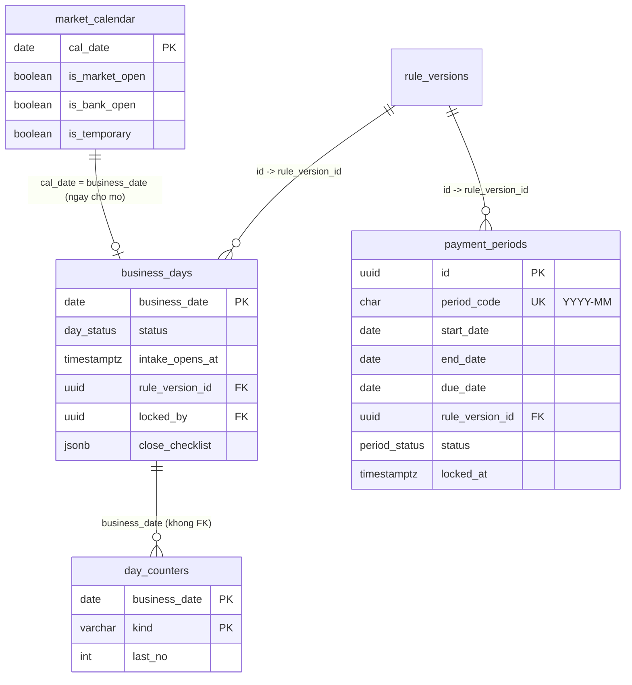

# CLOSE_DB — Lịch chợ – ngân hàng, khóa 業務日 / 期ロック, bộ đếm số

| | |
|---|---|
| System Name | 水産物卸売市場業務支援システム（Product A, khách 株式会社 桜水産市場 — hư cấu） |
| Schema | `app` |
| CHARACTER SET | UTF8 (PostgreSQL 16, RDS Multi-AZ, AWS Tokyo) |
| Updated by | phuongnnm-23344 |
| Note | Một file của bộ Database Design tách theo cụm ER (QC-01 §4: một file một nhóm bảng). Nguyên tắc P1–P7, quy ước chung + enum (4.0), view công bố, bảng lệch so với prototype, kết quả parity và điểm mở chung nằm ở file tổng [MKT_DB.md](MKT_DB.md). **Số mục 4.xx giữ theo số bảng toàn schema** (cột No ở MKT_DB §2) để tham chiếu chéo giữa các file và từ ADR / spec không đổi khi tách |

---

## 1. Lịch sử sửa đổi

| No | Version | Action | Sheet / Bảng | Nội dung thay đổi | Ngày | Người sửa | Approve |
|---|---|---|---|---|---|---|---|
| 1 | 0.1.0 | Add new | — | Nội dung ban đầu nằm trong `MKT_DB.md` 0.1.0 (một file cho toàn schema) | 2026-11-25 | phuongnnm-23344 | |
| 2 | 0.2.0 | Add new | Toàn file | Tách từ `MKT_DB.md` 0.1.1 theo cụm ER (Gate 1 M-09); sửa theo Gate 1: một định nghĩa 業務日 (bắt đầu `LOT_INTAKE_START_TIME`), 日次締め mở luôn ngày chợ kế tiếp, job 01:00 là lưới an toàn (M-01); checklist chuẩn ✖ / ⚠ (M-05, khách #1, #4, #25); 支払期日 lùi theo ngày ngân hàng (M-03); phạm vi tính lại DELTA mọi kỳ đã khóa (C-01); bỏ ghi chú OPEN-DB-02 đã đóng | 2026-11-25 | phuongnnm-23344 | |

---

## 2. Danh sách bảng

| No | Schema | Category | Tên bảng (logic) | Tên bảng (vật lý) | Mô tả | Note | Status |
|---|---|---|---|---|---|---|---|
| 20 | app | master | Lịch chợ – ngân hàng | [`market_calendar`](#420-market_calendar) | 1 bảng, 2 cờ; 臨時休市 / 臨時開市 có duyệt | Mới | Decision (provisional) |
| 24 | app | transaction | 業務日 | [`business_days`](#424-business_days) | Mở theo lịch (đầu ngày = giờ nhận lô 01:00), khóa bởi 照合部門長 | Prototype: `business_days` | Decision (provisional) |
| 43 | app | transaction | Kỳ thanh toán | [`payment_periods`](#443-payment_periods) | Tháng theo 業務日; 支払期日 theo quy chế + lịch | Prototype: `payment_periods` | Decision (provisional) |
| 57 | app | master | Bộ đếm số theo ngày | [`day_counters`](#457-day_counters) | Cấp số lô / số GD liên tục theo 業務日 | Prototype: `day_counters` | Decision (provisional) |

---

## 3. ER Diagram

Hai trục khóa: **ngày** (`business_days`, 日次締め) và **kỳ** (`payment_periods`, 期ロック). Bảng giao dịch của các cụm khác FK tới `business_days.business_date` (trigger "Ngày mở"); bảng tiền FK tới `payment_periods.id`. `rule_versions` ở [RULE_DB.md](RULE_DB.md).

**Định nghĩa 業務日 (một định nghĩa duy nhất — Gate 1 M-01):** 業務日 D = khoảng [D 01:00, D+1 01:00) JST, với 01:00 = `LOT_INTAKE_START_TIME` của version hiệu lực (E-16). Lô nhận từ 01:00 thuộc 業務日 sáng đó; chốt GD chỉ từ `TRADE_START_TIME` (02:00, PRM-116). Hàm `business_date_for(t)` = ngày của (t − `LOT_INTAKE_START_TIME`). **Kỳ** = tháng dương lịch theo 業務日 của **GD gốc** (`trades.trade_date`).

---

## 4. Định nghĩa bảng

Quy ước chung (kiểu, cột chung, chỉ thêm, ngày mở, ghi qua hàm, enum): [MKT_DB.md §4.0](MKT_DB.md#40-quy-ước-chung).

### 4.20. `market_calendar`

| | | | |
|---|---|---|---|
| Tên bảng (logic) | Lịch chợ – ngân hàng | Tạo bởi / ngày | phuongnnm-23344 / 2026-11-25 |
| Tên bảng (vật lý) | `market_calendar` | Sửa bởi / ngày | — |
| Overview | 1 bảng, 2 cờ (PRM-054). ルール管理者 nhập lịch năm sau một lần (tháng 12), 照合部門長 duyệt; 臨時休市 / 臨時開市 đổi trong ngày, maker-checker gọn, **không tính** vào 4 lần / năm (PREMISE §3.1, FB-CUS-239 **[Giả lập]**). 業務日 chỉ mở cho ngày có `is_market_open` (4.24, ADR-005). | Note | Lịch là **dữ liệu master**, không tính quota 4 lần / năm (PRM-054; OPEN-DB-02 đã đóng bằng PREMISE 0.4.0 §3.1). Công thức 支払期日 (`PAYMENT_DUE_RULE`) mới là quy chế |

**Định nghĩa cột**

| No. | Key | Tên logic | Tên vật lý | Data Type | Size | Not Null | Default | Note |
|---|---|---|---|---|---|---|---|---|
| 1 | PRI | Ngày | `cal_date` | DATE | N/A | Yes | | |
| 2 | | Chợ mở | `is_market_open` | BOOLEAN | N/A | Yes | | |
| 3 | | Ngân hàng mở | `is_bank_open` | BOOLEAN | N/A | Yes | | 支払期日 rơi ngày **ngân hàng** nghỉ → lùi về ngày **ngân hàng** mở trước (`PAYMENT_DUE_RULE`, RULE_DB 4.23). Thứ Bảy: chợ mở (週6日), ngân hàng nghỉ |
| 4 | | Đổi đột xuất | `is_temporary` | BOOLEAN | N/A | Yes | `false` | 臨時休市 / 臨時開市 |
| 5 | | Ghi chú | `note` | VARCHAR | 100 | No | | Lý do (bão, 時化, CN trước 年末) |
| 6 | FK | Maker / checker | `maker_id`, `checker_id` | UUID | N/A | Yes / No | | CHECK `checker_id <> maker_id`; dòng chưa có checker chưa có hiệu lực |
| 7 | | Duyệt lúc | `approved_at` | TIMESTAMPTZ | N/A | No | | |
| 8 | | Cột chung | `updated_at`, `updated_by` | | | | | Mọi lần đổi → `audit_logs` (trước / sau) |

**Index** — `market_calendar_pkey` (`cal_date`).

**Khoá ngoại**

| No. | Tên khoá ngoại | Cột | Bảng đích | Cột đích | Note |
|---|---|---|---|---|---|
| 1 | `fk_market_calendar_maker` / `_checker` | `maker_id`, `checker_id` | `staff_accounts` | `id` | |

---

### 4.24. `business_days`

| | | | |
|---|---|---|---|
| Tên bảng (logic) | 業務日 | Tạo bởi / ngày | phuongnnm-23344 / 2026-11-25 |
| Tên bảng (vật lý) | `business_days` | Sửa bởi / ngày | — |
| Overview | 業務日 D = [D 01:00, D+1 01:00) JST (01:00 = `LOT_INTAKE_START_TIME`). **Mở ngày:** hàm 日次締め ngày D mở luôn 業務日 chợ kế tiếp theo `market_calendar` (OPEN, `intake_opens_at` = ngày đó 01:00) để luôn có "業務日 chưa khóa sớm nhất" cho 修正申請 / 後入力; **job lúc 01:00** JST (EventBridge, Asia/Tokyo) là lưới an toàn idempotent — mở nếu chưa có (ví dụ ngày trước chưa khóa). Ghi theo giờ thực (lô, GD, giao) chỉ vào ngày `business_date_for(now())` đang `OPEN`; chốt GD từ `TRADE_START_TIME`. Khóa bởi 照合部門長 hoặc 代行 (MFA) sau checklist, **không mở lại** (BR-CLOSE-01). Sửa D22, Gate 1 M-01. | Note | `current_business_date()` to-be = `business_date_for(now())`; ghi không theo giờ thực (REVERSE / DELTA của 修正申請, `LATE_ENTRY`) vào 業務日 `OPEN` sớm nhất |

**Định nghĩa cột**

| No. | Key | Tên logic | Tên vật lý | Data Type | Size | Not Null | Default | Note |
|---|---|---|---|---|---|---|---|---|
| 1 | PRI | 業務日 | `business_date` | DATE | N/A | Yes | | |
| 2 | | Trạng thái | `status` | `day_status` | N/A | Yes | `'OPEN'` | `LOCKED` → `OPEN` bị trigger chặn |
| 3 | | Nhận lô từ | `intake_opens_at` | TIMESTAMPTZ | N/A | Yes | | = ngày + `LOT_INTAKE_START_TIME` của version hiệu lực = đầu 業務日 |
| 4 | | Mở lúc | `opened_at` | TIMESTAMPTZ | N/A | Yes | `now()` | Do hàm 日次締め ngày trước (`created_by` = người khóa) hoặc job 01:00 (`created_by` NULL) |
| 5 | FK | Version quy chế áp | `rule_version_id` | UUID | N/A | Yes | | Version hiệu lực ngày đó (FR-AUDIT-03) |
| 6 | FK | Người khóa | `locked_by` | UUID | N/A | No | | |
| 7 | FK | Khóa thay cho (代行) | `lock_delegation_id` | UUID | N/A | No | | |
| 8 | | Khóa lúc | `locked_at` | TIMESTAMPTZ | N/A | No | | |
| 9 | | Checklist lúc khóa | `close_checklist` | JSONB | N/A | No | | Ảnh chụp checklist (PRM-119, ADR-005 §2.5). **✖ chặn:** (1) GD 下書き / 確認待ち treo; (2) phiên せり chưa xác nhận; (3) thiết bị còn bản ghi chưa đồng bộ — trừ máy đã 「端末回収不能」 (`devices.lost_reported_at`, IAM_AUDIT_DB 4.6); (4) bản ghi SC-03-07 của ngày còn 要確認; (5) 当日訂正 / 取消 ≥ ngưỡng 2 cấp (theo người mua) hoặc đổi 買受人 chưa 「確認済」 (`trade_fixes.reviewed_at`); (6) ngoại lệ giao đổi tiền chưa 「確認済」 (`delivery_exceptions.settle_reviewed_at`). **⚠ xác nhận được:** (7) lô còn SL → 持ち越し; (8) giao còn dư — tick (PRM-036); (9) 当日訂正 dưới ngưỡng; (10) tranh chấp giao chưa xác nhận → sang ngày sau; (11) phiên せり do chính người nhập xác nhận (có lý do) — soát. Ghi cả danh sách máy đã loại khỏi checklist |

**Index** — `business_days_pkey`; `idx_business_days_status` (`status`) partial `status = 'OPEN'`.

**Khoá ngoại**

| No. | Tên khoá ngoại | Cột | Bảng đích | Cột đích | Note |
|---|---|---|---|---|---|
| 1 | `fk_business_days_rule_version` | `rule_version_id` | `rule_versions` | `id` | |
| 2 | `fk_business_days_locked_by` | `locked_by` | `staff_accounts` | `id` | |
| 3 | `fk_business_days_delegation` | `lock_delegation_id` | `delegations` | `id` | |

---

### 4.43. `payment_periods`

| | | | |
|---|---|---|---|
| Tên bảng (logic) | Kỳ thanh toán | Tạo bởi / ngày | phuongnnm-23344 / 2026-11-25 |
| Tên bảng (vật lý) | `payment_periods` | Sửa bởi / ngày | — |
| Overview | Kỳ = tháng dương lịch theo 業務日 của **GD gốc** (`trades.trade_date`, L4-A04 (2)); dòng điều chỉnh mang `period_id` của GD gốc (ADJUST_DB 4.39, Gate 1 C-02). 支払期日 tính từ `PAYMENT_DUE_RULE` của version hiệu lực + `market_calendar`: lùi về **ngày ngân hàng mở trước** (sửa D05, Gate 1 M-03). 期ロック: 照合部門長 + MFA, **trong cùng transaction** tính chính thức và ghi kết quả (ADR-007); không mở lại. Sau khi khóa, đầu vào của kỳ đổi (điều chỉnh / phân bổ ghi sau `locked_at`) → được tính lại ở 期ロック kế tiếp thành DELTA — **mọi kỳ đã khóa, không giới hạn năm TC** (Gate 1 C-01, INCENTIVE_DB 4.52). | Note | Kỳ sau được tạo khi khóa kỳ trước (giữ 0023) |

**Định nghĩa cột**

| No. | Key | Tên logic | Tên vật lý | Data Type | Size | Not Null | Default | Note |
|---|---|---|---|---|---|---|---|---|
| 1 | PRI | ID | `id` | UUID | N/A | Yes | `gen_random_uuid()` | |
| 2 | UNI | Mã kỳ | `period_code` | CHAR | 7 | Yes | | `YYYY-MM` |
| 3 | | Năm TC | `fiscal_year` | INT | N/A | Yes | | Chỉ dùng cho việc trừ dần delta âm (CARRY) tới hết năm TC của kỳ **ghi nhận** và quota quy chế; **không** giới hạn phạm vi tính lại DELTA (Gate 1 C-01) |
| 4 | | Từ / đến 業務日 | `start_date`, `end_date` | DATE | N/A | Yes | | CHECK `end_date >= start_date` |
| 5 | | 支払期日 | `due_date` | DATE | N/A | Yes | | |
| 6 | FK | Version quy chế của kỳ | `rule_version_id` | UUID | N/A | Yes | | Version hiệu lực tại `start_date` (hiệu lực ngày 1 = ranh giới kỳ) |
| 7 | | Trạng thái | `status` | `period_status` | N/A | Yes | `'OPEN'` | |
| 8 | FK | Người khóa / 代行 | `locked_by`, `lock_delegation_id` | UUID | N/A | No | | |
| 9 | | Khóa lúc | `locked_at` | TIMESTAMPTZ | N/A | No | | Mốc để phát hiện đầu vào đổi sau khóa (`created_at > locked_at`) |

**Index** — `payment_periods_pkey`; `uq_payment_periods_code`; `idx_payment_periods_fy` (`fiscal_year`, `status`).

**Khoá ngoại** — `rule_version_id` → `rule_versions.id`; `locked_by` → `staff_accounts.id`; `lock_delegation_id` → `delegations.id`.

---

### 4.57. `day_counters`

| | | | |
|---|---|---|---|
| Tên bảng (logic) | Bộ đếm số theo ngày | Tạo bởi / ngày | phuongnnm-23344 / 2026-11-25 |
| Tên bảng (vật lý) | `day_counters` | Sửa bởi / ngày | — |
| Overview | Cấp số lô / số GD liên tục theo 業務日 trong transaction (giữ 0025). Không grant cho app role; chỉ hàm `next_day_counter` dùng. | Note | Bảng kỹ thuật, không audit |

**Định nghĩa cột**

| No. | Key | Tên logic | Tên vật lý | Data Type | Size | Not Null | Default | Note |
|---|---|---|---|---|---|---|---|---|
| 1 | PRI | 業務日 | `business_date` | DATE | N/A | Yes | | |
| 2 | PRI | Loại số | `kind` | VARCHAR | 20 | Yes | | `LOT`, `TRADE` |
| 3 | | Số cuối | `last_no` | INT | N/A | Yes | | CHECK > 0 |

**Index** — `day_counters_pkey` (`business_date`, `kind`). **Khoá ngoại** — N/A (giữ như prototype; không FK `business_days` để job mở ngày không phụ thuộc thứ tự).
