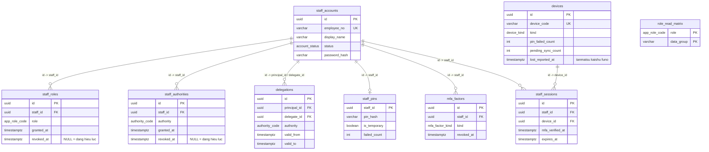
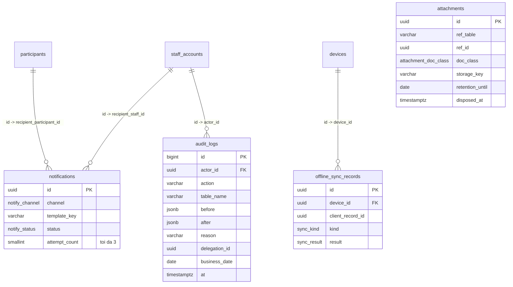

# IAM_AUDIT_DB — Tài khoản, vai, quyền duyệt, thiết bị, phiên + xuyên suốt (thông báo, đính kèm, đồng bộ offline, 監査ログ)

| | |
|---|---|
| System Name | 水産物卸売市場業務支援システム（Product A, khách 株式会社 桜水産市場 — hư cấu） |
| Schema | `app, audit` |
| CHARACTER SET | UTF8 (PostgreSQL 16, RDS Multi-AZ, AWS Tokyo) |
| Updated by | phuongnnm-23344 |
| Note | Một file của bộ Database Design tách theo cụm ER (QC-01 §4: một file một nhóm bảng). Nguyên tắc P1–P7, quy ước chung + enum (4.0), view công bố, bảng lệch so với prototype, kết quả parity và điểm mở chung nằm ở file tổng [MKT_DB.md](MKT_DB.md). **Số mục 4.xx giữ theo số bảng toàn schema** (cột No ở MKT_DB §2) để tham chiếu chéo giữa các file và từ ADR / spec không đổi khi tách |

---

## 1. Lịch sử sửa đổi

| No | Version | Action | Sheet / Bảng | Nội dung thay đổi | Ngày | Người sửa | Approve |
|---|---|---|---|---|---|---|---|
| 1 | 0.1.0 | Add new | — | Nội dung ban đầu nằm trong `MKT_DB.md` 0.1.0 (một file cho toàn schema) | 2026-11-25 | phuongnnm-23344 | |
| 2 | 0.2.0 | Add new | Toàn file | Tách từ `MKT_DB.md` 0.1.1 theo cụm ER (Gate 1 M-09); sửa theo Gate 1: thêm bảng `staff_roles` (4.58), bỏ cột `staff_accounts.role` (m-10); `devices.lost_*` — 「端末回収不能」 (M-05, khách #1); `attachments.doc_class`, lưu theo loại chứng từ TBL-ATTACH-01, xóa vật lý có duyệt (M-08); ER `staff_accounts ||--o| staff_pins` (m-08) | 2026-11-25 | phuongnnm-23344 | |

---

## 2. Danh sách bảng

| No | Schema | Category | Tên bảng (logic) | Tên bảng (vật lý) | Mô tả | Note | Status |
|---|---|---|---|---|---|---|---|
| 1 | app | master | Tài khoản nhân viên | [`staff_accounts`](#41-staff_accounts) | Một dòng một nhân viên nội bộ; thay `auth.users` + `profiles` | Prototype: `profiles` | Decision (provisional) |
| 2 | app | history | Quyền duyệt cấp / thu | [`staff_authorities`](#42-staff_authorities) | 照合部門長 / 運用部門長 / 配送部門責任者 gắn tài khoản, có lịch sử thu hồi | Prototype: `user_authorities` | Decision (provisional) |
| 3 | app | master | 代行者 (người làm thay) | [`delegations`](#43-delegations) | Ủy quyền duyệt có ngày bắt đầu / kết thúc | Mới | Decision (provisional) |
| 4 | app | master | PIN đổi người | [`staff_pins`](#44-staff_pins) | PIN 4 số băm, PIN tạm, đếm sai | Prototype: `profile_pins` | Decision (provisional) |
| 5 | app | master | Phương thức MFA | [`mfa_factors`](#45-mfa_factors) | TOTP ứng dụng / token phần cứng / mã dự phòng một lần của từng người | Mới | Decision (provisional) |
| 6 | app | master | Thiết bị đăng ký | [`devices`](#46-devices) | Tablet bến, PC bàn GD, PC văn phòng; khóa PIN theo thiết bị | Mới | Decision (provisional) |
| 7 | app | transaction | Phiên đăng nhập | [`staff_sessions`](#47-staff_sessions) | Phiên server-side (người, thiết bị), mốc MFA step-up | Mới | Decision (provisional) |
| 58 | app | history | Vai của tài khoản | [`staff_roles`](#458-staff_roles) | Nhiều vai / tài khoản, có lịch sử cấp / thu (Gate 1 m-10) | Mới — prototype `profiles.role` một vai | Decision (provisional) |
| 8 | app | master | Ma trận quyền đọc | [`role_read_matrix`](#48-role_read_matrix) | Vai × nhóm dữ liệu được đọc; RLS và menu cùng đọc | Mới | Decision (provisional) |
| 53 | app | transaction | Thông báo (outbox) | [`notifications`](#453-notifications) | In-app + email, gửi lại ≤ 3 lần | Mới | Decision (provisional) |
| 54 | app | transaction | Đính kèm | [`attachments`](#454-attachments) | Siêu dữ liệu file ở S3; thời hạn lưu theo loại chứng từ (TBL-ATTACH-01) | Mới | Decision (provisional) |
| 55 | app | transaction | Bản ghi đồng bộ offline | [`offline_sync_records`](#455-offline_sync_records) | Hàng đợi 仮受付 / 引渡し / 紙伝票後入力 + đối chiếu SC-03-07 | Mới | Decision (provisional) |
| 56 | audit | history | 監査ログ | [`audit_logs`](#456-audit_logs) | Ai, khi, lý do, 代行, trước / sau; chia theo năm TC | Prototype: `audit_logs` | Decision (provisional) |

---

## 3. ER Diagram

### 3.1 Tài khoản, vai, quyền duyệt, thiết bị (`iam`)

`staff_accounts ||--o| staff_pins`: PIN chỉ có với người dùng máy dùng chung; tài khoản chỉ dùng PC văn phòng không có PIN (Gate 1 m-08).

### 3.2 Xuyên suốt: thông báo, đính kèm, đồng bộ offline, 監査ログ

Ba bảng `notifications`, `attachments`, `audit_logs` tham chiếu nhiều bảng nghiệp vụ bằng cặp (`ref_table`, `ref_id`) hoặc (`table_name`, `record_id`) — không khai FK; lý do ở 4.53–4.56. `participants` thuộc [PARTY_DB.md](PARTY_DB.md).

---

## 4. Định nghĩa bảng

Quy ước chung (kiểu, cột chung, chỉ thêm, ngày mở, ghi qua hàm, enum): [MKT_DB.md §4.0](MKT_DB.md#40-quy-ước-chung).

### 4.1. `staff_accounts`

| | | | |
|---|---|---|---|
| Tên bảng (logic) | Tài khoản nhân viên | Tạo bởi / ngày | phuongnnm-23344 / 2026-11-25 |
| Tên bảng (vật lý) | `staff_accounts` | Sửa bởi / ngày | — |
| Overview | Một dòng một nhân viên nội bộ (PRM-089: mỗi người một tài khoản). Thay `auth.users` + `profiles` của prototype; module `iam` tự quản (ADR-002). | Note | Người tham gia bên ngoài không có tài khoản ở 第1期 (L4-A08). Vai **không** ở bảng này mà ở `staff_roles` (4.58) — một người nhiều vai, một tài khoản (Gate 1 m-10) |

**Định nghĩa cột**

| No. | Key | Tên logic | Tên vật lý | Data Type | Size | Not Null | Default | Note |
|---|---|---|---|---|---|---|---|---|
| 1 | PRI | ID | `id` | UUID | N/A | Yes | `gen_random_uuid()` | |
| 2 | UNI | Mã nhân viên | `employee_no` | VARCHAR | 20 | Yes | | Dùng để đổi người bằng PIN |
| 3 | | Tên hiển thị | `display_name` | VARCHAR | 50 | Yes | | Hiện to trên mọi màn (PRM-112 (a)) |
| 4 | UNI | Email đăng nhập | `login_email` | VARCHAR | 254 | No | | NULL cho người chỉ dùng máy dùng chung |
| 5 | | Mật khẩu băm | `password_hash` | VARCHAR | 255 | No | | argon2id (ADR-002). Không bao giờ ghi log |
| 6 | | Trạng thái | `status` | `account_status` | N/A | Yes | `'ACTIVE'` | Dừng → xóa mọi phiên ngay (ADR-002) |
| 7 | | Bắt MFA khi đăng nhập | `mfa_required_at_login` | BOOLEAN | N/A | Yes | `false` | `true` bắt buộc khi tài khoản có vai `SYSADM` (hàm cấp vai kiểm) — L4-A07 |
| 8 | | Cột chung | `created_at`, `created_by`, `updated_at`, `updated_by` | | | | | Xem 4.0 |

**Index**

| No. | Tên index | Cột | Primary key | Unique | Note |
|---|---|---|---|---|---|
| 1 | `staff_accounts_pkey` | `id` | Yes | Yes | |
| 2 | `uq_staff_accounts_employee_no` | `employee_no` | No | Yes | |
| 3 | `uq_staff_accounts_login_email` | `lower(login_email)` | No | Yes | Partial: `login_email IS NOT NULL` |

**Khoá ngoại**

| No. | Tên khoá ngoại | Cột | Bảng đích | Cột đích | Note |
|---|---|---|---|---|---|
| — | N/A | | | | Bảng gốc. `created_by` / `updated_by` tự tham chiếu `staff_accounts.id` |

---

### 4.2. `staff_authorities`

| | | | |
|---|---|---|---|
| Tên bảng (logic) | Quyền duyệt cấp / thu | Tạo bởi / ngày | phuongnnm-23344 / 2026-11-25 |
| Tên bảng (vật lý) | `staff_authorities` | Sửa bởi / ngày | — |
| Overview | Quyền duyệt gắn tài khoản — không phải vai mới (PRM-051, PRM-058, PRM-111). Thu hồi = điền `revoked_at`, không xóa dòng (ADR-003: có lịch sử cấp / thu). | Note | Chỉ cho phép một UPDATE: điền `revoked_at` / `revoked_by` một lần |

**Định nghĩa cột**

| No. | Key | Tên logic | Tên vật lý | Data Type | Size | Not Null | Default | Note |
|---|---|---|---|---|---|---|---|---|
| 1 | PRI | ID | `id` | UUID | N/A | Yes | `gen_random_uuid()` | |
| 2 | FK | Nhân viên | `staff_id` | UUID | N/A | Yes | | |
| 3 | | Quyền | `authority` | `authority_code` | N/A | Yes | | |
| 4 | | Thời điểm cấp | `granted_at` | TIMESTAMPTZ | N/A | Yes | `now()` | |
| 5 | FK | Người cấp | `granted_by` | UUID | N/A | Yes | | SYSADM |
| 6 | | Thời điểm thu | `revoked_at` | TIMESTAMPTZ | N/A | No | | NULL = đang hiệu lực |
| 7 | FK | Người thu | `revoked_by` | UUID | N/A | No | | |
| 8 | | Cột chung | `created_at`, `created_by` | | | | | |

**Index**

| No. | Tên index | Cột | Primary key | Unique | Note |
|---|---|---|---|---|---|
| 1 | `staff_authorities_pkey` | `id` | Yes | Yes | |
| 2 | `uq_staff_authorities_active` | `staff_id`, `authority` | No | Yes | Partial: `revoked_at IS NULL` |

**Khoá ngoại**

| No. | Tên khoá ngoại | Cột | Bảng đích | Cột đích | Note |
|---|---|---|---|---|---|
| 1 | `fk_staff_authorities_staff` | `staff_id` | `staff_accounts` | `id` | ON DELETE RESTRICT |
| 2 | `fk_staff_authorities_granted_by` / `_revoked_by` | `granted_by`, `revoked_by` | `staff_accounts` | `id` | |

---

### 4.3. `delegations`

| | | | |
|---|---|---|---|
| Tên bảng (logic) | 代行者 (người làm thay) | Tạo bởi / ngày | phuongnnm-23344 / 2026-11-25 |
| Tên bảng (vật lý) | `delegations` | Sửa bởi / ngày | — |
| Overview | Người có quyền duyệt chỉ định người làm thay có thời hạn; tự hết hạn (PRM-057, PRM-129 — tab trong SC-02-03). `assert_caller` coi `delegate_id` có quyền `authority` trong [`valid_from`, `valid_to`). | Note | Thu hồi sớm = điền `revoked_at`. Mọi hành động làm thay ghi `delegation_id` vào `audit_logs` |

**Định nghĩa cột**

| No. | Key | Tên logic | Tên vật lý | Data Type | Size | Not Null | Default | Note |
|---|---|---|---|---|---|---|---|---|
| 1 | PRI | ID | `id` | UUID | N/A | Yes | `gen_random_uuid()` | |
| 2 | FK | Người ủy quyền | `principal_id` | UUID | N/A | Yes | | Phải đang có `authority` |
| 3 | FK | Người làm thay | `delegate_id` | UUID | N/A | Yes | | CHECK `delegate_id <> principal_id` |
| 4 | | Quyền được làm thay | `authority` | `authority_code` | N/A | Yes | | |
| 5 | | Từ | `valid_from` | TIMESTAMPTZ | N/A | Yes | | |
| 6 | | Đến | `valid_to` | TIMESTAMPTZ | N/A | Yes | | CHECK `valid_to > valid_from` |
| 7 | | Lý do | `reason` | VARCHAR | 200 | Yes | | |
| 8 | | Thu hồi | `revoked_at` | TIMESTAMPTZ | N/A | No | | |
| 9 | | Cột chung | `created_at`, `created_by` | | | | | |

**Index**

| No. | Tên index | Cột | Primary key | Unique | Note |
|---|---|---|---|---|---|
| 1 | `delegations_pkey` | `id` | Yes | Yes | |
| 2 | `idx_delegations_delegate_period` | `delegate_id`, `authority`, `valid_from`, `valid_to` | No | No | Tra quyền hiệu lực trong `assert_caller` |

**Khoá ngoại**

| No. | Tên khoá ngoại | Cột | Bảng đích | Cột đích | Note |
|---|---|---|---|---|---|
| 1 | `fk_delegations_principal` | `principal_id` | `staff_accounts` | `id` | |
| 2 | `fk_delegations_delegate` | `delegate_id` | `staff_accounts` | `id` | |

---

### 4.4. `staff_pins`

| | | | |
|---|---|---|---|
| Tên bảng (logic) | PIN đổi người | Tạo bởi / ngày | phuongnnm-23344 / 2026-11-25 |
| Tên bảng (vật lý) | `staff_pins` | Sửa bởi / ngày | — |
| Overview | PIN 4 số để đổi người trên máy dùng chung (PRM-112). Không grant SELECT cho app role — chỉ hàm `verify_pin` đọc. | Note | Khóa theo **người** ở đây, khóa theo **thiết bị** ở `devices` (M22). Bản PIN offline lưu trên thiết bị, không ở bảng này (ADR-008) |

**Định nghĩa cột**

| No. | Key | Tên logic | Tên vật lý | Data Type | Size | Not Null | Default | Note |
|---|---|---|---|---|---|---|---|---|
| 1 | PRI/FK | Nhân viên | `staff_id` | UUID | N/A | Yes | | 1 : 1 với `staff_accounts` |
| 2 | | PIN băm | `pin_hash` | VARCHAR | 255 | Yes | | argon2id có salt |
| 3 | | PIN tạm | `is_temporary` | BOOLEAN | N/A | Yes | `false` | `true` sau khi trưởng ca đặt lại; chỉ dùng online, bắt đổi lần đầu (PRM-112 (c)) |
| 4 | | Số lần sai | `failed_count` | INT | N/A | Yes | `0` | CHECK ≥ 0; ngưỡng ở file cấu hình |
| 5 | | Khóa đến | `locked_until` | TIMESTAMPTZ | N/A | No | | |
| 6 | | Đếm sai hết hạn lúc | `failed_window_ends_at` | TIMESTAMPTZ | N/A | No | | Đếm sai tự về 0 sau khoảng thời gian (M22) |
| 7 | | Cột chung | `updated_at`, `updated_by` | | | | | |

**Index** — chỉ `staff_pins_pkey` (`staff_id`).

**Khoá ngoại**

| No. | Tên khoá ngoại | Cột | Bảng đích | Cột đích | Note |
|---|---|---|---|---|---|
| 1 | `fk_staff_pins_staff` | `staff_id` | `staff_accounts` | `id` | ON DELETE RESTRICT (không xóa tài khoản) |

---

### 4.5. `mfa_factors`

| | | | |
|---|---|---|---|
| Tên bảng (logic) | Phương thức MFA | Tạo bởi / ngày | phuongnnm-23344 / 2026-11-25 |
| Tên bảng (vật lý) | `mfa_factors` | Sửa bởi / ngày | — |
| Overview | Mỗi người có quyền duyệt / quản trị đăng ký ít nhất một phương thức (ADR-002 §2.2, ~12–13 người — PRM-088). Mã chỉ có giá trị cho tài khoản sở hữu. | Note | Mất token → SYSADM điền `revoked_at` ngay. **Không có email OTP** (ADR-002 0.2.0, Gate 1 m-06): quên / mất token → SYSADM cấp **mã dự phòng dùng một lần** (`BACKUP_CODE`) hết hạn trong ngày, hoặc chuyển việc duyệt cho 代行 |

**Định nghĩa cột**

| No. | Key | Tên logic | Tên vật lý | Data Type | Size | Not Null | Default | Note |
|---|---|---|---|---|---|---|---|---|
| 1 | PRI | ID | `id` | UUID | N/A | Yes | `gen_random_uuid()` | |
| 2 | FK | Nhân viên | `staff_id` | UUID | N/A | Yes | | |
| 3 | | Loại | `kind` | `mfa_factor_kind` | N/A | Yes | | |
| 4 | | Bí mật TOTP / mã dự phòng băm | `secret_encrypted` | BYTEA | N/A | Yes | | TOTP: mã hóa bằng khóa KMS ở tầng app, DB không thấy bản rõ. `BACKUP_CODE`: chỉ lưu bản băm |
| 5 | | Số sê-ri token | `hardware_serial` | VARCHAR | 40 | No | | Bắt buộc khi `kind = TOTP_HARDWARE` |
| 6 | | Thu hồi | `revoked_at` | TIMESTAMPTZ | N/A | No | | |
| 6a | | Hết hạn | `expires_at` | TIMESTAMPTZ | N/A | No | | Bắt buộc khi `BACKUP_CODE` (cuối 業務日 cấp); NULL với TOTP |
| 6b | | Đã dùng lúc | `used_at` | TIMESTAMPTZ | N/A | No | | `BACKUP_CODE` dùng đúng một lần (UPDATE một lần) |
| 7 | | Cột chung | `created_at`, `created_by` | | | | | `BACKUP_CODE`: `created_by` = SYSADM cấp, ghi `audit_logs` |

**Index** — `mfa_factors_pkey` (`id`); `idx_mfa_factors_staff` (`staff_id`) partial `revoked_at IS NULL`.

**Khoá ngoại**

| No. | Tên khoá ngoại | Cột | Bảng đích | Cột đích | Note |
|---|---|---|---|---|---|
| 1 | `fk_mfa_factors_staff` | `staff_id` | `staff_accounts` | `id` | |

---

### 4.6. `devices`

| | | | |
|---|---|---|---|
| Tên bảng (logic) | Thiết bị đăng ký | Tạo bởi / ngày | phuongnnm-23344 / 2026-11-25 |
| Tên bảng (vật lý) | `devices` | Sửa bởi / ngày | — |
| Overview | Máy được SYSADM cấp `device_code` (ADR-002 §2.1). Gắn vào phiên, bản ghi offline, nhật ký in, audit. | Note | Khóa PIN theo thiết bị chống dò PIN trên một máy (M22, NFR-SEC-03). Bản ghi của máy đã 「端末回収不能」 đồng bộ về sau → `offline_sync_records.result = HELD` → SC-03-07 → 修正申請 `LATE_ENTRY` (ADJUST_DB 4.37) |

**Định nghĩa cột**

| No. | Key | Tên logic | Tên vật lý | Data Type | Size | Not Null | Default | Note |
|---|---|---|---|---|---|---|---|---|
| 1 | PRI | ID | `id` | UUID | N/A | Yes | `gen_random_uuid()` | |
| 2 | UNI | Mã thiết bị | `device_code` | VARCHAR | 20 | Yes | | |
| 3 | | Loại | `kind` | `device_kind` | N/A | Yes | | Timeout theo loại ở file cấu hình (PRM-126) |
| 4 | | Vị trí | `location_label` | VARCHAR | 50 | No | | Bến số …, bàn GD … |
| 5 | | Đang dùng | `is_active` | BOOLEAN | N/A | Yes | `true` | |
| 6 | | Số lần sai PIN trên máy | `pin_failed_count` | INT | N/A | Yes | `0` | |
| 7 | | Khóa PIN đến | `pin_locked_until` | TIMESTAMPTZ | N/A | No | | |
| 8 | | Đồng bộ cuối | `last_synced_at` | TIMESTAMPTZ | N/A | No | | Hiện ở checklist khóa ngày (PRM-119 (a)) |
| 9 | | Heartbeat cuối | `last_heartbeat_at` | TIMESTAMPTZ | N/A | No | | Thiết bị gửi khi online (ADR-008 §2.2-7) |
| 10 | | Số bản ghi chờ đồng bộ | `pending_sync_count` | INT | N/A | Yes | `0` | Báo theo heartbeat; > 0 → dòng ✖ ở checklist 日次締め (ADR-005 §2.5) |
| 11 | | Báo 「端末回収不能」 lúc | `lost_reported_at` | TIMESTAMPTZ | N/A | No | | Thiết bị hỏng / mất / hết pin không lấy lại được (khách #1). Có giá trị → máy ra khỏi checklist 日次締め, phiên và PIN offline của máy bị thu hồi, `is_active = false` |
| 12 | FK | Người báo | `lost_reported_by` | UUID | N/A | No | | `STL_HEAD` hoặc 代行, **MFA**; ghi `audit_logs` (lý do, 代行, MFA) |
| 13 | | Lý do | `lost_reason` | VARCHAR | 200 | No | | Bắt buộc khi `lost_reported_at` có giá trị (CHECK) |
| 14 | | Cột chung | `created_at`, `created_by`, `updated_at`, `updated_by` | | | | | |

**Index** — `devices_pkey` (`id`); `uq_devices_device_code` (`device_code`, unique).

**Khoá ngoại** — `lost_reported_by` → `staff_accounts.id`; còn lại chỉ FK cột chung.

---

### 4.7. `staff_sessions`

| | | | |
|---|---|---|---|
| Tên bảng (logic) | Phiên đăng nhập | Tạo bởi / ngày | phuongnnm-23344 / 2026-11-25 |
| Tên bảng (vật lý) | `staff_sessions` | Sửa bởi / ngày | — |
| Overview | Phiên server-side, thu hồi được ngay (ADR-002 §2.1). Một phiên = (người, thiết bị); đổi người bằng PIN = đóng phiên cũ, mở phiên mới → MFA step-up hết hiệu lực. | Note | Dữ liệu vận hành: xóa phiên hết hạn sau 30 ngày bằng job (không phải dữ liệu nghiệp vụ; lịch sử đăng nhập nằm ở `audit_logs`) |

**Định nghĩa cột**

| No. | Key | Tên logic | Tên vật lý | Data Type | Size | Not Null | Default | Note |
|---|---|---|---|---|---|---|---|---|
| 1 | PRI | ID phiên | `id` | UUID | N/A | Yes | `gen_random_uuid()` | Cookie giữ giá trị băm của token, không giữ `id` |
| 2 | UNI | Token băm | `token_hash` | CHAR | 64 | Yes | | SHA-256 |
| 3 | FK | Nhân viên | `staff_id` | UUID | N/A | Yes | | |
| 4 | FK | Thiết bị | `device_id` | UUID | N/A | No | | NULL = PC cá nhân không đăng ký |
| 5 | | MFA lúc | `mfa_verified_at` | TIMESTAMPTZ | N/A | No | | Step-up hiệu lực 10 phút (ADR-002 §2.2, giá trị ở file cấu hình) |
| 6 | | Hoạt động cuối | `last_seen_at` | TIMESTAMPTZ | N/A | Yes | `now()` | |
| 7 | | Hết hạn | `expires_at` | TIMESTAMPTZ | N/A | Yes | | |
| 8 | | Thu hồi | `revoked_at` | TIMESTAMPTZ | N/A | No | | |
| 9 | | Tạo lúc | `created_at` | TIMESTAMPTZ | N/A | Yes | `now()` | |

**Index** — `staff_sessions_pkey`; `uq_staff_sessions_token_hash` (unique); `idx_staff_sessions_staff` (`staff_id`) partial `revoked_at IS NULL`.

**Khoá ngoại**

| No. | Tên khoá ngoại | Cột | Bảng đích | Cột đích | Note |
|---|---|---|---|---|---|
| 1 | `fk_staff_sessions_staff` | `staff_id` | `staff_accounts` | `id` | |
| 2 | `fk_staff_sessions_device` | `device_id` | `devices` | `id` | |

---

### 4.8. `role_read_matrix`

| | | | |
|---|---|---|---|
| Tên bảng (logic) | Ma trận quyền đọc | Tạo bởi / ngày | phuongnnm-23344 / 2026-11-25 |
| Tên bảng (vật lý) | `role_read_matrix` | Sửa bởi / ngày | — |
| Overview | Vai × nhóm dữ liệu được đọc theo cột 閲 của TBL-ROLE-01 (L4-A06). Policy RLS mọi bảng gọi `can_read(data_group)` đọc bảng này; menu UI cùng đọc (ADR-003 §2.5 — viết một lần). | Note | Nội dung dòng lấy từ role-list LAB-1; spec màn ghi quyền hiển thị chi tiết từng item |

**Định nghĩa cột**

| No. | Key | Tên logic | Tên vật lý | Data Type | Size | Not Null | Default | Note |
|---|---|---|---|---|---|---|---|---|
| 1 | PRI | Vai | `role` | `app_role_code` | N/A | Yes | | |
| 2 | PRI | Nhóm dữ liệu | `data_group` | VARCHAR | 30 | Yes | | Vd. `PARTY`, `LOT`, `TRADE`, `DELIVERY`, `SETTLE`, `INCENTIVE`, `RULE`, `AUDIT`, `IAM` |
| 3 | | Phạm vi | `scope` | VARCHAR | 10 | Yes | `'ALL'` | `ALL` · `OWN` (chỉ bản ghi mình tạo) |
| 4 | | Cột chung | `updated_at`, `updated_by` | | | | | Đổi ma trận = thay đổi quyền → audit |

**Index** — `role_read_matrix_pkey` (`role`, `data_group`). Quyền duyệt (`authority_code`) mở rộng đọc theo hàm, không ghi ở bảng này. Người có nhiều vai (4.58) đọc theo hợp các dòng của mọi vai đang hiệu lực.

**Khoá ngoại** — N/A.

---

### 4.58. `staff_roles`

| | | | |
|---|---|---|---|
| Tên bảng (logic) | Vai của tài khoản (cấp / thu) | Tạo bởi / ngày | phuongnnm-23344 / 2026-11-25 |
| Tên bảng (vật lý) | `staff_roles` | Sửa bởi / ngày | — |
| Overview | Một người có thể giữ **nhiều vai** của TBL-ROLE-01 (vd. 受付 + 目利き記録, 照合事務局 + ルール管理者) trên **một** tài khoản — giữ PRM-089 (mỗi người một tài khoản). Thay cột `staff_accounts.role` của 0.1.x (Gate 1 m-10). Thu hồi = điền `revoked_at`, không xóa (giống 4.2). `assert_caller` và `can_read` coi người dùng có mọi vai đang hiệu lực. Tách nhiệm (SoD) **không** dựa vào "một vai một người" mà kiểm trong hàm theo người: maker ≠ checker quy chế, người lập ≠ người duyệt, người ghi ≠ người xác nhận (ADR-003 §2.4). | Note | Giả định [PL] — RFP không quy định số vai / tài khoản; OPEN-DB-10 (MKT_DB §7). Bảng mới, đánh số 4.58 vì thêm sau khi đã đánh số toàn schema |

**Định nghĩa cột**

| No. | Key | Tên logic | Tên vật lý | Data Type | Size | Not Null | Default | Note |
|---|---|---|---|---|---|---|---|---|
| 1 | PRI | ID | `id` | UUID | N/A | Yes | `gen_random_uuid()` | |
| 2 | FK | Nhân viên | `staff_id` | UUID | N/A | Yes | | |
| 3 | | Vai | `role` | `app_role_code` | N/A | Yes | | |
| 4 | | Cấp lúc | `granted_at` | TIMESTAMPTZ | N/A | Yes | `now()` | |
| 5 | FK | Người cấp | `granted_by` | UUID | N/A | Yes | | SYSADM |
| 6 | | Thu lúc | `revoked_at` | TIMESTAMPTZ | N/A | No | | NULL = đang hiệu lực |
| 7 | FK | Người thu | `revoked_by` | UUID | N/A | No | | |
| 8 | | Cột chung | `created_at`, `created_by` | | | | | Chỉ UPDATE `revoked_at` / `revoked_by` một lần |

Tài khoản `SYSADM` không giữ thêm vai nghiệp vụ khác (CHECK trong hàm cấp vai) — tách quản trị khỏi nghiệp vụ.

**Index**

| No. | Tên index | Cột | Primary key | Unique | Note |
|---|---|---|---|---|---|
| 1 | `staff_roles_pkey` | `id` | Yes | Yes | |
| 2 | `uq_staff_roles_active` | `staff_id`, `role` | No | Yes | Partial: `revoked_at IS NULL` |

**Khoá ngoại**

| No. | Tên khoá ngoại | Cột | Bảng đích | Cột đích | Note |
|---|---|---|---|---|---|
| 1 | `fk_staff_roles_staff` | `staff_id` | `staff_accounts` | `id` | ON DELETE RESTRICT |
| 2 | `fk_staff_roles_granted_by` / `_revoked_by` | `granted_by`, `revoked_by` | `staff_accounts` | `id` | |

---

### 4.53. `notifications`

| | | | |
|---|---|---|---|
| Tên bảng (logic) | Thông báo (outbox) | Tạo bởi / ngày | phuongnnm-23344 / 2026-11-25 |
| Tên bảng (vật lý) | `notifications` | Sửa bởi / ngày | — |
| Overview | Ghi trong cùng transaction nghiệp vụ; worker gửi email qua SES; gửi lại tối đa 3 lần (BR-NOTIFY-01); `FAILED` → danh sách in ở quầy hôm sau + danh sách "chưa gửi được" cho 照合 (L4-A08). In-app hiện ở SC-00-03 (PRM-130). | Note | Bảng vận hành: được UPDATE `status`, `attempt_count`, `read_at`; không phải dữ liệu tiền. Tham chiếu đa hình (`ref_table`, `ref_id`) — không FK vì trỏ nhiều bảng |

**Định nghĩa cột**

| No. | Key | Tên logic | Tên vật lý | Data Type | Size | Not Null | Default | Note |
|---|---|---|---|---|---|---|---|---|
| 1 | PRI | ID | `id` | UUID | N/A | Yes | `gen_random_uuid()` | |
| 2 | | Kênh | `channel` | `notify_channel` | N/A | Yes | | |
| 3 | FK | Người nhận nội bộ | `recipient_staff_id` | UUID | N/A | No | | |
| 4 | FK | Người tham gia nhận | `recipient_participant_id` | UUID | N/A | No | | Đúng một trong 3, 4 |
| 5 | | Địa chỉ email | `email_to` | VARCHAR | 254 | No | | Chụp lúc xếp hàng |
| 6 | | Mẫu | `template_key` | VARCHAR | 50 | Yes | | Mẫu câu ở file cấu hình (PRM-126) |
| 7 | | Dữ liệu | `payload` | JSONB | N/A | Yes | | |
| 8 | | Mức | `is_critical` | BOOLEAN | N/A | Yes | `false` | Critical ≤ 5 phút (FG-12) |
| 9 | | Trạng thái | `status` | `notify_status` | N/A | Yes | `'QUEUED'` | |
| 10 | | Số lần gửi | `attempt_count` | SMALLINT | N/A | Yes | `0` | CHECK 0..3 |
| 11 | | Lỗi cuối | `last_error` | VARCHAR | 300 | No | | |
| 12 | | Gửi lúc / đọc lúc | `sent_at`, `read_at` | TIMESTAMPTZ | N/A | No | | |
| 13 | | Tham chiếu | `ref_table`, `ref_id` | VARCHAR(50) / UUID | | No | | |
| 14 | | Cột chung | `created_at` | | | | | |

**Index** — `notifications_pkey`; `idx_notifications_queue` (`status`, `created_at`) partial `status IN ('QUEUED','RETRYING')`; `idx_notifications_staff_unread` (`recipient_staff_id`) partial `read_at IS NULL`.

**Khoá ngoại** — `recipient_staff_id` → `staff_accounts.id`; `recipient_participant_id` → `participants.id`.

---

### 4.54. `attachments`

| | | | |
|---|---|---|---|
| Tên bảng (logic) | Đính kèm | Tạo bởi / ngày | phuongnnm-23344 / 2026-11-25 |
| Tên bảng (vật lý) | `attachments` | Sửa bởi / ngày | — |
| Overview | Siêu dữ liệu file ở S3: chứng từ lô, bản scan 紙伝票 / phiếu giấy tranh chấp, chứng cứ 修正申請. 第1期 chỉ scan / đính kèm ở PC (E-21). **Thời hạn lưu theo loại chứng từ** (`doc_class`, TBL-ATTACH-01): 受入票・取引票・照合表 **online 7 năm**, sau đó theo chính sách lưu của khách; ảnh / chứng cứ tranh chấp, giao hàng và hồ sơ rehearsal / nghiệm thu migration **online 3 năm → cold archive**, khôi phục ≤ 2 営業日. **Không tự xóa:** đến `retention_until` thì job đưa vào danh sách 「保存期限到来」; xóa vật lý chỉ sau khi 運用部門長 決裁 (MFA, lý do) — B.7 「保存期間満了後の物理削除は承認を要する」 (Gate 1 M-08, ADR-009). | Note | Tham chiếu đa hình (`ref_table`, `ref_id`) — không FK; hàm ghi kiểm `ref_table` thuộc danh sách cho phép. B.7 ghi 「添付書類は3年間」, TBL-ATTACH-01 tách 3 / 7 năm theo loại → theo TBL-ATTACH-01 (cụ thể hơn) — giả định [PL], Q-ARCH-07 |

**Định nghĩa cột**

| No. | Key | Tên logic | Tên vật lý | Data Type | Size | Not Null | Default | Note |
|---|---|---|---|---|---|---|---|---|
| 1 | PRI | ID | `id` | UUID | N/A | Yes | `gen_random_uuid()` | |
| 2 | | Bảng chủ / bản ghi chủ | `ref_table`, `ref_id` | VARCHAR(50) / UUID | | Yes | | |
| 2a | | Loại chứng từ | `doc_class` | `attachment_doc_class` | N/A | Yes | | Bắt buộc lúc tải lên; S3 object gắn **tag** cùng giá trị để lifecycle chạy theo loại (ADR-009 §2.2-9) |
| 3 | | Tên file | `file_name` | VARCHAR | 200 | Yes | | |
| 4 | | Kiểu | `content_type` | VARCHAR | 100 | Yes | | |
| 5 | | Dung lượng | `size_bytes` | BIGINT | N/A | Yes | | CHECK ≤ giới hạn ở file cấu hình |
| 6 | | Khóa S3 | `storage_key` | VARCHAR | 300 | Yes | | |
| 7 | | Băm | `sha256` | CHAR | 64 | Yes | | |
| 8 | | Giữ tới | `retention_until` | DATE | N/A | Yes | | Tính theo `doc_class` từ ngày tải lên: 7 năm (`RECEIPT_SLIP`, `TRADE_SLIP`, `RECONCILIATION_SHEET`, `CORRECTION_EVIDENCE`) / 3 năm online (`DISPUTE_EVIDENCE`, `MIGRATION_RECORD`) rồi cold archive tới hạn lưu do khách quyết |
| 9 | FK | Duyệt xóa vật lý | `disposal_approved_by` | UUID | N/A | No | | `OPS_HEAD` (決裁, MFA) |
| 9a | | Duyệt xóa lúc / lý do | `disposal_approved_at`, `disposal_reason` | TIMESTAMPTZ / VARCHAR(200) | | No | | |
| 9b | | Đã xóa file lúc | `disposed_at` | TIMESTAMPTZ | N/A | No | | Chỉ ghi được sau khi có `disposal_approved_by`; dòng siêu dữ liệu **giữ lại** (B.7 không xóa cứng bản ghi giao dịch) |
| 10 | | Cột chung | `created_at`, `created_by` | | | | | Chỉ UPDATE các cột `disposal_*`, `disposed_at` một lần |

**Index** — `attachments_pkey`; `idx_attachments_ref` (`ref_table`, `ref_id`); `idx_attachments_retention` (`retention_until`) partial `disposed_at IS NULL`. **Khoá ngoại** — `disposal_approved_by` → `staff_accounts.id`.

---

### 4.55. `offline_sync_records`

| | | | |
|---|---|---|---|
| Tên bảng (logic) | Bản ghi đồng bộ offline | Tạo bởi / ngày | phuongnnm-23344 / 2026-11-25 |
| Tên bảng (vật lý) | `offline_sync_records` | Sửa bởi / ngày | — |
| Overview | Nhận hàng đợi offline của 3 thao tác (仮受付, 引渡し thường, 紙伝票後入力 — ADR-008). `client_record_id` là khóa idempotent: nhận lại cùng id → trả kết quả cũ. Đồng bộ qua **cùng hàm nghiệp vụ** như online; bị từ chối (SL sẽ âm, ngày đã khóa…) → `HELD`, hiện ở SC-03-07 cho người có quyền xử lý — không ép ghi, không ghi đè. Bản ghi `HELD` vì **ngày đã khóa** (kể cả của máy 「端末回収不能」) chỉ có hai đường: 「修正申請（後入力）を作成」 → 修正申請 `LATE_ENTRY` điền sẵn (`applied_ref_table = 'correction_requests'`), hoặc 「反映しない」 có lý do (`REJECTED`) — cùng đường với ADR-008 §2.2-6 (Gate 1 M-05). | Note | Chỉ UPDATE `result`, `resolved_*`. Bản ghi `HELD` của 業務日 đang mở là dòng ✖ (4) ở checklist 日次締め |

**Định nghĩa cột**

| No. | Key | Tên logic | Tên vật lý | Data Type | Size | Not Null | Default | Note |
|---|---|---|---|---|---|---|---|---|
| 1 | PRI | ID | `id` | UUID | N/A | Yes | `gen_random_uuid()` | |
| 2 | FK | Thiết bị | `device_id` | UUID | N/A | Yes | | |
| 3 | UNI | Mã bản ghi máy | `client_record_id` | UUID | N/A | Yes | | |
| 4 | | Loại | `kind` | `sync_kind` | N/A | Yes | | |
| 5 | | Nội dung | `payload` | JSONB | N/A | Yes | | |
| 6 | FK | Người thao tác (qua PIN) | `captured_by` | UUID | N/A | Yes | | |
| 7 | | Giờ thiết bị | `captured_at` | TIMESTAMPTZ | N/A | Yes | | |
| 8 | | Đổi người khi offline | `is_offline_switch` | BOOLEAN | N/A | Yes | `false` | Cờ 「オフライン切替」 (PRM-112 (d)) |
| 9 | | Kết quả | `result` | `sync_result` | N/A | Yes | `'PENDING'` | |
| 10 | | Lý do giữ / từ chối | `result_reason` | VARCHAR | 200 | No | | |
| 11 | | Bản ghi đã tạo | `applied_ref_table`, `applied_ref_id` | VARCHAR(50) / UUID | | No | | |
| 12 | FK | Người xử lý / lúc | `resolved_by`, `resolved_at` | UUID / TIMESTAMPTZ | | No | | |
| 13 | | Server nhận lúc | `received_at` | TIMESTAMPTZ | N/A | Yes | `now()` | |

**Index** — `offline_sync_records_pkey`; `uq_offline_sync_client` (`device_id`, `client_record_id`) unique; `idx_offline_sync_held` (`result`) partial `result IN ('PENDING','HELD')`.

**Khoá ngoại** — `device_id` → `devices.id`; `captured_by`, `resolved_by` → `staff_accounts.id`.

---

### 4.56. `audit_logs`

| | | | |
|---|---|---|---|
| Tên bảng (logic) | 監査ログ | Tạo bởi / ngày | phuongnnm-23344 / 2026-11-25 |
| Tên bảng (vật lý) | `audit.audit_logs` (schema `audit`) | Sửa bởi / ngày | — |
| Overview | Trigger ghi trước / sau cho mọi bảng nghiệp vụ + hàm ghi bổ sung lý do, 代行, MFA, thiết bị (FR-AUDIT-01, B.7). **Chỉ thêm; không có cờ bỏ qua audit, không có hàm reset** (ADR-004 §2-5, sửa D19 / M24). Chia bảng theo năm TC (`PARTITION BY RANGE (at)`); partition quá 7 năm tách ra, xuất S3, bỏ theo quy trình có duyệt (ADR-009 §2.2-7). | Note | Migration ban đầu ghi audit với người thực hiện = tài khoản migration |

**Định nghĩa cột**

| No. | Key | Tên logic | Tên vật lý | Data Type | Size | Not Null | Default | Note |
|---|---|---|---|---|---|---|---|---|
| 1 | PRI | ID | `id` | BIGINT | N/A | Yes | IDENTITY | PK (`id`, `at`) do partition |
| 2 | FK | Người làm | `actor_id` | UUID | N/A | No | | NULL = job |
| 3 | | Hành động | `action` | VARCHAR | 50 | Yes | | `INSERT` / `UPDATE` / tên hàm nghiệp vụ / `LOGIN` / `EXPORT` … |
| 4 | | Bảng | `table_name` | VARCHAR | 63 | No | | |
| 5 | | Bản ghi | `record_id` | VARCHAR | 64 | No | | |
| 6 | | Trước / sau | `before`, `after` | JSONB | N/A | No | | |
| 7 | | Lý do | `reason` | VARCHAR | 500 | No | | |
| 8 | | 代行 | `delegation_id` | UUID | N/A | No | | |
| 9 | | MFA lúc | `mfa_verified_at` | TIMESTAMPTZ | N/A | No | | |
| 10 | | Thiết bị | `device_id` | UUID | N/A | No | | |
| 11 | | Mã request | `request_id` | VARCHAR | 64 | No | | Nối với log ứng dụng |
| 12 | | 業務日 | `business_date` | DATE | N/A | No | | |
| 13 | | Thời điểm | `at` | TIMESTAMPTZ | N/A | Yes | `now()` | Khóa partition |

**Index** — PK (`id`, `at`); `idx_audit_logs_at` (`at` desc); `idx_audit_logs_record` (`table_name`, `record_id`); `idx_audit_logs_actor_at` (`actor_id`, `at`).

**Khoá ngoại** — Không khai FK (bảng partition lớn, giữ 7 năm, phải ghi được cả khi bản ghi nguồn lỗi); `actor_id`, `delegation_id`, `device_id` kiểm ở hàm ghi.
