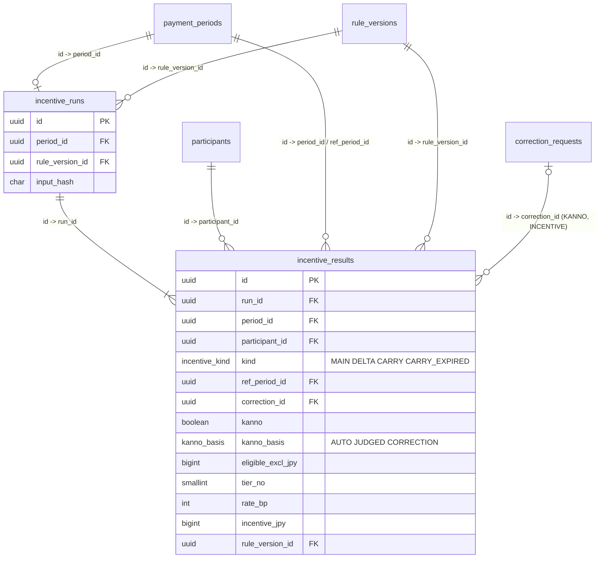

# INCENTIVE_DB — 完納奨励金 (lần chạy, kết quả, test vector)

| | |
|---|---|
| System Name | 水産物卸売市場業務支援システム（Product A, khách 株式会社 桜水産市場 — hư cấu） |
| Schema | `app` |
| CHARACTER SET | UTF8 (PostgreSQL 16, RDS Multi-AZ, AWS Tokyo) |
| Updated by | phuongnnm-23344 |
| Note | Một file của bộ Database Design tách theo cụm ER (QC-01 §4: một file một nhóm bảng). Nguyên tắc P1–P7, quy ước chung + enum (4.0), view công bố, bảng lệch so với prototype, kết quả parity và điểm mở chung nằm ở file tổng [MKT_DB.md](MKT_DB.md). **Số mục 4.xx giữ theo số bảng toàn schema** (cột No ở MKT_DB §2) để tham chiếu chéo giữa các file và từ ADR / spec không đổi khi tách |

---

## 1. Lịch sử sửa đổi

| No | Version | Action | Sheet / Bảng | Nội dung thay đổi | Ngày | Người sửa | Approve |
|---|---|---|---|---|---|---|---|
| 1 | 0.1.0 | Add new | — | Nội dung ban đầu nằm trong `MKT_DB.md` 0.1.0 (một file cho toàn schema) | 2026-11-25 | phuongnnm-23344 | |
| 2 | 0.2.0 | Add new | Toàn file | Tách từ `MKT_DB.md` 0.1.1 theo cụm ER (Gate 1 M-09); sửa theo Gate 1: phạm vi tính lại DELTA mọi kỳ đã khóa, giới hạn năm TC chỉ cho CARRY, thêm `CARRY_EXPIRED` (C-01, m-05); đầu vào theo `period_id` kỳ GD gốc (C-02); `correction_id` cho 修正申請 KANNO / INCENTIVE (M-10, M-04); `kanno_basis`, `judgement_note` cho 「手数料差引の疑い」 (khách #7); 試算 ghi audit (khách #6, M-02); thêm §5 test vector | 2026-11-25 | phuongnnm-23344 | |
| 3 | 0.3.0 | Update | 4.52, §5 | Gate 1 recheck: nhãn INC-EDGE đúng C.3 (N-01) + TV-12 INC-EDGE-01; GD LATE_ENTRY vào đầu vào DELTA + TV-13 (N-02); CARRY_EXPIRED dương đóng số dư, TV-04 không đếm âm hai lần (n-01); TV-14 修正申請 INCENTIVE (n-02); bảng 仲卸 giả; tham chiếu TV-06 (n-04) | 2026-11-25 | phuongnnm-23344 | |

---

## 2. Danh sách bảng

| No | Schema | Category | Tên bảng (logic) | Tên bảng (vật lý) | Mô tả | Note | Status |
|---|---|---|---|---|---|---|---|
| 51 | app | transaction | Lần chạy tính thưởng | [`incentive_runs`](#451-incentive_runs) | Một lần / kỳ | Prototype: `incentive_runs` | Decision (provisional) |
| 52 | app | transaction | Kết quả 完納奨励金 | [`incentive_results`](#452-incentive_results) | MAIN / DELTA / CARRY theo người × kỳ | Prototype: `incentive_results` | Decision (provisional) |

---

## 3. ER Diagram

Đầu vào của engine nằm ở các file khác: GD hiệu lực ([TRADE_DB.md](TRADE_DB.md) `trades.trade_date` + [ADJUST_DB.md](ADJUST_DB.md) `trade_adjustments.period_id`), 期のお支払額 và phân bổ 入金 ([BILLING_DB.md](BILLING_DB.md)), kỳ / 支払期日 ([CLOSE_DB.md](CLOSE_DB.md)), version quy chế + bảng tỷ lệ ([RULE_DB.md](RULE_DB.md)).

---

## 4. Định nghĩa bảng

Quy ước chung (kiểu, cột chung, chỉ thêm, ngày mở, ghi qua hàm, enum): [MKT_DB.md §4.0](MKT_DB.md#40-quy-ước-chung).

### 4.51. `incentive_runs`

| | | | |
|---|---|---|---|
| Tên bảng (logic) | Lần chạy tính thưởng | Tạo bởi / ngày | phuongnnm-23344 / 2026-11-25 |
| Tên bảng (vật lý) | `incentive_runs` | Sửa bởi / ngày | — |
| Overview | Một lần / kỳ, **ghi trong cùng transaction với 期ロック** (ADR-007 §2.1 — bỏ bước "đã tính, chưa khóa" của prototype, N13; Gate 1 M-02). Lưu version + mã băm đầu vào để chứng minh hàm thuần cho cùng kết quả. **Chỉ thêm.** | Note | 試算 (xem trước) chạy bao nhiêu lần cũng được, **không ghi bảng này**; mỗi lần 試算 ghi một dòng `audit_logs` (giờ, `input_hash`, tổng thưởng) để so với lần trước (khách #6) |

**Định nghĩa cột**

| No. | Key | Tên logic | Tên vật lý | Data Type | Size | Not Null | Default | Note |
|---|---|---|---|---|---|---|---|---|
| 1 | PRI | ID | `id` | UUID | N/A | Yes | `gen_random_uuid()` | |
| 2 | UNI/FK | Kỳ | `period_id` | UUID | N/A | Yes | | |
| 3 | FK | Version quy chế | `rule_version_id` | UUID | N/A | Yes | | |
| 4 | | Mã băm đầu vào | `input_hash` | CHAR | 64 | Yes | | SHA-256 của GD hiệu lực + phân bổ + version |
| 5 | | Cột chung | `created_at`, `created_by` | | | | | Prototype: `run_by`, `run_at` |

**Index** — `incentive_runs_pkey`; `uq_incentive_runs_period`. **Khoá ngoại** — `period_id` → `payment_periods.id`; `rule_version_id` → `rule_versions.id`.

---

### 4.52. `incentive_results`

| | | | |
|---|---|---|---|
| Tên bảng (logic) | Kết quả 完納奨励金 | Tạo bởi / ngày | phuongnnm-23344 / 2026-11-25 |
| Tên bảng (vật lý) | `incentive_results` | Sửa bởi / ngày | — |
| Overview | Theo BR-INC-01 / PRM-041: **適格金額** = tổng 買受代金 **税抜** trong kỳ nếu người đó 完納, ngược lại 0; bậc tra trên bảng tỷ lệ **của loại người tham gia** thuộc version của kỳ; **thưởng = floor(適格金額 × 交付率 × 110/100)** (sửa D01, D02; 110/100 là 税係数 cố định của BR-INC-01 / 13-06, không theo thuế suất hàng). **`DELTA` — phạm vi tính lại (Gate 1 C-01):** lúc 期ロック kỳ N, tính lại **mọi kỳ đã khóa, không giới hạn năm TC**, có đầu vào đổi sau khi khóa (`trade_adjustments.period_id` = kỳ đó và `created_at` > `locked_at`; **`trades` có `trade_date` thuộc kỳ đó và `created_at` > `locked_at` — GD `LATE_ENTRY`** (recheck N-02, TV-13); `payment_allocations` gán vào kỳ đó sau khi khóa; 修正申請 `KANNO` / `INCENTIVE` đã duyệt cho kỳ đó) theo **version của kỳ cũ**, so với tổng đã ghi nhận (MAIN + DELTA trước) → dòng `DELTA` ở kỳ N, `ref_period_id` = kỳ cũ; 完納 kỳ cũ giữ nguyên (không hồi tố — PRM-043), **trừ** 修正申請 `KANNO` (ngoại lệ có duyệt 2 cấp, PRM-055 — Gate 1 M-10). `INCENTIVE`: sửa tiền thưởng kỳ đã khóa tính theo tỷ lệ sai (R-L4-01). **`CARRY` / `CARRY_EXPIRED` (giới hạn năm TC chỉ áp ở đây):** delta âm trừ dần (CARRY) vào thưởng các kỳ sau tới hết năm TC của kỳ ghi nhận; phần âm còn lại cuối năm ghi dòng `CARRY_EXPIRED` và hiện ở RPT-07 để 照合部門 xử lý (cách thu: Q-ARCH-08). `CARRY_EXPIRED` là dòng **dương đóng số dư** (+ phần âm còn lại) ở kỳ cuối năm TC, đưa Σ của người đó về 0 để không đếm âm hai lần; `ref_period_id` = kỳ phát sinh delta; RPT-07 hiện trị tuyệt đối là phần chưa thu. Delta qua năm TC: tính bằng version kỳ cũ, ghi và tính CARRY theo năm TC của kỳ N. **Chỉ thêm.** | Note | Lưu đủ thành phần (適格金額, bậc, tỷ lệ) để RPT-07 / FORM-INC-01 tái hiện được phép tính. Tiền chi kỳ N cho một người = max(0, Σ `incentive_jpy` các dòng của người đó ở kỳ N); tổng âm → dòng `CARRY` (số âm) ở kỳ N+1 cùng năm TC |

**Định nghĩa cột**

| No. | Key | Tên logic | Tên vật lý | Data Type | Size | Not Null | Default | Note |
|---|---|---|---|---|---|---|---|---|
| 1 | PRI | ID | `id` | UUID | N/A | Yes | `gen_random_uuid()` | |
| 2 | FK | Lần chạy | `run_id` | UUID | N/A | Yes | | |
| 3 | FK | Kỳ ghi nhận | `period_id` | UUID | N/A | Yes | | |
| 4 | FK | Người tham gia | `participant_id` | UUID | N/A | Yes | | `NAKAOROSHI` hoặc `BAIBAI` |
| 5 | | Loại | `kind` | `incentive_kind` | N/A | Yes | | |
| 6 | FK | Kỳ được tính lại | `ref_period_id` | UUID | N/A | No | | Bắt buộc khi `DELTA`, `CARRY`, `CARRY_EXPIRED`; có thể thuộc năm TC khác kỳ ghi nhận |
| 6a | FK | 修正申請 | `correction_id` | UUID | N/A | No | | Bắt buộc khi DELTA sinh từ 修正申請 `KANNO` / `INCENTIVE` (Gate 1 M-10, M-04) |
| 7 | | Loại bảng tỷ lệ | `participant_class` | `participant_kind` | N/A | Yes | | |
| 8 | | 期のお支払額 | `payable_incl_jpy` | BIGINT | N/A | Yes | | Từ `period_billings` |
| 9 | | Đã trả đúng hạn | `paid_on_time_jpy` | BIGINT | N/A | Yes | | Σ `payment_allocations` `is_on_time` |
| 10 | | 完納 | `kanno` | BOOLEAN | N/A | Yes | | DELTA giữ giá trị của MAIN, **trừ** DELTA có `correction_id` của 修正申請 `KANNO` (ngoại lệ duyệt 2 cấp) |
| 10a | | Căn cứ 完納 | `kanno_basis` | `kanno_basis` | N/A | Yes | `'AUTO'` | `AUTO` (engine) · `JUDGED` (照合部門長 quyết dòng 要確認 trong hộp thoại 期ロック, cùng transaction, MFA — vd. 「手数料差引の疑い」, khách #7) · `CORRECTION` (修正申請 KANNO) |
| 10b | | Lý do quyết | `judgement_note` | VARCHAR | 500 | No | | Bắt buộc khi `JUDGED` |
| 11 | | 適格金額 (税抜) | `eligible_excl_jpy` | BIGINT | N/A | Yes | | 0 khi không 完納 |
| 12 | | Bậc | `tier_no` | SMALLINT | N/A | Yes | | |
| 13 | | 交付率 | `rate_bp` | INT | N/A | Yes | | |
| 14 | | Thưởng / chênh | `incentive_jpy` | BIGINT | N/A | Yes | | MAIN ≥ 0; DELTA, CARRY có thể âm; `CARRY_EXPIRED` **dương** = đóng số dư âm cuối năm TC (Σ kỳ cuối năm của người đó về 0) |
| 15 | FK | Version quy chế áp | `rule_version_id` | UUID | N/A | Yes | | |
| 16 | | Cột chung | `created_at` | | | | | |

**Index** — `incentive_results_pkey`; `idx_incentive_results_period` (`period_id`); `idx_incentive_results_participant` (`participant_id`, `period_id`); `uq_incentive_results_main` (`period_id`, `participant_id`) unique partial `kind = 'MAIN'`.

**Khoá ngoại** — `run_id` → `incentive_runs.id`; `period_id`, `ref_period_id` → `payment_periods.id`; `participant_id` → `participants.id`; `rule_version_id` → `rule_versions.id`; `correction_id` → `correction_requests.id`.

---

## 5. Test vector 完納奨励金

> *Biểu mẫu BM-2-901-50 không có mục này — thêm theo Gate 1 (C-01, C-02) để Technical Design 完納奨励金 (P3) và task LAB-5 dùng làm bộ test chuẩn trong CI (ADR-007 §2.7).* Bảng tỷ lệ là **giả** tới khi có `incentive-rate-table.csv` (E-03, L4-A02): bảng 売買参加者 — bậc 1 0–<500.000 = 0 bp · bậc 2 500.000–<1.000.000 = 50 bp · bậc 3 1.000.000–<3.000.000 = 90 bp · bậc 4 3.000.000–<10.000.000 = 120 bp · bậc 5 ≥ 10.000.000 = 150 bp (tra theo 適格金額 税抜); bảng 仲卸 giả dùng **cùng mức** để ví dụ SC-09-04 (N01 仲卸 1.000.000 = bậc 3) khớp. Version v2 (trước 2027-10) giả định bậc 3 = 80 bp — chỉ dùng ở TV-12. Thuế hàng **8%** (軽減税率, thực phẩm); thưởng = floor(適格金額 × 交付率 × 110/100) (BR-INC-01, 13-06). Mốc theo L4-A09: go-live 2027-08-01, kỳ đầu trong hệ thống 2027-08 (vì vậy TV-01 / TV-02 dùng tháng 8–9 thay cho tháng 7 trong brief). Số đã kiểm bằng script.

| TV | Đầu vào | Kỳ gán (GD / điều chỉnh / 入金) | DELTA | 完納 | Thưởng / kết quả | Nguồn |
|---|---|---|---|---|---|---|
| TV-01 | Người mua B01: GD tháng 8 tổng 1.000.000 税抜; 修正申請 `TRADE` cho GD 業務日 2027-08-31 (+50.000 税抜) duyệt **2027-09-03**, kỳ 2027-08 còn `OPEN` (支払期日 2027-09-10 thứ Sáu) | Điều chỉnh: `business_date` 2027-09-03, `period_id` **2027-08** → vào 期のお支払額 kỳ 08 = 1.050.000 + thuế 84.000 = **1.134.000** | Không | Trả 1.134.000 ngày 2027-09-09 ≤ 期日 → 完納 | MAIN kỳ 08: floor(1.050.000 × 0,9% × 1,1) = **10.395** | C-02 (c); L4-A04 (2) |
| TV-02 | B02: kỳ 08 = 1.000.000 税抜, trả 1.080.000 ngày 2027-09-08 → MAIN 9.900; kỳ 08 `LOCKED` 2027-09-14. 修正申請 `TRADE` cho GD 2027-08-20 (+200.000 税抜) duyệt **2027-09-20** | `business_date` 2027-09-20, `period_id` **2027-08**; **không** vào 期のお支払額 kỳ 09; 216.000 hiện 「前期以前の調整」 trên thông báo kỳ 09 (OPEN-DB-08) | 期ロック kỳ 09: tính lại kỳ 08 bằng version kỳ 08: floor(1.200.000 × 0,9% × 1,1) = 11.880 → dòng **DELTA +1.980**, `ref_period` 2027-08, ghi ở kỳ 09 | Kỳ 08 giữ 完納 = true (không hồi tố) | Kỳ 09 cộng +1.980 | C-02 (a)(b) — không đếm hai lần; INC-EDGE-02; PRM-043 |
| TV-03 | B03: kỳ 2028-03 (năm TC 2027) 適格金額 2.000.000, version v3 → MAIN 19.800; kỳ 2028-03 khóa 2028-04-12, kỳ 2028-04 khóa 2028-05-12. 修正申請 hủy GD 2028-03-15 (−1.200.000) duyệt **2028-05-20** | `period_id` **2028-03**, `business_date` 2028-05-20 | 期ロック kỳ **2028-05** (2028-06-12, năm TC 2028): tính lại kỳ 2028-03 bằng **v3**: 800.000 → bậc 2 → floor(800.000 × 0,5% × 1,1) = 4.400 → **DELTA −15.400**, ghi ở kỳ 2028-05, `ref_period` 2028-03. Thiết kế 0.1.x (chỉ tính lại kỳ cùng năm TC) **bỏ sót** dòng này | Kỳ 2028-03 giữ 完納 | Thuộc năm TC 2028 cho CARRY / báo cáo | **C-01**; BR-INC-01, FR-INC-03, INC-EDGE-02 |
| TV-04 | Tiếp TV-03: MAIN kỳ 2028-05 của B03 = 3.300 (600.000, bậc 2); MAIN 2028-06 = 9.900; từ 2028-07 tới 2029-03 không 完納 (MAIN 0) | — | — | — | Kỳ 2028-05: 3.300 − 15.400 = −12.100 → chi **0**, dòng **CARRY −12.100** ở kỳ 2028-06; kỳ 2028-06: 9.900 − 12.100 = −2.200 → chi **0**, CARRY −2.200 ở 2028-07 … 期ロック kỳ **2029-03**: Σ kỳ = CARRY −2.200 (MAIN 0) → dòng **CARRY_EXPIRED +2.200** đóng số dư (Σ = 0, chi 0), RPT-07 hiện **2.200 chưa thu** cho 照合部門 (Q-ARCH-08); không mang sang năm TC 2029, không đếm −2.200 hai lần | m-05; PRM-043 (c); D23 |
| TV-05 | B04: 期のお支払額 kỳ 2027-09 = 1.080.000; 支払期日: ngày 10 = 2027-10-10 (CN) → lùi ngày ngân hàng mở trước **2027-10-08** (thứ Sáu; 10-09 thứ Bảy ngân hàng nghỉ). Trả đủ ngày 2027-10-12 | Phân bổ vào kỳ 09, `is_on_time = false` | Không | **Không** 完納 (không ân hạn) | 適格金額 0 → MAIN **0** | B.5 「超過時は0」; L4-A04 (2) |
| TV-06 | B05: kỳ 2027-09 trả thiếu 108.000 (không 完納); kỳ 2027-10 期のお支払額 540.000 (500.000 税抜), 期日 2027-11-10. Ngày 2027-11-05 chuyển 540.000, **không có 請求番号** | FIFO: 108.000 → kỳ 09 (trễ), 432.000 → kỳ 10 | Không | Kỳ 10 **không** 完納 (432.000 < 540.000) | MAIN kỳ 10 = **0**. Nếu có 請求番号 (E-02) gán cả 540.000 vào kỳ 10 → 完納, floor(500.000 × 0,5% × 1,1) = 2.750. Màn 期ロック phải hiện tiền gán kỳ nào | OPEN-L4-02; E-02; ADR-007 §2.7-14 |
| TV-07 | B06: kỳ 2027-10 = 1.080.000, 期日 2027-11-10; tiền về **2027-11-10** nhưng mã người nộp chưa ánh xạ → 要判断; kỳ 10 khóa 2027-11-15 (không 完納, MAIN 0). Ánh xạ sửa 2027-11-16 → phân bổ `MANUAL` `is_on_time = true` vào kỳ 10 (đã khóa) | Phân bổ vào kỳ 10 sau khóa → kỳ 10 vào danh sách tính lại | Tính lại kỳ 10 giữ 完納 = false → DELTA 0 (không hồi tố). 修正申請 **`KANNO`** (sao kê làm chứng cứ) duyệt 2 cấp 2027-11-20 → 期ロック kỳ 11: dòng **DELTA +9.900**, `correction_id`, `kanno_basis = CORRECTION`, `ref_period` 2027-10 | Kỳ 10: 完納 = true **chỉ** qua dòng DELTA có `correction_id` | +9.900 ở kỳ 11 | **M-10**; PRM-055; FQ-08; INC-EDGE-02 |
| TV-08 | B07: kỳ 2028-05, ngày 10 = **2028-06-10 thứ Bảy** (chợ mở 週6日, ngân hàng nghỉ) | 支払期日 = **2028-06-09** (thứ Sáu, `PREV_BANK_DAY`). Nếu lùi theo 休市日 thì vẫn là 06-10 — **sai** | Không | Tiền ghi nhận 2028-06-12 (thứ Hai) → không 完納; 2028-06-09 → 完納 | — | **M-03**; PRM-054; Q-ARCH-11 |
| TV-09 | Lô nhận **2027-09-01 01:30**; GD chốt 01:45 cùng ngày; GD chốt 02:05 | Lô: 業務日 **2027-09-01** → kỳ 2027-09 (không thuộc 08-31 đã khóa). GD 01:45: **từ chối** (trước `TRADE_START_TIME` 02:00). GD 02:05: 業務日 2027-09-01, kỳ 09 | — | — | Ca "GD chốt 01:30 thuộc kỳ trước" của 0.1.x **không xảy ra được** | **M-01**; E-16; PRM-116; L4-A09 |
| TV-10 | B08: kỳ 2027-11 = 1.080.000, 期日 2027-12-10 (thứ Sáu). Ngày 2027-12-09 nhận **1.079.560** (thiếu 440 ≤ `KANNO_FEE_SUSPECT_MAX_JPY` ở file cấu hình) | Phân bổ vào kỳ 11, đúng hạn | Không | Engine **không** tự kết luận: dòng **要確認 「手数料差引の疑い」**; 照合部門長 chọn trong hộp thoại 期ロック (MFA) + lý do → `kanno_basis = JUDGED`. Gợi ý mặc định 非完納 (FQ-02, PRM-040: phí chuyển khoản người mua chịu) | 非完納 → **0**; chọn 完納 có lý do → **9.900** | Khách #7 [Giả lập]; CAP-HUMAN-01; chờ 経理部 |
| TV-11 | B09: 完納, 適格金額 1.234.567 税抜, bậc 3 | — | Không | 完納 | 1.234.567 × 0,9% × 1,1 = 12.222,21 → floor **12.222** | INC-EDGE-03 |
| TV-12 | B10 (売買参加者): kỳ 2027-10 適格金額 **1.000.000** (đúng cận dưới bậc 3, 「以上」); B11: kỳ 2027-10 **999.999**. Version v3 hiệu lực 2027-10-01 (bậc 3 = 90 bp như bảng giả); kỳ 2027-09 dùng v2 (giả định bậc 3 = 80 bp) — B10 kỳ 09 cũng 1.000.000 | GD theo `trade_date` | Không | 完納 | B10 kỳ 10: bậc 3 → floor(1.000.000 × 0,9% × 1,1) = **9.900**; B11 kỳ 10: bậc 2 → floor(999.999 × 0,5% × 1,1) = floor(5.499,99) = **5.499**; B10 kỳ 09 (v2): floor(1.000.000 × 0,8% × 1,1) = **8.800** — chọn version theo **kỳ**, không theo ngày khóa | **INC-EDGE-01**; TBL-RATE-01; PRM-041 |
| TV-13 | B12: kỳ 08 khóa 2027-09-14 với 適格金額 1.000.000 (MAIN 9.900). 紙伝票 GD ngày **2027-08-31** (+200.000 税抜) phát hiện 2027-09-20 → 修正申請 `LATE_ENTRY` duyệt 2027-09-21 → `trades` mới `trade_date` 2027-08-31, `business_date` 2027-09-21 | Kỳ GD = **2027-08** (theo `trade_date`); **không** vào 期のお支払額 kỳ 08 (đã khóa — 4.49 chỉ tính GD ghi trước khi khóa) lẫn kỳ 09; 216.000 hiện 「前期以前の調整」 | 期ロック kỳ 09: GD có `trade_date` thuộc kỳ 08 và `created_at` > `locked_at` → tính lại kỳ 08 bằng version kỳ 08: floor(1.200.000 × 0,9% × 1,1) = 11.880 → **DELTA +1.980**, `ref_period` 2027-08 | Kỳ 08 giữ 完納 | +1.980 ở kỳ 09 | Gate 1 recheck **N-02**; ADR-005 §2-8; BR-INC-01 |
| TV-14 | B13: kỳ 2027-10 đã khóa, MAIN 9.900 tính theo tỷ lệ áp sai; 修正申請 `INCENTIVE` +2.000 duyệt 2 cấp 2027-11-20. Tháng 12 có thêm 修正申請 `TRADE` cho GD kỳ 10 (+100.000 税抜) | — | 期ロック kỳ 11: **DELTA +2.000** (`correction_id` INCENTIVE). 期ロック kỳ 12: tính lại kỳ 10 = (1.100.000 → 10.890) **+ 2.000** (INCENTIVE là đầu vào cộng thêm) so với tổng đã ghi nhận 9.900 + 2.000 → **DELTA +990**; **không** sinh −2.000 | Giữ | Kỳ 11 +2.000; kỳ 12 +990 | Gate 1 recheck n-02; ADR-007 §2.5-12; R-L4-01 |
