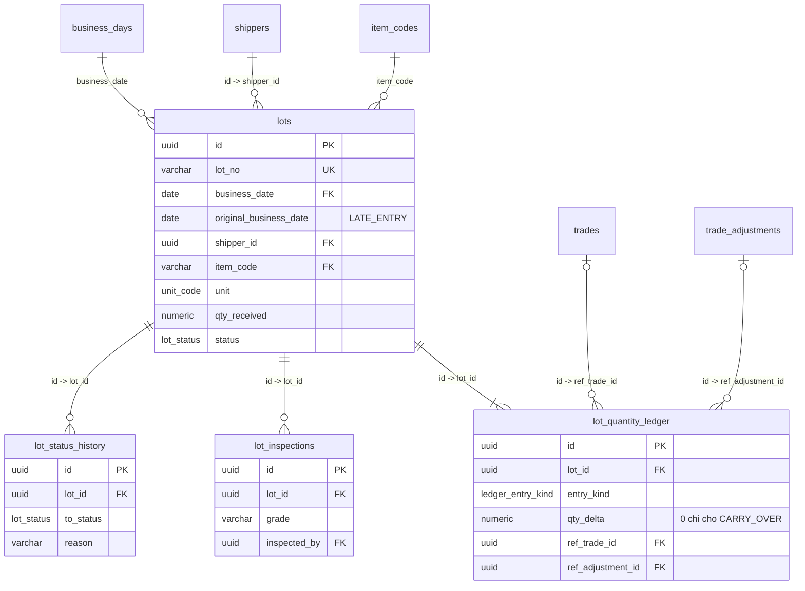

# LOT_DB — Lô: 仮受付 / 本登録 / 目利き / sổ số lượng

| | |
|---|---|
| System Name | 水産物卸売市場業務支援システム（Product A, khách 株式会社 桜水産市場 — hư cấu） |
| Schema | `app` |
| CHARACTER SET | UTF8 (PostgreSQL 16, RDS Multi-AZ, AWS Tokyo) |
| Updated by | phuongnnm-23344 |
| Note | Một file của bộ Database Design tách theo cụm ER (QC-01 §4: một file một nhóm bảng). Nguyên tắc P1–P7, quy ước chung + enum (4.0), view công bố, bảng lệch so với prototype, kết quả parity và điểm mở chung nằm ở file tổng [MKT_DB.md](MKT_DB.md). **Số mục 4.xx giữ theo số bảng toàn schema** (cột No ở MKT_DB §2) để tham chiếu chéo giữa các file và từ ADR / spec không đổi khi tách |

---

## 1. Lịch sử sửa đổi

| No | Version | Action | Sheet / Bảng | Nội dung thay đổi | Ngày | Người sửa | Approve |
|---|---|---|---|---|---|---|---|
| 1 | 0.1.0 | Add new | — | Nội dung ban đầu nằm trong `MKT_DB.md` 0.1.0 (một file cho toàn schema) | 2026-11-25 | phuongnnm-23344 | |
| 2 | 0.2.0 | Add new | Toàn file | Tách từ `MKT_DB.md` 0.1.1 theo cụm ER (Gate 1 M-09); sửa theo Gate 1 M-05: `lots.original_business_date` cho lô nhập bù (`LATE_ENTRY`) của ngày đã khóa; 業務日 tiếp nhận theo định nghĩa mới (M-01, lô 01:00–02:00 thuộc 業務日 sáng đó) | 2026-11-25 | phuongnnm-23344 | |

---

## 2. Danh sách bảng

| No | Schema | Category | Tên bảng (logic) | Tên bảng (vật lý) | Mô tả | Note | Status |
|---|---|---|---|---|---|---|---|
| 25 | app | transaction | Lô | [`lots`](#425-lots) | 仮受付 → 本登録 → 下見済 → 公開 → 確定 → 引渡し完了 | Prototype: `lots` | Decision (provisional) |
| 26 | app | history | Lịch sử trạng thái lô | [`lot_status_history`](#426-lot_status_history) | Mỗi lần đổi trạng thái lô, 販売終了, 持ち越し | Mới | Decision (provisional) |
| 27 | app | transaction | 目利き・下見 | [`lot_inspections`](#427-lot_inspections) | Kết quả đánh giá do người ghi | Prototype: `lot_inspections` | Decision (provisional) |
| 28 | app | transaction | Sổ số lượng lô | [`lot_quantity_ledger`](#428-lot_quantity_ledger) | SL khả dụng = tổng `qty_delta` | Prototype: `lot_quantity_ledger` | Decision (provisional) |

---

## 3. ER Diagram

`business_days` ở [CLOSE_DB.md](CLOSE_DB.md); `shippers`, `item_codes` ở [RULE_DB.md](RULE_DB.md); `trades` ở [TRADE_DB.md](TRADE_DB.md); `trade_adjustments` ở [ADJUST_DB.md](ADJUST_DB.md).

---

## 4. Định nghĩa bảng

Quy ước chung (kiểu, cột chung, chỉ thêm, ngày mở, ghi qua hàm, enum): [MKT_DB.md §4.0](MKT_DB.md#40-quy-ước-chung).

### 4.25. `lots`

| | | | |
|---|---|---|---|
| Tên bảng (logic) | Lô | Tạo bởi / ngày | phuongnnm-23344 / 2026-11-25 |
| Tên bảng (vật lý) | `lots` | Sửa bởi / ngày | — |
| Overview | Tiếp nhận 2 bước: 仮受付 ở bến (tablet, offline được) → 本登録 ở PC (mã 出荷者, chứng từ, mã lô chính thức) (PRM-116). Trạng thái FIG-011 + diễn giải PRM-110 (bán nhiều lần; 確定 khi SL = 0 hoặc 販売終了). **Ngày mở.** | Note | SL khả dụng **không** lưu ở đây — luôn tính từ `lot_quantity_ledger` (BR-LOT-02). Sửa thuộc tính trước khóa ngày trên SC-03-04 (PRM-128) → audit; sau khóa → 修正申請 |

**Định nghĩa cột**

| No. | Key | Tên logic | Tên vật lý | Data Type | Size | Not Null | Default | Note |
|---|---|---|---|---|---|---|---|---|
| 1 | PRI | ID | `id` | UUID | N/A | Yes | `gen_random_uuid()` | |
| 2 | UNI | Mã lô | `lot_no` | VARCHAR | 20 | Yes | | `L{YYYYMMDD}-{n}` qua `day_counters` (giữ 0025). Không đổi khi 持ち越し (PRM-110 (d)) |
| 3 | FK | 業務日 ghi sổ | `business_date` | DATE | N/A | Yes | | = `business_date_for(giờ nhận)` — lô nhận 01:30 ngày 1 thuộc 業務日 ngày 1 (Gate 1 M-01) |
| 3a | | 業務日 thật (nhập bù) | `original_business_date` | DATE | N/A | No | | Chỉ có khi lô được nhập qua 修正申請 `LATE_ENTRY` cho ngày đã khóa (ADJUST_DB 4.37); NULL = như `business_date` (Gate 1 M-05) |
| 4 | | 仮番号 | `provisional_no` | VARCHAR | 10 | No | | Số tạm ở bến |
| 5 | FK | 出荷者 | `shipper_id` | UUID | N/A | No | | NULL khi còn `PROVISIONAL`; bắt buộc từ `RECEIVED` (CHECK) |
| 6 | FK | 品目 | `item_code` | VARCHAR | 10 | Yes | | |
| 7 | | 荷目 | `nime_code` | VARCHAR | 20 | No | | `code_values` (`NIME`) |
| 8 | | Đơn vị | `unit` | `unit_code` | N/A | Yes | | |
| 9 | | SL ban đầu (仮受付) | `qty_provisional` | NUMERIC | 12,1 | No | | |
| 10 | | SL nhận (本登録) | `qty_received` | NUMERIC | 12,1 | No | | CHECK > 0; bắt buộc từ `RECEIVED` |
| 11 | | Số chứng từ | `voucher_no` | VARCHAR | 30 | No | | Ảnh chứng từ: `attachments` (chỉ PC — E-21) |
| 12 | | Trạng thái | `status` | `lot_status` | N/A | Yes | `'PROVISIONAL'` | Mỗi lần đổi sinh `lot_status_history` |
| 13 | FK | Người 仮受付 / 本登録 | `provisional_by`, `registered_by` | UUID | N/A | No | | |
| 14 | FK | Thiết bị 仮受付 | `device_id` | UUID | N/A | No | | |
| 15 | | Cột chung | `created_at`, `created_by`, `updated_at`, `updated_by` | | | | | |

**Index** — `lots_pkey`; `uq_lots_lot_no`; `idx_lots_business_date_status` (`business_date`, `status`); `idx_lots_shipper` (`shipper_id`).

**Khoá ngoại**

| No. | Tên khoá ngoại | Cột | Bảng đích | Cột đích | Note |
|---|---|---|---|---|---|
| 1 | `fk_lots_business_day` | `business_date` | `business_days` | `business_date` | |
| 2 | `fk_lots_shipper` | `shipper_id` | `shippers` | `id` | |
| 3 | `fk_lots_item` | `item_code` | `item_codes` | `item_code` | |
| 4 | `fk_lots_device` | `device_id` | `devices` | `id` | |
| — | (không FK) | `nime_code` | `code_values` | | FK ghép (`code_type`, `code`) cần cột hằng — kiểm trong hàm |

---

### 4.26. `lot_status_history`

| | | | |
|---|---|---|---|
| Tên bảng (logic) | Lịch sử trạng thái lô | Tạo bởi / ngày | phuongnnm-23344 / 2026-11-25 |
| Tên bảng (vật lý) | `lot_status_history` | Sửa bởi / ngày | — |
| Overview | Nguồn của RPT-02 ロット履歴 (FT-11-03). Ghi cả 販売終了 (lý do bắt buộc nếu còn SL) và 持ち越し (sang 業務日 kế tiếp). **Chỉ thêm.** | Note | Mới (D12) |

**Định nghĩa cột**

| No. | Key | Tên logic | Tên vật lý | Data Type | Size | Not Null | Default | Note |
|---|---|---|---|---|---|---|---|---|
| 1 | PRI | ID | `id` | UUID | N/A | Yes | `gen_random_uuid()` | |
| 2 | FK | Lô | `lot_id` | UUID | N/A | Yes | | |
| 3 | FK | 業務日 ghi | `business_date` | DATE | N/A | Yes | | |
| 4 | | Trạng thái trước / sau | `from_status`, `to_status` | `lot_status` | N/A | No / Yes | | |
| 5 | | Đánh dấu 販売終了 | `is_sale_end` | BOOLEAN | N/A | Yes | `false` | |
| 6 | | 持ち越し sang ngày | `carried_to_date` | DATE | N/A | No | | |
| 7 | | Lý do | `reason` | VARCHAR | 200 | No | | Bắt buộc khi `is_sale_end` và SL còn > 0 |
| 8 | | Cột chung | `created_at`, `created_by` | | | | | |

**Index** — `lot_status_history_pkey`; `idx_lot_status_history_lot` (`lot_id`, `created_at`).

**Khoá ngoại** — `fk_lot_status_history_lot` (`lot_id` → `lots.id`); `fk_lot_status_history_day` (`business_date` → `business_days.business_date`).

---

### 4.27. `lot_inspections`

| | | | |
|---|---|---|---|
| Tên bảng (logic) | 目利き・下見 | Tạo bởi / ngày | phuongnnm-23344 / 2026-11-25 |
| Tên bảng (vật lý) | `lot_inspections` | Sửa bởi / ngày | — |
| Overview | Kết quả đánh giá độ tươi / chất lượng **do người quyết và ghi** (CAP-HUMAN-01). Không có cột điểm tự động, không OCR (luật 3). Ghi hàng loạt cho nhiều lô cùng 品目 / tàu, mỗi lô vẫn một dòng (PRM-117). **Chỉ thêm. Ngày mở.** | Note | Giữ từ prototype, thêm `batch_no` |

**Định nghĩa cột**

| No. | Key | Tên logic | Tên vật lý | Data Type | Size | Not Null | Default | Note |
|---|---|---|---|---|---|---|---|---|
| 1 | PRI | ID | `id` | UUID | N/A | Yes | `gen_random_uuid()` | |
| 2 | FK | Lô | `lot_id` | UUID | N/A | Yes | | |
| 3 | FK | 業務日 | `business_date` | DATE | N/A | Yes | | |
| 4 | | Hạng | `grade` | VARCHAR | 10 | Yes | | Nhãn người đánh giá chọn |
| 5 | | Ghi chú độ tươi | `freshness_note` | VARCHAR | 200 | No | | |
| 6 | | Mã lượt ghi hàng loạt | `batch_no` | UUID | N/A | No | | Cùng giá trị cho các lô ghi một lần |
| 7 | FK | Người đánh giá | `inspected_by` | UUID | N/A | Yes | | |
| 8 | | Cột chung | `created_at`, `created_by` | | | | | Lần ghi sau thay kết quả trước (lấy dòng mới nhất), dòng cũ giữ |

**Index** — `lot_inspections_pkey`; `idx_lot_inspections_lot` (`lot_id`, `created_at`).

**Khoá ngoại** — `lot_id` → `lots.id`; `business_date` → `business_days`; `inspected_by` → `staff_accounts.id`.

---

### 4.28. `lot_quantity_ledger`

| | | | |
|---|---|---|---|
| Tên bảng (logic) | Sổ số lượng lô | Tạo bởi / ngày | phuongnnm-23344 / 2026-11-25 |
| Tên bảng (vật lý) | `lot_quantity_ledger` | Sửa bởi / ngày | — |
| Overview | SL khả dụng = tổng `qty_delta` (view `v_lot_available_qty`), không âm (BR-LOT-02) — hàm chốt GD khóa dòng lô (`FOR UPDATE`) rồi kiểm. **Chỉ thêm. Ngày mở.** | Note | Đổi: `reason` text → `entry_kind`; cho phép `qty_delta = 0` **chỉ** với `CARRY_OVER` (N01) |

**Định nghĩa cột**

| No. | Key | Tên logic | Tên vật lý | Data Type | Size | Not Null | Default | Note |
|---|---|---|---|---|---|---|---|---|
| 1 | PRI | ID | `id` | UUID | N/A | Yes | `gen_random_uuid()` | |
| 2 | FK | Lô | `lot_id` | UUID | N/A | Yes | | |
| 3 | FK | 業務日 | `business_date` | DATE | N/A | Yes | | |
| 4 | | Loại dòng | `entry_kind` | `ledger_entry_kind` | N/A | Yes | | |
| 5 | | SL thay đổi | `qty_delta` | NUMERIC | 12,1 | Yes | | CHECK (`entry_kind = 'CARRY_OVER'` AND `qty_delta = 0`) OR (`entry_kind <> 'CARRY_OVER'` AND `qty_delta <> 0`) |
| 6 | FK | GD liên quan | `ref_trade_id` | UUID | N/A | No | | Bắt buộc khi `SALE` |
| 7 | FK | Dòng điều chỉnh liên quan | `ref_adjustment_id` | UUID | N/A | No | | Bắt buộc khi `SALE_REVERSE` |
| 8 | | Ghi chú | `note` | VARCHAR | 200 | No | | Bắt buộc khi `RETURN_DISPOSE` |
| 9 | | Cột chung | `created_at`, `created_by` | | | | | |

**Index** — `lot_quantity_ledger_pkey`; `idx_ledger_lot` (`lot_id`); `idx_ledger_business_date` (`business_date`).

**Khoá ngoại** — `lot_id` → `lots.id`; `business_date` → `business_days`; `ref_trade_id` → `trades.id`; `ref_adjustment_id` → `trade_adjustments.id`.
