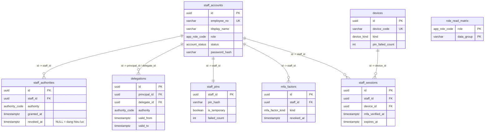
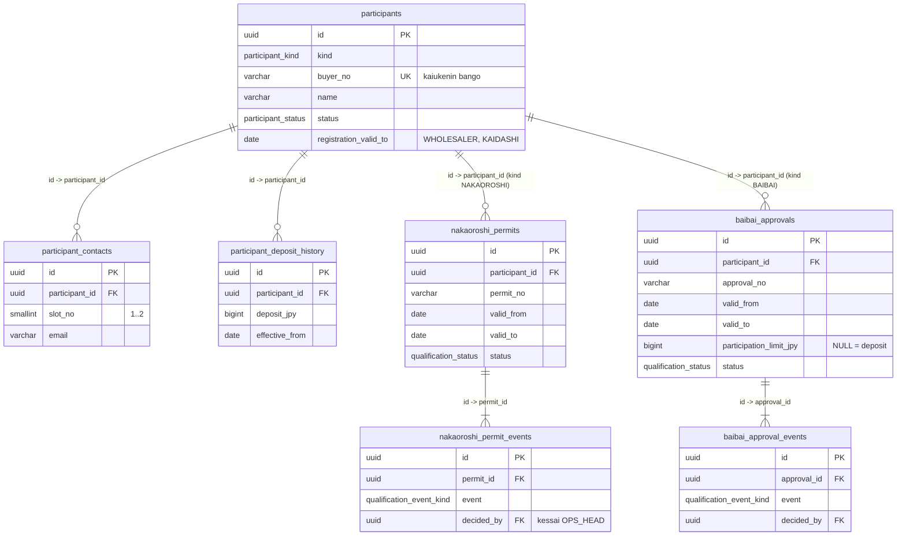
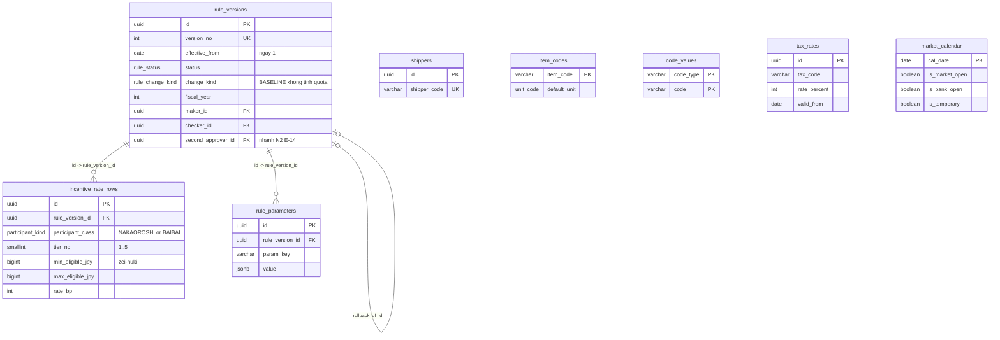
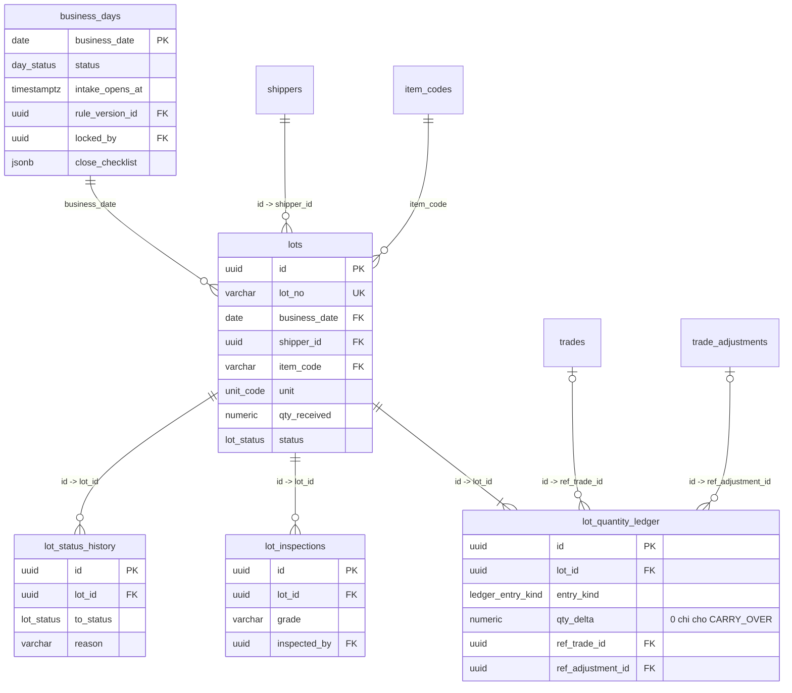
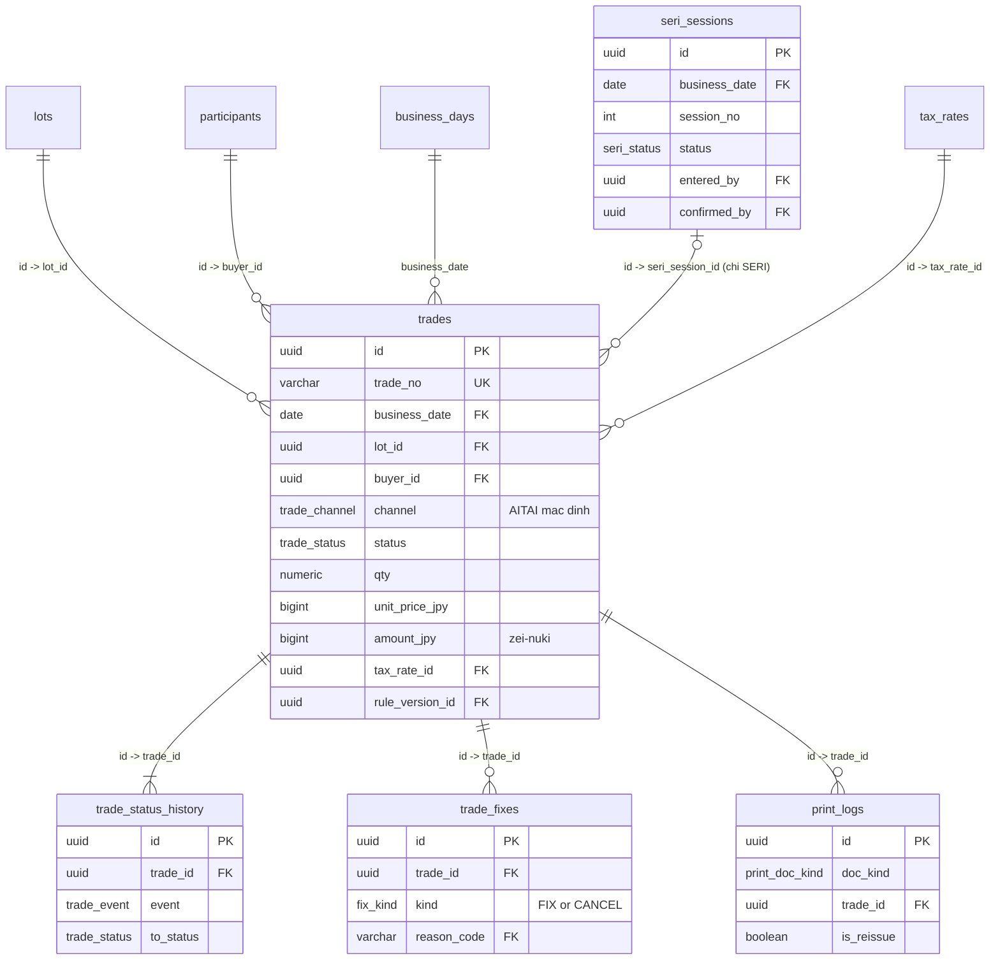
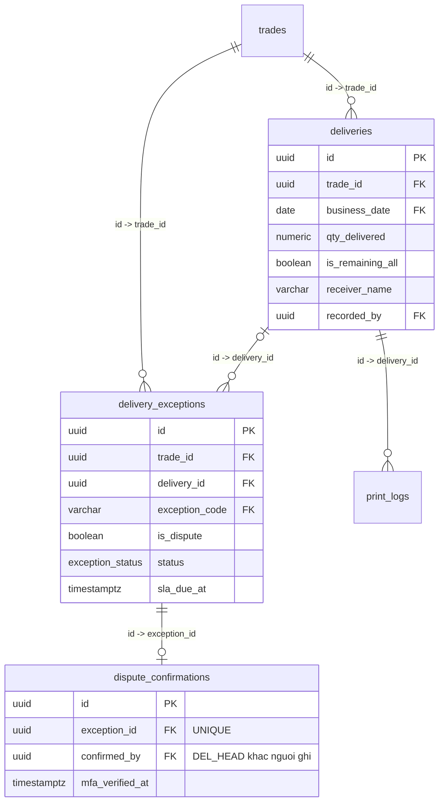
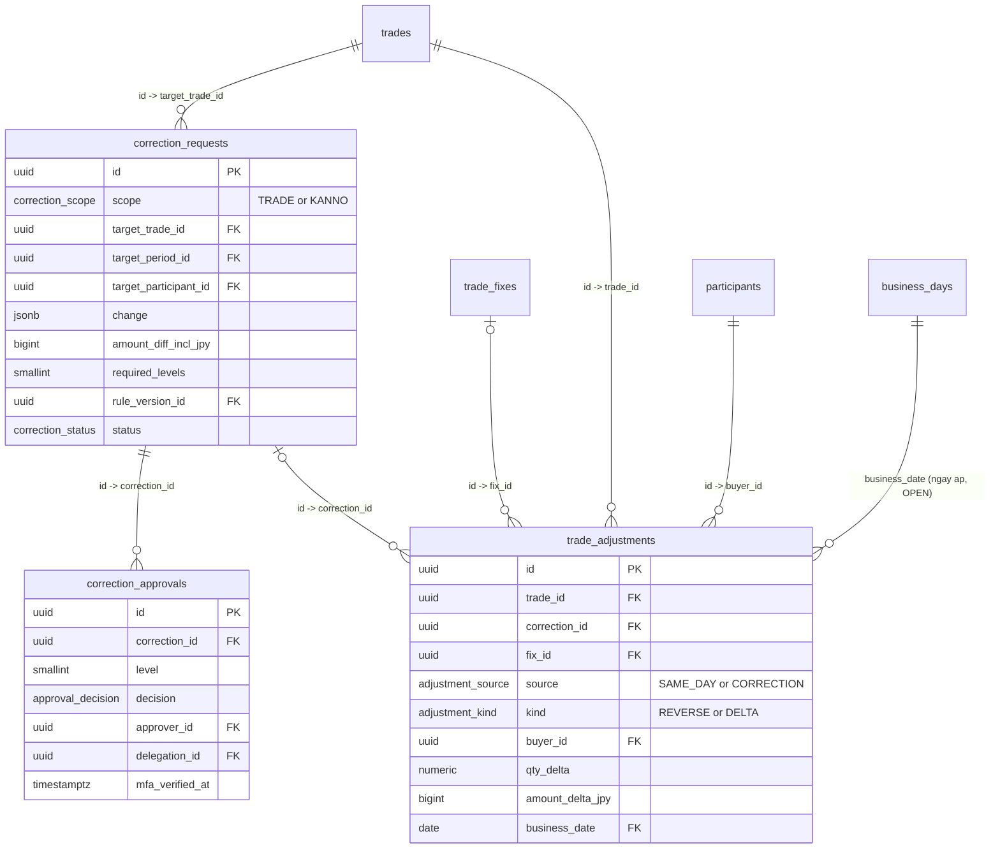
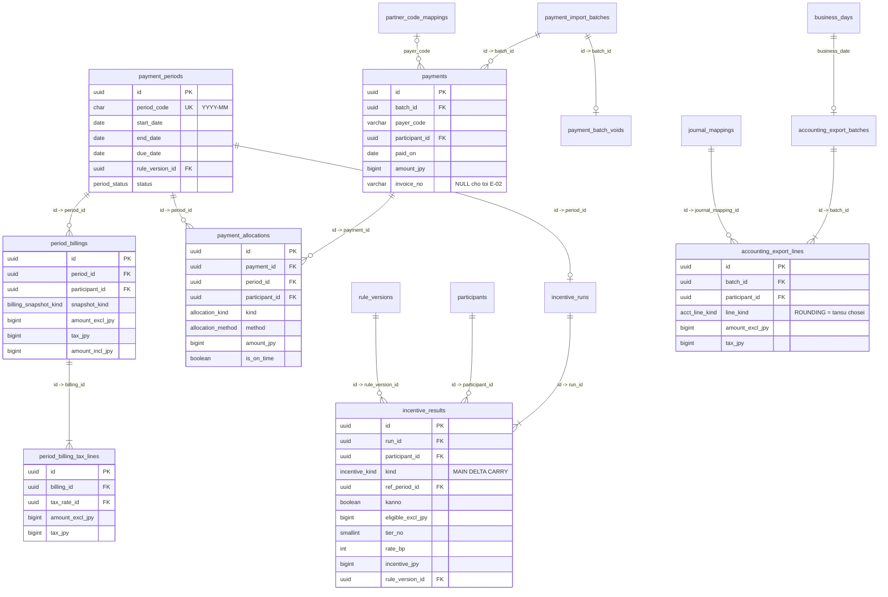
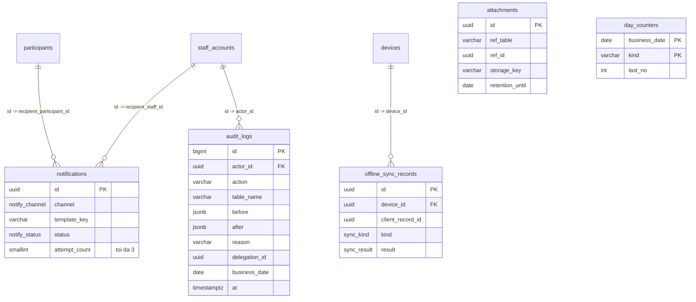

# 水産物卸売市場業務支援システム — Database Design (to-be, 第1期)

| | |
|---|---|
| System Name | 水産物卸売市場業務支援システム（Product A, khách 株式会社 桜水産市場 — hư cấu） |
| Schema | `app` (dữ liệu nghiệp vụ, hàm nghiệp vụ) · `audit` (監査ログ, chia theo năm TC) |
| CHARACTER SET | UTF8, collation `C` cho cột mã; `ja-JP-x-icu` cho cột tên khi sắp xếp |
| DBMS | PostgreSQL 16 trên RDS Multi-AZ, AWS Tokyo (L4-D01, ADR-001) |
| Updated by | phuongnnm-23344 |
| Note | Một file cho **toàn bộ schema**: mọi bảng dùng từ hai feature trở lên (QC-01 §3 — Database Design dùng chung đặt ở gốc `database-design/`). Phạm vi = 第1期 gói R1 (P0 + P1, 99 FT — DEC-031); option và 17 mục 第2期 không có bảng, chỉ ghi điểm mở rộng ở mục 7. Bảng lệch so với prototype LAB-2 ở **mục 5**. Thuật ngữ: 相対取引 (thỏa thuận mua bán trực tiếp — luồng chính, ~90% giá trị), せり (đấu giá — luồng phụ), 許可 (giấy phép cho 仲卸 — người bán buôn trung gian), 承認 (chấp thuận cho 売買参加者 — người tham gia mua bán), 完納奨励金 (tiền thưởng thanh toán đủ, đúng hạn), 業務日 (ngày nghiệp vụ 02:00 → 01:59 hôm sau, JST) |

**Nguyên tắc thiết kế xuyên suốt** (mỗi nguyên tắc có chỗ thể hiện trong mục 4):

| # | Nguyên tắc | Thể hiện ở schema | Nguồn |
|---|---|---|---|
| P1 | 相対取引 là luồng chính; せり chỉ ghi kết quả cuối do người xác nhận | `trades.channel` mặc định `AITAI`; `seri_sessions` chỉ là nhóm kết quả, không có bảng giá đặt / lượt trả giá | Luật 1; FR-SERI-01; B.3 |
| P2 | 許可 ≠ 承認 | Hai bảng, hai lịch sử, hai trigger kiểm loại người tham gia; **không** có bảng hay enum "giấy phép chung" | Luật 2; 02-08; ADR-003 |
| P3 | Người quyết định cuối | Cột người ghi / người xác nhận ở `lot_inspections`, `seri_sessions`, `correction_approvals`, `dispute_confirmations`; không có cột điểm do máy chấm | Luật 3; CAP-HUMAN-01 |
| P4 | Không ghi đè lịch sử | Bảng sổ / lịch sử chỉ thêm (trigger chặn UPDATE, DELETE); `trades` đóng băng khi 確定; sửa = `trade_adjustments` REVERSE + DELTA; ngày / kỳ đã khóa không ghi được | Luật 4; BR-CLOSE-01; B.4; B.7 |
| P5 | Quy chế có version | `rule_versions` + `incentive_rate_rows` (2 bảng tỷ lệ) + `rule_parameters`; mọi dòng tiền lưu `rule_version_id` đã áp | Luật 5; GOV-RULE-01; TBL-RATE-01; FR-AUDIT-03 |
| P6 | Mọi ghi qua hàm trong DB | DB role của app chỉ có EXECUTE trên hàm + SELECT qua RLS; không grant INSERT / UPDATE / DELETE trên bảng | ADR-001, ADR-003 |
| P7 | 業務日 là trục thời gian | Mọi bảng giao dịch có `business_date` (FK `business_days`), không suy từ giờ UTC; kỳ = tháng dương lịch theo 業務日 của giao dịch gốc | BR-INC-01; L4-A04 (2) |

---

## 1. Lịch sử sửa đổi

| No | Version | Action | Sheet / Bảng | Nội dung thay đổi | Ngày | Người sửa | Approve |
|---|---|---|---|---|---|---|---|
| 1 | 0.1.0 | Add new | — | Khởi tạo bản to-be từ mô hình dữ liệu prototype LAB-2 (migration 0001–0030) + LAB-1 (function list, premise list) + PREMISE 0.3.0 | 2026-11-25 | phuongnnm-23344 | |
| 2 | 0.1.0 | Add new | 57 bảng (mục 2) | 22 bảng giữ tên từ prototype (sửa cột), 3 bảng đổi tên (`profiles` → `staff_accounts`, `profile_pins` → `staff_pins`, `user_authorities` → `staff_authorities`), 32 bảng mới; sửa lệch D01–D24 + 14 lệch mới N01–N14 (mục 5) | 2026-11-25 | phuongnnm-23344 | |
| 3 | 0.1.1 | Update | §7 OPEN-DB-02 | Đóng OPEN-DB-02: PREMISE 0.4.0 §3.1 tách lịch chợ–ngân hàng năm khỏi quy chế, không tính 4 lần/năm (PRM-054) — thiết kế bảng không đổi | 2026-11-25 | phuongnnm-23344 | |

---

## 2. Danh sách bảng

Category: `master` = dữ liệu gốc, đổi ít, có người quản lý · `transaction` = phát sinh theo nghiệp vụ hằng ngày · `history` (thêm mới ở dự án này) = bảng **chỉ thêm** ghi lịch sử của một bảng master, không có UPDATE / DELETE. Cột "Prototype" ghi tên bảng tương ứng ở LAB-2 (— = bảng mới).

| No | Schema | Category | Tên bảng (logic) | Tên bảng (vật lý) | Mô tả | Prototype | Status |
|---|---|---|---|---|---|---|---|
| 1 | app | master | Tài khoản nhân viên | [`staff_accounts`](#41-staff_accounts) | Một dòng một nhân viên nội bộ; thay `auth.users` + `profiles` | `profiles` | Decision (provisional) |
| 2 | app | history | Quyền duyệt cấp / thu | [`staff_authorities`](#42-staff_authorities) | 照合部門長 / 運用部門長 / 配送部門責任者 gắn tài khoản, có lịch sử thu hồi | `user_authorities` | Decision (provisional) |
| 3 | app | master | 代行者 (người làm thay) | [`delegations`](#43-delegations) | Ủy quyền duyệt có ngày bắt đầu / kết thúc | — | Decision (provisional) |
| 4 | app | master | PIN đổi người | [`staff_pins`](#44-staff_pins) | PIN 4 số băm, PIN tạm, đếm sai | `profile_pins` | Decision (provisional) |
| 5 | app | master | Phương thức MFA | [`mfa_factors`](#45-mfa_factors) | TOTP ứng dụng / token phần cứng của từng người | — | Decision (provisional) |
| 6 | app | master | Thiết bị đăng ký | [`devices`](#46-devices) | Tablet bến, PC bàn GD, PC văn phòng; khóa PIN theo thiết bị | — | Decision (provisional) |
| 7 | app | transaction | Phiên đăng nhập | [`staff_sessions`](#47-staff_sessions) | Phiên server-side (người, thiết bị), mốc MFA step-up | — | Decision (provisional) |
| 8 | app | master | Ma trận quyền đọc | [`role_read_matrix`](#48-role_read_matrix) | Vai × nhóm dữ liệu được đọc; RLS và menu cùng đọc | — | Decision (provisional) |
| 9 | app | master | Người tham gia | [`participants`](#49-participants) | 4 loại: 卸売業者 / 仲卸 / 売買参加者 / 買出人 | `participants` | Decision (provisional) |
| 10 | app | master | Email liên lạc người tham gia | [`participant_contacts`](#410-participant_contacts) | Tối đa 2 địa chỉ, có thời hạn hiệu lực | — | Decision (provisional) |
| 11 | app | history | Lịch sử 保証金額 | [`participant_deposit_history`](#411-participant_deposit_history) | Mỗi lần đổi 保証金額 (tiền bảo chứng) một dòng | — | Decision (provisional) |
| 12 | app | master | 許可 (仲卸) | [`nakaoroshi_permits`](#412-nakaoroshi_permits) | Giấy phép của 仲卸 | `nakaoroshi_permits` | Decision (provisional) |
| 13 | app | history | Lịch sử 許可 | [`nakaoroshi_permit_events`](#413-nakaoroshi_permit_events) | Đăng ký / gia hạn / 一時停止 / 失効 / 再審査 của 許可 | — | Decision (provisional) |
| 14 | app | master | 承認 (売買参加者) | [`baibai_approvals`](#414-baibai_approvals) | Chấp thuận của 売買参加者 + 参加上限 | `baibai_approvals` | Decision (provisional) |
| 15 | app | history | Lịch sử 承認 | [`baibai_approval_events`](#415-baibai_approval_events) | Như trên, cho 承認 | — | Decision (provisional) |
| 16 | app | master | 出荷者 (người gửi hàng) | [`shippers`](#416-shippers) | Bảng mã 出荷者 | — | Decision (provisional) |
| 17 | app | master | 品目 (mặt hàng) | [`item_codes`](#417-item_codes) | Mã 品目 + đơn vị mặc định | — | Decision (provisional) |
| 18 | app | master | Bảng mã chung | [`code_values`](#418-code_values) | 荷目, lý do chọn nhanh, loại ngoại lệ giao | — | Decision (provisional) |
| 19 | app | master | Thuế suất | [`tax_rates`](#419-tax_rates) | 10% / 8% có ngày hiệu lực | — | Decision (provisional) |
| 20 | app | master | Lịch chợ – ngân hàng | [`market_calendar`](#420-market_calendar) | 1 bảng, 2 cờ; 臨時休市 / 臨時開市 có duyệt | — | Decision (provisional) |
| 21 | app | master | Version quy chế | [`rule_versions`](#421-rule_versions) | Ngày hiệu lực ngày 1, maker-checker, rollback, quota 4 lần / năm TC | `rule_versions` | Decision (provisional) |
| 22 | app | master | Bậc 交付率 | [`incentive_rate_rows`](#422-incentive_rate_rows) | **2 bảng (仲卸 / 売買参加者) × 5 bậc** theo 適格金額 税抜 | `incentive_rate_rows` | Decision (provisional) |
| 23 | app | master | Tham số quy chế | [`rule_parameters`](#423-rule_parameters) | Tham số đụng tiền / 業務日 trong cùng version (PREMISE §3.1) | — | Decision (provisional) |
| 24 | app | transaction | 業務日 | [`business_days`](#424-business_days) | Mở 02:00 theo lịch, khóa bởi 照合部門長 | `business_days` | Decision (provisional) |
| 25 | app | transaction | Lô | [`lots`](#425-lots) | 仮受付 → 本登録 → 下見済 → 公開 → 確定 → 引渡し完了 | `lots` | Decision (provisional) |
| 26 | app | history | Lịch sử trạng thái lô | [`lot_status_history`](#426-lot_status_history) | Mỗi lần đổi trạng thái lô, 販売終了, 持ち越し | — | Decision (provisional) |
| 27 | app | transaction | 目利き・下見 | [`lot_inspections`](#427-lot_inspections) | Kết quả đánh giá do người ghi | `lot_inspections` | Decision (provisional) |
| 28 | app | transaction | Sổ số lượng lô | [`lot_quantity_ledger`](#428-lot_quantity_ledger) | SL khả dụng = tổng `qty_delta` | `lot_quantity_ledger` | Decision (provisional) |
| 29 | app | transaction | Phiên せり | [`seri_sessions`](#429-seri_sessions) | Nhóm kết quả せり, 入力者 ≠ 確認者 | `seri_sessions` | Decision (provisional) |
| 30 | app | transaction | Giao dịch | [`trades`](#430-trades) | 相対 (chính) và kết quả せり; đóng băng khi 確定 | `trades` | Decision (provisional) |
| 31 | app | history | Lịch sử trạng thái GD | [`trade_status_history`](#431-trade_status_history) | FIG-012: 提出 / 承認 / 確定 / 取消 cùng người + thời điểm | — | Decision (provisional) |
| 32 | app | transaction | 当日訂正 / 取消 | [`trade_fixes`](#432-trade_fixes) | Sửa / hủy GD của ngày chưa khóa, có lý do, không duyệt 2 cấp | — | Decision (provisional) |
| 33 | app | transaction | Nhật ký in phiếu | [`print_logs`](#433-print_logs) | In / in lại (再発行) 取引確認票, 引渡票 | — | Decision (provisional) |
| 34 | app | transaction | Lần giao | [`deliveries`](#434-deliveries) | Giao nhiều lần, 「残り全部」, tên người nhận | `deliveries` | Decision (provisional) |
| 35 | app | transaction | Ngoại lệ / tranh chấp giao | [`delivery_exceptions`](#435-delivery_exceptions) | SC-06-04, SLA tranh chấp | — | Decision (provisional) |
| 36 | app | transaction | Xác nhận giao có tranh chấp | [`dispute_confirmations`](#436-dispute_confirmations) | 配送部門責任者 xác nhận (MFA), cấm tự xác nhận | — | Decision (provisional) |
| 37 | app | transaction | 修正申請 | [`correction_requests`](#437-correction_requests) | Yêu cầu sửa sau khóa ngày (FORM-CORR-01) | `correction_requests` | Decision (provisional) |
| 38 | app | history | Bước duyệt 修正申請 | [`correction_approvals`](#438-correction_approvals) | Mỗi lần duyệt / từ chối một dòng, có 代行, MFA | — (cột `approver1/2`) | Decision (provisional) |
| 39 | app | transaction | Dòng điều chỉnh | [`trade_adjustments`](#439-trade_adjustments) | REVERSE (người mua cũ) + DELTA (người mua mới) | `trade_adjustments` | Decision (provisional) |
| 40 | app | history | Ánh xạ 仕訳 | [`journal_mappings`](#440-journal_mappings) | 勘定科目 / 税区分 theo loại dòng, có lịch sử | — | Decision (provisional) |
| 41 | app | transaction | Batch kế toán IF-ACC-01 | [`accounting_export_batches`](#441-accounting_export_batches) | Một batch / 業務日 đã khóa, đóng băng lúc tạo | — | Undecided |
| 42 | app | transaction | Dòng batch kế toán | [`accounting_export_lines`](#442-accounting_export_lines) | Người tham gia × thuế suất; dòng 端数調整 | — | Undecided |
| 43 | app | transaction | Kỳ thanh toán | [`payment_periods`](#443-payment_periods) | Tháng theo 業務日; 支払期日 theo quy chế + lịch | `payment_periods` | Decision (provisional) |
| 44 | app | history | Ánh xạ mã đối tác | [`partner_code_mappings`](#444-partner_code_mappings) | Mã người nộp trong file 入金 → người tham gia | — | Decision (provisional) |
| 45 | app | transaction | Batch import 入金 | [`payment_import_batches`](#445-payment_import_batches) | Mỗi file một batch, chặn trùng SHA-256 | `payment_import_batches` | Decision (provisional) |
| 46 | app | transaction | Hủy batch 入金 | [`payment_batch_voids`](#446-payment_batch_voids) | Hủy bằng bản ghi thêm, người hủy ≠ người import | `payment_batch_voids` | Decision (provisional) |
| 47 | app | transaction | 入金 | [`payments`](#447-payments) | Dòng tiền về | `payments` | Decision (provisional) |
| 48 | app | transaction | Phân bổ 入金 vào kỳ | [`payment_allocations`](#448-payment_allocations) | FIFO khi chưa có 請求番号 (E-02) | — | Decision (provisional) |
| 49 | app | transaction | 期のお支払額 | [`period_billings`](#449-period_billings) | Số phải trả người × kỳ; ảnh chụp lúc thông báo và lúc 期ロック | — | Decision (provisional) |
| 50 | app | transaction | Thuế theo suất của kỳ | [`period_billing_tax_lines`](#450-period_billing_tax_lines) | Tổng 税抜 + thuế tính một lần theo từng suất | — | Decision (provisional) |
| 51 | app | transaction | Lần chạy tính thưởng | [`incentive_runs`](#451-incentive_runs) | Một lần / kỳ | `incentive_runs` | Decision (provisional) |
| 52 | app | transaction | Kết quả 完納奨励金 | [`incentive_results`](#452-incentive_results) | MAIN / DELTA / CARRY theo người × kỳ | `incentive_results` | Decision (provisional) |
| 53 | app | transaction | Thông báo (outbox) | [`notifications`](#453-notifications) | In-app + email, gửi lại ≤ 3 lần | — | Decision (provisional) |
| 54 | app | transaction | Đính kèm | [`attachments`](#454-attachments) | Siêu dữ liệu file ở S3; lưu 3 năm → lưu lạnh | — | Decision (provisional) |
| 55 | app | transaction | Bản ghi đồng bộ offline | [`offline_sync_records`](#455-offline_sync_records) | Hàng đợi 仮受付 / 引渡し / 紙伝票後入力 + đối chiếu SC-03-07 | — | Decision (provisional) |
| 56 | audit | history | 監査ログ | [`audit_logs`](#456-audit_logs) | Ai, khi, lý do, 代行, trước / sau; chia theo năm TC | `audit_logs` | Decision (provisional) |
| 57 | app | master | Bộ đếm số theo ngày | [`day_counters`](#457-day_counters) | Cấp số lô / số GD liên tục theo 業務日 | `day_counters` | Decision (provisional) |

> `accounting_export_batches` / `accounting_export_lines` để **Undecided** vì định dạng file kế toán chờ E-01 (PRM-123). Các bảng khác để **Decision (provisional)**: khách chưa duyệt bản này, và một số cột chờ câu trả lời E-xx — ghi ở Note từng cột và mục 7.

**View công bố** (module khác chỉ đọc bảng của module này qua view — ARCHITECTURE §2): `v_lot_available_qty`, `v_trade_effective`, `v_settlement_lines`, `v_delivery_status`, `v_daily_settlement` (giữ từ prototype 0004, **bắt buộc tham số khoảng 業務日** — sửa D24), thêm `v_participant_current_deposit`, `v_qualification_current`, `v_period_paid`, `v_buyer_period_usage` (参加上限 theo kỳ, 相対 + せり). View đều `security_invoker` để RLS của người gọi áp vào.

---

## 3. ER Diagram

Sơ đồ chia theo 9 cụm. Bảng của cụm khác chỉ hiện tên (không khối cột). Cột trong sơ đồ là cột khóa và cột quyết định nghiệp vụ; danh sách đủ ở mục 4. Cột người thao tác (`*_by`) đều FK tới `staff_accounts.id` — không vẽ để sơ đồ đọc được.

### 3.1 Tài khoản, quyền duyệt, thiết bị (`iam`)

### 3.2 Người tham gia và tư cách — 許可 ≠ 承認 (`party`)

Hai nhánh 許可 và 承認 vẽ tách: không có bảng chung nào nối hai nhánh ngoài `participants` (doanh nghiệp).

### 3.3 Master mã, thuế, lịch, quy chế (`calendar`, `rule`)

### 3.4 業務日, lô, 目利き (`lot`)

### 3.5 相対 (luồng chính), せり, 当日訂正 (`trade`)

### 3.6 Giao hàng (`delivery`)

### 3.7 修正申請 và điều chỉnh REVERSE / DELTA (`settle`)

`trade_adjustments` có đúng một nguồn: `correction_id` (修正申請 sau khóa ngày) **hoặc** `fix_id` (当日訂正 / 取消 trước khóa ngày).

### 3.8 Kỳ, 入金, phân bổ, 期のお支払額, 完納奨励金, kế toán (`incentive`, `settle`)

### 3.9 Xuyên suốt: thông báo, đính kèm, đồng bộ offline, 監査ログ

Ba bảng này tham chiếu nhiều bảng nghiệp vụ bằng cặp (`ref_table`, `ref_id`) — không khai FK; lý do ghi ở mục 4.53–4.56.

> Tên bảng và tên cột trong sơ đồ phải **khớp từng ký tự** với mục 4 — lệch tên là sơ đồ nói một đằng, định nghĩa bảng nói một nẻo. Kiểu trong sơ đồ viết thường, rút gọn (`varchar` không ghi độ dài); kiểu đủ ở mục 4.

---
## 4. Định nghĩa bảng

### 4.0. Quy ước chung

**Kiểu và cột chung**

| Quy ước | Giá trị | Lý do / nguồn |
|---|---|---|
| Khóa chính | `UUID` sinh bằng `gen_random_uuid()`; `audit_logs` dùng `BIGINT IDENTITY` | Giữ như prototype; id không lộ thứ tự nghiệp vụ. Số nghiệp vụ người đọc được (`lot_no`, `trade_no`) là cột riêng |
| Tiền | `BIGINT` đơn vị JPY, không số lẻ. Cột tiền **税抜** (chưa thuế) trừ khi tên cột có hậu tố `_incl_` | PRM-053: tiền dòng = SL × đơn giá, làm tròn xuống yên; thuế tính một lần trên tổng theo suất |
| Số lượng | `NUMERIC(12,1)` theo đơn vị của lô (kg tới 0,1 kg; ケース, 尾 là số nguyên — CHECK theo `unit`) | PRM-053 |
| Tỷ lệ | `INT` đơn vị basis point (1 bp = 0,01%) | Đề xuất PL: chưa có `incentive-rate-table.csv` (E-03), bp đủ mịn cho tỷ lệ dạng 0,25% |
| Thời điểm / ngày | `TIMESTAMPTZ` cho thời điểm; `DATE` cho 業務日 và ngày hiệu lực. 業務日 **không** suy từ `now()` mà lấy từ `business_days` | P7; BR-INC-01 (JST, 業務日) |
| Cột chung bảng `transaction` / `history` | `created_at TIMESTAMPTZ NOT NULL DEFAULT now()`, `created_by UUID` FK `staff_accounts.id` (NULL = job hệ thống) | FR-AUDIT-01 |
| Cột chung bảng `master` | Thêm `updated_at`, `updated_by`; mọi lần sửa đi kèm dòng `audit_logs` (trước / sau) | FR-AUDIT-01 |
| Chỉ thêm (append-only) | Trigger `forbid_update_delete` trên bảng có ghi "**Chỉ thêm**" ở Overview | Luật 4; B.7 (không xóa cứng) |
| Ngày mở | Trigger `enforce_open_business_day` trên bảng có ghi "**Ngày mở**": ghi vào 業務日 `LOCKED` → lỗi `DAY_LOCKED` | BR-CLOSE-01 |
| Ghi | Chỉ qua hàm `security definer` của module chủ bảng; hàm gọi `assert_caller(vai, quyền duyệt)` đọc `app.user_id`, `app.device_id`, `app.mfa_verified_at` (ADR-002 §2.1) | P6 |
| Đọc | RLS theo `role_read_matrix` (4.8) | L4-A06; ADR-003 |
| Xóa | Không có DELETE nghiệp vụ. Hết hạn lưu (7 năm dữ liệu, 3 năm chứng từ) → xóa vật lý **có duyệt**, ngoài phạm vi hàm thường | DR-RET-01; B.7 |

Cột chung được ghi ở cuối mỗi bảng dưới dạng một dòng "Cột chung" để danh sách cột không dài vô ích; ER và mục 4 dùng cùng tên.

**Enum**

| Enum | Giá trị (nghĩa) | Dùng ở | Khác prototype |
|---|---|---|---|
| `app_role_code` | `INTAKE` 受付 · `JUDGE` 目利き記録 · `TRADE` 取引 · `DELIVERY` 配送 · `SETTLE` 照合事務局 · `RULE` ルール管理者 · `SYSADM` システム管理者 | `staff_accounts`, `role_read_matrix` | Giữ |
| `authority_code` | `STL_HEAD` 照合部門長 · `OPS_HEAD` 運用部門長 · `DEL_HEAD` 配送部門責任者 | `staff_authorities`, `delegations` | Giữ |
| `account_status` | `ACTIVE` · `SUSPENDED` (dừng tạm) · `RETIRED` (nghỉ việc) | `staff_accounts` | Mới — thay `is_active` + `banned_until` |
| `mfa_factor_kind` | `TOTP_APP` · `TOTP_HARDWARE` (token móc khóa, cho người không dùng điện thoại riêng) | `mfa_factors` | Mới (ADR-002 §2.2) |
| `device_kind` | `DOCK_TABLET` (bến) · `DELIVERY_TABLET` · `TRADE_PC` (bàn GD) · `OFFICE_PC` | `devices` | Mới |
| `participant_kind` | `WHOLESALER` 卸売業者 · `NAKAOROSHI` 仲卸 · `BAIBAI` 売買参加者 · `KAIDASHI` 買出人 | `participants`, `incentive_rate_rows` | Giữ |
| `participant_status` | `ACTIVE` · `WITHDRAWN` (rút khỏi chợ) | `participants` | Đổi: `SUSPENDED` chuyển xuống mức 許可 / 承認 (FIG-010) |
| `qualification_status` | `VALID` 有効 · `SUSPENDED` 一時停止 · `EXPIRED` 失効 · `UNDER_REVIEW` 再審査 | `nakaoroshi_permits`, `baibai_approvals` | Đổi: prototype `ACTIVE` / `SUPERSEDED` / `EXPIRED` |
| `qualification_event_kind` | `REGISTERED` · `RENEWED` (gia hạn trước hạn — không qua 再審査) · `SUSPENDED` · `RESUMED` · `EXPIRED` (tự động khi quá 失効日) · `REVIEW_STARTED` · `REINSTATED` | `*_events` | Mới (PRM-045, PRM-121) |
| `day_status` / `period_status` | `OPEN` · `LOCKED` | `business_days` / `payment_periods` | Giữ |
| `unit_code` | `KG` · `CASE` (ケース) · `PIECE` (尾) | `lots`, `item_codes` | Mới — prototype `unit` là text |
| `lot_status` | `PROVISIONAL` 仮受付 · `RECEIVED` 受付 · `INSPECTED` 下見済 · `PUBLISHED` 公開 · `CLOSED` 確定 · `DELIVERED` 引渡し完了 | `lots`, `lot_status_history` | Đổi `SOLD_OUT` → `CLOSED` (確定 khi SL = 0 **hoặc** 販売終了 — PRM-110) |
| `ledger_entry_kind` | `RECEIVE` 受入 · `SALE` · `SALE_REVERSE` (trả SL do 訂正 / 取消 / 修正申請) · `CARRY_OVER` 持ち越し (SL 0) · `RETURN_DISPOSE` 返品・廃棄 · `ATTR_FIX` (sửa SL lúc 本登録) | `lot_quantity_ledger` | Mới — prototype dùng `reason` text |
| `trade_channel` | `AITAI` 相対 · `SERI` せり | `trades` | Giữ |
| `trade_status` | `DRAFT` 下書き · `PENDING` 確認待ち · `CONFIRMED` 確定 · `CANCELLED` 取消. 更正 của FIG-012 **không** là giá trị lưu: là trạng thái hiển thị khi GD có 修正申請 đang chờ | `trades` | Đổi: prototype `PROVISIONAL` / `CONFIRMED` |
| `trade_event` | `SUBMIT` 提出 · `APPROVE` 承認 · `REJECT` 却下 · `CONFIRM` 確定 · `FIX` 当日訂正 · `CANCEL` 取消 · `CORRECTION_APPLIED` | `trade_status_history` | Mới (PRM-114 (a)) |
| `trade_source` | `ONLINE` · `PAPER_LATE` 紙伝票後入力 | `trades` | Mới (FT-04-07) |
| `seri_status` | `ENTERING` · `CONFIRMED` | `seri_sessions` | Giữ |
| `fix_kind` | `FIX` 当日訂正 · `CANCEL` 取消 | `trade_fixes` | Mới (PRM-127) |
| `print_doc_kind` | `TRADE_SLIP` 取引確認票 · `DELIVERY_SLIP` 引渡票 | `print_logs` | Mới |
| `exception_status` | `OPEN` · `RESOLVED` | `delivery_exceptions` | Mới |
| `correction_scope` | `TRADE` (SL / giá / người mua của một GD) · `KANNO` (đổi trạng thái 完納 — PRM-055, luôn 2 cấp) | `correction_requests` | Mới |
| `correction_status` | `SUBMITTED` · `FIRST_APPROVED` · `APPROVED` · `REJECTED` | `correction_requests` | Giữ |
| `approval_decision` | `APPROVE` (決裁) · `REJECT` (却下) | `correction_approvals` | Mới |
| `adjustment_kind` | `REVERSE` · `DELTA` | `trade_adjustments` | Giữ |
| `adjustment_source` | `SAME_DAY` (当日訂正 / 取消, ngày chưa khóa) · `CORRECTION` (修正申請) | `trade_adjustments` | Mới (ADR-004 §2.2) |
| `rule_status` | `DRAFT` · `PENDING` · `APPROVED` (đã duyệt, chờ ngày hiệu lực) · `ACTIVE` · `SUPERSEDED` · `CANCELLED` | `rule_versions` | Thêm `APPROVED` (ADR-006 §2.2) |
| `rule_change_kind` | `BASELINE` (bộ giá trị go-live, **không tính** quota) · `CHANGE` · `ROLLBACK` | `rule_versions` | Mới (D06) |
| `allocation_kind` / `allocation_method` | `ALLOCATE` · `REVERSE` / `FIFO` · `INVOICE_NO` · `MANUAL` | `payment_allocations` | Mới (D03) |
| `billing_snapshot_kind` | `NOTICE` (số đã thông báo cho người tham gia) · `LOCK` (số lúc 期ロック) | `period_billings` | Mới |
| `incentive_kind` | `MAIN` · `DELTA` (tính lại kỳ đã khóa) · `CARRY` (delta âm mang sang) | `incentive_results` | Thêm `CARRY` (D23) |
| `acct_line_kind` | `SALE` · `ADJUSTMENT` · `ROUNDING` 端数調整 | `accounting_export_lines` | Mới |
| `acct_line_status` | `HOLD` 保留 · `CONFIRMED` 確認済み · `ADJUSTED` 調整済み | `accounting_export_lines` | Mới (IF-ACC-01) |
| `notify_channel` / `notify_status` | `IN_APP` · `EMAIL` / `QUEUED` · `SENT` · `RETRYING` · `FAILED` (hết 3 lần → danh sách in) | `notifications` | Mới |
| `sync_kind` / `sync_result` | `PROVISIONAL_LOT` 仮受付 · `DELIVERY` 引渡し · `PAPER_TRADE` 紙伝票後入力 / `PENDING` · `APPLIED` · `HELD` 要確認 · `REJECTED` | `offline_sync_records` | Mới (L4-A05) |

---

### 4.1. `staff_accounts`

| | | | |
|---|---|---|---|
| Tên bảng (logic) | Tài khoản nhân viên | Tạo bởi / ngày | phuongnnm-23344 / 2026-11-25 |
| Tên bảng (vật lý) | `staff_accounts` | Sửa bởi / ngày | — |
| Overview | Một dòng một nhân viên nội bộ (PRM-089: mỗi người một tài khoản). Thay `auth.users` + `profiles` của prototype; module `iam` tự quản (ADR-002). | Note | Người tham gia bên ngoài không có tài khoản ở 第1期 (L4-A08) |

**Định nghĩa cột**

| No. | Key | Tên logic | Tên vật lý | Data Type | Size | Not Null | Default | Note |
|---|---|---|---|---|---|---|---|---|
| 1 | PRI | ID | `id` | UUID | N/A | Yes | `gen_random_uuid()` | |
| 2 | UNI | Mã nhân viên | `employee_no` | VARCHAR | 20 | Yes | | Dùng để đổi người bằng PIN |
| 3 | | Tên hiển thị | `display_name` | VARCHAR | 50 | Yes | | Hiện to trên mọi màn (PRM-112 (a)) |
| 4 | UNI | Email đăng nhập | `login_email` | VARCHAR | 254 | No | | NULL cho người chỉ dùng máy dùng chung |
| 5 | | Mật khẩu băm | `password_hash` | VARCHAR | 255 | No | | argon2id (ADR-002). Không bao giờ ghi log |
| 6 | | Vai | `role` | `app_role_code` | N/A | Yes | | Một vai / tài khoản (TBL-ROLE-01) |
| 7 | | Trạng thái | `status` | `account_status` | N/A | Yes | `'ACTIVE'` | Dừng → xóa mọi phiên ngay (ADR-002) |
| 8 | | Bắt MFA khi đăng nhập | `mfa_required_at_login` | BOOLEAN | N/A | Yes | `false` | `true` bắt buộc với `SYSADM` (CHECK) — L4-A07 |
| 9 | | Cột chung | `created_at`, `created_by`, `updated_at`, `updated_by` | | | | | Xem 4.0 |

**Index**

| No. | Tên index | Cột | Primary key | Unique | Note |
|---|---|---|---|---|---|
| 1 | `staff_accounts_pkey` | `id` | Yes | Yes | |
| 2 | `uq_staff_accounts_employee_no` | `employee_no` | No | Yes | |
| 3 | `uq_staff_accounts_login_email` | `lower(login_email)` | No | Yes | Partial: `login_email IS NOT NULL` |

**Khoá ngoại**

| No. | Tên khoá ngoại | Cột | Bảng đích | Cột đích | Note |
|---|---|---|---|---|---|
| — | N/A | | | | Bảng gốc. `created_by` / `updated_by` tự tham chiếu `staff_accounts.id` |

---

### 4.2. `staff_authorities`

| | | | |
|---|---|---|---|
| Tên bảng (logic) | Quyền duyệt cấp / thu | Tạo bởi / ngày | phuongnnm-23344 / 2026-11-25 |
| Tên bảng (vật lý) | `staff_authorities` | Sửa bởi / ngày | — |
| Overview | Quyền duyệt gắn tài khoản — không phải vai mới (PRM-051, PRM-058, PRM-111). Thu hồi = điền `revoked_at`, không xóa dòng (ADR-003: có lịch sử cấp / thu). | Note | Chỉ cho phép một UPDATE: điền `revoked_at` / `revoked_by` một lần |

**Định nghĩa cột**

| No. | Key | Tên logic | Tên vật lý | Data Type | Size | Not Null | Default | Note |
|---|---|---|---|---|---|---|---|---|
| 1 | PRI | ID | `id` | UUID | N/A | Yes | `gen_random_uuid()` | |
| 2 | FK | Nhân viên | `staff_id` | UUID | N/A | Yes | | |
| 3 | | Quyền | `authority` | `authority_code` | N/A | Yes | | |
| 4 | | Thời điểm cấp | `granted_at` | TIMESTAMPTZ | N/A | Yes | `now()` | |
| 5 | FK | Người cấp | `granted_by` | UUID | N/A | Yes | | SYSADM |
| 6 | | Thời điểm thu | `revoked_at` | TIMESTAMPTZ | N/A | No | | NULL = đang hiệu lực |
| 7 | FK | Người thu | `revoked_by` | UUID | N/A | No | | |
| 8 | | Cột chung | `created_at`, `created_by` | | | | | |

**Index**

| No. | Tên index | Cột | Primary key | Unique | Note |
|---|---|---|---|---|---|
| 1 | `staff_authorities_pkey` | `id` | Yes | Yes | |
| 2 | `uq_staff_authorities_active` | `staff_id`, `authority` | No | Yes | Partial: `revoked_at IS NULL` |

**Khoá ngoại**

| No. | Tên khoá ngoại | Cột | Bảng đích | Cột đích | Note |
|---|---|---|---|---|---|
| 1 | `fk_staff_authorities_staff` | `staff_id` | `staff_accounts` | `id` | ON DELETE RESTRICT |
| 2 | `fk_staff_authorities_granted_by` / `_revoked_by` | `granted_by`, `revoked_by` | `staff_accounts` | `id` | |

---

### 4.3. `delegations`

| | | | |
|---|---|---|---|
| Tên bảng (logic) | 代行者 (người làm thay) | Tạo bởi / ngày | phuongnnm-23344 / 2026-11-25 |
| Tên bảng (vật lý) | `delegations` | Sửa bởi / ngày | — |
| Overview | Người có quyền duyệt chỉ định người làm thay có thời hạn; tự hết hạn (PRM-057, PRM-129 — tab trong SC-02-03). `assert_caller` coi `delegate_id` có quyền `authority` trong [`valid_from`, `valid_to`). | Note | Thu hồi sớm = điền `revoked_at`. Mọi hành động làm thay ghi `delegation_id` vào `audit_logs` |

**Định nghĩa cột**

| No. | Key | Tên logic | Tên vật lý | Data Type | Size | Not Null | Default | Note |
|---|---|---|---|---|---|---|---|---|
| 1 | PRI | ID | `id` | UUID | N/A | Yes | `gen_random_uuid()` | |
| 2 | FK | Người ủy quyền | `principal_id` | UUID | N/A | Yes | | Phải đang có `authority` |
| 3 | FK | Người làm thay | `delegate_id` | UUID | N/A | Yes | | CHECK `delegate_id <> principal_id` |
| 4 | | Quyền được làm thay | `authority` | `authority_code` | N/A | Yes | | |
| 5 | | Từ | `valid_from` | TIMESTAMPTZ | N/A | Yes | | |
| 6 | | Đến | `valid_to` | TIMESTAMPTZ | N/A | Yes | | CHECK `valid_to > valid_from` |
| 7 | | Lý do | `reason` | VARCHAR | 200 | Yes | | |
| 8 | | Thu hồi | `revoked_at` | TIMESTAMPTZ | N/A | No | | |
| 9 | | Cột chung | `created_at`, `created_by` | | | | | |

**Index**

| No. | Tên index | Cột | Primary key | Unique | Note |
|---|---|---|---|---|---|
| 1 | `delegations_pkey` | `id` | Yes | Yes | |
| 2 | `idx_delegations_delegate_period` | `delegate_id`, `authority`, `valid_from`, `valid_to` | No | No | Tra quyền hiệu lực trong `assert_caller` |

**Khoá ngoại**

| No. | Tên khoá ngoại | Cột | Bảng đích | Cột đích | Note |
|---|---|---|---|---|---|
| 1 | `fk_delegations_principal` | `principal_id` | `staff_accounts` | `id` | |
| 2 | `fk_delegations_delegate` | `delegate_id` | `staff_accounts` | `id` | |

---

### 4.4. `staff_pins`

| | | | |
|---|---|---|---|
| Tên bảng (logic) | PIN đổi người | Tạo bởi / ngày | phuongnnm-23344 / 2026-11-25 |
| Tên bảng (vật lý) | `staff_pins` | Sửa bởi / ngày | — |
| Overview | PIN 4 số để đổi người trên máy dùng chung (PRM-112). Không grant SELECT cho app role — chỉ hàm `verify_pin` đọc. | Note | Khóa theo **người** ở đây, khóa theo **thiết bị** ở `devices` (M22). Bản PIN offline lưu trên thiết bị, không ở bảng này (ADR-008) |

**Định nghĩa cột**

| No. | Key | Tên logic | Tên vật lý | Data Type | Size | Not Null | Default | Note |
|---|---|---|---|---|---|---|---|---|
| 1 | PRI/FK | Nhân viên | `staff_id` | UUID | N/A | Yes | | 1 : 1 với `staff_accounts` |
| 2 | | PIN băm | `pin_hash` | VARCHAR | 255 | Yes | | argon2id có salt |
| 3 | | PIN tạm | `is_temporary` | BOOLEAN | N/A | Yes | `false` | `true` sau khi trưởng ca đặt lại; chỉ dùng online, bắt đổi lần đầu (PRM-112 (c)) |
| 4 | | Số lần sai | `failed_count` | INT | N/A | Yes | `0` | CHECK ≥ 0; ngưỡng ở file cấu hình |
| 5 | | Khóa đến | `locked_until` | TIMESTAMPTZ | N/A | No | | |
| 6 | | Đếm sai hết hạn lúc | `failed_window_ends_at` | TIMESTAMPTZ | N/A | No | | Đếm sai tự về 0 sau khoảng thời gian (M22) |
| 7 | | Cột chung | `updated_at`, `updated_by` | | | | | |

**Index** — chỉ `staff_pins_pkey` (`staff_id`).

**Khoá ngoại**

| No. | Tên khoá ngoại | Cột | Bảng đích | Cột đích | Note |
|---|---|---|---|---|---|
| 1 | `fk_staff_pins_staff` | `staff_id` | `staff_accounts` | `id` | ON DELETE RESTRICT (không xóa tài khoản) |

---

### 4.5. `mfa_factors`

| | | | |
|---|---|---|---|
| Tên bảng (logic) | Phương thức MFA | Tạo bởi / ngày | phuongnnm-23344 / 2026-11-25 |
| Tên bảng (vật lý) | `mfa_factors` | Sửa bởi / ngày | — |
| Overview | Mỗi người có quyền duyệt / quản trị đăng ký ít nhất một phương thức (ADR-002 §2.2, ~12–13 người — PRM-088). Mã chỉ có giá trị cho tài khoản sở hữu. | Note | Mất token → SYSADM điền `revoked_at` ngay |

**Định nghĩa cột**

| No. | Key | Tên logic | Tên vật lý | Data Type | Size | Not Null | Default | Note |
|---|---|---|---|---|---|---|---|---|
| 1 | PRI | ID | `id` | UUID | N/A | Yes | `gen_random_uuid()` | |
| 2 | FK | Nhân viên | `staff_id` | UUID | N/A | Yes | | |
| 3 | | Loại | `kind` | `mfa_factor_kind` | N/A | Yes | | |
| 4 | | Bí mật TOTP (mã hóa) | `secret_encrypted` | BYTEA | N/A | Yes | | Mã hóa bằng khóa KMS ở tầng app; DB không thấy bản rõ |
| 5 | | Số sê-ri token | `hardware_serial` | VARCHAR | 40 | No | | Bắt buộc khi `kind = TOTP_HARDWARE` |
| 6 | | Thu hồi | `revoked_at` | TIMESTAMPTZ | N/A | No | | |
| 7 | | Cột chung | `created_at`, `created_by` | | | | | |

**Index** — `mfa_factors_pkey` (`id`); `idx_mfa_factors_staff` (`staff_id`) partial `revoked_at IS NULL`.

**Khoá ngoại**

| No. | Tên khoá ngoại | Cột | Bảng đích | Cột đích | Note |
|---|---|---|---|---|---|
| 1 | `fk_mfa_factors_staff` | `staff_id` | `staff_accounts` | `id` | |

---

### 4.6. `devices`

| | | | |
|---|---|---|---|
| Tên bảng (logic) | Thiết bị đăng ký | Tạo bởi / ngày | phuongnnm-23344 / 2026-11-25 |
| Tên bảng (vật lý) | `devices` | Sửa bởi / ngày | — |
| Overview | Máy được SYSADM cấp `device_code` (ADR-002 §2.1). Gắn vào phiên, bản ghi offline, nhật ký in, audit. | Note | Khóa PIN theo thiết bị chống dò PIN trên một máy (M22, NFR-SEC-03) |

**Định nghĩa cột**

| No. | Key | Tên logic | Tên vật lý | Data Type | Size | Not Null | Default | Note |
|---|---|---|---|---|---|---|---|---|
| 1 | PRI | ID | `id` | UUID | N/A | Yes | `gen_random_uuid()` | |
| 2 | UNI | Mã thiết bị | `device_code` | VARCHAR | 20 | Yes | | |
| 3 | | Loại | `kind` | `device_kind` | N/A | Yes | | Timeout theo loại ở file cấu hình (PRM-126) |
| 4 | | Vị trí | `location_label` | VARCHAR | 50 | No | | Bến số …, bàn GD … |
| 5 | | Đang dùng | `is_active` | BOOLEAN | N/A | Yes | `true` | |
| 6 | | Số lần sai PIN trên máy | `pin_failed_count` | INT | N/A | Yes | `0` | |
| 7 | | Khóa PIN đến | `pin_locked_until` | TIMESTAMPTZ | N/A | No | | |
| 8 | | Đồng bộ cuối | `last_synced_at` | TIMESTAMPTZ | N/A | No | | Hiện ở checklist khóa ngày (PRM-119 (a)) |
| 9 | | Heartbeat cuối | `last_heartbeat_at` | TIMESTAMPTZ | N/A | No | | Thiết bị gửi khi online (ADR-008 §2.2-7) |
| 10 | | Số bản ghi chờ đồng bộ | `pending_sync_count` | INT | N/A | Yes | `0` | Báo theo heartbeat; > 0 → hiện ở checklist 日次締め |
| 11 | | Cột chung | `created_at`, `created_by`, `updated_at`, `updated_by` | | | | | |

**Index** — `devices_pkey` (`id`); `uq_devices_device_code` (`device_code`, unique).

**Khoá ngoại** — N/A (bảng gốc; chỉ FK cột chung).

---

### 4.7. `staff_sessions`

| | | | |
|---|---|---|---|
| Tên bảng (logic) | Phiên đăng nhập | Tạo bởi / ngày | phuongnnm-23344 / 2026-11-25 |
| Tên bảng (vật lý) | `staff_sessions` | Sửa bởi / ngày | — |
| Overview | Phiên server-side, thu hồi được ngay (ADR-002 §2.1). Một phiên = (người, thiết bị); đổi người bằng PIN = đóng phiên cũ, mở phiên mới → MFA step-up hết hiệu lực. | Note | Dữ liệu vận hành: xóa phiên hết hạn sau 30 ngày bằng job (không phải dữ liệu nghiệp vụ; lịch sử đăng nhập nằm ở `audit_logs`) |

**Định nghĩa cột**

| No. | Key | Tên logic | Tên vật lý | Data Type | Size | Not Null | Default | Note |
|---|---|---|---|---|---|---|---|---|
| 1 | PRI | ID phiên | `id` | UUID | N/A | Yes | `gen_random_uuid()` | Cookie giữ giá trị băm của token, không giữ `id` |
| 2 | UNI | Token băm | `token_hash` | CHAR | 64 | Yes | | SHA-256 |
| 3 | FK | Nhân viên | `staff_id` | UUID | N/A | Yes | | |
| 4 | FK | Thiết bị | `device_id` | UUID | N/A | No | | NULL = PC cá nhân không đăng ký |
| 5 | | MFA lúc | `mfa_verified_at` | TIMESTAMPTZ | N/A | No | | Step-up hiệu lực 10 phút (ADR-002 §2.2, giá trị ở file cấu hình) |
| 6 | | Hoạt động cuối | `last_seen_at` | TIMESTAMPTZ | N/A | Yes | `now()` | |
| 7 | | Hết hạn | `expires_at` | TIMESTAMPTZ | N/A | Yes | | |
| 8 | | Thu hồi | `revoked_at` | TIMESTAMPTZ | N/A | No | | |
| 9 | | Tạo lúc | `created_at` | TIMESTAMPTZ | N/A | Yes | `now()` | |

**Index** — `staff_sessions_pkey`; `uq_staff_sessions_token_hash` (unique); `idx_staff_sessions_staff` (`staff_id`) partial `revoked_at IS NULL`.

**Khoá ngoại**

| No. | Tên khoá ngoại | Cột | Bảng đích | Cột đích | Note |
|---|---|---|---|---|---|
| 1 | `fk_staff_sessions_staff` | `staff_id` | `staff_accounts` | `id` | |
| 2 | `fk_staff_sessions_device` | `device_id` | `devices` | `id` | |

---

### 4.8. `role_read_matrix`

| | | | |
|---|---|---|---|
| Tên bảng (logic) | Ma trận quyền đọc | Tạo bởi / ngày | phuongnnm-23344 / 2026-11-25 |
| Tên bảng (vật lý) | `role_read_matrix` | Sửa bởi / ngày | — |
| Overview | Vai × nhóm dữ liệu được đọc theo cột 閲 của TBL-ROLE-01 (L4-A06). Policy RLS mọi bảng gọi `can_read(data_group)` đọc bảng này; menu UI cùng đọc (ADR-003 §2.5 — viết một lần). | Note | Nội dung dòng lấy từ role-list LAB-1; spec màn ghi quyền hiển thị chi tiết từng item |

**Định nghĩa cột**

| No. | Key | Tên logic | Tên vật lý | Data Type | Size | Not Null | Default | Note |
|---|---|---|---|---|---|---|---|---|
| 1 | PRI | Vai | `role` | `app_role_code` | N/A | Yes | | |
| 2 | PRI | Nhóm dữ liệu | `data_group` | VARCHAR | 30 | Yes | | Vd. `PARTY`, `LOT`, `TRADE`, `DELIVERY`, `SETTLE`, `INCENTIVE`, `RULE`, `AUDIT`, `IAM` |
| 3 | | Phạm vi | `scope` | VARCHAR | 10 | Yes | `'ALL'` | `ALL` · `OWN` (chỉ bản ghi mình tạo) |
| 4 | | Cột chung | `updated_at`, `updated_by` | | | | | Đổi ma trận = thay đổi quyền → audit |

**Index** — `role_read_matrix_pkey` (`role`, `data_group`). Quyền duyệt (`authority_code`) mở rộng đọc theo hàm, không ghi ở bảng này.

**Khoá ngoại** — N/A.

---

### 4.9. `participants`

| | | | |
|---|---|---|---|
| Tên bảng (logic) | Người tham gia | Tạo bởi / ngày | phuongnnm-23344 / 2026-11-25 |
| Tên bảng (vật lý) | `participants` | Sửa bởi / ngày | — |
| Overview | Doanh nghiệp / cá nhân tham gia chợ, 4 loại không gộp thành "người mua" chung (TBL-ACTOR-01). **Doanh nghiệp và căn cứ 許可 / 承認 là hai thực thể tách** (PRM-044): tư cách nằm ở 4.12, 4.14. | Note | Bỏ `email` (→ 4.10), `deposit_jpy` (→ 4.11), `is_sample` (M01) so với prototype |

**Định nghĩa cột**

| No. | Key | Tên logic | Tên vật lý | Data Type | Size | Not Null | Default | Note |
|---|---|---|---|---|---|---|---|---|
| 1 | PRI | ID | `id` | UUID | N/A | Yes | `gen_random_uuid()` | |
| 2 | | Loại | `kind` | `participant_kind` | N/A | Yes | | Không đổi sau khi tạo (trigger) |
| 3 | | Tên | `name` | VARCHAR | 100 | Yes | | |
| 4 | | Tên カナ | `name_kana` | VARCHAR | 100 | No | | Sắp xếp / tra cứu ở quầy |
| 5 | UNI | 買受人番号 | `buyer_no` | VARCHAR | 10 | No | | `^[A-Z0-9]{1,10}$`; bắt buộc với `NAKAOROSHI`, `BAIBAI` (giữ quy tắc 0029) |
| 6 | UNI | Mã đối tác kế toán | `accounting_partner_code` | VARCHAR | 20 | No | | Mã ở phần mềm kế toán (IF-ACC-01) |
| 7 | | Trạng thái doanh nghiệp | `status` | `participant_status` | N/A | Yes | `'ACTIVE'` | 一時停止 / 失効 nằm ở 許可 / 承認, không ở đây |
| 8 | | Số đăng ký | `registration_no` | VARCHAR | 20 | No | | Chỉ `WHOLESALER` (đăng ký chợ) và `KAIDASHI` (đăng ký tại điểm — EX-02) |
| 9 | | Đăng ký hiệu lực đến | `registration_valid_to` | DATE | N/A | No | | Cảnh báo, **không chặn GD** (PRM-044). CHECK: NULL khi `kind` ∈ (`NAKAOROSHI`, `BAIBAI`) |
| 10 | | Cột chung | `created_at`, `created_by`, `updated_at`, `updated_by` | | | | | |

**Index**

| No. | Tên index | Cột | Primary key | Unique | Note |
|---|---|---|---|---|---|
| 1 | `participants_pkey` | `id` | Yes | Yes | |
| 2 | `uq_participants_buyer_no` | `buyer_no` | No | Yes | Đường tra chính ở bàn GD, khu giao (PRM-114 (b)) |
| 3 | `uq_participants_accounting_partner_code` | `accounting_partner_code` | No | Yes | |
| 4 | `idx_participants_kind_status` | `kind`, `status` | No | No | |

**Khoá ngoại** — N/A (chỉ FK cột chung).

---

### 4.10. `participant_contacts`

| | | | |
|---|---|---|---|
| Tên bảng (logic) | Email liên lạc người tham gia | Tạo bởi / ngày | phuongnnm-23344 / 2026-11-25 |
| Tên bảng (vật lý) | `participant_contacts` | Sửa bởi / ngày | — |
| Overview | Tối đa 2 địa chỉ / doanh nghiệp đang hiệu lực (PRM-122 (e), L4-A08). Đổi email = đóng dòng cũ (`valid_to`), thêm dòng mới — giữ lịch sử; chỉ nhân viên chợ đổi theo giấy yêu cầu. | Note | Dữ liệu cá nhân (APPI, FT-13-04): xuất danh sách có email cần MFA step-up |

**Định nghĩa cột**

| No. | Key | Tên logic | Tên vật lý | Data Type | Size | Not Null | Default | Note |
|---|---|---|---|---|---|---|---|---|
| 1 | PRI | ID | `id` | UUID | N/A | Yes | `gen_random_uuid()` | |
| 2 | FK | Người tham gia | `participant_id` | UUID | N/A | Yes | | |
| 3 | | Vị trí | `slot_no` | SMALLINT | N/A | Yes | | CHECK 1..2 |
| 4 | | Email | `email` | VARCHAR | 254 | Yes | | |
| 5 | | Hiệu lực từ / đến | `valid_from`, `valid_to` | DATE | N/A | Yes / No | | `valid_to` NULL = đang dùng |
| 6 | | Số giấy yêu cầu | `request_ref` | VARCHAR | 30 | No | | |
| 7 | | Cột chung | `created_at`, `created_by` | | | | | Chỉ UPDATE `valid_to` một lần |

**Index** — `participant_contacts_pkey`; `uq_participant_contacts_active_slot` (`participant_id`, `slot_no`) unique partial `valid_to IS NULL`.

**Khoá ngoại**

| No. | Tên khoá ngoại | Cột | Bảng đích | Cột đích | Note |
|---|---|---|---|---|---|
| 1 | `fk_participant_contacts_participant` | `participant_id` | `participants` | `id` | |

---

### 4.11. `participant_deposit_history`

| | | | |
|---|---|---|---|
| Tên bảng (logic) | Lịch sử 保証金額 | Tạo bởi / ngày | phuongnnm-23344 / 2026-11-25 |
| Tên bảng (vật lý) | `participant_deposit_history` | Sửa bởi / ngày | — |
| Overview | 保証金額 là trường số có lịch sử, **không** có giao dịch nộp / rút (PRM-046). Giá trị hiện hành = dòng có `effective_from` lớn nhất ≤ ngày xét (view `v_participant_current_deposit`). **Chỉ thêm.** | Note | Dùng làm 参加上限 mặc định của 売買参加者 (4.14) |

**Định nghĩa cột**

| No. | Key | Tên logic | Tên vật lý | Data Type | Size | Not Null | Default | Note |
|---|---|---|---|---|---|---|---|---|
| 1 | PRI | ID | `id` | UUID | N/A | Yes | `gen_random_uuid()` | |
| 2 | FK | Người tham gia | `participant_id` | UUID | N/A | Yes | | |
| 3 | | 保証金額 | `deposit_jpy` | BIGINT | N/A | Yes | | CHECK ≥ 0 |
| 4 | | Hiệu lực từ | `effective_from` | DATE | N/A | Yes | | |
| 5 | | Lý do | `reason` | VARCHAR | 200 | Yes | | |
| 6 | | Cột chung | `created_at`, `created_by` | | | | | |

**Index** — `participant_deposit_history_pkey`; `uq_deposit_participant_from` (`participant_id`, `effective_from`) unique.

**Khoá ngoại**

| No. | Tên khoá ngoại | Cột | Bảng đích | Cột đích | Note |
|---|---|---|---|---|---|
| 1 | `fk_deposit_participant` | `participant_id` | `participants` | `id` | |

---

### 4.12. `nakaoroshi_permits`

| | | | |
|---|---|---|---|
| Tên bảng (logic) | 許可 (仲卸) | Tạo bởi / ngày | phuongnnm-23344 / 2026-11-25 |
| Tên bảng (vật lý) | `nakaoroshi_permits` | Sửa bởi / ngày | — |
| Overview | Giấy phép có xét duyệt của 仲卸. **Căn cứ pháp lý riêng, bảng riêng** (luật 2, ADR-003). Trigger `enforce_qualification_kind` chặn gắn vào người tham gia không phải `NAKAOROSHI` (giữ từ prototype 0005). | Note | `status`, `valid_to` chỉ đổi qua hàm sinh dòng `nakaoroshi_permit_events` trong cùng transaction |

**Định nghĩa cột**

| No. | Key | Tên logic | Tên vật lý | Data Type | Size | Not Null | Default | Note |
|---|---|---|---|---|---|---|---|---|
| 1 | PRI | ID | `id` | UUID | N/A | Yes | `gen_random_uuid()` | |
| 2 | FK | Người tham gia | `participant_id` | UUID | N/A | Yes | | `kind = NAKAOROSHI` (trigger) |
| 3 | UNI | Số 許可 | `permit_no` | VARCHAR | 20 | Yes | | |
| 4 | | Điều kiện 許可 | `permit_conditions` | VARCHAR | 500 | No | | Trường đặc thù của 許可 (ADR-003 §2.2) |
| 5 | | Hiệu lực từ | `valid_from` | DATE | N/A | Yes | | |
| 6 | | 失効日 | `valid_to` | DATE | N/A | Yes | | CHECK `valid_to >= valid_from`; cảnh báo trước 30 ngày (PRM-045) |
| 7 | | Trạng thái | `status` | `qualification_status` | N/A | Yes | `'VALID'` | FIG-010 |
| 8 | | Cột chung | `created_at`, `created_by`, `updated_at`, `updated_by` | | | | | |

**Index** — `nakaoroshi_permits_pkey`; `uq_nakaoroshi_permits_permit_no`; `idx_nakaoroshi_permits_participant` (`participant_id`, `status`).

**Khoá ngoại**

| No. | Tên khoá ngoại | Cột | Bảng đích | Cột đích | Note |
|---|---|---|---|---|---|
| 1 | `fk_nakaoroshi_permits_participant` | `participant_id` | `participants` | `id` | |

---

### 4.13. `nakaoroshi_permit_events`

| | | | |
|---|---|---|---|
| Tên bảng (logic) | Lịch sử 許可 | Tạo bởi / ngày | phuongnnm-23344 / 2026-11-25 |
| Tên bảng (vật lý) | `nakaoroshi_permit_events` | Sửa bởi / ngày | — |
| Overview | Mỗi thay đổi tư cách của một 許可 một dòng. **Chỉ thêm.** 一時停止 / 再審査 → 有効: 照合部門長 起案 (`proposed_by`), 運用部門長 決裁 (`decided_by`, MFA). Gia hạn: 照合事務局 nhập, 照合部門長 確認 — không qua 再審査 (PRM-121). | Note | Từ ngữ duyệt nội bộ là 決裁 / 確認, không dùng 承認 (PRM-121) |

**Định nghĩa cột**

| No. | Key | Tên logic | Tên vật lý | Data Type | Size | Not Null | Default | Note |
|---|---|---|---|---|---|---|---|---|
| 1 | PRI | ID | `id` | UUID | N/A | Yes | `gen_random_uuid()` | |
| 2 | FK | 許可 | `permit_id` | UUID | N/A | Yes | | |
| 3 | | Sự kiện | `event` | `qualification_event_kind` | N/A | Yes | | |
| 4 | | Trạng thái trước / sau | `from_status`, `to_status` | `qualification_status` | N/A | No / Yes | | `from_status` NULL khi `REGISTERED` |
| 5 | | 失効日 trước / sau | `old_valid_to`, `new_valid_to` | DATE | N/A | No | | Chỉ `RENEWED` |
| 6 | | Hiệu lực từ ngày | `effective_on` | DATE | N/A | Yes | | |
| 7 | | Lý do | `reason` | VARCHAR | 500 | Yes | | |
| 8 | FK | Người 起案 | `proposed_by` | UUID | N/A | No | | `STL_HEAD` |
| 9 | FK | Người 決裁 / 確認 | `decided_by` | UUID | N/A | No | | `OPS_HEAD` cho 一時停止 / 再開 / 再審査; NULL cho `EXPIRED` tự động. CHECK `decided_by <> proposed_by` |
| 10 | | MFA lúc | `mfa_verified_at` | TIMESTAMPTZ | N/A | No | | Bắt buộc khi `decided_by` có giá trị (PREMISE §3.2) |
| 11 | | Cột chung | `created_at`, `created_by` | | | | | |

**Index** — `nakaoroshi_permit_events_pkey`; `idx_permit_events_permit` (`permit_id`, `created_at`).

**Khoá ngoại**

| No. | Tên khoá ngoại | Cột | Bảng đích | Cột đích | Note |
|---|---|---|---|---|---|
| 1 | `fk_permit_events_permit` | `permit_id` | `nakaoroshi_permits` | `id` | |
| 2 | `fk_permit_events_proposed_by` / `_decided_by` | `proposed_by`, `decided_by` | `staff_accounts` | `id` | |

---

### 4.14. `baibai_approvals`

| | | | |
|---|---|---|---|
| Tên bảng (logic) | 承認 (売買参加者) | Tạo bởi / ngày | phuongnnm-23344 / 2026-11-25 |
| Tên bảng (vật lý) | `baibai_approvals` | Sửa bởi / ngày | — |
| Overview | Chấp thuận của 売買参加者 — căn cứ khác 許可, bảng khác (luật 2). Có 参加上限 (hạn mức tham gia): cảnh báo + bắt lý do khi tổng 買受代金 **trong kỳ** (相対 + せり) vượt, không chặn cứng (PRM-046, L4-A04 (1)). Trigger kiểm `kind = BAIBAI`. | Note | Hạn mức tính theo kỳ qua view `v_buyer_period_usage` — sửa M19 / D08 |

**Định nghĩa cột**

| No. | Key | Tên logic | Tên vật lý | Data Type | Size | Not Null | Default | Note |
|---|---|---|---|---|---|---|---|---|
| 1 | PRI | ID | `id` | UUID | N/A | Yes | `gen_random_uuid()` | |
| 2 | FK | Người tham gia | `participant_id` | UUID | N/A | Yes | | `kind = BAIBAI` (trigger) |
| 3 | UNI | Số 承認 | `approval_no` | VARCHAR | 20 | Yes | | |
| 4 | | Hiệu lực từ | `valid_from` | DATE | N/A | Yes | | |
| 5 | | 失効日 | `valid_to` | DATE | N/A | Yes | | CHECK `valid_to >= valid_from` |
| 6 | | 参加上限 | `participation_limit_jpy` | BIGINT | N/A | No | | NULL = dùng 保証金額 hiện hành (PRM-046). CHECK > 0 khi có giá trị. Đổi giá trị → `audit_logs` |
| 7 | | Trạng thái | `status` | `qualification_status` | N/A | Yes | `'VALID'` | FIG-010 |
| 8 | | Cột chung | `created_at`, `created_by`, `updated_at`, `updated_by` | | | | | |

**Index** — `baibai_approvals_pkey`; `uq_baibai_approvals_approval_no`; `idx_baibai_approvals_participant` (`participant_id`, `status`).

**Khoá ngoại**

| No. | Tên khoá ngoại | Cột | Bảng đích | Cột đích | Note |
|---|---|---|---|---|---|
| 1 | `fk_baibai_approvals_participant` | `participant_id` | `participants` | `id` | |

---

### 4.15. `baibai_approval_events`

| | | | |
|---|---|---|---|
| Tên bảng (logic) | Lịch sử 承認 | Tạo bởi / ngày | phuongnnm-23344 / 2026-11-25 |
| Tên bảng (vật lý) | `baibai_approval_events` | Sửa bởi / ngày | — |
| Overview | Cùng cấu trúc với 4.13 nhưng **tách bảng** cho 承認 (ADR-003: không có bảng lịch sử tư cách chung). **Chỉ thêm.** | Note | Lặp cấu trúc là có chủ đích — đổi một bên không kéo bên kia |

**Định nghĩa cột** — giống 4.13, thay cột 2:

| No. | Key | Tên logic | Tên vật lý | Data Type | Size | Not Null | Default | Note |
|---|---|---|---|---|---|---|---|---|
| 2 | FK | 承認 | `approval_id` | UUID | N/A | Yes | | Thay `permit_id` |
| 3–11 | | (như 4.13) | `event`, `from_status`, `to_status`, `old_valid_to`, `new_valid_to`, `effective_on`, `reason`, `proposed_by`, `decided_by`, `mfa_verified_at`, cột chung | | | | | |

**Index** — `baibai_approval_events_pkey`; `idx_approval_events_approval` (`approval_id`, `created_at`).

**Khoá ngoại**

| No. | Tên khoá ngoại | Cột | Bảng đích | Cột đích | Note |
|---|---|---|---|---|---|
| 1 | `fk_approval_events_approval` | `approval_id` | `baibai_approvals` | `id` | |

---
### 4.16. `shippers`

| | | | |
|---|---|---|---|
| Tên bảng (logic) | 出荷者 (người gửi hàng) | Tạo bởi / ngày | phuongnnm-23344 / 2026-11-25 |
| Tên bảng (vật lý) | `shippers` | Sửa bởi / ngày | — |
| Overview | Bảng mã 出荷者 (FT-10-06, P0) dùng lúc 本登録 (PRM-116). Thay `lots.shipper_name` text tự do của prototype (D15). | Note | Ngừng dùng = `valid_to`, không xóa |

**Định nghĩa cột**

| No. | Key | Tên logic | Tên vật lý | Data Type | Size | Not Null | Default | Note |
|---|---|---|---|---|---|---|---|---|
| 1 | PRI | ID | `id` | UUID | N/A | Yes | `gen_random_uuid()` | |
| 2 | UNI | Mã 出荷者 | `shipper_code` | VARCHAR | 10 | Yes | | |
| 3 | | Tên | `name` | VARCHAR | 100 | Yes | | |
| 4 | | Hiệu lực từ / đến | `valid_from`, `valid_to` | DATE | N/A | Yes / No | | |
| 5 | | Cột chung | `created_at`, `created_by`, `updated_at`, `updated_by` | | | | | |

**Index** — `shippers_pkey`; `uq_shippers_shipper_code`. **Khoá ngoại** — N/A.

---

### 4.17. `item_codes`

| | | | |
|---|---|---|---|
| Tên bảng (logic) | 品目 (mặt hàng) | Tạo bởi / ngày | phuongnnm-23344 / 2026-11-25 |
| Tên bảng (vật lý) | `item_codes` | Sửa bởi / ngày | — |
| Overview | Mã 品目 và đơn vị mặc định (FT-10-06). Thay `lots.species` text. | Note | |

**Định nghĩa cột**

| No. | Key | Tên logic | Tên vật lý | Data Type | Size | Not Null | Default | Note |
|---|---|---|---|---|---|---|---|---|
| 1 | PRI | Mã 品目 | `item_code` | VARCHAR | 10 | Yes | | |
| 2 | | Tên | `name` | VARCHAR | 50 | Yes | | |
| 3 | | Đơn vị mặc định | `default_unit` | `unit_code` | N/A | Yes | `'KG'` | |
| 4 | | Thuế suất mặc định | `default_tax_code` | VARCHAR | 10 | Yes | `'REDUCED8'` | Thực phẩm → 軽減税率 8% (gợi ý khi nhập; thuế thật của dòng ở `trades.tax_rate_id`) |
| 5 | | Đang dùng | `is_active` | BOOLEAN | N/A | Yes | `true` | |
| 6 | | Cột chung | `created_at`, `created_by`, `updated_at`, `updated_by` | | | | | |

**Index** — `item_codes_pkey`. **Khoá ngoại** — N/A (`default_tax_code` là mã, tra `tax_rates` theo ngày; không FK vì `tax_rates` có nhiều dòng theo thời gian cho một mã).

---

### 4.18. `code_values`

| | | | |
|---|---|---|---|
| Tên bảng (logic) | Bảng mã chung | Tạo bởi / ngày | phuongnnm-23344 / 2026-11-25 |
| Tên bảng (vật lý) | `code_values` | Sửa bởi / ngày | — |
| Overview | Danh mục nhỏ do người vận hành sửa: `NIME` 荷目, `OVER_LIMIT_REASON` (lý do chọn nhanh khi vượt 参加上限 — L4-A04 (1)), `DELIVERY_EXCEPTION` (loại ngoại lệ giao), `FIX_REASON` (lý do 当日訂正 / 取消). | Note | Thứ đụng tiền **không** đặt ở đây — nằm ở `rule_parameters` |

**Định nghĩa cột**

| No. | Key | Tên logic | Tên vật lý | Data Type | Size | Not Null | Default | Note |
|---|---|---|---|---|---|---|---|---|
| 1 | PRI | Loại mã | `code_type` | VARCHAR | 30 | Yes | | |
| 2 | PRI | Mã | `code` | VARCHAR | 20 | Yes | | |
| 3 | | Nhãn | `label` | VARCHAR | 100 | Yes | | Tiếng Nhật, hiện trên màn |
| 4 | | Thứ tự | `sort_order` | INT | N/A | Yes | `0` | |
| 5 | | Đang dùng | `is_active` | BOOLEAN | N/A | Yes | `true` | |
| 6 | | Cột chung | `updated_at`, `updated_by` | | | | | |

**Index** — `code_values_pkey` (`code_type`, `code`). **Khoá ngoại** — N/A.

---

### 4.19. `tax_rates`

| | | | |
|---|---|---|---|
| Tên bảng (logic) | Thuế suất | Tạo bởi / ngày | phuongnnm-23344 / 2026-11-25 |
| Tên bảng (vật lý) | `tax_rates` | Sửa bởi / ngày | — |
| Overview | 税率マスタ (FT-10-05): mã + suất + ngày hiệu lực. Mỗi GD lưu `tax_rate_id` đã áp; thuế kỳ tính một lần trên tổng theo từng suất (PRM-053). Sửa D04 (prototype cố định 10%). | Note | Hệ số 110/100 của BR-INC-01 là **quy tắc thưởng cố định của RFP**, không đọc từ bảng này |

**Định nghĩa cột**

| No. | Key | Tên logic | Tên vật lý | Data Type | Size | Not Null | Default | Note |
|---|---|---|---|---|---|---|---|---|
| 1 | PRI | ID | `id` | UUID | N/A | Yes | `gen_random_uuid()` | |
| 2 | | Mã thuế | `tax_code` | VARCHAR | 10 | Yes | | `STD10`, `REDUCED8` |
| 3 | | Suất (%) | `rate_percent` | INT | N/A | Yes | | CHECK 0..100 |
| 4 | | Hiệu lực từ / đến | `valid_from`, `valid_to` | DATE | N/A | Yes / No | | Không chồng khoảng cho cùng `tax_code` (EXCLUDE gist) |
| 5 | | Cột chung | `created_at`, `created_by` | | | | | |

**Index** — `tax_rates_pkey`; `ex_tax_rates_no_overlap` (`tax_code`, daterange). **Khoá ngoại** — N/A.

---

### 4.20. `market_calendar`

| | | | |
|---|---|---|---|
| Tên bảng (logic) | Lịch chợ – ngân hàng | Tạo bởi / ngày | phuongnnm-23344 / 2026-11-25 |
| Tên bảng (vật lý) | `market_calendar` | Sửa bởi / ngày | — |
| Overview | 1 bảng, 2 cờ (PRM-054). ルール管理者 nhập lịch năm sau một lần (tháng 12), 照合部門長 duyệt; 臨時休市 / 臨時開市 đổi trong ngày, maker-checker gọn, **không tính** vào 4 lần / năm (PREMISE §3.1, FB-CUS-239 **[Giả lập]**). Job 02:00 mở 業務日 theo cờ `is_market_open` (ADR-005). | Note | Điểm mở OPEN-DB-02: lịch **thường** năm sau có tính quota không — PRM-054 nói không, PREMISE §3.1 ghi chung dòng với quy chế |

**Định nghĩa cột**

| No. | Key | Tên logic | Tên vật lý | Data Type | Size | Not Null | Default | Note |
|---|---|---|---|---|---|---|---|---|
| 1 | PRI | Ngày | `cal_date` | DATE | N/A | Yes | | |
| 2 | | Chợ mở | `is_market_open` | BOOLEAN | N/A | Yes | | |
| 3 | | Ngân hàng mở | `is_bank_open` | BOOLEAN | N/A | Yes | | 支払期日 rơi ngày ngân hàng nghỉ → lùi về ngày mở trước |
| 4 | | Đổi đột xuất | `is_temporary` | BOOLEAN | N/A | Yes | `false` | 臨時休市 / 臨時開市 |
| 5 | | Ghi chú | `note` | VARCHAR | 100 | No | | Lý do (bão, 時化, CN trước 年末) |
| 6 | FK | Maker / checker | `maker_id`, `checker_id` | UUID | N/A | Yes / No | | CHECK `checker_id <> maker_id`; dòng chưa có checker chưa có hiệu lực |
| 7 | | Duyệt lúc | `approved_at` | TIMESTAMPTZ | N/A | No | | |
| 8 | | Cột chung | `updated_at`, `updated_by` | | | | | Mọi lần đổi → `audit_logs` (trước / sau) |

**Index** — `market_calendar_pkey` (`cal_date`).

**Khoá ngoại**

| No. | Tên khoá ngoại | Cột | Bảng đích | Cột đích | Note |
|---|---|---|---|---|---|
| 1 | `fk_market_calendar_maker` / `_checker` | `maker_id`, `checker_id` | `staff_accounts` | `id` | |

---

### 4.21. `rule_versions`

| | | | |
|---|---|---|---|
| Tên bảng (logic) | Version quy chế | Tạo bởi / ngày | phuongnnm-23344 / 2026-11-25 |
| Tên bảng (vật lý) | `rule_versions` | Sửa bởi / ngày | — |
| Overview | Một version = bảng tỷ lệ (4.22) + tham số (4.23), hiệu lực từ **ngày 1** của tháng (PRM-042). Maker ルール管理者, checker 照合部門長 (MFA). Vòng đời DRAFT → PENDING → APPROVED (chờ hiệu lực) → ACTIVE → SUPERSEDED; trả về → DRAFT; hủy trước hiệu lực → CANCELLED (ADR-006 §2.2). Quota 4 lần / năm TC (4月→3月) đếm version `CHANGE` + `ROLLBACK` ở `APPROVED` / `ACTIVE` / `SUPERSEDED` có ngày hiệu lực trong năm; **`BASELINE` (go-live) không tính**; `CANCELLED` không tính (L4-A04 (3), sửa D06). Hàm duyệt khóa theo năm TC (advisory lock) để hai checker không cùng vượt quota. Version mới thứ 5 bị chặn. Rollback khi đã đủ 4 lần: **chờ E-14** — cột `second_approver_id` phục vụ nhánh N2 (OPEN-L4-01). | Note | Không có công tắc cấu hình N1 / N2 (PREMISE §6): nhánh được chốt trong hàm sau workshop |

**Định nghĩa cột**

| No. | Key | Tên logic | Tên vật lý | Data Type | Size | Not Null | Default | Note |
|---|---|---|---|---|---|---|---|---|
| 1 | PRI | ID | `id` | UUID | N/A | Yes | `gen_random_uuid()` | |
| 2 | UNI | Số version | `version_no` | INT | N/A | Yes | | CHECK > 0 |
| 3 | | Hiệu lực từ | `effective_from` | DATE | N/A | Yes | | CHECK ngày = 1; hàm duyệt kiểm là tháng tương lai |
| 4 | | Năm TC | `fiscal_year` | INT | N/A | Yes | | GENERATED từ `effective_from` (tháng ≥ 4 → năm đó, ngược lại năm − 1) |
| 5 | | Loại thay đổi | `change_kind` | `rule_change_kind` | N/A | Yes | `'CHANGE'` | Chỉ một `BASELINE` trong toàn hệ thống (unique partial) |
| 6 | | Trạng thái | `status` | `rule_status` | N/A | Yes | `'DRAFT'` | |
| 7 | FK | Rollback về version | `rollback_of_id` | UUID | N/A | No | | Bắt buộc khi `change_kind = ROLLBACK`; nội dung chép từ version đích thành dòng mới |
| 8 | FK | Version bị thay | `replaced_version_id` | UUID | N/A | No | | Version trước đó chuyển `SUPERSEDED` |
| 9 | | Lý do / ghi chú | `note` | VARCHAR | 500 | No | | Bắt buộc khi `ROLLBACK` |
| 10 | FK | Maker | `maker_id` | UUID | N/A | Yes | | `RULE` |
| 11 | FK | Checker | `checker_id` | UUID | N/A | No | | `STL_HEAD`; CHECK `checker_id <> maker_id` |
| 12 | FK | Người duyệt thứ hai | `second_approver_id` | UUID | N/A | No | | Chỉ nhánh N2 của E-14: rollback khi đã đủ 4 lần cần 運用部門長 (MFA) |
| 13 | | Duyệt lúc | `approved_at` | TIMESTAMPTZ | N/A | No | | |
| 14 | | Cột chung | `created_at`, `created_by`, `updated_at`, `updated_by` | | | | | |

**Index** — `rule_versions_pkey`; `uq_rule_versions_version_no`; `uq_rule_versions_baseline` (`change_kind`) unique partial `change_kind = 'BASELINE'`; `idx_rule_versions_fy_status` (`fiscal_year`, `status`); `uq_rule_versions_active_from` (`effective_from`) unique partial `status = 'ACTIVE'`.

**Khoá ngoại**

| No. | Tên khoá ngoại | Cột | Bảng đích | Cột đích | Note |
|---|---|---|---|---|---|
| 1 | `fk_rule_versions_rollback_of` | `rollback_of_id` | `rule_versions` | `id` | |
| 2 | `fk_rule_versions_replaced` | `replaced_version_id` | `rule_versions` | `id` | |
| 3 | `fk_rule_versions_maker` / `_checker` / `_second` | `maker_id`, `checker_id`, `second_approver_id` | `staff_accounts` | `id` | |

---

### 4.22. `incentive_rate_rows`

| | | | |
|---|---|---|---|
| Tên bảng (logic) | Bậc 交付率 | Tạo bởi / ngày | phuongnnm-23344 / 2026-11-25 |
| Tên bảng (vật lý) | `incentive_rate_rows` | Sửa bởi / ngày | — |
| Overview | **Hai bảng tỷ lệ** — 仲卸 và 売買参加者 — mỗi bảng **5 bậc gồm bậc thấp nhất 0%** (PRM-041). Bậc tra theo **適格金額 税抜** (tổng 買受代金 税抜 trong kỳ của người 完納), cận dưới "以上" (sửa D01, D02). Chỉ sửa khi version `DRAFT` (giữ trigger 0005). | Note | Giá trị bậc thật chờ `incentive-rate-table.csv` (E-03, L4-A02) |

**Định nghĩa cột**

| No. | Key | Tên logic | Tên vật lý | Data Type | Size | Not Null | Default | Note |
|---|---|---|---|---|---|---|---|---|
| 1 | PRI | ID | `id` | UUID | N/A | Yes | `gen_random_uuid()` | |
| 2 | FK | Version | `rule_version_id` | UUID | N/A | Yes | | |
| 3 | | Bảng của loại | `participant_class` | `participant_kind` | N/A | Yes | | CHECK ∈ (`NAKAOROSHI`, `BAIBAI`) |
| 4 | | Bậc | `tier_no` | SMALLINT | N/A | Yes | | CHECK 1..5 |
| 5 | | Cận dưới (以上) | `min_eligible_jpy` | BIGINT | N/A | Yes | | 税抜. Bậc 1: `0` |
| 6 | | Cận trên (未満) | `max_eligible_jpy` | BIGINT | N/A | No | | NULL ở bậc 5. CHECK > `min_eligible_jpy` |
| 7 | | 交付率 | `rate_bp` | INT | N/A | Yes | | CHECK 0..10000; bậc 1 = 0 |

Hàm `submit_rule_version` kiểm: mỗi `participant_class` đủ 5 bậc, liền nhau (cận trên bậc n = cận dưới bậc n+1), bậc 1 bắt đầu 0 và `rate_bp = 0`.

**Index** — `incentive_rate_rows_pkey`; `uq_rate_rows_version_class_tier` (`rule_version_id`, `participant_class`, `tier_no`) unique.

**Khoá ngoại**

| No. | Tên khoá ngoại | Cột | Bảng đích | Cột đích | Note |
|---|---|---|---|---|---|
| 1 | `fk_rate_rows_version` | `rule_version_id` | `rule_versions` | `id` | |

---

### 4.23. `rule_parameters`

| | | | |
|---|---|---|---|
| Tên bảng (logic) | Tham số quy chế | Tạo bởi / ngày | phuongnnm-23344 / 2026-11-25 |
| Tên bảng (vật lý) | `rule_parameters` | Sửa bởi / ngày | — |
| Overview | Tham số đụng tới tiền, 支払期日, khóa sổ, 業務日, 完納 nằm **trong version quy chế** (PREMISE §3.1, L4-A03) — sửa D07, D09, M13. Đổi một tham số = version mới = tính 1 lần quota. Chỉ sửa khi version `DRAFT`. | Note | Tham số thuần vận hành (nơi nhận, giờ gửi, mẫu câu, timeout, SLA tranh chấp) ở **file cấu hình có nhật ký** (PRM-126), không ở bảng này |

**Định nghĩa cột**

| No. | Key | Tên logic | Tên vật lý | Data Type | Size | Not Null | Default | Note |
|---|---|---|---|---|---|---|---|---|
| 1 | PRI | ID | `id` | UUID | N/A | Yes | `gen_random_uuid()` | |
| 2 | FK | Version | `rule_version_id` | UUID | N/A | Yes | | |
| 3 | | Khóa tham số | `param_key` | VARCHAR | 50 | Yes | | CHECK thuộc danh sách dưới |
| 4 | | Giá trị | `value` | JSONB | N/A | Yes | | Kiểm kiểu theo `param_key` trong hàm `save_rule_parameters` |

| `param_key` | Kiểu | Giá trị bộ go-live (tạm) | ID |
|---|---|---|---|
| `CORR_TWO_LEVEL_THRESHOLD_JPY` | số nguyên JPY (税込, |chênh|, "以上") | 100000 | E-08, PRM-033, PRM-120 |
| `LOT_INTAKE_START_TIME` | `HH:MM` JST | `"01:00"` | E-16, PRM-116 |
| `DELIVERY_MATCH_RULE` | mã | `"REMAINING_ALL_MATCHES"` (「残り全部」= khớp 精算) | E-17, PRM-118 |
| `PAYMENT_DUE_RULE` | `{ "day": 10, "shift": "PREV_BANK_DAY" }` | ngày 10 tháng sau, lùi về ngày ngân hàng mở trước | PRM-054, D05 |
| `TAX_ROUNDING` | mã | `"FLOOR"` (thuế kỳ làm tròn xuống yên) | DEC-011, PRM-053, E-06 |
| `DAY_CLOSE_DEADLINE` | `HH:MM` JST | `"11:00"` (batch xong trước 11:00) | FG-11, PRM-119 |
| `LOT_CARRYOVER_ON_CLOSE` | boolean | `true` (持ち越し — tạm xếp như quy chế) | E-12, PRM-110, OPEN-L4-03 |
| `SELL_BEFORE_INSPECTION` | boolean | `false` (bám FIG-011) | E-13, PRM-117, OPEN-L4-03 |

**Index** — `rule_parameters_pkey`; `uq_rule_parameters_version_key` (`rule_version_id`, `param_key`) unique.

**Khoá ngoại**

| No. | Tên khoá ngoại | Cột | Bảng đích | Cột đích | Note |
|---|---|---|---|---|---|
| 1 | `fk_rule_parameters_version` | `rule_version_id` | `rule_versions` | `id` | |

---

### 4.24. `business_days`

| | | | |
|---|---|---|---|
| Tên bảng (logic) | 業務日 | Tạo bởi / ngày | phuongnnm-23344 / 2026-11-25 |
| Tên bảng (vật lý) | `business_days` | Sửa bởi / ngày | — |
| Overview | Job mở 業務日 lúc 02:00 JST theo `market_calendar` (ADR-005); lô nhận từ `LOT_INTAKE_START_TIME` gắn vào 業務日 sáng đó (`intake_opens_at`). Khóa bởi 照合部門長 hoặc 代行 (MFA), **không mở lại** (BR-CLOSE-01). Sửa D22. | Note | `current_business_date()` to-be = ngày `OPEN` theo lịch, không còn là "ngày OPEN lớn nhất" |

**Định nghĩa cột**

| No. | Key | Tên logic | Tên vật lý | Data Type | Size | Not Null | Default | Note |
|---|---|---|---|---|---|---|---|---|
| 1 | PRI | 業務日 | `business_date` | DATE | N/A | Yes | | |
| 2 | | Trạng thái | `status` | `day_status` | N/A | Yes | `'OPEN'` | `LOCKED` → `OPEN` bị trigger chặn |
| 3 | | Nhận lô từ | `intake_opens_at` | TIMESTAMPTZ | N/A | Yes | | = ngày + `LOT_INTAKE_START_TIME` của version hiệu lực |
| 4 | | Mở lúc | `opened_at` | TIMESTAMPTZ | N/A | Yes | `now()` | Job; `created_by` NULL |
| 5 | FK | Version quy chế áp | `rule_version_id` | UUID | N/A | Yes | | Version hiệu lực ngày đó (FR-AUDIT-03) |
| 6 | FK | Người khóa | `locked_by` | UUID | N/A | No | | |
| 7 | FK | Khóa thay cho (代行) | `lock_delegation_id` | UUID | N/A | No | | |
| 8 | | Khóa lúc | `locked_at` | TIMESTAMPTZ | N/A | No | | |
| 9 | | Checklist lúc khóa | `close_checklist` | JSONB | N/A | No | | Ảnh chụp số liệu checklist (PRM-119): GD treo, せり chưa xác nhận, máy chưa đồng bộ, lô còn SL, 引渡し残 đã tick |

**Index** — `business_days_pkey`; `idx_business_days_status` (`status`) partial `status = 'OPEN'`.

**Khoá ngoại**

| No. | Tên khoá ngoại | Cột | Bảng đích | Cột đích | Note |
|---|---|---|---|---|---|
| 1 | `fk_business_days_rule_version` | `rule_version_id` | `rule_versions` | `id` | |
| 2 | `fk_business_days_locked_by` | `locked_by` | `staff_accounts` | `id` | |
| 3 | `fk_business_days_delegation` | `lock_delegation_id` | `delegations` | `id` | |

---

### 4.25. `lots`

| | | | |
|---|---|---|---|
| Tên bảng (logic) | Lô | Tạo bởi / ngày | phuongnnm-23344 / 2026-11-25 |
| Tên bảng (vật lý) | `lots` | Sửa bởi / ngày | — |
| Overview | Tiếp nhận 2 bước: 仮受付 ở bến (tablet, offline được) → 本登録 ở PC (mã 出荷者, chứng từ, mã lô chính thức) (PRM-116). Trạng thái FIG-011 + diễn giải PRM-110 (bán nhiều lần; 確定 khi SL = 0 hoặc 販売終了). **Ngày mở.** | Note | SL khả dụng **không** lưu ở đây — luôn tính từ `lot_quantity_ledger` (BR-LOT-02). Sửa thuộc tính trước khóa ngày trên SC-03-04 (PRM-128) → audit; sau khóa → 修正申請 |

**Định nghĩa cột**

| No. | Key | Tên logic | Tên vật lý | Data Type | Size | Not Null | Default | Note |
|---|---|---|---|---|---|---|---|---|
| 1 | PRI | ID | `id` | UUID | N/A | Yes | `gen_random_uuid()` | |
| 2 | UNI | Mã lô | `lot_no` | VARCHAR | 20 | Yes | | `L{YYYYMMDD}-{n}` qua `day_counters` (giữ 0025). Không đổi khi 持ち越し (PRM-110 (d)) |
| 3 | FK | 業務日 tiếp nhận | `business_date` | DATE | N/A | Yes | | |
| 4 | | 仮番号 | `provisional_no` | VARCHAR | 10 | No | | Số tạm ở bến |
| 5 | FK | 出荷者 | `shipper_id` | UUID | N/A | No | | NULL khi còn `PROVISIONAL`; bắt buộc từ `RECEIVED` (CHECK) |
| 6 | FK | 品目 | `item_code` | VARCHAR | 10 | Yes | | |
| 7 | | 荷目 | `nime_code` | VARCHAR | 20 | No | | `code_values` (`NIME`) |
| 8 | | Đơn vị | `unit` | `unit_code` | N/A | Yes | | |
| 9 | | SL ban đầu (仮受付) | `qty_provisional` | NUMERIC | 12,1 | No | | |
| 10 | | SL nhận (本登録) | `qty_received` | NUMERIC | 12,1 | No | | CHECK > 0; bắt buộc từ `RECEIVED` |
| 11 | | Số chứng từ | `voucher_no` | VARCHAR | 30 | No | | Ảnh chứng từ: `attachments` (chỉ PC — E-21) |
| 12 | | Trạng thái | `status` | `lot_status` | N/A | Yes | `'PROVISIONAL'` | Mỗi lần đổi sinh `lot_status_history` |
| 13 | FK | Người 仮受付 / 本登録 | `provisional_by`, `registered_by` | UUID | N/A | No | | |
| 14 | FK | Thiết bị 仮受付 | `device_id` | UUID | N/A | No | | |
| 15 | | Cột chung | `created_at`, `created_by`, `updated_at`, `updated_by` | | | | | |

**Index** — `lots_pkey`; `uq_lots_lot_no`; `idx_lots_business_date_status` (`business_date`, `status`); `idx_lots_shipper` (`shipper_id`).

**Khoá ngoại**

| No. | Tên khoá ngoại | Cột | Bảng đích | Cột đích | Note |
|---|---|---|---|---|---|
| 1 | `fk_lots_business_day` | `business_date` | `business_days` | `business_date` | |
| 2 | `fk_lots_shipper` | `shipper_id` | `shippers` | `id` | |
| 3 | `fk_lots_item` | `item_code` | `item_codes` | `item_code` | |
| 4 | `fk_lots_device` | `device_id` | `devices` | `id` | |
| — | (không FK) | `nime_code` | `code_values` | | FK ghép (`code_type`, `code`) cần cột hằng — kiểm trong hàm |

---

### 4.26. `lot_status_history`

| | | | |
|---|---|---|---|
| Tên bảng (logic) | Lịch sử trạng thái lô | Tạo bởi / ngày | phuongnnm-23344 / 2026-11-25 |
| Tên bảng (vật lý) | `lot_status_history` | Sửa bởi / ngày | — |
| Overview | Nguồn của RPT-02 ロット履歴 (FT-11-03). Ghi cả 販売終了 (lý do bắt buộc nếu còn SL) và 持ち越し (sang 業務日 kế tiếp). **Chỉ thêm.** | Note | Mới (D12) |

**Định nghĩa cột**

| No. | Key | Tên logic | Tên vật lý | Data Type | Size | Not Null | Default | Note |
|---|---|---|---|---|---|---|---|---|
| 1 | PRI | ID | `id` | UUID | N/A | Yes | `gen_random_uuid()` | |
| 2 | FK | Lô | `lot_id` | UUID | N/A | Yes | | |
| 3 | FK | 業務日 ghi | `business_date` | DATE | N/A | Yes | | |
| 4 | | Trạng thái trước / sau | `from_status`, `to_status` | `lot_status` | N/A | No / Yes | | |
| 5 | | Đánh dấu 販売終了 | `is_sale_end` | BOOLEAN | N/A | Yes | `false` | |
| 6 | | 持ち越し sang ngày | `carried_to_date` | DATE | N/A | No | | |
| 7 | | Lý do | `reason` | VARCHAR | 200 | No | | Bắt buộc khi `is_sale_end` và SL còn > 0 |
| 8 | | Cột chung | `created_at`, `created_by` | | | | | |

**Index** — `lot_status_history_pkey`; `idx_lot_status_history_lot` (`lot_id`, `created_at`).

**Khoá ngoại** — `fk_lot_status_history_lot` (`lot_id` → `lots.id`); `fk_lot_status_history_day` (`business_date` → `business_days.business_date`).

---

### 4.27. `lot_inspections`

| | | | |
|---|---|---|---|
| Tên bảng (logic) | 目利き・下見 | Tạo bởi / ngày | phuongnnm-23344 / 2026-11-25 |
| Tên bảng (vật lý) | `lot_inspections` | Sửa bởi / ngày | — |
| Overview | Kết quả đánh giá độ tươi / chất lượng **do người quyết và ghi** (CAP-HUMAN-01). Không có cột điểm tự động, không OCR (luật 3). Ghi hàng loạt cho nhiều lô cùng 品目 / tàu, mỗi lô vẫn một dòng (PRM-117). **Chỉ thêm. Ngày mở.** | Note | Giữ từ prototype, thêm `batch_no` |

**Định nghĩa cột**

| No. | Key | Tên logic | Tên vật lý | Data Type | Size | Not Null | Default | Note |
|---|---|---|---|---|---|---|---|---|
| 1 | PRI | ID | `id` | UUID | N/A | Yes | `gen_random_uuid()` | |
| 2 | FK | Lô | `lot_id` | UUID | N/A | Yes | | |
| 3 | FK | 業務日 | `business_date` | DATE | N/A | Yes | | |
| 4 | | Hạng | `grade` | VARCHAR | 10 | Yes | | Nhãn người đánh giá chọn |
| 5 | | Ghi chú độ tươi | `freshness_note` | VARCHAR | 200 | No | | |
| 6 | | Mã lượt ghi hàng loạt | `batch_no` | UUID | N/A | No | | Cùng giá trị cho các lô ghi một lần |
| 7 | FK | Người đánh giá | `inspected_by` | UUID | N/A | Yes | | |
| 8 | | Cột chung | `created_at`, `created_by` | | | | | Lần ghi sau thay kết quả trước (lấy dòng mới nhất), dòng cũ giữ |

**Index** — `lot_inspections_pkey`; `idx_lot_inspections_lot` (`lot_id`, `created_at`).

**Khoá ngoại** — `lot_id` → `lots.id`; `business_date` → `business_days`; `inspected_by` → `staff_accounts.id`.

---

### 4.28. `lot_quantity_ledger`

| | | | |
|---|---|---|---|
| Tên bảng (logic) | Sổ số lượng lô | Tạo bởi / ngày | phuongnnm-23344 / 2026-11-25 |
| Tên bảng (vật lý) | `lot_quantity_ledger` | Sửa bởi / ngày | — |
| Overview | SL khả dụng = tổng `qty_delta` (view `v_lot_available_qty`), không âm (BR-LOT-02) — hàm chốt GD khóa dòng lô (`FOR UPDATE`) rồi kiểm. **Chỉ thêm. Ngày mở.** | Note | Đổi: `reason` text → `entry_kind`; cho phép `qty_delta = 0` **chỉ** với `CARRY_OVER` (N01) |

**Định nghĩa cột**

| No. | Key | Tên logic | Tên vật lý | Data Type | Size | Not Null | Default | Note |
|---|---|---|---|---|---|---|---|---|
| 1 | PRI | ID | `id` | UUID | N/A | Yes | `gen_random_uuid()` | |
| 2 | FK | Lô | `lot_id` | UUID | N/A | Yes | | |
| 3 | FK | 業務日 | `business_date` | DATE | N/A | Yes | | |
| 4 | | Loại dòng | `entry_kind` | `ledger_entry_kind` | N/A | Yes | | |
| 5 | | SL thay đổi | `qty_delta` | NUMERIC | 12,1 | Yes | | CHECK (`entry_kind = 'CARRY_OVER'` AND `qty_delta = 0`) OR (`entry_kind <> 'CARRY_OVER'` AND `qty_delta <> 0`) |
| 6 | FK | GD liên quan | `ref_trade_id` | UUID | N/A | No | | Bắt buộc khi `SALE` |
| 7 | FK | Dòng điều chỉnh liên quan | `ref_adjustment_id` | UUID | N/A | No | | Bắt buộc khi `SALE_REVERSE` |
| 8 | | Ghi chú | `note` | VARCHAR | 200 | No | | Bắt buộc khi `RETURN_DISPOSE` |
| 9 | | Cột chung | `created_at`, `created_by` | | | | | |

**Index** — `lot_quantity_ledger_pkey`; `idx_ledger_lot` (`lot_id`); `idx_ledger_business_date` (`business_date`).

**Khoá ngoại** — `lot_id` → `lots.id`; `business_date` → `business_days`; `ref_trade_id` → `trades.id`; `ref_adjustment_id` → `trade_adjustments.id`.

---

### 4.29. `seri_sessions`

| | | | |
|---|---|---|---|
| Tên bảng (logic) | Phiên せり | Tạo bởi / ngày | phuongnnm-23344 / 2026-11-25 |
| Tên bảng (vật lý) | `seri_sessions` | Sửa bởi / ngày | — |
| Overview | Nhóm kết quả cuối của một lượt せり theo FORM-SERI-01. せり人 quyết ở sàn, hệ thống **chỉ ghi** (FR-SERI-01); 確認者 xác nhận cả phiên một lần, mặc định khác 入力者, trùng thì bắt lý do và hiện ở 要確認 (PRM-115). Không có bảng giá đặt / lượt trả giá (luật 1). **Ngày mở.** | Note | Giữ từ prototype |

**Định nghĩa cột**

| No. | Key | Tên logic | Tên vật lý | Data Type | Size | Not Null | Default | Note |
|---|---|---|---|---|---|---|---|---|
| 1 | PRI | ID | `id` | UUID | N/A | Yes | `gen_random_uuid()` | |
| 2 | FK | 業務日 | `business_date` | DATE | N/A | Yes | | |
| 3 | | Số phiên | `session_no` | INT | N/A | Yes | | CHECK > 0 |
| 4 | | Trạng thái | `status` | `seri_status` | N/A | Yes | `'ENTERING'` | |
| 5 | FK | 入力者 | `entered_by` | UUID | N/A | Yes | | |
| 6 | FK | 確認者 | `confirmed_by` | UUID | N/A | No | | |
| 7 | | Xác nhận lúc | `confirmed_at` | TIMESTAMPTZ | N/A | No | | |
| 8 | | Lý do trùng người | `same_person_reason` | VARCHAR | 200 | No | | CHECK: bắt buộc khi `confirmed_by = entered_by` |
| 9 | | Cột chung | `created_at`, `created_by` | | | | | |

**Index** — `seri_sessions_pkey`; `uq_seri_sessions_day_no` (`business_date`, `session_no`) unique.

**Khoá ngoại** — `business_date` → `business_days`; `entered_by`, `confirmed_by` → `staff_accounts.id`.

---

### 4.30. `trades`

| | | | |
|---|---|---|---|
| Tên bảng (logic) | Giao dịch | Tạo bởi / ngày | phuongnnm-23344 / 2026-11-25 |
| Tên bảng (vật lý) | `trades` | Sửa bởi / ngày | — |
| Overview | Một dòng một GD gốc. **相対 là luồng chính** (`channel` mặc định `AITAI`); dòng せり là kết quả đã ghi của phiên. Trạng thái FIG-012; bàn GD bấm một lần từ ô đơn giá tới 確定, hệ thống vẫn ghi 提出 / 承認 / 確定 cùng người + thời điểm vào `trade_status_history` (PRM-114 (a), sửa D10). Kiểm 許可 (仲卸) hoặc 承認 + 参加上限 theo kỳ (売買参加者) **trong cùng transaction** với trừ SL (BR-PERM-01, ADR-003). **Không xóa; đóng băng khi `CONFIRMED`** (SL, giá, tiền, người mua, lô, kênh, ngày, thuế) — sửa chỉ bằng `trade_adjustments`. **Ngày mở.** | Note | Chốt GD bắt buộc online (L4-A05); `PAPER_LATE` là nhập bù có đánh dấu |

**Định nghĩa cột**

| No. | Key | Tên logic | Tên vật lý | Data Type | Size | Not Null | Default | Note |
|---|---|---|---|---|---|---|---|---|
| 1 | PRI | ID | `id` | UUID | N/A | Yes | `gen_random_uuid()` | |
| 2 | UNI | Số GD | `trade_no` | VARCHAR | 20 | Yes | | Qua `day_counters` |
| 3 | FK | 業務日 | `business_date` | DATE | N/A | Yes | | Kỳ của GD = tháng của cột này (L4-A04 (2)) |
| 4 | FK | Lô | `lot_id` | UUID | N/A | Yes | | |
| 5 | FK | Người mua | `buyer_id` | UUID | N/A | Yes | | `NAKAOROSHI` hoặc `BAIBAI` có tư cách `VALID` lúc chốt |
| 6 | | Kênh | `channel` | `trade_channel` | N/A | Yes | `'AITAI'` | |
| 7 | FK | Phiên せり | `seri_session_id` | UUID | N/A | No | | CHECK (`channel = 'SERI'`) = (`seri_session_id IS NOT NULL`) (N02) |
| 8 | | Nguồn | `source` | `trade_source` | N/A | Yes | `'ONLINE'` | |
| 9 | | Số phiếu giấy | `paper_slip_no` | VARCHAR | 20 | No | | Bắt buộc khi `PAPER_LATE`; unique partial |
| 9a | | Giờ ghi trên phiếu | `paper_slip_time` | TIMESTAMPTZ | N/A | No | | Bắt buộc khi `PAPER_LATE`; tư cách 許可 / 承認 kiểm theo hiệu lực tại giờ này (ADR-008 §2.4-11) |
| 10 | | Trạng thái | `status` | `trade_status` | N/A | Yes | `'DRAFT'` | |
| 11 | | SL | `qty` | NUMERIC | 12,1 | Yes | | CHECK > 0 |
| 12 | | Đơn giá | `unit_price_jpy` | BIGINT | N/A | Yes | | CHECK > 0, 税抜 |
| 13 | | Tiền (税抜) | `amount_jpy` | BIGINT | N/A | Yes | | = floor(`qty` × `unit_price_jpy`) — trigger (giữ 0025) |
| 14 | FK | Thuế suất | `tax_rate_id` | UUID | N/A | Yes | | Suất hiệu lực tại `business_date` (D04) |
| 15 | FK | Version quy chế | `rule_version_id` | UUID | N/A | Yes | | = `business_days.rule_version_id` |
| 16 | | Mã lý do vượt 参加上限 | `over_limit_reason_code` | VARCHAR | 20 | No | | `code_values` (`OVER_LIMIT_REASON`). Chỉ cho `BAIBAI` (L4-A04 (1)) |
| 17 | | Ghi chú vượt hạn mức | `over_limit_note` | VARCHAR | 200 | No | | |
| 18 | | 確定 lúc / bởi | `confirmed_at`, `confirmed_by` | TIMESTAMPTZ / UUID | N/A | No | | |
| 19 | | Cột chung | `created_at`, `created_by`, `updated_at`, `updated_by` | | | | | `created_by` = người nhập |

**Index** — `trades_pkey`; `uq_trades_trade_no`; `idx_trades_business_date` (`business_date`); `idx_trades_lot` (`lot_id`); `idx_trades_buyer_date` (`buyer_id`, `business_date`) — 参加上限 theo kỳ, 精算 người × ngày; `idx_trades_seri_session` (`seri_session_id`). Không chia bảng (ADR-009 §2.2-7: chỉ `audit_logs` chia theo năm TC); truy vấn danh sách luôn có khoảng `business_date` + phân trang (M23).

**Khoá ngoại** — `business_date` → `business_days`; `lot_id` → `lots.id`; `buyer_id` → `participants.id`; `seri_session_id` → `seri_sessions.id`; `tax_rate_id` → `tax_rates.id`; `rule_version_id` → `rule_versions.id`; `confirmed_by` → `staff_accounts.id`. `over_limit_reason_code`: kiểm trong hàm (FK ghép như 4.25).

---

### 4.31. `trade_status_history`

| | | | |
|---|---|---|---|
| Tên bảng (logic) | Lịch sử trạng thái GD | Tạo bởi / ngày | phuongnnm-23344 / 2026-11-25 |
| Tên bảng (vật lý) | `trade_status_history` | Sửa bởi / ngày | — |
| Overview | Mỗi sự kiện FIG-012 một dòng, gồm người, thời điểm, thiết bị (PRM-114 (a)); nguồn của RPT-02 取引状態ログ. **Chỉ thêm.** | Note | Mới (D10) |

**Định nghĩa cột**

| No. | Key | Tên logic | Tên vật lý | Data Type | Size | Not Null | Default | Note |
|---|---|---|---|---|---|---|---|---|
| 1 | PRI | ID | `id` | UUID | N/A | Yes | `gen_random_uuid()` | |
| 2 | FK | GD | `trade_id` | UUID | N/A | Yes | | |
| 3 | | Sự kiện | `event` | `trade_event` | N/A | Yes | | |
| 4 | | Trạng thái trước / sau | `from_status`, `to_status` | `trade_status` | N/A | No / Yes | | |
| 5 | | Lý do | `reason` | VARCHAR | 200 | No | | Bắt buộc khi `REJECT`, `CANCEL` |
| 6 | FK | Thiết bị | `device_id` | UUID | N/A | No | | |
| 7 | | Cột chung | `created_at`, `created_by` | | | | | |

**Index** — `trade_status_history_pkey`; `idx_trade_status_history_trade` (`trade_id`, `created_at`).

**Khoá ngoại** — `trade_id` → `trades.id`; `device_id` → `devices.id`.

---

### 4.32. `trade_fixes`

| | | | |
|---|---|---|---|
| Tên bảng (logic) | 当日訂正 / 取消 | Tạo bởi / ngày | phuongnnm-23344 / 2026-11-25 |
| Tên bảng (vật lý) | `trade_fixes` | Sửa bởi / ngày | — |
| Overview | Sửa / hủy GD **của 業務日 chưa khóa** trên SC-04-05 (PRM-127, FR-AITAI-03): có lý do, giữ lịch sử, **không** duyệt 2 cấp. Sinh `trade_adjustments` (REVERSE + DELTA; 取消 chỉ REVERSE) cùng cơ chế với 修正申請 → GD gốc không bị ghi đè (luật 4, sửa D11). **Chỉ thêm. Ngày mở** (ngày của GD gốc phải `OPEN`). | Note | Sau khóa ngày chỉ còn đường 修正申請 (4.37) |

**Định nghĩa cột**

| No. | Key | Tên logic | Tên vật lý | Data Type | Size | Not Null | Default | Note |
|---|---|---|---|---|---|---|---|---|
| 1 | PRI | ID | `id` | UUID | N/A | Yes | `gen_random_uuid()` | |
| 2 | FK | GD | `trade_id` | UUID | N/A | Yes | | |
| 3 | FK | 業務日 | `business_date` | DATE | N/A | Yes | | = `trades.business_date` (CHECK trong hàm) |
| 4 | | Loại | `kind` | `fix_kind` | N/A | Yes | | |
| 5 | | Nội dung đổi | `change` | JSONB | N/A | No | | `{before, after}` cho `qty`, `unit_price_jpy`, `buyer_id`; NULL khi `CANCEL` |
| 6 | | Mã lý do | `reason_code` | VARCHAR | 20 | Yes | | `code_values` (`FIX_REASON`) |
| 7 | | Ghi chú lý do | `reason_note` | VARCHAR | 200 | No | | |
| 8 | | Cột chung | `created_at`, `created_by` | | | | | |

**Index** — `trade_fixes_pkey`; `idx_trade_fixes_trade` (`trade_id`).

**Khoá ngoại** — `trade_id` → `trades.id`; `business_date` → `business_days`.

---

### 4.33. `print_logs`

| | | | |
|---|---|---|---|
| Tên bảng (logic) | Nhật ký in phiếu | Tạo bởi / ngày | phuongnnm-23344 / 2026-11-25 |
| Tên bảng (vật lý) | `print_logs` | Sửa bởi / ngày | — |
| Overview | In thẳng 取引確認票 sau 確定; hết giấy / kẹt → GD vẫn 確定, in lại từ danh sách, phiếu ghi 「再発行」 (PRM-114 (d), PRM-118 (d)). **Chỉ thêm.** | Note | Mới (M05 là điểm tích hợp máy in) |

**Định nghĩa cột**

| No. | Key | Tên logic | Tên vật lý | Data Type | Size | Not Null | Default | Note |
|---|---|---|---|---|---|---|---|---|
| 1 | PRI | ID | `id` | UUID | N/A | Yes | `gen_random_uuid()` | |
| 2 | | Loại phiếu | `doc_kind` | `print_doc_kind` | N/A | Yes | | |
| 3 | FK | GD | `trade_id` | UUID | N/A | No | | Bắt buộc khi `TRADE_SLIP` |
| 4 | FK | Lần giao | `delivery_id` | UUID | N/A | No | | Bắt buộc khi `DELIVERY_SLIP` |
| 5 | | In lại | `is_reissue` | BOOLEAN | N/A | Yes | `false` | `true` từ lần in thứ hai |
| 6 | FK | Thiết bị | `device_id` | UUID | N/A | No | | |
| 7 | | Cột chung | `created_at`, `created_by` | | | | | |

**Index** — `print_logs_pkey`; `idx_print_logs_trade` (`trade_id`); `idx_print_logs_delivery` (`delivery_id`).

**Khoá ngoại** — `trade_id` → `trades.id`; `delivery_id` → `deliveries.id`; `device_id` → `devices.id`.

---
### 4.34. `deliveries`

| | | | |
|---|---|---|---|
| Tên bảng (logic) | Lần giao | Tạo bởi / ngày | phuongnnm-23344 / 2026-11-25 |
| Tên bảng (vật lý) | `deliveries` | Sửa bởi / ngày | — |
| Overview | Mỗi lần giao một dòng; giao nhiều lần, lũy kế / còn lại tính ở `v_delivery_status` từ SL hiệu lực (sau điều chỉnh). Hoàn tất khi khớp theo `DELIVERY_MATCH_RULE` của quy chế (BR-DEL-03, PRM-118). Offline được với giao thường (ADR-008). **Chỉ thêm. Ngày mở.** | Note | Thêm `receiver_name`, `is_remaining_all`, `device_id`, `client_record_id` |

**Định nghĩa cột**

| No. | Key | Tên logic | Tên vật lý | Data Type | Size | Not Null | Default | Note |
|---|---|---|---|---|---|---|---|---|
| 1 | PRI | ID | `id` | UUID | N/A | Yes | `gen_random_uuid()` | |
| 2 | FK | GD | `trade_id` | UUID | N/A | Yes | | GD `CONFIRMED` |
| 3 | FK | 業務日 | `business_date` | DATE | N/A | Yes | | Server xác định (ADR-005) |
| 4 | | SL giao | `qty_delivered` | NUMERIC | 12,1 | Yes | | CHECK > 0; tổng không vượt SL hiệu lực (hàm) |
| 5 | | 「残り全部」 | `is_remaining_all` | BOOLEAN | N/A | Yes | `false` | GD theo kg không cân lại (PRM-118 (a)) |
| 6 | | Người nhận phía mua | `receiver_name` | VARCHAR | 50 | Yes | | PRM-118 (c) |
| 7 | FK | Người giao | `recorded_by` | UUID | N/A | Yes | | |
| 8 | FK | Thiết bị | `device_id` | UUID | N/A | No | | |
| 9 | UNI | Mã bản ghi máy | `client_record_id` | UUID | N/A | No | | Khóa idempotent khi đồng bộ offline (ADR-008 §2.2-4) |
| 10 | | Giờ trên thiết bị | `device_recorded_at` | TIMESTAMPTZ | N/A | No | | Bản ghi offline |
| 11 | | Cột chung | `created_at`, `created_by` | | | | | |

**Index** — `deliveries_pkey`; `idx_deliveries_trade` (`trade_id`); `idx_deliveries_business_date` (`business_date`); `uq_deliveries_client_record` (`client_record_id`) unique partial NOT NULL.

**Khoá ngoại** — `trade_id` → `trades.id`; `business_date` → `business_days`; `recorded_by` → `staff_accounts.id`; `device_id` → `devices.id`.

---

### 4.35. `delivery_exceptions`

| | | | |
|---|---|---|---|
| Tên bảng (logic) | Ngoại lệ / tranh chấp giao | Tạo bởi / ngày | phuongnnm-23344 / 2026-11-25 |
| Tên bảng (vật lý) | `delivery_exceptions` | Sửa bởi / ngày | — |
| Overview | SC-06-04 引渡し例外登録 (FT-06-04) và nguồn của 紛争管理・SLA (FT-07-05, RPT-04, RPT-09). Tranh chấp (`is_dispute`) cần 配送部門責任者 xác nhận ở 4.36. GD đang tranh chấp không chặn giao GD khác của cùng người mua (PRM-111). Đường giấy khi mất mạng: số phiếu 争いのある引渡し確認票 + bản scan (ADR-008 §2.4-12). | Note | Chỉ UPDATE `status` → `RESOLVED` (một lần, có `resolved_at`) |

**Định nghĩa cột**

| No. | Key | Tên logic | Tên vật lý | Data Type | Size | Not Null | Default | Note |
|---|---|---|---|---|---|---|---|---|
| 1 | PRI | ID | `id` | UUID | N/A | Yes | `gen_random_uuid()` | |
| 2 | FK | GD | `trade_id` | UUID | N/A | Yes | | |
| 3 | FK | Lần giao | `delivery_id` | UUID | N/A | No | | |
| 4 | FK | 業務日 | `business_date` | DATE | N/A | Yes | | |
| 5 | | Loại ngoại lệ | `exception_code` | VARCHAR | 20 | Yes | | `code_values` (`DELIVERY_EXCEPTION`) |
| 6 | | Là tranh chấp | `is_dispute` | BOOLEAN | N/A | Yes | `false` | |
| 7 | | Mô tả | `description` | VARCHAR | 500 | Yes | | |
| 8 | | Trạng thái | `status` | `exception_status` | N/A | Yes | `'OPEN'` | |
| 9 | | Hạn SLA | `sla_due_at` | TIMESTAMPTZ | N/A | No | | Tính từ SLA trong file cấu hình (PRM-048, tạm 3 営業日) |
| 10 | | Số phiếu giấy | `paper_form_no` | VARCHAR | 20 | No | | Phiếu 争いのある引渡し確認票 có số sê-ri |
| 11 | | Ký trên giấy lúc | `paper_signed_at` | TIMESTAMPTZ | N/A | No | | Giờ ghi trên phiếu |
| 12 | FK | Người ký trên giấy | `paper_signed_by` | UUID | N/A | No | | Phải là người xác nhận ở 4.36 |
| 13 | | Giải quyết lúc | `resolved_at` | TIMESTAMPTZ | N/A | No | | |
| 14 | | Cột chung | `created_at`, `created_by` | | | | | `created_by` = người ghi |

**Index** — `delivery_exceptions_pkey`; `idx_delivery_exceptions_open` (`status`, `sla_due_at`) partial `status = 'OPEN'`; `idx_delivery_exceptions_trade` (`trade_id`).

**Khoá ngoại** — `trade_id` → `trades.id`; `delivery_id` → `deliveries.id`; `business_date` → `business_days`; `paper_signed_by` → `staff_accounts.id`. Bản scan ở `attachments` (`ref_table = 'delivery_exceptions'`).

---

### 4.36. `dispute_confirmations`

| | | | |
|---|---|---|---|
| Tên bảng (logic) | Xác nhận giao có tranh chấp | Tạo bởi / ngày | phuongnnm-23344 / 2026-11-25 |
| Tên bảng (vật lý) | `dispute_confirmations` | Sửa bởi / ngày | — |
| Overview | SC-06-05: 配送部門責任者 (hoặc 代行) xác nhận hoàn tất — điểm người quyết cuối thứ 4 của CAP-HUMAN-01. **Cấm tự xác nhận** lần giao / ngoại lệ do chính mình ghi (PRM-111); bắt MFA, không làm offline. **Chỉ thêm.** | Note | Mới (M16) |

**Định nghĩa cột**

| No. | Key | Tên logic | Tên vật lý | Data Type | Size | Not Null | Default | Note |
|---|---|---|---|---|---|---|---|---|
| 1 | PRI | ID | `id` | UUID | N/A | Yes | `gen_random_uuid()` | |
| 2 | UNI/FK | Ngoại lệ | `exception_id` | UUID | N/A | Yes | | `is_dispute = true` |
| 3 | FK | Người xác nhận | `confirmed_by` | UUID | N/A | Yes | | `DEL_HEAD`; ≠ `delivery_exceptions.created_by` và ≠ `deliveries.recorded_by` (hàm) |
| 4 | FK | 代行 | `delegation_id` | UUID | N/A | No | | |
| 5 | | MFA lúc | `mfa_verified_at` | TIMESTAMPTZ | N/A | Yes | | |
| 6 | | Kết luận | `decision_note` | VARCHAR | 500 | Yes | | |
| 7 | | Cột chung | `created_at`, `created_by` | | | | | |

**Index** — `dispute_confirmations_pkey`; `uq_dispute_confirmations_exception` (`exception_id`).

**Khoá ngoại** — `exception_id` → `delivery_exceptions.id`; `confirmed_by` → `staff_accounts.id`; `delegation_id` → `delegations.id`.

---

### 4.37. `correction_requests`

| | | | |
|---|---|---|---|
| Tên bảng (logic) | 修正申請 | Tạo bởi / ngày | phuongnnm-23344 / 2026-11-25 |
| Tên bảng (vật lý) | `correction_requests` | Sửa bởi / ngày | — |
| Overview | FORM-CORR-01: sửa sau khóa ngày (FT-08-01). Số cấp duyệt chốt **lúc nộp** theo `CORR_TWO_LEVEL_THRESHOLD_JPY` của version hiệu lực (lưu ảnh chụp ngưỡng + version — sửa D07); **luôn 2 cấp** khi đổi người mua hoặc `KANNO` (PRM-033). Tối đa một yêu cầu đang chờ / GD (giữ 0029). Duyệt xong → REVERSE + DELTA vào **業務日 chưa khóa sớm nhất** (PRM-120 (b)). | Note | Bỏ cột `approver1`, `approver2` → bảng `correction_approvals` (có 代行, MFA) |

**Định nghĩa cột**

| No. | Key | Tên logic | Tên vật lý | Data Type | Size | Not Null | Default | Note |
|---|---|---|---|---|---|---|---|---|
| 1 | PRI | ID | `id` | UUID | N/A | Yes | `gen_random_uuid()` | |
| 2 | | Phạm vi | `scope` | `correction_scope` | N/A | Yes | `'TRADE'` | |
| 3 | FK | GD đích | `target_trade_id` | UUID | N/A | No | | Bắt buộc khi `TRADE` |
| 4 | FK | Kỳ đích | `target_period_id` | UUID | N/A | No | | Bắt buộc khi `KANNO` (PRM-055) |
| 5 | FK | Người tham gia đích | `target_participant_id` | UUID | N/A | No | | Bắt buộc khi `KANNO` |
| 6 | | Nội dung đổi | `change` | JSONB | N/A | Yes | | `{before, after}` |
| 7 | | Chênh tiền 精算 (税込) | `amount_diff_incl_jpy` | BIGINT | N/A | Yes | | |after − before|, dùng so ngưỡng |
| 8 | | Ngưỡng tại lúc nộp | `threshold_jpy_snapshot` | BIGINT | N/A | Yes | | |
| 9 | FK | Version quy chế | `rule_version_id` | UUID | N/A | Yes | | |
| 10 | | Số cấp cần | `required_levels` | SMALLINT | N/A | Yes | | CHECK 1..2 |
| 11 | | Lý do | `reason` | VARCHAR | 500 | Yes | | |
| 12 | | Trạng thái | `status` | `correction_status` | N/A | Yes | `'SUBMITTED'` | |
| 13 | | 業務日 áp | `applied_business_date` | DATE | N/A | No | | Ngày ghi REVERSE / DELTA |
| 14 | | Cột chung | `created_at`, `created_by`, `updated_at` | | | | | `created_by` = người lập (TRADE / DELIVERY / SETTLE) |

Chứng cứ (sao kê, ảnh) ở `attachments` (`ref_table = 'correction_requests'`). Chờ duyệt quá 2 営業日 → cảnh báo (`notifications`).

**Index** — `correction_requests_pkey`; `uq_correction_requests_one_pending` (`target_trade_id`) unique partial `status IN ('SUBMITTED','FIRST_APPROVED')`; `idx_correction_requests_status` (`status`, `created_at`).

**Khoá ngoại** — `target_trade_id` → `trades.id`; `target_period_id` → `payment_periods.id`; `target_participant_id` → `participants.id`; `rule_version_id` → `rule_versions.id`; `applied_business_date` → `business_days`.

---

### 4.38. `correction_approvals`

| | | | |
|---|---|---|---|
| Tên bảng (logic) | Bước duyệt 修正申請 | Tạo bởi / ngày | phuongnnm-23344 / 2026-11-25 |
| Tên bảng (vật lý) | `correction_approvals` | Sửa bởi / ngày | — |
| Overview | Mỗi lần 決裁 / 却下 một dòng. Cấp 1 = 照合部門長, cấp 2 = 運用部門長; **một người không duyệt cả 2 cấp**; người lập không duyệt; 照合部門長 tự lập → cấp 1 do 代行 đã chỉ định (PRM-120 (a)). MFA bắt buộc. **Chỉ thêm.** | Note | Mới — thay `approver1` / `approver2` |

**Định nghĩa cột**

| No. | Key | Tên logic | Tên vật lý | Data Type | Size | Not Null | Default | Note |
|---|---|---|---|---|---|---|---|---|
| 1 | PRI | ID | `id` | UUID | N/A | Yes | `gen_random_uuid()` | |
| 2 | FK | 修正申請 | `correction_id` | UUID | N/A | Yes | | |
| 3 | | Cấp | `level` | SMALLINT | N/A | Yes | | CHECK 1..2 |
| 4 | | Quyết định | `decision` | `approval_decision` | N/A | Yes | | |
| 5 | FK | Người duyệt | `approver_id` | UUID | N/A | Yes | | |
| 6 | FK | 代行 | `delegation_id` | UUID | N/A | No | | |
| 7 | | MFA lúc | `mfa_verified_at` | TIMESTAMPTZ | N/A | Yes | | |
| 8 | | Ý kiến / lý do từ chối | `comment` | VARCHAR | 500 | No | | Bắt buộc khi `REJECT` |
| 9 | | Cột chung | `created_at` | | | | | |

**Index** — `correction_approvals_pkey`; `uq_correction_approvals_level` (`correction_id`, `level`) unique; `uq_correction_approvals_person` (`correction_id`, `approver_id`) unique (một người một cấp).

**Khoá ngoại** — `correction_id` → `correction_requests.id`; `approver_id` → `staff_accounts.id`; `delegation_id` → `delegations.id`.

---

### 4.39. `trade_adjustments`

| | | | |
|---|---|---|---|
| Tên bảng (logic) | Dòng điều chỉnh | Tạo bởi / ngày | phuongnnm-23344 / 2026-11-25 |
| Tên bảng (vật lý) | `trade_adjustments` | Sửa bởi / ngày | — |
| Overview | Cặp REVERSE (người mua / giá **cũ**, số âm) + DELTA (người mua / giá **mới**) cho mọi thay đổi sau 確定 — hai nguồn `SAME_DAY` và `CORRECTION` dùng chung bảng (ADR-004 §2.2). GD gốc không đổi; giá trị hiệu lực = gốc + Σ điều chỉnh (`v_trade_effective`). `business_date` = ngày áp, luôn `OPEN`. **Chỉ thêm. Ngày mở.** | Note | Thêm `adjustment_source`, `fix_id`, `tax_rate_id`, `rule_version_id`, `created_by` so với prototype |

**Định nghĩa cột**

| No. | Key | Tên logic | Tên vật lý | Data Type | Size | Not Null | Default | Note |
|---|---|---|---|---|---|---|---|---|
| 1 | PRI | ID | `id` | UUID | N/A | Yes | `gen_random_uuid()` | |
| 2 | FK | GD gốc | `trade_id` | UUID | N/A | Yes | | |
| 3 | | Nguồn | `source` | `adjustment_source` | N/A | Yes | | |
| 4 | FK | 修正申請 | `correction_id` | UUID | N/A | No | | CHECK: có khi `source = CORRECTION` |
| 5 | FK | 当日訂正 / 取消 | `fix_id` | UUID | N/A | No | | CHECK: có khi `source = SAME_DAY`; đúng một trong 4, 5 |
| 6 | | Loại | `kind` | `adjustment_kind` | N/A | Yes | | |
| 7 | FK | Người mua của dòng | `buyer_id` | UUID | N/A | Yes | | REVERSE = cũ, DELTA = mới (giữ M4 của prototype) |
| 8 | | Đơn giá của dòng | `unit_price_jpy` | BIGINT | N/A | Yes | | CHECK > 0 |
| 9 | | SL thay đổi | `qty_delta` | NUMERIC | 12,1 | Yes | | |
| 10 | | Tiền thay đổi (税抜) | `amount_delta_jpy` | BIGINT | N/A | Yes | | Trigger kiểm = SL × giá (giữ 0025) |
| 11 | FK | Thuế suất | `tax_rate_id` | UUID | N/A | Yes | | = suất của GD gốc |
| 12 | FK | Version quy chế áp | `rule_version_id` | UUID | N/A | Yes | | |
| 13 | FK | 業務日 áp | `business_date` | DATE | N/A | Yes | | Kỳ của dòng = tháng của cột này (L4-A04 (2)) |
| 14 | | Cột chung | `created_at`, `created_by` | | | | | |

**Index** — `trade_adjustments_pkey`; `idx_adjustments_trade` (`trade_id`); `idx_adjustments_buyer_date` (`buyer_id`, `business_date`); `idx_adjustments_business_date` (`business_date`).

**Khoá ngoại** — `trade_id` → `trades.id`; `correction_id` → `correction_requests.id`; `fix_id` → `trade_fixes.id`; `buyer_id` → `participants.id`; `tax_rate_id` → `tax_rates.id`; `rule_version_id` → `rule_versions.id`; `business_date` → `business_days`.

---

### 4.40. `journal_mappings`

| | | | |
|---|---|---|---|
| Tên bảng (logic) | Ánh xạ 仕訳 | Tạo bởi / ngày | phuongnnm-23344 / 2026-11-25 |
| Tên bảng (vật lý) | `journal_mappings` | Sửa bởi / ngày | — |
| Overview | 仕訳対応表 (FT-11-14): loại dòng × thuế suất → 勘定科目 / 税区分. Có lịch sử; thay đổi chỉ áp cho batch tạo **sau** thời điểm đổi, không áp ngược (PRM-123). **Chỉ thêm** (đổi = dòng mới, dòng cũ điền `superseded_at` qua hàm). | Note | Mới (M06) |

**Định nghĩa cột**

| No. | Key | Tên logic | Tên vật lý | Data Type | Size | Not Null | Default | Note |
|---|---|---|---|---|---|---|---|---|
| 1 | PRI | ID | `id` | UUID | N/A | Yes | `gen_random_uuid()` | |
| 2 | | Loại dòng | `line_kind` | `acct_line_kind` | N/A | Yes | | |
| 3 | | Mã thuế | `tax_code` | VARCHAR | 10 | Yes | | |
| 4 | | 勘定科目 | `account_code` | VARCHAR | 20 | Yes | | Định dạng chờ E-01 |
| 5 | | 税区分 | `tax_category` | VARCHAR | 20 | Yes | | |
| 6 | | Hiệu lực từ | `effective_at` | TIMESTAMPTZ | N/A | Yes | `now()` | |
| 7 | | Bị thay lúc | `superseded_at` | TIMESTAMPTZ | N/A | No | | |
| 8 | | Cột chung | `created_at`, `created_by` | | | | | |

**Index** — `journal_mappings_pkey`; `uq_journal_mappings_current` (`line_kind`, `tax_code`) unique partial `superseded_at IS NULL`. **Khoá ngoại** — N/A.

---

### 4.41. `accounting_export_batches`

| | | | |
|---|---|---|---|
| Tên bảng (logic) | Batch kế toán IF-ACC-01 | Tạo bởi / ngày | phuongnnm-23344 / 2026-11-25 |
| Tên bảng (vật lý) | `accounting_export_batches` | Sửa bởi / ngày | — |
| Overview | Tạo sau 日次締め, nội dung **đóng băng lúc tạo** gồm ánh xạ đã áp; xuất lại cùng 業務日 trả đúng file đã tạo (PRM-123, ADR-005 §2-7). Import tay vào phần mềm kế toán. **Chỉ thêm.** | Note | **Undecided**: định dạng / trường chờ E-01. Trường tối thiểu theo IF-ACC-01 / DR-SETTLE-01 |

**Định nghĩa cột**

| No. | Key | Tên logic | Tên vật lý | Data Type | Size | Not Null | Default | Note |
|---|---|---|---|---|---|---|---|---|
| 1 | PRI | ID | `id` | UUID | N/A | Yes | `gen_random_uuid()` | |
| 2 | UNI | Batch code | `batch_code` | VARCHAR | 20 | Yes | | |
| 3 | UNI/FK | 業務日 | `business_date` | DATE | N/A | Yes | | Ngày `LOCKED`; một batch / ngày |
| 4 | | Ánh xạ đã áp | `mapping_snapshot` | JSONB | N/A | Yes | | |
| 5 | | Băm file | `file_sha256` | CHAR | 64 | Yes | | File gốc ở S3 |
| 6 | | Khóa file S3 | `storage_key` | VARCHAR | 300 | Yes | | |
| 7 | | Cột chung | `created_at`, `created_by` | | | | | Xuất CSV kế toán cần MFA (PREMISE §3.2) |

**Index** — `accounting_export_batches_pkey`; `uq_acct_batches_code`; `uq_acct_batches_business_date`.

**Khoá ngoại** — `business_date` → `business_days`.

---

### 4.42. `accounting_export_lines`

| | | | |
|---|---|---|---|
| Tên bảng (logic) | Dòng batch kế toán | Tạo bởi / ngày | phuongnnm-23344 / 2026-11-25 |
| Tên bảng (vật lý) | `accounting_export_lines` | Sửa bởi / ngày | — |
| Overview | Người tham gia × thuế suất × loại dòng. Thuế theo ngày ở đây **chỉ để 照合**, không dùng xét 完納. Khi 期ロック sinh dòng `ROUNDING` 端数調整 (thuế kỳ − tổng thuế ngày) vào batch kế tiếp để 売掛 = 期のお支払額 (PRM-053, FT-09-10). **Chỉ thêm.** | Note | **Undecided** cùng 4.41 |

**Định nghĩa cột**

| No. | Key | Tên logic | Tên vật lý | Data Type | Size | Not Null | Default | Note |
|---|---|---|---|---|---|---|---|---|
| 1 | PRI | ID | `id` | UUID | N/A | Yes | `gen_random_uuid()` | |
| 2 | FK | Batch | `batch_id` | UUID | N/A | Yes | | |
| 3 | FK | Người tham gia | `participant_id` | UUID | N/A | Yes | | |
| 4 | | Loại dòng | `line_kind` | `acct_line_kind` | N/A | Yes | | |
| 5 | FK | Thuế suất | `tax_rate_id` | UUID | N/A | Yes | | |
| 6 | FK | Ánh xạ | `journal_mapping_id` | UUID | N/A | Yes | | |
| 7 | | Tiền 税抜 | `amount_excl_jpy` | BIGINT | N/A | Yes | | |
| 8 | | Thuế | `tax_jpy` | BIGINT | N/A | Yes | | |
| 9 | | Trạng thái dòng | `line_status` | `acct_line_status` | N/A | Yes | | 保留 / 確認済み / 調整済み |
| 10 | FK | Kỳ (dòng 端数調整) | `period_id` | UUID | N/A | No | | Bắt buộc khi `ROUNDING` |

**Index** — `accounting_export_lines_pkey`; `idx_acct_lines_batch` (`batch_id`).

**Khoá ngoại** — `batch_id` → `accounting_export_batches.id`; `participant_id` → `participants.id`; `tax_rate_id` → `tax_rates.id`; `journal_mapping_id` → `journal_mappings.id`; `period_id` → `payment_periods.id`.

---

### 4.43. `payment_periods`

| | | | |
|---|---|---|---|
| Tên bảng (logic) | Kỳ thanh toán | Tạo bởi / ngày | phuongnnm-23344 / 2026-11-25 |
| Tên bảng (vật lý) | `payment_periods` | Sửa bởi / ngày | — |
| Overview | Kỳ = tháng dương lịch theo **業務日** của GD gốc (L4-A04 (2)). 支払期日 tính từ `PAYMENT_DUE_RULE` của version hiệu lực + `market_calendar` (lùi về ngày ngân hàng mở trước — sửa D05). 期ロック: 照合部門長 + MFA, **trong cùng transaction** tính chính thức và ghi kết quả (ADR-007); không mở lại. | Note | Kỳ sau được tạo khi khóa kỳ trước (giữ 0023) |

**Định nghĩa cột**

| No. | Key | Tên logic | Tên vật lý | Data Type | Size | Not Null | Default | Note |
|---|---|---|---|---|---|---|---|---|
| 1 | PRI | ID | `id` | UUID | N/A | Yes | `gen_random_uuid()` | |
| 2 | UNI | Mã kỳ | `period_code` | CHAR | 7 | Yes | | `YYYY-MM` |
| 3 | | Năm TC | `fiscal_year` | INT | N/A | Yes | | Delta âm mang sang tới hết năm này |
| 4 | | Từ / đến 業務日 | `start_date`, `end_date` | DATE | N/A | Yes | | CHECK `end_date >= start_date` |
| 5 | | 支払期日 | `due_date` | DATE | N/A | Yes | | |
| 6 | FK | Version quy chế của kỳ | `rule_version_id` | UUID | N/A | Yes | | Version hiệu lực tại `start_date` (hiệu lực ngày 1 = ranh giới kỳ) |
| 7 | | Trạng thái | `status` | `period_status` | N/A | Yes | `'OPEN'` | |
| 8 | FK | Người khóa / 代行 | `locked_by`, `lock_delegation_id` | UUID | N/A | No | | |
| 9 | | Khóa lúc | `locked_at` | TIMESTAMPTZ | N/A | No | | |

**Index** — `payment_periods_pkey`; `uq_payment_periods_code`; `idx_payment_periods_fy` (`fiscal_year`, `status`).

**Khoá ngoại** — `rule_version_id` → `rule_versions.id`; `locked_by` → `staff_accounts.id`; `lock_delegation_id` → `delegations.id`.

---

### 4.44. `partner_code_mappings`

| | | | |
|---|---|---|---|
| Tên bảng (logic) | Ánh xạ mã đối tác | Tạo bởi / ngày | phuongnnm-23344 / 2026-11-25 |
| Tên bảng (vật lý) | `partner_code_mappings` | Sửa bởi / ngày | — |
| Overview | 取引先コード対応表 (FT-09-02): mã / tên người nộp trong file 入金 → người tham gia. Dòng không khớp vào danh sách 要判断 cho 照合事務局. **Chỉ thêm** (đổi = đóng `valid_to` + dòng mới). | Note | Mới (M07) |

**Định nghĩa cột**

| No. | Key | Tên logic | Tên vật lý | Data Type | Size | Not Null | Default | Note |
|---|---|---|---|---|---|---|---|---|
| 1 | PRI | ID | `id` | UUID | N/A | Yes | `gen_random_uuid()` | |
| 2 | | Mã người nộp | `payer_code` | VARCHAR | 30 | Yes | | Theo định dạng file của 経理 (E-02) |
| 3 | FK | Người tham gia | `participant_id` | UUID | N/A | Yes | | |
| 4 | | Hiệu lực từ / đến | `valid_from`, `valid_to` | DATE | N/A | Yes / No | | |
| 5 | | Cột chung | `created_at`, `created_by` | | | | | |

**Index** — `partner_code_mappings_pkey`; `uq_partner_code_current` (`payer_code`) unique partial `valid_to IS NULL`.

**Khoá ngoại** — `participant_id` → `participants.id`.

---

### 4.45. `payment_import_batches`

| | | | |
|---|---|---|---|
| Tên bảng (logic) | Batch import 入金 | Tạo bởi / ngày | phuongnnm-23344 / 2026-11-25 |
| Tên bảng (vật lý) | `payment_import_batches` | Sửa bởi / ngày | — |
| Overview | Mỗi file 入金 CSV một batch; file gốc lưu S3; chặn import trùng file chưa bị hủy bằng SHA-256 (giữ 0024). **Chỉ thêm.** | Note | |

**Định nghĩa cột**

| No. | Key | Tên logic | Tên vật lý | Data Type | Size | Not Null | Default | Note |
|---|---|---|---|---|---|---|---|---|
| 1 | PRI | ID | `id` | UUID | N/A | Yes | `gen_random_uuid()` | |
| 2 | | Tên file | `file_name` | VARCHAR | 200 | Yes | | |
| 3 | | Băm file | `file_sha256` | CHAR | 64 | Yes | | Prototype cho NULL; to-be bắt buộc |
| 4 | | Khóa file S3 | `storage_key` | VARCHAR | 300 | Yes | | |
| 5 | | Số dòng | `row_count` | INT | N/A | Yes | | CHECK ≥ 0 |
| 6 | | Cột chung | `created_at`, `created_by` | | | | | `created_by` = người import (prototype: `imported_by`, `imported_at`) |

**Index** — `payment_import_batches_pkey`; `idx_payment_batches_sha` (`file_sha256`). **Khoá ngoại** — `created_by` → `staff_accounts.id`.

---

### 4.46. `payment_batch_voids`

| | | | |
|---|---|---|---|
| Tên bảng (logic) | Hủy batch 入金 | Tạo bởi / ngày | phuongnnm-23344 / 2026-11-25 |
| Tên bảng (vật lý) | `payment_batch_voids` | Sửa bởi / ngày | — |
| Overview | Hủy batch sai bằng bản ghi thêm (không xóa); 照合部門長 khác người import; từ chối khi kỳ có tiền của batch đã khóa (giữ 0024). Hủy sinh dòng `REVERSE` ở `payment_allocations`. **Chỉ thêm.** | Note | |

**Định nghĩa cột**

| No. | Key | Tên logic | Tên vật lý | Data Type | Size | Not Null | Default | Note |
|---|---|---|---|---|---|---|---|---|
| 1 | PRI | ID | `id` | UUID | N/A | Yes | `gen_random_uuid()` | |
| 2 | UNI/FK | Batch | `batch_id` | UUID | N/A | Yes | | |
| 3 | | Lý do | `reason` | VARCHAR | 500 | Yes | | |
| 4 | | Cột chung | `created_at`, `created_by` | | | | | `created_by` = người hủy (prototype: `voided_by`) |

**Index** — `payment_batch_voids_pkey`; `uq_payment_batch_voids_batch`. **Khoá ngoại** — `batch_id` → `payment_import_batches.id`.

---

### 4.47. `payments`

| | | | |
|---|---|---|---|
| Tên bảng (logic) | 入金 | Tạo bởi / ngày | phuongnnm-23344 / 2026-11-25 |
| Tên bảng (vật lý) | `payments` | Sửa bởi / ngày | — |
| Overview | Một dòng tiền về. Người tham gia xác định qua `partner_code_mappings`; chưa khớp → `participant_id` NULL, vào danh sách 要判断; gán sau bằng bản ghi `payment_allocations`, không sửa dòng này. **Chỉ thêm.** | Note | |

**Định nghĩa cột**

| No. | Key | Tên logic | Tên vật lý | Data Type | Size | Not Null | Default | Note |
|---|---|---|---|---|---|---|---|---|
| 1 | PRI | ID | `id` | UUID | N/A | Yes | `gen_random_uuid()` | |
| 2 | FK | Batch | `batch_id` | UUID | N/A | Yes | | |
| 3 | | Số dòng trong file | `row_no` | INT | N/A | Yes | | |
| 4 | | Mã người nộp | `payer_code` | VARCHAR | 30 | Yes | | Prototype: `buyer_no` |
| 5 | FK | Người tham gia | `participant_id` | UUID | N/A | No | | |
| 6 | | Ngày nhận | `paid_on` | DATE | N/A | Yes | | Ngày tiền về tài khoản — so với 支払期日 |
| 7 | | Số tiền | `amount_jpy` | BIGINT | N/A | Yes | | CHECK > 0 |
| 8 | | 請求番号 | `invoice_no` | VARCHAR | 30 | No | | NULL tới khi E-02 trả lời |
| 9 | | Cột chung | `created_at` | | | | | |

**Index** — `payments_pkey`; `uq_payments_batch_row` (`batch_id`, `row_no`); `idx_payments_participant_paid_on` (`participant_id`, `paid_on`).

**Khoá ngoại** — `batch_id` → `payment_import_batches.id`; `participant_id` → `participants.id`. `payer_code` không FK (`partner_code_mappings` có lịch sử, nhiều dòng một mã).

---

### 4.48. `payment_allocations`

| | | | |
|---|---|---|---|
| Tên bảng (logic) | Phân bổ 入金 vào kỳ | Tạo bởi / ngày | phuongnnm-23344 / 2026-11-25 |
| Tên bảng (vật lý) | `payment_allocations` | Sửa bởi / ngày | — |
| Overview | Bảng riêng, append-only (ADR-007 §2-4, sửa D03): mặc định **FIFO theo kỳ cũ nhất còn nợ** của người đó; có 請求番号 (E-02) thì phân bổ theo số; 照合 có thể gán tay (`MANUAL`, có lý do). Hủy batch → dòng `REVERSE` số âm. 入金 sau 支払期日 vẫn gán kỳ cũ nhưng `is_on_time = false` → kỳ đó không 完納 (L4-A04 (2)). Màn 期ロック đọc bảng này để hiện tiền nào gán vào kỳ nào (OPEN-L4-02). **Chỉ thêm.** | Note | Test vector bắt buộc: nợ kỳ cũ + FIFO làm kỳ mới mất 完納 (OPEN-L4-02) |

**Định nghĩa cột**

| No. | Key | Tên logic | Tên vật lý | Data Type | Size | Not Null | Default | Note |
|---|---|---|---|---|---|---|---|---|
| 1 | PRI | ID | `id` | UUID | N/A | Yes | `gen_random_uuid()` | |
| 2 | FK | 入金 | `payment_id` | UUID | N/A | Yes | | |
| 3 | FK | Kỳ | `period_id` | UUID | N/A | Yes | | Kỳ `OPEN` hoặc kỳ cũ chưa đủ (gán vào kỳ đã khóa → chỉ ảnh hưởng DELTA, không hồi tố 完納) |
| 4 | FK | Người tham gia | `participant_id` | UUID | N/A | Yes | | |
| 5 | | Loại | `kind` | `allocation_kind` | N/A | Yes | `'ALLOCATE'` | |
| 6 | | Cách | `method` | `allocation_method` | N/A | Yes | `'FIFO'` | |
| 7 | | Số tiền | `amount_jpy` | BIGINT | N/A | Yes | | CHECK ≠ 0; dấu theo `kind` |
| 8 | | Đúng hạn | `is_on_time` | BOOLEAN | N/A | Yes | | `paid_on <= payment_periods.due_date` |
| 9 | FK | Dòng bị đảo | `reverses_id` | UUID | N/A | No | | Bắt buộc khi `REVERSE` |
| 10 | | Lý do | `note` | VARCHAR | 200 | No | | Bắt buộc khi `MANUAL` |
| 11 | | Cột chung | `created_at`, `created_by` | | | | | `created_by` NULL = hệ thống |

**Index** — `payment_allocations_pkey`; `idx_allocations_period_participant` (`period_id`, `participant_id`); `idx_allocations_payment` (`payment_id`).

**Khoá ngoại** — `payment_id` → `payments.id`; `period_id` → `payment_periods.id`; `participant_id` → `participants.id`; `reverses_id` → `payment_allocations.id`.

---

### 4.49. `period_billings`

| | | | |
|---|---|---|---|
| Tên bảng (logic) | 期のお支払額 | Tạo bởi / ngày | phuongnnm-23344 / 2026-11-25 |
| Tên bảng (vật lý) | `period_billings` | Sửa bởi / ngày | — |
| Overview | **Một nguồn duy nhất** cho số phải trả của người × kỳ (PRM-040, PRM-053): Σ 税抜 theo suất + thuế tính một lần trên tổng theo suất. Ghi ảnh chụp `NOTICE` khi gửi thông báo nghĩa vụ thanh toán (chậm nhất 営業日 thứ 3) và `LOCK` lúc 期ロック — để đối chiếu được số đã báo với số đã khóa. Trước đó số tính bằng hàm (xem trước). **Chỉ thêm.** | Note | Mới (D02, D04) |

**Định nghĩa cột**

| No. | Key | Tên logic | Tên vật lý | Data Type | Size | Not Null | Default | Note |
|---|---|---|---|---|---|---|---|---|
| 1 | PRI | ID | `id` | UUID | N/A | Yes | `gen_random_uuid()` | |
| 2 | FK | Kỳ | `period_id` | UUID | N/A | Yes | | |
| 3 | FK | Người tham gia | `participant_id` | UUID | N/A | Yes | | |
| 4 | | Loại ảnh chụp | `snapshot_kind` | `billing_snapshot_kind` | N/A | Yes | | |
| 5 | | Tổng 税抜 | `amount_excl_jpy` | BIGINT | N/A | Yes | | Gồm REVERSE / DELTA có `business_date` trong kỳ |
| 6 | | Tổng thuế | `tax_jpy` | BIGINT | N/A | Yes | | = Σ `period_billing_tax_lines.tax_jpy` |
| 7 | | 期のお支払額 (税込) | `amount_incl_jpy` | BIGINT | N/A | Yes | | |
| 8 | FK | Version quy chế | `rule_version_id` | UUID | N/A | Yes | | |
| 9 | | Cột chung | `created_at`, `created_by` | | | | | |

**Index** — `period_billings_pkey`; `uq_period_billings_snapshot` (`period_id`, `participant_id`, `snapshot_kind`) unique.

**Khoá ngoại** — `period_id` → `payment_periods.id`; `participant_id` → `participants.id`; `rule_version_id` → `rule_versions.id`.

---

### 4.50. `period_billing_tax_lines`

| | | | |
|---|---|---|---|
| Tên bảng (logic) | Thuế theo suất của kỳ | Tạo bởi / ngày | phuongnnm-23344 / 2026-11-25 |
| Tên bảng (vật lý) | `period_billing_tax_lines` | Sửa bởi / ngày | — |
| Overview | Một dòng một suất thuế của một `period_billings`: thuế = round(`TAX_ROUNDING`)(tổng 税抜 × suất). **Chỉ thêm.** | Note | |

**Định nghĩa cột**

| No. | Key | Tên logic | Tên vật lý | Data Type | Size | Not Null | Default | Note |
|---|---|---|---|---|---|---|---|---|
| 1 | PRI | ID | `id` | UUID | N/A | Yes | `gen_random_uuid()` | |
| 2 | FK | 期のお支払額 | `billing_id` | UUID | N/A | Yes | | |
| 3 | FK | Thuế suất | `tax_rate_id` | UUID | N/A | Yes | | |
| 4 | | Tổng 税抜 theo suất | `amount_excl_jpy` | BIGINT | N/A | Yes | | |
| 5 | | Thuế | `tax_jpy` | BIGINT | N/A | Yes | | |

**Index** — `period_billing_tax_lines_pkey`; `uq_billing_tax_line` (`billing_id`, `tax_rate_id`) unique.

**Khoá ngoại** — `billing_id` → `period_billings.id`; `tax_rate_id` → `tax_rates.id`.

---

### 4.51. `incentive_runs`

| | | | |
|---|---|---|---|
| Tên bảng (logic) | Lần chạy tính thưởng | Tạo bởi / ngày | phuongnnm-23344 / 2026-11-25 |
| Tên bảng (vật lý) | `incentive_runs` | Sửa bởi / ngày | — |
| Overview | Một lần / kỳ, **ghi trong cùng transaction với 期ロック** (ADR-007 §2-2 — bỏ bước "đã tính, chưa khóa" của prototype, N13). Lưu version + mã băm đầu vào để chứng minh hàm thuần cho cùng kết quả. **Chỉ thêm.** | Note | |

**Định nghĩa cột**

| No. | Key | Tên logic | Tên vật lý | Data Type | Size | Not Null | Default | Note |
|---|---|---|---|---|---|---|---|---|
| 1 | PRI | ID | `id` | UUID | N/A | Yes | `gen_random_uuid()` | |
| 2 | UNI/FK | Kỳ | `period_id` | UUID | N/A | Yes | | |
| 3 | FK | Version quy chế | `rule_version_id` | UUID | N/A | Yes | | |
| 4 | | Mã băm đầu vào | `input_hash` | CHAR | 64 | Yes | | SHA-256 của GD hiệu lực + phân bổ + version |
| 5 | | Cột chung | `created_at`, `created_by` | | | | | Prototype: `run_by`, `run_at` |

**Index** — `incentive_runs_pkey`; `uq_incentive_runs_period`. **Khoá ngoại** — `period_id` → `payment_periods.id`; `rule_version_id` → `rule_versions.id`.

---

### 4.52. `incentive_results`

| | | | |
|---|---|---|---|
| Tên bảng (logic) | Kết quả 完納奨励金 | Tạo bởi / ngày | phuongnnm-23344 / 2026-11-25 |
| Tên bảng (vật lý) | `incentive_results` | Sửa bởi / ngày | — |
| Overview | Theo BR-INC-01 / PRM-041: **適格金額** = tổng 買受代金 **税抜** trong kỳ nếu người đó 完納, ngược lại 0; bậc tra trên bảng tỷ lệ **của loại người tham gia** thuộc version của kỳ; **thưởng = floor(適格金額 × 交付率 × 110/100)** (sửa D01, D02). `DELTA`: tính lại kỳ đã khóa cùng năm TC theo **version của kỳ cũ**, không hồi tố 完納 (PRM-043). `CARRY`: delta âm còn dư trừ dần vào kỳ sau tới hết năm TC; còn dư cuối năm liệt kê ở RPT-07 (sửa D23). **Chỉ thêm.** | Note | Lưu đủ thành phần (適格金額, bậc, tỷ lệ) để RPT-07 / FORM-INC-01 tái hiện được phép tính |

**Định nghĩa cột**

| No. | Key | Tên logic | Tên vật lý | Data Type | Size | Not Null | Default | Note |
|---|---|---|---|---|---|---|---|---|
| 1 | PRI | ID | `id` | UUID | N/A | Yes | `gen_random_uuid()` | |
| 2 | FK | Lần chạy | `run_id` | UUID | N/A | Yes | | |
| 3 | FK | Kỳ ghi nhận | `period_id` | UUID | N/A | Yes | | |
| 4 | FK | Người tham gia | `participant_id` | UUID | N/A | Yes | | `NAKAOROSHI` hoặc `BAIBAI` |
| 5 | | Loại | `kind` | `incentive_kind` | N/A | Yes | | |
| 6 | FK | Kỳ được tính lại | `ref_period_id` | UUID | N/A | No | | Bắt buộc khi `DELTA`, `CARRY` |
| 7 | | Loại bảng tỷ lệ | `participant_class` | `participant_kind` | N/A | Yes | | |
| 8 | | 期のお支払額 | `payable_incl_jpy` | BIGINT | N/A | Yes | | Từ `period_billings` |
| 9 | | Đã trả đúng hạn | `paid_on_time_jpy` | BIGINT | N/A | Yes | | Σ `payment_allocations` `is_on_time` |
| 10 | | 完納 | `kanno` | BOOLEAN | N/A | Yes | | DELTA giữ giá trị của MAIN |
| 11 | | 適格金額 (税抜) | `eligible_excl_jpy` | BIGINT | N/A | Yes | | 0 khi không 完納 |
| 12 | | Bậc | `tier_no` | SMALLINT | N/A | Yes | | |
| 13 | | 交付率 | `rate_bp` | INT | N/A | Yes | | |
| 14 | | Thưởng / chênh | `incentive_jpy` | BIGINT | N/A | Yes | | MAIN ≥ 0; DELTA / CARRY có thể âm |
| 15 | FK | Version quy chế áp | `rule_version_id` | UUID | N/A | Yes | | |
| 16 | | Cột chung | `created_at` | | | | | |

**Index** — `incentive_results_pkey`; `idx_incentive_results_period` (`period_id`); `idx_incentive_results_participant` (`participant_id`, `period_id`); `uq_incentive_results_main` (`period_id`, `participant_id`) unique partial `kind = 'MAIN'`.

**Khoá ngoại** — `run_id` → `incentive_runs.id`; `period_id`, `ref_period_id` → `payment_periods.id`; `participant_id` → `participants.id`; `rule_version_id` → `rule_versions.id`.

---

### 4.53. `notifications`

| | | | |
|---|---|---|---|
| Tên bảng (logic) | Thông báo (outbox) | Tạo bởi / ngày | phuongnnm-23344 / 2026-11-25 |
| Tên bảng (vật lý) | `notifications` | Sửa bởi / ngày | — |
| Overview | Ghi trong cùng transaction nghiệp vụ; worker gửi email qua SES; gửi lại tối đa 3 lần (BR-NOTIFY-01); `FAILED` → danh sách in ở quầy hôm sau + danh sách "chưa gửi được" cho 照合 (L4-A08). In-app hiện ở SC-00-03 (PRM-130). | Note | Bảng vận hành: được UPDATE `status`, `attempt_count`, `read_at`; không phải dữ liệu tiền. Tham chiếu đa hình (`ref_table`, `ref_id`) — không FK vì trỏ nhiều bảng |

**Định nghĩa cột**

| No. | Key | Tên logic | Tên vật lý | Data Type | Size | Not Null | Default | Note |
|---|---|---|---|---|---|---|---|---|
| 1 | PRI | ID | `id` | UUID | N/A | Yes | `gen_random_uuid()` | |
| 2 | | Kênh | `channel` | `notify_channel` | N/A | Yes | | |
| 3 | FK | Người nhận nội bộ | `recipient_staff_id` | UUID | N/A | No | | |
| 4 | FK | Người tham gia nhận | `recipient_participant_id` | UUID | N/A | No | | Đúng một trong 3, 4 |
| 5 | | Địa chỉ email | `email_to` | VARCHAR | 254 | No | | Chụp lúc xếp hàng |
| 6 | | Mẫu | `template_key` | VARCHAR | 50 | Yes | | Mẫu câu ở file cấu hình (PRM-126) |
| 7 | | Dữ liệu | `payload` | JSONB | N/A | Yes | | |
| 8 | | Mức | `is_critical` | BOOLEAN | N/A | Yes | `false` | Critical ≤ 5 phút (FG-12) |
| 9 | | Trạng thái | `status` | `notify_status` | N/A | Yes | `'QUEUED'` | |
| 10 | | Số lần gửi | `attempt_count` | SMALLINT | N/A | Yes | `0` | CHECK 0..3 |
| 11 | | Lỗi cuối | `last_error` | VARCHAR | 300 | No | | |
| 12 | | Gửi lúc / đọc lúc | `sent_at`, `read_at` | TIMESTAMPTZ | N/A | No | | |
| 13 | | Tham chiếu | `ref_table`, `ref_id` | VARCHAR(50) / UUID | | No | | |
| 14 | | Cột chung | `created_at` | | | | | |

**Index** — `notifications_pkey`; `idx_notifications_queue` (`status`, `created_at`) partial `status IN ('QUEUED','RETRYING')`; `idx_notifications_staff_unread` (`recipient_staff_id`) partial `read_at IS NULL`.

**Khoá ngoại** — `recipient_staff_id` → `staff_accounts.id`; `recipient_participant_id` → `participants.id`.

---

### 4.54. `attachments`

| | | | |
|---|---|---|---|
| Tên bảng (logic) | Đính kèm | Tạo bởi / ngày | phuongnnm-23344 / 2026-11-25 |
| Tên bảng (vật lý) | `attachments` | Sửa bởi / ngày | — |
| Overview | Siêu dữ liệu file ở S3 (TBL-ATTACH-01): chứng từ lô, bản scan phiếu giấy tranh chấp, chứng cứ 修正申請. 第1期 chỉ scan / đính kèm ở PC (E-21). Lưu online 3 năm → lưu lạnh, xóa sau 7 năm **có duyệt** (DR-RET-01, B.7, ADR-009). | Note | Tham chiếu đa hình (`ref_table`, `ref_id`) — không FK; hàm ghi kiểm `ref_table` thuộc danh sách cho phép |

**Định nghĩa cột**

| No. | Key | Tên logic | Tên vật lý | Data Type | Size | Not Null | Default | Note |
|---|---|---|---|---|---|---|---|---|
| 1 | PRI | ID | `id` | UUID | N/A | Yes | `gen_random_uuid()` | |
| 2 | | Bảng chủ / bản ghi chủ | `ref_table`, `ref_id` | VARCHAR(50) / UUID | | Yes | | |
| 3 | | Tên file | `file_name` | VARCHAR | 200 | Yes | | |
| 4 | | Kiểu | `content_type` | VARCHAR | 100 | Yes | | |
| 5 | | Dung lượng | `size_bytes` | BIGINT | N/A | Yes | | CHECK ≤ giới hạn ở file cấu hình |
| 6 | | Khóa S3 | `storage_key` | VARCHAR | 300 | Yes | | |
| 7 | | Băm | `sha256` | CHAR | 64 | Yes | | |
| 8 | | Giữ tới | `retention_until` | DATE | N/A | Yes | | |
| 9 | FK | Duyệt xóa vật lý | `disposal_approved_by` | UUID | N/A | No | | |
| 10 | | Cột chung | `created_at`, `created_by` | | | | | |

**Index** — `attachments_pkey`; `idx_attachments_ref` (`ref_table`, `ref_id`). **Khoá ngoại** — `disposal_approved_by` → `staff_accounts.id`.

---

### 4.55. `offline_sync_records`

| | | | |
|---|---|---|---|
| Tên bảng (logic) | Bản ghi đồng bộ offline | Tạo bởi / ngày | phuongnnm-23344 / 2026-11-25 |
| Tên bảng (vật lý) | `offline_sync_records` | Sửa bởi / ngày | — |
| Overview | Nhận hàng đợi offline của 3 thao tác (仮受付, 引渡し thường, 紙伝票後入力 — ADR-008). `client_record_id` là khóa idempotent: nhận lại cùng id → trả kết quả cũ. Đồng bộ qua **cùng hàm nghiệp vụ** như online; bị từ chối (SL sẽ âm, ngày đã khóa…) → `HELD`, hiện ở SC-03-07 cho người có quyền xử lý — không ép ghi, không ghi đè. | Note | Chỉ UPDATE `result`, `resolved_*` |

**Định nghĩa cột**

| No. | Key | Tên logic | Tên vật lý | Data Type | Size | Not Null | Default | Note |
|---|---|---|---|---|---|---|---|---|
| 1 | PRI | ID | `id` | UUID | N/A | Yes | `gen_random_uuid()` | |
| 2 | FK | Thiết bị | `device_id` | UUID | N/A | Yes | | |
| 3 | UNI | Mã bản ghi máy | `client_record_id` | UUID | N/A | Yes | | |
| 4 | | Loại | `kind` | `sync_kind` | N/A | Yes | | |
| 5 | | Nội dung | `payload` | JSONB | N/A | Yes | | |
| 6 | FK | Người thao tác (qua PIN) | `captured_by` | UUID | N/A | Yes | | |
| 7 | | Giờ thiết bị | `captured_at` | TIMESTAMPTZ | N/A | Yes | | |
| 8 | | Đổi người khi offline | `is_offline_switch` | BOOLEAN | N/A | Yes | `false` | Cờ 「オフライン切替」 (PRM-112 (d)) |
| 9 | | Kết quả | `result` | `sync_result` | N/A | Yes | `'PENDING'` | |
| 10 | | Lý do giữ / từ chối | `result_reason` | VARCHAR | 200 | No | | |
| 11 | | Bản ghi đã tạo | `applied_ref_table`, `applied_ref_id` | VARCHAR(50) / UUID | | No | | |
| 12 | FK | Người xử lý / lúc | `resolved_by`, `resolved_at` | UUID / TIMESTAMPTZ | | No | | |
| 13 | | Server nhận lúc | `received_at` | TIMESTAMPTZ | N/A | Yes | `now()` | |

**Index** — `offline_sync_records_pkey`; `uq_offline_sync_client` (`device_id`, `client_record_id`) unique; `idx_offline_sync_held` (`result`) partial `result IN ('PENDING','HELD')`.

**Khoá ngoại** — `device_id` → `devices.id`; `captured_by`, `resolved_by` → `staff_accounts.id`.

---

### 4.56. `audit_logs`

| | | | |
|---|---|---|---|
| Tên bảng (logic) | 監査ログ | Tạo bởi / ngày | phuongnnm-23344 / 2026-11-25 |
| Tên bảng (vật lý) | `audit.audit_logs` (schema `audit`) | Sửa bởi / ngày | — |
| Overview | Trigger ghi trước / sau cho mọi bảng nghiệp vụ + hàm ghi bổ sung lý do, 代行, MFA, thiết bị (FR-AUDIT-01, B.7). **Chỉ thêm; không có cờ bỏ qua audit, không có hàm reset** (ADR-004 §2-5, sửa D19 / M24). Chia bảng theo năm TC (`PARTITION BY RANGE (at)`); partition quá 7 năm tách ra, xuất S3, bỏ theo quy trình có duyệt (ADR-009 §2.2-7). | Note | Migration ban đầu ghi audit với người thực hiện = tài khoản migration |

**Định nghĩa cột**

| No. | Key | Tên logic | Tên vật lý | Data Type | Size | Not Null | Default | Note |
|---|---|---|---|---|---|---|---|---|
| 1 | PRI | ID | `id` | BIGINT | N/A | Yes | IDENTITY | PK (`id`, `at`) do partition |
| 2 | FK | Người làm | `actor_id` | UUID | N/A | No | | NULL = job |
| 3 | | Hành động | `action` | VARCHAR | 50 | Yes | | `INSERT` / `UPDATE` / tên hàm nghiệp vụ / `LOGIN` / `EXPORT` … |
| 4 | | Bảng | `table_name` | VARCHAR | 63 | No | | |
| 5 | | Bản ghi | `record_id` | VARCHAR | 64 | No | | |
| 6 | | Trước / sau | `before`, `after` | JSONB | N/A | No | | |
| 7 | | Lý do | `reason` | VARCHAR | 500 | No | | |
| 8 | | 代行 | `delegation_id` | UUID | N/A | No | | |
| 9 | | MFA lúc | `mfa_verified_at` | TIMESTAMPTZ | N/A | No | | |
| 10 | | Thiết bị | `device_id` | UUID | N/A | No | | |
| 11 | | Mã request | `request_id` | VARCHAR | 64 | No | | Nối với log ứng dụng |
| 12 | | 業務日 | `business_date` | DATE | N/A | No | | |
| 13 | | Thời điểm | `at` | TIMESTAMPTZ | N/A | Yes | `now()` | Khóa partition |

**Index** — PK (`id`, `at`); `idx_audit_logs_at` (`at` desc); `idx_audit_logs_record` (`table_name`, `record_id`); `idx_audit_logs_actor_at` (`actor_id`, `at`).

**Khoá ngoại** — Không khai FK (bảng partition lớn, giữ 7 năm, phải ghi được cả khi bản ghi nguồn lỗi); `actor_id`, `delegation_id`, `device_id` kiểm ở hàm ghi.

---

### 4.57. `day_counters`

| | | | |
|---|---|---|---|
| Tên bảng (logic) | Bộ đếm số theo ngày | Tạo bởi / ngày | phuongnnm-23344 / 2026-11-25 |
| Tên bảng (vật lý) | `day_counters` | Sửa bởi / ngày | — |
| Overview | Cấp số lô / số GD liên tục theo 業務日 trong transaction (giữ 0025). Không grant cho app role; chỉ hàm `next_day_counter` dùng. | Note | Bảng kỹ thuật, không audit |

**Định nghĩa cột**

| No. | Key | Tên logic | Tên vật lý | Data Type | Size | Not Null | Default | Note |
|---|---|---|---|---|---|---|---|---|
| 1 | PRI | 業務日 | `business_date` | DATE | N/A | Yes | | |
| 2 | PRI | Loại số | `kind` | VARCHAR | 20 | Yes | | `LOT`, `TRADE` |
| 3 | | Số cuối | `last_no` | INT | N/A | Yes | | CHECK > 0 |

**Index** — `day_counters_pkey` (`business_date`, `kind`). **Khoá ngoại** — N/A (giữ như prototype; không FK `business_days` để job mở ngày không phụ thuộc thứ tự).

---
## 5. Bảng lệch: thiết kế to-be ↔ prototype LAB-2

> *Biểu mẫu BM-2-901-50 không có mục này — đề LAB-4 yêu cầu phát hiện chỗ prototype làm khác thiết kế.* Cột "Prototype" mô tả **code thật** ở `prototype/supabase/migrations/` (bản mới nhất của mỗi hàm = lần `create or replace` cuối); đã kiểm bằng `tkm:audit-doc-parity`, kết quả ở mục 6.

**Cách đọc**

- **Loại lệch:** `Thiếu` = prototype không có bảng / cột / ràng buộc mà to-be cần · `Sai` = prototype làm khác quy tắc đã chốt ở LAB-1 / PREMISE (cho kết quả nghiệp vụ sai nếu đem đi dùng) · `Giản lược có chủ đích` = prototype cố ý làm gọn, đã ghi ở danh sách mock M01–M24.
- **Mức:** `Cao` = đụng tiền, luật 1–5 hoặc dữ liệu kiểm toán · `TB` = đụng quy trình / quyền · `Thấp` = kỹ thuật, không đổi kết quả nghiệp vụ.
- **ID:** `D01`–`D24` lấy từ báo cáo as-built P1 (§5); `N01`–`N14` là lệch **mới** phát hiện khi đối chiếu từng cột ở bước này.

| # | Bảng / cột | Prototype (migration) | To-be (mục 4) | Loại lệch | Mức | Truy vết |
|---|---|---|---|---|---|---|
| D01 | `incentive_rate_rows` | Một bảng tỷ lệ cho mọi người tham gia, cột `min_paid_jpy`, `max_paid_jpy`, `rate_permille`; không có loại người tham gia, không số bậc (0003) | Hai bảng theo `participant_class` (仲卸 / 売買参加者), 5 bậc `tier_no`, bậc 1 = 0%, kiểm liền bậc khi nộp (4.22) | Sai | Cao | PRM-041, BR-INC-01, TBL-RATE-01, ADR-006 |
| D02 | `incentive_results`, hàm `compute_incentive_rows` / `incentive_for` | Tra bậc và nhân tỷ lệ trên **số phải trả 税込** `floor(tiền × 110/100)`: thưởng = floor(payable × rate / 1000) (0023) | Bậc tra theo **適格金額 税抜**; thưởng = floor(適格金額 × 交付率 × 110/100); lưu `eligible_excl_jpy`, `tier_no`, `rate_bp` (4.52) | Sai | Cao | PRM-041, BR-INC-01, ADR-007, M08 |
| D03 | `payments` → kỳ | Không có bảng phân bổ; `period_payables` gán 入金 vào kỳ theo cửa sổ `paid_on` ∈ (`end_date`, `end_date` + 1 tháng] (0024). Danh sách mock LAB-2 ghi "FIFO" nhưng code không phải FIFO | Bảng `payment_allocations` append-only, FIFO theo kỳ cũ nhất còn nợ, `INVOICE_NO` khi có E-02, đảo khi hủy batch (4.48) | Sai | Cao | ADR-007 §2-4, L4-A04 (2), OPEN-L4-02, E-02, M07, M21 |
| D04 | `trades`, `period_payables` | Không có thuế suất; thuế cố định `floor(amount × 110/100)` trên tổng (0023, 0024); không có dòng 端数調整 | `tax_rates` + `trades.tax_rate_id`; `period_billings` / `period_billing_tax_lines` tính thuế một lần theo suất; dòng `ROUNDING` ở `accounting_export_lines` (4.19, 4.49, 4.50, 4.42) | Giản lược có chủ đích | Cao | PRM-053, FT-09-10, M08 |
| D05 | `payment_periods.due_date` | `lock_period` tạo kỳ sau với `due_date` = ngày 10 tháng sau, cố định (0023) | Tính từ `PAYMENT_DUE_RULE` của version + `market_calendar`, lùi về ngày ngân hàng mở trước; kỳ lưu `rule_version_id` (4.43, 4.23) | Giản lược có chủ đích | Cao | PRM-054, ADR-005, M10 |
| D06 | `rule_versions`, `rule_version_quota_used` | Đếm mọi version `ACTIVE` / `SUPERSEDED` cùng năm TC, **kể cả bộ go-live** (0020) | `change_kind = BASELINE` không tính; đếm `CHANGE` + `ROLLBACK` ở `APPROVED` / `ACTIVE` / `SUPERSEDED` (4.21) | Sai | Cao | L4-A03, L4-A04 (3), ADR-006 §2.3, M15 |
| D07 | `correction_requests`, `approve_correction` | Ngưỡng 2 cấp = hằng số **300.000** trong code (0019, bản cuối 0027) | `CORR_TWO_LEVEL_THRESHOLD_JPY` trong `rule_parameters` (tạm 100.000); chụp ngưỡng + version lúc nộp (4.23, 4.37) | Sai | Cao | PRM-033, E-08, PREMISE §2 dòng 5, M13 |
| D08 | `check_buyer_qualification` | 参加上限 so với tổng `trades.amount_jpy` gốc (không tính điều chỉnh) của GD `CONFIRMED` cùng **業務日** (0025) | So theo **kỳ** (view `v_buyer_period_usage`, 相対 + せり), mặc định = 保証金額 hiện hành (4.14, 4.11) | Giản lược có chủ đích | Cao | PRM-046, L4-A04 (1), M19 |
| D09 | (không có bảng) | Quy chế chỉ gồm `rule_versions` + `incentive_rate_rows` (0003) | `rule_parameters` trong cùng version (ngưỡng 2 cấp, giờ nhận lô, 「残り全部」, 支払期日, làm tròn thuế, giờ khóa, E-12 / E-13) (4.23) | Thiếu | Cao | PREMISE §3.1, ADR-006 §2.1, GOV-RULE-01 |
| D10 | `trades.status` | Enum `trade_status` chỉ `PROVISIONAL` / `CONFIRMED`; `confirm_aitai_trade` insert thẳng `CONFIRMED`; không có lịch sử trạng thái (0001, 0026) | FIG-012 `DRAFT` / `PENDING` / `CONFIRMED` / `CANCELLED` + `trade_status_history` ghi 提出 / 承認 / 確定 cùng người, thời điểm (4.30, 4.31) | Thiếu | TB | FIG-012, PRM-114 (a), ADR-004 §2-4 |
| D11 | (không có bảng) | Mọi điều chỉnh qua `correction_requests`, kể cả ngày chưa khóa (0019) | `trade_fixes` (当日訂正 / 取消, không duyệt 2 cấp) → `trade_adjustments.source = SAME_DAY` (4.32, 4.39) | Giản lược có chủ đích | TB | FR-AITAI-03, PRM-127, ADR-004 §2-2, M17 |
| D12 | `lots.status`, (không có bảng lịch sử) | `lot_status` 6 giá trị có `SOLD_OUT`; không ghi 販売終了 / 持ち越し (0001) | `CLOSED` (確定 khi SL = 0 hoặc 販売終了); `lot_status_history` có `is_sale_end`, `carried_to_date` (4.25, 4.26) | Thiếu | TB | FIG-011, PRM-110, E-12 |
| D13 | `nakaoroshi_permits.status`, `baibai_approvals.status`, `participants.status` | `qualification_status` = `ACTIVE` / `SUPERSEDED` / `EXPIRED`; 一時停止 chỉ ở mức `participants.status = SUSPENDED`. Đăng ký lại 許可 / 承認 = chuyển dòng cũ sang `SUPERSEDED` rồi thêm dòng mới (0012) — có lịch sử theo dòng, nhưng không có sự kiện 一時停止 / 失効 / 再審査 / gia hạn, không ghi người 起案 / 決裁 (0001, 0012) | FIG-010 `VALID` / `SUSPENDED` / `EXPIRED` / `UNDER_REVIEW` ở mức 許可 / 承認; hai bảng lịch sử riêng có 起案 / 決裁 + MFA (4.12–4.15) | Thiếu | TB | FIG-010, PRM-045, PRM-121, ADR-003 §2-2 |
| D14 | `participants.deposit_jpy` | Cột số sửa đè (chỉ còn dấu vết ở `audit_logs`) (0001) | `participant_deposit_history` append-only (4.11) | Thiếu | TB | PRM-046 |
| D15 | `lots.shipper_name`, `lots.species`, `lots.unit` | Ba cột `text` tự do, `unit` mặc định `'kg'` (0002) | `shipper_id` → `shippers`, `item_code` → `item_codes`, `unit` enum `unit_code` (4.16, 4.17, 4.25) | Thiếu | TB | FT-10-06, PRM-116 |
| D16 | (không có bảng) | Không có: 代行者, thông báo, lịch chợ – ngân hàng, đính kèm, batch kế toán + ánh xạ 仕訳, ngoại lệ / tranh chấp giao, thiết bị + đồng bộ offline, thuế suất | `delegations`, `notifications`, `market_calendar`, `attachments`, `accounting_export_*`, `journal_mappings`, `delivery_exceptions`, `dispute_confirmations`, `devices`, `offline_sync_records`, `tax_rates` | Giản lược có chủ đích | TB | PRM-123, PRM-129, PRM-130, M04, M06, M09–M11, M16 |
| D17 | `profile_pins` | PIN chỉ online, đếm sai + khóa theo người đích; không có PIN tạm, không khóa theo thiết bị; không có bảng MFA / phiên (0001, 0013) | `staff_pins.is_temporary`, `failed_window_ends_at`; `devices.pin_failed_count`; `mfa_factors`; `staff_sessions.mfa_verified_at` (4.4–4.7) | Giản lược có chủ đích | TB | PRM-112, NFR-SEC-03, ADR-002, ADR-008, M02, M03, M22 |
| D18 | Policy SELECT (RLS) | Mọi bảng nghiệp vụ: `(select app_role()) is not null` — mọi nội bộ đọc hết (0029) | `role_read_matrix` + `can_read(data_group)` (4.8) | Giản lược có chủ đích | TB | TBL-ROLE-01, L4-A06, ADR-003 §2-5, M18 |
| D19 | `write_audit_log`, `reset_demo_business_data` | Bỏ ghi audit khi `app.seeding = on` (0006); hàm reset `truncate` cả `audit_logs` (0029, bản cuối 0030) | Không cờ bỏ qua, không hàm reset (4.56) | Giản lược có chủ đích | Cao (production) | FR-AUDIT-01, ADR-004 §2-5, M24 |
| D20 | `participants.is_sample`, `profiles.is_demo_protected`, hàm `seed_demo_*` | Có (0001, 0008–0010, 0030) | Bỏ; dữ liệu đầu vào từ migration (DEC-005) | Giản lược có chủ đích | Thấp | M01 |
| D21 | `profiles.user_id` | FK `auth.users(id)`; định danh từ `auth.uid()`; dừng TK bằng `banned_until` của Supabase (0001, 0004) | `staff_accounts` tự quản + `account_status`; định danh qua `app.user_id` (4.1) | Giản lược có chủ đích | TB | L4-D01, ADR-001, ADR-002 |
| D22 | `business_days` | Không có giờ nhận lô, không có version quy chế; `current_business_date()` = ngày `OPEN` lớn nhất (0002, 0004) | `intake_opens_at`, `rule_version_id`, job 02:00 theo `market_calendar` (4.24) | Giản lược có chủ đích | TB | PRM-116, ADR-005, M10 |
| D23 | `incentive_results.kind` | `MAIN` / `DELTA`; delta tính lại theo version của MAIN (đúng PRM-043) nhưng delta âm không mang sang các kỳ sau (0023) | Thêm `CARRY`; còn dư cuối năm TC liệt kê RPT-07 (4.52) | Thiếu | TB | PRM-043 (c), ADR-007 §2-5, M08 |
| D24 | View `v_trade_effective`, `v_settlement_lines`, `v_daily_settlement` | Quét toàn lịch sử, không tham số khoảng ngày (0004) | View / hàm nhận khoảng 業務日; index `(…, business_date)` ở bảng lớn (mục 2, 4.30, 4.39) | Giản lược có chủ đích | Thấp (prototype) / TB (7 năm) | NFR-PERF-01, DR-RET-01, ADR-009 §2.2-8, M23 |
| N01 | `lot_quantity_ledger.qty_delta` | `CHECK (qty_delta <> 0)`, cột `reason` text (0002) | Cho `qty_delta = 0` **chỉ** với `entry_kind = CARRY_OVER` — cần để ghi dòng 持ち越し SL không đổi; prototype không ghi được dòng này (4.28) | Thiếu | TB | PRM-110 (d), BR-LOT-02 |
| N02 | `trades.seri_session_id` | Không ràng buộc giữa `channel` và `seri_session_id` — GD `AITAI` có thể mang phiên せり và ngược lại (0002; chỉ hàm seed điền đúng) | CHECK (`channel = 'SERI'`) = (`seri_session_id IS NOT NULL`) (4.30) | Thiếu | Thấp | FR-SERI-01, B.3 |
| N03 | `lots.qty_received`, `trades.qty`, … | `NUMERIC(12,2)`, không gắn với đơn vị (0002); hàm kiểm tối đa 2 chữ số lẻ (`assert_two_decimals`, 0026) | `NUMERIC(12,1)` + CHECK số nguyên khi `CASE` / `PIECE` (4.0) | Sai | Thấp | PRM-053 |
| N04 | `participants.email` | Một cột email sửa đè (0001) | `participant_contacts` tối đa 2 địa chỉ, có hiệu lực (4.10) | Thiếu | TB | PRM-122 (e), L4-A08 |
| N05 | `correction_requests.approver1`, `approver2` | Hai cột người duyệt; không ghi 代行, MFA, ngưỡng / version đã áp; không có phạm vi "đổi trạng thái 完納" (0002, 0019, 0027) | `correction_approvals` mỗi bước một dòng (代行, MFA); `threshold_jpy_snapshot`, `rule_version_id`, `scope = KANNO` (4.37, 4.38) | Thiếu | Cao | PRM-033, PRM-055, PRM-120, FT-09-09, FR-AUDIT-03 |
| N06 | `trade_adjustments` | Không có `created_by`, thuế suất, version quy chế, nguồn (0002) | Thêm `source`, `fix_id`, `tax_rate_id`, `rule_version_id`, `created_by` (4.39) | Thiếu | Cao | ADR-004 §2-2, FR-AUDIT-01, FR-AUDIT-03 |
| N07 | `audit_logs` | Cột: `actor_id`, `action`, `table_name`, `record_id`, `before`, `after`, `business_date`, `at`; không lý do / 代行 / MFA / thiết bị; không partition (0003) | Thêm `reason`, `delegation_id`, `mfa_verified_at`, `device_id`, `request_id`; partition theo năm TC (4.56) | Thiếu | Cao | FR-AUDIT-01, B.7, ADR-009 §2.2-7 |
| N08 | `deliveries` | Chỉ `qty_delivered`; 「残り全部」 tính trong hàm nhưng không lưu cờ; không có người nhận phía mua, thiết bị, khóa idempotent (0002, 0018) | `is_remaining_all`, `receiver_name`, `device_id`, `client_record_id` (4.34) | Thiếu | TB | PRM-118 (a)(c), ADR-008 §2.2-4 |
| N09 | `business_days` | Chỉ `status`, `locked_by`, `locked_at`; không lưu ảnh chụp checklist, không ghi 代行 (0002) | `close_checklist`, `lock_delegation_id`, `rule_version_id` (4.24) | Thiếu | TB | PRM-119, PRM-129 |
| N10 | `user_authorities` | Đổi quyền = `delete` hết rồi `insert` lại (`admin_upsert_account`, 0013 → 0028): mất ngày cấp gốc, không có dòng thu hồi | `staff_authorities` thu hồi bằng `revoked_at`, không xóa (4.2) | Sai | TB | ADR-003 §2-1, FR-AUDIT-01 |
| N11 | `payment_import_batches.file_sha256`, `payments` | `file_sha256` ở DDL cho NULL (hàm `import_payments` bắt buộc hash hợp lệ khi chạy — chặn ở hàm, không ở bảng); `payments` không có số dòng file, không 請求番号, mã người nộp đặt tên `buyer_no` (0003, 0024) | `file_sha256` bắt buộc, `storage_key`; `payments.row_no`, `invoice_no`, `payer_code` (4.45, 4.47) | Thiếu | TB | FT-09-01, E-02 |
| N12 | `trades` | Không lưu version quy chế đã áp trên GD (version chỉ tra lại theo ngày ở `/api/trades/[id]`) (0002) | `trades.rule_version_id`, `period_billings.rule_version_id` (4.30, 4.49) | Thiếu | TB | FR-AUDIT-03, ADR-006 §2.1-3 |
| N13 | `incentive_runs`, hàm `run_incentive_calc` / `lock_period` | Ba bước tách: preview → run (ghi kết quả, kỳ vẫn `OPEN`) → lock (0023) | Kết quả chính thức ghi **trong cùng transaction với 期ロック**; `incentive_runs.input_hash` (4.51) | Sai | TB | ADR-007 §2-2 |
| N14 | `rule_versions.status`, `approve_rule_version` | Checker duyệt → `ACTIVE` ngay và chuyển version đang `ACTIVE` có ngày hiệu lực sớm hơn sang `SUPERSEDED`, dù ngày hiệu lực còn ở tương lai (0028); tra cứu theo ngày nên tiền vẫn tính đúng | Thêm `APPROVED` (chờ hiệu lực) → `ACTIVE` vào ngày hiệu lực (4.21) | Giản lược có chủ đích | Thấp | ADR-006 §2.2-4 |

**Đếm:** 38 dòng (24 D + 14 N).

| Mức | Số dòng | ID |
|---|---|---|
| Cao | 13 | D01–D09, D19, N05, N06, N07 |
| TB | 20 | D10–D18, D21–D23, N01, N04, N08–N13 |
| Thấp | 5 | D20, D24 (TB khi chạy 7 năm), N02, N03, N14 |

Theo loại: Thiếu 17 · Giản lược có chủ đích 13 · Sai 8. Tám dòng **Sai** (D01, D02, D03, D06, D07, N03, N10, N13) là chỗ prototype cho kết quả khác quy tắc đã chốt — phải sửa trước khi đem logic prototype sang code thật.

**Giữ nguyên từ prototype (khớp to-be, không phải lệch):** 許可 / 承認 hai bảng + trigger kiểm loại · GD đóng băng sau 確定 và chặn xóa · REVERSE / DELTA mang người mua từng dòng · trigger chặn ghi ngày đã khóa · tiền = SL × đơn giá làm tròn xuống (trigger 0025) · maker ≠ checker, ngày hiệu lực ngày 1 · せり người xác nhận khác người nhập, trùng bắt lý do · một 修正申請 đang chờ / GD · chặn import 入金 trùng bằng SHA-256, hủy batch bằng bản ghi thêm · `day_counters` cấp số liên tục · append-only cho sổ SL, giao, điều chỉnh, 入金, thưởng, audit · mọi ghi qua hàm `security definer` kiểm vai trong DB.

---
## 6. Kết quả kiểm cột "Prototype" bằng `tkm:audit-doc-parity`

| | |
|---|---|
| Ngày kiểm | 2026-11-25 |
| Mức | `low` — phạm vi chỉ cột "Prototype (migration)" của 38 dòng mục 5 ↔ `prototype/supabase/migrations/0001–0030` |
| Cách làm | Pipeline script của skill cần tài liệu dạng rebuild-spec có trích dẫn `path:N-M`, file này không có dạng đó → làm tay theo đúng nguyên tắc của skill: (1) **mô tả lại mù** — một agent chỉ đọc SQL, không mở file `.md` nào, trả lời 30 câu hỏi trung tính (không chứa khẳng định của bảng lệch), mỗi câu có số dòng migration; (2) so từng dòng; (3) dòng lệch được phân xử bằng cách đọc lại code tại chỗ (0012:76-84, 0029:54, 0030:57, 0024:36-42) |
| Kết quả | **PASS sau sửa** — trước sửa: 33 MATCH · 3 DRIFT · 2 thiếu chi tiết · 0 FABRICATED; cả 5 đã sửa trong mục 5 |

| Dòng | Kết quả trước sửa | Code thật | Đã sửa |
|---|---|---|---|
| D13 | DRIFT | Đăng ký lại 許可 / 承認 không ghi đè: dòng cũ → `SUPERSEDED`, thêm dòng mới (0012:79-83). Bảng lệch ghi "bị ghi đè, không có lịch sử" là sai | Ghi lại: có lịch sử theo dòng, nhưng thiếu sự kiện FIG-010 và người 起案 / 決裁 — loại lệch và mức giữ nguyên |
| D19 | DRIFT (dẫn sai migration) | `reset_demo_business_data` bản cuối ở 0030 (`truncate` dòng 57), không phải 0029 | Dẫn 0029, bản cuối 0030 |
| N11 | DRIFT (một phần) | `file_sha256` cho NULL ở DDL (0024:10) nhưng `import_payments` bắt buộc hash hợp lệ khi chạy (0024:39) | Ghi rõ chặn ở hàm, không ở bảng |
| D08 | Thiếu chi tiết | Tổng dùng `trades.amount_jpy` gốc, không cộng điều chỉnh (0025:83-86) | Thêm vào mô tả |
| N03 | Thiếu chi tiết | Có hàm `assert_two_decimals` (0026:9) | Thêm vào mô tả |

**Phát hiện ngoài phạm vi file này:** báo cáo as-built P1 (`plans/reports/pl-261125-lab4-p1-prototype-as-built-extraction.md` §1, §2.2) ghi "23 bảng"; code có **25** `create table` (đúng 25 dòng ở bảng §2.2 của chính báo cáo đó). Không sửa (không thuộc phạm vi P2-B) — báo điều phối.

---

## 7. Câu hỏi mở / TBD và điểm mở rộng

> *Biểu mẫu BM-2-901-50 không có mục này — thêm theo cách của bản mẫu `sample-AUTH_DATABASE.md` §5.*

| # | Câu hỏi | Ảnh hưởng tới | Giả định tạm | Người trả lời | Trạng thái |
|---|---|---|---|---|---|
| OPEN-DB-01 | Định dạng file IF-ACC-01 và mã 勘定科目 / 税区分 (E-01) | 4.40–4.42 (Undecided) | Trường tối thiểu theo DR-SETTLE-01 | 経理部 / IT khách | open |
| OPEN-DB-02 | Lịch chợ – ngân hàng **thường** năm sau có tính vào 4 lần / năm không: PRM-054 nói **không** (lịch là master), PREMISE §3.1 dòng "Bảng tỷ lệ, 支払期日, giờ khóa, lịch chợ–ngân hàng thường" ghi **có** | 4.20, đếm quota ở 4.21 | Theo PRM-054: lịch là master có maker-checker, **không** tính quota; công thức 支払期日 mới là quy chế (`PAYMENT_DUE_RULE`) | PL sửa PREMISE (ngoài phạm vi file này) | closed — PREMISE 0.4.0 §3.1 sửa khớp PRM-054 |
| OPEN-DB-03 | Có 請求番号 trong file 入金 không (E-02) | 4.47 `invoice_no`, 4.48 `method` | FIFO mặc định; `invoice_no` NULL | 経理部 | open (OPEN-L4-02) |
| OPEN-DB-04 | Rollback khi đã đủ 4 lần (E-14) | 4.21 `second_approver_id` | Cột có sẵn, chỉ dùng ở nhánh N2; không công tắc cấu hình | Ban lãnh đạo (workshop) | open (OPEN-L4-01) |
| OPEN-DB-05 | E-12 持ち越し, E-13 bán trước 下見済 có làm đổi tiền không | 4.23 hai `param_key`; 4.26 | Tạm xếp như tham số quy chế | 運用部門 | open (OPEN-L4-03) |
| OPEN-DB-06 | Bảng tỷ lệ thật, kiểu / độ dài cột theo fixture (E-03) | 4.22 `rate_bp`, độ dài VARCHAR | bp; độ dài theo TBL-* + prototype | Khách (fixture ~2026-12-01 **[Giả lập]**) | open (L4-A02) |
| OPEN-DB-07 | Thuế kỳ làm tròn xuống (E-06) | 4.23 `TAX_ROUNDING`, 4.50 | `FLOOR` (DEC-011) | 経理部 | open |

**Điểm mở rộng (option / 第2期 — không có bảng ở 第1期, luật 6):**

| Hạng mục | Điểm nối trong schema | ID |
|---|---|---|
| Portal người mua / giao dịch từ xa / đăng nhập OTP email người ngoài | Bảng tài khoản người ngoài **riêng** (không dùng `staff_accounts`), tham chiếu `participants.id`; đọc qua view công bố | SCOPE-OUT-03/04, SEC-IAM-02, FT-01-08, FT-02-03 |
| AI suggestion-only | Bảng gợi ý riêng, không có quyền gọi hàm ghi; người xác nhận vẫn ghi vào `lot_inspections` / `trades` như hiện tại | SCOPE-OUT-06, CAP-HUMAN-01, ADR-010 |
| Phân tích / dự báo | Xuất dữ liệu cấu trúc (FT-11-15) từ view; không thêm bảng | 08-06 |
| Dư nợ thật + giao dịch 保証金 | Bảng giao dịch 保証金 riêng, không sửa `participant_deposit_history` | PRM-046 (option) |

