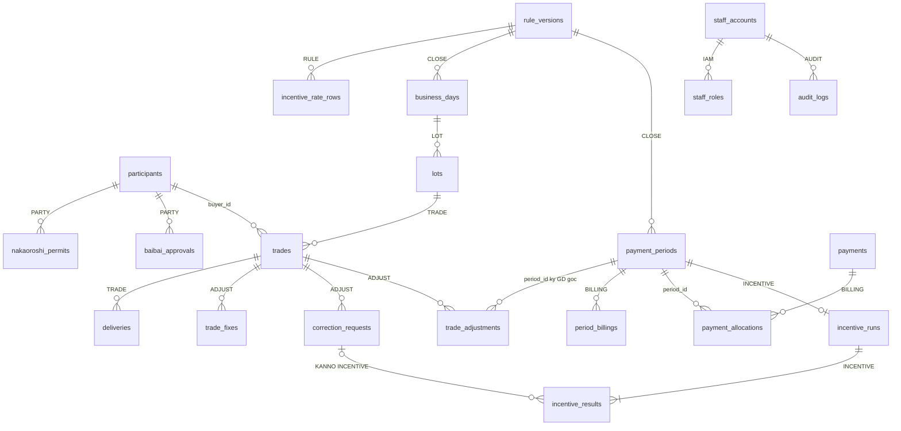

# 水産物卸売市場業務支援システム — Database Design (to-be, 第1期) — file tổng

| | |
|---|---|
| System Name | 水産物卸売市場業務支援システム（Product A, khách 株式会社 桜水産市場 — hư cấu） |
| Schema | `app` (dữ liệu nghiệp vụ, hàm nghiệp vụ) · `audit` (監査ログ, chia theo năm TC) |
| CHARACTER SET | UTF8, collation `C` cho cột mã; `ja-JP-x-icu` cho cột tên khi sắp xếp |
| DBMS | PostgreSQL 16 trên RDS Multi-AZ, AWS Tokyo (L4-D01, ADR-001) |
| Updated by | phuongnnm-23344 |
| Note | **File tổng** của bộ Database Design (Gate 1 M-09: tách theo cụm ER, QC-01 §4 — một file một nhóm bảng). File này chỉ giữ phần **dùng chung**: nguyên tắc P1–P7, danh sách 58 bảng trỏ tới file cụm (§2), ERD tổng quan (§3), quy ước chung + enum + view công bố (§4), bảng lệch so với prototype LAB-2 (§5), kết quả parity (§6), điểm mở + điểm mở rộng (§7). Định nghĩa bảng nằm ở 9 file cụm cùng thư mục; **số mục 4.xx giữ theo số bảng toàn schema** (cột No §2) nên tham chiếu "4.39" tra ra file qua §2. File tổng không phải "một nhóm bảng" → ngoại lệ #7 ở README §3. Phạm vi = 第1期 gói R1 (P0 + P1, 99 FT — DEC-031); option và 17 mục 第2期 không có bảng. Thuật ngữ: 相対取引 (thỏa thuận mua bán trực tiếp — luồng chính, ~90% giá trị), せり (đấu giá — luồng phụ), 許可 (giấy phép có xét duyệt cho 仲卸), 承認 (chấp thuận, thủ tục nhẹ hơn, cho 売買参加者), 完納奨励金 (tiền thưởng thanh toán đủ, đúng hạn), 業務日 (ngày nghiệp vụ JST, bắt đầu từ giờ nhận lô `LOT_INTAKE_START_TIME` 01:00 tới 01:00 hôm sau; chốt GD từ 02:00) |

**Nguyên tắc thiết kế xuyên suốt** (mỗi nguyên tắc có chỗ thể hiện trong mục 4):

| # | Nguyên tắc | Thể hiện ở schema | Nguồn |
|---|---|---|---|
| P1 | 相対取引 là luồng chính; せり chỉ ghi kết quả cuối do người xác nhận | `trades.channel` mặc định `AITAI`; `seri_sessions` chỉ là nhóm kết quả, không có bảng giá đặt / lượt trả giá | Luật 1; FR-SERI-01; B.3 |
| P2 | 許可 ≠ 承認 | Hai bảng, hai lịch sử, hai trigger kiểm loại người tham gia; **không** có bảng hay enum "giấy phép chung" | Luật 2; 02-08; ADR-003 |
| P3 | Người quyết định cuối | Cột người ghi / người xác nhận ở `lot_inspections`, `seri_sessions`, `correction_approvals`, `dispute_confirmations`; không có cột điểm do máy chấm | Luật 3; CAP-HUMAN-01 |
| P4 | Không ghi đè lịch sử | Bảng sổ / lịch sử chỉ thêm (trigger chặn UPDATE, DELETE); `trades` đóng băng khi 確定; sửa = `trade_adjustments` REVERSE + DELTA; ngày / kỳ đã khóa không ghi được | Luật 4; BR-CLOSE-01; B.4; B.7 |
| P5 | Quy chế có version | `rule_versions` + `incentive_rate_rows` (2 bảng tỷ lệ) + `rule_parameters`; mọi dòng tiền lưu `rule_version_id` đã áp | Luật 5; GOV-RULE-01; TBL-RATE-01; FR-AUDIT-03 |
| P6 | Mọi ghi qua hàm trong DB | DB role của app chỉ có EXECUTE trên hàm + SELECT qua RLS; không grant INSERT / UPDATE / DELETE trên bảng | ADR-001, ADR-003 |
| P7 | 業務日 là trục thời gian | Mọi bảng giao dịch có `business_date` (FK `business_days`, = ngày **ghi sổ**), không suy từ giờ UTC. **Kỳ** = tháng dương lịch theo 業務日 của **GD gốc** (`trades.trade_date`); dòng điều chỉnh mang `period_id` của GD gốc, tách khỏi ngày áp (Gate 1 C-02) | BR-INC-01; L4-A04 (2) |

---

## 1. Lịch sử sửa đổi

| No | Version | Action | Sheet / Bảng | Nội dung thay đổi | Ngày | Người sửa | Approve |
|---|---|---|---|---|---|---|---|
| 1 | 0.1.0 | Add new | — | Khởi tạo bản to-be từ mô hình dữ liệu prototype LAB-2 (migration 0001–0030) + LAB-1 (function list, premise list) + PREMISE 0.3.0 | 2026-11-25 | phuongnnm-23344 | |
| 2 | 0.1.0 | Add new | 57 bảng (mục 2) | 22 bảng giữ tên từ prototype (sửa cột), 3 bảng đổi tên (`profiles` → `staff_accounts`, `profile_pins` → `staff_pins`, `user_authorities` → `staff_authorities`), 32 bảng mới; sửa lệch D01–D24 + 14 lệch mới N01–N14 (mục 5) | 2026-11-25 | phuongnnm-23344 | |
| 3 | 0.1.1 | Update | §7 OPEN-DB-02 | Đóng OPEN-DB-02: PREMISE 0.4.0 §3.1 tách lịch chợ–ngân hàng năm khỏi quy chế, không tính 4 lần/năm (PRM-054) — thiết kế bảng không đổi | 2026-11-25 | phuongnnm-23344 | |
| 4 | 0.2.0 | Update | Toàn bộ | Gate 1 M-09: tách định nghĩa bảng sang 9 file cụm (IAM_AUDIT, PARTY, RULE, CLOSE, LOT, TRADE, ADJUST, BILLING, INCENTIVE); file này thành file tổng. Thêm bảng `staff_roles` (58 bảng, m-10). Enum mới / đổi theo Gate 1 (C-01, C-02, M-05, M-07, M-08, M-10, m-06). Bảng lệch: D07 → Giản lược có chủ đích, N10 → Cao, thêm N15 (C-01), N16 (C-02) — 40 dòng (m-04). Bỏ `status` ở frontmatter, §2 dùng cột `Note` của khuôn (m-02). §7 thêm OPEN-DB-08..10 | 2026-11-25 | phuongnnm-23344 | |

---

## 2. Danh sách bảng

Category: `master` = dữ liệu gốc, đổi ít, có người quản lý · `transaction` = phát sinh theo nghiệp vụ hằng ngày · `history` (thêm mới ở dự án này) = bảng **chỉ thêm** ghi lịch sử của một bảng master, không có UPDATE / DELETE. Cột `Note` ghi file chứa định nghĩa và bảng tương ứng ở prototype LAB-2.

| No | Schema | Category | Tên bảng (logic) | Tên bảng (vật lý) | Mô tả | Note | Status |
|---|---|---|---|---|---|---|---|
| 1 | app | master | Tài khoản nhân viên | [`staff_accounts`](IAM_AUDIT_DB.md#41-staff_accounts) | Một dòng một nhân viên nội bộ; thay `auth.users` + `profiles` | File: [IAM_AUDIT_DB.md](IAM_AUDIT_DB.md). Prototype: `profiles` | Decision (provisional) |
| 2 | app | history | Quyền duyệt cấp / thu | [`staff_authorities`](IAM_AUDIT_DB.md#42-staff_authorities) | 照合部門長 / 運用部門長 / 配送部門責任者 gắn tài khoản, có lịch sử thu hồi | File: [IAM_AUDIT_DB.md](IAM_AUDIT_DB.md). Prototype: `user_authorities` | Decision (provisional) |
| 3 | app | master | 代行者 (người làm thay) | [`delegations`](IAM_AUDIT_DB.md#43-delegations) | Ủy quyền duyệt có ngày bắt đầu / kết thúc | File: [IAM_AUDIT_DB.md](IAM_AUDIT_DB.md). Mới | Decision (provisional) |
| 4 | app | master | PIN đổi người | [`staff_pins`](IAM_AUDIT_DB.md#44-staff_pins) | PIN 4 số băm, PIN tạm, đếm sai | File: [IAM_AUDIT_DB.md](IAM_AUDIT_DB.md). Prototype: `profile_pins` | Decision (provisional) |
| 5 | app | master | Phương thức MFA | [`mfa_factors`](IAM_AUDIT_DB.md#45-mfa_factors) | TOTP ứng dụng / token phần cứng của từng người | File: [IAM_AUDIT_DB.md](IAM_AUDIT_DB.md). Mới | Decision (provisional) |
| 6 | app | master | Thiết bị đăng ký | [`devices`](IAM_AUDIT_DB.md#46-devices) | Tablet bến, PC bàn GD, PC văn phòng; khóa PIN theo thiết bị | File: [IAM_AUDIT_DB.md](IAM_AUDIT_DB.md). Mới | Decision (provisional) |
| 7 | app | transaction | Phiên đăng nhập | [`staff_sessions`](IAM_AUDIT_DB.md#47-staff_sessions) | Phiên server-side (người, thiết bị), mốc MFA step-up | File: [IAM_AUDIT_DB.md](IAM_AUDIT_DB.md). Mới | Decision (provisional) |
| 8 | app | master | Ma trận quyền đọc | [`role_read_matrix`](IAM_AUDIT_DB.md#48-role_read_matrix) | Vai × nhóm dữ liệu được đọc; RLS và menu cùng đọc | File: [IAM_AUDIT_DB.md](IAM_AUDIT_DB.md). Mới | Decision (provisional) |
| 9 | app | master | Người tham gia | [`participants`](PARTY_DB.md#49-participants) | 4 loại: 卸売業者 / 仲卸 / 売買参加者 / 買出人 | File: [PARTY_DB.md](PARTY_DB.md). Prototype: `participants` | Decision (provisional) |
| 10 | app | master | Email liên lạc người tham gia | [`participant_contacts`](PARTY_DB.md#410-participant_contacts) | Tối đa 2 địa chỉ, có thời hạn hiệu lực | File: [PARTY_DB.md](PARTY_DB.md). Mới | Decision (provisional) |
| 11 | app | history | Lịch sử 保証金額 | [`participant_deposit_history`](PARTY_DB.md#411-participant_deposit_history) | Mỗi lần đổi 保証金額 (tiền bảo chứng) một dòng | File: [PARTY_DB.md](PARTY_DB.md). Mới | Decision (provisional) |
| 12 | app | master | 許可 (仲卸) | [`nakaoroshi_permits`](PARTY_DB.md#412-nakaoroshi_permits) | Giấy phép của 仲卸 | File: [PARTY_DB.md](PARTY_DB.md). Prototype: `nakaoroshi_permits` | Decision (provisional) |
| 13 | app | history | Lịch sử 許可 | [`nakaoroshi_permit_events`](PARTY_DB.md#413-nakaoroshi_permit_events) | Đăng ký / gia hạn / 一時停止 / 失効 / 再審査 của 許可 | File: [PARTY_DB.md](PARTY_DB.md). Mới | Decision (provisional) |
| 14 | app | master | 承認 (売買参加者) | [`baibai_approvals`](PARTY_DB.md#414-baibai_approvals) | Chấp thuận của 売買参加者 + 参加上限 | File: [PARTY_DB.md](PARTY_DB.md). Prototype: `baibai_approvals` | Decision (provisional) |
| 15 | app | history | Lịch sử 承認 | [`baibai_approval_events`](PARTY_DB.md#415-baibai_approval_events) | Như trên, cho 承認 | File: [PARTY_DB.md](PARTY_DB.md). Mới | Decision (provisional) |
| 16 | app | master | 出荷者 (người gửi hàng) | [`shippers`](RULE_DB.md#416-shippers) | Bảng mã 出荷者 | File: [RULE_DB.md](RULE_DB.md). Mới | Decision (provisional) |
| 17 | app | master | 品目 (mặt hàng) | [`item_codes`](RULE_DB.md#417-item_codes) | Mã 品目 + đơn vị mặc định | File: [RULE_DB.md](RULE_DB.md). Mới | Decision (provisional) |
| 18 | app | master | Bảng mã chung | [`code_values`](RULE_DB.md#418-code_values) | 荷目, lý do chọn nhanh, loại ngoại lệ giao | File: [RULE_DB.md](RULE_DB.md). Mới | Decision (provisional) |
| 19 | app | master | Thuế suất | [`tax_rates`](RULE_DB.md#419-tax_rates) | 10% / 8% có ngày hiệu lực | File: [RULE_DB.md](RULE_DB.md). Mới | Decision (provisional) |
| 20 | app | master | Lịch chợ – ngân hàng | [`market_calendar`](CLOSE_DB.md#420-market_calendar) | 1 bảng, 2 cờ; 臨時休市 / 臨時開市 có duyệt | File: [CLOSE_DB.md](CLOSE_DB.md). Mới | Decision (provisional) |
| 21 | app | master | Version quy chế | [`rule_versions`](RULE_DB.md#421-rule_versions) | Ngày hiệu lực ngày 1, maker-checker, rollback, quota 4 lần / năm TC | File: [RULE_DB.md](RULE_DB.md). Prototype: `rule_versions` | Decision (provisional) |
| 22 | app | master | Bậc 交付率 | [`incentive_rate_rows`](RULE_DB.md#422-incentive_rate_rows) | **2 bảng (仲卸 / 売買参加者) × 5 bậc** theo 適格金額 税抜 | File: [RULE_DB.md](RULE_DB.md). Prototype: `incentive_rate_rows` | Decision (provisional) |
| 23 | app | master | Tham số quy chế | [`rule_parameters`](RULE_DB.md#423-rule_parameters) | Tham số đụng tiền / 業務日 trong cùng version (PREMISE §3.1) | File: [RULE_DB.md](RULE_DB.md). Mới | Decision (provisional) |
| 24 | app | transaction | 業務日 | [`business_days`](CLOSE_DB.md#424-business_days) | Mở theo lịch (đầu ngày = giờ nhận lô 01:00), khóa bởi 照合部門長 | File: [CLOSE_DB.md](CLOSE_DB.md). Prototype: `business_days` | Decision (provisional) |
| 25 | app | transaction | Lô | [`lots`](LOT_DB.md#425-lots) | 仮受付 → 本登録 → 下見済 → 公開 → 確定 → 引渡し完了 | File: [LOT_DB.md](LOT_DB.md). Prototype: `lots` | Decision (provisional) |
| 26 | app | history | Lịch sử trạng thái lô | [`lot_status_history`](LOT_DB.md#426-lot_status_history) | Mỗi lần đổi trạng thái lô, 販売終了, 持ち越し | File: [LOT_DB.md](LOT_DB.md). Mới | Decision (provisional) |
| 27 | app | transaction | 目利き・下見 | [`lot_inspections`](LOT_DB.md#427-lot_inspections) | Kết quả đánh giá do người ghi | File: [LOT_DB.md](LOT_DB.md). Prototype: `lot_inspections` | Decision (provisional) |
| 28 | app | transaction | Sổ số lượng lô | [`lot_quantity_ledger`](LOT_DB.md#428-lot_quantity_ledger) | SL khả dụng = tổng `qty_delta` | File: [LOT_DB.md](LOT_DB.md). Prototype: `lot_quantity_ledger` | Decision (provisional) |
| 29 | app | transaction | Phiên せり | [`seri_sessions`](TRADE_DB.md#429-seri_sessions) | Nhóm kết quả せり, 入力者 ≠ 確認者 | File: [TRADE_DB.md](TRADE_DB.md). Prototype: `seri_sessions` | Decision (provisional) |
| 30 | app | transaction | Giao dịch | [`trades`](TRADE_DB.md#430-trades) | 相対 (chính) và kết quả せり; đóng băng khi 確定 | File: [TRADE_DB.md](TRADE_DB.md). Prototype: `trades` | Decision (provisional) |
| 31 | app | history | Lịch sử trạng thái GD | [`trade_status_history`](TRADE_DB.md#431-trade_status_history) | FIG-012: 提出 / 承認 / 確定 / 取消 cùng người + thời điểm | File: [TRADE_DB.md](TRADE_DB.md). Mới | Decision (provisional) |
| 32 | app | transaction | 当日訂正 / 取消 | [`trade_fixes`](ADJUST_DB.md#432-trade_fixes) | Sửa / hủy GD của ngày chưa khóa, có lý do, không duyệt 2 cấp | File: [ADJUST_DB.md](ADJUST_DB.md). Mới | Decision (provisional) |
| 33 | app | transaction | Nhật ký in phiếu | [`print_logs`](TRADE_DB.md#433-print_logs) | In / in lại (再発行) 取引確認票, 引渡票 | File: [TRADE_DB.md](TRADE_DB.md). Mới | Decision (provisional) |
| 34 | app | transaction | Lần giao | [`deliveries`](TRADE_DB.md#434-deliveries) | Giao nhiều lần, 「残り全部」, tên người nhận | File: [TRADE_DB.md](TRADE_DB.md). Prototype: `deliveries` | Decision (provisional) |
| 35 | app | transaction | Ngoại lệ / tranh chấp giao | [`delivery_exceptions`](TRADE_DB.md#435-delivery_exceptions) | SC-06-04, SLA tranh chấp | File: [TRADE_DB.md](TRADE_DB.md). Mới | Decision (provisional) |
| 36 | app | transaction | Xác nhận giao có tranh chấp | [`dispute_confirmations`](TRADE_DB.md#436-dispute_confirmations) | 配送部門責任者 xác nhận (MFA), cấm tự xác nhận | File: [TRADE_DB.md](TRADE_DB.md). Mới | Decision (provisional) |
| 37 | app | transaction | 修正申請 | [`correction_requests`](ADJUST_DB.md#437-correction_requests) | Yêu cầu sửa sau khóa ngày (FORM-CORR-01) | File: [ADJUST_DB.md](ADJUST_DB.md). Prototype: `correction_requests` | Decision (provisional) |
| 38 | app | history | Bước duyệt 修正申請 | [`correction_approvals`](ADJUST_DB.md#438-correction_approvals) | Mỗi lần duyệt / từ chối một dòng, có 代行, MFA | File: [ADJUST_DB.md](ADJUST_DB.md). Mới | Decision (provisional) |
| 39 | app | transaction | Dòng điều chỉnh | [`trade_adjustments`](ADJUST_DB.md#439-trade_adjustments) | REVERSE (người mua cũ) + DELTA (người mua mới) | File: [ADJUST_DB.md](ADJUST_DB.md). Prototype: `trade_adjustments` | Decision (provisional) |
| 40 | app | history | Ánh xạ 仕訳 | [`journal_mappings`](BILLING_DB.md#440-journal_mappings) | 勘定科目 / 税区分 theo loại dòng, có lịch sử | File: [BILLING_DB.md](BILLING_DB.md). Mới | Decision (provisional) |
| 41 | app | transaction | Batch kế toán IF-ACC-01 | [`accounting_export_batches`](BILLING_DB.md#441-accounting_export_batches) | Một batch / 業務日 đã khóa, đóng băng lúc tạo | File: [BILLING_DB.md](BILLING_DB.md). Mới | Undecided |
| 42 | app | transaction | Dòng batch kế toán | [`accounting_export_lines`](BILLING_DB.md#442-accounting_export_lines) | Người tham gia × thuế suất; dòng 端数調整 | File: [BILLING_DB.md](BILLING_DB.md). Mới | Undecided |
| 43 | app | transaction | Kỳ thanh toán | [`payment_periods`](CLOSE_DB.md#443-payment_periods) | Tháng theo 業務日; 支払期日 theo quy chế + lịch | File: [CLOSE_DB.md](CLOSE_DB.md). Prototype: `payment_periods` | Decision (provisional) |
| 44 | app | history | Ánh xạ mã đối tác | [`partner_code_mappings`](BILLING_DB.md#444-partner_code_mappings) | Mã người nộp trong file 入金 → người tham gia | File: [BILLING_DB.md](BILLING_DB.md). Mới | Decision (provisional) |
| 45 | app | transaction | Batch import 入金 | [`payment_import_batches`](BILLING_DB.md#445-payment_import_batches) | Mỗi file một batch, chặn trùng SHA-256 | File: [BILLING_DB.md](BILLING_DB.md). Prototype: `payment_import_batches` | Decision (provisional) |
| 46 | app | transaction | Hủy batch 入金 | [`payment_batch_voids`](BILLING_DB.md#446-payment_batch_voids) | Hủy bằng bản ghi thêm, người hủy ≠ người import | File: [BILLING_DB.md](BILLING_DB.md). Prototype: `payment_batch_voids` | Decision (provisional) |
| 47 | app | transaction | 入金 | [`payments`](BILLING_DB.md#447-payments) | Dòng tiền về | File: [BILLING_DB.md](BILLING_DB.md). Prototype: `payments` | Decision (provisional) |
| 48 | app | transaction | Phân bổ 入金 vào kỳ | [`payment_allocations`](BILLING_DB.md#448-payment_allocations) | FIFO khi chưa có 請求番号 (E-02) | File: [BILLING_DB.md](BILLING_DB.md). Mới | Decision (provisional) |
| 49 | app | transaction | 期のお支払額 | [`period_billings`](BILLING_DB.md#449-period_billings) | Số phải trả người × kỳ; ảnh chụp lúc thông báo và lúc 期ロック | File: [BILLING_DB.md](BILLING_DB.md). Mới | Decision (provisional) |
| 50 | app | transaction | Thuế theo suất của kỳ | [`period_billing_tax_lines`](BILLING_DB.md#450-period_billing_tax_lines) | Tổng 税抜 + thuế tính một lần theo từng suất | File: [BILLING_DB.md](BILLING_DB.md). Mới | Decision (provisional) |
| 51 | app | transaction | Lần chạy tính thưởng | [`incentive_runs`](INCENTIVE_DB.md#451-incentive_runs) | Một lần / kỳ | File: [INCENTIVE_DB.md](INCENTIVE_DB.md). Prototype: `incentive_runs` | Decision (provisional) |
| 52 | app | transaction | Kết quả 完納奨励金 | [`incentive_results`](INCENTIVE_DB.md#452-incentive_results) | MAIN / DELTA / CARRY theo người × kỳ | File: [INCENTIVE_DB.md](INCENTIVE_DB.md). Prototype: `incentive_results` | Decision (provisional) |
| 53 | app | transaction | Thông báo (outbox) | [`notifications`](IAM_AUDIT_DB.md#453-notifications) | In-app + email, gửi lại ≤ 3 lần | File: [IAM_AUDIT_DB.md](IAM_AUDIT_DB.md). Mới | Decision (provisional) |
| 54 | app | transaction | Đính kèm | [`attachments`](IAM_AUDIT_DB.md#454-attachments) | Siêu dữ liệu file ở S3; thời hạn lưu theo loại chứng từ (TBL-ATTACH-01) | File: [IAM_AUDIT_DB.md](IAM_AUDIT_DB.md). Mới | Decision (provisional) |
| 55 | app | transaction | Bản ghi đồng bộ offline | [`offline_sync_records`](IAM_AUDIT_DB.md#455-offline_sync_records) | Hàng đợi 仮受付 / 引渡し / 紙伝票後入力 + đối chiếu SC-03-07 | File: [IAM_AUDIT_DB.md](IAM_AUDIT_DB.md). Mới | Decision (provisional) |
| 56 | audit | history | 監査ログ | [`audit_logs`](IAM_AUDIT_DB.md#456-audit_logs) | Ai, khi, lý do, 代行, trước / sau; chia theo năm TC | File: [IAM_AUDIT_DB.md](IAM_AUDIT_DB.md). Prototype: `audit_logs` | Decision (provisional) |
| 57 | app | master | Bộ đếm số theo ngày | [`day_counters`](CLOSE_DB.md#457-day_counters) | Cấp số lô / số GD liên tục theo 業務日 | File: [CLOSE_DB.md](CLOSE_DB.md). Prototype: `day_counters` | Decision (provisional) |
| 58 | app | history | Vai của tài khoản | [`staff_roles`](IAM_AUDIT_DB.md#458-staff_roles) | Nhiều vai / tài khoản, lịch sử cấp / thu (Gate 1 m-10) | File: [IAM_AUDIT_DB.md](IAM_AUDIT_DB.md). Mới — prototype `profiles.role` một vai | Decision (provisional) |

> `accounting_export_batches` / `accounting_export_lines` để **Undecided** vì định dạng file kế toán chờ E-01 (PRM-123). Các bảng khác để **Decision (provisional)**: khách chưa duyệt bản này, và một số cột chờ câu trả lời E-xx — ghi ở Note từng cột và mục 7.

| File cụm | Nhóm bảng | Số bảng | Module (ARCHITECTURE §2) |
|---|---|---|---|
| [IAM_AUDIT_DB.md](IAM_AUDIT_DB.md) | Tài khoản, vai, quyền duyệt, thiết bị, phiên + xuyên suốt (thông báo, đính kèm, đồng bộ offline, 監査ログ) | 13 | `iam`, `notify`, `sync`, `audit` |
| [PARTY_DB.md](PARTY_DB.md) | Người tham gia, 許可 (仲卸) ≠ 承認 (売買参加者) | 7 | `party` |
| [RULE_DB.md](RULE_DB.md) | Quy chế có version + master mã / thuế | 7 | `rule` |
| [CLOSE_DB.md](CLOSE_DB.md) | Lịch, khóa ngày / kỳ, bộ đếm | 4 | `calendar`, `settle`, `incentive` |
| [LOT_DB.md](LOT_DB.md) | Lô / 受付 / 目利き / sổ SL | 4 | `lot` |
| [TRADE_DB.md](TRADE_DB.md) | 相対 / せり / in phiếu / giao hàng | 7 | `trade`, `delivery` |
| [ADJUST_DB.md](ADJUST_DB.md) | 当日訂正, 修正申請, REVERSE / DELTA | 4 | `trade`, `settle` |
| [BILLING_DB.md](BILLING_DB.md) | 期のお支払額 / 入金 / phân bổ / batch kế toán | 10 | `settle`, `incentive` |
| [INCENTIVE_DB.md](INCENTIVE_DB.md) | 完納奨励金 + test vector | 2 | `incentive` |
| | **Tổng** | **58** | |

---

## 3. ER Diagram tổng quan

Chỉ vẽ quan hệ chính giữa các cụm (bảng đại diện); sơ đồ đủ cột nằm ở §3 của từng file cụm. Cột người thao tác (`*_by`) đều FK tới `staff_accounts.id` — không vẽ.

> Tên bảng và tên cột trong sơ đồ của mọi file phải **khớp từng ký tự** với mục 4 của file chứa bảng đó. Kiểu trong sơ đồ viết thường, rút gọn (`varchar` không ghi độ dài); kiểu đủ ở mục 4.

---

## 4. Quy ước chung, enum, view công bố

### 4.0. Quy ước chung

**Kiểu và cột chung**

| Quy ước | Giá trị | Lý do / nguồn |
|---|---|---|
| Khóa chính | `UUID` sinh bằng `gen_random_uuid()`; `audit_logs` dùng `BIGINT IDENTITY` | Giữ như prototype; id không lộ thứ tự nghiệp vụ. Số nghiệp vụ người đọc được (`lot_no`, `trade_no`) là cột riêng |
| Tiền | `BIGINT` đơn vị JPY, không số lẻ. Cột tiền **税抜** (chưa thuế) trừ khi tên cột có hậu tố `_incl_` | PRM-053: tiền dòng = SL × đơn giá, làm tròn xuống yên; thuế tính một lần trên tổng theo suất |
| Số lượng | `NUMERIC(12,1)` theo đơn vị của lô (kg tới 0,1 kg; ケース, 尾 là số nguyên — CHECK theo `unit`) | PRM-053 |
| Tỷ lệ | `INT` đơn vị basis point (1 bp = 0,01%) | Đề xuất PL: chưa có `incentive-rate-table.csv` (E-03), bp đủ mịn cho tỷ lệ dạng 0,25% |
| Thời điểm / ngày | `TIMESTAMPTZ` cho thời điểm; `DATE` cho 業務日 và ngày hiệu lực. 業務日 **không** suy từ `now()` mà lấy từ `business_days` | P7; BR-INC-01 (JST, 業務日) |
| Cột chung bảng `transaction` / `history` | `created_at TIMESTAMPTZ NOT NULL DEFAULT now()`, `created_by UUID` FK `staff_accounts.id` (NULL = job hệ thống) | FR-AUDIT-01 |
| Cột chung bảng `master` | Thêm `updated_at`, `updated_by`; mọi lần sửa đi kèm dòng `audit_logs` (trước / sau) | FR-AUDIT-01 |
| Chỉ thêm (append-only) | Trigger `forbid_update_delete` trên bảng có ghi "**Chỉ thêm**" ở Overview | Luật 4; B.7 (không xóa cứng) |
| Ngày mở | Trigger `enforce_open_business_day` trên bảng có ghi "**Ngày mở**": ghi vào 業務日 `LOCKED` → lỗi `DAY_LOCKED` | BR-CLOSE-01 |
| Ghi | Chỉ qua hàm `security definer` của module chủ bảng; hàm gọi `assert_caller(vai, quyền duyệt)` đọc `app.user_id`, `app.device_id`, `app.mfa_verified_at` (ADR-002 §2.1) | P6 |
| Đọc | RLS theo `role_read_matrix` (4.8) | L4-A06; ADR-003 |
| Xóa | Không có DELETE nghiệp vụ. Dữ liệu nghiệp vụ online 7 năm; chứng từ lưu theo loại (`attachment_doc_class`, TBL-ATTACH-01: 受入票・取引票・照合表 7 năm, ảnh / chứng cứ tranh chấp và hồ sơ migration 3 năm → cold archive). Hết hạn → danh sách 「保存期限到来」 → xóa vật lý **chỉ sau 決裁** (B.7), không có lifecycle tự xóa (Gate 1 M-08) | DR-RET-01; B.7; TBL-ATTACH-01 |

Cột chung được ghi ở cuối mỗi bảng (trong file cụm) dưới dạng một dòng "Cột chung" để danh sách cột không dài vô ích; ER và mục 4 dùng cùng tên.

**Enum**

| Enum | Giá trị (nghĩa) | Dùng ở | Khác prototype |
|---|---|---|---|
| `app_role_code` | `INTAKE` 受付 · `JUDGE` 目利き記録 · `TRADE` 取引 · `DELIVERY` 配送 · `SETTLE` 照合事務局 · `RULE` ルール管理者 · `SYSADM` システム管理者 | `staff_roles`, `role_read_matrix` | Giữ giá trị; một tài khoản nhiều vai (m-10) |
| `authority_code` | `STL_HEAD` 照合部門長 · `OPS_HEAD` 運用部門長 · `DEL_HEAD` 配送部門責任者 | `staff_authorities`, `delegations` | Giữ |
| `account_status` | `ACTIVE` · `SUSPENDED` (dừng tạm) · `RETIRED` (nghỉ việc) | `staff_accounts` | Mới — thay `is_active` + `banned_until` |
| `mfa_factor_kind` | `TOTP_APP` · `TOTP_HARDWARE` (token móc khóa, cho người không dùng điện thoại riêng) · `BACKUP_CODE` (mã dự phòng dùng một lần do SYS-ADMIN cấp, hết hạn trong ngày — thay email OTP) | `mfa_factors` | Mới (ADR-002 §2.2; `BACKUP_CODE` theo ADR-002 0.2.0, Gate 1 m-06) |
| `device_kind` | `DOCK_TABLET` (bến) · `DELIVERY_TABLET` · `TRADE_PC` (bàn GD) · `OFFICE_PC` | `devices` | Mới |
| `participant_kind` | `WHOLESALER` 卸売業者 · `NAKAOROSHI` 仲卸 · `BAIBAI` 売買参加者 · `KAIDASHI` 買出人 | `participants`, `incentive_rate_rows` | Giữ |
| `participant_status` | `ACTIVE` · `WITHDRAWN` (rút khỏi chợ) | `participants` | Đổi: `SUSPENDED` chuyển xuống mức 許可 / 承認 (FIG-010) |
| `qualification_status` | `VALID` 有効 · `SUSPENDED` 一時停止 · `EXPIRED` 失効 · `UNDER_REVIEW` 再審査 | `nakaoroshi_permits`, `baibai_approvals` | Đổi: prototype `ACTIVE` / `SUPERSEDED` / `EXPIRED` |
| `qualification_event_kind` | `REVIEWED` (kết quả 審査 + điều kiện — **chỉ 許可**) · `REGISTERED` · `RENEWED` (gia hạn trước hạn — không chuyển trạng thái 再審査) · `LIMIT_CHANGED` (đổi 参加上限 — **chỉ 承認**) · `SUSPENDED` · `RESUMED` · `EXPIRED` (tự động khi quá 失効日 — giả định [PL]) · `REVIEW_STARTED` · `REINSTATED` | `nakaoroshi_permit_events`, `baibai_approval_events` (CHECK theo bảng) | Mới (PRM-045, PRM-121; Gate 1 M-07) |
| `day_status` / `period_status` | `OPEN` · `LOCKED` | `business_days` / `payment_periods` | Giữ |
| `unit_code` | `KG` · `CASE` (ケース) · `PIECE` (尾) | `lots`, `item_codes` | Mới — prototype `unit` là text |
| `lot_status` | `PROVISIONAL` 仮受付 · `RECEIVED` 受付 · `INSPECTED` 下見済 · `PUBLISHED` 公開 · `CLOSED` 確定 · `DELIVERED` 引渡し完了 | `lots`, `lot_status_history` | Đổi `SOLD_OUT` → `CLOSED` (確定 khi SL = 0 **hoặc** 販売終了 — PRM-110) |
| `ledger_entry_kind` | `RECEIVE` 受入 · `SALE` · `SALE_REVERSE` (trả SL do 訂正 / 取消 / 修正申請) · `CARRY_OVER` 持ち越し (SL 0) · `RETURN_DISPOSE` 返品・廃棄 · `ATTR_FIX` (sửa SL lúc 本登録) | `lot_quantity_ledger` | Mới — prototype dùng `reason` text |
| `trade_channel` | `AITAI` 相対 · `SERI` せり | `trades` | Giữ |
| `trade_status` | `DRAFT` 下書き · `PENDING` 確認待ち · `CONFIRMED` 確定 · `CANCELLED` 取消. 更正 của FIG-012 **không** là giá trị lưu: là trạng thái hiển thị khi GD có 修正申請 đang chờ | `trades` | Đổi: prototype `PROVISIONAL` / `CONFIRMED` |
| `trade_event` | `SUBMIT` 提出 · `APPROVE` 承認 · `REJECT` 却下 · `CONFIRM` 確定 · `FIX` 当日訂正 · `CANCEL` 取消 · `CORRECTION_APPLIED` | `trade_status_history` | Mới (PRM-114 (a)) |
| `trade_source` | `ONLINE` · `PAPER_LATE` 紙伝票後入力 | `trades` | Mới (FT-04-07) |
| `seri_status` | `ENTERING` · `CONFIRMED` | `seri_sessions` | Giữ |
| `fix_kind` | `FIX` 当日訂正 · `CANCEL` 取消 | `trade_fixes` | Mới (PRM-127) |
| `print_doc_kind` | `TRADE_SLIP` 取引確認票 · `DELIVERY_SLIP` 引渡票 | `print_logs` | Mới |
| `exception_status` | `OPEN` · `RESOLVED` | `delivery_exceptions` | Mới |
| `correction_scope` | `TRADE` (SL / giá / người mua của một GD) · `KANNO` (đổi 完納 của kỳ đã khóa khi tiền về đúng hạn nhưng 消込 trễ — PRM-055, luôn 2 cấp) · `INCENTIVE` (sửa tiền thưởng kỳ đã khóa do tỷ lệ áp sai — R-L4-01, luôn 2 cấp) · `LATE_ENTRY` (GD / lô / lần giao **mới** của ngày đã khóa) | `correction_requests` | Mới (Gate 1 M-04, M-05, M-10) |
| `correction_status` | `SUBMITTED` · `FIRST_APPROVED` · `APPROVED` · `REJECTED` | `correction_requests` | Giữ |
| `approval_decision` | `APPROVE` (決裁) · `REJECT` (却下) | `correction_approvals` | Mới |
| `adjustment_kind` | `REVERSE` · `DELTA` | `trade_adjustments` | Giữ |
| `adjustment_source` | `SAME_DAY` (当日訂正 / 取消, ngày chưa khóa) · `CORRECTION` (修正申請) | `trade_adjustments` | Mới (ADR-004 §2.2) |
| `rule_status` | `DRAFT` · `PENDING` · `APPROVED` (đã duyệt, chờ ngày hiệu lực) · `ACTIVE` · `SUPERSEDED` · `CANCELLED` | `rule_versions` | Thêm `APPROVED` (ADR-006 §2.2) |
| `rule_change_kind` | `BASELINE` (bộ giá trị go-live, **không tính** quota) · `CHANGE` · `ROLLBACK` | `rule_versions` | Mới (D06) |
| `allocation_kind` / `allocation_method` | `ALLOCATE` · `REVERSE` / `FIFO` · `INVOICE_NO` · `MANUAL` | `payment_allocations` | Mới (D03) |
| `billing_snapshot_kind` | `NOTICE` (số đã thông báo cho người tham gia) · `LOCK` (số lúc 期ロック) | `period_billings` | Mới |
| `incentive_kind` | `MAIN` · `DELTA` (tính lại kỳ đã khóa — mọi năm TC) · `CARRY` (delta âm mang sang, trong năm TC) · `CARRY_EXPIRED` (âm còn lại cuối năm TC → RPT-07) | `incentive_results` | Thêm `CARRY` (D23), `CARRY_EXPIRED` (Gate 1 C-01, m-05) |
| `kanno_basis` | `AUTO` (engine) · `JUDGED` (照合部門長 quyết dòng 要確認 lúc 期ロック) · `CORRECTION` (修正申請 KANNO) | `incentive_results` | Mới (Gate 1 M-10, khách #7) |
| `acct_line_kind` | `SALE` · `ADJUSTMENT` · `ROUNDING` 端数調整 | `accounting_export_lines` | Mới |
| `acct_line_status` | `HOLD` 保留 · `CONFIRMED` 確認済み · `ADJUSTED` 調整済み | `accounting_export_lines` | Mới (IF-ACC-01) |
| `attachment_doc_class` | `RECEIPT_SLIP` 受入票 · `TRADE_SLIP` 取引票 (gồm scan 紙伝票) · `RECONCILIATION_SHEET` 照合表 · `CORRECTION_EVIDENCE` chứng cứ 修正申請 (giả định [PL]: mức 7 năm) → online 7 năm · `DISPUTE_EVIDENCE` ảnh / chứng cứ tranh chấp, giao hàng · `MIGRATION_RECORD` hồ sơ rehearsal / nghiệm thu migration → online 3 năm rồi cold archive | `attachments` | Mới (TBL-ATTACH-01, Gate 1 M-08) |
| `notify_channel` / `notify_status` | `IN_APP` · `EMAIL` / `QUEUED` · `SENT` · `RETRYING` · `FAILED` (hết 3 lần → danh sách in) | `notifications` | Mới |
| `sync_kind` / `sync_result` | `PROVISIONAL_LOT` 仮受付 · `DELIVERY` 引渡し · `PAPER_TRADE` 紙伝票後入力 / `PENDING` · `APPLIED` · `HELD` 要確認 · `REJECTED` | `offline_sync_records` | Mới (L4-A05) |

### 4.0a. View công bố

**View công bố** (module khác chỉ đọc bảng của module này qua view — ARCHITECTURE §2): `v_lot_available_qty`, `v_trade_effective` (gốc + Σ điều chỉnh; trả cả `business_date` ngày áp và `period_id` kỳ GD gốc — Gate 1 C-02), `v_settlement_lines`, `v_delivery_status`, `v_daily_settlement` (giữ từ prototype 0004, **bắt buộc tham số khoảng 業務日** — sửa D24), thêm `v_participant_current_deposit`, `v_qualification_current`, `v_period_paid`, `v_buyer_period_usage` (参加上限 theo kỳ theo `trade_date`, 相対 + せり). View đều `security_invoker` để RLS của người gọi áp vào.

---

## 5. Bảng lệch: thiết kế to-be ↔ prototype LAB-2

> *Biểu mẫu BM-2-901-50 không có mục này — đề LAB-4 yêu cầu phát hiện chỗ prototype làm khác thiết kế.* Cột "Prototype" mô tả **code thật** ở `prototype/supabase/migrations/` (bản mới nhất của mỗi hàm = lần `create or replace` cuối); đã kiểm bằng `tkm:audit-doc-parity`, kết quả ở mục 6.

**Cách đọc**

- **Loại lệch:** `Thiếu` = prototype không có bảng / cột / ràng buộc mà to-be cần · `Sai` = prototype làm khác quy tắc đã chốt ở LAB-1 / PREMISE (cho kết quả nghiệp vụ sai nếu đem đi dùng) · `Giản lược có chủ đích` = prototype cố ý làm gọn, đã ghi ở danh sách mock M01–M24.
- **Mức:** `Cao` = đụng tiền, luật 1–5 hoặc dữ liệu kiểm toán · `TB` = đụng quy trình / quyền · `Thấp` = kỹ thuật, không đổi kết quả nghiệp vụ.
- **Loại thêm ở 0.2.0:** `Giữ hành vi prototype (to-be 0.1 từng sai)` = prototype đúng, bản thiết kế 0.1.x lệch; to-be sửa về hành vi prototype.
- **ID:** `D01`–`D24` lấy từ báo cáo as-built P1 (§5); `N01`–`N16` là lệch phát hiện khi đối chiếu từng cột (N15, N16 thêm ở Gate 1). Số `4.xx` trong cột To-be là số bảng toàn schema — tra file chứa bảng ở §2.

| # | Bảng / cột | Prototype (migration) | To-be (mục 4) | Loại lệch | Mức | Truy vết |
|---|---|---|---|---|---|---|
| D01 | `incentive_rate_rows` | Một bảng tỷ lệ cho mọi người tham gia, cột `min_paid_jpy`, `max_paid_jpy`, `rate_permille`; không có loại người tham gia, không số bậc (0003) | Hai bảng theo `participant_class` (仲卸 / 売買参加者), 5 bậc `tier_no`, bậc 1 = 0%, kiểm liền bậc khi nộp (4.22) | Sai | Cao | PRM-041, BR-INC-01, TBL-RATE-01, ADR-006 |
| D02 | `incentive_results`, hàm `compute_incentive_rows` / `incentive_for` | Tra bậc và nhân tỷ lệ trên **số phải trả 税込** `floor(tiền × 110/100)`: thưởng = floor(payable × rate / 1000) (0023) | Bậc tra theo **適格金額 税抜**; thưởng = floor(適格金額 × 交付率 × 110/100); lưu `eligible_excl_jpy`, `tier_no`, `rate_bp` (4.52) | Sai | Cao | PRM-041, BR-INC-01, ADR-007, M08 |
| D03 | `payments` → kỳ | Không có bảng phân bổ; `period_payables` gán 入金 vào kỳ theo cửa sổ `paid_on` ∈ (`end_date`, `end_date` + 1 tháng] (0024). Danh sách mock LAB-2 ghi "FIFO" nhưng code không phải FIFO | Bảng `payment_allocations` append-only, FIFO theo kỳ cũ nhất còn nợ, `INVOICE_NO` khi có E-02, đảo khi hủy batch (4.48) | Sai | Cao | ADR-007 §2.7, L4-A04 (2), OPEN-L4-02, E-02, M07, M21 |
| D04 | `trades`, `period_payables` | Không có thuế suất; thuế cố định `floor(amount × 110/100)` trên tổng (0023, 0024); không có dòng 端数調整 | `tax_rates` + `trades.tax_rate_id`; `period_billings` / `period_billing_tax_lines` tính thuế một lần theo suất; dòng `ROUNDING` ở `accounting_export_lines` (4.19, 4.49, 4.50, 4.42) | Giản lược có chủ đích | Cao | PRM-053, FT-09-10, M08 |
| D05 | `payment_periods.due_date` | `lock_period` tạo kỳ sau với `due_date` = ngày 10 tháng sau, cố định (0023) | Tính từ `PAYMENT_DUE_RULE` của version + `market_calendar`, lùi về ngày ngân hàng mở trước; kỳ lưu `rule_version_id` (4.43, 4.23) | Giản lược có chủ đích | Cao | PRM-054, ADR-005, M10 |
| D06 | `rule_versions`, `rule_version_quota_used` | Đếm mọi version `ACTIVE` / `SUPERSEDED` cùng năm TC, **kể cả bộ go-live** (0020) | `change_kind = BASELINE` không tính; đếm `CHANGE` + `ROLLBACK` ở `APPROVED` / `ACTIVE` / `SUPERSEDED` (4.21) | Sai | Cao | L4-A03, L4-A04 (3), ADR-006 §2.3, M15 |
| D07 | `correction_requests`, `approve_correction` | Ngưỡng 2 cấp = hằng số **300.000** trong code (0019, bản cuối 0027) | `CORR_TWO_LEVEL_THRESHOLD_JPY` trong `rule_parameters` (tạm 100.000), đo theo tiền thay đổi lớn nhất của một người mua; chụp ngưỡng + version lúc nộp (4.23, 4.37) | Giản lược có chủ đích (mock M13) | Cao | PRM-033, E-08, PREMISE §2 dòng 5, M13 |
| D08 | `check_buyer_qualification` | 参加上限 so với tổng `trades.amount_jpy` gốc (không tính điều chỉnh) của GD `CONFIRMED` cùng **業務日** (0025) | So theo **kỳ** (view `v_buyer_period_usage`, 相対 + せり), mặc định = 保証金額 hiện hành (4.14, 4.11) | Giản lược có chủ đích | Cao | PRM-046, L4-A04 (1), M19 |
| D09 | (không có bảng) | Quy chế chỉ gồm `rule_versions` + `incentive_rate_rows` (0003) | `rule_parameters` trong cùng version (ngưỡng 2 cấp, giờ nhận lô, 「残り全部」, 支払期日, làm tròn thuế, giờ khóa, E-12 / E-13) (4.23) | Thiếu | Cao | PREMISE §3.1, ADR-006 §2.1, GOV-RULE-01 |
| D10 | `trades.status` | Enum `trade_status` chỉ `PROVISIONAL` / `CONFIRMED`; `confirm_aitai_trade` insert thẳng `CONFIRMED`; không có lịch sử trạng thái (0001, 0026) | FIG-012 `DRAFT` / `PENDING` / `CONFIRMED` / `CANCELLED` + `trade_status_history` ghi 提出 / 承認 / 確定 cùng người, thời điểm (4.30, 4.31) | Thiếu | TB | FIG-012, PRM-114 (a), ADR-004 §2-4 |
| D11 | (không có bảng) | Mọi điều chỉnh qua `correction_requests`, kể cả ngày chưa khóa (0019) | `trade_fixes` (当日訂正 / 取消, không duyệt 2 cấp) → `trade_adjustments.source = SAME_DAY` (4.32, 4.39) | Giản lược có chủ đích | TB | FR-AITAI-03, PRM-127, ADR-004 §2-2, M17 |
| D12 | `lots.status`, (không có bảng lịch sử) | `lot_status` 6 giá trị có `SOLD_OUT`; không ghi 販売終了 / 持ち越し (0001) | `CLOSED` (確定 khi SL = 0 hoặc 販売終了); `lot_status_history` có `is_sale_end`, `carried_to_date` (4.25, 4.26) | Thiếu | TB | FIG-011, PRM-110, E-12 |
| D13 | `nakaoroshi_permits.status`, `baibai_approvals.status`, `participants.status` | `qualification_status` = `ACTIVE` / `SUPERSEDED` / `EXPIRED`; 一時停止 chỉ ở mức `participants.status = SUSPENDED`. Đăng ký lại 許可 / 承認 = chuyển dòng cũ sang `SUPERSEDED` rồi thêm dòng mới (0012) — có lịch sử theo dòng, nhưng không có sự kiện 一時停止 / 失効 / 再審査 / gia hạn, không ghi người 起案 / 決裁 (0001, 0012) | FIG-010 `VALID` / `SUSPENDED` / `EXPIRED` / `UNDER_REVIEW` ở mức 許可 / 承認; hai bảng lịch sử riêng có 起案 / 決裁 + MFA (4.12–4.15) | Thiếu | TB | FIG-010, PRM-045, PRM-121, ADR-003 §2-2 |
| D14 | `participants.deposit_jpy` | Cột số sửa đè (chỉ còn dấu vết ở `audit_logs`) (0001) | `participant_deposit_history` append-only (4.11) | Thiếu | TB | PRM-046 |
| D15 | `lots.shipper_name`, `lots.species`, `lots.unit` | Ba cột `text` tự do, `unit` mặc định `'kg'` (0002) | `shipper_id` → `shippers`, `item_code` → `item_codes`, `unit` enum `unit_code` (4.16, 4.17, 4.25) | Thiếu | TB | FT-10-06, PRM-116 |
| D16 | (không có bảng) | Không có: 代行者, thông báo, lịch chợ – ngân hàng, đính kèm, batch kế toán + ánh xạ 仕訳, ngoại lệ / tranh chấp giao, thiết bị + đồng bộ offline, thuế suất | `delegations`, `notifications`, `market_calendar`, `attachments`, `accounting_export_*`, `journal_mappings`, `delivery_exceptions`, `dispute_confirmations`, `devices`, `offline_sync_records`, `tax_rates` | Giản lược có chủ đích | TB | PRM-123, PRM-129, PRM-130, M04, M06, M09–M11, M16 |
| D17 | `profile_pins` | PIN chỉ online, đếm sai + khóa theo người đích; không có PIN tạm, không khóa theo thiết bị; không có bảng MFA / phiên (0001, 0013) | `staff_pins.is_temporary`, `failed_window_ends_at`; `devices.pin_failed_count`; `mfa_factors`; `staff_sessions.mfa_verified_at` (4.4–4.7) | Giản lược có chủ đích | TB | PRM-112, NFR-SEC-03, ADR-002, ADR-008, M02, M03, M22 |
| D18 | Policy SELECT (RLS) | Mọi bảng nghiệp vụ: `(select app_role()) is not null` — mọi nội bộ đọc hết (0029) | `role_read_matrix` + `can_read(data_group)` (4.8) | Giản lược có chủ đích | TB | TBL-ROLE-01, L4-A06, ADR-003 §2-5, M18 |
| D19 | `write_audit_log`, `reset_demo_business_data` | Bỏ ghi audit khi `app.seeding = on` (0006); hàm reset `truncate` cả `audit_logs` (0029, bản cuối 0030) | Không cờ bỏ qua, không hàm reset (4.56) | Giản lược có chủ đích | Cao (production) | FR-AUDIT-01, ADR-004 §2-5, M24 |
| D20 | `participants.is_sample`, `profiles.is_demo_protected`, hàm `seed_demo_*` | Có (0001, 0008–0010, 0030) | Bỏ; dữ liệu đầu vào từ migration (DEC-005) | Giản lược có chủ đích | Thấp | M01 |
| D21 | `profiles.user_id` | FK `auth.users(id)`; định danh từ `auth.uid()`; dừng TK bằng `banned_until` của Supabase (0001, 0004) | `staff_accounts` tự quản + `account_status`; định danh qua `app.user_id` (4.1) | Giản lược có chủ đích | TB | L4-D01, ADR-001, ADR-002 |
| D22 | `business_days` | Không có giờ nhận lô, không có version quy chế; `current_business_date()` = ngày `OPEN` lớn nhất (0002, 0004) | `intake_opens_at` (đầu 業務日 = giờ nhận lô 01:00), `rule_version_id`; 日次締め mở ngày kế tiếp, job 01:00 lưới an toàn theo `market_calendar` (4.24) | Giản lược có chủ đích | TB | PRM-116, ADR-005, M10 |
| D23 | `incentive_results.kind` | `MAIN` / `DELTA`; delta tính lại theo version của MAIN (đúng PRM-043) nhưng delta âm không mang sang các kỳ sau (0023) | Thêm `CARRY`; còn dư cuối năm TC liệt kê RPT-07 (4.52) | Thiếu | TB | PRM-043 (c), ADR-007 §2.4, M08 |
| D24 | View `v_trade_effective`, `v_settlement_lines`, `v_daily_settlement` | Quét toàn lịch sử, không tham số khoảng ngày (0004) | View / hàm nhận khoảng 業務日; index `(…, business_date)` ở bảng lớn (mục 2, 4.30, 4.39) | Giản lược có chủ đích | Thấp (prototype) / TB (7 năm) | NFR-PERF-01, DR-RET-01, ADR-009 §2.2-8, M23 |
| N01 | `lot_quantity_ledger.qty_delta` | `CHECK (qty_delta <> 0)`, cột `reason` text (0002) | Cho `qty_delta = 0` **chỉ** với `entry_kind = CARRY_OVER` — cần để ghi dòng 持ち越し SL không đổi; prototype không ghi được dòng này (4.28) | Thiếu | TB | PRM-110 (d), BR-LOT-02 |
| N02 | `trades.seri_session_id` | Không ràng buộc giữa `channel` và `seri_session_id` — GD `AITAI` có thể mang phiên せり và ngược lại (0002; chỉ hàm seed điền đúng) | CHECK (`channel = 'SERI'`) = (`seri_session_id IS NOT NULL`) (4.30) | Thiếu | Thấp | FR-SERI-01, B.3 |
| N03 | `lots.qty_received`, `trades.qty`, … | `NUMERIC(12,2)`, không gắn với đơn vị (0002); hàm kiểm tối đa 2 chữ số lẻ (`assert_two_decimals`, 0026) | `NUMERIC(12,1)` + CHECK số nguyên khi `CASE` / `PIECE` (4.0) | Sai | Thấp | PRM-053 |
| N04 | `participants.email` | Một cột email sửa đè (0001) | `participant_contacts` tối đa 2 địa chỉ, có hiệu lực (4.10) | Thiếu | TB | PRM-122 (e), L4-A08 |
| N05 | `correction_requests.approver1`, `approver2` | Hai cột người duyệt; không ghi 代行, MFA, ngưỡng / version đã áp; không có phạm vi "đổi trạng thái 完納" (0002, 0019, 0027) | `correction_approvals` mỗi bước một dòng (代行, MFA); `threshold_jpy_snapshot`, `rule_version_id`, `scope = KANNO` (4.37, 4.38) | Thiếu | Cao | PRM-033, PRM-055, PRM-120, FT-09-09, FR-AUDIT-03 |
| N06 | `trade_adjustments` | Không có `created_by`, thuế suất, version quy chế, nguồn (0002) | Thêm `source`, `fix_id`, `tax_rate_id`, `rule_version_id`, `created_by` (4.39) | Thiếu | Cao | ADR-004 §2-2, FR-AUDIT-01, FR-AUDIT-03 |
| N07 | `audit_logs` | Cột: `actor_id`, `action`, `table_name`, `record_id`, `before`, `after`, `business_date`, `at`; không lý do / 代行 / MFA / thiết bị; không partition (0003) | Thêm `reason`, `delegation_id`, `mfa_verified_at`, `device_id`, `request_id`; partition theo năm TC (4.56) | Thiếu | Cao | FR-AUDIT-01, B.7, ADR-009 §2.2-7 |
| N08 | `deliveries` | Chỉ `qty_delivered`; 「残り全部」 tính trong hàm nhưng không lưu cờ; không có người nhận phía mua, thiết bị, khóa idempotent (0002, 0018) | `is_remaining_all`, `receiver_name`, `device_id`, `client_record_id` (4.34) | Thiếu | TB | PRM-118 (a)(c), ADR-008 §2.2-4 |
| N09 | `business_days` | Chỉ `status`, `locked_by`, `locked_at`; không lưu ảnh chụp checklist, không ghi 代行 (0002) | `close_checklist`, `lock_delegation_id`, `rule_version_id` (4.24) | Thiếu | TB | PRM-119, PRM-129 |
| N10 | `user_authorities` | Đổi quyền = `delete` hết rồi `insert` lại (`admin_upsert_account`, 0013 → 0028): mất ngày cấp gốc, không có dòng thu hồi | `staff_authorities` thu hồi bằng `revoked_at`, không xóa (4.2) | Sai | Cao (mất dữ liệu kiểm toán) | ADR-003 §2-1, FR-AUDIT-01 |
| N11 | `payment_import_batches.file_sha256`, `payments` | `file_sha256` ở DDL cho NULL (hàm `import_payments` bắt buộc hash hợp lệ khi chạy — chặn ở hàm, không ở bảng); `payments` không có số dòng file, không 請求番号, mã người nộp đặt tên `buyer_no` (0003, 0024) | `file_sha256` bắt buộc, `storage_key`; `payments.row_no`, `invoice_no`, `payer_code` (4.45, 4.47) | Thiếu | TB | FT-09-01, E-02 |
| N12 | `trades` | Không lưu version quy chế đã áp trên GD (version chỉ tra lại theo ngày ở `/api/trades/[id]`) (0002) | `trades.rule_version_id`, `period_billings.rule_version_id` (4.30, 4.49) | Thiếu | TB | FR-AUDIT-03, ADR-006 §2.1-3 |
| N13 | `incentive_runs`, hàm `run_incentive_calc` / `lock_period` | Ba bước tách: preview → run (ghi kết quả, kỳ vẫn `OPEN`) → lock (0023) | Kết quả chính thức ghi **trong cùng transaction với 期ロック**; `incentive_runs.input_hash` (4.51) | Sai | TB | ADR-007 §2.1 |
| N14 | `rule_versions.status`, `approve_rule_version` | Checker duyệt → `ACTIVE` ngay và chuyển version đang `ACTIVE` có ngày hiệu lực sớm hơn sang `SUPERSEDED`, dù ngày hiệu lực còn ở tương lai (0028); tra cứu theo ngày nên tiền vẫn tính đúng | Thêm `APPROVED` (chờ hiệu lực) → `ACTIVE` vào ngày hiệu lực (4.21) | Giản lược có chủ đích | Thấp | ADR-006 §2.2-4 |
| N15 | `incentive_results` DELTA — phạm vi tính lại | `compute_incentive_rows` (0023) tính lại mọi kỳ `LOCKED` có `end_date` < kỳ đang khóa — **không** giới hạn năm TC (đúng BR-INC-01) | Giữ hành vi prototype: tính lại **mọi kỳ đã khóa** có đầu vào đổi sau khóa; năm TC chỉ giới hạn CARRY (4.52). Database Design 0.1.x / ADR-007 0.1.0 từng giới hạn "cùng năm TC" → delta GD tháng 3 sửa sau khi sang năm TC mới không bao giờ sinh | Giữ hành vi prototype (to-be 0.1 từng sai) | Cao | BR-INC-01, FR-INC-03, INC-EDGE-01, Gate 1 C-01, TV-03 |
| N16 | `trade_adjustments` → kỳ | `period_buyer_amounts` (0022) gom điều chỉnh vào kỳ theo `trades.business_date` của **GD gốc** | `trade_adjustments.period_id` = kỳ GD gốc, tách khỏi `business_date` ngày áp; kỳ gốc đã khóa → không vào 期のお支払額 kỳ mở, chỉ DELTA (4.39, 4.49). Database Design 0.1.x từng gán theo ngày áp → lệch 完納 kỳ hiện tại và đếm hai lần | Giữ hành vi prototype (to-be 0.1 từng sai) | Cao | BR-INC-01, L4-A04 (2), Gate 1 C-02, TV-01, TV-02 |

**Đếm:** 40 dòng (24 D + 16 N).

| Mức | Số dòng | ID |
|---|---|---|
| Cao | 16 | D01–D09, D19, N05, N06, N07, N10, N15, N16 |
| TB | 19 | D10–D18, D21–D23, N01, N04, N08, N09, N11–N13 |
| Thấp | 5 | D20, D24 (TB khi chạy 7 năm), N02, N03, N14 |

Theo loại: Thiếu 17 · Giản lược có chủ đích 14 · Sai 7 · Giữ hành vi prototype (to-be 0.1 từng sai) 2. Bảy dòng **Sai** (D01, D02, D03, D06, N03, N10, N13) là chỗ prototype cho kết quả khác quy tắc đã chốt — phải sửa trước khi đem logic prototype sang code thật. Hai dòng N15, N16 ngược chiều: prototype đúng, bản thiết kế 0.1.x từng làm kém hơn — to-be 0.2.0 giữ hành vi prototype (Gate 1 C-01, C-02). Phân loại D07 (đã có trong mock M13 → Giản lược có chủ đích) và mức N10 (dữ liệu kiểm toán → Cao) sửa theo Gate 1 m-04.

**Giữ nguyên từ prototype (khớp to-be, không phải lệch):** 許可 / 承認 hai bảng + trigger kiểm loại · GD đóng băng sau 確定 và chặn xóa · REVERSE / DELTA mang người mua từng dòng · trigger chặn ghi ngày đã khóa · tiền = SL × đơn giá làm tròn xuống (trigger 0025) · maker ≠ checker, ngày hiệu lực ngày 1 · せり người xác nhận khác người nhập, trùng bắt lý do · một 修正申請 đang chờ / GD · chặn import 入金 trùng bằng SHA-256, hủy batch bằng bản ghi thêm · `day_counters` cấp số liên tục · append-only cho sổ SL, giao, điều chỉnh, 入金, thưởng, audit · mọi ghi qua hàm `security definer` kiểm vai trong DB.

---

## 6. Kết quả kiểm cột "Prototype" bằng `tkm:audit-doc-parity`

| | |
|---|---|
| Ngày kiểm | 2026-11-25 |
| Mức | `low` — phạm vi chỉ cột "Prototype (migration)" của 38 dòng mục 5 ↔ `prototype/supabase/migrations/0001–0030` |
| Cách làm | Pipeline script của skill cần tài liệu dạng rebuild-spec có trích dẫn `path:N-M`, file này không có dạng đó → làm tay theo đúng nguyên tắc của skill: (1) **mô tả lại mù** — một agent chỉ đọc SQL, không mở file `.md` nào, trả lời 30 câu hỏi trung tính (không chứa khẳng định của bảng lệch), mỗi câu có số dòng migration; (2) so từng dòng; (3) dòng lệch được phân xử bằng cách đọc lại code tại chỗ (0012:76-84, 0029:54, 0030:57, 0024:36-42) |
| Kết quả | **PASS sau sửa** — trước sửa: 33 MATCH · 3 DRIFT · 2 thiếu chi tiết · 0 FABRICATED; cả 5 đã sửa trong mục 5 |

| Dòng | Kết quả trước sửa | Code thật | Đã sửa |
|---|---|---|---|
| D13 | DRIFT | Đăng ký lại 許可 / 承認 không ghi đè: dòng cũ → `SUPERSEDED`, thêm dòng mới (0012:79-83). Bảng lệch ghi "bị ghi đè, không có lịch sử" là sai | Ghi lại: có lịch sử theo dòng, nhưng thiếu sự kiện FIG-010 và người 起案 / 決裁 — loại lệch và mức giữ nguyên |
| D19 | DRIFT (dẫn sai migration) | `reset_demo_business_data` bản cuối ở 0030 (`truncate` dòng 57), không phải 0029 | Dẫn 0029, bản cuối 0030 |
| N11 | DRIFT (một phần) | `file_sha256` cho NULL ở DDL (0024:10) nhưng `import_payments` bắt buộc hash hợp lệ khi chạy (0024:39) | Ghi rõ chặn ở hàm, không ở bảng |
| D08 | Thiếu chi tiết | Tổng dùng `trades.amount_jpy` gốc, không cộng điều chỉnh (0025:83-86) | Thêm vào mô tả |
| N03 | Thiếu chi tiết | Có hàm `assert_two_decimals` (0026:9) | Thêm vào mô tả |

**Phát hiện ngoài phạm vi file này:** báo cáo as-built P1 (`plans/reports/pl-261125-lab4-p1-prototype-as-built-extraction.md` §1, §2.2) ghi "23 bảng"; code có **25** `create table` (đúng 25 dòng ở bảng §2.2 của chính báo cáo đó). Không sửa (không thuộc phạm vi P2-B) — báo điều phối.

Phạm vi parity trên là 38 dòng của bản 0.1.1. N15, N16 thêm ở 0.2.0 đã đối chiếu trực tiếp với 0023 `compute_incentive_rows` và 0022 `period_buyer_amounts` theo spot-check của Expert Gate 1 (`project/07_feedbacks/expert-review-lab4-gate1-261125.md` C-01, C-02).

---

## 7. Câu hỏi mở / TBD và điểm mở rộng

> *Biểu mẫu BM-2-901-50 không có mục này — thêm theo cách của bản mẫu `sample-AUTH_DATABASE.md` §5.* Cột "Ảnh hưởng tới" dùng số bảng toàn schema (file ở §2).

| # | Câu hỏi | Ảnh hưởng tới | Giả định tạm | Người trả lời | Trạng thái |
|---|---|---|---|---|---|
| OPEN-DB-01 | Định dạng file IF-ACC-01 và mã 勘定科目 / 税区分 (E-01) | 4.40–4.42 (Undecided) | Trường tối thiểu theo DR-SETTLE-01 | 経理部 / IT khách | open |
| OPEN-DB-02 | Lịch chợ – ngân hàng **thường** năm sau có tính vào 4 lần / năm không: PRM-054 nói **không** (lịch là master), PREMISE §3.1 dòng "Bảng tỷ lệ, 支払期日, giờ khóa, lịch chợ–ngân hàng thường" ghi **có** | 4.20, đếm quota ở 4.21 | Theo PRM-054: lịch là master có maker-checker, **không** tính quota; công thức 支払期日 mới là quy chế (`PAYMENT_DUE_RULE`) | PL sửa PREMISE (ngoài phạm vi file này) | closed — PREMISE 0.4.0 §3.1 sửa khớp PRM-054 |
| OPEN-DB-03 | Có 請求番号 trong file 入金 không (E-02) | 4.47 `invoice_no`, 4.48 `method` | FIFO mặc định; `invoice_no` NULL | 経理部 | open (OPEN-L4-02) |
| OPEN-DB-04 | Rollback khi đã đủ 4 lần (E-14) | 4.21 `second_approver_id` | Cột có sẵn, chỉ dùng ở nhánh N2; không công tắc cấu hình | Ban lãnh đạo (workshop) | open (OPEN-L4-01) |
| OPEN-DB-05 | E-12 持ち越し, E-13 bán trước 下見済 có làm đổi tiền không | 4.23 hai `param_key`; 4.26 | Tạm xếp như tham số quy chế | 運用部門 | open (OPEN-L4-03) |
| OPEN-DB-06 | Bảng tỷ lệ thật, kiểu / độ dài cột theo fixture (E-03) | 4.22 `rate_bp`, độ dài VARCHAR | bp; độ dài theo TBL-* + prototype | Khách (fixture ~2026-12-01 **[Giả lập]**) | open (L4-A02) |
| OPEN-DB-07 | Thuế kỳ làm tròn xuống (E-06) | 4.23 `TAX_ROUNDING`, 4.50 | `FLOOR` (DEC-011) | 経理部 | open |
| OPEN-DB-08 | Chênh lệch tiền của **kỳ đã khóa** (điều chỉnh có `period_id` kỳ cũ) người mua trả / được trả thế nào: tạm hiện dòng 「前期以前の調整」 trên thông báo kỳ kế tiếp, **không** cộng vào 期のお支払額 xét 完納 kỳ mới | ADJUST_DB 4.39, BILLING_DB 4.49, 4.48 | Dòng riêng trên thông báo; 入金 FIFO trả nợ kỳ cũ trước | 照合部門 / 経理部 | open (Gate 1 C-02) |
| OPEN-DB-09 | Thủ tục 許可 vs 承認: ai 決裁 đình chỉ / thu hồi 許可, có 弁明の機会 không; 承認 đăng ký / gia hạn chỉ cần 照合部門長 確認 (không 審査) có đúng không | PARTY_DB 4.12–4.15 | 許可: 審査 + 運用部門長 決裁; 承認: 照合部門長 確認; đình chỉ cả hai: 運用部門長 決裁 | 運用部門 | open (Gate 1 M-07) |
| OPEN-DB-10 | Một người có giữ nhiều vai trên một tài khoản không (vd. 受付 + 目利き, 照合 + ルール管理) | IAM_AUDIT_DB 4.58 `staff_roles` | Cho nhiều vai / tài khoản (PRM-089 mỗi người một tài khoản); SoD kiểm theo người trong hàm | IT khách / 運用部門 | open (Gate 1 m-10) |

**Điểm mở rộng (option / 第2期 — không có bảng ở 第1期, luật 6):**

| Hạng mục | Điểm nối trong schema | ID |
|---|---|---|
| Portal người mua / giao dịch từ xa / đăng nhập OTP email người ngoài | Bảng tài khoản người ngoài **riêng** (không dùng `staff_accounts`), tham chiếu `participants.id`; đọc qua view công bố | SCOPE-OUT-03/04, SEC-IAM-02, FT-01-08, FT-02-03 |
| AI suggestion-only | Bảng gợi ý riêng, không có quyền gọi hàm ghi; người xác nhận vẫn ghi vào `lot_inspections` / `trades` như hiện tại | SCOPE-OUT-06, CAP-HUMAN-01, ADR-010 |
| Phân tích / dự báo | Xuất dữ liệu cấu trúc (FT-11-15) từ view; không thêm bảng | 08-06 |
| Dư nợ thật + giao dịch 保証金 | Bảng giao dịch 保証金 riêng, không sửa `participant_deposit_history` | PRM-046 (option) |
