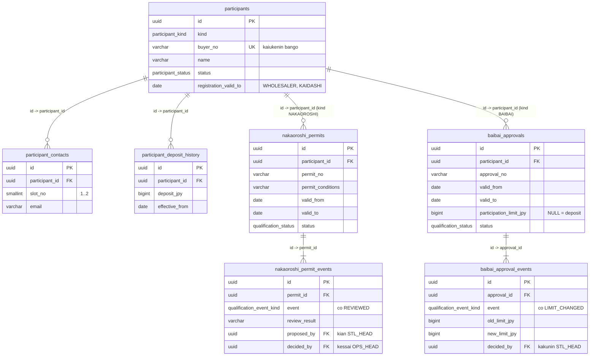

# PARTY_DB — Người tham gia và tư cách — 許可 (仲卸) ≠ 承認 (売買参加者)

| | |
|---|---|
| System Name | 水産物卸売市場業務支援システム（Product A, khách 株式会社 桜水産市場 — hư cấu） |
| Schema | `app` |
| CHARACTER SET | UTF8 (PostgreSQL 16, RDS Multi-AZ, AWS Tokyo) |
| Updated by | phuongnnm-23344 |
| Note | Một file của bộ Database Design tách theo cụm ER (QC-01 §4: một file một nhóm bảng). Nguyên tắc P1–P7, quy ước chung + enum (4.0), view công bố, bảng lệch so với prototype, kết quả parity và điểm mở chung nằm ở file tổng [MKT_DB.md](MKT_DB.md). **Số mục 4.xx giữ theo số bảng toàn schema** (cột No ở MKT_DB §2) để tham chiếu chéo giữa các file và từ ADR / spec không đổi khi tách |

---

## 1. Lịch sử sửa đổi

| No | Version | Action | Sheet / Bảng | Nội dung thay đổi | Ngày | Người sửa | Approve |
|---|---|---|---|---|---|---|---|
| 1 | 0.1.0 | Add new | — | Nội dung ban đầu nằm trong `MKT_DB.md` 0.1.0 (một file cho toàn schema) | 2026-11-25 | phuongnnm-23344 | |
| 2 | 0.2.0 | Add new | Toàn file | Tách từ `MKT_DB.md` 0.1.1 theo cụm ER (Gate 1 M-09); sửa theo Gate 1 M-07: thể hiện khác biệt thủ tục 許可 (審査 + 運用部門長 決裁) và 承認 (届出 + 照合部門長 確認), sự kiện `REVIEWED` (許可) và `LIMIT_CHANGED` (承認, 参加上限 không sửa đè), bảng so sánh §3, giả định 失効 tự động, OPEN-DB-09; khách #20 (đổi 保証金 kéo theo 参加上限 khi NULL) | 2026-11-25 | phuongnnm-23344 | |

---

## 2. Danh sách bảng

| No | Schema | Category | Tên bảng (logic) | Tên bảng (vật lý) | Mô tả | Note | Status |
|---|---|---|---|---|---|---|---|
| 9 | app | master | Người tham gia | [`participants`](#49-participants) | 4 loại: 卸売業者 / 仲卸 / 売買参加者 / 買出人 | Prototype: `participants` | Decision (provisional) |
| 10 | app | master | Email liên lạc người tham gia | [`participant_contacts`](#410-participant_contacts) | Tối đa 2 địa chỉ, có thời hạn hiệu lực | Mới | Decision (provisional) |
| 11 | app | history | Lịch sử 保証金額 | [`participant_deposit_history`](#411-participant_deposit_history) | Mỗi lần đổi 保証金額 (tiền bảo chứng) một dòng | Mới | Decision (provisional) |
| 12 | app | master | 許可 (仲卸) | [`nakaoroshi_permits`](#412-nakaoroshi_permits) | Giấy phép của 仲卸 | Prototype: `nakaoroshi_permits` | Decision (provisional) |
| 13 | app | history | Lịch sử 許可 | [`nakaoroshi_permit_events`](#413-nakaoroshi_permit_events) | Đăng ký / gia hạn / 一時停止 / 失効 / 再審査 của 許可 | Mới | Decision (provisional) |
| 14 | app | master | 承認 (売買参加者) | [`baibai_approvals`](#414-baibai_approvals) | Chấp thuận của 売買参加者 + 参加上限 | Prototype: `baibai_approvals` | Decision (provisional) |
| 15 | app | history | Lịch sử 承認 | [`baibai_approval_events`](#415-baibai_approval_events) | Như trên, cho 承認 | Mới | Decision (provisional) |

---

## 3. ER Diagram

Hai nhánh 許可 và 承認 vẽ tách: không có bảng chung nào nối hai nhánh ngoài `participants` (doanh nghiệp). Hai nhánh **khác nhau ở thủ tục và trường đặc thù**, không chỉ ở tên bảng (Gate 1 M-07):

| | 許可 (仲卸) — 4.12 / 4.13 | 承認 (売買参加者) — 4.14 / 4.15 |
|---|---|---|
| Căn cứ | Giấy phép **có xét duyệt (審査)** | Chấp thuận — **thủ tục nhẹ hơn (届出 + 確認)** |
| Đăng ký / gia hạn | 照合事務局 nhập hồ sơ → 照合部門長 起案 kèm **kết quả 審査 + điều kiện** (sự kiện `REVIEWED`) → **運用部門長 決裁 (MFA)** | 照合事務局 nhập 届出 → **照合部門長 確認 (MFA)** — một người, không 審査 |
| Trường đặc thù | `permit_conditions`, kết quả 審査 (`review_result`, `reviewed_on`) | `participation_limit_jpy` (参加上限) — **không sửa đè**, đổi bằng sự kiện `LIMIT_CHANGED` (cũ / mới / lý do) |
| 一時停止 / 失効 / 再審査 → 有効 | 照合部門長 起案 → 運用部門長 決裁 (MFA) | Như bên trái (PRM-121) |
| Hết 失効日 | Tự động `EXPIRED` (giả định [PL], nối FIG-010) | Như bên trái |
| Còn mở | Ai 決裁 đình chỉ / thu hồi 許可, có 弁明の機会 không — OPEN-DB-09 | 承認 chỉ cần 照合部門長 確認 có đúng không — OPEN-DB-09 |

---

## 4. Định nghĩa bảng

Quy ước chung (kiểu, cột chung, chỉ thêm, ngày mở, ghi qua hàm, enum): [MKT_DB.md §4.0](MKT_DB.md#40-quy-ước-chung).

### 4.9. `participants`

| | | | |
|---|---|---|---|
| Tên bảng (logic) | Người tham gia | Tạo bởi / ngày | phuongnnm-23344 / 2026-11-25 |
| Tên bảng (vật lý) | `participants` | Sửa bởi / ngày | — |
| Overview | Doanh nghiệp / cá nhân tham gia chợ, 4 loại không gộp thành "người mua" chung (TBL-ACTOR-01). **Doanh nghiệp và căn cứ 許可 / 承認 là hai thực thể tách** (PRM-044): tư cách nằm ở 4.12, 4.14. | Note | Bỏ `email` (→ 4.10), `deposit_jpy` (→ 4.11), `is_sample` (M01) so với prototype |

**Định nghĩa cột**

| No. | Key | Tên logic | Tên vật lý | Data Type | Size | Not Null | Default | Note |
|---|---|---|---|---|---|---|---|---|
| 1 | PRI | ID | `id` | UUID | N/A | Yes | `gen_random_uuid()` | |
| 2 | | Loại | `kind` | `participant_kind` | N/A | Yes | | Không đổi sau khi tạo (trigger) |
| 3 | | Tên | `name` | VARCHAR | 100 | Yes | | |
| 4 | | Tên カナ | `name_kana` | VARCHAR | 100 | No | | Sắp xếp / tra cứu ở quầy |
| 5 | UNI | 買受人番号 | `buyer_no` | VARCHAR | 10 | No | | `^[A-Z0-9]{1,10}$`; bắt buộc với `NAKAOROSHI`, `BAIBAI` (giữ quy tắc 0029) |
| 6 | UNI | Mã đối tác kế toán | `accounting_partner_code` | VARCHAR | 20 | No | | Mã ở phần mềm kế toán (IF-ACC-01) |
| 7 | | Trạng thái doanh nghiệp | `status` | `participant_status` | N/A | Yes | `'ACTIVE'` | 一時停止 / 失効 nằm ở 許可 / 承認, không ở đây |
| 8 | | Số đăng ký | `registration_no` | VARCHAR | 20 | No | | Chỉ `WHOLESALER` (đăng ký chợ) và `KAIDASHI` (đăng ký tại điểm — EX-02) |
| 9 | | Đăng ký hiệu lực đến | `registration_valid_to` | DATE | N/A | No | | Cảnh báo, **không chặn GD** (PRM-044). CHECK: NULL khi `kind` ∈ (`NAKAOROSHI`, `BAIBAI`) |
| 10 | | Cột chung | `created_at`, `created_by`, `updated_at`, `updated_by` | | | | | |

**Index**

| No. | Tên index | Cột | Primary key | Unique | Note |
|---|---|---|---|---|---|
| 1 | `participants_pkey` | `id` | Yes | Yes | |
| 2 | `uq_participants_buyer_no` | `buyer_no` | No | Yes | Đường tra chính ở bàn GD, khu giao (PRM-114 (b)) |
| 3 | `uq_participants_accounting_partner_code` | `accounting_partner_code` | No | Yes | |
| 4 | `idx_participants_kind_status` | `kind`, `status` | No | No | |

**Khoá ngoại** — N/A (chỉ FK cột chung).

---

### 4.10. `participant_contacts`

| | | | |
|---|---|---|---|
| Tên bảng (logic) | Email liên lạc người tham gia | Tạo bởi / ngày | phuongnnm-23344 / 2026-11-25 |
| Tên bảng (vật lý) | `participant_contacts` | Sửa bởi / ngày | — |
| Overview | Tối đa 2 địa chỉ / doanh nghiệp đang hiệu lực (PRM-122 (e), L4-A08). Đổi email = đóng dòng cũ (`valid_to`), thêm dòng mới — giữ lịch sử; chỉ nhân viên chợ đổi theo giấy yêu cầu. | Note | Dữ liệu cá nhân (APPI, FT-13-04): xuất danh sách có email cần MFA step-up |

**Định nghĩa cột**

| No. | Key | Tên logic | Tên vật lý | Data Type | Size | Not Null | Default | Note |
|---|---|---|---|---|---|---|---|---|
| 1 | PRI | ID | `id` | UUID | N/A | Yes | `gen_random_uuid()` | |
| 2 | FK | Người tham gia | `participant_id` | UUID | N/A | Yes | | |
| 3 | | Vị trí | `slot_no` | SMALLINT | N/A | Yes | | CHECK 1..2 |
| 4 | | Email | `email` | VARCHAR | 254 | Yes | | |
| 5 | | Hiệu lực từ / đến | `valid_from`, `valid_to` | DATE | N/A | Yes / No | | `valid_to` NULL = đang dùng |
| 6 | | Số giấy yêu cầu | `request_ref` | VARCHAR | 30 | No | | |
| 7 | | Cột chung | `created_at`, `created_by` | | | | | Chỉ UPDATE `valid_to` một lần |

**Index** — `participant_contacts_pkey`; `uq_participant_contacts_active_slot` (`participant_id`, `slot_no`) unique partial `valid_to IS NULL`.

**Khoá ngoại**

| No. | Tên khoá ngoại | Cột | Bảng đích | Cột đích | Note |
|---|---|---|---|---|---|
| 1 | `fk_participant_contacts_participant` | `participant_id` | `participants` | `id` | |

---

### 4.11. `participant_deposit_history`

| | | | |
|---|---|---|---|
| Tên bảng (logic) | Lịch sử 保証金額 | Tạo bởi / ngày | phuongnnm-23344 / 2026-11-25 |
| Tên bảng (vật lý) | `participant_deposit_history` | Sửa bởi / ngày | — |
| Overview | 保証金額 là trường số có lịch sử, **không** có giao dịch nộp / rút (PRM-046). Giá trị hiện hành = dòng có `effective_from` lớn nhất ≤ ngày xét (view `v_participant_current_deposit`). **Chỉ thêm.** | Note | Dùng làm 参加上限 mặc định của 売買参加者 (4.14) khi `participation_limit_jpy` NULL: đổi 保証金 thì hạn mức đổi theo từ `effective_from` — hộp thoại đổi 保証金 phải báo 「参加上限も ¥… に変わります」 hoặc 「参加上限は変わりません」 (khách #20) |

**Định nghĩa cột**

| No. | Key | Tên logic | Tên vật lý | Data Type | Size | Not Null | Default | Note |
|---|---|---|---|---|---|---|---|---|
| 1 | PRI | ID | `id` | UUID | N/A | Yes | `gen_random_uuid()` | |
| 2 | FK | Người tham gia | `participant_id` | UUID | N/A | Yes | | |
| 3 | | 保証金額 | `deposit_jpy` | BIGINT | N/A | Yes | | CHECK ≥ 0 |
| 4 | | Hiệu lực từ | `effective_from` | DATE | N/A | Yes | | |
| 5 | | Lý do | `reason` | VARCHAR | 200 | Yes | | |
| 6 | | Cột chung | `created_at`, `created_by` | | | | | |

**Index** — `participant_deposit_history_pkey`; `uq_deposit_participant_from` (`participant_id`, `effective_from`) unique.

**Khoá ngoại**

| No. | Tên khoá ngoại | Cột | Bảng đích | Cột đích | Note |
|---|---|---|---|---|---|
| 1 | `fk_deposit_participant` | `participant_id` | `participants` | `id` | |

---

### 4.12. `nakaoroshi_permits`

| | | | |
|---|---|---|---|
| Tên bảng (logic) | 許可 (仲卸) | Tạo bởi / ngày | phuongnnm-23344 / 2026-11-25 |
| Tên bảng (vật lý) | `nakaoroshi_permits` | Sửa bởi / ngày | — |
| Overview | Giấy phép **có xét duyệt (審査)** của 仲卸. **Căn cứ pháp lý riêng, bảng riêng, thủ tục riêng** (luật 2, ADR-003): đăng ký và gia hạn đều qua 審査 — 照合事務局 nhập hồ sơ, 照合部門長 起案 kèm kết quả 審査 + điều kiện (`REVIEWED`), 運用部門長 決裁 có MFA (`REGISTERED` / `RENEWED`). Trigger `enforce_qualification_kind` chặn gắn vào người tham gia không phải `NAKAOROSHI` (giữ từ prototype 0005). | Note | `status`, `valid_to`, `permit_conditions` chỉ đổi qua hàm sinh dòng `nakaoroshi_permit_events` trong cùng transaction. Quá `valid_to` → job sinh `EXPIRED` tự động — giả định [PL] (FIG-010 không vẽ 有効 → 失効 trực tiếp) |

**Định nghĩa cột**

| No. | Key | Tên logic | Tên vật lý | Data Type | Size | Not Null | Default | Note |
|---|---|---|---|---|---|---|---|---|
| 1 | PRI | ID | `id` | UUID | N/A | Yes | `gen_random_uuid()` | |
| 2 | FK | Người tham gia | `participant_id` | UUID | N/A | Yes | | `kind = NAKAOROSHI` (trigger) |
| 3 | UNI | Số 許可 | `permit_no` | VARCHAR | 20 | Yes | | |
| 4 | | Điều kiện 許可 | `permit_conditions` | VARCHAR | 500 | No | | Trường đặc thù của 許可 (ADR-003 §2.2) |
| 5 | | Hiệu lực từ | `valid_from` | DATE | N/A | Yes | | |
| 6 | | 失効日 | `valid_to` | DATE | N/A | Yes | | CHECK `valid_to >= valid_from`; cảnh báo trước 30 ngày (PRM-045) |
| 7 | | Trạng thái | `status` | `qualification_status` | N/A | Yes | `'VALID'` | FIG-010 |
| 8 | | Cột chung | `created_at`, `created_by`, `updated_at`, `updated_by` | | | | | |

**Index** — `nakaoroshi_permits_pkey`; `uq_nakaoroshi_permits_permit_no`; `idx_nakaoroshi_permits_participant` (`participant_id`, `status`).

**Khoá ngoại**

| No. | Tên khoá ngoại | Cột | Bảng đích | Cột đích | Note |
|---|---|---|---|---|---|
| 1 | `fk_nakaoroshi_permits_participant` | `participant_id` | `participants` | `id` | |

---

### 4.13. `nakaoroshi_permit_events`

| | | | |
|---|---|---|---|
| Tên bảng (logic) | Lịch sử 許可 | Tạo bởi / ngày | phuongnnm-23344 / 2026-11-25 |
| Tên bảng (vật lý) | `nakaoroshi_permit_events` | Sửa bởi / ngày | — |
| Overview | Mỗi thay đổi tư cách của một 許可 một dòng. **Chỉ thêm.** Đăng ký / gia hạn: `REVIEWED` (照合部門長 ghi kết quả 審査 + điều kiện) rồi `REGISTERED` / `RENEWED` (運用部門長 決裁, MFA) — gia hạn có 審査 nhưng **không** chuyển trạng thái 再審査 (PRM-121). 一時停止 / 再審査 → 有効: 照合部門長 起案 (`proposed_by`), 運用部門長 決裁 (`decided_by`, MFA). | Note | Từ ngữ duyệt nội bộ là 決裁 / 確認, không dùng 承認 (PRM-121). Thủ tục đình chỉ / thu hồi 許可 (ai 決裁, 弁明の機会) chờ OPEN-DB-09 |

**Định nghĩa cột**

| No. | Key | Tên logic | Tên vật lý | Data Type | Size | Not Null | Default | Note |
|---|---|---|---|---|---|---|---|---|
| 1 | PRI | ID | `id` | UUID | N/A | Yes | `gen_random_uuid()` | |
| 2 | FK | 許可 | `permit_id` | UUID | N/A | Yes | | |
| 3 | | Sự kiện | `event` | `qualification_event_kind` | N/A | Yes | | CHECK ≠ `LIMIT_CHANGED` (許可 không có hạn mức) |
| 3a | | Kết quả 審査 / ngày 審査 | `review_result`, `reviewed_on` | VARCHAR(500) / DATE | | No | | Bắt buộc khi `REVIEWED`; điều kiện mới ghi cả vào `nakaoroshi_permits.permit_conditions` khi `REGISTERED` / `RENEWED` |
| 4 | | Trạng thái trước / sau | `from_status`, `to_status` | `qualification_status` | N/A | No / Yes | | `from_status` NULL khi `REGISTERED`; `REVIEWED` giữ nguyên trạng thái |
| 5 | | 失効日 trước / sau | `old_valid_to`, `new_valid_to` | DATE | N/A | No | | Chỉ `RENEWED` |
| 6 | | Hiệu lực từ ngày | `effective_on` | DATE | N/A | Yes | | |
| 7 | | Lý do | `reason` | VARCHAR | 500 | Yes | | |
| 8 | FK | Người 起案 | `proposed_by` | UUID | N/A | No | | `STL_HEAD` |
| 9 | FK | Người 決裁 / 確認 | `decided_by` | UUID | N/A | No | | `OPS_HEAD` cho `REGISTERED` / `RENEWED` / 一時停止 / 再開 / 再審査; NULL cho `REVIEWED` (người ghi = `proposed_by`) và `EXPIRED` tự động. CHECK `decided_by <> proposed_by` |
| 10 | | MFA lúc | `mfa_verified_at` | TIMESTAMPTZ | N/A | No | | Bắt buộc khi `decided_by` có giá trị (PREMISE §3.2) |
| 11 | | Cột chung | `created_at`, `created_by` | | | | | |

**Index** — `nakaoroshi_permit_events_pkey`; `idx_permit_events_permit` (`permit_id`, `created_at`).

**Khoá ngoại**

| No. | Tên khoá ngoại | Cột | Bảng đích | Cột đích | Note |
|---|---|---|---|---|---|
| 1 | `fk_permit_events_permit` | `permit_id` | `nakaoroshi_permits` | `id` | |
| 2 | `fk_permit_events_proposed_by` / `_decided_by` | `proposed_by`, `decided_by` | `staff_accounts` | `id` | |

---

### 4.14. `baibai_approvals`

| | | | |
|---|---|---|---|
| Tên bảng (logic) | 承認 (売買参加者) | Tạo bởi / ngày | phuongnnm-23344 / 2026-11-25 |
| Tên bảng (vật lý) | `baibai_approvals` | Sửa bởi / ngày | — |
| Overview | Chấp thuận của 売買参加者 — căn cứ khác 許可, bảng khác, **thủ tục nhẹ hơn** (luật 2): 届出 → 照合事務局 nhập → 照合部門長 確認 (MFA), không 審査. Có 参加上限 (hạn mức tham gia): cảnh báo + bắt lý do khi tổng 買受代金 **trong kỳ** (相対 + せり) vượt, không chặn cứng (PRM-046, L4-A04 (1)). Trigger kiểm `kind = BAIBAI`. | Note | Hạn mức tính theo kỳ qua view `v_buyer_period_usage` — sửa M19 / D08. Quá `valid_to` → `EXPIRED` tự động (giả định [PL], như 4.12) |

**Định nghĩa cột**

| No. | Key | Tên logic | Tên vật lý | Data Type | Size | Not Null | Default | Note |
|---|---|---|---|---|---|---|---|---|
| 1 | PRI | ID | `id` | UUID | N/A | Yes | `gen_random_uuid()` | |
| 2 | FK | Người tham gia | `participant_id` | UUID | N/A | Yes | | `kind = BAIBAI` (trigger) |
| 3 | UNI | Số 承認 | `approval_no` | VARCHAR | 20 | Yes | | |
| 4 | | Hiệu lực từ | `valid_from` | DATE | N/A | Yes | | |
| 5 | | 失効日 | `valid_to` | DATE | N/A | Yes | | CHECK `valid_to >= valid_from` |
| 6 | | 参加上限 hiện hành | `participation_limit_jpy` | BIGINT | N/A | No | | NULL = dùng 保証金額 hiện hành (PRM-046). CHECK > 0 khi có giá trị. **Không sửa đè:** chỉ đổi qua hàm sinh `baibai_approval_events.LIMIT_CHANGED` (cũ / mới / lý do / người 確認) trong cùng transaction — cột này là giá trị hiện hành, lịch sử ở 4.15 (Gate 1 M-07) |
| 7 | | Trạng thái | `status` | `qualification_status` | N/A | Yes | `'VALID'` | FIG-010 |
| 8 | | Cột chung | `created_at`, `created_by`, `updated_at`, `updated_by` | | | | | |

**Index** — `baibai_approvals_pkey`; `uq_baibai_approvals_approval_no`; `idx_baibai_approvals_participant` (`participant_id`, `status`).

**Khoá ngoại**

| No. | Tên khoá ngoại | Cột | Bảng đích | Cột đích | Note |
|---|---|---|---|---|---|
| 1 | `fk_baibai_approvals_participant` | `participant_id` | `participants` | `id` | |

---

### 4.15. `baibai_approval_events`

| | | | |
|---|---|---|---|
| Tên bảng (logic) | Lịch sử 承認 | Tạo bởi / ngày | phuongnnm-23344 / 2026-11-25 |
| Tên bảng (vật lý) | `baibai_approval_events` | Sửa bởi / ngày | — |
| Overview | Lịch sử tư cách của 承認 — **tách bảng** khỏi 4.13 (ADR-003: không có bảng lịch sử tư cách chung). Khác 4.13: không có 審査; có sự kiện `LIMIT_CHANGED` mang 参加上限 cũ / mới; đăng ký / gia hạn chỉ cần 照合部門長 確認. **Chỉ thêm.** | Note | Phần cột trùng 4.13 là có chủ đích — đổi một bên không kéo bên kia |

**Định nghĩa cột** — riêng cho 承認 (không chép 4.13: không có cột 審査, có cột hạn mức):

| No. | Key | Tên logic | Tên vật lý | Data Type | Size | Not Null | Default | Note |
|---|---|---|---|---|---|---|---|---|
| 1 | PRI | ID | `id` | UUID | N/A | Yes | `gen_random_uuid()` | |
| 2 | FK | 承認 | `approval_id` | UUID | N/A | Yes | | |
| 3 | | Sự kiện | `event` | `qualification_event_kind` | N/A | Yes | | CHECK ≠ `REVIEWED` (承認 không 審査) |
| 4 | | Trạng thái trước / sau | `from_status`, `to_status` | `qualification_status` | N/A | No / Yes | | `from_status` NULL khi `REGISTERED`; `LIMIT_CHANGED` giữ nguyên trạng thái |
| 5 | | 失効日 trước / sau | `old_valid_to`, `new_valid_to` | DATE | N/A | No | | Chỉ `RENEWED` |
| 6 | | 参加上限 trước / sau | `old_limit_jpy`, `new_limit_jpy` | BIGINT | N/A | No | | Bắt buộc khi `LIMIT_CHANGED` (NULL = theo 保証金). Hàm đổi hạn mức ghi dòng này và cập nhật 4.14 cột 6 **trong cùng transaction** |
| 7 | | Hiệu lực từ ngày | `effective_on` | DATE | N/A | Yes | | `LIMIT_CHANGED`: áp từ kỳ chứa ngày này |
| 8 | | Lý do | `reason` | VARCHAR | 500 | Yes | | |
| 9 | FK | Người 起案 | `proposed_by` | UUID | N/A | No | | `STL_HEAD` cho 一時停止 / 再開 / 再審査 |
| 10 | FK | Người 決裁 / 確認 | `decided_by` | UUID | N/A | No | | `STL_HEAD` 確認 cho `REGISTERED` / `RENEWED` / `LIMIT_CHANGED`; `OPS_HEAD` 決裁 cho `SUSPENDED` / `RESUMED` / `REVIEW_STARTED` / `REINSTATED`; NULL cho `EXPIRED` tự động. CHECK `decided_by <> proposed_by` và ≠ `created_by` |
| 11 | | MFA lúc | `mfa_verified_at` | TIMESTAMPTZ | N/A | No | | Bắt buộc khi `decided_by` có giá trị (PREMISE §3.2) |
| 12 | | Cột chung | `created_at`, `created_by` | | | | | `created_by` = 照合事務局 nhập |

**Index** — `baibai_approval_events_pkey`; `idx_approval_events_approval` (`approval_id`, `created_at`).

**Khoá ngoại**

| No. | Tên khoá ngoại | Cột | Bảng đích | Cột đích | Note |
|---|---|---|---|---|---|
| 1 | `fk_approval_events_approval` | `approval_id` | `baibai_approvals` | `id` | |
