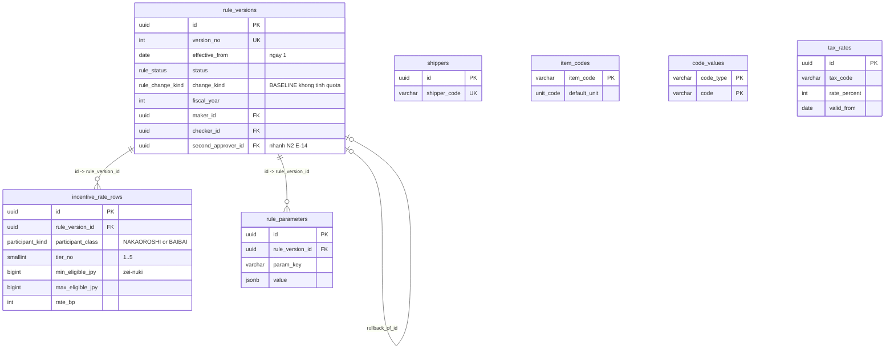

# RULE_DB — Quy chế có version (bảng tỷ lệ, tham số) + master mã / thuế

| | |
|---|---|
| System Name | 水産物卸売市場業務支援システム（Product A, khách 株式会社 桜水産市場 — hư cấu） |
| Schema | `app` |
| CHARACTER SET | UTF8 (PostgreSQL 16, RDS Multi-AZ, AWS Tokyo) |
| Updated by | phuongnnm-23344 |
| Note | Một file của bộ Database Design tách theo cụm ER (QC-01 §4: một file một nhóm bảng). Nguyên tắc P1–P7, quy ước chung + enum (4.0), view công bố, bảng lệch so với prototype, kết quả parity và điểm mở chung nằm ở file tổng [MKT_DB.md](MKT_DB.md). **Số mục 4.xx giữ theo số bảng toàn schema** (cột No ở MKT_DB §2) để tham chiếu chéo giữa các file và từ ADR / spec không đổi khi tách |

---

## 1. Lịch sử sửa đổi

| No | Version | Action | Sheet / Bảng | Nội dung thay đổi | Ngày | Người sửa | Approve |
|---|---|---|---|---|---|---|---|
| 1 | 0.1.0 | Add new | — | Nội dung ban đầu nằm trong `MKT_DB.md` 0.1.0 (một file cho toàn schema) | 2026-11-25 | phuongnnm-23344 | |
| 2 | 0.2.0 | Add new | Toàn file | Tách từ `MKT_DB.md` 0.1.1 theo cụm ER (Gate 1 M-09); sửa theo Gate 1: tham số `TRADE_START_TIME` + nghĩa `LOT_INTAKE_START_TIME` là đầu 業務日 (M-01); `PAYMENT_DUE_RULE` lùi theo ngày ngân hàng là quy tắc chốt, có giả định + câu hỏi (M-03); ngưỡng 2 cấp đo theo tiền thay đổi lớn nhất của một người mua (khách #3); hủy version `APPROVED` có maker-checker (m-09); ghi giả định 110/100 cố định (m-07) | 2026-11-25 | phuongnnm-23344 | |

---

## 2. Danh sách bảng

| No | Schema | Category | Tên bảng (logic) | Tên bảng (vật lý) | Mô tả | Note | Status |
|---|---|---|---|---|---|---|---|
| 16 | app | master | 出荷者 (người gửi hàng) | [`shippers`](#416-shippers) | Bảng mã 出荷者 | Mới | Decision (provisional) |
| 17 | app | master | 品目 (mặt hàng) | [`item_codes`](#417-item_codes) | Mã 品目 + đơn vị mặc định | Mới | Decision (provisional) |
| 18 | app | master | Bảng mã chung | [`code_values`](#418-code_values) | 荷目, lý do chọn nhanh, loại ngoại lệ giao | Mới | Decision (provisional) |
| 19 | app | master | Thuế suất | [`tax_rates`](#419-tax_rates) | 10% / 8% có ngày hiệu lực | Mới | Decision (provisional) |
| 21 | app | master | Version quy chế | [`rule_versions`](#421-rule_versions) | Ngày hiệu lực ngày 1, maker-checker, rollback, quota 4 lần / năm TC | Prototype: `rule_versions` | Decision (provisional) |
| 22 | app | master | Bậc 交付率 | [`incentive_rate_rows`](#422-incentive_rate_rows) | **2 bảng (仲卸 / 売買参加者) × 5 bậc** theo 適格金額 税抜 | Prototype: `incentive_rate_rows` | Decision (provisional) |
| 23 | app | master | Tham số quy chế | [`rule_parameters`](#423-rule_parameters) | Tham số đụng tiền / 業務日 trong cùng version (PREMISE §3.1) | Mới | Decision (provisional) |

---

## 3. ER Diagram

Bảng `business_days`, `payment_periods` dùng `rule_versions` nằm ở [CLOSE_DB.md](CLOSE_DB.md); `trades.tax_rate_id` ở [TRADE_DB.md](TRADE_DB.md).

---

## 4. Định nghĩa bảng

Quy ước chung (kiểu, cột chung, chỉ thêm, ngày mở, ghi qua hàm, enum): [MKT_DB.md §4.0](MKT_DB.md#40-quy-ước-chung).

### 4.16. `shippers`

| | | | |
|---|---|---|---|
| Tên bảng (logic) | 出荷者 (người gửi hàng) | Tạo bởi / ngày | phuongnnm-23344 / 2026-11-25 |
| Tên bảng (vật lý) | `shippers` | Sửa bởi / ngày | — |
| Overview | Bảng mã 出荷者 (FT-10-06, P0) dùng lúc 本登録 (PRM-116). Thay `lots.shipper_name` text tự do của prototype (D15). | Note | Ngừng dùng = `valid_to`, không xóa |

**Định nghĩa cột**

| No. | Key | Tên logic | Tên vật lý | Data Type | Size | Not Null | Default | Note |
|---|---|---|---|---|---|---|---|---|
| 1 | PRI | ID | `id` | UUID | N/A | Yes | `gen_random_uuid()` | |
| 2 | UNI | Mã 出荷者 | `shipper_code` | VARCHAR | 10 | Yes | | |
| 3 | | Tên | `name` | VARCHAR | 100 | Yes | | |
| 4 | | Hiệu lực từ / đến | `valid_from`, `valid_to` | DATE | N/A | Yes / No | | |
| 5 | | Cột chung | `created_at`, `created_by`, `updated_at`, `updated_by` | | | | | |

**Index** — `shippers_pkey`; `uq_shippers_shipper_code`. **Khoá ngoại** — N/A.

---

### 4.17. `item_codes`

| | | | |
|---|---|---|---|
| Tên bảng (logic) | 品目 (mặt hàng) | Tạo bởi / ngày | phuongnnm-23344 / 2026-11-25 |
| Tên bảng (vật lý) | `item_codes` | Sửa bởi / ngày | — |
| Overview | Mã 品目 và đơn vị mặc định (FT-10-06). Thay `lots.species` text. | Note | |

**Định nghĩa cột**

| No. | Key | Tên logic | Tên vật lý | Data Type | Size | Not Null | Default | Note |
|---|---|---|---|---|---|---|---|---|
| 1 | PRI | Mã 品目 | `item_code` | VARCHAR | 10 | Yes | | |
| 2 | | Tên | `name` | VARCHAR | 50 | Yes | | |
| 3 | | Đơn vị mặc định | `default_unit` | `unit_code` | N/A | Yes | `'KG'` | |
| 4 | | Thuế suất mặc định | `default_tax_code` | VARCHAR | 10 | Yes | `'REDUCED8'` | Thực phẩm → 軽減税率 8% (gợi ý khi nhập; thuế thật của dòng ở `trades.tax_rate_id`) |
| 5 | | Đang dùng | `is_active` | BOOLEAN | N/A | Yes | `true` | |
| 6 | | Cột chung | `created_at`, `created_by`, `updated_at`, `updated_by` | | | | | |

**Index** — `item_codes_pkey`. **Khoá ngoại** — N/A (`default_tax_code` là mã, tra `tax_rates` theo ngày; không FK vì `tax_rates` có nhiều dòng theo thời gian cho một mã).

---

### 4.18. `code_values`

| | | | |
|---|---|---|---|
| Tên bảng (logic) | Bảng mã chung | Tạo bởi / ngày | phuongnnm-23344 / 2026-11-25 |
| Tên bảng (vật lý) | `code_values` | Sửa bởi / ngày | — |
| Overview | Danh mục nhỏ do người vận hành sửa: `NIME` 荷目, `OVER_LIMIT_REASON` (lý do chọn nhanh khi vượt 参加上限 — L4-A04 (1)), `DELIVERY_EXCEPTION` (loại ngoại lệ giao), `FIX_REASON` (lý do 当日訂正 / 取消). | Note | Thứ đụng tiền **không** đặt ở đây — nằm ở `rule_parameters` |

**Định nghĩa cột**

| No. | Key | Tên logic | Tên vật lý | Data Type | Size | Not Null | Default | Note |
|---|---|---|---|---|---|---|---|---|
| 1 | PRI | Loại mã | `code_type` | VARCHAR | 30 | Yes | | |
| 2 | PRI | Mã | `code` | VARCHAR | 20 | Yes | | |
| 3 | | Nhãn | `label` | VARCHAR | 100 | Yes | | Tiếng Nhật, hiện trên màn |
| 4 | | Thứ tự | `sort_order` | INT | N/A | Yes | `0` | |
| 5 | | Đang dùng | `is_active` | BOOLEAN | N/A | Yes | `true` | |
| 6 | | Cột chung | `updated_at`, `updated_by` | | | | | |

**Index** — `code_values_pkey` (`code_type`, `code`). **Khoá ngoại** — N/A.

---

### 4.19. `tax_rates`

| | | | |
|---|---|---|---|
| Tên bảng (logic) | Thuế suất | Tạo bởi / ngày | phuongnnm-23344 / 2026-11-25 |
| Tên bảng (vật lý) | `tax_rates` | Sửa bởi / ngày | — |
| Overview | 税率マスタ (FT-10-05): mã + suất + ngày hiệu lực. Mỗi GD lưu `tax_rate_id` đã áp; thuế kỳ tính một lần trên tổng theo từng suất (PRM-053). Sửa D04 (prototype cố định 10%). | Note | Hệ số 110/100 của 完納奨励金 là 税係数 **cố định** của BR-INC-01 / B.5 / 13-06, **không** theo thuế suất của hàng (thủy sản tươi là thực phẩm → 軽減税率 8%) và không đọc từ bảng này — giả định [PL] ghi theo Gate 1 m-07; 税区分 của 完納奨励金 khi xuất IF-ACC-01 là câu hỏi Q-ARCH-12 (theo E-01 / E-06) |

**Định nghĩa cột**

| No. | Key | Tên logic | Tên vật lý | Data Type | Size | Not Null | Default | Note |
|---|---|---|---|---|---|---|---|---|
| 1 | PRI | ID | `id` | UUID | N/A | Yes | `gen_random_uuid()` | |
| 2 | | Mã thuế | `tax_code` | VARCHAR | 10 | Yes | | `STD10`, `REDUCED8` |
| 3 | | Suất (%) | `rate_percent` | INT | N/A | Yes | | CHECK 0..100 |
| 4 | | Hiệu lực từ / đến | `valid_from`, `valid_to` | DATE | N/A | Yes / No | | Không chồng khoảng cho cùng `tax_code` (EXCLUDE gist) |
| 5 | | Cột chung | `created_at`, `created_by` | | | | | |

**Index** — `tax_rates_pkey`; `ex_tax_rates_no_overlap` (`tax_code`, daterange). **Khoá ngoại** — N/A.

---

### 4.21. `rule_versions`

| | | | |
|---|---|---|---|
| Tên bảng (logic) | Version quy chế | Tạo bởi / ngày | phuongnnm-23344 / 2026-11-25 |
| Tên bảng (vật lý) | `rule_versions` | Sửa bởi / ngày | — |
| Overview | Một version = bảng tỷ lệ (4.22) + tham số (4.23), hiệu lực từ **ngày 1** của tháng (PRM-042). Maker ルール管理者, checker 照合部門長 (MFA). Vòng đời DRAFT → PENDING → APPROVED (chờ hiệu lực) → ACTIVE → SUPERSEDED; trả về → DRAFT; hủy trước hiệu lực → CANCELLED (ADR-006 §2.2). Quota 4 lần / năm TC (4月→3月) đếm version `CHANGE` + `ROLLBACK` ở `APPROVED` / `ACTIVE` / `SUPERSEDED` có ngày hiệu lực trong năm; **`BASELINE` (go-live) không tính**; `CANCELLED` không tính (L4-A04 (3), sửa D06). Hàm duyệt khóa theo năm TC (advisory lock) để hai checker không cùng vượt quota. Version mới thứ 5 bị chặn. Rollback khi đã đủ 4 lần: **chờ E-14** — cột `second_approver_id` phục vụ nhánh N2 (OPEN-L4-01). **Hủy version `APPROVED` trước ngày hiệu lực:** maker (RULE) đề nghị, checker 照合部門長 決裁 + MFA + lý do (giữ maker-checker; Gate 1 m-09) → `CANCELLED`, không tính quota. Tỷ lệ sai đã duyệt vẫn là version "đúng" của kỳ → engine không tự sinh DELTA; sửa tiền thưởng các kỳ đã khóa bằng 修正申請 `INCENTIVE` (ADJUST_DB 4.37, R-L4-01). | Note | Không có công tắc cấu hình N1 / N2 (PREMISE §6): nhánh được chốt trong hàm sau workshop |

**Định nghĩa cột**

| No. | Key | Tên logic | Tên vật lý | Data Type | Size | Not Null | Default | Note |
|---|---|---|---|---|---|---|---|---|
| 1 | PRI | ID | `id` | UUID | N/A | Yes | `gen_random_uuid()` | |
| 2 | UNI | Số version | `version_no` | INT | N/A | Yes | | CHECK > 0 |
| 3 | | Hiệu lực từ | `effective_from` | DATE | N/A | Yes | | CHECK ngày = 1; hàm duyệt kiểm là tháng tương lai |
| 4 | | Năm TC | `fiscal_year` | INT | N/A | Yes | | GENERATED từ `effective_from` (tháng ≥ 4 → năm đó, ngược lại năm − 1) |
| 5 | | Loại thay đổi | `change_kind` | `rule_change_kind` | N/A | Yes | `'CHANGE'` | Chỉ một `BASELINE` trong toàn hệ thống (unique partial) |
| 6 | | Trạng thái | `status` | `rule_status` | N/A | Yes | `'DRAFT'` | |
| 7 | FK | Rollback về version | `rollback_of_id` | UUID | N/A | No | | Bắt buộc khi `change_kind = ROLLBACK`; nội dung chép từ version đích thành dòng mới |
| 8 | FK | Version bị thay | `replaced_version_id` | UUID | N/A | No | | Version trước đó chuyển `SUPERSEDED` |
| 9 | | Lý do / ghi chú | `note` | VARCHAR | 500 | No | | Bắt buộc khi `ROLLBACK` |
| 10 | FK | Maker | `maker_id` | UUID | N/A | Yes | | `RULE` |
| 11 | FK | Checker | `checker_id` | UUID | N/A | No | | `STL_HEAD`; CHECK `checker_id <> maker_id` |
| 12 | FK | Người duyệt thứ hai | `second_approver_id` | UUID | N/A | No | | Chỉ nhánh N2 của E-14: rollback khi đã đủ 4 lần cần 運用部門長 (MFA) |
| 13 | | Duyệt lúc | `approved_at` | TIMESTAMPTZ | N/A | No | | |
| 13a | FK | Hủy: người 決裁 / lý do | `cancelled_by`, `cancel_reason` | UUID / VARCHAR(500) | | No | | Bắt buộc khi `APPROVED` → `CANCELLED`; `cancelled_by` = `STL_HEAD` ≠ `maker_id`, kèm MFA trong `audit_logs` |
| 14 | | Cột chung | `created_at`, `created_by`, `updated_at`, `updated_by` | | | | | |

**Index** — `rule_versions_pkey`; `uq_rule_versions_version_no`; `uq_rule_versions_baseline` (`change_kind`) unique partial `change_kind = 'BASELINE'`; `idx_rule_versions_fy_status` (`fiscal_year`, `status`); `uq_rule_versions_active_from` (`effective_from`) unique partial `status = 'ACTIVE'`.

**Khoá ngoại**

| No. | Tên khoá ngoại | Cột | Bảng đích | Cột đích | Note |
|---|---|---|---|---|---|
| 1 | `fk_rule_versions_rollback_of` | `rollback_of_id` | `rule_versions` | `id` | |
| 2 | `fk_rule_versions_replaced` | `replaced_version_id` | `rule_versions` | `id` | |
| 3 | `fk_rule_versions_maker` / `_checker` / `_second` | `maker_id`, `checker_id`, `second_approver_id` | `staff_accounts` | `id` | |

---

### 4.22. `incentive_rate_rows`

| | | | |
|---|---|---|---|
| Tên bảng (logic) | Bậc 交付率 | Tạo bởi / ngày | phuongnnm-23344 / 2026-11-25 |
| Tên bảng (vật lý) | `incentive_rate_rows` | Sửa bởi / ngày | — |
| Overview | **Hai bảng tỷ lệ** — 仲卸 và 売買参加者 — mỗi bảng **5 bậc gồm bậc thấp nhất 0%** (PRM-041). Bậc tra theo **適格金額 税抜** (tổng 買受代金 税抜 trong kỳ của người 完納), cận dưới "以上" (sửa D01, D02). Chỉ sửa khi version `DRAFT` (giữ trigger 0005). | Note | Giá trị bậc thật chờ `incentive-rate-table.csv` (E-03, L4-A02) |

**Định nghĩa cột**

| No. | Key | Tên logic | Tên vật lý | Data Type | Size | Not Null | Default | Note |
|---|---|---|---|---|---|---|---|---|
| 1 | PRI | ID | `id` | UUID | N/A | Yes | `gen_random_uuid()` | |
| 2 | FK | Version | `rule_version_id` | UUID | N/A | Yes | | |
| 3 | | Bảng của loại | `participant_class` | `participant_kind` | N/A | Yes | | CHECK ∈ (`NAKAOROSHI`, `BAIBAI`) |
| 4 | | Bậc | `tier_no` | SMALLINT | N/A | Yes | | CHECK 1..5 |
| 5 | | Cận dưới (以上) | `min_eligible_jpy` | BIGINT | N/A | Yes | | 税抜. Bậc 1: `0` |
| 6 | | Cận trên (未満) | `max_eligible_jpy` | BIGINT | N/A | No | | NULL ở bậc 5. CHECK > `min_eligible_jpy` |
| 7 | | 交付率 | `rate_bp` | INT | N/A | Yes | | CHECK 0..10000; bậc 1 = 0 |

Hàm `submit_rule_version` kiểm: mỗi `participant_class` đủ 5 bậc, liền nhau (cận trên bậc n = cận dưới bậc n+1), bậc 1 bắt đầu 0 và `rate_bp = 0`.

**Index** — `incentive_rate_rows_pkey`; `uq_rate_rows_version_class_tier` (`rule_version_id`, `participant_class`, `tier_no`) unique.

**Khoá ngoại**

| No. | Tên khoá ngoại | Cột | Bảng đích | Cột đích | Note |
|---|---|---|---|---|---|
| 1 | `fk_rate_rows_version` | `rule_version_id` | `rule_versions` | `id` | |

---

### 4.23. `rule_parameters`

| | | | |
|---|---|---|---|
| Tên bảng (logic) | Tham số quy chế | Tạo bởi / ngày | phuongnnm-23344 / 2026-11-25 |
| Tên bảng (vật lý) | `rule_parameters` | Sửa bởi / ngày | — |
| Overview | Tham số đụng tới tiền, 支払期日, khóa sổ, 業務日, 完納 nằm **trong version quy chế** (PREMISE §3.1, L4-A03) — sửa D07, D09, M13. Đổi một tham số = version mới = tính 1 lần quota. Chỉ sửa khi version `DRAFT`. | Note | Tham số thuần vận hành (nơi nhận, giờ gửi, mẫu câu, timeout, SLA tranh chấp) ở **file cấu hình có nhật ký** (PRM-126), không ở bảng này |

**Định nghĩa cột**

| No. | Key | Tên logic | Tên vật lý | Data Type | Size | Not Null | Default | Note |
|---|---|---|---|---|---|---|---|---|
| 1 | PRI | ID | `id` | UUID | N/A | Yes | `gen_random_uuid()` | |
| 2 | FK | Version | `rule_version_id` | UUID | N/A | Yes | | |
| 3 | | Khóa tham số | `param_key` | VARCHAR | 50 | Yes | | CHECK thuộc danh sách dưới |
| 4 | | Giá trị | `value` | JSONB | N/A | Yes | | Kiểm kiểu theo `param_key` trong hàm `save_rule_parameters` |

| `param_key` | Kiểu | Giá trị bộ go-live (tạm) | ID |
|---|---|---|---|
| `CORR_TWO_LEVEL_THRESHOLD_JPY` | số nguyên JPY (税込, "以上"), so với **tiền thay đổi lớn nhất của một người mua** = max theo người mua của \|Σ chênh 税込\| (khách #3); đổi 買受人 → luôn 2 cấp, không so ngưỡng. Cùng ngưỡng dùng cho dòng ✖ 当日訂正 ở checklist 日次締め (khách #25) | 100000 | E-08, PRM-033, PRM-120 |
| `LOT_INTAKE_START_TIME` | `HH:MM` JST | `"01:00"` | **Đầu 業務日**: 業務日 D = [D 01:00, D+1 01:00) JST; `business_date_for(t)` = ngày của (t − giá trị này) (Gate 1 M-01). E-16, PRM-116 |
| `TRADE_START_TIME` | `HH:MM` JST | `"02:00"` | Giờ sớm nhất được chốt GD (相対 / xác nhận せり) trong 業務日. PRM-116 |
| `DELIVERY_MATCH_RULE` | mã | `"REMAINING_ALL_MATCHES"` (「残り全部」= khớp 精算) | E-17, PRM-118 |
| `PAYMENT_DUE_RULE` | `{ "day": 10, "shift": "PREV_BANK_DAY" }` | ngày 10 tháng sau; rơi **ngày ngân hàng nghỉ** (`market_calendar.is_bank_open = false`) → lùi về **ngày ngân hàng mở trước** — hạn chuyển khoản theo ngày ngân hàng, không theo 休市日. Giả định [PL], hỏi 経理部 (Q-ARCH-11). Vd. kỳ 2028-05: 2028-06-10 thứ Bảy (chợ mở, ngân hàng nghỉ) → 2028-06-09 | PRM-054, D05, Gate 1 M-03 |
| `TAX_ROUNDING` | mã | `"FLOOR"` (thuế kỳ làm tròn xuống yên) | DEC-011, PRM-053, E-06 |
| `DAY_CLOSE_DEADLINE` | `HH:MM` JST | `"11:00"` (batch xong trước 11:00) | FG-11, PRM-119 |
| `LOT_CARRYOVER_ON_CLOSE` | boolean | `true` (持ち越し — tạm xếp như quy chế) | E-12, PRM-110, OPEN-L4-03 |
| `SELL_BEFORE_INSPECTION` | boolean | `false` (bám FIG-011) | E-13, PRM-117, OPEN-L4-03 |

**Index** — `rule_parameters_pkey`; `uq_rule_parameters_version_key` (`rule_version_id`, `param_key`) unique.

**Khoá ngoại**

| No. | Tên khoá ngoại | Cột | Bảng đích | Cột đích | Note |
|---|---|---|---|---|---|
| 1 | `fk_rule_parameters_version` | `rule_version_id` | `rule_versions` | `id` | |
