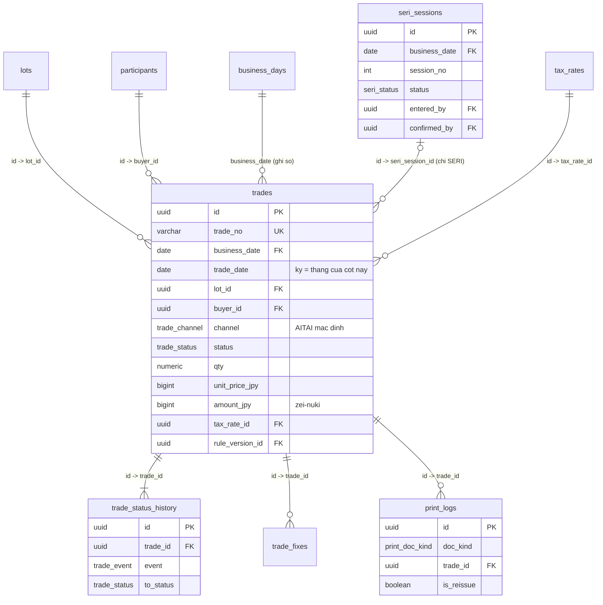
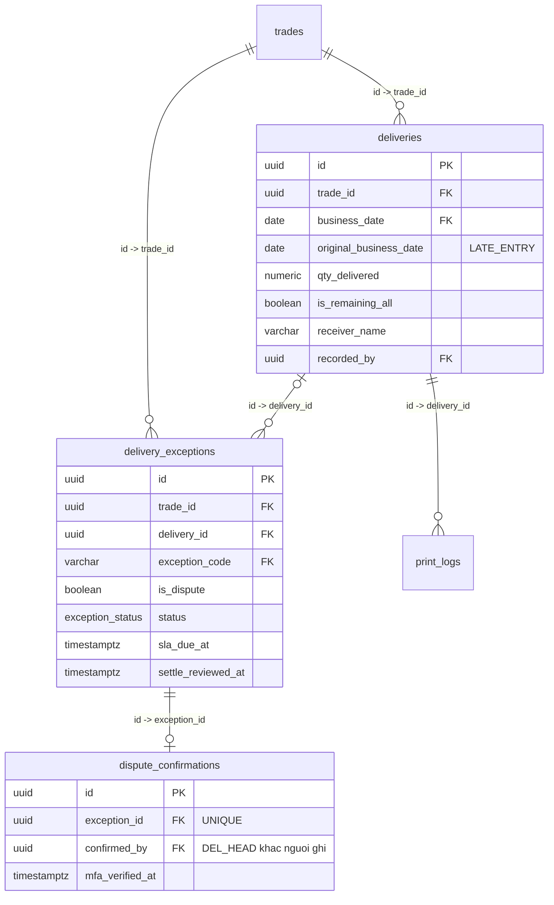

# TRADE_DB — 相対 (luồng chính) / せり / in phiếu / giao hàng

| | |
|---|---|
| System Name | 水産物卸売市場業務支援システム（Product A, khách 株式会社 桜水産市場 — hư cấu） |
| Schema | `app` |
| CHARACTER SET | UTF8 (PostgreSQL 16, RDS Multi-AZ, AWS Tokyo) |
| Updated by | phuongnnm-23344 |
| Note | Một file của bộ Database Design tách theo cụm ER (QC-01 §4: một file một nhóm bảng). Nguyên tắc P1–P7, quy ước chung + enum (4.0), view công bố, bảng lệch so với prototype, kết quả parity và điểm mở chung nằm ở file tổng [MKT_DB.md](MKT_DB.md). **Số mục 4.xx giữ theo số bảng toàn schema** (cột No ở MKT_DB §2) để tham chiếu chéo giữa các file và từ ADR / spec không đổi khi tách |

---

## 1. Lịch sử sửa đổi

| No | Version | Action | Sheet / Bảng | Nội dung thay đổi | Ngày | Người sửa | Approve |
|---|---|---|---|---|---|---|---|
| 1 | 0.1.0 | Add new | — | Nội dung ban đầu nằm trong `MKT_DB.md` 0.1.0 (một file cho toàn schema) | 2026-11-25 | phuongnnm-23344 | |
| 2 | 0.2.0 | Add new | Toàn file | Tách từ `MKT_DB.md` 0.1.1 theo cụm ER (Gate 1 M-09); sửa theo Gate 1: `trades.trade_date` (取引日 thật, quyết định kỳ) tách khỏi `business_date` ghi sổ, `deliveries.original_business_date` (M-05, C-02); `delivery_exceptions.settle_reviewed_*` — ngoại lệ giao đổi tiền phải 「確認済」 trước 日次締め (khách #4); 4.36 cho 配送部門責任者 khác xác nhận phiếu giấy khi người ký vắng (khách #16) | 2026-11-25 | phuongnnm-23344 | |

---

## 2. Danh sách bảng

| No | Schema | Category | Tên bảng (logic) | Tên bảng (vật lý) | Mô tả | Note | Status |
|---|---|---|---|---|---|---|---|
| 29 | app | transaction | Phiên せり | [`seri_sessions`](#429-seri_sessions) | Nhóm kết quả せり, 入力者 ≠ 確認者 | Prototype: `seri_sessions` | Decision (provisional) |
| 30 | app | transaction | Giao dịch | [`trades`](#430-trades) | 相対 (chính) và kết quả せり; đóng băng khi 確定 | Prototype: `trades` | Decision (provisional) |
| 31 | app | history | Lịch sử trạng thái GD | [`trade_status_history`](#431-trade_status_history) | FIG-012: 提出 / 承認 / 確定 / 取消 cùng người + thời điểm | Mới | Decision (provisional) |
| 33 | app | transaction | Nhật ký in phiếu | [`print_logs`](#433-print_logs) | In / in lại (再発行) 取引確認票, 引渡票 | Mới | Decision (provisional) |
| 34 | app | transaction | Lần giao | [`deliveries`](#434-deliveries) | Giao nhiều lần, 「残り全部」, tên người nhận | Prototype: `deliveries` | Decision (provisional) |
| 35 | app | transaction | Ngoại lệ / tranh chấp giao | [`delivery_exceptions`](#435-delivery_exceptions) | SC-06-04, SLA tranh chấp | Mới | Decision (provisional) |
| 36 | app | transaction | Xác nhận giao có tranh chấp | [`dispute_confirmations`](#436-dispute_confirmations) | 配送部門責任者 xác nhận (MFA), cấm tự xác nhận | Mới | Decision (provisional) |

---

## 3. ER Diagram

`lots` ở [LOT_DB.md](LOT_DB.md); `participants` ở [PARTY_DB.md](PARTY_DB.md); `business_days`, `payment_periods` ở [CLOSE_DB.md](CLOSE_DB.md); `tax_rates` ở [RULE_DB.md](RULE_DB.md); `trade_fixes` ở [ADJUST_DB.md](ADJUST_DB.md).

### 3.1 相対 (luồng chính), せり

### 3.2 Giao hàng

---

## 4. Định nghĩa bảng

Quy ước chung (kiểu, cột chung, chỉ thêm, ngày mở, ghi qua hàm, enum): [MKT_DB.md §4.0](MKT_DB.md#40-quy-ước-chung).

### 4.29. `seri_sessions`

| | | | |
|---|---|---|---|
| Tên bảng (logic) | Phiên せり | Tạo bởi / ngày | phuongnnm-23344 / 2026-11-25 |
| Tên bảng (vật lý) | `seri_sessions` | Sửa bởi / ngày | — |
| Overview | Nhóm kết quả cuối của một lượt せり theo FORM-SERI-01. せり人 quyết ở sàn, hệ thống **chỉ ghi** (FR-SERI-01); 確認者 xác nhận cả phiên một lần, mặc định khác 入力者, trùng thì bắt lý do và hiện ở 要確認 (PRM-115). Không có bảng giá đặt / lượt trả giá (luật 1). **Ngày mở.** | Note | Giữ từ prototype |

**Định nghĩa cột**

| No. | Key | Tên logic | Tên vật lý | Data Type | Size | Not Null | Default | Note |
|---|---|---|---|---|---|---|---|---|
| 1 | PRI | ID | `id` | UUID | N/A | Yes | `gen_random_uuid()` | |
| 2 | FK | 業務日 | `business_date` | DATE | N/A | Yes | | |
| 3 | | Số phiên | `session_no` | INT | N/A | Yes | | CHECK > 0 |
| 4 | | Trạng thái | `status` | `seri_status` | N/A | Yes | `'ENTERING'` | |
| 5 | FK | 入力者 | `entered_by` | UUID | N/A | Yes | | |
| 6 | FK | 確認者 | `confirmed_by` | UUID | N/A | No | | |
| 7 | | Xác nhận lúc | `confirmed_at` | TIMESTAMPTZ | N/A | No | | |
| 8 | | Lý do trùng người | `same_person_reason` | VARCHAR | 200 | No | | CHECK: bắt buộc khi `confirmed_by = entered_by` |
| 9 | | Cột chung | `created_at`, `created_by` | | | | | |

**Index** — `seri_sessions_pkey`; `uq_seri_sessions_day_no` (`business_date`, `session_no`) unique.

**Khoá ngoại** — `business_date` → `business_days`; `entered_by`, `confirmed_by` → `staff_accounts.id`.

---

### 4.30. `trades`

| | | | |
|---|---|---|---|
| Tên bảng (logic) | Giao dịch | Tạo bởi / ngày | phuongnnm-23344 / 2026-11-25 |
| Tên bảng (vật lý) | `trades` | Sửa bởi / ngày | — |
| Overview | Một dòng một GD gốc. **相対 là luồng chính** (`channel` mặc định `AITAI`); dòng せり là kết quả đã ghi của phiên. Trạng thái FIG-012; bàn GD bấm một lần từ ô đơn giá tới 確定, hệ thống vẫn ghi 提出 / 承認 / 確定 cùng người + thời điểm vào `trade_status_history` (PRM-114 (a), sửa D10). Kiểm 許可 (仲卸) hoặc 承認 + 参加上限 theo kỳ (売買参加者) **trong cùng transaction** với trừ SL (BR-PERM-01, ADR-003). **Không xóa; đóng băng khi `CONFIRMED`** (SL, giá, tiền, người mua, lô, kênh, ngày, thuế) — sửa chỉ bằng `trade_adjustments`. **Ngày mở.** | Note | Chốt GD bắt buộc online (L4-A05); `PAPER_LATE` là nhập bù có đánh dấu |

**Định nghĩa cột**

| No. | Key | Tên logic | Tên vật lý | Data Type | Size | Not Null | Default | Note |
|---|---|---|---|---|---|---|---|---|
| 1 | PRI | ID | `id` | UUID | N/A | Yes | `gen_random_uuid()` | |
| 2 | UNI | Số GD | `trade_no` | VARCHAR | 20 | Yes | | Qua `day_counters` |
| 3 | FK | 業務日 ghi sổ | `business_date` | DATE | N/A | Yes | | Ngày `OPEN` lúc ghi; dùng cho sổ ngày, 日次精算, IF-ACC-01 |
| 3a | | 取引日 (ngày GD thật) | `trade_date` | DATE | N/A | Yes | | = `business_date`, **trừ** GD nhập qua 修正申請 `LATE_ENTRY` cho ngày đã khóa (= ngày trên 紙伝票). **Kỳ của GD = tháng của cột này** (L4-A04 (2); Gate 1 C-02, M-05). CHECK `trade_date <= business_date` |
| 4 | FK | Lô | `lot_id` | UUID | N/A | Yes | | |
| 5 | FK | Người mua | `buyer_id` | UUID | N/A | Yes | | `NAKAOROSHI` hoặc `BAIBAI` có tư cách `VALID` lúc chốt |
| 6 | | Kênh | `channel` | `trade_channel` | N/A | Yes | `'AITAI'` | |
| 7 | FK | Phiên せり | `seri_session_id` | UUID | N/A | No | | CHECK (`channel = 'SERI'`) = (`seri_session_id IS NOT NULL`) (N02) |
| 8 | | Nguồn | `source` | `trade_source` | N/A | Yes | `'ONLINE'` | |
| 9 | | Số phiếu giấy | `paper_slip_no` | VARCHAR | 20 | No | | Bắt buộc khi `PAPER_LATE`; unique partial. `PAPER_LATE` cho ngày **chưa khóa** ghi thẳng (後入力); cho ngày **đã khóa** chỉ qua 修正申請 `LATE_ENTRY` |
| 9a | | Giờ ghi trên phiếu | `paper_slip_time` | TIMESTAMPTZ | N/A | No | | Bắt buộc khi `PAPER_LATE`; tư cách 許可 / 承認 kiểm theo hiệu lực tại giờ này (ADR-008 §2.4-11) |
| 10 | | Trạng thái | `status` | `trade_status` | N/A | Yes | `'DRAFT'` | |
| 11 | | SL | `qty` | NUMERIC | 12,1 | Yes | | CHECK > 0 |
| 12 | | Đơn giá | `unit_price_jpy` | BIGINT | N/A | Yes | | CHECK > 0, 税抜 |
| 13 | | Tiền (税抜) | `amount_jpy` | BIGINT | N/A | Yes | | = floor(`qty` × `unit_price_jpy`) — trigger (giữ 0025) |
| 14 | FK | Thuế suất | `tax_rate_id` | UUID | N/A | Yes | | Suất hiệu lực tại `business_date` (D04) |
| 15 | FK | Version quy chế | `rule_version_id` | UUID | N/A | Yes | | = `business_days.rule_version_id` |
| 16 | | Mã lý do vượt 参加上限 | `over_limit_reason_code` | VARCHAR | 20 | No | | `code_values` (`OVER_LIMIT_REASON`). Chỉ cho `BAIBAI` (L4-A04 (1)) |
| 17 | | Ghi chú vượt hạn mức | `over_limit_note` | VARCHAR | 200 | No | | |
| 18 | | 確定 lúc / bởi | `confirmed_at`, `confirmed_by` | TIMESTAMPTZ / UUID | N/A | No | | |
| 19 | | Cột chung | `created_at`, `created_by`, `updated_at`, `updated_by` | | | | | `created_by` = người nhập |

**Index** — `trades_pkey`; `uq_trades_trade_no`; `idx_trades_business_date` (`business_date`); `idx_trades_lot` (`lot_id`); `idx_trades_buyer_date` (`buyer_id`, `business_date`) — 精算 người × ngày; `idx_trades_buyer_trade_date` (`buyer_id`, `trade_date`) — 参加上限 và 期のお支払額 theo kỳ; `idx_trades_seri_session` (`seri_session_id`). Không chia bảng (ADR-009 §2.2-7: chỉ `audit_logs` chia theo năm TC); truy vấn danh sách luôn có khoảng `business_date` + phân trang (M23).

**Khoá ngoại** — `business_date` → `business_days`; `lot_id` → `lots.id`; `buyer_id` → `participants.id`; `seri_session_id` → `seri_sessions.id`; `tax_rate_id` → `tax_rates.id`; `rule_version_id` → `rule_versions.id`; `confirmed_by` → `staff_accounts.id`. `over_limit_reason_code`: kiểm trong hàm (FK ghép như 4.25).

---

### 4.31. `trade_status_history`

| | | | |
|---|---|---|---|
| Tên bảng (logic) | Lịch sử trạng thái GD | Tạo bởi / ngày | phuongnnm-23344 / 2026-11-25 |
| Tên bảng (vật lý) | `trade_status_history` | Sửa bởi / ngày | — |
| Overview | Mỗi sự kiện FIG-012 một dòng, gồm người, thời điểm, thiết bị (PRM-114 (a)); nguồn của RPT-02 取引状態ログ. **Chỉ thêm.** | Note | Mới (D10) |

**Định nghĩa cột**

| No. | Key | Tên logic | Tên vật lý | Data Type | Size | Not Null | Default | Note |
|---|---|---|---|---|---|---|---|---|
| 1 | PRI | ID | `id` | UUID | N/A | Yes | `gen_random_uuid()` | |
| 2 | FK | GD | `trade_id` | UUID | N/A | Yes | | |
| 3 | | Sự kiện | `event` | `trade_event` | N/A | Yes | | |
| 4 | | Trạng thái trước / sau | `from_status`, `to_status` | `trade_status` | N/A | No / Yes | | |
| 5 | | Lý do | `reason` | VARCHAR | 200 | No | | Bắt buộc khi `REJECT`, `CANCEL` |
| 6 | FK | Thiết bị | `device_id` | UUID | N/A | No | | |
| 7 | | Cột chung | `created_at`, `created_by` | | | | | |

**Index** — `trade_status_history_pkey`; `idx_trade_status_history_trade` (`trade_id`, `created_at`).

**Khoá ngoại** — `trade_id` → `trades.id`; `device_id` → `devices.id`.

---

### 4.33. `print_logs`

| | | | |
|---|---|---|---|
| Tên bảng (logic) | Nhật ký in phiếu | Tạo bởi / ngày | phuongnnm-23344 / 2026-11-25 |
| Tên bảng (vật lý) | `print_logs` | Sửa bởi / ngày | — |
| Overview | In thẳng 取引確認票 sau 確定; hết giấy / kẹt → GD vẫn 確定, in lại từ danh sách, phiếu ghi 「再発行」 (PRM-114 (d), PRM-118 (d)). **Chỉ thêm.** | Note | Mới (M05 là điểm tích hợp máy in) |

**Định nghĩa cột**

| No. | Key | Tên logic | Tên vật lý | Data Type | Size | Not Null | Default | Note |
|---|---|---|---|---|---|---|---|---|
| 1 | PRI | ID | `id` | UUID | N/A | Yes | `gen_random_uuid()` | |
| 2 | | Loại phiếu | `doc_kind` | `print_doc_kind` | N/A | Yes | | |
| 3 | FK | GD | `trade_id` | UUID | N/A | No | | Bắt buộc khi `TRADE_SLIP` |
| 4 | FK | Lần giao | `delivery_id` | UUID | N/A | No | | Bắt buộc khi `DELIVERY_SLIP` |
| 5 | | In lại | `is_reissue` | BOOLEAN | N/A | Yes | `false` | `true` từ lần in thứ hai |
| 6 | FK | Thiết bị | `device_id` | UUID | N/A | No | | |
| 7 | | Cột chung | `created_at`, `created_by` | | | | | |

**Index** — `print_logs_pkey`; `idx_print_logs_trade` (`trade_id`); `idx_print_logs_delivery` (`delivery_id`).

**Khoá ngoại** — `trade_id` → `trades.id`; `delivery_id` → `deliveries.id`; `device_id` → `devices.id`.

---

### 4.34. `deliveries`

| | | | |
|---|---|---|---|
| Tên bảng (logic) | Lần giao | Tạo bởi / ngày | phuongnnm-23344 / 2026-11-25 |
| Tên bảng (vật lý) | `deliveries` | Sửa bởi / ngày | — |
| Overview | Mỗi lần giao một dòng; giao nhiều lần, lũy kế / còn lại tính ở `v_delivery_status` từ SL hiệu lực (sau điều chỉnh). Hoàn tất khi khớp theo `DELIVERY_MATCH_RULE` của quy chế (BR-DEL-03, PRM-118). Offline được với giao thường (ADR-008). **Chỉ thêm. Ngày mở.** | Note | Thêm `receiver_name`, `is_remaining_all`, `device_id`, `client_record_id` |

**Định nghĩa cột**

| No. | Key | Tên logic | Tên vật lý | Data Type | Size | Not Null | Default | Note |
|---|---|---|---|---|---|---|---|---|
| 1 | PRI | ID | `id` | UUID | N/A | Yes | `gen_random_uuid()` | |
| 2 | FK | GD | `trade_id` | UUID | N/A | Yes | | GD `CONFIRMED` |
| 3 | FK | 業務日 ghi sổ | `business_date` | DATE | N/A | Yes | | Server xác định (ADR-005) |
| 3a | | 業務日 thật (nhập bù) | `original_business_date` | DATE | N/A | No | | Chỉ khi lần giao được nhập qua `LATE_ENTRY` cho ngày đã khóa (bản ghi offline của máy 「端末回収不能」, giao ghi giấy); NULL = như `business_date` (Gate 1 M-05) |
| 4 | | SL giao | `qty_delivered` | NUMERIC | 12,1 | Yes | | CHECK > 0; tổng không vượt SL hiệu lực (hàm) |
| 5 | | 「残り全部」 | `is_remaining_all` | BOOLEAN | N/A | Yes | `false` | GD theo kg không cân lại (PRM-118 (a)) |
| 6 | | Người nhận phía mua | `receiver_name` | VARCHAR | 50 | Yes | | PRM-118 (c) |
| 7 | FK | Người giao | `recorded_by` | UUID | N/A | Yes | | |
| 8 | FK | Thiết bị | `device_id` | UUID | N/A | No | | |
| 9 | UNI | Mã bản ghi máy | `client_record_id` | UUID | N/A | No | | Khóa idempotent khi đồng bộ offline (ADR-008 §2.2-4) |
| 10 | | Giờ trên thiết bị | `device_recorded_at` | TIMESTAMPTZ | N/A | No | | Bản ghi offline |
| 11 | | Cột chung | `created_at`, `created_by` | | | | | |

**Index** — `deliveries_pkey`; `idx_deliveries_trade` (`trade_id`); `idx_deliveries_business_date` (`business_date`); `uq_deliveries_client_record` (`client_record_id`) unique partial NOT NULL.

**Khoá ngoại** — `trade_id` → `trades.id`; `business_date` → `business_days`; `recorded_by` → `staff_accounts.id`; `device_id` → `devices.id`.

---

### 4.35. `delivery_exceptions`

| | | | |
|---|---|---|---|
| Tên bảng (logic) | Ngoại lệ / tranh chấp giao | Tạo bởi / ngày | phuongnnm-23344 / 2026-11-25 |
| Tên bảng (vật lý) | `delivery_exceptions` | Sửa bởi / ngày | — |
| Overview | SC-06-04 引渡し例外登録 (FT-06-04) và nguồn của 紛争管理・SLA (FT-07-05, RPT-04, RPT-09). Tranh chấp (`is_dispute`) cần 配送部門責任者 xác nhận ở 4.36. GD đang tranh chấp không chặn giao GD khác của cùng người mua (PRM-111). Đường giấy khi mất mạng: số phiếu 争いのある引渡し確認票 + bản scan (ADR-008 §2.4-12). | Note | Chỉ UPDATE `status` → `RESOLVED` (một lần, có `resolved_at`) và `settle_reviewed_*` (một lần) |

**Định nghĩa cột**

| No. | Key | Tên logic | Tên vật lý | Data Type | Size | Not Null | Default | Note |
|---|---|---|---|---|---|---|---|---|
| 1 | PRI | ID | `id` | UUID | N/A | Yes | `gen_random_uuid()` | |
| 2 | FK | GD | `trade_id` | UUID | N/A | Yes | | |
| 3 | FK | Lần giao | `delivery_id` | UUID | N/A | No | | |
| 4 | FK | 業務日 | `business_date` | DATE | N/A | Yes | | |
| 5 | | Loại ngoại lệ | `exception_code` | VARCHAR | 20 | Yes | | `code_values` (`DELIVERY_EXCEPTION`) |
| 6 | | Là tranh chấp | `is_dispute` | BOOLEAN | N/A | Yes | `false` | |
| 7 | | Mô tả | `description` | VARCHAR | 500 | Yes | | |
| 8 | | Trạng thái | `status` | `exception_status` | N/A | Yes | `'OPEN'` | |
| 9 | | Hạn SLA | `sla_due_at` | TIMESTAMPTZ | N/A | No | | Tính từ SLA trong file cấu hình (PRM-048, tạm 3 営業日) |
| 10 | | Số phiếu giấy | `paper_form_no` | VARCHAR | 20 | No | | Phiếu 争いのある引渡し確認票 có số sê-ri |
| 11 | | Ký trên giấy lúc | `paper_signed_at` | TIMESTAMPTZ | N/A | No | | Giờ ghi trên phiếu |
| 12 | FK | Người ký trên giấy | `paper_signed_by` | UUID | N/A | No | | Mặc định là người xác nhận ở 4.36; người ký vắng → 配送部門責任者 khác xác nhận được, lý do bắt buộc (`dispute_confirmations.signer_absent_reason`) — khách #16 |
| 13 | | Giải quyết lúc | `resolved_at` | TIMESTAMPTZ | N/A | No | | |
| 13a | | Đổi tiền | `affects_amount` | BOOLEAN | N/A | Yes | `false` | `true` với 不足 / 返品 / 一部取消 sinh REVERSE / DELTA (ADJUST_DB 4.39) |
| 13b | FK | 照合 確認済 bởi / lúc | `settle_reviewed_by`, `settle_reviewed_at` | UUID / TIMESTAMPTZ | | No | | 照合事務局 bấm 「確認済」 ở 要確認 SC-07-01. `affects_amount = true` mà chưa có → dòng ✖ checklist 日次締め (khách #4) |
| 14 | | Cột chung | `created_at`, `created_by` | | | | | `created_by` = người ghi |

**Index** — `delivery_exceptions_pkey`; `idx_delivery_exceptions_open` (`status`, `sla_due_at`) partial `status = 'OPEN'`; `idx_delivery_exceptions_trade` (`trade_id`).

**Khoá ngoại** — `trade_id` → `trades.id`; `delivery_id` → `deliveries.id`; `business_date` → `business_days`; `paper_signed_by` → `staff_accounts.id`. Bản scan ở `attachments` (`ref_table = 'delivery_exceptions'`).

---

### 4.36. `dispute_confirmations`

| | | | |
|---|---|---|---|
| Tên bảng (logic) | Xác nhận giao có tranh chấp | Tạo bởi / ngày | phuongnnm-23344 / 2026-11-25 |
| Tên bảng (vật lý) | `dispute_confirmations` | Sửa bởi / ngày | — |
| Overview | SC-06-05: 配送部門責任者 (hoặc 代行) xác nhận hoàn tất — điểm người quyết cuối thứ 4 của CAP-HUMAN-01. **Cấm tự xác nhận** lần giao / ngoại lệ do chính mình ghi (PRM-111); bắt MFA, không làm offline. **Chỉ thêm.** | Note | Mới (M16) |

**Định nghĩa cột**

| No. | Key | Tên logic | Tên vật lý | Data Type | Size | Not Null | Default | Note |
|---|---|---|---|---|---|---|---|---|
| 1 | PRI | ID | `id` | UUID | N/A | Yes | `gen_random_uuid()` | |
| 2 | UNI/FK | Ngoại lệ | `exception_id` | UUID | N/A | Yes | | `is_dispute = true` |
| 3 | FK | Người xác nhận | `confirmed_by` | UUID | N/A | Yes | | `DEL_HEAD`; ≠ `delivery_exceptions.created_by` và ≠ `deliveries.recorded_by` (hàm) |
| 4 | FK | 代行 | `delegation_id` | UUID | N/A | No | | |
| 5 | | MFA lúc | `mfa_verified_at` | TIMESTAMPTZ | N/A | Yes | | |
| 6 | | Kết luận | `decision_note` | VARCHAR | 500 | Yes | | |
| 6a | | Lý do người ký giấy vắng | `signer_absent_reason` | VARCHAR | 200 | No | | Bắt buộc khi `confirmed_by` ≠ `delivery_exceptions.paper_signed_by`; vẫn cấm tự xác nhận (khách #16 [Giả lập]) |
| 7 | | Cột chung | `created_at`, `created_by` | | | | | |

**Index** — `dispute_confirmations_pkey`; `uq_dispute_confirmations_exception` (`exception_id`).

**Khoá ngoại** — `exception_id` → `delivery_exceptions.id`; `confirmed_by` → `staff_accounts.id`; `delegation_id` → `delegations.id`.
