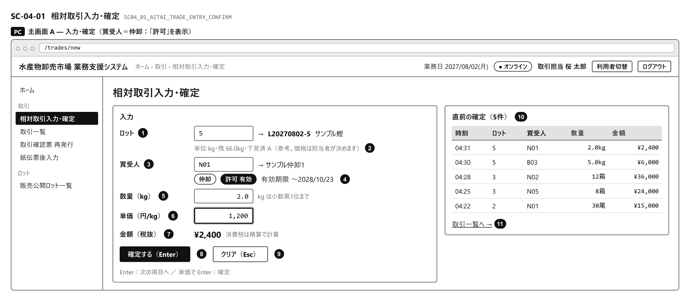

# SC-04-01 — 相対取引入力・確定

> Biểu mẫu: **BM-2-901-51 v2.1** — Screen Specification · SUN ASTERISK VIETNAM CO., LTD · ISO/IEC 27001:2013 & ISO 9001:2015

---

## 1. History of change

| No | Version | Action | Nội dung thay đổi | Ngày | Người sửa | Approve |
|---|---|---|---|---|---|---|
| 1 | 0.1.0 | Add New | Khởi tạo từ wireframe WF-SC-04-01 0.2.0 (LAB-4 P3) | 2026-11-25 | phuongnnm-23344 | |
| 2 | 0.1.1 | Update | Khách Q-TRD-02: hiện 使用額 税込 / 税抜; G2-m07: nhãn [PL] mục tiêu hiệu năng | 2026-11-25 | phuongnnm-23344 |  |
| 3 | 0.1.2 | Update | LAB-4: ảnh annotated thay bằng biến thể A của wireframe HTML `wireframes/html/SC-04-01.html` (WF 0.2.2); ghi badge không có trên ảnh; link HTML / PNG / PDF | 2026-11-25 | phuongnnm-23344 | |

---

## 2. Layout

**Design:** [Wireframe SC-04-01 0.2.2](../../../wireframes/SC-04-01-aitai-trade-entry-confirm-wireframe.md) · nguồn hình HTML [`wireframes/html/SC-04-01.html`](../../../wireframes/html/SC-04-01.html) · mọi biến thể: [`wireframes/png/SC-04-01.png`](../../../wireframes/png/SC-04-01.png) / [`wireframes/pdf/wireframes-all.pdf`](../../../wireframes/pdf/wireframes-all.pdf) · khung chung [_common-layout](../../../wireframes/_common-layout.md) · ảnh as-is prototype: [SC-04-01_prototype.png](../../../wireframes/assets/SC-04-01_prototype.png)

> - Ảnh = **biến thể A** (màn chính) của wireframe HTML, sinh bằng `scripts/render-wireframes.py --spec` (chưa có Figma). Số trên ảnh = cột `ID` mục 4 = cột `No` của wireframe; `C-x` = mục chung ở `_common-layout.md`.
> - Badge không có trên ảnh này: 12 (E), 13 (B), 14 (C), 15 (D), C-12 (E), C-24 (F) → xem biến thể tương ứng trong [`wireframes/png/SC-04-01.png`](../../../wireframes/png/SC-04-01.png) / PDF.

---

## 3. Description

- **Mục đích:** nhập và **chốt** một GD 相対 (thỏa thuận trực tiếp) — **luồng chính, màn dùng nhiều nhất** (~90% giá trị, C.5; FR-AITAI-01/02). Người chốt (取引担当) đọc lại với người mua (読み合わせ) rồi bấm một lần: ロット → 買受人 → 数量 → 単価 → Enter. Mục tiêu ~10 giây / GD khi đã thạo **[Giả lập]**.
- **Kiểm tại thời điểm chốt, ở server, trong cùng transaction với trừ SL lô** (BR-PERM-01, BR-LOT-02, ADR-003): 仲卸 → **許可** 有効; 売買参加者 → **承認** 有効 + **参加上限** theo kỳ (相対 + せり, cảnh báo + lý do, không chặn cứng — PRM-046, L4-A04 (1)). Hai căn cứ khác nhau, **thông điệp khác nhau** (luật 2).
- **Trạng thái FIG-012:** một lần bấm ghi đủ 提出 / 承認 / 確定 cùng người + thời điểm vào `trade_status_history` (PRM-114 (a)); GD 確定 đóng băng, sửa chỉ qua SC-04-05 / SC-08-01 (luật 4). Trên màn không hiện chữ 「承認」 cho bước nội bộ (L4-D03).
- **Bắt buộc online** (L4-A05, ADR-008): mất mạng → ghi 紙伝票, nhập bù ở SC-04-07.
- **Ai dùng:** TRADE. SETTLE / STL-HEAD / OPS-HEAD xem GD ở SC-04-03 / SC-04-04, không mở màn này (role-list P16).
- **Đi tới:** SC-04-03 ([11]); SC-04-02 ([12] in lại); SC-04-07 (khi mất mạng — qua menu); SC-08-01 (C-24).

---

## 4. View

**Đánh ID:** cột `ID` = số item wireframe to-be; `A`, `B`, `C` chỉ là nhóm.

### 4.1 Danh sách item

| ID | Item Name | Item Type | Required | Note |
|---|---|---|---|---|
| **C** | **Khung chung (PC)** | | | C-1..C-12, C-20..C-26, C-28, C-29. Không dùng C-27 (相対 không có bước duyệt), C-30 (không MFA — PREMISE §3.2), C-31 |
| **A** | **入力** | | | |
| 1 | ロット | Text box (số + gợi ý) | Có | Placeholder 「番号」. Gõ số đuôi → gợi ý ≤ 10 lô 販売公開中 còn SL; bên phải hiện `→ {lotNo} {品目}` |
| 2 | 単位・残・下見 | Label | - | `単位 {kg/箱/尾}・残 {available}{unit}・下見済 {grade}` (目利き chỉ để tham khảo, **không tự quyết giá** — CAP-HUMAN-01) |
| 3 | 買受人 | Text box (mã + gợi ý) | Có | Placeholder 「例：N01」; bên phải hiện tên |
| 4 | Tư cách người mua | Label | - | 仲卸: 「仲卸 許可 {状態}（〜{YYYY/MM/DD}）」. 売買参加者: 「売買参加者 承認 {状態}（〜…）／参加上限残 ¥{n}（{YYYY年M月}期）」 + dòng nhỏ 「使用額 ¥{usedIncl}（税込）／ 税抜 ¥{usedExcl}」 (Q-TRD-02: 残 = 上限 − 使用額 税込). Màu **+ chữ**: đỏ = 失効 / 一時停止 / 再審査 / loại không được mua; vàng = còn ≤ 30 ngày tới 失効日; xanh = 有効. **Không** gộp thành 「資格OK」 |
| 5 | 数量（{単位}） | Text box (số) | Có | Nhãn đổi theo đơn vị lô |
| 6 | 単価（円/{単位}） | Text box (số) | Có | Dấu phẩy nghìn khi rời ô |
| 7 | 金額（税抜） | Label | - | `¥{floor(数量 × 単価)}`; thuế tính ở 精算 (PRM-053) |
| 8 | 確定する（Enter） | Button | - | Nút chính; Enter ở [6] = bấm [8] |
| 9 | クリア（Esc） | Button | - | Xóa [3]–[7], giữ lô |
| **B** | **Bảng phụ** | | | |
| 10 | 直前の確定（5件） | Label (bảng) | - | 5 GD 確定 gần nhất **của chính người dùng**, mới nhất trên: 時刻 · ロット · 買受人 · 数量 · 金額 |
| 11 | 取引一覧へ → | Button (liên kết) | - | → SC-04-03 |
| 12 | Banner lỗi in | Label (banner) | - | 「取引確認票の印刷に失敗しました。取引は確定済みです → 再印刷」 → SC-04-02 |
| **D** | **Hộp thoại** | | | |
| 13 | 参加上限超過 | Label (dialog) | - | Chỉ 売買参加者. 「今期の参加上限を超えます：上限 ¥{limit} / 今期確定済 ¥{usedIncl}（税込） / 今回 ¥{amountIncl}（税込）」 + dòng nhỏ 「税抜：今期確定済 ¥{usedExcl} / 今回 ¥{amountExcl}」 + 3 lựa chọn bấm phím số `1` 事前に了承済 · `2` 保証金追加予定 · `3` その他（備考必須） + [理由を付けて確定] [戻る] |
| 14 | 備考 | Text box | Có khi chọn 「3 その他」 | Trong [13] |
| 15 | 同一内容の再確定確認 | Label (dialog) | - | 「直前と同じ内容です。もう一度確定しますか？」 [はい] [いいえ] (mặc định con trỏ ở [いいえ]) |

### 4.2 Validation

Client kiểm ngay ở ô; server (API-TRD-002) kiểm lại **tất cả** lúc chốt — kết quả server là cuối cùng.

| ID | Type | Min | Max | Default | Ghi chú |
|---|---|---|---|---|---|
| 1 | Chọn lô (uuid) | - | - | lô của lần chốt trước | Phải chọn từ gợi ý; lô không còn bán → `E-TRD-001` 「ロット {lotNo} は販売公開中ではありません（{状態}）」 |
| 3 | String `^[A-Z0-9]{1,10}$` | 1 | 10 | trống | Chữ thường tự đổi hoa. Không có → `E-TRD-003` 「買受人番号が見つかりません（{buyerNo}）」; không phải 仲卸 / 売買参加者 → `E-TRD-004` 「買受人は仲卸または売買参加者のみ指定できます」 |
| 4 | (kết quả kiểm) | - | - | - | 仲卸 không 有効 → `E-TRD-005` 「仲卸の許可が有効ではないため確定できません（{状態}・有効期限 {date}）」; 売買参加者 không 有効 → `E-TRD-006` 「売買参加者の承認が有効ではないため確定できません（{状態}・有効期限 {date}）」. Client chỉ cảnh báo đỏ, nút [8] vẫn bấm được (server quyết) |
| 5 | Number | > 0 | ≤ 残 | trống | ≤ 0 / trống → `E-TRD-009` 「数量は0より大きい値を入力してください」; kg > 1 chữ số lẻ, 箱 / 尾 có lẻ → chặn khi gõ, `E-TRD-010` 「kg は小数第1位まで、箱・尾は整数で入力してください」; > 残 → `E-TRD-002` 「残数量が {n}{unit} に変わりました（不足しています）」 |
| 6 | Integer | 1 | 99,999,999 | trống | Sai → `E-TRD-011` 「単価は1円以上の整数で入力してください」 |
| 13 | Code `OVER_LIMIT_REASON` | - | - | không chọn | Vượt hạn mức mà không lý do → `E-TRD-007` 「今期の参加上限を超えます。超過理由を選択してください（…）」 |
| 14 | String | 1 | 200 | trống | Chọn 「その他」 mà trống / > 200 → `E-TRD-008` 「「その他」を選んだ場合は備考を入力してください（200文字以内）」 |
| 8 | (giờ) | - | - | - | Trước giờ bắt đầu chốt GD của quy chế (tạm 02:00, PRM-116) → `E-TRD-012` 「取引の確定は {HH:MM} 以降にできます」 |

### 4.3 Data Mapping

| ID | Data Source | API ID | API URL | Key / Param | Ghi chú |
|---|---|---|---|---|---|
| 1, 2 | API | `API-LOT-003` | `GET /api/v1/lots` | `onSale=true&q={số}&include=latestInspection&limit=10` | Feature lot; debounce 150 ms |
| 3, 4, 13 | API | `API-TRD-001` | `GET /api/v1/trades/buyers` | `q={mã}` → `buyers[].qualification`, `buyers[].participationLimit`, `overLimitReasonOptions[]` | Gọi khi gõ (debounce 150 ms) và khi rời [3] |
| 1–8, 13, 14 | API | `API-TRD-002` | `POST /api/v1/trades/aitai` | `lotId`, `buyerId`, `qty`, `unitPriceJpy`, `overLimitReasonCode`, `overLimitNote` | → `tradeId`, `tradeNo`, `displayNo`, `amountJpy`, `availableQtyAfter`, `overLimit` |
| 10 | API | `API-TRD-003` | `GET /api/v1/trades` | `mine=true&channel=AITAI&status=CONFIRMED&sort=-confirmedAt&limit=5` | Mở màn + sau mỗi lần chốt |
| 12 | API | `API-TRD-004` | `POST /api/v1/trades/{tradeId}/slip-prints` | `isReissue=false` → PDF | Gọi ngay sau 201 của API-TRD-002 |

### 4.4 Phân quyền hiển thị theo vai

| Vai \ Item | 1–9 | 10, 11 | 12 | 13–15 |
|---|---|---|---|---|
| TRADE | Thao tác | Chỉ đọc / liên kết | Hiện khi lỗi in | Thao tác |
| SETTLE · STL-HEAD · OPS-HEAD | Không vào màn (C-25); xem GD ở SC-04-03 / SC-04-04 | | | |
| INTAKE · JUDGE · DELIVERY · RULE · SYSADM | Không vào màn (C-25) | | | |

---

## 5. Event

| ID | Given (Pre-condition) | When (Trigger/Action) | Then (Result) | Note |
|---|---|---|---|---|
| **Initializing Process（初期処理）** | | | | |
| - | Vai TRADE, online | Mở màn (1 phím tắt từ ホーム) | 1. Gọi API-TRD-003 → [10] 2. Con trỏ ở [1] | |
| 1 | Không có lô 販売公開中 | Gõ vào [1] | C-21 「販売公開中のロットがありません」 + liên kết SC-03-03 | |
| **Standard Process（通常処理）** | | | | |
| 1 | - | Gõ số + Enter | Chọn gợi ý đầu (hoặc dòng đang trỏ); [2] hiện đơn vị · 残 · 下見; con trỏ sang [3] | FB LAB-2 #1 |
| 3 | - | Gõ mã + Enter | Gọi API-TRD-001; [4] hiện tư cách đúng chữ 許可 / 承認; con trỏ sang [5] (kể cả khi đỏ — server quyết) | luật 2 |
| 5, 6 | - | Gõ | [7] cập nhật ngay; Enter ở [5] → [6] | |
| 8 | Các ô hợp lệ ở client | Enter ở [6] / bấm [8] | 1. Nếu [10] có GD cùng lô · người mua · SL · đơn giá trong 3 phút → mở [15] 2. Nếu người mua là 売買参加者 và 金額 quy 税込 (cùng công thức server, từ `taxRatePercent` của API-TRD-001) > 参加上限残 → mở [13] trước; server vẫn là bên quyết (E-TRD-007) 3. Gọi API-TRD-002 (nút [8] mờ, không bấm đúp được) | |
| 15 | [15] mở | [はい] / [いいえ] | はい → tiếp bước 2–3 ở trên; いいえ → đóng, con trỏ về [5] | FB LAB-2 #6 |
| 13 | [13] mở | Bấm `1`/`2`/`3` (+ [14]) → [理由を付けて確定] | Gọi API-TRD-002 kèm `overLimitReasonCode` (+ `overLimitNote`) | GD có lý do hiện ở 要確認 SC-07-01 (khách #10) |
| 8 | - | API-TRD-002 trả 201 | 1. C-12 「確定：{buyerNo} {名前}／{品目} {qty}{unit} × ¥{単価} = ¥{金額}（{displayNo}）」 2. Gọi API-TRD-004 → in thẳng, không xem trước 3. Giữ [1], cập nhật [2] theo `availableQtyAfter`; xóa [3]–[7]; con trỏ [3] 4. Nạp lại [10] | DEC-033, M05 |
| 12 | In thất bại (API-TRD-004 lỗi / máy in báo lỗi) | - | Hiện [12]; GD **vẫn 確定** | PRM-114 (d) |
| 9 | - | Esc / [9] | Xóa [3]–[7], giữ lô | |
| 11 | - | Bấm | → SC-04-03 | |
| **Error Handling（エラー制御）** | | | | |
| 1, 5 | Người khác vừa chốt cùng lô | 409 `E-TRD-002` / `E-TRD-001` | C-23 với số thật; [2] cập nhật 残 từ `detail.availableQty`; con trỏ [5] | |
| 3, 4 | Tư cách không hợp lệ tại lúc chốt | 422 `E-TRD-003`..`006` | C-22 dưới [3] với thông điệp riêng 許可 / 承認; [4] đỏ | BR-PERM-01 |
| 13 | Client chưa biết vượt (hạn mức đổi giữa chừng) | 422 `E-TRD-007` | Mở [13] với `detail.limitJpy` / `usedInclJpy` / `amountInclJpy` (+ `usedExclJpy` / `amountExclJpy`) server trả | |
| 14 | - | 422 `E-TRD-008` | C-22 dưới [14] | |
| 8 | Trước giờ chốt | 409 `E-TRD-012` | C-23 | |
| 8 | 業務日 bị khóa | 423 `E-CMN-003` | C-24, giữ nội dung (hiếm: màn chỉ ghi ngày mở) | |
| 8 | - | 403 / 5xx / timeout 10 s | C-25 / C-26 (giữ nội dung). Timeout: **không** tự gửi lại — gọi API-TRD-003 kiểm GD đã có chưa rồi mới cho bấm lại | Tránh chốt đôi |
| - | - | Mất mạng | C-28: form khóa, banner 「通信が回復するまで確定できません。紙伝票で継続してください」; có mạng lại → C-29 kèm kết quả lần bấm cuối 「確定済」/「未確定」 (kiểm qua API-TRD-003) | L4-A05, ADR-008 |

---

## 6. Other Notes

- **Truy vết:** FR-AITAI-01, FR-AITAI-02, FT-04-01..04, FT-01-05, FT-01-09, FT-03-04, BR-PERM-01, BR-LOT-02, NFR-USE-01, PRM-046, PRM-053, PRM-114, PRM-116, FIG-012, DEC-033, ADR-003, ADR-004, ADR-008, L4-A04 (1), L4-A05; luật 1, 2, 3, 4; FB LAB-2 #1, #3, #5, #6, #7; khách #10 (FB-CUS-269), #11 (FB-CUS-270); bảng lệch D08 / M19 (hạn mức theo kỳ), D10 (FIG-012).
- **Không chặn cứng 参加上限:** người chốt tự quyết lúc cao điểm, lý do ghi ở `trades.over_limit_reason_code` / `over_limit_note`; 照合 soát ở 要確認 SC-07-01.
- **Kỳ của 参加上限:** tháng của `trade_date` (= 業務日), cộng 相対 + せり đã 確定 theo giá trị hiệu lực (gốc + điều chỉnh) — view `v_buyer_period_usage` (PARTY_DB). So **税込** = floor(Σ税抜 × (100 + suất) / 100), suất ở `tax_rates` theo mã trong tham số `PARTICIPATION_LIMIT_TAX_CODE` — không dùng 110/100 của BR-INC-01 (Q-TRD-02 [Customer giả lập, 2026-11-25]; 照合 soát sổ theo 税抜, nói chuyện với người mua theo 税込 nên màn hiện cả hai số).
- **Mã GD hiển thị:** `相対-{nnnn}` (số trong ngày) — đề xuất PL, chờ chốt (Q-TRD-01); `trade_no` lưu dạng `A{YYYYMMDD}-{nnnn}`.
- **Hiệu năng:** API-TRD-002 p95 ≤ 1 s ở cao điểm 60 người đồng thời — [PL] mục tiêu nội bộ cho API ghi (RFP chỉ có NFR-PERF-01 cho tìm kiếm, NFR-PERF-02 cho tải); hai người chốt cùng lô được tuần tự hóa bằng khóa dòng lô.
- **Câu hỏi mở / TBD:** Q-TRD-01 (định dạng số GD), Q-TRD-03 (máy in hiện trường — cách in thẳng PDF) — ở [TRADE_FUNC §3](../function-specifications/TRADE_FUNC.md#3-mã-lỗi-câu-hỏi-giả-định-của-module).
