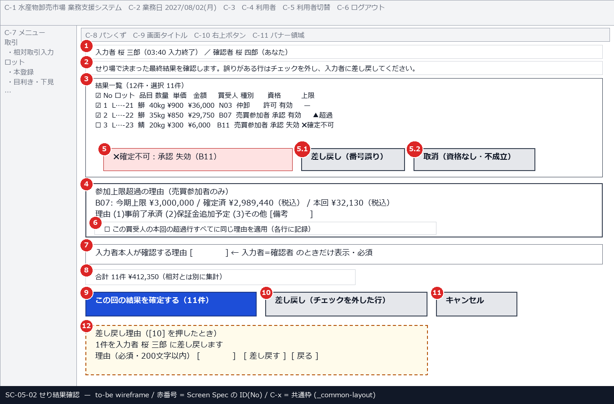

# SC-05-02 — せり結果確認

> Biểu mẫu: **BM-2-901-51 v2.1** — Screen Specification · SUN ASTERISK VIETNAM CO., LTD · ISO/IEC 27001:2013 & ISO 9001:2015

---

## 1. History of change

| No | Version | Action | Nội dung thay đổi | Ngày | Người sửa | Approve |
|---|---|---|---|---|---|---|
| 1 | 0.1.0 | Add New | Khởi tạo từ wireframe WF-SC-05-02 0.2.0 (LAB-4 P3) | 2026-11-25 | phuongnnm-23344 | |
| 2 | 0.1.1 | Update | Khách Q-TRD-05: hai nút 5.1 「差し戻し（番号誤り）」 / 5.2 「取消（資格なし・不成立）」; Q-TRD-02 | 2026-11-25 | phuongnnm-23344 |  |
| 3 | 0.1.2 | Update | LAB-4: ảnh annotated thay bằng biến thể A của wireframe HTML `wireframes/html/SC-05-02.html` (WF 0.2.3); ghi badge không có trên ảnh; link HTML / PNG / PDF | 2026-11-25 | phuongnnm-23344 | |
| 4 | 0.1.3 | Update | Expert Gate 3 G3-m05: thêm §6.1 Trạng thái màn (tổng hợp từ §5 Event), ghi chú cũ thành §6.2 | 2026-11-25 | phuongnnm-23344 | |
| 5 | 0.1.4 | Update | Expert Gate 3 kiểm diff D3-n03: §6.1 tách dòng 「Xung đột」 thành 409 (`E-TRD-013` / `018`: C-23 + nạp lại) và 422 (`E-TRD-015`: tô dòng chưa xử lý, không nạp lại; `E-TRD-016` theo §5) | 2026-11-26 | phuongnnm-23344 |  |

---

## 2. Layout

**Design:** [Wireframe SC-05-02 0.2.4](../../../wireframes/SC-05-02-seri-result-session-confirm-wireframe.md) · nguồn hình HTML [`wireframes/html/SC-05-02.html`](../../../wireframes/html/SC-05-02.html) · mọi biến thể: [`wireframes/png/SC-05-02.png`](../../../wireframes/png/SC-05-02.png) / [`wireframes/pdf/wireframes-all.pdf`](../../../wireframes/pdf/wireframes-all.pdf) · khung chung [_common-layout](../../../wireframes/_common-layout.md) · ảnh as-is prototype: [SC-05-02_prototype-seri-list-ref.png](../../../wireframes/assets/SC-05-02_prototype-seri-list-ref.png) (chỉ danh sách phiên rỗng)

> - Ảnh = **biến thể A** (màn chính) của wireframe HTML, sinh bằng `scripts/render-wireframes.py --spec` (chưa có Figma). Số trên ảnh = cột `ID` mục 4 = cột `No` của wireframe; `C-x` = mục chung ở `_common-layout.md`.
> - Badge không có trên ảnh này: 7 lý do khi 入力者 = 確認者 (B), 12 hộp thoại 差し戻し (C), C-31 (D), C-12 (E), C-23 (F), C-28 (G) → xem biến thể tương ứng trong [`wireframes/png/SC-05-02.png`](../../../wireframes/png/SC-05-02.png) / PDF.
> - Ở biến thể A nút [9] hiện **mờ** có chủ ý (còn dòng No 4 chưa xử lý) để thấy điều kiện bật nút; trạng thái bật xem biến thể B.

---

## 3. Description

- **Mục đích:** 確認者 (người xác nhận) xác nhận **kết quả cuối của cả một phiên せり (đấu giá) một lần** — điểm người quyết cuối (CAP-HUMAN-01). Giá và người mua do せり人 quyết trên sàn; hệ thống **chỉ ghi** kết quả đã nhập ở SC-05-01, không có màn đấu giá trực tiếp, không bảng trả giá (FR-SERI-01/02, luật 1). せり là luồng phụ (~10%), tổng tách khỏi 相対.
- **Kiểm lại tại lúc xác nhận** (BR-PERM-01, BR-LOT-02): từng dòng — 許可 (仲卸) / 承認 (売買参加者) có hiệu lực, SL lô còn đủ; 参加上限 theo kỳ **chỉ cho 売買参加者**, chung 相対 + せり, cảnh báo + lý do, không chặn cứng (L4-A04 (1), M20).
- **確認者 ≠ 入力者** mặc định; trùng người → bắt lý do, hiện ở 要確認 SC-07-01 + checklist SC-07-02 (S2, PRM-115).
- **Bắt buộc online**, **không MFA** (không có trong PREMISE §3.2). Có hộp xác nhận C-31 vì sau khi xác nhận GD bị đóng băng.
- **Ai dùng:** TRADE (確認者). SETTLE / STL-HEAD / OPS-HEAD mở được ở chế độ chỉ đọc (P20).
- **Đi tới:** danh sách phiên (C-10 「回の一覧へ」); dòng 差し戻し quay về SC-05-01 của 入力者; sau khi xác nhận, sửa → SC-04-05 (ngày chưa khóa) / SC-08-01 (đã khóa).

---

## 4. View

**Đánh ID:** cột `ID` = số item wireframe to-be; `A`, `B`, `C` chỉ là nhóm.

### 4.1 Danh sách item

| ID | Item Name | Item Type | Required | Note |
|---|---|---|---|---|
| **C** | **Khung chung (PC)** | | | C-1..C-12 (C-9 「せり結果確認：第{n}回（{日付}）」, C-10 「回の一覧へ」), C-20..C-26, C-28, C-29, **C-31** (xác nhận trước [9]). Không dùng C-27, C-30 |
| **A** | **Phiên** | | | |
| 1 | 入力者 / 確認者 | Label | - | 「入力者 {tên}（{HH:MM} 入力終了） ／ 確認者 {tên}（あなた）」; trùng người → nhãn vàng 「入力者本人による確認」 |
| 2 | Hướng dẫn | Label | - | 「せり場で決まった最終結果を確認します。誤りがある行はチェックを外し、入力者に差し戻してください。」 |
| **B** | **Kết quả** | | | |
| 3 | 結果一覧（N件・選択 M件） | Label (bảng chọn) | - | Bố cục FORM-SERI-01. Cột: ☑ · No · ロット · 品目 · 数量 · 単価 · 金額 · 買受人 · 種別 · **資格** (「許可 {状態}」 cho 仲卸 / 「承認 {状態}」 cho 売買参加者) · 上限 (「▲超過」 / 「—」). Mặc định chọn mọi dòng xác nhận được |
| 5 | Dòng không xác nhận được | Label (đỏ trong dòng) | - | 「✖確定不可：{lý do}」 + dòng phụ 「この行は確定できません。番号誤りなら差し戻し、資格なしなら取消を選んでください」. ☑ khóa ở trạng thái bỏ chọn. **Không tự hủy** — phải chọn 5.1 hoặc 5.2 (Q-TRD-05) |
| 5.1 | 差し戻し（番号誤り） | Button (trong dòng [5]) | - | Đánh dấu dòng để 差し戻し: mở [12] với lý do gợi ý 「買受人番号誤りの可能性（せり原票と照合してください）」 → API-TRD-007. Dùng khi 入力者 có thể đã gõ nhầm số (người thật vẫn còn hạn) |
| 5.2 | 取消（資格なし・不成立） | Button (trong dòng [5]) | - | Đánh dấu dòng để hủy khi bấm [9] (`cancelTradeIds`); nhãn dòng đổi 「取消予定：ロットは販売公開中に戻ります（再せり・相対）」; bấm lại để bỏ đánh dấu. **Không** có nút 「別の買受人に変更」 — không đôn người trả giá thứ 2 (luật 3) |
| 4 | 参加上限超過の理由 | Label (khối theo người mua) | Có khi có dòng ▲超過 được chọn | Một khối / người mua 売買参加者 có dòng vượt: 「{buyerNo} {名前}: 今期上限 ¥{limit} / 確定済 ¥{usedIncl}（税込） / 本回 ¥{sumIncl}（税込）」 + dòng nhỏ 「税抜：確定済 ¥{usedExcl} / 本回 ¥{sumExcl}」 (Q-TRD-02 — so 税込) + lý do `(1)事前了承済 (2)保証金追加予定 (3)その他` + 備考 (theo từng dòng) |
| 6 | この買受人の本回の超過行すべてに同じ理由を適用 | Button (checkbox) | Không | Áp lý do vừa chọn cho mọi dòng vượt của người mua đó trong phiên; **vẫn lưu từng dòng** (Muốn có — L4-A04 (1)) |
| 7 | 入力者本人が確認する理由 | Text box | Có khi 入力者 = 確認者 | Chỉ hiện khi trùng người |
| 8 | 合計 | Label | - | 「合計 {M}件 ¥{Σ金額}（相対とは別に集計）」 theo dòng đang chọn |
| 9 | この回の結果を確定する（M件） | Button | - | Mờ + lý do khi chưa đủ điều kiện (gồm còn dòng [5] chưa chọn 5.1 / 5.2: 「未処理の行があります（{n}件）」) |
| 10 | 差し戻し（チェックを外した行） | Button | - | Hiện khi có dòng bỏ chọn **xác nhận được** (không tính dòng [5]) |
| 11 | キャンセル | Button | - | Về danh sách phiên, không ghi |
| **D** | **Hộp thoại** | | | |
| 12 | 差し戻し理由 | Label (dialog) | - | Thêm ở P3, có trong WF-SC-05-02 0.2.1 (số kế tiếp, không chèn — quy tắc giữ số): 「{n}件を入力者 {tên} に差し戻します」 + ô 理由 (bắt buộc, ≤ 200) + [差し戻す] [戻る] — vì `trade_status_history.reason` bắt buộc với `REJECT` (TRADE_DB 4.31) |

### 4.2 Validation

| ID | Type | Min | Max | Default | Ghi chú |
|---|---|---|---|---|---|
| 3 | Chọn dòng | 1 | số dòng | mọi dòng xác nhận được | 0 dòng → [9] mờ; server `E-TRD-016` 「確定する行がありません」. Còn dòng bỏ chọn xác nhận được chưa 差し戻し → [9] mờ 「チェックを外した行を先に差し戻してください」; server `E-TRD-015` |
| 4 | Code `OVER_LIMIT_REASON` / dòng | - | - | không chọn | Dòng ▲超過 được chọn mà thiếu lý do → [9] mờ, viền đỏ dòng (C-22); server `E-TRD-007` (kèm `detail.tradeNos`) |
| 4 | 備考 String | 1 | 200 | trống | Chọn 「その他」 mà trống → `E-TRD-008` |
| 7 | String | 1 | 200 | trống | Trùng người mà trống → `E-TRD-014` 「入力者と同じ人が確認する場合は理由を入力してください」 |
| 12 | String | 1 | 200 | trống | Trống → `E-TRD-017` 「差し戻しの理由を入力してください」 |

### 4.3 Data Mapping

| ID | Data Source | API ID | API URL | Key / Param | Ghi chú |
|---|---|---|---|---|---|
| 1–5, 8 | API | `API-TRD-005` | `GET /api/v1/seri-sessions/{sessionId}` | → `session`, `rows[]` (gồm `qualification`, `confirmable`, `notConfirmableReason`, `overLimit`), `overLimitReasonOptions[]`, `viewerIsEntrant` | Đánh giá trước (preview) theo thứ tự dòng, cộng dồn hạn mức; kết quả cuối do API-TRD-006 |
| 3, 4, 6, 7, 9 | API | `API-TRD-006` | `POST /api/v1/seri-sessions/{sessionId}/confirm` | `confirmTradeIds[]`, `overLimitReasons{tradeId: {code, note}}`, `samePersonReason` | → `confirmedCount`, `cancelledTradeNos[]`, `sessionStatus` |
| 10, 12 | API | `API-TRD-007` | `POST /api/v1/seri-sessions/{sessionId}/send-back` | `tradeIds[]`, `reason` | → `sentBackCount` |

### 4.4 Phân quyền hiển thị theo vai

| Vai \ Item | 1–3, 5, 8 | 4, 6 | 7 | 9, 10, 12 | 11 |
|---|---|---|---|---|---|
| TRADE ≠ 入力者 | Hiện | Thao tác | Ẩn | Thao tác | Thao tác |
| TRADE = 入力者 | Hiện + nhãn vàng ở [1] | Thao tác | Thao tác (bắt buộc) | Thao tác | Thao tác |
| SETTLE · STL-HEAD · OPS-HEAD | Chỉ đọc (☑ ẩn) | Ẩn | Hiện giá trị đã lưu (chỉ đọc) nếu có | Ẩn | Hiện (「戻る」) |
| INTAKE · JUDGE · DELIVERY · RULE · SYSADM | Không vào màn (C-25) | | | | |

---

## 5. Event

| ID | Given (Pre-condition) | When (Trigger/Action) | Then (Result) | Note |
|---|---|---|---|---|
| **Initializing Process（初期処理）** | | | | |
| - | Mở từ danh sách phiên | Mở màn | 1. Gọi API-TRD-005 2. Chọn sẵn mọi dòng `confirmable = true`; dòng `false` → [5] 3. `viewerIsEntrant` → hiện [7] + nhãn vàng [1] | |
| - | Phiên `CONFIRMED` (mọi dòng đã xử lý) | Mở màn | Chỉ đọc; [1] thêm 「確定済（{tên} {HH:MM}）」; [9][10] ẩn | |
| 3 | Phiên không có dòng chờ xác nhận | Mở màn | C-21 「確認待ちの結果はありません」 + liên kết SC-05-01 | |
| **Standard Process（通常処理）** | | | | |
| 3 | - | Bỏ / chọn dòng | Cập nhật [3] (M件), [8], tính lại hạn mức cộng dồn (client) để bật / tắt ▲ và [4]; có dòng bỏ chọn xác nhận được → hiện [10] | |
| 5.1 | Dòng [5] | Bấm 「差し戻し（番号誤り）」 | Mở [12] cho đúng dòng đó (lý do gợi ý, sửa được); [差し戻す] → API-TRD-007 → dòng về `DRAFT`, rời bảng chờ | Q-TRD-05 |
| 5.2 | Dòng [5] | Bấm 「取消（資格なし・不成立）」 | Dòng đổi nhãn 「取消予定」; id vào `cancelTradeIds` của lần bấm [9]; C-31 liệt kê 「取消 {k}件（ロットは販売公開中に戻ります）」 | Q-TRD-05, khách #9 |
| 4 | Có dòng ▲超過 | Chọn lý do (+ 備考) | Lưu cho dòng đó; tick [6] → chép sang mọi dòng vượt của người mua đó | L4-A04 (1) |
| 10 | Có dòng bỏ chọn | Bấm [10] | Mở [12]; [差し戻す] → API-TRD-007 → toast 「{n}件を差し戻しました」 + gọi lại API-TRD-005 | Dòng về `DRAFT`, 入力者 nhận thông báo in-app |
| 9 | Đủ điều kiện | Bấm [9] | C-31: 「第{n}回の結果 {M}件 ¥{Σ} を確定します。確定後の修正は当日訂正（締め後は修正申請）になります。」 [確定する] [戻る] | |
| 9 | C-31 → [確定する] | - | 1. Gọi API-TRD-006 (`confirmTradeIds`, `cancelTradeIds` = dòng 5.2) 2. 200 → C-12 「せり確定：第{n}回 {M}件 ¥{Σ}」; dòng hủy (`cancelledTradeNos`) liệt kê trong toast 3. `sessionStatus = CONFIRMED` → chỉ đọc; còn dòng 差し戻し đang sửa → ở lại, chờ 入力者 nộp lại | |
| 11 | - | Bấm | Về danh sách phiên | |
| **Error Handling（エラー制御）** | | | | |
| 3, 5 | Tư cách / SL đổi giữa lúc mở và lúc bấm (vd. 相対 chốt trước) | 409 `E-TRD-018` | C-23 「確認中に状態が変わった行があります（{tradeNos}）」; gọi lại API-TRD-005, dòng đó chuyển [5]; **không dòng nào được ghi** | Tất cả hoặc không |
| 4 | - | 422 `E-TRD-007` / `E-TRD-008` | Viền đỏ các dòng trong `detail.tradeNos` | |
| 7 | - | 422 `E-TRD-014` | C-22 dưới [7] | |
| 9 | Người khác vừa xác nhận phiên | 409 `E-TRD-013` | C-23 + nạp lại (chỉ đọc) | |
| 3, 5 | - | 422 `E-TRD-015` / `E-TRD-016` | C-23; `E-TRD-015` → tô các dòng chưa xử lý (bỏ chọn chưa 差し戻し, [5] chưa chọn 5.1 / 5.2) | |
| 5.2 | Dòng 取消予定 vừa có tư cách hợp lệ (vd gia hạn xong) | 409 `E-TRD-018` (`NOW_CONFIRMABLE`) | C-23 + nạp lại; dòng thành dòng thường, 確認者 chọn lại | |
| - | Ngày đã khóa | 423 `E-CMN-003` | C-24 → SC-08-01 (`LATE_ENTRY`) | ADR-005 |
| - | - | 403 / 5xx | C-25 / C-26 | |
| - | - | Mất mạng | C-28 「通信が回復するまで確定できません」; [9][10] khóa, lựa chọn + lý do giữ nguyên | L4-A05 |

---

## 6. Other Notes

### 6.1 Trạng thái màn

Tổng hợp từ §5 Event; mã `C-xx` định nghĩa ở `wireframes/_common-layout.md`. Phân quyền theo vai ở §4.4.

| Trạng thái | Hiển thị / hành vi |
|---|---|
| Phiên đang xác nhận | Chọn sẵn dòng `confirmable = true`; dòng `false` ở [5]; `viewerIsEntrant` → [7] + nhãn vàng [1] |
| Phiên đã 確定 | Chỉ đọc; [1] 「確定済（{tên} {HH:MM}）」; [9][10] ẩn |
| Không có dòng chờ | C-21 「確認待ちの結果はありません」 + liên kết SC-05-01 |
| Dòng 取消予定 | Nhãn 「取消予定」 (5.2), liệt kê ở C-31 |
| Chờ xác nhận | C-31 tổng số dòng + tiền |
| Lưu xong | C-12 toast; `CONFIRMED` → chỉ đọc; còn dòng 差し戻し → ở lại |
| Lỗi nhập (422 `E-TRD-007`, `008`, `014`) | Viền đỏ dòng trong `detail.tradeNos` / C-22 dưới [7] |
| Xung đột (409 `E-TRD-013`, `E-TRD-018`) | C-23 + nạp lại (API-TRD-005); không dòng nào được ghi. `E-TRD-013` (người khác vừa xác nhận phiên) → chỉ đọc; `E-TRD-018` → dòng đổi tư cách / SL chuyển [5], dòng 取消予定 vừa hợp lệ (`NOW_CONFIRMABLE`) thành dòng thường |
| Chưa xử lý hết dòng (422 `E-TRD-015`, `E-TRD-016`) | C-23, không dòng nào được ghi. `E-TRD-015` → tô các dòng chưa xử lý (bỏ chọn chưa 差し戻し, [5] chưa chọn 5.1 / 5.2), **không nạp lại** để giữ chỗ tô và lựa chọn; `E-TRD-016` → C-23 (§5) |
| Ngày đã khóa (423 `E-CMN-003`) | C-24 → SC-08-01 (`LATE_ENTRY`) |
| Không có quyền / lỗi server | C-25 / C-26 |
| Offline | C-28; [9][10] khóa, lựa chọn + lý do giữ nguyên |

### 6.2 Ghi chú khác

- **Truy vết:** FR-SERI-01, FR-SERI-02, FT-05-02, FT-01-05, FORM-SERI-01, BR-PERM-01, BR-LOT-02, CAP-HUMAN-01, PRM-046, PRM-115, ACT-03, L4-A04 (1), L4-A05, M19, M20, S2, ADR-003, FIG-012; luật 1, 2, 3, 4; khách #9 (FB-CUS-268).
- **Dòng không xác nhận được (Q-TRD-05 [Customer giả lập, 2026-11-25]):** 確認者 chọn — 5.1 差し戻し khi nghi gõ nhầm số (入力者 sửa đúng số người thắng theo せり原票, lịch sử giữ số cũ / mới / người sửa, BR-PERM-01 kiểm lại lúc xác nhận lượt sau) hoặc 5.2 取消 khi số đúng mà người đó không có tư cách (`CANCELLED`, `CANCEL`, lý do 「資格なし・不成立（{nguyên nhân}）」, người hủy = 確認者, **không** trừ SL, lô vẫn / trở lại 販売公開中 — khách #9). Không nút đổi người mua, không đôn người trả giá thứ 2 (luật 3). Bản ghi giữ, không xóa (luật 4). `5.x` là item con của [5] (cùng vùng ảnh annotated, không đánh số lại).
- **Trạng thái phiên:** `seri_status` chỉ có `ENTERING` / `CONFIRMED` → phiên thành `CONFIRMED` khi mọi dòng đã `CONFIRMED` / `CANCELLED`; còn dòng 差し戻し thì vẫn `ENTERING` và màn này xác nhận nốt lượt sau (giả định PL — Q-TRD-04).
- **Item [12]** thêm ở P3 (số kế tiếp, không chèn); WF-SC-05-02 0.2.1 đã thêm item [12] khớp spec.
- **Câu hỏi mở / TBD:** Q-TRD-04 (xác nhận một phiên nhiều lượt khi có 差し戻し), Q-TRD-05 đã trả lời (hai nút) — ở [TRADE_FUNC §3](../function-specifications/TRADE_FUNC.md#3-mã-lỗi-câu-hỏi-giả-định-của-module).
