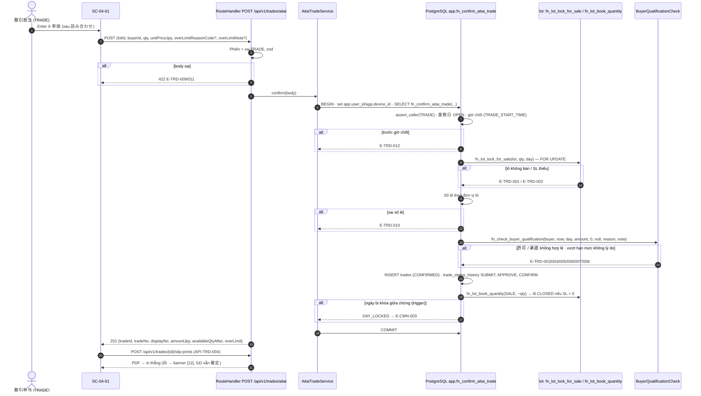

# TRADE_AITAI_CONFIRM — Chốt GD 相対 (luồng chính) + trạng thái FIG-012 + trừ SL lô

> Biểu mẫu: **BM-2-901-53 v01** — Detail Design (Chart + Description) · SUN ASTERISK VIETNAM CO., LTD · ISO/IEC 27001:2013 & ISO 9001:2015

---

## 1. History of change

| No | Version | Action | Mục / Bước | Nội dung thay đổi | Ngày | Người sửa | Approve |
|---|---|---|---|---|---|---|---|
| 1 | 0.1.0 | Add new | — | Khởi tạo (LAB-4 P3) | 2026-11-25 | phuongnnm-23344 | |

---

## 2. Sequence diagram

Ảnh `./assets/TRADE_AITAI_CONFIRM_sequence.png`: **N/A — chưa xuất** (chưa có `mmdc`); nguồn duy nhất là khối Mermaid.

**File nguồn của sơ đồ:** khối Mermaid trong file này.

---

## 3. Description

- Chốt **một** GD 相対 — luồng chính (~90% giá trị) — trong **một** transaction: khóa lô, kiểm SL, kiểm 許可 / 承認 + 参加上限 **tại thời điểm chốt**, ghi GD `CONFIRMED`, ghi đủ sự kiện FIG-012, trừ SL lô. Hoặc tất cả, hoặc không gì (BR-PERM-01, BR-LOT-02, ADR-003).
- FIG-012 (提出 → 承認 → 確定): bàn GD bấm một lần; hệ thống vẫn ghi 3 dòng `trade_status_history` cùng người + thời điểm + thiết bị (PRM-114 (a), sửa D10). Sự kiện `APPROVE` hiển thị là 「確認」 trên UI (L4-D03, A-TRD-02).
- Sau 確定 GD đóng băng (trigger `TRADE_FROZEN`): số liệu chỉ đổi qua `trade_adjustments` (当日訂正 / 修正申請 — luật 4).
- Người gọi: SC-04-01. In 取引確認票 là lời gọi riêng sau khi chốt (API-TRD-004) — in hỏng không làm mất GD.

---

## 4. Detail function

### 4.1. Kiểm request, người gọi, giờ chốt

| Trường | Giá trị |
|---|---|
| Input | Body `AitaiConfirmBody`, cookie phiên |
| Output | Body đã validate, `v_caller`, `v_day` → 4.2 |

**Error**

| Điều kiện lỗi | Xử lý | Status code |
|---|---|---|
| Chưa đăng nhập | `E-CMN-001`, dừng | 401 |
| Không có vai TRADE (app hoặc `assert_caller`) | `E-CMN-002`, dừng | 403 |
| `qty` ≤ 0 / không phải số | `E-TRD-009`, dừng | 422 |
| `unitPriceJpy` không nguyên / < 1 | `E-TRD-011`, dừng | 422 |
| Không có 業務日 `OPEN` | `E-CMN-003`, rollback | 423 |
| Giờ hiện tại (JST) < `rule_parameters.TRADE_START_TIME` của 業務日 (tạm 02:00) | `E-TRD-012: {HH:MM}`, rollback | 409 |

**Detail**

| No | Nội dung xử lý |
|---|---|
| 1 | `requireRole(["TRADE"])`; zod |
| 2 | BEGIN; gắn `app.user_id`, `app.device_id` |
| 3 | `v_caller := assert_caller(['TRADE'], [])`; `v_day :=` 業務日 `OPEN`; đọc `TRADE_START_TIME` theo `business_days.rule_version_id` |

### 4.2. Khóa lô, kiểm SL và số lẻ

| Trường | Giá trị |
|---|---|
| Input | `p_lot_id`, `p_qty`, `v_day` |
| Output | `v_available`, `v_unit` → 4.3 |

**Error**

| Điều kiện lỗi | Xử lý | Status code |
|---|---|---|
| Lô không tồn tại | `E-LOT-014`, rollback | 404 |
| Lô không `PUBLISHED` / không thuộc (hoặc 持ち越し sang) `v_day` | `E-TRD-001: {lot_no} {状態}`, rollback | 409 |
| `p_qty > v_available` | `E-TRD-002: {v_available}{unit}`, rollback; client cập nhật 残 | 409 |
| `unit = KG` mà `p_qty` > 1 chữ số lẻ; `CASE` / `PIECE` mà có lẻ | `E-TRD-010`, rollback | 422 |

**Detail**

| No | Nội dung xử lý |
|---|---|
| 1 | `v_available := app.fn_lot_lock_for_sale(p_lot_id, p_qty, v_day)` (LOT_FUNC 2.9) — khóa dòng lô `FOR UPDATE`, hai người chốt cùng lô được xếp hàng |
| 2 | Đọc `lots.unit`, kiểm số lẻ (CHECK ở DB là lưới cuối) |

### 4.3. Kiểm tư cách người mua và 参加上限

| Trường | Giá trị |
|---|---|
| Input | `p_buyer_id`, `now()`, `v_day`, `v_amount = floor(p_qty × p_unit_price_jpy)`, lý do |
| Output | `v_qual` (`basis`, `over_limit`) → 4.4 |

**Error**

| Điều kiện lỗi | Xử lý | Status code |
|---|---|---|
| Theo [TRADE_QUALIFICATION_CHECK_TECH](TRADE_QUALIFICATION_CHECK_TECH.md) §4 | `E-TRD-003` / `004` / `005` / `006` / `007` / `008`, rollback | 422 |

**Detail**

| No | Nội dung xử lý |
|---|---|
| 1 | `v_qual := app.fn_check_buyer_qualification(p_buyer_id, now(), v_day, v_amount, 0, NULL, p_over_limit_reason_code, p_over_limit_note)` |
| 2 | Lô đã khóa từ 4.2 nên tư cách và SL được kiểm cùng một thời điểm |

### 4.4. Ghi GD và sự kiện FIG-012

| Trường | Giá trị |
|---|---|
| Input | Kết quả 4.1–4.3 |
| Output | `v_trade_id`, `v_trade_no`, `v_display_no` → 4.5 |

**Error**

| Điều kiện lỗi | Xử lý | Status code |
|---|---|---|
| Không có `tax_rates` hiệu lực tại `v_day` | Log `ERROR`, `E-CMN-004`, rollback (lỗi cấu hình master) | 500 |
| Trigger `DAY_LOCKED` | `E-CMN-003`, rollback | 423 |

**Detail**

| No | Nội dung xử lý |
|---|---|
| 1 | `v_seq := next_day_counter(v_day, 'AITAI')`; `trade_no := 'A' || YYYYMMDD || '-' || lpad(v_seq, 4, '0')`; `display_no := '相対-' || lpad(v_seq, 4, '0')` (Q-TRD-01) |
| 2 | `INSERT trades (trade_no, business_date = v_day, trade_date = v_day, lot_id, buyer_id, channel = 'AITAI', source = 'ONLINE', status = 'CONFIRMED', qty, unit_price_jpy, amount_jpy = v_amount, tax_rate_id, rule_version_id = business_days.rule_version_id, over_limit_reason_code / note` **chỉ khi** `v_qual.over_limit`, `confirmed_at = now(), confirmed_by = created_by = v_caller)` |
| 3 | `fn_record_trade_event`: `SUBMIT` (NULL → `PENDING`), `APPROVE` (`PENDING` → `PENDING`), `CONFIRM` (`PENDING` → `CONFIRMED`) — cùng `v_caller`, cùng `now()` |

### 4.5. Trừ SL lô

| Trường | Giá trị |
|---|---|
| Input | `v_trade_id`, `p_lot_id`, `p_qty`, `v_day` |
| Output | `available_qty_after` → 4.6 |

**Error**

| Điều kiện lỗi | Xử lý | Status code |
|---|---|---|
| SL sau ghi < 0 (không xảy ra vì đã khóa, lưới an toàn của `fn_lot_book_quantity`) | `E-TRD-002`, rollback | 409 |

**Detail**

| No | Nội dung xử lý |
|---|---|
| 1 | `app.fn_lot_book_quantity(p_lot_id, 'SALE', -p_qty, v_trade_id, NULL, v_day)` (LOT_FUNC 2.10) — SL = 0 → lô `CLOSED` + `lot_status_history` |

### 4.6. Commit, trả kết quả, in phiếu

| Trường | Giá trị |
|---|---|
| Input | Kết quả 4.4, 4.5 |
| Output | 201 `{tradeId, tradeNo, displayNo, amountJpy, availableQtyAfter, overLimit}` |

**Error**

| Điều kiện lỗi | Xử lý | Status code |
|---|---|---|
| `40P01` / `40001` | Rollback, `E-CMN-006`; client kiểm API-TRD-003 trước khi cho bấm lại | 409 |
| Lỗi khác | Log `ERROR` + traceId, `E-CMN-004` | 500 |

**Detail**

| No | Nội dung xử lý |
|---|---|
| 1 | `COMMIT`; log `INFO trade.aitai.confirmed tradeNo={…} overLimit={…}` (không ghi tên người mua) |
| 2 | Client gọi API-TRD-004 (in thẳng). Lỗi in **không** ảnh hưởng GD (PRM-114 (d)) |

---

## 5. Other Notes

- **Bắt buộc online:** không có hàng đợi offline cho hàm này (ADR-008 §2.1); mất mạng → 紙伝票 → SC-04-07 nhập bù (`source = PAPER_LATE`, kiểm tư cách theo giờ trên phiếu — dùng lại 4.2–4.5 với `p_at = paper_slip_time`).
- **Function này KHÔNG:** sửa / hủy GD (→ [TRADE_SAME_DAY_FIX_TECH](TRADE_SAME_DAY_FIX_TECH.md)); tính thuế (精算); kiểm trùng nội dung trong 3 phút (client, không chặn).
- **Lệch prototype:** prototype 0015 dùng 参加上限 theo 業務日 + tiền gốc (D08) và `status` 2 giá trị không có lịch sử (D10); mã GD `T…-A{count+1}` không an toàn khi đồng thời → to-be dùng `day_counters`.
- **Điều kiện hoàn thành (LAB-5):** (a) GD hợp lệ → 1 dòng `trades` `CONFIRMED` + 3 dòng `trade_status_history` + 1 dòng sổ `SALE`; (b) hai request song song cùng lô, tổng SL > 残 → một 201, một 409 `E-TRD-002`, sổ SL không âm; (c) 仲卸 許可 hết hạn hôm qua → 422 `E-TRD-005`, không dòng nào được ghi; (d) 売買参加者 vượt hạn mức kỳ (cộng cả せり đã 確定 trong tháng) → 422 `E-TRD-007`; gửi lại có lý do → 201 `overLimit = true`; (e) 01:59 → 409 `E-TRD-012`; (f) lô về SL 0 → `CLOSED`.
