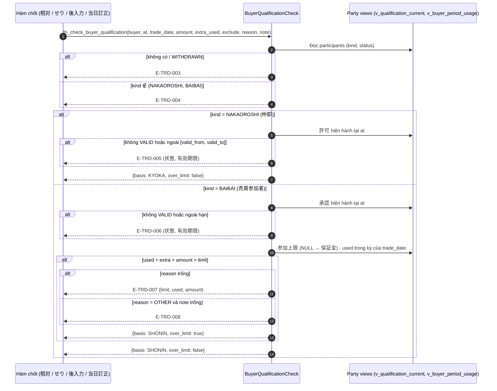

# TRADE_QUALIFICATION_CHECK — Kiểm 許可 / 承認 và 参加上限 tại thời điểm chốt

> Biểu mẫu: **BM-2-901-53 v01** — Detail Design (Chart + Description) · SUN ASTERISK VIETNAM CO., LTD · ISO/IEC 27001:2013 & ISO 9001:2015

---

## 1. History of change

| No | Version | Action | Mục / Bước | Nội dung thay đổi | Ngày | Người sửa | Approve |
|---|---|---|---|---|---|---|---|
| 1 | 0.1.0 | Add new | — | Khởi tạo (LAB-4 P3) | 2026-11-25 | phuongnnm-23344 | |

---

## 2. Sequence diagram

Ảnh `./assets/TRADE_QUALIFICATION_CHECK_sequence.png`: **N/A — chưa xuất** (máy làm P3 chưa có `mmdc`); nguồn duy nhất là khối Mermaid dưới đây, ảnh xuất từ chính khối này.

**File nguồn của sơ đồ:** khối Mermaid trong file này.

---

## 3. Description

- Một hàm dùng chung cho **mọi** đường chốt GD (相対 SC-04-01, xác nhận せり SC-05-02, 紙伝票後入力 SC-04-07, 当日訂正 SC-04-05 khi đổi người mua / SL), chạy **trong transaction của hàm gọi**, sau khi đã khóa dòng lô — để tư cách và SL được kiểm cùng một thời điểm (BR-PERM-01, BR-LOT-02, ADR-003 §2-3).
- Hai nhánh tách hẳn theo căn cứ pháp lý (luật 2): **許可** của 仲卸 (bảng `nakaoroshi_permits`, không có hạn mức) và **承認** của 売買参加者 (bảng `baibai_approvals`, có 参加上限). Không có khái niệm "quyền mua chung"; mã lỗi và thông điệp khác nhau.
- 参加上限: hạn mức **theo kỳ** (tháng dương lịch của `trade_date`), **chung 相対 + せり**, mặc định = 保証金 hiện hành; vượt → bắt lý do, **không chặn cứng** — người chốt quyết (PRM-046, L4-A04 (1), CAP-HUMAN-01).
- Hàm chỉ đọc, không ghi; trả kết quả để hàm gọi lưu `over_limit_reason_code` / `over_limit_note` vào `trades`.

---

## 4. Detail function

### 4.1. Xác định người mua và loại

| Trường | Giá trị |
|---|---|
| Input | `p_buyer_id` |
| Output | `v_kind` (`NAKAOROSHI` / `BAIBAI`) → 4.2 hoặc 4.3 |

**Error**

| Điều kiện lỗi | Xử lý | Status code |
|---|---|---|
| Không có `participants` hoặc `status = WITHDRAWN` | Ném `E-TRD-003: {buyer_no}`; hàm gọi rollback | 422 |
| `kind` là `WHOLESALER` / `KAIDASHI` | Ném `E-TRD-004` | 422 |

**Detail**

| No | Nội dung xử lý |
|---|---|
| 1 | Đọc `participants` (kind, status, buyer_no) |
| 2 | Rẽ nhánh theo `kind` — không có nhánh chung |

### 4.2. Nhánh 仲卸 — kiểm 許可

| Trường | Giá trị |
|---|---|
| Input | `p_buyer_id`, `p_at` |
| Output | `{kind: NAKAOROSHI, basis: KYOKA, over_limit: false}` → trả hàm gọi |

**Error**

| Điều kiện lỗi | Xử lý | Status code |
|---|---|---|
| Không có 許可 hiện hành, hoặc trạng thái ≠ `VALID` (`SUSPENDED` 一時停止 / `EXPIRED` 失効 / `UNDER_REVIEW` 再審査), hoặc `p_at::date` ngoài `[valid_from, valid_to]` | Ném `E-TRD-005: {状態} {valid_to}` | 422 |

**Detail**

| No | Nội dung xử lý |
|---|---|
| 1 | Đọc `v_qualification_current` lọc `basis = KYOKA` cho người mua tại ngày `p_at` (JST) |
| 2 | 仲卸 không có 参加上限 — bỏ qua `p_amount_jpy`, `p_reason_code` (lý do gửi kèm bị bỏ, không lưu) |

### 4.3. Nhánh 売買参加者 — kiểm 承認

| Trường | Giá trị |
|---|---|
| Input | `p_buyer_id`, `p_at` |
| Output | 承認 hợp lệ → 4.4 |

**Error**

| Điều kiện lỗi | Xử lý | Status code |
|---|---|---|
| Không có 承認 hiện hành / ≠ `VALID` / ngoài hạn | Ném `E-TRD-006: {状態} {valid_to}` | 422 |

**Detail**

| No | Nội dung xử lý |
|---|---|
| 1 | Đọc `v_qualification_current` lọc `basis = SHONIN` tại ngày `p_at` |

### 4.4. 参加上限 theo kỳ

| Trường | Giá trị |
|---|---|
| Input | `p_trade_date`, `p_amount_jpy`, `p_extra_used_jpy`, `p_exclude_trade_id`, `p_reason_code`, `p_note` |
| Output | `{kind: BAIBAI, basis: SHONIN, over_limit, limit_jpy, used_jpy}` |

**Error**

| Điều kiện lỗi | Xử lý | Status code |
|---|---|---|
| `used + extra + amount > limit` và `p_reason_code` NULL | Ném `E-TRD-007: {limit} {used + extra} {amount}` — client mở hộp lý do | 422 |
| `p_reason_code` không thuộc `OVER_LIMIT_REASON` | Ném `E-TRD-007` (coi như chưa chọn) | 422 |
| `p_reason_code = OTHER` và `p_note` trống | Ném `E-TRD-008` | 422 |

**Detail**

| No | Nội dung xử lý |
|---|---|
| 1 | `v_limit :=` `baibai_approvals.participation_limit_jpy` hiện hành; NULL → `v_participant_current_deposit` tại `p_trade_date` |
| 2 | `v_used :=` Σ tiền **hiệu lực** (gốc + REVERSE / DELTA) của GD `CONFIRMED` kênh `AITAI` + `SERI` có `trade_date` cùng tháng với `p_trade_date` — view `v_buyer_period_usage`; trừ `p_exclude_trade_id` nếu có |
| 3 | So `v_used + p_extra_used_jpy + p_amount_jpy` với `v_limit` (税抜 — Q-TRD-02) |
| 4 | Không vượt → `over_limit = false` (lý do gửi kèm bị bỏ) |

---

## 5. Other Notes

- **Tiền đề:** hàm gọi đã khóa dòng lô và chạy trong transaction `READ COMMITTED`; hai người chốt cùng một người mua song song có thể cùng thấy `v_used` cũ → vượt hạn mức nhỏ không bị bắt lý do. Chấp nhận (hạn mức là cảnh báo, không chặn cứng); 照合 soát ở 要確認. Nếu khách muốn chính xác tuyệt đối → khóa advisory theo `buyer_id` (~0,3 ngày) — ghi ở Q-TRD-02.
- **Thời điểm xét:** `p_at` = `now()` với online; = `paper_slip_time` với `PAPER_LATE` (ADR-008 §2.4-11); 業務日 / kỳ theo `p_trade_date`, không theo giờ đồng hồ (L4-A04 (2)).
- **Cột view** (đã định nghĩa ở MKT_DB 0.3.2 §4.0a — thêm `qualification_no`, `limit_mode`, `period_id`, `trade_count`): `v_qualification_current(participant_id, basis KYOKA|SHONIN, qualification_id, status, valid_from, valid_to, participation_limit_jpy NULL với KYOKA)` — một dòng / người × căn cứ, lấy từ **hai** bảng `nakaoroshi_permits`, `baibai_approvals` (không gộp bảng); `v_buyer_period_usage(buyer_id, period_ym, used_jpy)` theo `trade_date`, giá trị hiệu lực. Định nghĩa chính thức ở MKT_DB §4.0a.
- **Function này KHÔNG:** đổi trạng thái tư cách (module party); gửi cảnh báo 30 ngày (module notify); chặn GD vì vượt hạn mức.
- **Điều kiện hoàn thành (LAB-5):** (a) 仲卸 許可 `EXPIRED` → `E-TRD-005` với chữ 「仲卸の許可」; (b) 売買参加者 承認 `SUSPENDED` → `E-TRD-006` với chữ 「売買参加者の承認」; (c) 売買参加者 vượt không lý do → `E-TRD-007` kèm 3 số; có lý do → `over_limit = true`; (d) 仲卸 tiền rất lớn không bao giờ nhận `E-TRD-007`; (e) せり 2 dòng cùng người mua, dòng 2 vượt nhờ cộng dồn `p_extra_used_jpy` → chỉ dòng 2 cần lý do; (f) GD tháng 7 không tính vào hạn mức tháng 8.
